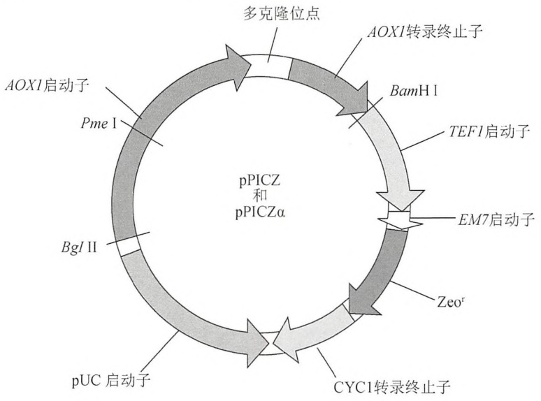
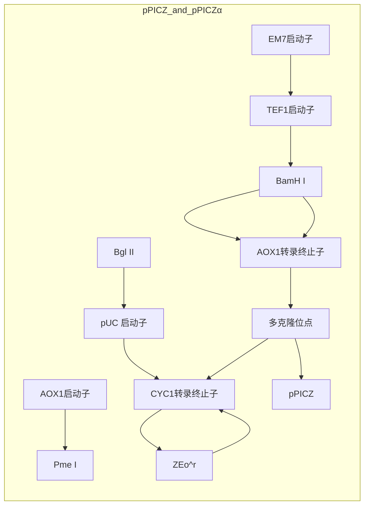
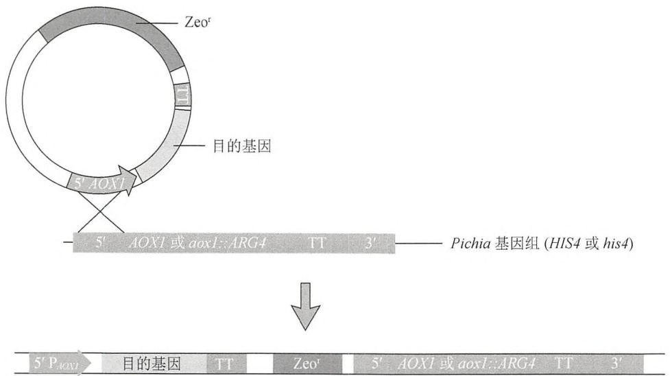
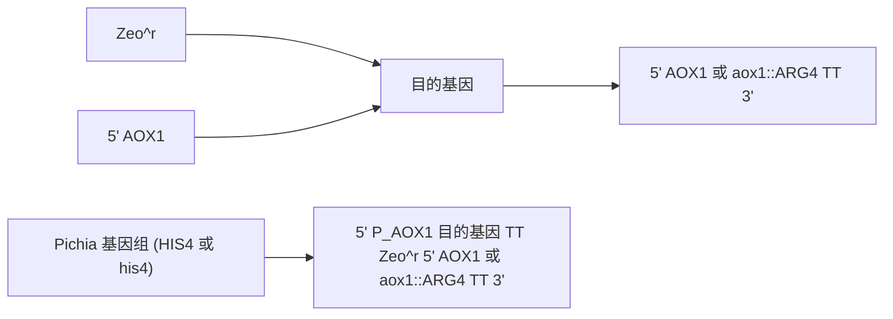

下。细胞应该用适当体积的培养基从冻存的或指数增长期培养物稀释至密度为 $3 \times 10^{5}$ 个细胞/mL。例如，通过添加 $4.5\mathrm{mL}2 \times 10^{6}$ 个细胞/mL 的细胞到含有 $30\mathrm{mL}$ 培养基的 $125\mathrm{mL}$ 摇瓶中（见下段）。达到指数生长期（$1 \times 10^{6} \sim 3 \times 10^{6}$ 个细胞/mL，2\~3天）后，将细胞用新鲜的培养基稀释至 $3 \times 10^{5}$ 个细胞/mL 进行传代培养。在这一阶段，可通过培养体积的扩大，达到蛋白质表达所需的细胞量。在该方法中，最初的 $30\mathrm{mL}$ 培养液传代3次或 $11 \sim 12$ 天后可扩增成1L处于指数生长期的细胞，用于蛋白质的生产。不建议简单地用大量的培养基将细胞稀释到较低的密度，因为细胞会返回到滞后期并且分裂非常缓慢。相反，绝不允许细胞培养过度并进入稳定期（$4 \times 10^{6}$ 个细胞/mL）。每隔3周，细胞培养基应更换，以避免有毒副产品的积聚。在无菌试管中离心培养物 $400\mathrm{g}$、$10\mathrm{min}$，然后轻轻地在适当体积的新鲜培养基中重悬细胞沉淀。重悬浮后，检查这些细胞的完整性和活力。

细胞可传代培养次数不是无限的。多次传代（>40轮传代），细胞产生蛋白质的能力可能退化。谨慎的做法是将扩增培养昆虫细胞的前3～4代冻存大量的小份。然后，当细胞培养传代次数变高以后或是当有污染发生时，可以使用这些冷藏的细胞液接种到新鲜培养中。将健康、指数增长中期的细胞重悬于预冷的冷冻保护培养基（45%的新鲜培养基，45%经0.22μm无菌过滤后的当前培养基，10%DMSO）至细胞密度为 $1\times10^{6}\sim2\times10^{6}$ 个细胞/mL。分装到50mL的冷冻管中（如Corning, no.430656）梯度冷冻，先在4℃下30min，再在-20℃下3～4h，-80℃过夜，然后保存于液氮中。

需要注意的是, 如果从冻结的细胞开始昆虫细胞培养, 先清洗细胞移除 DMSO 溶液, 如下所示:

1. 在  $37^{\circ}$ C 下迅速解冻细胞，并用 10mL 的培养基稀释。
2. 在 400g 离心 10min。
3. 用 5mL 新鲜的培养基重悬细胞。
4. 在接种前，计数和确定细胞的生存能力。


## 疑难解答

一些因素可能造成杆状病毒系统表达蛋白水平较低。杆状病毒在昆虫细胞中表达可能存在的问题和解决方案都在 BaculoGold（BD Biosciences）和 BAC-BAC（Life Technologies）制造商手册里详尽列出。为了提高蛋白质的表达能力，MOI 值和感染时间可以按方案 1 的附加方案“目标蛋白可溶性表达的小量试验”所述方法优化。昆虫细胞系、生长培养基和融合标签的不同也会导致表达水平的差异。在某些情况下，可能出现其他问题，如下所示。

问题:表达盒在病毒多次传代后丢失。

解决方案:用低传代数的病毒种子（P1～P2）。

问题:昆虫细胞在连续培养时可能会失去高效表达外源蛋白的能力。

解决方案:用低传代数的昆虫细胞代替。

问题:外源蛋白可能对昆虫宿主细胞有毒。

解决方案:提早收集感染的细胞。

问题:外源蛋白可被昆虫细胞降解。

解决方案:这可以通过比较 mRNA 与蛋白质表达水平加以区分。

## 参考文献

- Agathos SN. 2007. Development of serum-free media for lepidopteran insect cell lines. Methods Mol Biol 388: 155–186.
- Aumiller JJ, Hollister JR, Jarvis DL. 2003. A transgenic insect cell line engineered to produce CMP-sialic acid and sialylated glycoproteins. Glycobiology 13: 497–507.
- Barry GF. 1988. A broad-host-range shuttle system for gene insertion into the chromosomes of Gram-negative bacteria. Gene 71: 75–84.
- Burand JP, Summers MD, Smith GE. 1980. Transfection with baculovirus DNA. Virology 101: 286–290.
- Davis TR, Wickham TJ, McKenna KA, Granados RR, Shuler ML, Wood HA. 1993. Comparative recombinant protein production of eight insect cell lines. In Vitro Cell Dev Biol Anim 29A: 388–390.
- Dee KU, Shuler ML, Wood HA. 1997. Inducing single-cell suspension of BTI-TN5B1-4 insect cells: I. The use of sulfated polyanions to prevent cell aggregation and enhance recombinant protein production. Biotechnol Bioeng 54: 191–205.
- Dulbecco R. 1952. Production of plaques in monolayer tissue cultures by single particles of an animal virus. Proc Natl Acad Sci 38: 747–752.
- Gardiner GR, Stockdale H. 1975. Two tissue culture media for production of lepidopteran cells and nuclear polyhedrosis virus. J Invertebr Pathol 25: 363–370.
- Grace TD. 1962. Establishment of four strains of cells from insect tissues grown in vitro. Nature 195: 788–789.
- Granados RR, Derksen AC, Dwyer KG. 1986. Replication of the Trichoplusia ni granulosis and nuclear polyhedrosis viruses in cell cultures. Virology 152: 472–476.
- Harwood S. 2007. Small-scale protein production with the baculovirus expression vector system. Methods Mol Biol 388: 211–224.
- Hink WF. 1970. Established insect cell line from the cabbage looper, Tri-choplusia ni Nature 226: 466–467.
- Hitchman RB, Siaterli EA, Nixon CP, King LA. 2007. Quantitative real-time PCR for rapid and accurate titration of recombinant baculovirus particles. Biotechnol Bioeng 96: 810–814.
- Hollister J, Grabenhorst E, Nimtz M, Conradt H, Jarvis DL. 2002. Engineering the protein N-glycosylation pathway in insect cells for production of biantennary, complex N-glycans. Biochemistry 41: 15093–15104.
- Jarvis DL, Kawar ZS, Hollister JR. 1998. Engineering N-glycosylation pathways in the baculovirus-insect cell system. Curr Opin Biotechnol 9:528–533.
- King LA, Hitchman R, Possee RD. 2007. Recombinant baculovirus isolation. Methods Mol Biol 388: 77–94.
- Kitts PA, Green G. 1999. An immunological assay for determination of baculovirus titers in 48 hours. Anal Biochem 268: 173–178.
- Kitts PA, Possee RD. 1993. A method for producing recombinant baculovirus expression vectors at high frequency. BioTechniques 14: 810–817.
- Kwon MS, Dojima T, Toriyama M, Park EY. 2002. Development of an antibody-based assay for determination of baculovirus titers in 10 hours. Biotechnol Prog 18: 647–651.
- Lee HH, Miller LK. 1978. Isolation of genotypic variants of Autographa californica nuclear polyhedrosis virus. J Virol 27: 754–767.
- Luckow VA, Lee SC, Barry GF, Olins PO. 1993. Efficient generation of infectious recombinant baculoviruses by site-specific transposon-mediated insertion of foreign genes into a baculovirus genome propagated in Escherichia coli. J Virol 67: 4566–4579.
- Lynn DE. 2002. Methods for maintaining insect cell cultures. J Insect Sci 2: 9. http://www.ncbi.nlm.nih.gov/pmc/articles/PMC355909/?tool= pubmed.
- Lynn DE. 2007. Available lepidopteran insect cell lines. Methods Mol Biol 388: 117–138.
- O'Reilly DR, Miller LK, Luckow VA. 1994. Baculovirus expression vectors. Oxford University Press, New York.
- Shen CF, Meghrous J, Kamen A. 2002. Quantitation of baculovirus particles by flow cytometry. J Virol Methods 105: 321–330.
- Vaughn JL, Goodwin RH, Tompkins GJ, McCawley P. 1977. The establishment of two cell lines from the insect Spodoptera frugiperda (Lepidoptera; Noctuidae). In Vitro 13: 213–217.
- Wickham TJ, Nemerow GR. 1993. Optimization of growth methods and recombinant protein production in BTI-Tn-5B1-4 insect cells using the baculovirus expression system. Biotechnol Prog 9: 25–30.
- Wickham TJ, Davis T, Granados RR, Shuler ML, Wood HA. 1992. Screening of insect cell lines for the production of recombinant proteins and infectious virus in the baculovirus expression system. Biotechnol Prog 8: 391–396.
- Zhao Y, Chapman DA, Jones IM. 2003. Improving baculovirus recombination. Nucleic Acids Res 31: e66. doi: 10.1093/nar/gng006.

## 方案 3 用甲醇诱导启动子 AOX1 在毕赤酵母中表达克隆基因

在毕赤酵母中用甲醇诱导启动子 AOX1 表达克隆基因。毕赤酵母是一种可以甲醇作为唯一碳源的甲基营养型酵母（Gregg et al. 1985）。用含有甲醇的培养基培养，可广泛诱导醇氧化通路中基因的表达，这些基因的产物包括甲醇氧化酶（AOX）、甲醛脱氢酶（FLD）和二羟基丙酮合酶（DHAS）（Cregg 2007a）。这些蛋白质占生物量的比例高达 30%。研究人员已经利用这些甲醇依赖基因来构建严谨型表达载体（Daly and Hearn 2005）。大多数的毕赤酵母利用严谨型 AOX1 启动子来启动外源蛋白的表达。pPICZ 载体图谱见图 19-5。将外源基因克隆到 AOX1 启动子和 AOX1 转录终止序列之间。这些序列与毕赤酵母基因组中的 AOX1 区域属于同源片段，可在同源重组中将外源基因整合到酵母基因组中（Cregg et al. 1985, 1989）。

获得整合型的毕赤酵母转化体需要比以游离质粒表达基因的酿酒酵母更多的DNA，但是转化子非常稳定，可以保存很多年。染色体上的AOX1区与pPICZ载体上的AOX1启动子或是终止子区发生单交换完成外源基因的插入（图19-6）。这可能导致基因组上AOX1基因的上游或下游被插入单个或多个拷贝的目的基因（Daly and Hearn 2005）。然而，一个依靠 AOX1 启动子上的酶切位点（如 Pme I）处线性化的重组载体会优先插入到基因组的 AOX1 启动子上。随机的多拷贝插入的发生频率是单插入的 1%～10%（Cregg 2007b）。如果要得到基因的多拷贝插入，建议转化时加入大剂量的线性化 DNA（20μg 或更多）。



<details>
<summary>flowchart</summary>


</details>

图 19-5 pPICZ 和 pPICZα 毕赤酵母载体。pPICZ 和 pPICZα 载体带有 AOX1 启动子和转录终止子（TT）序列，用于 Zeocin 抗性的 Sh ble 基因（Streptoalloteichus hindustanus ble 基因）和用于重组蛋白整合的多克隆位点（MCS）。这些载体有 3 种阅读框形式（A、B、C），可以同框与羧基端的 myc 标签融合用于检测，与 His6 标签融合用于纯化（经 Life Technologies 允许复制）



<details>
<summary>flowchart</summary>


</details>

表达框

图 19-6 酵母同源重组原理示意图。通过一次互补区域的同源重组将两侧带有 AOX1 启动子和 AOX1 转录终止子（TT）序列的外源基因插入到毕赤酵母菌株 X-33（AOX1）或 KM71（aox::ARG4）。单一位点的多基因插入的进一步例子参见 EasySelect Pichia Expression Kit 手册（Life Technologies; http://tools.invitrogen.com/content/sfs/manuals/easyselect\_man.pdf）（经 Life Technologies 允许复制）

小贴士:毕赤酵母并不像大肠杆菌一样是个过表达系统，但可以呈现高的细胞密度。一般酵母表达的异源蛋白不能用考马斯亮蓝染色凝胶检测到，它需要更灵敏的方法如Western杂交或功能检测（如果可能的话）。因此，在表达研究的同时或之前，需要研发一系列灵敏的检测方法（Cregg et al. 2009）。如果没有针对目的蛋白的抗体，可以检测 C 端的 myc 标签（pPICZ 载体中有介绍）。抗 myc 标签的抗体在 Western 杂交具有很高的特异性，几乎不会与毕赤酵母菌的固有蛋白发生交叉反应。


## 材料

为正确使用本方案中的器材和危险试剂，必须查阅相应的材料安全数据表并咨询所在机构的环境卫生和安全办公室。

本方案的专用试剂标注&lt;R&gt;，配方在本方案末提供。常用储备溶液、缓冲液和试剂标注&lt;A&gt;，配方见附录1。储备溶液应稀释至适用浓度后使用。

## 试剂

## 琼脂糖凝胶

用于分离 DNA 的琼脂糖凝胶的制备方法详见第 2 章的方案 1 和方案 2。

dNTP 溶液（PCR 等级，pH8.0，含有全部 4 种 dNTP，每种含量为 10mmol/L）

大肠杆菌培养基:

```txt
Zeocin（100mg/mL）（来自 Life Technologies 公司）
低盐 LB 固体培养基（含 25μg/mL Zeocin）<R>
低盐 LB 液体培养基（含 25μg/mL Zeocin）<R>
冰冷的无菌水（1L）
```

可用于转化和质粒扩增的大肠杆菌

TOP10（来自 Life Technologies 公司）、XL1-Blue 或 XL10-Gold（来自 Stratagene 公司）、DH5α（来自 Life Technologies 公司），或者其他任何重组（recA）缺陷和内切核酸酶（endA）缺陷的实验用菌株。

乙醇（70%，100%）

目的基因或 cDNA 片段

甘油

匀浆缓冲液&lt;R&gt;

DNA 分子质量标准

甲醇（0.5%～1%）

$\mathrm{MgCl_{2}(25mmol/L)}$

寡聚核苷酸引物

寡聚核苷酸引物长度应为 20～24 个碱基对，针对目标 DNA 序列，没有潜在的二级结构，含有 10～15 个 G/C 残基。有关 PCR 引物设计的建议请参见第 7 章。

PCR 反应体系混合物（步骤 21）

转化前用限制性内切核酸酶 Pme I、Sac I 或者 BstXI 将质粒 DNA 线性化

含 SDS 的聚丙烯酰胺凝胶（方案 8）

具有所需表型的毕赤酵母菌株（对于不同毕赤酵母宿主的详细介绍请见本章导言的表 19-2）

野生型 X-33 用于 $Mut^{+}$ 表型，KM71H（arg4 aox1::ARG4）用于 $Mut^{-S}$ 表型。

在转入 pPICZ 质粒后，后一种菌株在甲醇培养基上生长缓慢（甲醇利用慢）

（更详细的介绍，请见导言“不同载体产生的菌株和表型”部分。）

pPICZ 或 pPICZα 表达载体（EasySelect 表达试剂盒，来自 Life Technologies 公司）

这些载体含有一个多克隆位点（MCS）和3种不同的阅读框（A、B和C），用于同框克隆目的基因的可读框和羧基端的myc标签。pPICZα系列载体还有含前导肽和原肽的α交配因子信号肽序列，用于引导蛋白分泌到培养

基中。

## 蛋白酶抑制剂

苯甲基磺酰氟化物、抑肽素 A、亮抑蛋白酶肽、胰凝乳蛋白酶抑制剂

对于那些易降解的蛋白质，包括苯甲脒和 E-64。

抑制剂储存液配制方法:10mg/mL 亮抑蛋白酶肽溶于水，10mg/mL 胃酶抑素 A 溶于无水 DMSO, 2.5mg/mL 胰凝乳蛋白酶抑制剂溶于无水 DMSO, 1mol/L 苯甲基磺酰氟化物溶于无水 DMSO 中，2.5mg/mL E-64 溶于水中。储存液用前进行 1000 倍稀释。苯甲脒先配成 250mmol/L 溶液，用前进行 100 倍稀释。所有的抑制剂都应分装后于 -20℃ 保存，避免反复冻融。

限制性内切核酸酶（Pme I、Sac I、Bst XI）

SDS 样品缓冲液 (5×) &lt;A&gt;

不含二硫苏糖醇(DTT)的  $5 \times$  SDS 样品缓冲液在室温下储存。使用前加入 1mol/L 的 DTT 至终浓度为 100mmol/L。用于菌落 PCR 的 Taq DNA 聚合酶（来自 New England Biolabs 或其他公司）

Taq PCR 缓冲液  $10 \times$  (Taq DNA 聚合酶中附带)

酵母培养基

冰冷的无菌山梨醇（30mL, 1mol/L）

YPD 液体培养基&lt;R&gt;

含  $100 \mu g/mL$ 、 $500 \mu g/mL$  和  $1000 \mu g/mL$  Zeocin 的 YPD 固体培养基&lt;R&gt;

MD 平板&lt;R&gt;

MGY 培养基&lt;R&gt;

MM 培养基&lt;R&gt;

## 仪器

琼脂糖凝胶电泳仪

Beckman JA10、SorvallGS3 或 SLA3000 转子，或类似的用于 500mL 离心管的转子
Beckman JA20、Sorvall SS34 或 SA600 转子，或类似的用于 40～50mL 离心管的转子
无菌粗平布

锥底管（50mL）

无菌培养管（15mL）

电转仪和 0.2cm 无菌电转化杯

Fernbach 摇瓶（3.5L）

摇瓶（3.5L, 1L）

酸洗玻璃珠（42.5～600μm，Sigma-Aldrich, 目录号 6-9268；或 0.5mm 直径，BioSpec, 目录号 11079105）

温箱（28～30℃）

微型振荡仪-8 或 -96（BioSpec）

摇床（28～30℃）

真空浓缩机或冻干机

设定好所需的扩增程序的 PCR 仪

磁力搅拌器，微型振荡仪（BioSpec Products, Cole-Parmer, BioCold Scientific）


## 方法

## 构建含重组基因的毕赤酵母表达质粒

1. 通过 PCR 扩增或酶切的方法获得一段含有 5 端和 3 端具有限制性酶切位点的 DNA

片段，这些酶切位点应与 pPICZ 表达载体上的位点相一致。

pPICZ 表达载体中含有所有表达外源蛋白所需的控制元件。利用 PCR 方法来扩增 cDNA/目的基因，确保其尾部不含有任何额外的成分。用同类载体 pPICZα 载体表达分泌型蛋白。对于 pPICZ 载体，应确保含有一段 Kozak 序列，用于翻译的正确起始（详细情况请参阅本方法中“疑难解答”部分）。

利用PCR方法扩增目的基因构建的载体应经过测序来确保目的基因没有发生突变。

2. 将含有目的基因的 DNA 片段克隆到表达载体上（详见第 3 章的方案 5 和方案 6）。

3. 将重组质粒转入大肠杆菌细胞（详见第 3 章的方案 1 和方案 2）。将转化后的细胞涂布到含 25mg/mL Zeocin 的低盐 LB 平板上，置于 37℃ 孵育过夜。

作为对照，同样条件下转化一个完整的pPICZ载体（阳性）和一个线性化的pPICZ载体（阴性）。为了保持Zeocin的活性，平板必须保证低盐（<90mmol/L），而 $\mathrm{pH}$ 则必须为7.5。高盐的LB平板由于Zeocin功能被抑制而失去筛选作用。

4. 少量制备重组质粒，经酶切或直接测序（详见第11章）鉴定重组质粒是否正确。

5. 小量制备所选质粒（$50\sim 100\mu \mathrm{g}$）用于可读框（ORF）的全长测序和毕赤酵母转化。记得要保存阳性克隆的甘油菌。

## 制备用于毕赤酵母转化的表达质粒 DNA

6. 用一种可在 pPICZ 载体的 AOX1 启动子区域切开，而目的基因上没有位点的限制酶（Pme I、Sac I 或 BstXI）线性化 5～20μg 质粒 DNA。

如果希望实现目的基因的多拷贝，可以适量增加线性化的 DNA 含量（达到或超过  $20 \mu g$ ）。

7. 用 $1 / 10$ 体积的 $3\mathrm{mol} / \mathrm{L}$ 乙酸钠和3倍体积的无水乙醇沉淀线性化的质粒。用 $70\%$ 乙醇洗两次以除去其中的盐，晾干，少量水（约 $30\mu \mathrm{L}$ ）重悬沉淀。取少量线性化质粒用琼脂糖凝胶电泳鉴定其线性化的效果。如果有真空离心蒸发浓缩器或冻干机，将DNA溶液浓缩至 $10\mu \mathrm{L}$ 。

## 表达质粒电转化毕赤酵母菌

这一部分取自 Life Technologies 公司的酵母菌蛋白表达操作手册，其公司网址为 http://tools.invitrogen.com/content/sfs/manuals/easysele。

电转化是目前在毕赤酵母中经常使用的转化方法，可以筛选出含有目的基因多拷贝克隆的重组酵母菌株。多拷贝发生的频率为 $1\% \sim 10\%$ 不等，因此筛选大量的菌株才能筛选出一个含有所需目的基因拷贝数的菌株。传统的方法是利用原生质体法来转化毕赤酵母，但这一方法并不适合用Zeocin直接筛选，因为细胞壁的损伤会让一些潜在的阳性克隆在表达Zeocin抗性基因之前已经死亡。如果没有条件做电转化，另外一个方便快捷的选择是化学转化法，然而这个方法的转化效率很低（$3\mu \mathrm{g}$ 质粒产生约50个克隆），难以得到多拷贝整合体。因为电转化方法易于筛选多拷贝整合体，本方案推荐使用该方法。

8. 在 YPD 平板上用划线法分离毕赤酵母菌（KH71 或 X-33）单克隆，28～30℃温箱培养 2 天。
9. 接种一个单克隆至一个装有 10mL YPD 培养基的 50mL 三角瓶中，30℃过夜培养至  $OD_{600}$  约为 2。再将 0.1～0.5mL 菌液接种到含有 500mL YPD 培养基的 3.5L 摇瓶中，培养过夜至  $OD_{600}$  值为 1.3～1.5（在 YPD 培养基中酵母菌的倍增时间约为 90min，1 个  $OD_{600}$  单位相当于中约含  $5 \times 10^{7}$  个细胞）。
10. 将菌液转移至无菌的离心瓶中，$4^{\circ}\mathrm{C} 1500\mathrm{g}$ 离心 $10\mathrm{min}$ 。用 $500\mathrm{mL}$ 预冷的无菌水重悬菌体。

11. 按步骤 10 离心细胞，用 250mL 预冷的无菌水重悬菌体。

12. 按步骤 10 离心细胞，用 20mL 预冷的无菌 1mol/L 山梨醇重悬菌体。

13. 按步骤 10 离心细胞，用 0.5mL 预冷的 1mol/L 山梨醇重悬菌体至终体积为 1.5mL。将细胞置于冰上用于电转化，当天使用，不要存放。

14. 每个转化，取  $80 \mu L$  步骤 13 制备的细胞与溶于  $5 \sim 10 \mu L$  无菌水的  $5 \sim 10 \mu g$  线性化 DNA（步骤 7 制备）在微量离心管中混匀，置冰上 5 min，将混合物转移到一个冰冷的 0.2 cm 电转杯中。

15. 按照厂家建议的毕赤酵母方法电穿孔细胞（如用 Bio-Rad Gene Pulser，2000V，25μF，200Ω），立即向电转杯中加入 1mL 冰冷的 1mol/L 山梨醇，并小心地将混合物转移至 15mL 培养管中。

16. 将离心管放在  $30^{\circ}$ C 温箱孵育 1～2h，不要摇动。加入 1mL YPD 培养基后，在  $30^{\circ}$ C、250r/min 的摇床中孵育 3～6h。

17. 分别涂布  $25 \mu L$ 、 $50 \mu L$ 、 $100 \mu L$  和  $200 \mu L$  步骤 16 制备的细胞到含  $100 \mu g/mL$  Zeocin 的 YPDS 平板上。

低密度铺板有利于 Zeocin 的有效筛选。为了简化筛选含有多拷贝目的基因的克隆，也可以将  $100 \mu L$  细胞涂布在含  $100 \mu g/mL$  Zeocin 的 YPDS 平板上，然后将剩下的细胞 1500g 离心 5min 后弃去上清，用  $200 \mu L$  的 1mol/L 山梨醇重悬菌体，分别涂布  $50 \mu L$  和  $150 \mu L$  到含  $500 \mu g/mL$  和  $1000 \mu g/mL$  Zeocin 的 YPDS 平板上。

18. 将平板放置在  $30^{\circ}$ C 温箱中孵育 3～10 天直到有单克隆长出来。挑取 10～20 个单克隆在新的含  $100\mu g/mL$  Zeocin 的 YPD 或 YPDS 平板上纯化（划线分离）。确保每种克隆都要挑，尤其是大的，通常它们的蛋白质表达量最高。

## PCR 鉴定毕赤酵母重组体

无须将酵母中的 DNA 提取出来做 PCR 鉴定。通常情况下，单克隆的少量细胞可以直接作为 PCR 反应的模板。“菌落 PCR”是一种简单方便的预筛选单克隆（酵母菌）中外源基因的方法。但是，PCR 结果只显示目的基因是否存在，并不能提供蛋白质表达的情况。建议用 Western 杂交分析细胞裂解物或细胞组分，检测不同菌株的相对表达水平（详细介绍请见下一部分）。

19. 对于引物的设计，上游引物可以选择位于 AOX1 启动子的引物（如 5'AOX1 引物，Life Technologies 公司），下游引物则可以是目的基因上的一个片段，使得 PCR 反应的终产物大小为 300～500bp 即可。引物的复性温度最好是在 55～60℃。

20. 在 PCR 小管中加入  $10 \mu L$  的无菌水。用一根灭过菌的牙签挑取一个单克隆，在  $10 \mu L$  的水中使细胞分散。再将这根牙签在一块新的预标记的 MD 平板上轻蘸一下，以保存这一株单克隆。将 MD 平板放置在  $30^{\circ} C$  孵育两天或者直到克隆长出来。

不要加入太多的酵母菌体作为 PCR 的模板，因为细胞壁的一些成分会阻碍 PCR 反应。

对于任何的 PCR 鉴定反应来说，适当的阴性对照是必不可少的，如完全不含任何酵母成分或者是含野生型酵母（不含目的基因）的阴性对照反应。阳性对照则含野生酵母，并含有目的基因用作酵母菌转化和/或重构反应的 10～100pg 质粒 DNA。

21. 准备好一份  $2 \times$  的 PCR 反应混合物，包含 PCR 缓冲液、 $MgCl_{2}$ 、dNTP、引物以及 DNA 聚合酶，具体参照公司提供的方法。例如，一份典型的 Taq 聚合酶的配方包括:

| Taq 聚合酶缓冲液(10×) | 2μL |
| --- | --- |
| $MgCl_2$(2.5mmol/L) | 1.2μL |
| dNTP(10mmol/L) | 0.4μL |
| 寡聚核苷酸引物 | 每个 10pmol |
| $H_2O$ | 至 9.8μL |
| Taq 聚合酶 | 0.2μL(5U) |

22. 在每个 PCR 小管中加入 $10\mu \mathrm{L}$ PCR 反应体系混合物，然后立刻开始扩增。适宜的循环程序应该如下:

| 循环数 | 变性 | 复性 | 延伸 |
| --- | --- | --- | --- |
| 1 | 95°C,4min |  |  |
| 2~30 | 95°C,30s | 50°C,30s | 72°C,30s |
| 结束 |  |  | 72°C,10min |

时间与温度应根据不同种类的聚合酶、反应体积和循环数变化而改变，欲了解PCR反应的详细介绍，请参见第7章。

23. 利用琼脂糖凝胶电泳和适宜大小的 DNA 分子质量标准来鉴定 PCR 产物的大小。

如果目的基因的扩增条带很淡或很虚，降低复性温度 $5^{\circ}\mathrm{C}$ （计算引物解链温度的方法，请参阅第13章中解链温度的相关内容）。如果阳性对照显示细胞壁对PCR扩增反应有抑制作用，将PCR管中细胞溶液的稀释倍数由2倍增加到5倍后重新做PCR。或者提取酵母菌的基因组后用 $100\sim 200\mathrm{ng}$ 基因组重新做PCR，提取基因组的方法详见第5章的方案15。

## 全菌裂解物和细胞组分的小规模蛋白表达分析

就任何一个表达系统来说，优化诱导前细胞的培养时间和诱导期细胞生长密度是很重要的。尤其是在甲醇诱导情况下，菌体过浓会导致菌体凋亡释放蛋白酶，从而降解目的蛋白。甲醇利用慢型菌株在含甲醇的培养基中的倍增时间约为 $20\mathrm{h}$，诱导最好是从对数生长期的中期（$\mathrm{OD}_{600}$ 为 $3\sim 4$）开始，这样在细胞到达稳定期之前有 $20\mathrm{h}$ 诱导期。甲醇诱导野生型菌株在含甲醇的培养基中的倍增时间约为 $2\mathrm{h}$，因此诱导开始时的细胞密度应调整到与诱导时间（$4\sim 20\mathrm{h}$）相适应，以确保诱导期间细胞一直处于对数生长中期。

下面所介绍的小规模表达蛋白的条件可能无法完美适用于所有的目的蛋白。因此，确定一个能适当表达某种目的蛋白的菌株后，在进行中等规模的表达前都要优化菌体的培养条件。在本方案末尾的优化蛋白表达的部分会进一步探讨这方面的内容。

24. 从含有 Zeocin 的 MD 或 YPD 平板上挑取一个克隆（来源于步骤 18 或步骤 20）接种到一个装有 10mL MGY 培养基的 50mL 螺旋盖灭菌管中。确保将整个克隆都挑起来以便接种足够量的菌种。拧松盖子以便通气。在 28～30℃，250r/min 的摇床中培养过夜至  $OD_{600}$  为 2～4（适用于甲醇利用慢型菌株）。

10mL 培养物通常足够可以用来比较每个菌株的表达水平了，而且可以一组处理 10～20 个菌株。如果可能，在实验设置一个阴性对照（只转入了 pPICZ 空载体）和一个阳性对照，阳性对照菌中含有相同抗体表位的基因以便后续的 Western 杂交检测（见下文）。这些对照菌必须与样品进行同样的培养、诱导和处理。

25. 取  $700 \mu L$  培养物以甘油菌种的形式保存，供以后使用（甘油菌种的制备方法，见附加方案“酵母培养物的冻存”。将剩下的菌体在室温条件下以 1250g 离心 10min。弃去上清，用 10mL 含 0.5%～1% 的甲醇的 MM 培养基重悬沉淀。在 28～30℃，250r/min 的摇床中至少诱导 4～16h。

毕赤酵母高效表达蛋白的一个重要条件是甲醇诱导时良好的通气条件。一般情况下，诱导时的培养基的量以占摇瓶体积的 $10\% \sim 20\%$ 为佳。强烈建议将菌管倾斜，盖子拧松以获得良好的通气，盖子可用一小片胶带固定住。

26. 室温条件下，将菌液以 1250g 离心 10min。如果目的蛋白是分泌型的（由 pPICZα 载体表达），保留上清液进行步骤 29 操作。对于胞内目的蛋白，弃去上清，用 0.5mL 的匀浆缓冲液重悬菌体并将其转移到微量离心管中。该菌体可以在本步骤-70℃保存。

27. 在微型离心管中将细胞离心 $10\sim 15\mathrm{s}$，用加入了蛋白酶抑制剂的新制 $350\mu \mathrm{L}$ 匀浆缓冲液重悬菌体，涡旋振荡混匀。加入约 $150\mu \mathrm{L}$ 酸洗玻璃珠（直径 $425\sim 600\mu \mathrm{m}$ 或 $0.5\mathrm{mm}$），每个样品以最大速度涡旋振荡 $1\mathrm{min}$，重复6次，每两次涡旋振荡中间冰浴 $2\mathrm{min}$ 以防蛋白质降解。

一个小型的珠磨式组织匀浆器（如迷你珠磨式组织匀浆器-8或迷你珠磨式组织匀浆器-96，BioSpec公司）可以一次性处理多个样品。后一种机型配备有一个可在-20℃预冷的铝制支架，可以一次性振荡45个小离心管。用含有蛋白酶抑制剂的500μL匀浆缓冲液重悬，加入约500μL酸洗玻璃珠后细胞振荡2～3min，确保样品低温（在10℃以下），但不要冻结。

在对细胞进行处理时应加入蛋白酶抑制剂防止细胞内的丝氨酸蛋白酶（用苯甲基磺酰氟化物 PMSF、亮抑蛋白酶肽和苯甲脒）、半胱氨酸蛋白酶（PMSF、E-64）、天冬氨酸蛋白酶（胃酶抑素 A）、金属蛋白酶（EDTA、EGTA）和糜蛋白酶等（胰凝乳蛋白酶抑制剂）水解目的蛋白。酵母细胞处理常用的蛋白酶抑制剂包括苯甲基磺酰氟化物、胃酶抑素 A、亮抑蛋白酶肽和胰凝乳蛋白酶抑制剂。对于易降解的蛋白质，还应额外添加苯甲脒和 E-64。蛋白酶抑制剂的储备液的配制方法如下:10mg/mL 亮抑蛋白酶肽溶于水，10mg/mL 胃酶抑素 A 溶于无水 DMSO，2.5mg/mL 胰凝乳蛋白酶抑制剂溶于无水 DMSO，1mol/L 苯甲基磺酰氟化物溶于无水 DMSO 中，2.5mg/mL E-64 溶于水中。储存液用前进行 1000 倍稀释。苯甲脒先配成 250mmol/L 水溶液，用前进行 100 倍稀释。所有的抑制剂都应分装后-20℃保存，避免反复冻融。

28. 用低温小型离心机 $4^{\circ} \mathrm{C} 3500 \mathrm{~g}$ 离心 $5 \mathrm{~min}$, 沉淀未破碎的细胞、细胞核和核膜。继续在 $4^{\circ} \mathrm{C}$ 环境下以最大转速（$14000 \mathrm{~g}$）离心 $5 \mathrm{~min}$ 来分离线粒体和其他的一些细胞器。将上清液转移至一个新的放置在冰上的微量离心管中。上清中包含胞质蛋白和一些小的膜囊泡，因而呈混浊状。

29. 用 Bradford 法分析 $2 \sim 5 \mu \mathrm{L}$ 样品的蛋白质含量（详见方案 10）。将 $40 \mu \mathrm{g}$ 上清（约 $20 \mu \mathrm{L}$）与 $5 \sim 10 \mu \mathrm{L} 5 \times$ 的 SDS 上样缓冲液混合（最好是用平常用量 2 倍的样缓冲）。用 SDS-PAGE 分离后进行 Western 杂交（SDS-PAGE 电泳和 Western 杂交的详细情况请见方案 8 和方案 9）。在每块 SDS-PAGE 胶上，点一个蛋白质分子质量标准，一个阴性对照来评估抗体与酵母中其他蛋白交叉反应的情况，还有一个阳性对照来比较表达水平。最好有一个用其他体系表达的目的蛋白，用来比较目的蛋白的分子质量、翻译后的修饰情况和表达水平。

对于可溶的蛋白质来说，用 14 000g 离心得到的上清足够用来做 Western 杂交分析。对于丰度较低的膜蛋白，含有 ER、高尔基体和质膜囊泡的微粒体膜组分（来自步骤 28）（McNamee 1989）等可以用 150 000g 超速离心（如用 TLA-100 台式超速离心机）30min 沉淀。用 30μL 含有新鲜蛋白酶抑制剂的匀浆缓冲液重悬沉淀，然后用 Bradford 法分析 2～5μL 样品的蛋白浓度。所获得的目的蛋白为 50～200μg，蛋白质的产量主要由特定培养物中细胞的浓度决定（OD$_{600}$ 值 4～6）。用作 Western 杂交的 SDS-PAGE 电泳，每个泳道加入 15～30μg。注意，膜蛋白不能在 SDS-PAGE 上样缓冲液中煮沸，而应在加样之前将膜蛋白样品与 SDS-PAGE 上样缓冲液混匀后在室温（或 37℃）孵育 5～10min（Lerner-Marmarosh et al. 1999）。

## 中等规模表达目的蛋白

中等规模（1L）的摇瓶培养通常能提供足够的材料用于目的蛋白的纯化及其初步生化分析。大规模生产一般在严格控制反应环境的发酵罐中进行。毕赤酵母在发酵罐中可以达到很高的密度（200～400g/L），为下游分析如蛋白晶体学分析提供充足的材料，即使是低丰度的膜蛋白也可以（Parcej and Eckhardt-Strelau 2003; Long et al. 2005; Aller et al. 2009）。毕赤酵母发酵指南由 Life Technologies 公司提供（http://tools.invitrogen.com/content/sfs/manuals/pichiaferm\_prot.pdf）。关于不同种类酵母（甲醇利用慢型与甲醇利用野生型）的发酵细节需查阅其他资料（Lerner-Marmarosh et al. 1999; Plantz et al. 2006; Zhang et al. 2007b）。与小规模表达试验一样，优选机械剪切法裂解酵母细胞，常在 BeadBeater 中用玻璃珠或用其他匀浆器破碎。关于用于蛋白纯化的酵母菌中等规模破碎方法详细步骤请参见方案 4。

30. 为了中等规模表达产物和纯化目的蛋白，挑取一个克隆接种到 10mL 培养基中作为初级种子，详见步骤 24。
31. 将 10mL 菌液全部接种至含有 1L MGY 培养基的 3.5L 带有挡板的 Fernbach 摇瓶中，在  $30^{\circ}$ C、250r/min 摇床中培养过夜（16～20h）至  $OD_{600}$  为 2～4。酵母菌在 MGY 培养基中的倍增时间约为 3h。

32. 将菌液转移至 500mL 已灭菌的离心瓶中，室温，3000g 离心 10min。小心弃去上清。用 1L 含 0.5%～1%甲醇的 MM 培养基重悬菌体，并将其重新放入 Fernbach 摇瓶中。为了更好的通气用两层无菌干酪包布盖住瓶口，并用橡胶筋固定。28℃、250r/min 条件下诱导 4～16h。

33. 收取细胞时，将菌液转移至预先称重的 500mL 离心管中，4℃、3000g 离心 10min。如果目的蛋白是分泌型的，收取上清液用于蛋白质纯化。

如果目的蛋白是胞内蛋白，小心地弃去上清，控干，称离心瓶的总质量来确定每个沉淀的菌体湿重。一般的产出量为每升菌液 10～12g 湿菌。用匀浆缓冲液重悬菌体使终浓度至少为每克细胞 2mL。细胞悬液可在这一步-70℃ 冻存，也可以裂解菌体用于蛋白纯化，详见方案 4。


## 疑难解答

根据目前的数据，通常情况下，毕赤酵母表达系统表达某一蛋白质的可能性为 50%～75%。很少有蛋白质的表达量相当高（10g/L），很多的表达量为中等（≥1g/L）（Cregg et al. 2000; Boettner et al. 2007）。考虑到酵母高密度发酵的方便性，中等或低表达（如膜蛋白）也可以为下游应用，如进行生物化学、生理和生物物理研究提供充足的原材料（Parcej and Eckhardt-Strelau 2003; Long et al. 2005; Aller et al. 2009）（参见“膜蛋白纯化的策略”信息栏）。Boettner 等比较分析了 79 种人源基因的表达。

在任何表达水平上获得蛋白质的初步表达是最大的障碍。蛋白质一旦获得表达，就可以优化一系列的参数来获得更大量的表达，甚至获得“头彩”菌株。优化这些参数的方法已列在下面。更多的问题请查阅 Life Technologies 公司提供的酵母表达手册（http://www.invitrogen.com）。

## 胞内表达蛋白还是分泌表达蛋白

外源蛋白在毕赤酵母中可以胞内蛋白或分泌蛋白的形式表达。一般情况下，在原宿主中是胞内蛋白的，在毕赤酵母中首选的是以胞内蛋白形式表达，反之亦然。一些例子表明胞内蛋白也可以利用酵母菌分泌表达，但很少（Cregg 2007a）。

胞内表达时（如 pPICZ 载体），必须含有一段类 Kozak 序列以有效起始翻译。例如，AAAAGAATGG 就是一个类 Kozak 序列，其中 ATG 对应 ORF 的起始 ATG，-3 和 +1 位置对高水平翻译很重要。具有信号肽的载体（如 pPICZα）通常带有 Kozak 序列。

分泌蛋白的氨基末端必须含有一个信号肽，以使其定位到分泌途径中。这个分泌信号肽可以是目的蛋白自身的信号肽（如果该蛋白质本身有信号肽），也可以由特定的载体提供（最常用的是 pPICZα 及 pPINKα 载体中含有的酿酒酵母交配因子 α 的前肽-原肽信号）。毕赤酵母分泌自身蛋白很少（Mattanovich et al. 2009），因此培养上清中的蛋白质主要为目的蛋白，这一特点非常有利于目的蛋白的加工和纯化。

问题:如果培养基可变为酸性，即使是裂解释放的少量胞内蛋白酶，也可能大量降解分泌型蛋白。

解决方案:在培养基中加入缓冲系统（见 pH 优化方法），培养基中加入蛋白酶抑制剂或 1% 酪蛋白氨基酸，或使用蛋白酶缺陷型菌（详见导言中的表 19-2）可能解决这个问题。

## 基因拷贝数

提高基因拷贝数通常会增加目的蛋白的表达量。

问题:有些情况下，高拷贝数的基因对蛋白质的表达具有消极影响。

解决方案:第一次用毕赤酵母表达某一种特定蛋白时可以同时筛选含有低拷贝数、中等拷贝数和高拷贝数目的基因工程菌（Inan et al. 2007）。这可以通过将转化子涂布在不同选择压力的 Zeocin 平板上筛选获得，详见步骤 17。

## 功能蛋白构象

某一特定蛋白在酵母菌中的折叠和成熟通常但不总是与其在天然宿主菌中的相一致。

问题:目的蛋白可以在毕赤酵母中表达出来，但折叠错误。

解决方案:在培养基中添加特定的配体，组氨酸或 DMSO 有时会促进表达具有正确构象的功能性蛋白（Andre et al. 2006）。

共表达分子伴侣可以促进某些蛋白质的分泌（Inan et al. 2006; Damasceno et al. 2007），也可以促进难于表达的细胞内蛋白的折叠和加工。

## 密码子优化

分析酵母菌中高效表达的基因表明 tRNA 多样性和密码子的选择有很大的关系（Hani and Feldmann 1998; De Schutter et al. 2009），表明密码子的使用偏好性是酵母菌细胞表达外源蛋白的一个限制性因素。不利的 GC 含量或不稳定的 mRNA 也可能导致目的蛋白的无效翻译（Daly and Hearn 2005; Boettner et al. 2007）。

问题:目的蛋白表达太低。

解决方案:毕赤酵母基因的密码子选择表可以在 Kazusa 数据库（http://www.kazusa.or.jp/codon/）或最新公布的毕赤酵母基因组（De Schutter et al. 2009）中查到。要得到目的蛋白的超高表达，可以按照 Bai 等提出的毕赤酵母高频基因表达表优化目的基因的密码子。调整目的基因序列以去除潜在的 mRNA 剪切位点、mRNA 二级结构（发夹结构）和可能导致转录终止的富含 A 和 T 的区域。改变基因的 GC 比含量，使其达到约 45%。通过全基因合成可以实现目的基因的全盘优化，尽管有点贵，但是非常便利。很多公司提供这种服务（如 GeneArt, Life Technologies; GenScript, Entelechon 等公司）。完成基因的密码子优化可以增加 3～5 倍的蛋白质表达量，特别是对于长于 3kb 的目的基因效果更佳。


## 讨论

## 在毕赤酵母中优化蛋白表达

诱导时间、$\mathrm{pH}$ 和温度是影响外源蛋白在酵母中的合成、折叠和转运的关键因素，因此对于特定的靶蛋白和宿主菌，需依靠经验对这些条件进行优化。

## pH

对于酵母菌表达系统，pH 是最重要的优化因素。酵母菌在生长达到较高浓度的过程中会酸化培养基，进而活化培养基中的酸性蛋白酶。毕赤酵母中最重要的蛋白酶是 Pep4，该酶是一种酸性蛋白酶，其在 pH 为 4 条件下呈现最大活性。

如果靶蛋白对酸性蛋白酶敏感,则需在甲醇诱导过程中添加含有所需 pH 的 100mmol/L 磷酸盐缓冲液的 MM 培养基（BMM 培养）（对于不同 pH 的 1mol/L 磷酸盐储存液，详细见附录 1，酸碱部分的表 3 和表 4）。

可以通过以下实验获得靶蛋白的 $\mathrm{pH}$ 表达谱:

1. 在含有  $100 \, mL$  MGY 培养基的  $500 \, mL$  摇瓶中接种目的菌，待其长到  $OD_{600}$  值为  $2 \sim 4$ 。
2. 取 10mL 液体培养物置于 50mL 离心管中，在室温下 3000g 离心 10min。
3. 用 $10 \mathrm{~mL}$ 含有 $100 \mathrm{mmol} / \mathrm{L}$ 磷酸盐的 BMM 培养基重悬沉淀, 磷酸盐的 pH 分别为 8、

7、6、5、4 和 3.2（酵母菌在 pH 3 以下不能生长）。

4. 将上述重悬菌液分别在  $28^{\circ}$ C、250r/min 摇床上培养诱导 16h，用 Western 杂交检测其不同的表达量（步骤 26～步骤 29）。

## 温度

改变培养温度可以影响很多重要的细胞内过程，包括中心碳代谢、应激反应和蛋白折叠等。在培养过程中将温度从 $30^{\circ}\mathrm{C}$ 降低到 $22^{\circ}\mathrm{C}$ 甚至 $15^{\circ}\mathrm{C}$ 可以降低酵母菌的生长速度和蛋白质翻译速度，从而有助于新生多肽链的充分折叠和加工。对于难表达的靶蛋白，降低诱导温度是值得研究的。

## 培养时间

表达的靶蛋白可以在甲醇诱导后 0.5～1h 后检测出来，此后表达量会逐渐增加，最终达到一个稳定值，此时表达量和分解量是相同的。很多情况下，在甲醇诱导后 2～3 天，蛋白质表达量达到最大值（Lerner-Marmarosh et al. 1999），此后由于细胞凋亡和蛋白降解作用会导致表达水平下降。

时间-蛋白表达量相关性实验:

1. 在 1L 带有挡板的摇瓶中培养 200\~250mL 酵母菌（步骤 30\~步骤 32）。
2. 在 MM 或 BMM 培养基中用甲醇诱导后的不同时间点，如 1h、2h、4h、8h、16h、24h、72h 分别取样 10mL。

3. 按照步骤 26～步骤 29 处理样品，用 Western 杂交进行分析（方案 9）。

欲了解更多的关于 $Mut^S$ 和 $Mut^+$ 菌株的时间-蛋白表达量的信息，请查阅 Life Technologies 公司的 “EasySelect Pichia Expression Kit” 试剂盒的使用手册第 33 页和第 34 页（http://tools.invitrogen.com/content/sfs/manuals/easyselect\_man.pdf.）。

## 附加方案 酵母培养物的冻存

酵母培养物可以在含有 $15\%$ 的甘油的生长培养基中 $-70^{\circ}\mathrm{C}$ 冻存，本方案介绍了保存物的制备方法。


## 材料

为正确使用本方案中的器材和危险试剂，必须查阅相应的材料安全数据表并咨询所在机构的环境卫生和安全办公室。

本方案的专用试剂标注&lt;R&gt;，配方在本方案末提供。常用储备溶液、缓冲液和试剂标注&lt;A&gt;，配方见附录1。储备溶液应稀释至适用浓度后使用。

## 试剂

甘油（50%，m/m）溶于水

酵母培养物（取自方案3）

## 仪器

冻存管（1mL）

涡旋器

YPD 或 MD 平板（方案 3）


## 方法

1. 在 1mL 冻存管中添加 0.3mL 的 50% 甘油（m/m）水溶液，高温灭菌后拧紧瓶盖。
2. 加入 0.7mL 的酵母菌培养物，然后用涡旋器将混合物混匀。
3. 将冻存管放入-70℃冰箱保存。
4. 在 YPD 或 MD 平板上划线复苏保存的酵母菌。

▲ 如果在-55℃以上保存酵母菌会失去活性。


## 配方

为正确使用本方案中的器材和危险试剂，必须查阅相应的材料安全数据表并咨询所在机构的环境卫生和安全办公室。

匀浆缓冲液

| 试剂 | 质量(1L) | 终浓度 |
| --- | --- | --- |
| 蔗糖 | 113g | 0.33mol/L |
| Tris-Cl(1mol/L,pH8.0) | 300mL | 0.3mol/L |
| EDTA(0.4mol/L,pH8.0) | 2.5mL | 1mmol/L |
| EGTA(0.4mol/L,pH8.0) | 2.5mL | 1mmol/L |
| 二硫苏糖醇(DTT) | 0.31g | 2mmol/L |
| 6-氨基己酸(EACA) | 13.1g | 100mmol/L |

在  $4^{\circ}$ C 条件下至多储存一周，如果储存时间超过一周需要在使用前加入新鲜 DTT。

用 Zeocin 筛选的低盐 LB 培养基

| 试剂 | 每升含量 |
| --- | --- |
| 胰蛋白胨 | 10g |
| 酵母抽提物 | 5g |
| NaCl | 5g |

摇动使溶质完全溶解，然后用 1mol/L 的 NaOH 调溶液的 pH 至 7.5（约需要 0.2mL）；用去离子水定容至 1L；如果制备平板，则需添加 15g/L 琼脂粉。121℃高温灭菌 20min。

▲ 为了使 Zeocin 保持活性，溶液的盐浓度必须低于 90mmol/L，pH 需为 7.5。标准 LB 培养基中的高盐浓度会使平板失去选择功能。含有 Zeocin 的平板可以在避光 4℃ 条件下保存一周。

## 毕赤酵母培养基

配方来自 Life Technologies 公司 EasySelect Pichia Expression Kit 试剂盒手册(http://tools.invitrogen.com/content/sfs/manuals/easyselect\_man.pdf)。

## 储存液

生物素（500×）（0.02%生物素）

| 生物素 | 20 mg |
| --- | --- |
| $H_{2}O$ | 至 100mL |

溶解后过滤除菌，室温存放，可用约1年。

D（10×）（20%葡萄糖）

| D-葡萄糖 | 200g |
| --- | --- |
| $H_{2}O$ | 至 1000mL |

高压 15min 或过滤灭菌，室温存放可用约 1 年。

GY (10×) (10%甘油)

| 甘油 | 100mL |
| --- | --- |
| $H_{2}O$ | 900mL |

高压 15min 或过滤灭菌，室温存放可用 1 年以上。

YNB（10×）（13.4%含硫酸铵，无氨基酸酵母细胞氮源）

| YNB | 134g |
| --- | --- |
| $H_{2}O$ | 至 1000mL |

加热溶解，过滤除菌（也可在 34g 无硫酸铵、无氨基酸的 YNB 中加入 100g 硫酸铵），暗处室温存放可用 1 年。注意，毕赤酵母在较高浓度的 YNB 中生长最适，因此，这里的 YNB 成分是酿酒酵母标准配方的 2 倍。

## 培养基

BMM（buffered minimal methanol）培养基

| 水 | 800mL |
| --- | --- |

加入 100mL 1mol/L 的所需 pH（如 pH3,4,5,6,7 或 8）的磷酸钾缓冲液（详细配方见附录 1），然后 121℃ 高压灭菌 20min，冷却溶液至 60℃ 之后添加:

| YNB (10×) | 100mL |
| --- | --- |
| 生物素 (500×) | 2mL |
| 甲醇 (100%) | 5mL |

不含甲醇的 BMM 溶液可以在避光条件下于室温中保存数月。甲醇应在使用前添加。

欲了解更多关于毕赤酵母菌培养基配方的信息，请查阅 Life Technologies 公司的 EasySelect Pichia Expression Kit 试剂盒的使用手册，其网址为 http://tools.invitrogen.com/content/sfs/manuals/easyselect\_man.pdf。

MD（minimal dextrose）固体培养基

MD 培养基可用于短期保存毕赤酵母菌转化体。

<table><tr><td>琼脂粉</td><td>15g</td></tr><tr><td>水</td><td>800mL</td></tr><tr><td colspan="2">121°C高温灭菌20min,待溶液温度降至60°C以下时,加入以下组分:</td></tr><tr><td>YNB(10×)</td><td>100mL</td></tr><tr><td>葡萄糖(10×)</td><td>100mL</td></tr><tr><td>生物素(500×)</td><td>2mL</td></tr></table>

MD 平板可以在避光条件下于室温中保存数月。

MGY（minimal glycerol）培养基

MGY 为液体培养基。

| 甘油(10×) | 100mL |
| --- | --- |
| 水 | 800mL |

121℃条件下高温灭菌 20min，待溶液温度降至 60℃以下后，加入下列物质:

| YNB (10×) | 100mL |
| --- | --- |
| 生物素(500×) | 2mL |

MGY 培养基可以在避光条件下于室温中保存数月。

MM（minimal methanol）培养基

MM 或 BMM 培养基用于在 MGY 培养基中生长菌进行甲醇诱导。

<table><tr><td>蒸馏水</td><td>900mL</td></tr><tr><td colspan="2">121°C高温灭菌20min,待溶液冷却至60°C以下后加入以下组分:</td></tr><tr><td>YNB(10×)</td><td>100mL</td></tr><tr><td>生物素(500×)</td><td>2mL</td></tr><tr><td>甲醇(100%)</td><td>5mL</td></tr></table>

不含甲醇的 MM 培养基在避光条件下于室温中数月。甲醇须在使用前添加。

YPD（yeast extract peptone dextrose）培养基

YPD 培养基是一种用于培养野生型酵母菌的混合型培养基。

| 酵母提取物 | 10g |
| --- | --- |
| 蛋白胨 | 20g |
| 蒸馏水 | 至900mL |

对于 YPD 固体培养基，则需要加入 20g 琼脂。121℃高温灭菌 20min，待溶液冷却至 60℃以下后加入 100mL 葡萄糖（10×）。培养基可以在室温下保存数月。

YPDS+Zeocin 平板（含 1mol/L 山梨醇和 Zeocin 的 YPD 平板）

电转后，将酵母细胞涂布于含 1mol/L 山梨醇的 YPD 平板上以稳定细胞。

| 酵母菌提取物 | 10g |
| --- | --- |
| 蛋白胨 | 20g |
| 山梨醇 | 182.2g |
| 琼脂粉 | 20g |
| 蒸馏水 | 至900mL |

充分溶解山梨醇，高温灭菌 $20\mathrm{min}$，待溶液冷却至 $60^{\circ}\mathrm{C}$ 以下，加入 $100\mathrm{mL}$ 葡萄糖（$10\times$）。按需要加入 $100\mathrm{mg/mL}$ 的Zeocin储存液至溶液终浓度为 $100\mu \mathrm{g/mL}$、$500\mu \mathrm{g/mL}$ 或 $1000\mu \mathrm{g/mL}$。筛选平板最好现用现配并在避光条件下置于 $4^{\circ}\mathrm{C}$ 条件下保存。不含Zeocin的培养基可以在室温条件下保存数月。

## 参考文献

- Aller SG, Yu J, Ward A, Weng Y, Chittaboina S, Zhuo R, Harrell PM, Trinh YT, Zhang Q, Urbatsch IL, et al. 2009. Structure of P-glycoprotein reveals a molecular basis for poly-specific drug binding. Science 323:1718–1722.
- Andre N, Cherouati N, Prual C, Steffan T, Zeder-Lutz G, Magnin T, Pattus F, Michel H, Wagner R, Reinhart C. 2006. Enhancing functional production of G protein-coupled receptors in Pichia pastoris to levels required for structural studies via a single expression screen. Protein Sci 15: 1115–1126.
- Bai J, Swartz DJ, Protasevich II, Brouillette CG, Harrell PM, Hildebrandt E, Gasser B, Mattanovich D, Ward A, Chang G, et al. 2011. A gene optimization strategy that enhances production of fully functional P-glycoprotein in Pichia pastoris. PLoS One 6: e22577. doi: 10.1371/journal.pone.0022577.
- Boettner M, Steffens C, von Mering C, Bork P, Stahl U, Lang C. 2007. Sequence-based factors influencing the expression of heterologous genes in the yeast Pichia pastoris—A comparative view on 79 human genes. J Biotechnol 130: 1–10.
- Chloupkova M, Pickert A, Lee JY, Souza S, Trinh YT, Connelly SM, Dumont ME, Dean M, Urbatsch IL. 2007. Expression of 25 human
- ABC transporters in the yeast Pichia pastoris and characterization of the purified ABCC3 ATPase activity. Biochemistry 46: 7992–8003.
- Gregg JM. 2007a. Introduction: Distinctions between Pichia pastoris and other expression systems. Methods Mol Biol 389: 1–10.
- Cregg JM. 2007b. DNA-mediated transformation. Methods Mol Biol 389:27–42.
- Gregg JM, Barringer KJ, Hessler AY, Madden KR. 1985. Pichia pastoris as a host system for transformations. Mol Cell Biol 5: 3376–3385.
- Gregg JM, Madden KR, Barringer KJ, Thill GP, Stillman CA. 1989. Functional characterization of the two alcohol oxidase genes from the yeast Pichia pastoris. Mol Cell Biol 9: 1316–1323.
- Gregg JM, Cereghino JL, Shi J, Higgins DR. 2000. Recombinant protein expression in Pichia pastoris. Mol Biotechnol 16: 23–52.
- Cregg JM, Tolstorukov I, Kusari A, Sunga J, Madden K, Chappell T. 2009. Expression in the yeast Pichia pastoris. Methods Enzymol 463: 169–189.
- Daly R, Hearn MT. 2005. Expression of heterologous proteins in Pichia pastoris: A useful experimental tool in protein engineering and production. J Mol Recognit 18: 119–138.
- Damasceno LM, Anderson KA, Ritter G, Gregg JM, Old LJ, Batt CA. 2007. Cooverexpression of chaperones for enhanced secretion of a
- single-chain antibody fragment in Pichia pastoris. Appl Microbiol Biotechnol 74: 381–389.
- De Schutter K, Lin YC, Tiels P, Van Hecke A, Glinka S, Weber-Lehmann J, Rouze P, Van de Peer Y, Callewaert N. 2009. Genome sequence of the recombinant protein production host Pichia pastoris. Nat Biotechnol 27: 561–566.
- Dragosits M, Stadlmann J, Albiol J, Baumann K, Maurer M, Gasser B, Sauer M, Altmann F, Ferrer P, Mattanovich D. 2009. The effect of temperature on the proteome of recombinant Pichia pastoris. J Proteome Res 8: 1380–1392.
- Gietz RD, Schiestl RH. 2007. High-efficiency yeast transformation using the LiAc/SS carrier DNA/PEG method. Nat Protoc 2: 31–34.
- Hani J, Feldmann H. 1998. tRNA genes and retroelements in the yeast genome. Nucleic Acids Res 26: 689–696.
- Inan M, Aryasomayajula D, Sinha J, Meagher MM. 2006. Enhancement of protein secretion in Pichia pastoris by overexpression of protein disulfide isomerase. Biotechnol Bioeng 93: 771–778.
- Inan M, Fanders SA, Zhang W, Hotez PJ, Zhan B, Meagher MM. 2007. Saturation of the secretory pathway by overexpression of a hookworm (Necator americanus) Protein (Na-ASP1). Methods Mol Biol 389: 65–76.
- Kozak M. 1987. At least six nucleotides preceding the AUG initiator codon enhance translation in mammalian cells. J Mol Biol 196: 947–950.
- Lerner-Marmarosh N, Gimi K, Urbatsch IL, Gros P, Senior AE. 1999. Large scale purification of detergent-soluble P-glycoprotein from Pichia
- pastoris cells and characterization of nucleotide binding properties of wild-type, Walker A, and Walker B mutant proteins. J Biol Chem 274: 34711–34718.
- Long SB, Campbell EB, Mackinnon R. 2005. Crystal structure of a mammalian voltage-dependent Shaker family K+ channel. Science 309:897–893.
- Mattanovich D, Graf A, Stadlmann J, Dragosits M, Redl A, Maurer M, Kleinheinz M, Sauer M, Altmann F, Gasser B. 2009. Genome, secretome and glucose transport highlight unique features of the protein production host Pichia pastoris. Microb Cell Fact 8: 29. doi: 10.1186/1475-2859-8-29.
- McNamee MG. 1989. Isolation and characterization of cell membranes. BioTechniques 7: 466–475.
- Parcej DN, Eckhardt-Strelau L. 2003. Structural characterisation of neuronal voltage-sensitive K+ channels heterologously expressed in Pichia pastoris. J Mol Biol 333: 103–116.
- Plantz BA, Sinha J, Villarete L, Nickerson KW, Schlegel VL. 2006. Pichia pastoris fermentation optimization: Energy state and testing a growth-associated model Appl Microbiol Biotechnol 72: 297–305.
- Wellman AM, Stewart GG. 1973. Storage of brewing yeasts by liquid nitrogen refrigeration. Appl Microbiol 26: 577–583.
- Zhang W, Inan M, Meagher MM. 2007. Rational design and optimization of fed-batch and continuous fermentations. Methods Mol Biol 389:43–64.

## 方案 4 用于纯化大肠杆菌中表达可溶性蛋白的细胞提取物的制备

提取和分离目标蛋白前，需要裂解宿主细胞以便回收胞内所有蛋白质。依据需裂解的细胞类型、细胞总量及处理的样品数，细胞裂解的方法有所不同。常用的方法包括但不局限于以下方法:低渗裂解法、溶菌酶裂解法、超声裂解法及微射流（microfluidic）或弗氏细胞破碎器机械破碎法（French press mechanical disruption）（综述见 Grabski 2009）。某些情况下，低渗裂解法就能轻易将细胞裂解，即当细胞暴露于低渗溶液中，它会迅速吸水，从而被渗透压胀破。对于有细胞壁的细胞（如大肠杆菌及酵母），温和的破碎方法如低渗裂解很难达到充分裂解的效果，这时通常需要更强烈的破碎技术如超声或弗氏细胞破碎器。虽然这些强力方法对于细胞壁裂解更为有效，但它们同时也更容易导致目标蛋白因局部受热、机械损伤、氧化反应及自由基反应而受到破坏（Hawkins and Davies 2001; Mason and Peters 2002）。因此，通常有必要针对每种细胞系，优化其裂解方案及蛋白质回收技术，以达到最大限度地提高回收蛋白的活性和总量，同时最大限度地减少操作时间和所需的仪器设备。

本方案将主要介绍大肠杆菌的超声裂解，同时介绍冻融及酶解等替代方案。用于裂解昆虫细胞的超声裂解改进技术及去污剂裂解相关信息将在信息栏“昆虫细胞裂解注意事项”中介绍，而酵母细胞的玻璃珠匀浆化将在附加方案“酵母细胞玻璃珠裂解法”中介绍。

## 蛋白酶抑制剂

PMSF（苯甲基磺酰氟）是一种广泛应用、价格低廉的蛋白酶抑制剂，能够有效抑制丝氨酸蛋白酶和半胱氨酸蛋白酶的活性。PMSF可以溶于无水DMSO（二甲基亚砜）、乙醇或异丙醇中，配制为0.1～1mol/L的储备液；其有效浓度范围为0.1～1mmol/L。然而，PMSF在液体溶液中的半衰期相对较短（pH8条件下约35min），需要经常更新。毒性更低的4-（2-氨乙基）苯磺酰氟盐酸盐（AEBSF，也被称为Pefabloc；Roche公司），经常