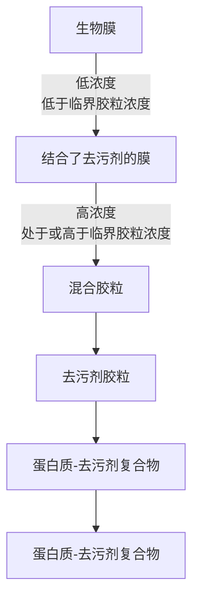
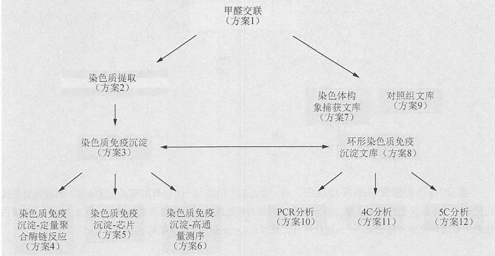
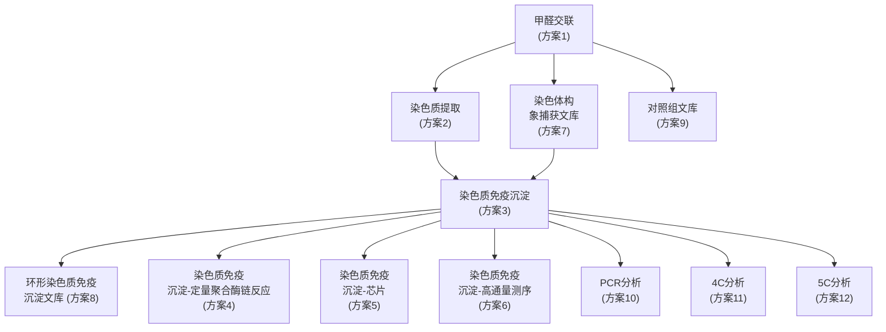
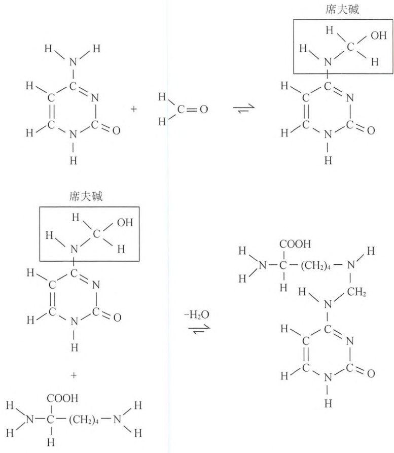
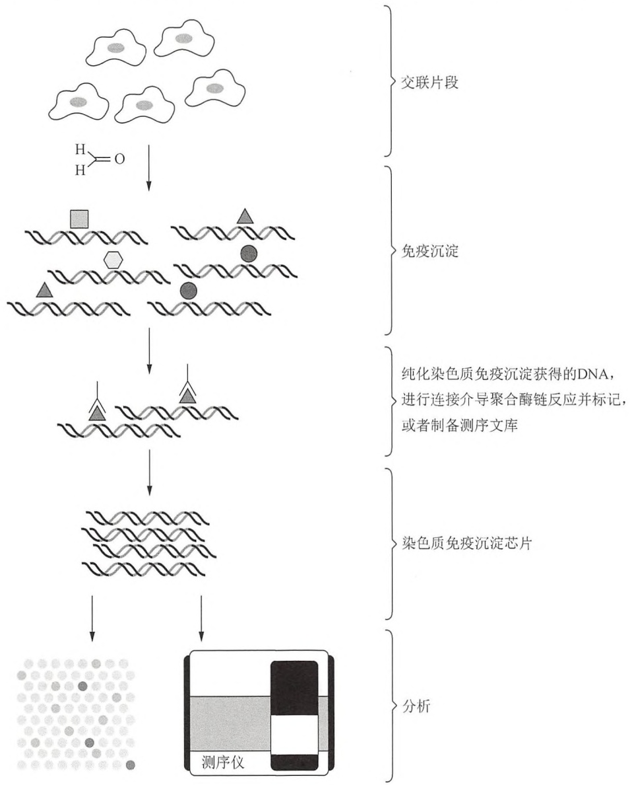
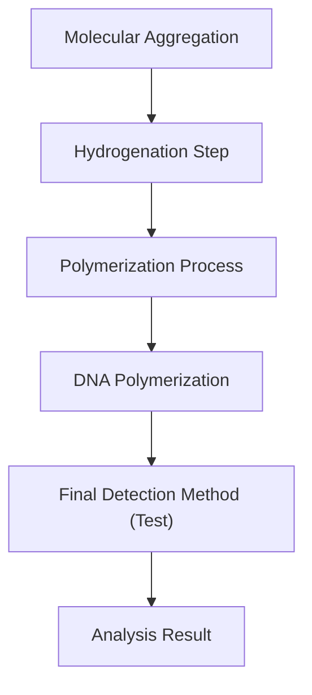
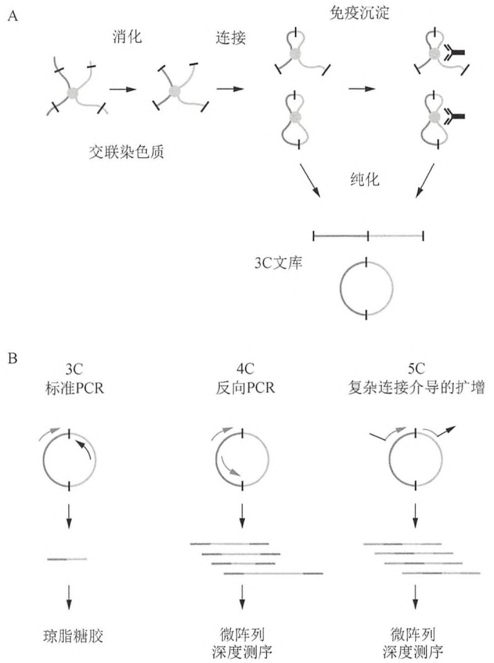
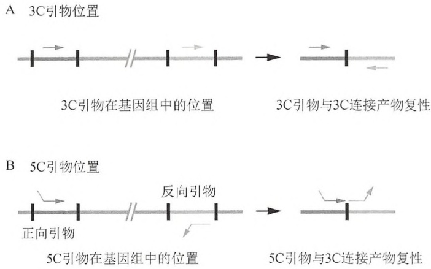
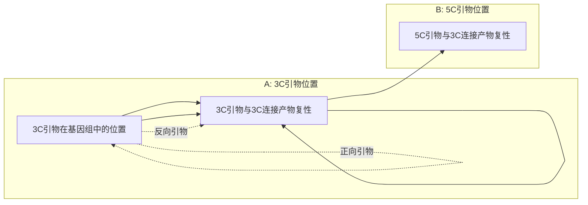

flowchart

图 1 去污剂溶解膜蛋白。（©EMD Chemicals Inc., Merck KGaA 子公司, Darmstadt, Germany. 经许可后转载）（彩图请扫封底二维码）。

## 参考文献

- Clark KM, Fedoriw N, Robinson K, Connelly SM, Randles J, Malkowski MG, Detitta GT, Dumont ME. 2010. Purification of transmembrane proteins from Saccharomyces cerevisiae for X-ray crystallography. Protein Expr Purif 71: 207–223.
- prerequisite for determination of peptide stoichiometry and ATP hydrolysis. J Biol Chem 284: 33740–33749.
- le Maire M, Champeil P, Moller IV. 2000. Interaction of membrane proteins and lipids with solubilizing detergents. Biochim Biophys Acta 1508: 86–111.
- Maloney PC, Ambudkar SV. 1989. Functional reconstitution of prokaryote and eukaryote membrane proteins. Arch Biochem Biophys 269: 1–10.
- Newby ZE, O'Connell JD III, Gruswitz F, Hays FA, Harries WE, Harwood IM, Ho JD, Lee JK, Savage DF, Miercke LJ, et al. 2009. A general protocol for the crystallization of membrane proteins for X-ray structural investigation. Nat Protoc 4: 619–637.
- Prive GG. 2007. Detergents for the stabilization and crystallization of membrane proteins. Methods 41: 388–397.
- Rigaud JL, Levy D. 2003. Reconstitution of membrane proteins into liposomes. Methods Enzymol 372: 65–86.
- Hauser H. 2000. Short-chain phospholipids as detergents. Biochim Biophys Acta 1508: 164–181.
- Herget M, Kreissig N, Kolbe C, Scholz C, Tampe R, Abele R. 2009. Purification and reconstitution of the antigen transport complex TAP: A
- Seddon AM, Curnow P, Booth PJ. 2004. Membrane proteins, lipids and detergents: not just a soap opera. Biochim Biophys Acta 1666; 105–117.
- White SH. 2009. Biophysical dissection of membrane proteins. Nature 459:344–346.
- White MA, Clark KM, Grayhack EJ, Dumont ME. 2007. Characteristics affecting expression and solubilization of yeast membrane proteins. J Mol Biol 365: 621–636.
- Wiener MC. 2004. A pedestrian guide to membrane protein crystallization. Methods 34: 364–372.
- Zhang Q, Ma X, Ward A, Hong WX, Jaakola VP, Stevens RC, Finn MG, Chang G. 2007. Designing facial amphiphiles for the stabilization of integral membrane proteins. Angew Chem Int Ed Engl 46: 7023-7025.

## 历史注脚:考马斯亮蓝

考马斯亮蓝 R-250 首次被用作实验室蛋白质染色试剂是在 1963 年。Robert Webster, 一个在堪培拉澳大利亚国立大学 Stephen Fazekas de St Groth 实验室里的研究生, 正在寻找一种方式, 来定位醋酸纤维素条上已被电泳分离的流感病毒蛋白。当时, 澳大利亚羊毛业正在蓬勃发展, 政府实验室也在集中研究不同类别的羊毛染料作用机制。Fazekas de St Groth 和 Webster 推测, 这些染料一定具有与蛋白质的高亲和力, 随后他们从联邦科学与工业组织 (Commonwealth Scientific and Industrial Organization) 处获得了大量染料样品。其中包括考马斯亮蓝 R-250, 也被称为酸性蓝 83——一种自世纪之交以来已在纺织行业使用的染料。Webster 很快就确定考马斯亮蓝 R-250 可以作为一种高灵敏度的蛋白质染料, 但令他感到沮丧的是, 染色强度存在每天不同的极端变化。一天晚上在家, 他突然意识到, 解决问题的方法是在染色前将蛋白质固定 (“fix”) 在醋酸纤维素条上。他回到实验室, 用磺基水杨酸固定了分离的流感病毒蛋白。这些结果公布后 (Fazekas de St. Groth et al. 1963), 很快就被用于聚丙烯酰胺凝胶分离后的蛋白质染色 (Meyer and Lamberts 1965)。

由于考马斯亮蓝 R-250 是 Imperial Chemical Industries PLC 公司的商标，故此染料一般在生化试剂目录中被标为“亮蓝”。氨基三苯甲烷类（aminotriarylmethane）染料有两种形式可供选择:亮蓝 G 和亮蓝 R[在颜色指数中分别对应不同的数字（42655 和 42660）]。颜色指数可以看成是染料的“圣经”，根据颜色进行染料的分类和排列。亮蓝 G（G 代表“微绿”）和亮蓝 R（R 代表“微红”），分别微溶和不溶于冷水，分别可溶和微溶于热水和醇类。两种染料都能对蛋白质进行有效的染色，虽然 G-250 更灵敏，但 R-250 对比度更好且常用于凝胶中的蛋白质染色（Merril 1990）。最初的配方建议，将浓度为 0.05% 的染料溶于甲醇:乙酸:水（50:10:40，V/V）的溶液中。

## 参考文献

Fazekas de St Groth S, Webster RG, Datyner A. 1963. Two new staining procedures for quantitative estimation of proteins on electrophoretic strips. Biochim Biophys Acta 71: 377–391.
Merril CR. 1990. Gel-staining techniques. Methods Enzymol 182: 477–488.

Meyer TS, Lamberts BL. 1965. Use of Coomassie Brilliant Blue R250 for the electrophoresis of microgram quantities of parotid saliva proteins on acrylamide gel strips. Biochim Biophys Acta 107: 144–145.

(吴军 刘星明 译，王恒樑 校)

## 第 20 章 利用交联技术分析染色质 结构与功能

<table><tr><td rowspan="3">导言</td><td>利用甲醛交联考查基因组相互作用</td><td>1359</td></tr><tr><td>ChIP 分析蛋白质-DNA 相互作用</td><td>1360</td></tr><tr><td>基于 3C 分析染色质相互作用</td><td>1362</td></tr></table>

<table><tr><td rowspan="7">方案</td><td>1 甲醛交联</td><td>1369</td></tr><tr><td>2 制备用于染色质免疫沉淀的交联染色质</td><td>1371</td></tr><tr><td>3 染色质免疫沉淀(ChIP)</td><td>1373</td></tr><tr><td>4 染色质免疫沉淀-定量聚合酶链反应(ChIP-qPCR)</td><td>1377</td></tr><tr><td>5 染色质免疫沉淀-芯片杂交(ChIP-chip)</td><td>1378</td></tr><tr><td>6 染色质免疫沉淀-高通量测序(ChIP-seq)</td><td>1385</td></tr><tr><td>7 交联细胞3C文库的制备</td><td>1389</td></tr></table>

8 环形染色质免疫沉淀（ChIP-loop）
文库的制备 1393
9 连接产物对照组文库的制备 1398
10 PCR 检测 3C、ChIP-loop 和对照文库中的 3C 连接产物:文库滴定与相互作用频率分析 1400
11 3C、ChIP-loop 和对照组文库的 4C 分析 1404
12 3C、ChIP-loop 和对照组文库的 5C 分析 1408

<table><tr><td rowspan="2">信息栏</td><td>甲醛</td><td>1412</td></tr><tr><td>基于3C的实验捕获的是什么?</td><td>1413</td></tr></table>

## 导言

本章将介绍两种利用甲醛交联来研究基因组结构和功能的分子生物学方法:染色质免疫沉淀（ChIP）和染色体构象捕获（3C）（图20-1）。通过这些方法，可以研究组蛋白修饰（如乙酰化、甲基化）的分布、组蛋白变异体（如H2AZ、H3.3）的沉积、序列特异性转录因子和通用转录因子的结合位点，以及远距离功能性基因组位点的空间相对距离等（通过形成环形结构）。第一部分描述了使用广泛的基于ChIP的方法，分析活细胞中的蛋白质-DNA相互作用。第二部分则描述了利用基于3C的技术，考查细胞内染色体折叠以及远距离的基因组序列相互作用。

flowchart

图 20-1 ChIP 和 3C 方案框架。这里展示了本章所介绍的 12 个方案之间的联系。方案 3 和方案 8 之间的水平箭头表明这些方案是紧密相连的。

## 利用甲醛交联考查基因组相互作用

自 1960 年以来，作为一种化学探针，甲醛交联广泛应用于研究蛋白质-蛋白质以及蛋白质-DNA 的体内外相互作用。甲醛介导的蛋白质与底物 DNA 之间的交联包括两步反应（图 20-2）。首先，甲醛与 DNA 或者蛋白质中游离氨基反应生成席夫碱（Schiff's base），然后席夫碱与另一个游离氨基反应，从而在 DNA 与蛋白质之间形成共价键。甲醛作为一种重要的交联剂，广泛应用于基因组局部区域或全基因组范围的染色质组成（基于 ChIP 方法）及染色质高级结构（基于 3C 方法）的研究。

实现最佳交联是 ChIP 和 3C 实验的关键。样品交联不充分将产生假阴性，而交联过度将产生不溶的染色质，导致无法进一步分析。对于 ChIP 和 3C，活细胞通常暴露在 1% 的甲醛溶液中。除了甲醛浓度，交联时间和温度也可以根据实际情况调整，以达到最佳核内交联状态。调整交联时间和温度能够优化目的蛋白与其底物（ChIP 分析）以及两个远距离基因组位点间（3C 分析）的交联效率。不太稳定的相互作用可以通过 4℃ 的较长时间（30 min 或更久）交联或者 37℃ 下的交联来增加反应的特异性。对于固定组织和器官，一定要确保组织在甲醛交联前被充分解离，以便甲醛高效且充分地扩散。

反应I

反应Ⅱ

图 20-2 甲醛交联的两步反应。第一步反应，甲醛与一个核苷酸碱基（胞嘧啶）的游离氨基反应生成一个不稳定的席夫碱。第二步反应，席夫碱与赖氨酸残基上的游离氨基反应，从而在 DNA 和蛋白质之间形成共价键（经 Elsevier 出版社许可，修改自 Orlando 等 1997 年的出版物）。

## ChIP 分析蛋白质-DNA 相互作用

ChIP 最早由 David Gilmour 和 John Lis 于 1984 年建立,他们利用紫外线交联研究 RNA 聚合酶在细菌基因上的体内结合情况（Gilmour and Lis 1984）。第二年，Mark Solomon 和 Alexander Varshavsky 利用甲醛交联，探查染色质的体内结构（Solomon and Varshavsky 1985）。这两篇报道的不同之处就在于交联剂的选择。尽管紫外线作为交联剂的使用比甲醛的使用更为广泛，但紫外线介导的蛋白质-DNA 交联是不可逆的，而甲醛交联在温和加热条件下即可解离（Solomon and Varshavsky 1985）。这样由甲醛交联染色体得到的 DNA 更易于进行后续的分子生物学检测，因此甲醛成为 ChIP 和 3C 的首选交联剂。

ChIP 的基本步骤包括活细胞的甲醛处理，目的是在细胞内将蛋白质与其底物 DNA 固定。随后通过物理剪切或者酶消化，蛋白质-DNA 复合物被提取和片段化。利用针对蛋白质的特异性抗体，通过免疫亲和纯化分离获得与特定蛋白质复合物结合的特异 DNA 序列（图 20-3）。纯化得到 DNA 后，通过一系列分子生物学技术如 Southern 印迹法（Orlando and Paro 1993）（第 2 章，方案 11 和方案 12），或聚合酶链反应（PCR，见第 7 章）等的分析，最终确定特定 DNA 序列与目的蛋白之间的相关性（Hecht et al. 1996）。

2000 年，有两个小组使用了一种基于 DNA 微阵列的新技术，可以在上百万个碱基对序列中检测蛋白质-DNA 相互作用的位点(ChIP-chip, 又称为 ChIP-on-chip)(Ren et al. 2000; Iyer et al. 2001)。覆盖全部人类基因组序列的高密度寡核苷酸阵列的商业化，促进了利用

ChIP-chip 技术进行蛋白质-DNA 相互作用位点的系统检测（图 20-3）（Kim et al. 2005b）。利用基因表达系列分析技术（SAGE）（Velculescu et al. 1995）来研究 ChIP DNA（Roh et al. 2004; Wei et al. 2006），进一步扩展了这种全基因组范围研究蛋白质-DNA 相互作用的方法。随后，高通量测序技术的进步（ChIP-seq）（Johnson et al. 2007; Mikkelsen et al. 2007）为基于 ChIP 的基因调控和表观基因组学研究揭开了新的篇章。ChIP DNA 的直接测序，更使得人们可以对占基因组相当大比例的重复元件进行直接考查，这是 DNA 微阵列技术难以做到的。虽然相关检测方法已有很大改变，但核心的交联及免疫沉淀步骤始终未变。

flowchart

图 20-3 ChIP-chip 和 ChIP-seq 方法框架图。首先对细胞进行甲醛交联，再提取交联后的细胞核，并使用超声将其破碎成可溶的染色质。接下来进行染色质免疫沉淀，对得到的纯化后 DNA 进行 DNA 微阵列杂交（ChIP-chip）或者直接测序（ChIP-seq），详细内容见正文（经 Cold Spring Harbor Laboratory 出版社许可，修改自 Kim 等 2005 年的出版物，Kim et al. 2005a）。

所用抗体的质量对于利用 ChIP 实验识别和分析结合位点至关重要。目前尚没有一种简便方法可以预测给定抗体能否适用于 ChIP，必须在实验中直接检测抗体是否合适。现在的供应商都会提供所销售抗体用途的详细信息，有助于合适抗体的选择。如果针对某种特定转录因子的抗体尚无市售，则可以通过实验动物的常规免疫获得。另外一种策略是在转基因因细胞系或转基因动物组织中表达表位标记的蛋白质，从而进行 ChIP 实验。细菌人工染色体（BAC）转基因细胞系被证明是在生理表达水平下，表达标记转录因子的一种很好的方式（Poser et al. 2008）。准备 ChIP 实验时，应考虑确定:①蛋白质可能结合的基因组序列作为阳性对照；②蛋白质不会结合的基因组序列作为阴性对照；③蛋白质的结合是组成性还是诱导性。另一个需要考虑的因素是:ChIP-qPCR、ChIP-chip 和 ChIP-seq 哪一种方法更合适（表 20-1）？当需进行全基因组 ChIP 分析（ChIP-seq）时，应注意要获得准确和全面的数据所需要的序列覆盖度取决于基因组中结合位点的数量。

表 20-1 基于 ChIP 的方法概述

| 方法 | 使用难易度 | 所需成本和时间 | 应用 |
| --- | --- | --- | --- |
| ChIP-qPCR | 容易 | 便宜,3~4天 | 只能分析数量有限的基因组区域 |
| ChIP-chip | 具挑战性 | 昂贵,2周,需要额外的数据分析和管理 | 用于分析较大的、连续的基因组区域,特意挑选的基因组区域如启动子,以及整个基因组中感兴趣的蛋白质或组蛋白的分布 |
| ChIP-seq | 具挑战性 | 昂贵,2~3周,需要额外的数据分析和管理 | 全基因组分析感兴趣的蛋白质或组蛋白的分布 |

## 预期结果和 ChIP 数据解读

基于 ChIP 的方法提供了关于蛋白质和 DNA 序列空间接近性的信息。最新的研究表明，转录因子的结合及不同组蛋白修饰模式可以用来注释基因组中功能性的顺式调控元件（Kim et al. 2005a, 2005b, 2007; Heintzman et al. 2009）。这些研究体现了基于 ChIP 的方法可以广泛用于基因组功能的研究。然而，检测到的阳性相互作用并不代表该蛋白质与序列的直接结合，因为分子间的接近也可能是由两个不同位点形成的环状结构所致。此外，由于检测到的相互作用未必会在所有细胞或整个细胞周期中都存在，所以由 ChIP 实验得到的阳性相互作用需要仔细考查分析。同时出现的相互作用（co-occurrence of interaction）同样需要仔细分析并且通过额外实验（如连续 ChIP 等）来验证是否的确是多个蛋白质共同占据同一基因组位点。

在 ChIP-qPCR、ChIP-chip 及 ChIP-seq 中，相对于对照组 DNA，ChIP DNA 两倍富集度通常被认为是确定某个基因组位点是否与目的蛋白结合的一个合适的阈值。然而，更为可靠的结合信号阈值的取舍，应根据阴性对照组中抗体在基因组中的背景结合情况等经验来确定。因此，特定蛋白质在某个位点的 ChIP 信号可能由于所使用抗体的不同而不同。此外，还可以用干扰小 RNA（siRNA）进行进一步的验证，即通过 siRNA 敲低目的蛋白，考查关联程度是否会随之降低。全基因组相互作用的功能学分析可以通过检测全基因组的表达情况来研究（综述见 Hawkins et al. 2010）。

## 基于 3C 分析染色质相互作用

染色体在三维层面折叠，其空间构象在基因调控、染色体分离、基因组稳定性及染色质代谢的其他方面扮演重要角色。特别地，远距离相互作用可以发生在间隔较远的基因组元件如基因与其远距离调控元件之间，两者间可能相距几百万碱基对。这些相互作用导致染色质形成环状结构。

3C 最早由 Dekker 等（2002）开创，随后一些类似的方法不断发展，均使用甲醛交联来捕获、检测并衡量染色体内或染色体间不同基因座之间的物理相互作用。这些方法的核心始终是 3C（Dekker et al. 2002）。3C 能够检测完整细胞基因组内任何一对小基因座位（可达几千碱基）之间相互作用的频率。3C 广泛用于检测基因组元件如增强子和启动子之间的成环作用（Dekker 2003, 2008; Simonis et al. 2007）。本方案详尽描述了 3C 实验方案，以及几种 3C 的衍生方案，其中包括两种利用高通量技术大规模检测全基因组染色质相互作用的方案。

## 3C 技术概要

3C 首先利用甲醛对完整细胞进行交联，通过蛋白质与 DNA 或者蛋白质与蛋白质交联而实现物理上接触的不同基因座位共价链接（图 20-3）。接下来，3C 利用一系列分子学手段来确定有相互作用的基因座位。首先，通过去污剂、机械裂解细胞以及在  $65^{\circ}$ C 下短暂孵育等不同策略的组合溶解交联染色质。然后使用限制酶消化染色质，最后 DNA 被稀释并在有利于交联染色质片段的分子内连接的情况下进行连接。随后，解交联并对连接混合物进行纯化。3C 产生了全基因组范围的连接产物文库，每一条连接产物对应于两个基因座之间的特异相互作用。特定 3C 连接产物在文库中出现的频率标志着两个基因座在空间上足够接近而被交联的概率。

下一个步骤是对 3C 连接产物的定量检测，正是这一步决定了基于 3C 的几种不同方法之间的区别。传统的 3C 使用特定引物进行 PCR，一次一个地检测连接产物。PCR 引物设计靠近新形成的限制性酶切位点连接产物上下游 100～150bp（图 20-4）。PCR 产物凝胶电泳以后通过凝胶定量系统进行定量，或者通过 TaqMan 引物的实时 PCR 来对特定 3C 连接产物的丰度进行定量（Hagege et al. 2007）（第 9 章），两种方法结果非常类似。最终 PCR 产物的量可用来衡量基因座之间相互作用的频率。

图 20-4 基于 3C 的技术框架图。（A）交联的染色体片段（浅蓝色和深蓝色实线）与蛋白质

复合物（灰色圆圈）相连，然后被限制酶（酶切位点由黑色短线标识）消化后进行连接。在标准3C方案中，DNA交联后再解交联，然后进行纯化。在ChIP-loop方案中，连接后的染色质片段首先与特异性的抗体进行免疫沉淀，然后将交联的DNA解交联再纯化。这两种方案都将产生既有线性又有环形DNA分子的3C连接产物文库。（B）三种分析3C连接产物文库的方案。在传统3C方案中，通过设计引物利用PCR对连接片段进行扩增（引物设计如图中所示，箭头方向是引物3'端），扩增后的DNA片段通过琼脂糖胶检测和定量。4C方案中，利用反向PCR将所有与感兴趣的位点存在相互作用的片段全部扩增，然后通过微阵列或深度（高通量）测序技术对获得的DNA片段进行分析。5C方案中，连接产物通过复杂连接介导的扩增进行检测，5C引物的设计需跨过连接位点，图中箭头方向是3'端。需注意，5C引物上存在不会与3C连接产物复性的通用末端（灰色实线/箭头）。详细的引物设计参见图20-5。最终获得的DNA片段通过微阵列或深度测序技术进行分析（彩图请扫封底二维码）。

## 对照组文库

3C 产物的 PCR 检测依赖于对应于各个不同连接产物的特定引物对，这些引物对的复性温度和扩增效率可能不同。为纠正这些差异，可以构建包含所有可能的连接产物且丰度一致的对照组文库。相互作用频率的计算规则如下:使用 PCR 扩增 3C 及对照组文库中的特定连接产物，然后计算 3C 与对照组文库中得到 PCR 产物量的比值。该比值作为衡量两个基因座之间相互作用频率的指标，并校正了引物效率或者目的 DNA 扩增效率的差异。

对照组文库可通过纯化后基因组 DNA 进行限制性酶切消化并随机连接获得，这种方法只适用于较小的基因组，包括细菌和酵母。对于较大的基因组（如人类或小鼠基因组），使用这种方法得到的文库过于复杂，以至于无法正确检测单个不同连接产物，因此，对于较大基因组，研究者应构建只含有感兴趣的区域的对照组文库。大多数 3C 研究只限于分析几十万个碱基长度区域，使用一个或数个覆盖该区域的 BAC 克隆即可制备对照组文库。

## 3C 应用

传统利用 PCR 检测连接产物的 3C 实验, 通常限于研究相对较小的特定基因组区域(最多几十万碱基), 以便识别候选基因组元件之间的相互作用。由于这些相互作用通常使用一个接一个的方式来检测, 因而可进行检测的染色质相互作用数目被限制在数十个之内。另外, 对照组文库通常会被用于校正 PCR 引物及扩增子的扩增效率的差异。

## 4C 技术概要

高通量检测 3C 文库连接产物的方法不断发展, 这些方法均使用标准 3C 方案来建立 3C 连接产物文库, 但通过不同方式对连接产物进行大规模检测。4C 技术——基于芯片的染色质构象捕获 (3C-on chip), 或环形染色体构象捕获 (Simonis et al. 2006; Zhao et al. 2006; Gondor et al. 2008) ——使用反向 PCR, 扩增在 3C 实验中连接到某一感兴趣基因座的所有位点。3C 通常会产生线性或环形产物 (图 20-4), 为得到更小的环形分子, 可对纯化后的 3C 连接产物进一步用高频切割限制性内切核酸酶 (frequently cutting restriction enzyme) 进行酶切消化, 然后通过分子内连接再环化 (Simonis et al. 2006)。反向 PCR 引物设计成与目的基因座 (“诱饵” 片段) 的两端配对, 这样使得中间未知连接片段可被 PCR 扩增 (见第 7 章, 方案 6), 扩增后的 DNA 序列通过全基因组微阵列或者高通量测序进行确定。通过 4C 得到全基因组范围相互作用信息, 可以识别基因组中那些与目的基因座在空间上密切靠近的区域。

对基因组较小的细胞如细菌和酵母进行 4C 实验时，其对照组文库的制备可参考 3C 实验，然后使用同样的反向 PCR 引物，得到的相互作用信息按照 3C 同样的策略用于校正扩增效率等差异。对基因组较大的细胞如人类或小鼠细胞进行 4C 实验时，由于得到的连接混合物过于复杂，无法简单地建立 4C 对照组文库，这一点与上一节所述相同。

## 4C 应用

4C可用于识别整个基因组内与一个特定元件相互作用的所有基因座，如识别与某一基因或者调控元件相互作用的所有基因组区域。

## 5C 技术概要

5C 技术——染色质构象捕获 3C——碳拷贝（3C-carbon copy）（Dostie et al. 2006; Dostie and Dekker 2007）——同样始于传统 3C 方案，但其使用位点特异性引物库，对 3C 文库进行高度多重连接所介导的扩增，并通过微阵列或高通量测序来量化连接引物对（图 20-4）。5C 的标志是在单次反应中使用多达数千个引物，从而能够大规模平行检测 3C 连接产物。

## 5C 引物设计

目的限制性酶切片段可在整个基因组范围内进行挑选，并对每一个片段设计 5C 引物。5C 可使用两种类型引物——正向和反向引物（图 20-5），但每个限制性酶切片段只能选择一种引物。通常，5C 引物被设计用来检测“头对头”的 3C 连接产物，正向引物设计成恰好与限制性酶切片段的 3' 端的底链（bottom strand）复性（如线性基因组拼接中所展示），并且包括限制性酶切位点的一半。同样，反向引物也设计成恰好与限制性酶切片段 3' 端的顶链（top strand）复性（如线性基因组拼接中所展示），并且包括限制性酶切位点的一半。因此，在比对至基因组时，正向、反向引物分别位于相反的两条链上（图 20-5）。然而，组合使用正向和反向引物，其复性后将对应于同一条 DNA 链，且直接相邻于特定的“头对头” 3C 连接产物所产生的新限制性酶切位点。这样的话，引物对可被切口特异性连接酶如 Taq 连接酶连接。这样设计的 5C 引物仅能检测正向引物识别的片段与反向引物识别的片段之间的相互作用。最后，正向、反向引物带有通用末端（在正向引物的 5' 端和反向引物的 3' 端）。这些通用末端使得只使用单一 PCR 引物对就可扩增那些仅由正向、反向 5C 引物构成的连接片段。

flowchart

图 20-5 3C 和 5C 的引物位置。（A）用于 PCR 检测 3C 连接产物的引物，能够与基因组 DNA 的同一条链复性，使得 PCR 主要扩增头对头的 3C 连接产物。（B）用于 5C 检测的引物，能够与基因组 DNA 的不同链复性，使得 PCR 主要扩增头对头的 3C 连接产物。箭头方向指示引物的 3' 端，图中灰色部分是 5C 引物中未复性结合的通用末端（详见正文），分别在正向引物的 5' 端和反向引物的 3' 端。

对基因组较小的细胞进行 5C 实验时，对照组文库的制备可以参照 3C 方法，并使用同样的 5C 引物库，得到的连接引物对文库可用于校正复性和扩增效率等差异。对于较大的基因组，若仅仅需要分析相对较小的基因组区域（最多几百万个碱基长度），则 5C 的对照组文库可利用 BAC 克隆的组合来构建（如前节 3C 中所述），若区域过大，则建立对照组文库几乎是不可能。需要注意的是，5C 对于引物效率的敏感程度要比普通 PCR 低很多，因此其对于对照组文库的需求程度也比 3C 要低。这是因为 5C 引物通常设计为等长（因此正向、反向引物的不同组合的扩增子长度是相同的），并使用相同的复性温度，所以引物在复性和扩增方面的差异很小，对于对照组文库的需求也就小了。另外，对于连接的 5C 引物对使用单一通用的 PCR 引物对，进一步减小了不同的 5C 引物对之间扩增效率的差异。

## 5C 应用

5C 能够分析两组基因组位点之间的所有相互作用——一组由正向引物识别，另一组由反向引物识别。同时，通过使用上千个引物，5C 能以极高的多重性进行（Dostie et al. 2006; Lajoie et al. 2009）。例如，1000 个正向引物和 1000 个反向引物的组合，通过一次实验 5C 可以同时考察相应 2000 个限制性酶切片段的 100 万个染色质相互作用。

5C 可以有两种不同的应用。第一种，对一组感兴趣的位点（如基因启动子）设计一种类型的引物（如反向引物），对另一组感兴趣的位点（如基因调控元件）设计另一种类型的引物（正向引物），利用这组引物通过 5C 就可以平行分析这些启动子和基因调控元件之间的相互作用关系。

第二种应用包括生成整个基因组区域的相互作用稠密矩阵。“相互作用稠密矩阵”是空间上靠近的限制性酶切片段之间相互作用信息的数据集。这些数据集可被用于识别全新的、远距离的基因组之间的相互作用，这些基因座之间以前并不知道是否存在相互作用，或者是否存在未知的功能性元件。通过相互作用稠密矩阵还可获得基因组特定区域的整个三维（3D）高级结构的折叠信息，这已在酵母染色体 III 上实现（Dekker et al. 2002）。相互作用稠密矩阵的生成方式是:根据连续的限制性酶切片段，将正向和反向 5C 引物在整个感兴趣的区域中交替进行设计，按照基因组顺序将这些限制性酶切片段编号，随后检测所有奇数号和偶数号限制性酶切片段之间的相互作用。由于 5C 能够使用数千个引物，因此以这种方式进行分析的基因组区域大小可达上千万碱基对。

## 环形染色质免疫沉淀技术

环形染色质免疫沉淀技术（Horike et al. 2005; Tiwari et al. 2008）是将3C与ChIP进行结合（图20-4），其方案开始于细胞甲醛交联，随后溶解，进行限制性酶切，利用针对目的蛋白的特定抗体进行染色质免疫沉淀，最终，那些与该蛋白质结合的染色质被选择性沉淀下来，同时与这些染色质片段有相互作用的基因座也会被捕获。后面的步骤与3C一致，包括交联染色质片段的连接、解交联以及连接混合物的纯化。

对于Chip-loop连接混合物的分析与前述3C连接文库相同。PCR可以一次一个地检测连接产物，4C可以检测与目的基因座有相互作用的所有位点，5C可以检测两组基因组元件之间的相互作用。

## Chip-loop 应用

该方法可以用来确定目的蛋白质是否参与两个特定基因座之间的相互作用。

## 选择何种基于 3C 的实验技术

针对具体的研究问题，几种考量决定了选择哪种基于 3C 的方法。所有这类方法都开始于基本的 3C 方案，但检测连接产物的方法不同，表 20-2 描述了不同方法之间的差异和特点，可以为选择使用何种方法提供参考。

表 20-2 基于 3C 的方法特点概述

| 方法 | 使用难易度 | 所需成本和时间 | 应用 |
| --- | --- | --- | --- |
| 3C | 容易 | 便宜,快速 | 分析较小的基因座(1~200kb),且研究者需对基因组元件之间的远距离相互作用有特定的假设 |
| 4C | 中等难度 | 中等成本(微阵列成本,且需要额外的数据分析和管理) | 用于识别基因组中与特定基因或调控元件相互作用的所有区域 |
| 5C | 具挑战性,复杂的引物和微阵列设计 | 昂贵(引物和微阵列的成本、数据分析和管理) | 绘制大量基因组元件之间的相互作用网络图谱,发现全新的远距离相互作用网络,分析多个基因座(可达数千)之间的远距离相互作用,生成基因组多位点之间的染色质相互作用稠密矩阵,用于分析染色质三维高级结构 |
| Chip-loop | 具挑战性 | 中等成本,随实验规模的增加而增加,特别是对于4C或5C检测;需优质抗体 | 用于检测某个特定蛋白质是否参与某两个基因座之间的相互作用 |

## 基于 3C 的实验方案概述

所有基于 3C 的方法首先都要根据方案 1，使用甲醛交联细胞，然后 3C、4C 和 5C 要根据方案 7 来执行，Chip-loop 则依据方案 8。方案 9 描述了如何制备随机连接产物文库，作为 3C、4C、5C 和 Chip-loop 实验的对照组。方案 10～方案 12 描述了使用不同的方法来检测 3C 文库或者 Chip-loop 文库中的连接产物，其中方案 10 描述了使用半定量 PCR 来分析 3C、Chip-loop 和对照组文库，方案 11 描述了 4C 方法检测候选基因座在全基因组范围内的相互作用谱，方案 12 描述了利用 5C 方法建立染色质相互作用网络及稠密矩阵。

## 基于 3C 的实验预期结果和数据判读

由于基于 3C 的方法得到的是两个基因座之间相互作用的频率，所以可预期的是，基因组中距离较近的基因座之间相互作用的频率应相对更高，直接相邻的两个限制性酶切片段之间应呈现最高的相互作用频率，并且随着间距的增加而急剧下降。一般而言，若两个位点间距超过几百 kb，则使用半定量 PCR 难以检测其中的相互作用。对于间距几十甚至上百 Mb 的基因座或者位于不同染色体的基因座之间的相互作用，使用 4C 和 5C 检测更加敏感。在没有特定染色体高级结构的情况下，可认为背景相互作用的频率与基因组距离成反比。

同样，Chip-loop 实验检测基因组中线性距离较近的基因座之间相互作用的频率应相对更高。由于有 ChIP 富集的步骤，实验背景会相对较低，具明显峰值的相互作用也会更多，不过上述情况也取决于抗体的质量。

通过分析相互作用的数据，找出那些出现频率比期望值显著增高（或降低）的相互作用，可以得到关于染色质高级结构的信息。当两个基因座（如启动子和远距离增强子）之间相互作用的频率显著高于同等线性距离下两位点之间相互作用的频率时，可认为这两个基因座之间形成了特定的环形染色质构象。基于3C的实验通常能够检测目的基因组区域中出现的一系列相互作用的频率，而所形成的环形染色质构象在相互作用谱中会以峰值形式呈现（在Dekker2006年发表的文章中有详细讨论）。

所有基于 3C 的方法，其发现的某基因座相互作用的频率都是大量细胞下得到的平均结果，这一点在数据分析以及把数据结果与显微镜下观察单细胞所得到的结果相比较时，是必须要考虑到的。举例而言，4C 实验能够检测到基因组内数十甚至上百个区域在空间上与诱饵片段相靠近，但在显微镜下观察单个细胞时，往往只能看到一个或者少数几个位点与诱饵片段之间存在相互作用。对这种明显差异的一个可能解释是，染色体空间结构是极端动态变化的，在细胞群体水平上存在明显波动性。

最后，为了对比不同实验之间的相互作用数据，需要在每个实验分析中设置同一内部对照组，这种对照组通常要求在实验条件或细胞类型不同的情况下，检测到的相互作用没有差异。我们建议使用至少有10～20个相互作用，间距不超过50kb的在不同实验之间相同的一段基因组区域。我们成功使用了人类16号染色体的基因荒漠区（缺少基因的一段区域）（Dostie et al. 2006）或含有持家基因的一段区域（Gheldof et al. 2006）。在所有的实验中检测这组相互作用，得到的数值用来计算归一化因子，使不同实验数据间可以定量比较。对每一个相互作用取其两次实验中的信号值的对数比值，然后计算整组对数比值的平均值，即得到归一化因子。

## 致谢

我们感谢 Yeun Hee Kim, Celeste Greer 以及 Kim 和 Dekker 实验室成员对该章节的审阅。Kim 实验室受到来源于国家卫生研究院（NIH）、Rita Allen 基金会 Sidney Kimmel 肿瘤研究基金会，耶鲁肿瘤中心，Alexander 和 Margaret Stewart 信托机构的基金支持。Dekker 实验室受来源于 NIH（HG003143, HG004592）和一个 W.M. Keck 基金会医学研究杰出青年研究者奖的资助。

## 参考文献

- Dekker J. 2003. A closer look at long-range chromosomal interactions. Trends Biochem Sci 28: 277–280.
- Dekker J. 2006. The three 'C's of chromosome conformation capture: Controls, controls, controls. Nat Methods 3: 17–21.
- Dekker J. 2008. Gene regulation in the third dimension. Science 319: 1793–1794.
- Dekker J, Rippe K, Dekker M, Kleckner N. 2002. Capturing chromosome conformation. Science 295: 1306–1311.
- Dostie J, Dekker J. 2007. Mapping networks of physical interactions between genomic elements using 5C technology. Nat Protoc 2: 988–1002.
- Dostie J, Richmond TA, Arnaout RA, Selzer RR, Lee WL, Honan TA, Rubio ED, Krumm A, Lamb J, Nusbaum C, et al. 2006. Chromosome Conformation Capture Carbon Copy (5C): A massively parallel solution for mapping interactions between genomic elements. Genome Res 16: 1299–1309.
- Gheldof N, Tabuchi TM, Dekker J. 2006. The active FMR1 promoter is associated with a large domain of altered chromatin conformation with embedded local histone modifications. Proc Natl Acad Sci 103:12463–12468.
- Gilmour DS, Lis JT. 1984. Detecting protein–DNA interactions in vivo: Distribution of RNA polymerase on specific bacterial genes. Proc Natl Acad Sci 81: 4275–4279.
- Gondor A, Rougier C, Ohlsson R. 2008. High-resolution circular chromosome conformation capture assay. Nat Protoc 3: 303–313.
- Hagege H, Klous P, Braem C, Splinter E, Dekker J, Cathala G, de Laat W, Forne T. 2007. Quantitative analysis of chromosome conformation capture assays (3C-qPCR). Nat Protoc 2: 1722–1733.
- Hawkins RD, Hon GC, Ren B. 2010. Next-generation genomics: An integrative approach. Nat Rev Genet 11: 476–486.
- Hecht A, Strahl-Bolsinger S, Grunstein M. 1996. Spreading of transcriptional repressor SIR3 from telomeric heterochromatin. Nature 383: 92–96.
- Heintzman ND, Hon GC, Hawkins RD, Kheradpour P, Stark A, Harp LF, Ye Z, Lee LK, Stuart RK, Ching CW, et al. 2009. Histone modifications at human enhancers reflect global cell-type-specific gene expression. Nature 459: 108–112.
- Horike S, Cai S, Miyano M, Cheng JF, Kohwi-Shigematsu T. 2005. Loss of silent-chromatin looping and impaired imprinting of DLX5 in Rett syndrome. Nat Genet 37: 31–40.
- Iyer VR, Horak CE, Scafe CS, Botstein D, Snyder M, Brown PO. 2001. Genomic binding sites of the yeast cell-cycle transcription factors SBF and MBF. Nature 409: 533–538.
- Johnson DS, Mortazavi A, Myers RM, Wold B. 2007. Genome-wide mapping of in vivo protein-DNA interactions. Science 316: 1497-1502.
- Kim TH, Barrera LO, Qu C, Van Calcar S, Trinklein ND, Cooper SJ, Luna RM, Glass CK, Rosenfeld MG, Myers RM, et al. 2005a. Direct isolation and identification of promoters in the human genome. Genome Res 15: 830–839.
- Kim TH, Barrera LO, Zheng M, Qu C, Singer MA, Richmond TA, Wu Y, Green RD, Ren B. 2005b. A high-resolution map of active promoters
- in the human genome. Nature 436: 876–880.
- Kim TH, Abdullaev ZK, Smith AD, Ching KA, Loukinov DI, Green RD, Zhang MQ, Lobanenkov VV, Ren B. 2007. Analysis of the vertebrate insulator protein CTCF-binding sites in the human genome. Cell 128: 1231–1245.
- Lajoie BR, van Berkum ZK, Sanyal A, Dekker J. 2009. My5C: Web tools for chromosome conformation capture studies. Nat Methods 6: 690–691.
- Mikkelsen TS, Ku M, Jaffe DB, Issac B, Lieberman E, Giannoukos G, Alvarez P, Brockman W, Kim TK, Koche RP, et al. 2007. Genome-wide maps of chromatin state in pluripotent and lineage-committed cells. Nature 448: 553–560.
- Orlando V, Paro R. 1993. Mapping Polycomb-repressed domains in the Bithorax complex using in vivo formaldehyde cross-linked chromatin. Cell 75: 1187–1198.
- Orlando V, Strutt H, Paro R. 1997. Analysis of chromatin structure by in vivo formaldehyde cross-linking. Methods 11: 205–214.
- Poser I, Sarov M, Hutchins JR, Heriche JK, Toyoda Y, Pozniakovsky A, Weigl D, Nitzsche A, Hegemann B, Bird AW, et al. 2008. BAC TransgeneOmics: A high-throughput method for exploration of protein function in mammals. Nat Methods 5: 409–415.
- Ren B, Robert F, Wyrick JJ, Aparicio O, Jennings EG, Simon I, Zeitlinger J, Schreiber J, Hannett N, Kanin E, et al. 2000. Genome-wide location and function of DNA binding proteins. Science 290: 2306–2309.
- Roh TY, Ngau WC, Cui K, Landsman D, Zhao K. 2004. High-resolution genome-wide mapping of histone modifications. Nat Biotechnol 22:1013–1016.
- Simonis M, Klous P, Splinter E, Moshkin Y, Willemsen R, de Wit E, van Steensel B, de Laat W. 2006. Nuclear organization of active and inactive chromatin domains uncovered by chromosome conformation capture-on-chip (4C). Nat Genet 38: 1348–1354.
- Simonis M, Kooren J, de Laat W. 2007. An evaluation of 3C-based methods to capture DNA interactions. Nat Methods 4: 895–901.
- Solomon MJ, Varshavsky A. 1985. Formaldehyde-mediated DNA–protein cross-linking: A probe for in vivo chromatin structures. Proc Natl Acad Sci 82: 6470–6474.
- Tiwari VK, Cope L, McGarvey KM, Ohm JE, Baylin SB. 2008. A novel 6C assay uncovers Polycomb-mediated higher order chromatin conformations. Genome Res 18: 1171–1179.
- Velculescu VE, Zhang L, Vogelstein B, Kinzler KW. 1995. Serial analysis of gene expression. Science 270: 484–487.
- Wei CL, Wu Q, Vega VB, Chiu KP, Ng P, Zhang T, Shahab A, Yong HC, Fu Y, Weng Z, et al. 2006. A global map of p53 transcription-factor binding sites in the human genome. Cell 124: 207–219.
- Zhao Z, Tavoosidana G, Sjolinder M, Gondor A, Mariano P, Wang S, Kanduri C, Lezcano M, Sandhu KS, Singh U, et al. 2006. Circular chromosome conformation capture (4C) uncovers extensive networks of epigenetically regulated intra- and interchromosomal interactions. Nat Genet 38: 1341–1347.

## 方案 1 甲醛交联

DNA 与其结合蛋白质的甲醛交联虽然是一种相对简单的方法，但该方法也是 ChIP 和 3C 实验中最为关键的步骤。尽管甲醛是一种可渗透的交联剂，但由于其反应仅局限于氨基之间，在哺乳动物细胞中最大交联效率往往也只能达到 1% 左右。因此对 ChIP 和 3C 实验来说，大量的细胞是必需的。由于 5 亿个交联的二倍体细胞约相当于 1.66fmol 基因组的量，因此一次 ChIP 实验仅能分析约 100amol 基因组的拷贝。即使在几乎相同的条件下，交联染色质性质也存在多变性，因此倾向于多制备几个大批量样品。不同细胞类型需要采用不同的交联条件和方法。悬浮细胞由于不附着于生长表面，其交联和收集更为容易。甲醛可简单地加入培养基中，交联后的细胞通过离心即可收集。当交联细胞需要经过生长因子和信号分子诱导时，在开展实验之前，应该为交联和收集细胞制订详细的计划。对于贴壁细胞，需要决定在收集前还是收集后交联细胞。应该注意的是，如果是在贴壁状态下进行交联，贴壁细胞可能很难完全回收回来。

这一章节描述了人类原代成纤维细胞 IMR90 的生长与交联。对其他类型的细胞来说，需要略作修改。请注意一些主要的氨基基团类似物（如三羟甲基氨基甲烷、血清蛋白）能高效猝灭甲醛，因此会强烈地抑制交联。

## 材料

为正确使用本方案中的器材和危险试剂，必须查阅相应的材料安全数据表并咨询所在机构的环境卫生和安全办公室。

本方案的专用试剂标注&lt;R&gt;，配方在本方案末提供。常用储备溶液、缓冲液和试剂标注&lt;A&gt;，配方见附录1。储备溶液应稀释至适用浓度后使用。

## 试剂

细胞（人类原代成纤维细胞 IMR90）

交联缓冲液（新制）&lt;R&gt;

基本培养基

胎牛血清

甲醛（37%）

甘氨酸（2.5mol/L），过滤（filtered）并高压灭菌

$$
\mathrm{PBS} (1 \times) <   \mathrm{A} >
$$

胰蛋白酶/EDTA（100×储存液，可购买）

## 仪器

细胞刮刀

离心机

$CO_{2}$ 恒温箱（设定为 $37^{\circ}C$ ），摇晃

锥形瓶（250mL）

锥形管（50mL）

转台

## 方法

1. 根据美国菌种保藏中心（ATCC）的指导进行细胞培养。一般来说，收获  $5 \times 10^{8}$  个细胞需要用 16 个  $500 ~cm^{2}$  （含 10% FBS 的 100 mL MEM 培养基）培养皿的细胞量。当细胞几乎长满整个培养皿便可用来交联。

这些细胞量足够 5 次 ChIP 或 3C 实验及对照实验。

2. 将培养基从  $500 \, cm^{2}$  培养皿中吸出，用  $100 \, mL \times PBS$  清洗细胞一次。
3. 每皿中加入 4mL 的  $0.5 \times$  胰酶-EDTA 的 PBS 溶液。
4. 将细胞从培养皿底部轻轻刮下，并收集于 250mL 的圆锥形瓶中，用 PBS 将体积补至 250mL。
5.  $4^{\circ}$ C, 3000r/min 离心 15min 收集细胞。将上清倾倒入废液瓶中，加入漂白剂漂白后方可丢弃。
6. 将细胞沉淀重悬于 200mL 的 PBS 中，并用移液管将细胞轻轻吹散。将管子放置于冰上。
7. 加入 20mL 新鲜配制的交联缓冲液。
8. 室温孵育 15min 且持续振荡。

改变交联时间和温度可以优化交联效率。

参照 “疑难解答”。

9. 加入 11mL 2.5mol/L 甘氨酸（20×）猝灭交联反应，旋转混匀，室温孵育 5min。

参照 “疑难解答”。

10.  $4^{\circ}$ C, 500g 离心 15min, 将上清存放于适当的生物公害废液收集瓶中。

参照“疑难解答”。

11. 将沉淀重悬于 25mL 的  $1 \times$  PBS 中，转移至 50mL 的圆锥管中。

参照 “疑难解答”。

12.  $4^{\circ}$ C，500g 离心 15min 弃上清。

参照 “疑难解答”。

13. 将细胞沉淀速冻并存放于-80℃直到染色质抽提。

交联后的细胞可在-80℃稳定存放数月。

参照 “疑难解答”。

## 疑难解答

问题（步骤 8～步骤 13）:对交联的程度和效率统一标准是很困难的。

解决方案:为了确定交联染色质的质量，可以通过 ChIP 实验（方案 3）确定已知相互作用位点的俘获效率。

## 配方

为正确使用本方案中的器材和危险试剂，必须查阅相应的材料安全数据表并咨询所在机构的环境卫生和安全办公室。

交联缓冲液

| 试剂 | 储液 | 含量(每20mL) | 终浓度 |
| --- | --- | --- | --- |
| NaCl | 5mol/L | 0.4mL | 0.1mol/L |
| EDTA | 0.5mol/L | 40μL | 1mmol/L |
| EGTA | 0.5mol/L | 20μL | 0.5mmol/L |
| HEPES (pH 8.0) | 1mol/L | 1mL | 50mmol/L |
| $dH_2O$ |  | 12.59mL |  |
| 甲醛 | 37% | 5.95mL | 11% |

新鲜制备。

## 方案 2 制备用于染色质免疫沉淀的交联染色质

染色质的质量和可用性依赖于交联的效率和相应的抗体对抗原表位的识别。为了尽可能减小这一问题，应多次分批制备染色质样品，并同时利用特性良好的抗体（TAF1或组蛋白H3乙酰化抗体）进行标准化的ChIP实验平行检测。超声循环数应凭经验进行确定。当首次对一种特定细胞类型和交联条件进行超声时，为了获得最佳超声循环数，应在每轮超声后取小量样品（5μL）进行琼脂糖凝胶电泳检测。对于ChIP-chip，主要染色质片段分布在500bp左右并不是必需的；平均片段大小分布在1～2kb已足够了。但是ChIP-seq则需要保证染色质的平均片段＜500bp。其他片段化染色质的方法还有:①微球菌核酸酶消化，微球菌核酸酶主要作用于核小体间的DNA片段（Richard-Foy and Hager 1987）；②ChIP-loop方法中的限制性内切核酸酶消化，利用限制性内切核酸酶促进分离的细胞核中染色质的消化溶解（Simonis et al. 2007）。

## 材料

为正确使用本方案中的器材和危险试剂，必须查阅相应的材料安全数据表并咨询所在机构的环境卫生和安全办公室。

本方案的专用试剂标注&lt;R&gt;，配方在本方案末提供。常用储备溶液、缓冲液和试剂标注&lt;A&gt;，配方见附录1。储备溶液应稀释至适用浓度后使用。

## 试剂

L1 缓冲液（裂解缓冲液）&lt;R&gt;
L2 缓冲液（蛋白质抽提缓冲液）&lt;R&gt;
L3 缓冲液（染色质抽提缓冲液）&lt;R&gt;

来自方案 1 的细胞

来自方案 1 的甲醛交联后的细胞沉淀

甘油（80%溶液）

蛋白酶抑制剂片（Roche 公司）

1 片溶解于  $1 \, mL \, dH_{2}O$  中，得到  $50 \times$  浓度的储存液。

## 仪器

Branson 公司 450 系列带有微探头的超声破碎仪，或 Biorupter 超声破碎仪（Diagenode 公司）

带有 50mL 和 15mL 锥形管转头的离心机