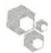
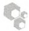
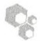

荧光计

转台


## 方法

## 细胞核分离

1. 冰上解冻甲醛交联的细胞沉淀（方案 1），将细胞重悬于 30mL 的 L1 缓冲液（裂解缓冲液）中。4℃振荡细胞悬液 10min。
2.  $4^{\circ}$ C，1000g 离心 15min。
3. 弃上清，细胞重悬于 24mL 的 L2 缓冲液中（蛋白质提取缓冲液）。
4. 室温振荡细胞悬液 10min。
5.  $4^{\circ}$ C，1000g 离心 15min 收集细胞核沉淀，弃上清。

## 染色质超声

6. 细胞核重悬于 $5\mathrm{mL}$ 的L3缓冲液中（染色质抽提缓冲液），并转移至 $15\mathrm{mL}$ 的锥形管中。
7. 将 15mL 的锥形管放入 50mL 装满冰的锥形管中。利用 Branson 450 超声仪微探头对细胞核悬液进行超声，设定 4（对应 15%～20% 输出功率），功率恒定。超声 8 次，每次 20s，每次脉冲间停顿 40s，以便悬液在冰上冷却。

避免样品过热，因为即使是温和加热也会导致解交联。在这里描述的超声程序对于交联的 IMR90 细胞可以产生 1\~2kb 的片段。避免样品过热是很关键的，因为过热会导致甲醛交联的解交联。

超声仪配套的微探头必须没有凹槽或由于过度使用产生的其他瑕疵。有缺陷的微探头会导致染色质片段化不完全。亦可使用其他类型的超声仪（如 Diagenode 公司的 Bioruptor 超声仪）。

8.  $4^{\circ}$ C，2000g 离心 15min 去除不溶的细胞残片。

在先前方法中，超声的染色质通过氯化铯密度梯度离心来进一步纯化。但是，这一步现在来说已没有必要，而且会由于额外的操作和透析步骤造成染色质的明显丢失。

9. 利用荧光计确定样品的 DNA 浓度。

当然也可以利用 260nm 波长的 UV 吸光值，但是这种测定由于染色质样品中蛋白质在 260nm 波长处也会出现吸收值，因此测定的 DNA 量会比实际偏高。所以对染色质样品 DNA 的精确测定还需要荧光计，但是 UV 吸光值仍然可以用来标准化染色质样品。

10. 使用含 $80\%$ 甘油的L3缓冲液储存液将超声染色质样品稀释成 $10\%$ 的甘油溶液以便储存。

11. 使用 L3 缓冲液将 DNA 终浓度调整为 2mg/mL。最终制备的样品需要进行琼脂糖凝胶电泳分析（参考第 2 章，方案 1 和方案 2）。样品还需要解交联（见下，65℃孵育过夜并对 DNA 进行纯化）和分析来确定片段大小的总体分布情况。

12. 将染色质按照每 2mg 等分（1mL），冻存于-80℃。

注意每  $10^{8}$  个细胞可以产生 2～3mg 的染色质。对于 16 个  $500cm^{2}$  的培养皿，可以获得约 10mg 的染色质，足够 5 次 ChIP-chip 实验所用。

13. 将染色质样品储存于-80℃。

对于 ChIP 实验，添加甘油的染色质样品可储存较长时间（>1 年）活性不会发生明显变化。


## 配方

为正确使用本方案中的器材和危险试剂，必须查阅相应的材料安全数据表并咨询所在机构的环境卫生和安全办公室。

L1 缓冲液（裂解缓冲液）

| 试剂 | 储液 | 含量(每60mL) | 终浓度 |
| --- | --- | --- | --- |
| HEPES(pH 7.5) | 1mol/L | 3mL | 50mmol/L |
| NaCl | 5mol/L | 1.68mL | 140mmol/L |
| EDTA(pH 8.0) | 0.5mol/L | 120μL | 1mmol/L |
| 甘油 | 100% | 6mL | 10% |
| NP-40 | 100% | 3mL | 0.5% |
| Triton X-100 | 100% | 0.15mL | 0.25% |
| dH2O |  | 46.05mL |  |

L2 缓冲液（蛋白质提取缓冲液）

| 试剂 | 储液 | 含量(每50mL) | 终浓度 |
| --- | --- | --- | --- |
| NaCl | 5mol/L | 2mL | 200mmol/L |
| EDTA (pH 8.0) | 0.5mol/L | 100μL | 1mmol/L |
| EGTA (pH 8.0) | 0.5mol/L | 50μL | 0.5mmol/L |
| Tris (pH 8.0) | 1mol/L | 500μL | 10mmol/L |
| dH2O |  | 47.35mL |  |

L3 缓冲液（染色质抽提缓冲液）

| 试剂 | 储液 | 含量(每20mL) | 终浓度 |
| --- | --- | --- | --- |
| EDTA(pH 8.0) | 0.5mol/L | 40μL | 1mmol/L |
| EGTA(pH 8.0) | 0.5mol/L | 20μL | 0.5mmol/L |
| Tris(pH 8.0) | 1mol/L | 200μL | 10mmol/L |
| dH2O |  | 19.74mL |  |

## 参考文献

Richard-Foy H, Hager GL. 1987. Sequence-specific positioning of nucleosomes over the steroid-inducible MMTV promoter. EMBO J 6: 2321-2328.

Simonis M, Kooren J, de Laat W. 2007. An evaluation of 3C-based methods to capture DNA interactions. Nat Methods 4: 895–901.

## 方案 3 染色质免疫沉淀（ChIP）

染色质免疫沉淀是用来分析体内蛋白质-DNA 相互作用的一种非常有效的方法。其基本操作方案涉及交联的核蛋白复合体的沉淀、分离以及目的蛋白结合 DNA 的分析。免疫沉淀及洗脱的条件需要根据所用抗体进行优化以增加特异性富集。此外，在免疫沉淀步骤前，染色质可以用尿素部分变性从而使抗原表位更易被抗体识别。针对这一基本操作方案已有很多改进，包括降低细胞量要求（carrier ChIP）（O'Neill et al. 2006），以及通过连续的染色质免疫沉淀研究共定位情况（又称 re-ChIP）等改进。第一次尝试本方案时，应该用质量良好的抗体如针对 TAF1（通用转录因子 TFIID 的一个组分），或者经修饰的组蛋白的抗体如针对组蛋白 H3 的 4-赖氨酸三甲基化（H3K4me3）的抗体等作为整个流程的对照。

这里列出的抗体和染色体用量主要用于 ChIP-chip 和 ChIP-seq，并且是一次标准的 ChIP 实验用量的 10 倍。对于涉及不止一个样品的 ChIP 实验，在保持其他部分体积不变的情况下，免疫磁珠和抗体的体积应相应增加。“模拟”免疫沉淀中对照抗体和免疫磁珠的偶联可以设定为一个阴性对照。蛋白 A/G 琼脂糖或琼脂糖凝胶颗粒也能够用于 ChIP，但是这类颗粒因孔径更多而更易非特异性结合 DNA，需要额外的预处理。首先，用变性的鲑精 DNA 封闭颗粒；其次，在无特异性抗体存在情况下用颗粒预清除制备好的染色质，进而从染色质抽提物中去除非特异结合组分。我们推荐用低吸附试管和抗气溶胶吸头以防止 ChIP 捕获 DNA 的样品丢失及交叉污染。


## 材料

为正确使用本方案中的器材和危险试剂，必须查阅相应的材料安全数据表并咨询所在机构的环境卫生和安全办公室。

本方案的专用试剂标注&lt;R&gt;，配方在本方案末提供。常用储备溶液、缓冲液和试剂标注&lt;A&gt;，配方见附录1。储备溶液应稀释至适用浓度后使用。

## 试剂

抗体（不同来源；如 Upstate Biotechnology 公司、Santa Cruz Biotechnology 公司、Abcam 公司）

牛血清白蛋白（BSA）

氯仿

方案 2 中的染色质

脱氧胆酸（DOC），钠盐（10%，m/V）水溶液；新鲜制备

二硫苏糖醇（DTT）（20mmol/L）（可选；见步骤17）

洗脱缓冲液&lt;R&gt;

乙醇（100%，70%，V/V）水溶液

糖原（20mg/mL）（Roche 公司）

氯化钠（5mol/L）

NP-40（10%，m/V）水溶液

磷酸盐缓冲液（PBS）（1×）&lt;A&gt;

酚:氯仿:异戊醇（25:24:1）

PicoGreen 染料（Life Technologies 公司）

蛋白酶抑制剂混合物[50×；1mL完全蛋白酶抑制剂药片（Roche公司）水溶液，或者其他蛋白酶抑制剂混合物]

蛋白质 A 或 G，或抗 IgG 偶联的磁珠（Life Technologies 公司）

蛋白酶 K（10mg/mL，m/V）水溶液

QIAquick PCR 纯化试剂盒（QIAGEN 公司）

RIPA 缓冲液&lt;R&gt;

使用前新鲜制备。

核糖核酸酶 A（10mg/mL），不含脱氧核糖核酸酶

鲑精 DNA（ssDNA），变性处理

乙酸钠（3mol/L，pH 5.3）

氯化钠（5mol/L）

TE 缓冲液&lt;A&gt;

Triton X-100（10%，m/V）水溶液

## 仪器

化学通风柜

锥形管（15mL）

磁珠（或蛋白质 A/G 琼脂糖，或琼脂糖凝胶颗粒）

荧光计

加热块或培养箱（65℃）

磁力架（Life Technologies 公司）

微量离心机

抗气溶胶吸头

转台

低吸附试管（Axygen 公司的 Maxymum Recovery Tubes）

紫外分光光度计

涡旋振荡器



## 方法

## 偶联抗体至磁珠

1. 使用前及时制备一份 5mg/mL BSA 溶液（0.25g BSA 溶解于 50mL 1×PBS）。

2. 加  $100 \mu L$  （每个 ChIP 反应）适量的磁珠悬液至一个 15 mL 的锥形管。

也可以选择使用蛋白 A/G 琼脂糖或者琼脂糖凝胶颗粒。首先，用变性的鲑精 DNA 和这些颗粒孵育以阻止染色体非特异地结合。

3.  $4^{\circ}$ C，500g 离心悬液 5min，用吸头移除上清。

4. 用 10mL 5mg/mL 的 BSA 溶液重悬磁珠。4℃，2000r/min 离心 5min。

5. 用 $5 \mathrm{mg} / \mathrm{mL}$ BSA 溶液漂洗磁珠三遍。用 $1 \mathrm{~mL} 5 \mathrm{mg} / \mathrm{mL}$ 的 BSA 溶液重悬磁珠。

6. 加入  $10 \mu g$  抗体至磁珠悬液。

7.  $4^{\circ}$ C，在转台上孵育过夜。

## 免疫沉淀

所有的漂洗步骤都在冰上或者冷室中操作。漂洗液中去污剂及盐离子浓度和漂洗次数可能需要优化。如果存在很高的非特异性富集，可以增加 RIPA 缓冲液中盐（氯化锂）或者去污剂（Triton X-100）浓度从而提高洗脱的严谨性。相反，如果特异性富集较弱，可以降低 RIPA 缓冲液中盐或者去污剂浓度。RIPA 缓冲液使用前即时制备。

8. 用磁力架收集抗体偶联的磁珠。用吸头移除上清液，再用 $1\mathrm{mL}5\mathrm{mg / mL}$ 的BSA溶液悬浮磁珠。

9. 重复步骤 8 三遍。

10. 用  $100 \mu L$  5mg/mL 的 BSA 溶液悬浮漂洗过的磁珠。

11. 融化 1mL 方案 2 中分装的染色质。

12. 往染色质样品中加入 $130\mu \mathrm{L} 10\%$ 的Triton X-100、$13\mu \mathrm{L} 10\%$ 脱氧胆酸、$26\mu \mathrm{L} 50\times$ 完全蛋白酶抑制剂溶液以及 $131\mu \mathrm{L}$ TE。

对于大体积免疫沉淀，按比例放大 TE 缓冲液、去污剂及蛋白酶抑制剂的体积。

13. 往染色质样品中加入  $100 \mu L$  磁珠，置于摇床上  $4^{\circ} C$  孵育过夜。

14. 用磁力架沉淀磁珠，吸走液体同时避免磁珠被吸出。

15. 往试管中加入新鲜制备的 1mL RIPA 缓冲液，上下颠倒试管约 10 次洗涤磁珠。
16. 用磁力架浓缩集中磁珠。吸走缓冲液，再用 1mL RIPA 缓冲液重复这个洗涤程序 7 次。
17. 用 1mL TE 缓冲液重复一次步骤 15。

对于连续染色质免疫沉淀（或重复染色质免疫沉淀）中用另一种的抗体检测特定位点因子的共定位情况，可以通过往漂洗的磁珠中加入  $100 \mu L$  含 20 mmol/L 二硫苏糖醇（DTT）的 TE 缓冲液温和洗脱纯化的染色体。 $37^{\circ}C$ ，适度混匀，孵育 30 min。从上面步骤 8 开始转移洗脱缓冲液至新的试管，用免疫沉淀缓冲液（5 mg/mL 牛血清白蛋白溶液）稀释至 1 mL。

18. 吸走 TE 缓冲液，室温下，3000r/min 离心 3min，用吸头吸走残留的液体。

19. 加入  $50 \mu L$  洗脱缓冲液，短暂涡旋振荡以重悬磁珠。 $65^{\circ}C$  孵育 10min。孵育时每隔 2min 短暂振荡一次。

20. 用最大转速离心 30s，转移液体至新的试管。

21. 往新试管中的上清溶液加入  $120 \mu L$  洗脱缓冲液。 $65^{\circ}C$  孵育过夜解交联。此外，同时解交联  $25 \mu L$ （ $50 \mu g$  或更少）总染色质（来源于还未进行免疫沉淀的总染色质）。

## 染色质免疫沉淀捕获的 DNA 的纯化

22. 往每管中加入  $140 \mu L$  TE 缓冲液、 $3 \mu L$   $20 mg/mL$  糖原，以及  $7 \mu L$   $10 mg/mL$  蛋白酶 K，涡旋振荡。

23.  $37^{\circ}$ C 孵育 2h，再加入  $13\mu L$  5mol/L 的氯化钠溶液。

24. 加入  $300 \mu L$  酚:氯仿:异丙醇（25:24:1），剧烈涡旋振荡 30s。室温下最高转速离心 5min，收集液相至新的试管。

25. 重复步骤 24。

26. 加入  $300 \mu L$  氯仿，剧烈涡旋振荡 30s。室温下最高转速离心 5min，收集液相至新的试管。

27. 加入  $700 \mu L$  100% 乙醇，涡旋振荡。

28.  $-80^{\circ}C$ 孵育样品 15\~30min。

29.  $4^{\circ}$ C, 14 000r/min（最大转速）微量离心机离心 15min。

30. 用  $500 \mu L$  冰冷 75% 乙醇洗涤沉淀，涡旋振荡。 $4^{\circ}C$ ，14 000r/min 离心 5min。

31. 风干沉淀 5min，用含有  $10\mu g$  RNase A 的  $30\mu L$  TE 缓冲液重悬沉淀。

32.  $37^{\circ}$ C 孵育 2h。

33. 用 QIAGEN 公司的 QIAquick PCR 纯化试剂盒纯化 DNA，用  $50 \mu L$  洗脱缓冲液洗脱。

34. 用紫外分光光度计测量总的 DNA 样品（Input）的浓度。设置滴定梯度用于校准 DNA 荧光值（参见第 1 章，方案 19）。

ChIP 捕获的 DNA 浓度太低而不能通过紫外吸收光检测。

35. 准备  $50 \mu L$  浓度为  $20 ng/\mu L$  的 Input DNA 稀释液（来自步骤 33）。

36. 用已知浓度的 Input DNA（来源于步骤 35）来设置浓度稀释梯度。借助 PicoGreen 染料，比较 ChIP 捕获的 DNA 和稀释梯度之间的荧光值。用线性回归分析得出捕获下来的 DNA 浓度。2μL 量的 ChIP DNA 足够用于该实验。

37.  $-20^{\circ}C$  冻存 ChIP DNA 及 Input DNA。


## 配方

为正确使用本方案中的器材和危险试剂，必须查阅相应的材料安全数据表并咨询所在机构的环境卫生和安全办公室。

洗脱缓冲液

| 试剂 | 储液 | 含量(每50mL) | 终浓度 |
| --- | --- | --- | --- |
| Tris(pH 8.0) | 1mol/L | 500μL | 10mmol/L |
| EDTA | 0.5mol/L | 100μL | 1mmol/L |
| SDS | 10% | 5mL | 1% |
| dH2O |  | 44.4mL |  |

该缓冲液可以制备后储存。

RIPA 缓冲液

| 试剂 | 储液 | 含量(每10mL) | 终浓度 |
| --- | --- | --- | --- |
| HEPES(pH 8.0) | 1mol/L | 500μL | 50mmol/L |
| EDTA | 0.5mol/L | 20μL | 1mmol/L |
| NP-40 | 10% | 1mL | 1% |
| DOC | 10% | 700μL | 0.7% |
| dH2O |  | 6.955mL |  |
| LiCl | 8mol/L | 625μL | 0.5mol/L |
| 蛋白酶抑制剂 | 50× | 200μL | 1× |

新鲜制备。

## 参考文献

O'Neill LP, VerMilyea MD, Turner BM. 2006. Epigenetic characterization of the early embryo with a chromatin immunoprecipitation protocol applicable to small cell populations. Nat Genet 38: 835–841.

## 方案 4 染色质免疫沉淀-定量聚合酶链反应 (ChIP-qPCR)

判定 ChIP 实际上是否富集到与靶蛋白相关的 DNA 序列至关重要。如果存在已知的基因组结合位点，可以据此设计引物进行定量 PCR，通过和 input 染色质、用预先免疫的血清来“模拟”的免疫沉淀组比较，确定这些已知位点是否的确被免疫沉淀组特异性地富集。如果没有已知结合位点但是存在备选靶基因，可以考虑沿着潜在调节区域如启动子和位于基因间隔区和基因区域的保守非编码序列来设计定量 PCR 引物。因为实时 PCR 可在 96 孔或者 384 孔板以最小反应体积进行，引物可以以最便宜价格合成，对于大量不同实验条件和不同的细胞类型情况下靶基因及潜在的调节区域的筛查，ChIP-qPCR 是一个相当有吸引力的策略。如果没有备选靶基因或潜在的位点，那就要考虑 ChIP-chip（方案 5）或 ChIP-seq（方案 6）。

有很多方法来判定特定靶基因的相对 ChIP 富集度。这个方案用标准化后的 ChIP DNA 和全基因组 DNA 的绝对质量来对 DNA 进行最直接的定量。我们用 SYBR Green 作为 PCR 的检测染料，也可以使用 TaqMan 和其他的检测化合物。


## 材料

为正确使用本方案中的器材和危险试剂，必须查阅相应的材料安全数据表并咨询所在机构的环境卫生和安全办公室。

本方案的专用试剂标注&lt;R&gt;，配方在本方案末提供。常用储备溶液、缓冲液和试剂标注&lt;A&gt;，配方见附录1。储备溶液应稀释至适用浓度后使用。

## 试剂

来自方案 3 中的 ChIP DNA

阴性对照 DNA

含 SYBR Green 染料的 PCR 混合成分

PCR 引物

模板 DNA（见步骤 2）

## 仪器

荧光计

实时定量 PCR 仪



## 方法

1. 用商业化的基础混合成分（通常提供  $2 \times$  浓度，含有全部所需的核苷酸和酶）、引物（每个引物浓度  $0.15 \mu mol/L$ ），500pg 模板 DNA（参见第 9 章）准备实时 PCR 反应体系。

需要优化引物浓度以实现靶基因的有效扩增。500pg DNA 相当于基因组中 150 个拷贝。

2. 模板可以是 ChIP DNA、总的 Input DNA，或者是仅仅用磁珠富集的阴性对照 DNA。

通常，仅用磁珠富集的模拟免疫沉淀产出 DNA 非常少。相反，用琼脂糖或者琼脂糖凝胶颗粒模拟免疫沉淀产出的 DNA 量足以满足大量的 PCR。

3. 依据引物熔解温度和 PCR 产物预期长度来设计实时 PCR 条件（参见第 9 章）。遵循适合仪器和反应试剂的 PCR 参数:

i.  $95^{\circ}$ C, 10min

ii.  $95^{\circ}$ C, 15s

iii.  $60^{\circ}$ C, 45s

iv. 回到步骤 ii 开始循环，39 次

v（可选）. 完成熔解曲线。

4. 通过比较由实时定量 PCR 仪确定的 input 和 ChIP DNA 模板的临界循环数（ $C_{T}$ ）来比较富集度。用合适的方法来判定  $C_{T}$  值（参见第 9 章）。

$\blacktriangle C_{T}$ 值代表 ChIP 富集的相对对数，假定扩增效率接近 100%。

## 方案 5 染色质免疫沉淀-芯片杂交（ChIP-chip）

染色质免疫沉淀-芯片（ChIP-chip）能够用来分析某个区域范围和全基因组范围内蛋白质-DNA相互作用。通过ChIP富集的DNA和Input DNA竞争性地与DNA芯片杂交，可以鉴定和蛋白质相互作用的基因组位点。DNA芯片上包含代表基因组序列的PCR产物或寡核苷酸探针。ChIP DNA和Input DNA相对杂交强度被用来判断探针序列是否是蛋白质-DNA相互作用的潜在位点。蛋白质结合实际基因组位点的分辨率依赖于染色质的大小和芯片上探针间对应基因组序列之间的距离。

所研究的基因组区域的大小和性质依赖于芯片的设计和覆盖度。许多芯片平台可以用于 ChIP-chip，这些芯片包含 PCR 产物或寡核苷酸。仅仅包含启动子区域的第一代人类 ChIP-chip 芯片被用来搜寻转录因子的直接靶标（Ren et al. 2002）。第二代人类 ChIP-chip 芯片覆盖了基因组的小的连续区域（Kim et al. 2005a）。目前，整个人类基因组序列可以被高密度的寡核苷酸芯片组所覆盖（Kim et al. 2005b）。许多企业能够为客户提供多种复杂芯片，以便高密度和高通量地对特定区域进行研究，这些企业同时还可以提供一系列经确证的寡核苷酸探针，可以同时放置于客户定制芯片上。正如利用基因芯片进行表达谱分析一样，ChIP-chip 实验也要求多次重复以便获得蛋白质-DNA 相互作用的统计学上可信的测定结果。

ChIP-chip 方案可以划分为两个主要部分:ChIP DNA 扩增和 ChIP DNA 与芯片杂交。与芯片杂交需要大量的 DNA，与一组代表整个人类基因组序列的多个芯片杂交需要两轮 PCR 扩增。这里提供的是使用 Kim 等描述的 PCR 产物印记-ENCODE 芯片进行的 ChIP-chip 实验（Kim et al. 2005a）。


## 材料

为正确使用本方案中的器材和危险试剂，必须查阅相应的材料安全数据表并咨询所在机构的环境卫生和安全办公室。

本方案的专用试剂标注&lt;R&gt;，配方在本方案末提供。常用储备溶液、缓冲液和试剂标注&lt;A&gt;，配方见附录1。储备溶液应稀释至适用浓度后使用。

## 试剂

BioPrime Array CGH 基因组标记系统试剂盒（Life Technologies 公司）

乙酰化的牛血清白蛋白（BSA）

BSA 溶液[5mg/mL（m/V）的 PBS 溶液和 2%（m/V）水溶液]

来自方案 3 的 ChIP DNA 和 Input DNA

人类  $C_{0}t-1$  DNA（Life Technologies 公司）

Cy3-dCTP 和 Cy5-dCTP（GE Healthcare Biosciences 公司）

dNTP 混合物（dATP、dCTP、dGTP、dTTP 各 20mmol/L）

dNTP 混合物（dATP、dCTP、dGTP、dTTP 各 2.5mmol/L）

乙醇（70%,100%，预冷）

糖原（20mg/mL）

杂交缓冲液&lt;R&gt;

连接缓冲液（5×）（Life Technologies 公司）

LM-PCR 混合物&lt;R&gt;

```txt
JW102 oligo（5'-GCGGTGACCCGGGAGATCTGAATTC-3', HPLC 纯化）（40μmol/L）
JW103 oligo（5'-GAATTCAGATC-3', HPLC 纯化）（40μmol/L）
```

PfuUltra 聚合酶（2.5U/ $\mu$ L）（Agilent Technologies 公司）

酚:氯仿:异戊醇（25:24:1）

聚合酶混合物&lt;R&gt;

预杂交溶液&lt;R&gt;

QIAquick PCR 纯化试剂盒（QIAGEN 公司）

乙酸钠（3mol/L，pH 5.3）

标准柠檬酸盐水溶液（0.1×）

标准柠檬酸盐水溶液（0.1×）/十二烷基硫酸钠（0.1%）水溶液

标准柠檬酸盐水溶液（2×）/十二烷基硫酸钠（0.1%）水溶液

标准柠檬酸盐水溶液（2.2×）/十二烷基硫酸钠（0.22%）&lt;R&gt;

T4 DNA 连接酶（400U/mL）（New England Biolabs 公司）

T4 DNA 聚合酶（3U/mL）（New England Biolabs 公司）

Taq 聚合酶（5U/mL）和缓冲液（QIAGEN 公司）

Tris (1mol/L, pH 7.9)

酵母 tRNA (10μg/μL)

## 仪器

Axon GenePix 4000B 芯片扫描仪（Molecular Devices 公司）

离心管

化学通风橱

玻片染色缸

盖玻片（24mm×60mm）

Eppendorf 5840 离心机

GenePix 扫描软件

加热块（100℃、95℃、70℃）

杂交盒（Sigma-Aldrich 公司）

冷冻干燥箱（可选，见步骤46）

芯片（PCR-spotted ENCODE）

微型离心机

PCR 管 (200μL)

平板（96孔）

摇床/转台

96 孔板转子接头

片盒

片架

光谱仪

带扣帽试管

涡旋振荡器

水浴锅

Wheaton 玻璃染缸


## 方法

## 制备接头

接头可以预先制备并储存几个月。

1. 用水溶解 oJW102 和 oJW103 寡核苷酸至终浓度  $40 \mu mol/L$ 。
2. 将  $375 \mu L$   $40 \mu mol/L$  的 oJW102 和  $375 \mu L$   $40 \mu mol/L$  的 oJW103 加入到  $250 \mu L$  Tris (1mol/L, pH 7.9) 中。
3. 将混合物按  $100 \mu L$  等体积分装进微型离心管。
4. 把试管置于  $95^{\circ}$ C 热浴 5min。
5. 转移样品至  $70^{\circ}$ C 热浴槽。
6. 移走热源，仍然保持试管在热浴块上，将其置于工作台，冷却至  $25^{\circ}$ C。

7. 转移热浴块至  $4^{\circ}$ C，孵育样品过夜。

8. 冻存样品于 $-20^{\circ}C$ 。

## 扩增 ChIP DNA 和 Input DNA

连接介导的 PCR（LM-PCR）方案用来将少量的 ChIP DNA 扩增至足够进行后续的芯片实验。作为对照，平行扩增 20ng 的 Input DNA。

## DNA 末端补平

9. 在  $200 \mu L$  PCR 管中，加  $40 \mu L$  的 ChIP DNA 或  $20 ng (1 \mu L)$  的 Input DNA，再用水补平至  $100 \mu L$ 。剩下的 DNA 冻存于  $-20^{\circ} C$ 。

10. 往 DNA 中加入下列成分:

| T4 DNA 聚合酶缓冲液(10×) | 11μL |
| --- | --- |
| 乙酰化的牛血清白蛋白(10mg/mL) | 0.5μL |
| dNTP(20mmol/L) | 0.5μL |
| T4 DNA 聚合酶(3U/μL) | 0.2μL |

11. 吹打混匀， $12^{\circ}$ C孵育20min。

此步骤用 PCR 仪。

12. 转移补平后 DNA 至新的 1.5mL 试管，置于冰上。

13. 往其中加入  $11 \mu L$  3mol/L 的乙酸钠（pH 5.3）和  $1 \mu L$  20mg/mL 的糖原，涡旋振荡。

14. 加入  $120 \mu L$  酚:氯仿:异戊醇（25:24:1）。

15. 涡旋振荡后在微型离型机中室温最高速离心 5min。

16. 转移  $110 \mu L$  水相至新的 1.5 mL 离心管中，加入  $230 \mu L$  预冷 100% 乙醇。涡旋振荡， $-80^{\circ}C$  放置  $15 \sim 30 min$ （直到冰冻），再于  $4^{\circ}C$  最高速离心 5 min。

17. 移除上清，用  $500 \mu L$  预冷 70% 乙醇漂洗沉淀。

18.  $4^{\circ}$ C最高速离心5min。

19. 移除上清，简短离心，用吸头移除残留的液体，简短干燥沉淀（5min）。

20. 用  $25 \mu L$  水重悬沉淀，置于冰上。

## 接头连接至 DNA

21. 准备如下  $25 \mu L$  连接酶混合物:

| 连接酶缓冲液(5×) | 10μL |
| --- | --- |
| 复性接头(15μmol/L) | 6.7μL |
| T4 DNA 连接酶(400U/μL) | 0.5μL |
| 去离子水 | 7.8μL |

往每个样品中加入连接酶混合物。

22. 用吸头充分混匀，16℃孵育过夜。

23. 第二天，加入  $6 \mu L$   $3 \, mol/L$  的乙酸钠和  $130 \mu L$  预冷 100% 乙醇，涡旋振荡。

24. 于-80℃冻存样品15～30min，在微型离心机中4℃最高速离心15min，丢弃上清。

25. 用  $500 \mu L$  冷的 70% 乙醇洗涤沉淀，离心，移除所有液体，干燥沉淀 5min。

26. 用  $25 \mu L$  水重悬沉淀，转移至新的  $200 \mu L$  PCR 管。

## 运行 PCR

27. 将连接后的 DNA 置于冰上。准备 LM-PCR 和聚合酶混合物。

28. 往管中加入  $15 \mu L$  LM-PCR 混合物。
29. 将试管置于已经加热至  $55^{\circ}$ C 的 PCR 仪，暂停。
30. 往 PCR 仪上的试管中加入  $10 \mu L$  聚合酶混合物，充分混匀。

31. 运行剩下的循环:

| 步骤1 | 55°C 2min |
| --- | --- |
| 步骤2 | 72°C 5min |
| 步骤3 | 95°C 2min |
| 步骤4 | 95°C 1min |
| 步骤5 | 60°C 1min |
| 步骤6 | 72°C 2min |
| 步骤7 | 返回至步骤4,22× |
| 步骤8 | 72°C 5min |
| 步骤9 | 4°C 持续 |

32. 用 QIAGEN QIAquick PCR 纯化试剂盒纯化样品。用  $50 \mu L$  试剂盒提供的洗脱缓冲液洗脱样品。检测 PCR 产物的浓度。

LM-PCR 产物可用凝胶电泳分析（请见第 2 章，方案 1 和方案 2）。检测全部的 LM-PCR 产物的大小分布对于测定 PCR 步骤是否导致偏性扩增很重要。理想状态下，LM-PCR 产物应该和未扩增的解交联染色体无差别。如果 LM-PCR 产物能够看见离散的条带，表明 LM-PCR 导致了偏性扩增。通过减少循环数再次运行 PCR 可能限制偏性扩增。

## 从 LM-PCR 产物中制备荧光标记的 DNA

33. 加 200ng LM-PCR DNA 产物至试管中，用去离子水调整体积至  $22.5 \mu L$ 。
34. 加  $20 \mu L$   $2.5 \times$  随机引物溶液（来自 QIAGEN 公司的试剂盒）至试管。
35. 用  $100^{\circ}$ C 热浴煮沸 5min，然后置于冰上保持 5min。
36. 加入  $5 \mu L$   $10 \times$  的 dNTP 混合物（来自试剂盒）。
37. 加入  $1.5 \mu L$  Cy5-dCTP 至免疫沉淀样品试管中，加入  $1.5 \mu L$  Cy3-dCTP 至总输入样品试管中。
38. 加入  $1 \mu L$  高浓度 Klenow 酶（40U/ $\mu L$  来自 BioPrime 公司的试剂盒），轻微涡旋振荡并简短离心收集液体。
39.  $37^{\circ}$ C 孵育 1.5h。
40. 用 QIAGEN 公司的 QIAquick PCR 纯化试剂盒纯化标记的 DNA，用试剂盒提供的洗脱缓冲液  $50 \mu L$  洗脱 DNA，用紫外光谱仪测定标记的 DNA 浓度。

## 制备芯片

41. 加 80mL 预杂交溶液至玻片染色缸，用水浴加热溶液至  $42^{\circ}$ C（20～30min）。
42. 将微阵列沉浸在玻片染色缸中（每个染色缸最多 4 片），然后  $42^{\circ}$ C 孵育 40min。
43. 将微阵列轻微地浸润在反渗透水中约 10s，将片盒置于 96 孔板转子上，2000r/min 离心 30s 甩干，离心后立即开始使用芯片。

## 制备杂交液

44. 将  $2 \mu g$  Cy3 标记的 DNA（Input DNA）和  $2 \mu g$  Cy5 标记的 DNA（ChIP DNA）混合。
需要的标记 DNA 数量可能依据不同的芯片平台而有所差异。通常，探针数量较多的芯片要求更多的标记靶 DNA。

45. 加入  $36 \mu g$  人类  $C_{0} t-1$  DNA 和去离子水至终体积  $130 \mu L$ 。

因为  $C_{0}$ -1 DNA 用来阻止富含重复元件序列的交叉杂交， $C_{0}$ -1 DNA 的使用依赖所用的芯片平台类型。此外， $C_{0}$ -1 DNA 的量依赖芯片上探针种类和数量而变化。酵母 tRNA 也用于阻止基因组中高拷贝数量转运 RNA 序列的交叉杂交。 $C_{0}$ t-1 DNA 和酵母 tRNA 在寡核苷酸芯片杂交中均可省略。

46. 加入  $14 \mu L$  3mol/L 的乙酸钠和  $280 \mu L$  100% 冷乙醇，振荡混合， $-80^{\circ}C$  孵育 15min， $4^{\circ}C$  最高转速离心 15min。

标记的靶标可用真空冷冻干燥仪代替乙醇沉淀干燥。

47. 用 $500 \mu \mathrm{L} 70 \%$ 冷乙醇漂洗沉淀, 移除所有残留液体, 风干 $5 \mathrm{~min}$ 。

48. 用 $22.4\mu \mathrm{L} 2.2\times$ 的SSC/0.22%SDS溶液溶解沉淀。$37^{\circ}\mathrm{C}$ 孵育10min溶解，每2min轻微振荡样品促进溶解。

49. 加入  $20 \mu L$  杂交缓冲液，轻轻且充分地振荡。

50. 盖上试管盖，95℃变性杂交液 5min，离心 30s。

51.  $42^{\circ}$ C 孵育 2min。

52. 加入  $4 \mu L$  酵母 tRNA ( $10 \mu g/\mu L$ )。

对于寡核苷酸芯片或者不包含编码编码 tRNA 序列的芯片，tRNA 可以省略。

53. 加入  $3 \mu L$  2% 牛血清白蛋白，轻轻且充分地振荡， $42^{\circ}C$  孵育 5min，简短离心。

## 杂交

54. 将来自步骤 53 的混合物  $47 \mu L$ （3 滴）点至芯片，将芯片的盖片首先接触芯片边缘，再将盖片覆盖至芯片上。

55. 加  $15 \mu L$  去离子水至湿盒任意一边的小储存孔中，压紧杂交湿盒。

56.  $60^{\circ}$ C孵育过夜（16h）（浸于 $60^{\circ}$ C水浴）。

## 漂洗

$2 \times$ SSC 溶液预热至 $60^{\circ} \mathrm{C}$，但是漂洗实际上在室温下完成。下面的每个漂洗体积最多可用于 4 个芯片的漂洗。

57. 用 50mL 预热至  $60^{\circ}$ C 的  $2 \times$  SSC/0.1% SDS 填满染色缸，轻轻将芯片放入染色缸，保持条形码向上。浸润芯片 1min，缓缓从染色缸中移除每张芯片，留下盖玻片。

58. 将芯片置于在 Wheaton 染色缸中放置的、已被预热至  $60^{\circ}$ C 的  $2 \times$  SSC/0.1% SDS 浸润的片架中，通过摇床摇动来温和搅动孵育芯片 5min。

59. 从 $2 \times \mathrm{SSC} / 0.1\% \mathrm{SDS}$ 溶液中移出片架，转置于盛有 $250 \mathrm{~mL}$ 室温的 $0.1 \times \mathrm{SSC} / 0.1\% \mathrm{SDS}$ 溶液的 Wheaton 染色缸中。通过转台/摇床的摇动温和搅动孵育芯片 $10 \mathrm{~min}$ 。

60. 从 $0.1 \times \mathrm{SSC} / 0.1\% \mathrm{SDS}$ 溶液中移出片架，转置于盛有 $250 \mathrm{~mL}$ 室温的 $0.1 \times \mathrm{SSC}$ 溶液的 Wheaton 染色缸中，手动温和搅动孵育芯片 $15 \mathrm{~s}$，此处快洗可移除大量残留 SDS。

除去 SDS 非常关键，因为任何 SDS 残留都将干扰扫描。

61. 从 $250\mathrm{mL} 0.1 \times \mathrm{SSC}$ 溶液中移出片架，转置于盛有 $250\mathrm{mL}$ 的 $0.1 \times \mathrm{SSC}$ 溶液的 Wheaton 染色缸中，孵育 $1\mathrm{min}$ （如有必要可以温和搅动）。

62. 重复步骤 29 两次以上（共 3 次）。

63. 15s 后, 缓慢从片架上移走芯片, 置于转子接头的离心管架上。平衡好, 在 Eppendorf 5840 离心管中于 1500r/min 离心 1min。离心后, 保存芯片于片盒中, 分析前保持芯片避光避尘。

## 扫描

本方案的最后将描述用 Axon 4000B 扫描仪扫描的步骤。按照说明开展合适的操作，其他的扫描平台和和程序的操作流程有可能不同。

64. 漂洗及干燥后立即用 Axon 4000B 扫描仪和 GenePix 扫描软件以合适的分辨率（大于 20K 特征芯片组为 5μm）扫描芯片。

65. 校准每个通道的 PMT 得率保证每个通道的荧光值一致。

66. 用正确/合适的基因芯片列表文件 (.gal) 从每个斑点中提取荧光强度值。

67. 保留扫描图像 (.TIFF)、图像设置 (.gps) 和结果文件 (.gpr)，相比于 Input DNA, ChIP DNA 的信号标准化后呈现两倍的增加即可认为有显著作用；但是，仍然需要用不同的芯片测量误差模型进行统计学分析以判断不同重复间 ChIP DNA 信号的统计学差异。


## 配方

为正确使用本方案中的器材和危险试剂，必须查阅相应的材料安全数据表并咨询所在机构的环境卫生和安全办公室。

杂交缓冲液

| 试剂 | 储液 | 含量(每1mL) | 终浓度 |
| --- | --- | --- | --- |
| 甲酰胺 | 100% | 700μL | 70% |
| 硫酸葡聚糖 | 100% | 0.143g | 14.3% |
| SSC | 20× | 150μL | 3× |
| 去离子水 |  | 75μL |  |

新鲜制备。

LM-PCR 混合物

| 试剂 | 含量(每15μL) |
| --- | --- |
| 热聚合酶反应缓冲液(10×)(New England Biolabs公司) | 4μL |
| dNTP(2.5mmol/L) | 5μL |
| oJW102(40μmol/L) | 1.25μL |
| 去离子水 | 4.75μL |
| 总计 | 15μL |

新鲜制备并保存于冰上。

聚合酶混合物

| 试剂 | 含量(每10μL) |
| --- | --- |
| 热聚合酶反应缓冲液(10×)(New England Biolabs公司) | 1μL |
| Taq 聚合酶 (5U/μL) | 1μL |
| PfuUltra 聚合酶 (2.5U/μL) | 0.01μL |
| 去离子水 | 8μL |
| 总计 | 10μL |

新鲜制备并保存于冰上。

预杂交溶液

| 试剂 | 储液 | 含量(每100mL) | 终浓度 |
| --- | --- | --- | --- |
| SSC | 20× | 10mL | 2× |
| SDS | 10% | 0.5mL | 0.05% |
| 牛血清白蛋白 | 2% | 10mL | 0.2% |
| 去离子水 |  | 79.5mL |  |

新鲜制备。

SSC (2.2×) /SDS (0.22%)

| 试剂 | 储液 | 含量(每1mL) | 终浓度 |
| --- | --- | --- | --- |
| SSC | 20× | 110μL | 2.2× |
| SDS | 10% | 22μL | 0.22% |
| 去离子水 |  | 868μL |  |

新鲜制备。

## 参考文献

Kim TH, Barrera LO, Qu C, Van Calcar S, Trinklein ND, Cooper SJ, Luna RM, Glass CK, Rosenfeld MG, Myers RM, et al. 2005a. Direct isolation and identification of promoters in the human genome. Genome Res 15: 830–839.

Kim TH, Barrera LO, Zheng M, Qu C, Singer MA, Richmond TA, Wu Y, Green RD, Ren B. 2005b. A high-resolution map of active promoters

in the human genome. Nature 436: 876–880.
Ren B, Cam H, Takahashi Y, Volkert T, Terragni J, Young RA, Dynlacht BD. 2002. E2F integrates cell cycle progression with DNA repair, replication, and G₂/M checkpoints. Genes Dev 16: 245–256.

## 方案 6 染色质免疫沉淀-高通量测序（ChIP-seq）

对 ChIP-富集 DNA 直接测序（ChIP-seq）是微阵列（芯片）检测方法的一种替代方法。在 ChIP-seq 方案中，利用二代测序平台（如 Illumina 基因组分析仪，见第 11 章）对 ChIP DNA 进行分析。对 ChIP DNA 的直接测序可以获得数百万短序列的“读本（reads）”，基因组上 ChIP 俘获序列读本的密度可以用来确定蛋白的结合位点。尽管 ChIP-seq 对 ChIP DNA 的需要量要少得多，但是目前的测序平台仍然需要通过连接作用介导的 PCR 对 ChIP DNA 进行扩增。由于该方法具有数字特性，因此逐渐成为全基因组 ChIP 分析的标准方法。

本方案涉及接头连接和随后的样品片段大小选择，是 Illumina 基因组分析仪 ChIP-seq 的标准操作。经过大小选择的 ChIP DNA 通过 LM-PCR 进行扩增，并进行第二次片段大小选择。纯化后的 ChIP DNA 随后载入基因组测序仪，ChIP DNA 也可以与 ChIP-chip 结果平行进行。


## 材料

为正确使用本方案中的器材和危险试剂，必须查阅相应的材料安全数据表并咨询所在机构的环境卫生和安全办公室。

本方案的专用试剂标注&lt;R&gt;，配方在本方案末提供。常用储备溶液、缓冲液和试剂标注&lt;A&gt;，配方见附录1。储备溶液应稀释至适用浓度后使用。

## 试剂

ATP (10mmol/L)

溴酚蓝/二甲苯胺上样染料

来自方案 3 的 ChIP DNA

ChIP-seq DNA 样品制备试剂盒（Illumina 公司）

dATP (1mmol/L)

DNA 分子质量标准

dNTP 混合液（10mmol/L dATP、dCTP、dGTP 及 dTTP）

dNTP 混合液（2.5mmol/L dATP、dCTP、dGTP 及 dTTP）

洗脱缓冲液（QIAGEN 公司的 MinElute QIAquick 纯化试剂盒）

End-It DNA 末端修复试剂盒（Epicentre Technologies 公司）

乙醇

糖原（20mg/mL）

Illumina 公司基因组 DNA 样品制备试剂盒

Klenow 片段（3'→5'外切酶活性）（Life Technologies 公司）

最小洗脱 QIAquick PCR 纯化试剂盒（QIAGEN 公司）

Nanosep MF 过滤试管（VWR 公司）

Illumina 公司基因组 DNA 样品制备试剂盒的 PCR 引物

Phusion 热启动高保真 DNA 聚合酶（New England Biolabs 公司）

聚丙烯酰胺凝胶（浓度为8%，溶于1×TBE）或预制胶&lt;R&gt;

快速连接试剂盒（New England Biolabs 公司）

限制性内切核酸酶缓冲液 2（NEB 公司）

乙酸钠（3mol/L，pH 5.3）

SYBR 金色溶液（10000×）（Life Technologies 公司）

T4 DNA 连接酶和缓冲液

TAE 缓冲液（1×）&lt;A&gt;

## 仪器

琼脂糖凝胶电泳设备

Dark Reader 荧光透射仪（Iso BioExpress 公司）

胶染色平皿

加热板

Illumina 基因组分析仪系统

针

PCR 仪

振荡器平台/转台

外科手术刀

分光光度计

SpeedVac 浓缩仪

Thermo 混合器（Eppendorf 公司）

试管（0.5mL、1.5mL、2.0mL）

涡旋振荡器

水浴锅



## 方法

## 末端修复

1. 在 $29 \mu \mathrm{L}$ 的 ChIP DNA 中加入以下成分:

| 末端修复缓冲液(来源于 End-It DNA 末端修复试剂盒) | 10μL |
| --- | --- |
| dNTP (2.5mmol/L) | 5μL |
| ATP (10mmol/L) | 5μL |
| End-It 酶混合物 | 1μL |
| 总反应体积 | 50μL |

2. 室温孵育 45min。

3. 利用 MinElute QIAquick PCR 纯化试剂盒对 DNA 进行纯化，过程参照生产说明书。

4. 分两次从柱子上洗脱 DNA: 首次利用 $20 \mu \mathrm{L}$ 洗脱缓冲液洗脱, 随后 $12 \mu \mathrm{L}$ 洗脱缓冲液洗脱。洗脱总体积为 $32 \mu \mathrm{L}$ 。

## 在 ChIP DNA 的 3' 端加 A

5. 对先前步骤中的末端修复 DNA, 加入  $5 \mu L$  的  $10 \times$  限制性内切核酸酶缓冲液 2、 $10 \mu L$  1 mmol/L 的 dATP、 $3 \mu L$   $5 U/\mu L$  的 Klenow 片段（ $3' \rightarrow 5'$  外切）。

6.  $37^{\circ}$ C 孵育 30min。

7. 利用 MinElute QIAquick PCR 纯化试剂盒对 DNA 进行纯化，过程参照生产说明书。

8. 分两次洗脱 DNA: 首次利用 $10 \mu \mathrm{L}$ 洗脱缓冲液洗脱, 随后 $10 \mu \mathrm{L}$ 洗脱缓冲液洗脱。洗脱总体积为 $20 \mu \mathrm{L}$ 。

9. 利用 SpeedVac 浓缩纯化的 DNA 至  $4 \mu L$ 。

## 连接

10. 对浓缩的 DNA 溶液，加入  $5 \mu L$  的  $2 \times T4$  连接酶缓冲液、 $0.5 \mu L$ （用水按 1:10 稀释）的接头寡核苷酸混合物（在 ChIP-Seq DNA 样品准备试剂盒内）和  $0.5 \mu L$  的  $1 U/\mu L$  的 T4 DNA 连接酶。

11. 室温连接 15min。

12. 利用 MinElute QIAquick PCR 纯化试剂盒对 DNA 进行纯化, 过程参照生产说明书。

13. 分两次洗脱 DNA: 首次利用 $20 \mu \mathrm{L}$ 洗脱缓冲液洗脱, 随后 $20 \mu \mathrm{L}$ 洗脱缓冲液洗脱。洗脱总体积为 $40 \mu \mathrm{L}$ 。

## 胶纯化/片段大小选取

14. 准备一块 8% 的聚丙烯酰胺胶（1×TBE）或一块预制胶。

15. 将每个孔槽中的残胶用  $1 \times TBE$  缓冲液清洗，

16. 上  $8 \mu L$  溴酚蓝/二甲苯青，跟踪 DNA 条带的迁移。

17. 将步骤 13 中的已连接接头的 ChIP DNA 全部上样。

18. 上样 DNA 分子质量标准。

19. 150V 电泳，直到最前端的染料迁移到整块胶的 2/3 处。

20. 将胶放置于 100mL 含  $10 \mu L$  的  $10\,000 \times$  的 SYBR 金色溶液的  $1 \times TAE$  缓冲液中染色。

21. 将染色平皿用锡箔纸覆盖，温和振荡孵育 15\~20min。

22. 采用 Dark Reader 荧光透射仪对胶进行分析。

23. 利用一个干净的刀片将处于 200～220bp 或 250bp 的条带切下。用于 Illumina 测序的优化了的搭桥 PCR 产物簇的大小为 200～250bp。

24. 对于 ChIP-chip，胶回收的 DNA 片段大小为 400～800bp（方案 5）。

25. 将 200～250bp 条带的胶条放于 0.5mL 的用针预先扎了许多孔的管内切碎。将该 0.5mL 含有胶碎片的管子放置于 1.5mL 或 2.0mL 的管子中，14 000r/min 离心 2min。胶可以通过孔径而流下。

26. 丢弃较小的管子。向底部含有胶碎片的管子中加入 2 倍体积的 EB 缓冲液，放置于 Thermomixer 或旋转器上振荡过夜。

27. 第二天，在 Thermomixer 上， $50^{\circ}$ C，1400r/min，振荡 15min。

28. 室温下，14 000r/min 离心 2min。

29. 将上清转移至 Nanoseq 柱子中，室温，14 000r/min 离心 2min。

30. 再次室温，14 000r/min 离心 2min。

31. 将洗脱液用 EB 缓冲液补足总体积至  $300 \mu L$ 。

32. 加入 1/10 体积（30μL）3mol/L 的乙酸钠（pH 5.2）并混合。