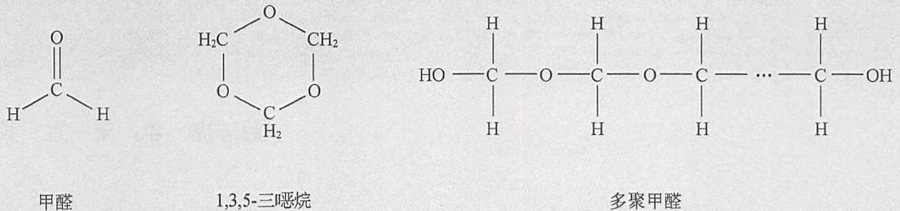
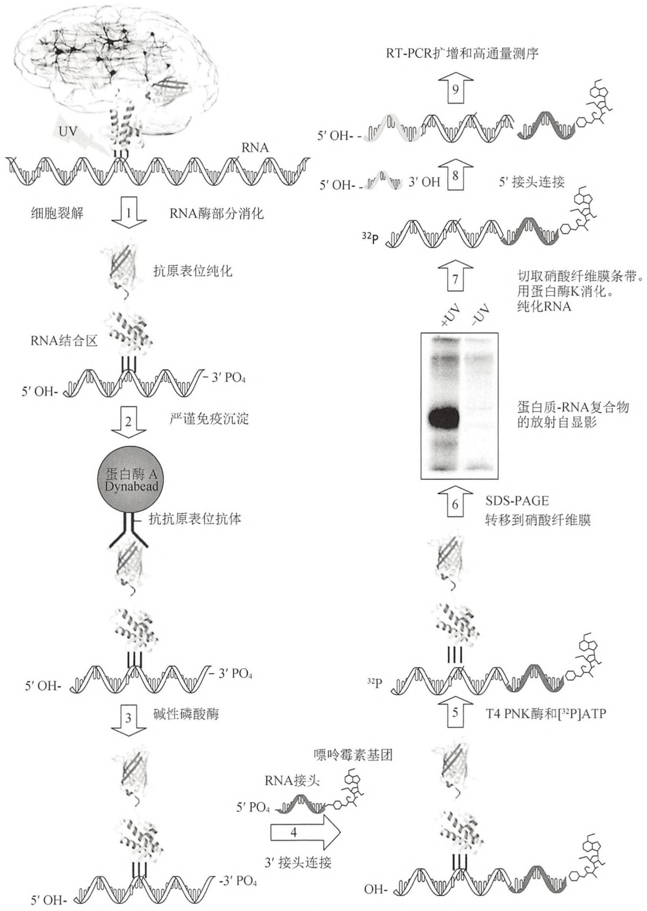

制性酶切片段形成的连接产物)。这样才能保证在所鉴定的文库浓度范围内，丰度高的和丰度低的连接产物都与文库浓度线性相关。连接产物丰度的差异，说明成功地制备了基于3C实验的连接产物文库，该文库能检测到两位点在空间上的相互靠近（详细讨论，见 Dekker 2006）。对于对照连接文库，所有连接产物理论上应等量。

## 3C PCR 引物的设计

引物应该长 28～30 碱基，GC 含量约 50%。3C PCR 引物通常设计在相关限制性酶切位点的上游 100～300 碱基。因而，产物大小 200～300bp。所有的 3C 引物通常在基因组上是单向的，也就是说，它们或者都与染色体的有义链互补配对，或者都与染色体的反义链互补配对。这样才能在基于 3C 的实验中，检测到头对头连接产物（图 20-5），而不会检测到环化的未酶切片段。

## 用 3C、ChIP-loop 和对照文库确定相互作用频率

利用识别感兴趣的特定位点的引物对，通过半定量 PCR 测定相互作用频率。首先确定连接产物文库量在什么范围内，PCR 产物量与文库浓度线性相关。这在实验方案的第一部分有介绍。然后在线性范围内选择一个文库浓度进行半定量 PCR，以检测特定的连接产物，对应于特定的远距离相互作用，这在实验方案的第二部分有介绍。

为确定两个基因座之间的相对相互作用频率，需要使用一对 3C 引物，以 3C 文库（或是 ChIP-loop 文库）和对照组文库作为模板，通过半定量 PCR 进行测定。通过计算 3C 文库得到的 PCR 产物量与对照组文库得到的 PCR 产物量之间的比值，得到相互作用频率，这是一个与引物效率和扩增子大小无关的相对值。由不同引物对得到的相互作用频率之间可以直接比较。


## 配方

为正确使用本方案中的器材和危险试剂，必须查阅相应的材料安全数据表并咨询所在机构的环境卫生和安全办公室。

3C PCR (10×)

| 试剂 | 储液 | 含量(每25mL) | 终浓度 |
| --- | --- | --- | --- |
| Tris-HCl(pH 8.4) | 1mol/L | 2.5mL | 100mmol/L |
| KCl | 5mol/L | 2.5mL | 500mmol/L |
| MgCl2 | 100mmol/L | 5.625mL | 22.5mL |
| H2O |  | 14.375mL |  |

新鲜配制。

## 参考文献

Dekker J. 2006. The three 'C's of chromosome conformation capture: Controls, controls, controls. Nat Methods 3: 17–21.

## 方案 11 3C、ChIP-loop 和对照组文库的 4C 分析

4C 检测方法开始于 3C、ChIP-loop 或者对照文库，然后通过反向 PCR 扩增所有与某一目的限制性酶切片段相连的限制性酶切片段。因而，可以获得该限制性酶切片段在全基因组范围内的相互作用谱。4C实验前，首先要确定3C、ChIP-loop或对照文库的质量，这些文库用作半定量PCR的模板，正如实验方案10中所介绍。本实验方案确定连接产物能够被轻易地检测到，且附近的限制性酶切片段比远距离的连接频率高。对于如何选择用于4C分析的限制性内切核酸酶以及如何用4C的方法确定相互作用频率，在讨论部分有详细的介绍。


## 材料

为正确使用本方案中的器材和危险试剂，必须查阅相应的材料安全数据表并咨询所在机构的环境卫生和安全办公室。

本方案的专用试剂标注&lt;R&gt;，配方在本方案末提供。常用储备溶液、缓冲液和试剂标注&lt;A&gt;，配方见附录1。储备溶液应稀释至适用浓度后使用。

## 试剂

琼脂糖凝胶（1%）

3C 文库、ChIP-loop 文库或对照文库

文库 DNA 的浓度应该为 0.1～0.25μg/μL。总共需要 50μg 文库。

dNTP (25mmol/L)

乙醇（预冷无水，70%）

糖原（储液 20mg/mL）

反向 4C 引物 1（储液 20μmol/L）

反向 4C 引物 2（储液  $20 \mu mol/L$ ）

PCR 缓冲液（10×）（依照生产商的建议）

PCR DNA 聚合酶（5U/μL）

Phusion 聚合酶（Finnzymes 公司）和 Expand Long Template PCR 聚合酶都已经有成功使用的范例（Simonis et al. 2006; Zhao et al. 2006）。

酚:氯仿（1:1，V/V）

QIAquick Nucleotide Removal System （QIAGEN 公司）

限制性内切核酸酶缓冲液（10×）（依照限制性内切核酸酶生产商的建议）

识别 4bp 序列的限制性内切核酸酶

酶 DpnI、NlaIII、MboI 和 Csp6I 工作良好（Simonis et al. 2006; Gondor et al. 2008）。

乙酸钠（3mol/L，pH 5.2）

T4 DNA 连接酶

T4 DNA 连接酶缓冲液（10×）（依照 T4 DNA 连接酶生产商的建议）

TE 缓冲液（1×，pH 8.0）&lt;A&gt;

## 仪器

琼脂糖凝胶电泳设备（见步骤34）

离心瓶（200mL）

化学试剂通风橱

医用离心机

锥形管（15mL）

凝胶定量设备

微量离心管（1.7mL）

96 孔 PCR 仪

涡旋振荡器


## 方法

## 制备小的环形连接产物

1. 向 10 个微量离心管中分别加入 $5\mu \mathrm{g}$ 连接产物文库（3C 文库、ChIP-loop 文库或对照文库）。每管 DNA 的体积不应超过 $40\mu \mathrm{L}$。
2. 加水使每个微量离心管中液体总体积为  $360 \mu L$ 。
3. 向各管加入生产商提供的  $10 \times$  限制性内切核酸酶缓冲液  $40 \mu L$ 。

限制性内切核酸酶缓冲液的组分依照限制性内切核酸酶生产商的推荐。

4. 向各管加入选定的限制性内切核酸酶 20U（通常  $1 \sim 2\mu L$ ），以限制性内切核酸酶生产商推荐的温度孵育过夜。
5. 向各管加入 $1:1$ （$V/V$）酚:氯仿 $400\mu \mathrm{L}$，漩涡振荡混匀 $1\mathrm{min}$。室温，$14000\mathrm{r/min}$ 离心 $5\mathrm{min}$。
6. 将 10 个水相（上层）分别转移到 10 个新的微量离心管中。
7. 向各管加入 3mol/L 乙酸钠（pH 5.2）40μL，混匀，离心数秒。
8. 加入 1mL 预冷的无水乙醇，轻轻混匀。-80℃孵育至少 30min。
9.  $4^{\circ}$ C, 14 000r/min 离心 20min。
10. 各管去除上清，用  $1 \, mL \, 70\%$  乙醇重悬以洗涤沉淀。
11.  $4^{\circ}$ C, 14 000r/min 离心 20min。
12. 各管去除 70%乙醇上清，风干 DNA 沉淀。
13. 各管用  $100 \mu L$  水重悬 DNA 沉淀，然后合并到 15mL 锥形管中，得到 1mL DNA 样品。
14. 加入  $10 \times T4$  DNA 连接酶缓冲液 1.5mL（缓冲液成分依照生产商的推荐）。
15. 加入 12.5mL 水。
16. 加入 T4 DNA 连接酶 200U，漩涡振荡混匀数秒，然后  $16^{\circ}$ C 孵育 4 h。
17. 将反应体系转移到 200mL 离心瓶中。
18. 加入 3mol/L 乙酸钠（pH 5.2）1.5mL。混匀，在医用离心机中离心数秒。
19. 加入预冷的无水乙醇 37.5mL，颠倒混匀数次。
20. 加入糖原（储液 20mg/mL）54μL，-80℃孵育至少30min。
21. 在医用离心机中， $4^{\circ}$ C，10 000r/min 离心 25min。
22. 移除上清，用  $1 \times TE$  缓冲液（pH 8.0）250μL 重悬沉淀，用移液枪吹打混匀。将 DNA 溶液转移到微量离心管中。DNA 的浓度应该为  $0.1 \sim 0.2 \mu g/\mu L$ 。

## 反向 PCR 扩增

23. 准备 32 个相同的 PCR 反应（终体积  $50 \mu L$ ），每个包含:

| 连接产物文库 ${\left( {0.1} \sim {0.2\mu }\mathrm{g}/\mu \mathrm{L}\right) }^{\mathrm{a}}$ | ${1\mu }\mathrm{L}$ |
| --- | --- |
| PCR 缓冲液 ${\left( {10} \times \right) }^{\mathrm{b}}$ | 5μL |
| 反向 4C 引物 1 (储液 10μmol/L) | 1.25μL |
| 反向 4C 引物 1 (储液 10μmol/L) | 1.25μL |
| dNTPs (储液 25mmol/L) | 1μL |
| PCR DNA 聚合酶 $\left( {5\mathrm{U}/\mu \mathrm{L}}\right)$ | 0.2μL |
| 水 | 40.3μL |

a. 按照实验方案 7、8、9 或 11 获得（步骤 22）。
b. 依照 DNA 聚合酶生产商的建议。

准备32个PCR反应很重要，因为这些反应综合起来可以确保获得足够量的基因组拷贝用于检测分析。

24. 使用以下 PCR 程序进行 PCR 扩增:

<table><tr><td>开始反应:</td><td>95°C 5min(热启动)</td></tr><tr><td rowspan="3">35个循环:</td><td>95°C 15s</td></tr><tr><td>55°C 60s</td></tr><tr><td>72°C 3min</td></tr><tr><td>随后:</td><td>2°C 7min</td></tr></table>

25. 合并所有 32 个 PCR 反应的产物。

26. 用 QIAquick Nucleotide Removal System (QIAGEN 公司) 纯化 DNA

27. 将 DNA 均分到 4 个微量离心管中，每管  $400 \mu L$ 。

28. 向各管加入 3mol/L 乙酸钠（pH 5.2）40μL，混匀，离心数秒。

29. 加入预冷的无水乙醇 1mL，轻轻混匀。-80℃孵育至少 30min。

30. 4℃，14 000r/min 离心 20min。

31. 各管去除上清，用 1mL 70%乙醇重悬以洗涤沉淀。

32. 4℃，14000r/min 离心 20min。

33. 各管去除 70%乙醇上清，风干 DNA 沉淀。

34. 各管用  $10 \mu L$  水重悬 DNA 沉淀，合并。

用微阵列和深度测序分析 4C 文库。关于微阵列检测或深度（高通量）测序的样品制备的细节，见方案 5 和方案 6，ChIP-chip 和 ChIP-seq 在这两个实验方案中有介绍。

当在琼脂糖凝胶上电泳时，4C 文库应该呈现为弥散条带，范围为几十到数千碱基。

见“疑难解答”。


## 疑难解答

问题（步骤 34）:没有获得 4C 文库。

解决方案:反向 4C 引物可能并不适用于所用的 PCR 条件。改变 PCR 条件（例如，复性温度、延伸时间）或更换 PCR 引物。


## 讨论

## 限制性内切核酸酶的选择

正如 3C 实验方案所介绍的，应该使用高频切割 DNA 的限制性内切核酸酶来制备 3C 文库（如识别 4 个碱基序列的限制性内切核酸酶）。这样会产生小的环形连接产物，在 4C 实验方案中此种连接产物可以轻易地被扩增（Zhao et al. 2006）。为了确保连接产物环化的效率，3C 实验方案中连接这步（方案 7 步骤 18）的时间可能需要延长，正如实验方案 7 概述的。如果高频切割的限制性内切核酸酶用于制备 3C 文库，本实验方案的步骤 1～步骤 22 可以省略。另一方面，也可以用识别 6bp 序列（方案 7）、切割 DNA 频率不是很高（约每 4kb 一次）的限制性内切核酸酶制备 3C 文库。在此种情况下，完成方案 7 后，进行本实验方案的步骤 1～步骤 22，所用的限制性内切核酸酶应与制备 3C 文库的酶不同且切割频率更高，用该酶酶切已纯化的 3C 文库然后再环化，以产生小的环形连接产物（Simonis et al. 2006）。为了避免 DNA 不同甲基化状态造成的酶切效率不同，使用对 DNA 甲基化不敏感的限制性内切核酸酶。

首先，选择适用于研究全基因组相互作用谱的限制性酶切片段（“诱饵”片段）。许多情况下，该片段位于启动子或其他目的调控元件上。然后，设计4C引物，4C引物应位于包含目的元件的靶片段的某一端。两个引物方向应均朝外，以便能扩增与目的限制性酶切片段相连接的片段（图20-4）（见第7章）。形成小的环形连接产物后（方案11），靶片段就是双酶切的产物了，分别是制备的3C文库使用的酶（方案7）和方案11使用的酶。4C引物必须设计在该短靶片段的两端，方向相反，离酶切位点越近越好。引物的长度通常约20个碱基， $T_{m}$ 值约为65℃。

## 利用 4C 确定相互作用频率

4C 得到的是全基因组的相互作用谱, 这个作用谱展示了基因组各位点与靶片段的相互作用频率。通过微阵列获得的信号强度或通过高通量深度测序得到的特定片段的次数, 可以被认为是相互作用频率的一个直接度量。

对于小的基因组，对对照文库进行 4C 分析，通过确定每对位点在 4C 文库和对照文库中的信号强度之比计算归一化的相互作用频率。对于大的哺乳动物基因组，如小鼠和人的基因组，无法制备对照文库，仅仅使用以 4C 文库获得的原始信号来估计相互作用频率。

## 参考文献

Gondor A, Rougier C, Ohlsson R. 2008. High-resolution circular chromosome conformation capture assay. Nat Protoc 3: 303–313.

Simonis M, Klous P, Splinter E, Moshkin Y, Willemsen R, de Wit E, van Steensel B, de Laat W. 2006. Nuclear organization of active and inactive chromatin domains uncovered by chromosome conformation capture-on-chip (4C). Nat Genet 38: 1348–1354.

Zhao Z, Tavoosidana G, Sjolinder M, Gondor A, Mariano P, Wang S, Kanduri C, Lezcano M, Sandhu KS, Singh U, et al. 2006. Circular chromosome conformation capture (4C) uncovers extensive networks of epigenetically regulated intra- and interchromosomal interactions. Nat Genet 38: 1341–1347.

## 方案 12 3C、ChIP-loop 和对照组文库的 5C 分析

本实验方案介绍的是用 5C 的方法检测 3C、ChIP-loop 或对照文库的连接产物。本方案开始于纯化的 3C 文库（依照方案 7 制备）、ChIP-loop 文库（见方案 8）或者对照文库（见方案 9）。开始本实验方案前，首先要确定文库的质量，该文库将用作半定量 PCR 的模板，正如方案 10 所介绍。连接产物应该能够被轻易地检测到，且附近的限制性酶切片段比远距离的连接频率高。5C 引物的设计和确定相互作用频率的方法，在讨论部分有详细的介绍。


## 材料

为正确使用本方案中的器材和危险试剂，必须查阅相应的材料安全数据表并咨询所在机构的环境卫生和安全办公室。

本方案的专用试剂标注&lt;R&gt;，配方在本方案末提供。常用储备溶液、缓冲液和试剂标注&lt;A&gt;，配方见附录1。储备溶液应稀释至适用浓度后使用。

## 试剂

含有  $0.5 \mu g/mL$  溴化乙锭的琼脂糖（2%）/TBE（0.5%）凝胶

5C 复性缓冲液（10×）&lt;R&gt;

3C 文库、ChIP-loop 文库或对照文库（0.1～0.25μg/μL）

取自方案7\~9。

5C PCR mix &lt;R&gt;

5C 引物库

5C 引物库可以购得或者各种引物从  $20 \mu mol/L$  储液[溶于 TE（pH 8.0）]取出混合而成。引物库的体积需要调整，以使每种 5C 引物的终浓度都为  $1 fmol/\mu L$ 。

反向 5C 引物需要对它们的 5' 端磷酸化。可以直接购买 5' 磷酸化的引物，也可以用噬菌体 T4 多核苷酸激酶（第 13 章，方案 12）。

dNTP (25mmol/L)

该溶液含有 25mmol/L dATP、25mmol/L dTTP、25mmol/L dGTP 和 25mmol/L dCTP。可以购买各核苷酸的 100mmol/L 储液，然后等比例混合。

$\mathrm{MgCl_{2}(50mmol/L)}$

已知浓度的分子质量标准

鲑精 DNA（1mg/mL）（竞争 DNA）

商业上卖的储液通常是 10mg/mL，用 TE 缓冲液（pH 8.0）稀释成 1mg/mL 的储液。

Taq DNA 连接酶

Taq 连接缓冲液（1×）

Taq 连接缓冲液（1×）组分是 20mmol/L Tris-HCl、25mmol/L 乙酸钾、10mmol/L 乙酸镁、10mmol/L 二硫苏糖醇、1mmol/L NAD、0.1% Triton X-100（pH 7.6），25℃。

通用 5C PCR 引物对

正向 PCR 引物的序列与加到 5C 正向引物 5' 端的通用尾巴的序列相同。反向 PCR 引物与加到 5C 反向引物 3' 端的通用尾巴的反向互补序列相同（图 20-5）。

通用 5C PCR 引物对的序列（也就是通用 5C 引物尾巴的序列）可被用来配对特定高通量 DNA 测序平台所需要的序列（第 11 章）。如果用芯片来检测 5C 连接产物，则需要将 5C 文库进行荧光标记。可以通过使用带有 5' 荧光标记的 5C PCR 引物来实现 5C 文库的荧光标记。

## 仪器

琼脂糖凝胶设备

凝胶记录/定量设备（如 UVP 公司的 GelDoc-it）

微阵列（自行设计），或高通量测序设备（见步骤15）

MinElute 柱（QIAGEN 公司）

96 孔 PCR 仪

PCR 板（96 孔）


## 方法

1. 冰上，分别在96孔PCR板的10个孔中，将连接产物文库（3C、ChIP-loop或对照文库）与鲑精DNA混合，使总DNA量为 $1.5\mu \mathrm{g}$ 。用水调整体积到 $7.3\mu \mathrm{L}$ 。同时准备两个对照孔:

i. 水对照:不含连接产物文库；
ii. 不含连接酶对照:含有连接产物文库，但在本实验方案的步骤6中不加连接酶。
每管加入约相当于 200 000 基因组拷贝的连接产物文库。加入对照组文库的量取决于样品的复杂度。对于用 1.5Mb 基因区域制备的对照文库，我们建议使用约 1.5ng。随着文库复杂度的增加，需要的量也增加。鲑精 DNA 用作竞争 DNA。

2. 每孔加入  $10 \times 5C$  复性缓冲液  $1 \mu L$ 。

3. 每孔加入预冷的 5C 引物库 1.7μL。引物库中每种 5C 引物的终浓度应为 1fmol/μL。

吹打混匀，离心，立即进行步骤4。

5C 引物库可以含有数千条浓度均相同的引物。因而，大的引物库要比小的引物库含有更高的引物总浓度。这会对后面的实验——用通用引物扩增已连接的 5C 引物库产生影响（见步骤 8～10 和 “疑难解答” 部分）。

4. 在 PCR 仪中  $95^{\circ}$ C 孵育 5min，以使连接产物文库和引物变性。

5. 在 PCR 仪中 $48^{\circ} \mathrm{C}$ 孵育 $16 \mathrm{~h}$, 以使引物结合到连接产物文库的目标序列上。

在此步过程中，5C 引物与连接混合物复性。为了达到定量的复性结合，必须进行 16h 的孵育。

## 5C 引物的连接

6. 加入  $1 \times Taq$  连接缓冲液（用  $10 \times$  储液新鲜配制）20μL，加入 Taq DNA 连接酶 10U。吹打混匀，在 PCR 仪中  $55^{\circ}C$  孵育 1 h。

在此过程中，并排复性结合到连接交叉点的正向和反向 5C 引物对将会连接起来。

对每个模板设置一个不含连接酶对照，以测定非连接酶依赖的背景。除 Taq DNA 连接酶外，该对照含有步骤 1～6 的所有试剂。在步骤 12 中，不含连接酶对照应该不产生任何 5C 文库。另准备一个对照，在从步骤 1 开始的整个实验方案中，该对照不含连接文库（如在步骤 1 不加连接文库），以检查 5C 引物的非特异连接。在步骤 12，该对照应该不产生任何 5C 文库。

7. 在 PCR 仪中  $65^{\circ}$ C 孵育 10min，以终止连接反应。

## 5C 文库的 PCR 扩增

8. 每孔取  $6 \mu L$  转移到一个新的 96 孔 PCR 板中。

9. 每孔加入  $19 \mu L$  新鲜配制的 5C PCR mix。

另准备一个反应，该反应含有  $6 \mu L$  水而不是  $6 \mu L$  反应混合物。该对照也是用来验证扩增样品中不含有引物二聚体，在步骤 12，该对照应该不产生任何 5C 文库。

10. 使用以下 PCR 程序进行 PCR 扩增:

<table><tr><td>开始反应:</td><td>95°C</td><td>5min(热启动)</td></tr><tr><td rowspan="3">31个循环:</td><td>95°C</td><td>30s</td></tr><tr><td>60°C</td><td>30s</td></tr><tr><td>72°C</td><td>30s</td></tr><tr><td rowspan="3">最后一个循环:</td><td>95°C</td><td>30s</td></tr><tr><td>60°C</td><td>30s</td></tr><tr><td>72°C</td><td>8min</td></tr></table>

11. 合并这 10 个 PCR 反应的产物，得到含有 5C 扩增文库的溶液。

12. 取  $2 \sim 5 \mu L$  扩增的 5C 文库，用含有  $0.5 \mu g/mL$  溴化乙锭的 2% 琼脂糖/ $0.5 \times TBE$  凝胶电泳。

不含连接酶对照和水对照应该没有信号。5C 文库的分子大小取决于 5C 引物的大小。5C 引物通常约为 60 个碱基，因而 5C 文库应该约为 120bp。正如上面所讲的，设计 5C 引物使它们的长度都一样，这样得到的 5C 文库电泳时会形成紧密的单一条带，有利于凝胶纯化。当设计的 5C 引物长度不等时，5C 文库电泳会呈现模糊的条带。

13. 依照生产商的方法用 MinElute 柱纯化已扩增的 5C 文库。每个样品最多用 $20\mu \mathrm{L}$ 溶液洗脱。

这一步去除了 5C 文库中游离（未连接）的 5C 引物和通用 5C PCR 引物。另外，5C 文库可以从胶上直接获得，这一方法仅在 5C 文库由等长的连接产物构成时推荐使用（参见讨论中关于引物设计的部分）。

14. 取 2～5μL 扩增的 5C 文库，用含有 0.5μg/mL 溴化乙锭的 2% 琼脂糖/0.5×TBE 凝胶电泳，以定量 DNA 回收效率。使用已知浓度的分子质量标志物来估计样品浓度。

见“疑难解答”。

15. 用自行设计的微阵列（芯片）或深度（高通量）测序分析 5C 文库的成分。

对于芯片分析，5C文库需要进行荧光标记，例如，可以在步骤10通过荧光标记的通用5C PCR引物对来标记荧光。对于深度测序分析，则需要连接特定的接头（adaptor）（见第11章）。方案5和方案6介绍的是如何制备用于芯片或高通量测序的样品。


## 疑难解答

问题（步骤 14）:没有得到 5C 文库。

解决方案:没能获得 5C 文库可能由一些不同的原因所致:

- 反向引物没有成功地磷酸化。在磷酸化反应中，磷酸水平可以用放射性标记的 ATP 测定。
- 连接产物文库中连接产物的丰度太低。提高步骤1中连接产物文库的量可能会有帮助。
- 步骤 10 可能需要更多的 PCR 循环以扩增 5C 连接产物。
- 步骤 9 可能需要更高浓度的通用 5C PCR 引物。特别是当 5C 引物库中的 5C 引物数量很多（通常多于 500）且反应中 5C 引物的总量相当大时。因为在这种情况下，步骤 9 和步骤 10 的 PCR 中未连接的 5C 引物浓度较高，这些未连接的引物会结合通用 5C 引物而不会有产物。增加通用 5C 引物的量可以解决这个问题，提高 5C 文库的产量。

问题（步骤 14）:不含连接酶和水的对照组中检测到 5C 连接产物。

解决方案:当任何阴性对照检测到5C连接产物时，说明用于制备5C文库的一种或多种试剂被污染。重新制备所有的试剂，从头开始做。


## 讨论

## 引物设计

为了设计 5C 引物，找出所有横跨目的基因位点的限制性酶切片段，并且需要一个正向或反向的 5C 引物。导言以及导言中图 20-3 和图 20-4 介绍了如何设计 5C 引物。用于设计 5C 引物的网上工具有网站 http://my5C.umassmed.edu（Lajoie et al. 2009）。正向和反向引物对应该结合于预测的头对头 3C 连接产物的同一条链上，且另一个引物应紧密相连于限制性酶切位点（图 20-5）。正向引物通常含有限制性位点的前半部分，而反向引物含有后半部分。5C 引物结合于 3C 文库的部分，通常长 30～40 个碱基，复性温度为 70～72℃。所有的引物长度应一致，实现方法是在 5C 引物的特异部分和通用尾巴之间插入随机碱基，以使引物的特异部分加随机插入部分总碱基数为 40。正向引物在 5'端含有通用尾，而反向引物在 3'端含有一个不同的通用尾。研究者可以选择采用何种尾序列。T7 和 T3 序列已成功地用于 5C 引物（Dostie et al. 2006）。如果使用高通量测序平台，使用的通用尾序列应与特定测序平台所需的尾序列相匹配（第 11 章）。最后，应将反向引物的 5'端磷酸化，以利于连接。可以直接购买已磷酸化的引物，也可以用 T4 多聚核苷酸激酶对引物进行磷酸化。

## 用 5C 确定相互作用频率

为了确定两个位点的相对相互作用频率，使用:①3C 文库作为模板；②对照文库进行 5C 实验方案。计算 3C 文库和对照文库中 5C 连接产物的比值作为相互作用频率。此相互作用频率是相对定量，不依赖于引物效率，因此，使用不同引物对获得的相互作用频率可以直接比较。值得注意的是，很多 5C 研究覆盖较大范围的复杂基因序列，以至于无法使用对照文库。鉴于 5C 实验对不同引物效率的敏感程度远远低于 3C 实验，不一定非要对照文库不可。可以简单地认为，一对位点的相互作用频率与以 3C 文库为模板检测到的 5C 连接产物量直接相关。


## 配方

为正确使用本方案中的器材和危险试剂，必须查阅相应的材料安全数据表并咨询所在机构的环境卫生和安全办公室。

5C 复性缓冲液（10×）

| 试剂 | 储液 | 含量(10mL) | 终浓度 |
| --- | --- | --- | --- |
| Tris-acetate (pH 7.9) | 1mol/L | 2mL | 200mmol/L |
| 乙酸钾 | 1mol/L | 5mL | 500mmol/L |
| 乙酸镁 | 1mol/L | 1mL | 100mmol/L |
| DTT | 1mol/L | 100μL | 10mmol/L |
| $H_2O$ |  | 1.9mL |  |

## 5C PCR 混合液

(用于单个反应；根据反应数调整体积)

<table><tr><td>试剂</td><td>储液</td><td>含量(单个反应)</td><td>终浓度</td></tr><tr><td>Tris-HCl (pH 8.0)</td><td>1mol/L</td><td>0.5μL</td><td>20mmol/L</td></tr><tr><td>KCl</td><td>5mol/L</td><td>0.25μL</td><td>50mmol/L</td></tr><tr><td>MgCl2</td><td>20mmol/L</td><td>2μL</td><td>4mmol/L</td></tr><tr><td rowspan="2">dNTPs</td><td>25mmol/L</td><td rowspan="2">0.2μL</td><td rowspan="2">0.2mmol/L dATP、dTTP, dCTP、dGTP</td></tr><tr><td>dATP、dTTP、dCTP、dGTP</td></tr><tr><td>通用PCR引物1</td><td>10μmol/L</td><td>0.5μL</td><td>0.4μmol/L</td></tr><tr><td>通用PCR引物2</td><td>10μmol/L</td><td>0.5μL</td><td>0.4μmol/L</td></tr><tr><td>H2O</td><td></td><td>14.05μL</td><td></td></tr><tr><td>Platinum Taq DNA聚合酶,高保真性</td><td>5U/μL</td><td>1μL</td><td>1U</td></tr></table>

## 参考文献

Dostie J, Richmond TA, Arnaout RA, Selzer RR, Lee WL, Honan TA, Rubio ED, Krumm A, Lamb J, Nusbaum C, et al. 2006. Chromosome Conformation Capture Carbon Copy (5C): A massively parallel solution for mapping interactions between genomic elements. Genome Res 16: 1299–1309.

## 网络资源

5C 引物设计:http://my5C.umassmed.edu

Lajoie BR, van Berkum NL, Sanyal A, Dekker J. 2009. My5C: Web tools for chromosome conformation capture studies. Nat Methods 6:690–691.

## 信息栏


## 甲醛

甲醛是分子式为  $CH_{2}O$  的最简单的醛类（图 1）。当溶解在水里时候，它被称为“福尔马林”而且具有多种构象。在工业化应用中，甲醛的三聚体，有名的 1-3-5 三噁烷被用作燃料和塑料生产。甲醛的二聚体能和寡聚体以平衡态共存。甲醛的无穷聚合体即所谓的“多聚甲醛”。甲醛的饱和水溶液（100%福尔马林）是由 37% 质量的甲醛（40% 体积的甲醛）组成。多数商业上提供的福尔马林包含稳定剂，通常是 $10\% \sim 15\%$ 的甲醇，以减少氧化和聚合。甲醛是高毒、高致癌物质。室温下甲醛是气态，$1/10^{7}$ 的甲醛就能对眼球产生刺激。吸入该浓度下的甲醛可能导致头痛和呼吸系统问题。操作甲醛时要小心并适当防护。

甲醛广泛应用于生物学研究，是一种多功能试剂。它也可以作为一种消毒剂用于消除细菌和真菌等不必要的生物学污染，并被用作遗体和生物标本的保存剂。在分子生物学领域，甲醛已经被广泛用作 RNA 甲醛凝胶电泳的变性剂（Lehrach et al. 1977）。甲醛在核酸生物化学中的应用开始于 20 世纪 60 年代。甲醛交联的可逆性（Solomon 和 Varshavsky 1985）使得甲醛成为体内研究蛋白-DNA 相互作用的理想试剂。



图 1 甲醛的不同衍生物。这里展示的是单聚甲醛，三聚体化的 1,3,5-三噁烷和无穷聚合体多聚甲醛。

## 参考文献

Lehrach H, Diamond D, Wozney JM, Boedtker H. 1977. RNA molecular weight determinations by gel electrophoresis under denaturing conditions, a critical reexamination. Biochemistry 16: 4743–4751.

Solomon MJ, Varshavsky A. 1985. Formaldehyde-mediated DNA–protein cross-linking: A probe for in vivo chromatin structures. Proc Natl Acad Sci 82: 6470–6474.


## 基于 3C 的实验捕获的是什么？

基于 3C 的方法，允许在细胞群体范围检测细胞核内三维结构上的成对基因座位之间彼此靠近的相对频率。如同任何其他的检测手段，这些实验并没有直接揭示这些空间关联的分子性质及生物学意义。进一步补充功能分析实验，可以将远距离染色质相互作用和特定的功能联系起来(如基因调节等)，并能够鉴定驱动这些生物学现象的分子机制。

基于 3C 的方法广泛应用于研究染色体的空间结构。根据已经发表的许多详细研究，该方法能够捕获下面述及的一些特定类型的染色质相互作用（Simonis et al. 2007; Dekker 2008）。首先，位于基因启动子和对应基因调控元件之间的直接物理联系（如增强子和隔离子）可以很容易被检测到。发生在精密的顺式元件（数以百计碱基对大小）的这些频繁的相互作用，依赖于转录因子结合到两个相互作用位点，通常和基因的表达相关。其次，在基因组范围内可以检测到成组的活性基因之间的关联。这些相互作用较少发生，并且出现在较大的基因区域（达到数十万碱基对）之间。这些相互作用可能反映了细胞核内基因空间聚集位点即富含剪切因子（斑点）（Brown et al. 2008）或者 RNA 聚合酶（有时称之为“转录工厂”）（Osborne et al. 2004）的区域。最后，相对于成组的活性基因之间的相互作用，那些反映了细胞核内一般性的染色体组织结构的远距离相互作用也能被检测到。这包括呈现亚细胞核定位偏好的、来源于成对的完整染色体间的频繁的相互作用，以及反映整个基因组区室化空间结构的、来源于相邻的活性和惰性区域之间的相互作用（Simonis et al. 2006; Lieberman-Aiden et al. 2009）。当分析和解释任何基于 3C 的数据的时候，考虑到所有类型的相互作用并设计其他实验来检测鉴别属于哪种类型的相互作用十分重要。

## 参考文献

- Brown JM, Green J, das Neves RP, Wallace HA, Smith AJ, Hughes J, Gray N, Taylor S, Wood WG, Higgs DR, et al. 2008. Association between active genes occurs at nuclear speckles and is modulated by chromatin environment. J Cell Biol 182: 1083–1097.
- Dekker J. 2008. Gene regulation in the third dimension. Science 319: 1793–1794.
- Lieberman-Aiden E, van Berkum NL, Williams L, Imakaev M, Ragoczy T, Telling A, Amit I, Lajoie BR, Sabo PJ, Dorschner MO, et al. 2009. Comprehensive mapping of long-range interactions reveals folding principles of the human genome. Science 326: 289–293.
- Osborne CS, Chakalova L, Brown KE, Carter D, Horton A, Debrand E, Goyenechea B, Mitchell JA, Lopes S, Reik W, et al. 2004. Active genes dynamically colocalize to shared sites of ongoing transcription. Nat Genet 36: 1065–1071.
- Simonis M, Klous P, Splinter E, Moshkin Y, Willemsen R, de Wit E, van Steensel B, de Laat W. 2006. Nuclear organization of active and inactive chromatin domains uncovered by chromosome conformation capture-on-chip (4C). Nat Genet 38: 1348–1354.
- Simonis M, Kooren J, de Laat W. 2007. An evaluation of 3C-based methods to capture DNA interactions. Nat Methods 4: 895–901.

(赵志虎 译, 宋 宜 校)

## 第 21 章 紫外交联免疫沉淀(CLIP)

## 技术进行体内 RNA 结合位点作图

导言 | 交联免疫沉淀方法 1418 CLIP 方法演化 1421

高通量测序（HITS）CLIP 1420 CLIP实验设计原则 1422

CLIP结果验证 1420 致谢 1422

方案 | 1 CLIP 实验免疫沉淀严谨性的优化 1424 ● 替代方案 去磷酸化 RL3 接头 5' 端

2 活细胞的紫外交联和裂解物制备 1429 的标记 1445

3 RNA 酶滴定、免疫沉淀及 SDS-PAGE 1432 5 RNA 标签的分离、5'-接头的连接和反转录 PCR 扩增 1446

4 3'-接头的连接和用 SDS-PAGE 进行大小选择 1441 6 RNA CLIP 标签测序 1456
7 RNA 接头胶回收及保存 1458

信息栏 紫外蛋白交联的机制和特异性 1460

HITS-CLIP 数据分析 1462

## 导言

深入理解 RNA 如何被调控，将为我们打开重新洞悉生物复杂性的大门。例如，线虫和人有显著的差异，却都有大约相同数量标准的蛋白质编码基因。对 DNA 复杂性认识的极限，加上由 RNA 世界概念产生的兴奋点和 RNA 具有极高复杂性的新证据（见 Cech 2009; Sharp 2009; Licatalosi and Darnell 2010），为这一难题给出了解决方法。现代观点认为每个物种的 DNA 是一个包含遗传信息的压缩文件（zip-file），被一套复杂的调控途径解压缩成为 RNA 世界，在 RNA 世界里每个生物的多样性得以展现。按照这一观点，了解 RNA 代谢调控将为认识复杂的细胞、组织和器官特异性的功能提供一种新的途径。

通过 RNA-蛋白质复合物共价交联、纯化和 RNA 测序的 RNA CLIP（交联免疫沉淀）方法作为获得直接的、功能性 RNA-蛋白质相互作用位点的基因组范围图谱的有力工具引起了广泛关注。这些图谱被用于确定调控位点，并有望了解正常细胞功能中 RNA 调控的动力学及其在疾病中的调节异常。

RNA CLIP 最早建立于 2003 年（Ule et al. 2003），从那时起，随着高通量测序方法（HITS-CLIP，也称为 CLIP-seq）的应用，该方法的用途得到大大扩展，用来分析交联的 RNA 序列（Licatalosi et al. 2008）。到 2011 年，CLIP 或 HITS-CLIP 被用来分析各种组织和生物体中的 RNA-蛋白质相互作用，如真细菌的耐辐射奇球菌、丝状真菌的玉蜀黍黑粉菌、酿酒酵母、秀丽隐杆线虫、HeLa 及 293T 细胞、人胚胎干细胞、小鼠脑或细精管（表 21-1）（Darnell 2010）。

用交联方法来研究 RNA-蛋白质相互作用在许多方面类似于十年或更早前建立的染色质免疫沉淀技术（ChIP）（第20章），该方法用来分析DNA-蛋白质相互作用。从历史的角度来看，ChIP的出现就预示着CLIP，但现在这两种技术在几个重要方法上发生了差异。这两种技术都注重保持天然的蛋白质-核酸相互作用，因为这种相互作用在纯化过程中很容易丢失或重新组合，这是DNA-蛋白质相互作用（Kuo and Allis 1999）和RNA-蛋白质相互作用（Mili and Steitz 2004）研究中公认的难题。蛋白质-DNA交联方法最早于20世纪80年代在分析转录和染色质调控因子(Ilyin and Georgiev 1969; Gilmour and Lis 1984; Solomon and Varshavsky 1985)的过程中建立，随着DNA ChIP技术的出现，这一技术在20世纪90年代得到广泛使用，例如用于研究组蛋白-DNA相互作用(Kuo and Allis 1999）。

紫外照射（Alexander and Moroson 1962; Smith 1962）和甲醛处理（Ilyin and Georgiev 1969）是较早就被认可的两种在体外交联 DNA-蛋白质复合物的方法。1974 年，紫外照射同样被证实可以将 RNA 交联到蛋白质上（Schoemaker and Schimmel 1974）。到 20 世纪 80 年代中期，这些技术开始用于体内研究（Gilmour and Lis 1984），如被用来在照射的细胞中分析（Mayrand and Pederson 1981; Mayrand et al. 1981; Li et al. 2006）、免疫沉淀和制备作用于核糖核蛋白复合物（RNP）的抗体（Dreyfuss et al. 1984）。但当时紫外线照射还没有被考虑作为纯化蛋白质结合 DNA 或 RNA 的一种手段。这种可能性被忽视的原因有两个:一是认为紫外线交联的效率太低，没有应用价值（Fecko et al. 2007），二是知道紫外线交联会妨碍反转录酶（RT；用于 RNA-蛋白质结合位点作图）（Urlaub et al. 2002）。因此，甲醛交联的可逆性（Kuo and Allis 1999）是其用于 ChIP 方案的一个重要因素。

有关紫外交联的担忧在 2003 年就排除了，当时第一个 CLIP 实验显示，紫外交联后反转录受阻是因为它本身效率低。照射后的样品经蛋白酶 K 消化后，就可以被反转录和

PCR 扩增，来自交联 RNA 的产物即可通过测序获知其序列。在当时建立的 CLIP 方案基础上，经过一些修改，就形成了本章所描述的方法。不过，潜在的局部反转录阻滞作用仍然引起关注，并推动了一些替代性 CLIP 方案的形成（iCLIP; Konig et al. 2010）。幸运的是，这一问题并没有被证明成为识别结合 RNA 片段的障碍；下面描述的标准紫外交联方案能产生成千上万与许多不同 RNA 结合蛋白（RNABP）交联的独特的 RNA 序列（标签）。实际上，反转录在交联位点所遇到的问题甚至更具优势:在交联位点处的错误或部分反转录受阻可被用以确定 RNA-蛋白质相互作用的确切位点（Ule et al. 2005; Granneman et al. 2009; Hafner et al. 2010; Konig et al. 2010; Zhang et al. 2010; Zhang and Darnell 2011）。

与利用甲醛交联的标准 DNA ChIP 相比, 采用紫外交联的 RNA CLIP 具有独特优势。CLIP 具有提供更高时空解析度的潜力, 因为紫外线照射后, 只有在直接相互作用 (一个键长) 的蛋白质和核酸之间才会产生交联。CLIP 这种较强的特异性 (下文讨论), 与甲醛交联形成了鲜明的对比。在甲醛交联中, 大的蛋白质-核酸和蛋白质-蛋白质复合物都可以发生交联。

表 21-1 用 CLIP 技术研究的典型的 RNA 结合蛋白

| RNA 结合蛋白 | 方法 | 组织/细胞类型 | 主要发现 | 参考文献 |
| --- | --- | --- | --- | --- |
| Nova | CLIP 和 HITS-CLIP | 小鼠脑组织 | 结合基序生物学靶标RNA 剪接图谱poly(A)使用调控3'-UTR 定位元件络丝蛋白途径 RNA 剪接分析 | Ule et al. 2003; Licatalosi et al. 2008; Racca et al. 2010; Yano et al. 2010 |
| PTB | HITS-CLIP;已发表CLIP 数据的重分析 | HeLa 细胞 | 结合基序RNA 剪接图谱 | Xue et al. 2009; Llorian et al. 2010 |
| 带标签的 Khd1 | HITS-CLIP | 啤酒酵母 | 结合基序生物学靶标翻译调控中的作用 | Wolf et al. 2010 |
| hnRNP A1 | CLIP | HeLa 细胞 | pri-mRNA 加工调控过程中的作用 | Guil and Caceres 2007 |
| TIA1 | HITS-iCLIP | HeLa 细胞 | RNA 剪接图谱 | Wang et al. 2010 |
| Fox2 | HITS-CLIP | 人胚胎干细胞 | 生物学靶标RNA 剪接图谱 | Yeo et al. 2009 |
| SFRS1 | CLIP 和 HITS-CLIP | HEK293T 细胞 | 结合基序疾病相关位点 | Sanford et al. 2008, 2009 |
| 带标签的 Rrm4 | CLIP | 丝状真菌玉米黑粉菌 | 结合基序rrm4-RNP 定位 | Becht et al. 2006 |
| CUGBP1 | CLIP | 小鼠后脑组织 | 结合基序剪接靶的验证 | Daughters et al. 2009 |
| 带标签的 snRNP | HITS-CLIP | 啤酒酵母 | 蛋白质-rRNA 和 snoRNA 相互作用位点详细作图 | Granneman et al. 2009; Bohnsack et al. 2009 |
| Ro homolog Rsr | CLIP | 耐辐射球菌 | 与 rRNA 相互作用的发现 | Wurtmann and Wolin 2010 |
| hnRNP C | HITS-iCLIP | HeLa 细胞 | 结合基序RNA 剪接图谱剪接相关 hnRNP 颗粒结构 | Konig et al. 2010 |
| Ago 和带标签的 Ago | HITS-CLIP 和 PAR-CLIP | 小鼠脑组织;HeLa 细胞;HEK293 细胞 | Ago-miRNA 精确结合位点 | Chi et al. 2009; Hafner et al. 2010; Leung et al. 2011 |
| Alg-1 | HITS-CLIP | 秀丽新小杆线虫 | Alg-1-miRNA 精确结合位点 | Zisoulis et al. 2010 |
| Msy2 | CLIP | 小鼠输精管 | piRNA 和及其他小RNA 相互作用 | Xu et al. 2009 |
| HuR | PAR-CLIP | HEK293 细胞 | 在 mRNA 稳定性及加工中的作用 | Lebedeva et al. 2011; Mukherjee et al. 2011 |
| FMRP | HITS-CLIP | 小鼠脑组织 | 翻译抑制机制及与自闭症的联系 | Darnell et al. 2011 |

修改自 Darnell 2010。

由于紫外交联通过形成共价键固定了 RNA-蛋白质之间的相互作用，CLIP 就可以对二者的结合进行“抓拍”，而不会受到后续操作步骤的影响。相对于缺少交联步骤的方法，包括最常使用的 RNP 免疫沉淀（RIP），这是一个非常大的优势。关键是 CLIP 还能在单个 RNA 分子中识别蛋白结合位点。如果对交联的 RNA 进行高通量测序，CLIP 技术就可以在全基因组范围获得蛋白质-RNA 结合位点图谱。针对一些 RNA 结合蛋白，HITS-CLIP 具有生成预测调控模式的能力（Darnell 2010; Licatalosi and Darnell 2010; Darnell et al. 2011），包括涉及多种 RNA-蛋白质相互作用（如 Argonaute miRNA-mRNA 复合物中的相互作用）的 RNA 结合蛋白（Chi et al. 2009; Hafner et al. 2010; Zisoulis et al. 2010; Leung et al. 2011）。HITS-CLIP 为研究人员提供了将调控性 RNA 结合蛋白的活性与小 RNA 调控网络进行整合的可能（见信息栏“紫外蛋白交联的机制和特异性”和“HITS-CLIP 数据分析”）。


## 交联免疫沉淀方法

交联免疫沉淀（CLIP）（图 21-1）提供了描绘 RNA-蛋白质在体内相互作用的一种通用方法，无论是 254nm 紫外线处理过的整个组织、生物体，还是单个细胞类型（Ule et al. 2003, 2005; Jensen and Darnell 2008）。紫外照射诱导一个瞬态电子受激状态导致紧密接触（最多相距几埃）的 RNA 和蛋白质之间产生共价键。虽然确切的机制尚不完全清楚，但相信核酸碱基吸收紫外光后（Brimacombe et al. 1988），诱导基态电子进入单线高能状态，使电子形成一个新的共价键（Fecko et al. 2007）。蛋白质-RNA 交联反应只发生在少数结合位点（标准 CLIP 实验中 1%～5%，尽管不同蛋白质可能不同）（也见 Fecko et al. 2007）（也见信息栏“紫外蛋白交联的机制和特异性”）。

形成这个新键后，就可以在非常严谨的条件下纯化 RNA-蛋白质复合物。原则上，任何纯化方法都可以使用。但是，在实践中，一个可靠的方案取决于 3 个步骤:①用针对 RNA 结合蛋白（RNABP）本身或表达标签的抗体进行免疫沉淀；②通过 SDS-PAGE 进行大小分离；③转移到硝酸纤维素膜以去除污染的（非交联的）RNA。在该纯化过程中，RNA 被消化变小，通常消化成约 50 个核苷酸大小的片段，以便于鉴定结合位点（例如，交联的 RNA 片段为 20～100 个碱基）。一旦获得足够的纯度，再用蛋白酶 K 处理除去交联复合物中的蛋白质成分，并纯化释放的 RNA 片段。相关方案仍在不断改进，目前的方案是用 RNA 连接酶将 RNA 接头连接到释放出的所有 RNA 上，用反义引物和反转录酶进行 cDNA 合成以生成测序的模板。

CLIP 的一个主要优点是可以在体内对众多不同的系统进行相互作用分析。虽然 CLIP 最早是在小鼠的大脑中完成的，它后来被应用到一系列完整生物体中，包括细菌、真菌、酵母、线虫，以及人胚胎干细胞在内的多种培养的哺乳动物组织细胞（表 21-1）。CLIP 也被应用到许多涉及不同生物过程的不同 RNA 结合蛋白（表 21-1）。例如，来自 hnRNP A1 的少量 CLIP 序列标签，就足以推测出该复合物可能调控 miRNA 前体的加工（Guil and Caceres 2007），这一推测随后得到了证实（Michlewski et al. 2008），另一研究更提示该蛋白质参与 miRNA 调控（Newman et al. 2008）。对少量 Nova（一个在小鼠脑神经元细胞核和细胞质中发现的 55kDa 的 RNA 结合蛋白）CLIP 标签进行的分析发现了功能相关的 RNA-蛋白质相互作用，这些相互作用的重要性随后被更高通量的研究所证实（Licatalosi et al. 2008）。



<details>
<summary>flowchart</summary>

```mermaid
graph TD
  A["UV"] --> B["RNA"]
  B --> C["细胞裂解\nRNA酶部分消化"]
  C --> D["抗原表位纯化"]
  D --> E["RNA结合区"]
  E --> F["5' OH- - 3' PO4\n严谨免疫沉淀"]
  F --> G["蛋白酶A\nDynabead"]
  G --> H["抗抗原表位抗体"]
  H --> I["碱性磷酸酶"]
  I --> J["5' OH- - 3' PO4\nRNA接头"]
  J --> K["3' 接头连接"]
  K --> L["5' PO4"]
  L --> M["嘌呤霉素基团"]
  M --> N["&quot;T4 PNK酶和[32P"]ATP"]
  N --> O["SDS-PAGE\n转移到硝酸纤维膜"]
  O --> P["蛋白质-RNA复合物的放射自显影"]
  P --> Q["切取硝酸纤维膜条带。用蛋白酶K消化。纯化RNA"]
  Q --> R["5' 接头连接"]
  R --> S["5' OH- - 3' OH\n5' 接头连接"]
```
</details>

图 21-1 交联免疫沉淀（CLIP）。对组织（如脑组织）或细胞进行紫外线照射（方案 2），在体内诱导 RNA-蛋白复合物发生共价交联。（箭头 1，见方案 2 和方案 3）细胞裂解及 RNA 酶部分消化可以在免疫沉淀之前对 RNA-蛋白复合物进行部分净化，并能将交联 RNA 的长度减小到所需的大小（一般约 50 个碱基或更小）。RNase A 及 T1 在消化的 RNA 上留下一个 5' 羟基和 3' 磷酸基团。（箭头 2，见方案 1 和方案 3）交联允许使用严谨的条件对蛋白质进行纯化。可以使用针对天然表位或蛋白标签的抗体进行免疫沉淀。（箭头 3、4，见方案 4）为防止在 3' 端连接接头时分子内 RNA 环化，用碱性磷酸酶去掉 3' 磷酸基团。接头自身的 3' 端被嘌呤霉素封闭，这样可以阻止接头-接头的自连反应。（箭头 5，见方案 4）RNA 的 5' 端用 T4 多聚核苷酸激酶及  $[\gamma-^{32}P]$ ATP 进行标记。（箭头 6，见方案 4）RNABP-RNA 复合物从