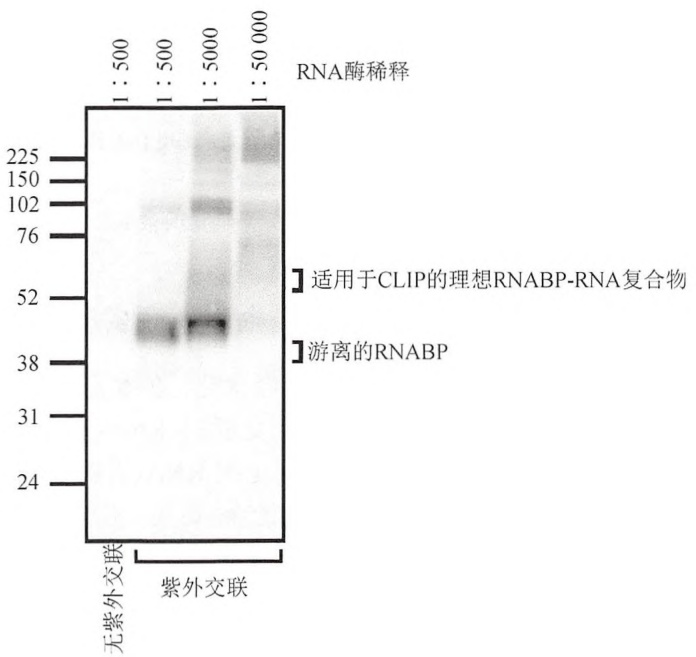

磁珠上释放，用变性 SDS-PAGE 凝胶进行电泳并转移到硝酸纤维素膜上（两个重要的纯化步骤），之后进行放射自显影。（箭头 7，见方案 5）从硝酸纤维素膜上切取放射性的 RNABP-RNA 复合物，用蛋白酶 K 消化去掉 RNABP，洗脱 RNA，再用酚:氯仿抽提，最后进行乙醇沉淀。（箭头 8，见方案 5）在 RNA 的 5' 端加上第二个接头。（箭头 9，见方案 5 和 6）对 RNA 进行 RT-PCR 扩增及测序（彩图请扫封底二维码）。

## 高通量测序（HITS）CLIP

最早进行 CLIP 实验时，340 个单一的 Nova 结合 RNA 序列测序成本约 4000 美元（Ule et al. 2003）。少量的标签不足以完全囊括 Nova 与 RNA 相互作用的种类。后来用高通量测序 CLIP（HITS-CLIP 或 CLIP-seq）对这些研究进行了扩展。2008 年用 HITS-CLIP 技术对相同的 RNA-蛋白质相互作用进行重新分析，同样的 4000 美元成本鉴定出多达 1000 倍的单一序列标签。单个 RNA 标签的价格持续大幅下降。鉴于获得如此庞大的数据集，利用生物信息学方法分析 RNA CLIP 标签成为所有 HITS-CLIP 研究的一个重要组成部分。

HITS-CLIP 得到的 RNA-蛋白质图谱可以结合其他研究的结果一起来揭示结合位点与蛋白质和 RNA 功能之间的关系。例如，结合生物信息学研究（Ule et al. 2006），RNA-蛋白质图谱显示结合位点决定了 Nova 介导的剪接调控结果（包含或排除外显子）（Licatalosi et al. 2008）。随后的研究，包括 PTB 的 HITS-CLIP（Xue et al. 2009）结合 PTB-依赖的 RNA 剪接变异体功能分析（Llorian et al. 2010），以及其他 RNA 结合蛋白- Fox2、hnRNP C、hnRNPL、TIA1/2、TDP-43、MBNL 和 CELF 蛋白（Yuan et al. 2007; Kalsotra et al. 2008; Zhang et al. 2008; Yeo et al. 2009; Du et al. 2010; Chen and Manley 2009; Tollervey et al. 2011; Witten and Ule 2011）的相关研究都使人们意识到这种位置依赖的剪接图谱是普遍现象。它们揭示了同样适合许多 RNA 结合蛋白的剪接调控规则（Chen and Manley 2009; Corrionero and Valcarcel 2009; Licatalosi and Darnell 2010; Witten and Ule 2011）。HITS-CLIP 还揭示 Nova 在可变聚腺苷酸化调控中发挥作用（Licatalosi et al. 2008）。hnRNP C 的 HITS-CLIP 研究则提示蛋白质可以形成类似于 DNA 核小体的高度有序的 RNA-蛋白复合物，从而在剪接抑制中发挥重要作用（Konig et al. 2010）。最后，用 HITS-CLIP 对 Argonaute（AGO）足迹进行全基因组绘图发现了许多位于 3'非翻译区之外的结合位点，这暗示在 RNA 转录物上有新的 Ago-miRNA 调控点（Chi et al. 2009; Hafner et al. 2010; Zisoulis et al. 2010）。HITS-CLIP 技术的这些应用为传统调控机制的研究方法提供了一个新的帮手（Sharp 2009; Xue et al. 2009; Nilsen and Graveley 2010）。

## CLIP 结果验证

要获得功能性 RNA-蛋白质图谱，把 CLIP 产生的物理 RNA-蛋白质的相互作用的种类与可检测到的 RNA 变体关联起来是非常有价值的。例如，在不同组织或遗传背景下进行 RNA-seq 分析，再结合生物信息学分析，这就能提供一个鉴定功能性 RNA-蛋白质图谱的通用方法（Licatalosi and Darnell 2010）。通常情况下，这些类似的实验协同 CLIP 数据可以带来新的生物学见解。例如，CLIP 数据可以与下列分析研究结合，如单独的 RNA 微阵列分析（Ule et al. 2005; Licatalosi et al. 2008; Daughters et al. 2009; Yeo et al. 2009）、RNA 序列分析（Bohnsack et al. 2009; Chi et al. 2009; Hafner et al. 2010; Llorian et al. 2010; Zisoulis et al. 2010）、RNA-蛋白质相互作用功能鉴定（Chi et al. 2009; Darnell et al. 2011）、生理功能（Huang et al. 2005; Ruggiu et al. 2009），甚至 RNA 定位（Racca et al. 2010）或细胞迁移（Yano et al. 2010）的细胞学研究。

CLIP 数据与其他类型数据的交叉验证的例子包括:Fox2 研究（Yeo et al. 2009）与张等（2008）进行的独立生物信息学验证的数据，PTB 研究（Xue et al. 2009）与生物化学和生物信息学独立评估的数据（Gama-Carvalho et al. 2006; Boutz et al. 2007; Xing et al. 2008; Llorian et al. 2010）。独立确证 CLIP 研究的例子还包括一些由不同的实验室独立进行的类似研究，如同 Ago 的 HITS-CLIP 研究（Chi et al. 2009; Hafner et al. 2010; Zisoulis et al. 2010）。

## CLIP 方法演化

基本的 CLIP 方法已经发生演化，并可能继续发展（表 21-2）。这些方法有共同的特性:在活细胞中紫外照射交联 RNA-蛋白质复合物，然后在严谨条件下纯化 RNA-蛋白质复合物，部分消化 RNA，以产生可克隆的片段，连接接头以进行 RT-PCR 扩增和 cDNA 测序（或在新出现的方法中，可直接进行 RNA 测序）（Ozsolak et al. 2009）。一种改进的方法是在 CLIP 之前将蛋白质带上标签以进行蛋白纯化[cross-linking reactions and purification, or cross-linking and analyses of cDNA（CRAC）]（Granneman et al. 2009）。在 CRAC 中引入标签蛋白或许是有用的，但对于其他 RNA 结合蛋白纯化手段并不合适，尽管当目的是识别生物相关位点时，关注化学计量很重要。鉴定交联位点的方法包括:监测反转录酶的中止 [individual nucleotide resolution UV cross-linking and immunoprecipitation （iCLIP）]（Konig et al. 2010），以及在组织培养细胞的 RNA 中掺入 4-硫尿核苷后鉴定核苷酸的变化 [photoactivatable-ribonucleoside-enhanced cross-linking and immunoprecipitation（PAR-CLIP）]（Hafner et al. 2010）。这些信息也可以通过对序列错误进行生物信息学分析或分析基本 CLIP 方案中反转录中止位点获得（Ule et al. 2005; Granneman et al. 2009; Konig et al. 2010; Zhang and Darnell 2011）。

表 21-2 CLIP 方法的演化

| 名称 | 描述 | 优点 | 缺点 | 参考文献 |
| --- | --- | --- | --- | --- |
| CLIP | 最早用来在小鼠脑组织交联 RNA-蛋白复合物的方案。见表21-1 | 便宜,被充分验证 | 低复杂度,需要针对内源蛋白的免疫沉淀抗体 | Ule et al. 2003, 2005;Jensen and Darnell 2008;http://lab.rockefelleredu/darnell/methods/CLIP |
| HITS-CLIP | 使用下一代测序建立全基因组RNA-蛋白质图谱。最初用于小鼠脑组织。见表21-1 | 高复杂度,被充分验证,可通过突变鉴定 RNA-蛋白质交联位点 |  | Licatalosi et al. 2008 |
| Crac CLIP | 使用亲和标签免疫沉淀 RNABP | 在缺乏针对内源蛋白的免疫沉淀抗体时可用 | 除非在内源位点插入标签,RNABP的化学计量及RNA图谱可能受到影响。RNABP-标签融合载体可能影响RNA结合特性 | Granneman et al. 2009 |
| PAR-CLIP | 4-硫代鸟苷掺入到RNA,可提高交联效率 | 如果需要高交联效率,或天然蛋白交联效率低时有帮助;可以确定RNA-蛋白作用位点 | 目前局限于培养细胞;4-硫代鸟苷对细胞有毒性;T-C转换得分分析限制了CLIP序列间隔 | Hafner et al. 2010 |
| iCLIP | 将反转录酶停顿位点确定到氨基酸-核苷酸交联位点附近的CLIP变种 | 能够确定 RNA-蛋白交联位点可高效俘获交联的RNA标签 | 需要针对内源蛋白进行免疫沉淀 | Konig et al. 2010 |

CLIP 是相对较新的技术，并通过许多实验室不断改进（Darnell 2010）。对多数应用来说，这里所描述的基本 CLIP 方案所产生的数百万 CLIP 标签通过生物信息学筛选足以获得数十万单一 CLIP 标签，这些单一 CLIP 标签可用来生成翔实的全基因组 RNA 图谱。

## CLIP 实验设计原则

在对一个感兴趣的 RNA 结合蛋白进行 CLIP 实验前，有几个问题需要考虑。一个关键的决定是起始材料的选择。CLIP 的一个主要优点是，它通过紫外线处理完整的细胞或生物体组织瞬时固定了 RNA 结合蛋白和 RNA 之间的结合，从而能检测到生理性相互作用。因此，对生物体、组织和发育状态的选择是非常关键的，而对诸如细胞或神经元活性的扰动控制及生物学相关问题是能而且应该谨慎选择的。另一个关键因素是在交联后成功地纯化 RNABP-RNA 复合物，这一般使用免疫沉淀方法。因为 RNA-蛋白质相互作用对化学计量是敏感的（如过表达的蛋白质或导致非特异的 RNA 相互作用），如果可能的话，提倡使用针对内源蛋白的抗体进行免疫沉淀，这有利于获得生理相关的 RNA-蛋白质相互作用。如果实在无法实现，过表达带标签的 RNA 结合蛋白也可以考虑。这时，须尽可能使表达水平接近生理水平，因此在内源位点敲入一个标签要优于表达一个 cDNA 转基因。

因为基本的 CLIP 技术依赖于免疫沉淀作为一个主要的纯化步骤（虽然从理论上讲，任何蛋白质纯化手段都可以使用），免疫沉淀的质量常常是每个 CLIP 实验的限制因素。本章提供了几个预试验方案，用以评估 CLIP 实验的灵敏度和特异性（例如，方案 1 和方案 3）。一般说来，由于交联导致共价键结合，可以在严谨的条件下进行免疫沉淀和洗涤，而不必担心丢失 RNABP-RNA 相互作用。当然，抗体-RNABP 的相互作用强度还是需要考虑的。按下面方案所描述的方法，花些时间用渐次增强的洗涤条件评估最高严谨度是非常值得的，这样可以获得真正需要的 RNA-蛋白质复合物。

方案2～5是典型的CLIP实验。因为需要在硝酸纤维膜上进行曝光并分析RNABP-RNA复合物，在方案4和方案5之间有一个自然的中止点。此时，滤膜可以在-80℃无限期保存，将来可以切下条带。曝光并分析方案4的结果后，就会发现有必要从头开始实验，以增加起始材料或稍稍调整纯化步骤。一旦各项实验因素都得到优化后（方案1），一个完整的CLIP实验可以在一个星期完成。随后进行的RNA测序（方案6）和生物信息学分析将完成整个HITS-CLIP实验。

## 致谢

我们感谢 Robert Darnell 实验室过去和现在的成员为最初建立、使用 CLIP 方法（特别是 Kirk Jensen 和 Jernej Ule）和应用高通量测序技术（特别是 Donny Licatalosi、Sung Wook Chi 和 Chaolin Zhang）所做的贡献。我们感谢实验室成员在实验方案改进和多个 RNA 结合蛋白中的应用，以及对目前方案的审阅中做出的贡献。此外，我们感谢所有分享 CLIP 技术使用经验的研究者。本研究方案及相关问题和评注都在我们的 CLIP 论坛上（http://lab.rockefeller.edu/darnell/），欢迎大家浏览。

## 参考文献

- Alexander P, Moroson H. 1962. Cross-linking of deoxyribonucleic acid to protein following ultra-violet irradiation of different cells. Nature 194:882–883.
- Becht P, Konig J, Feldbrugge M. 2006. The RNA-binding protein Rrm4 is essential for polarity in Ustilago maydis and shuttles along microtubules. J Cell Sci 119: 4964–4973.
- Bohnsack MT, Martin R, Granneman S, Ruprecht M, Schleiff E, Tollervey D. 2009. Prp43 bound at different sites on the pre-rRNA performs distinct functions in ribosome synthesis. Mol Cell 36: 583–592.
- Boutz PL, Stoilov P, Li Q, Lin CH, Chawla G, Ostrow K, Shiue L, Ares MJ, Black DL. 2007. A post-transcriptional regulatory switch in polypyrimidine tract-binding proteins reprograms alternative splicing in developing neurons. Genes Dev 21: 1636–1652.
- Brimacombe R, Stiege W, Kyriatsoulis A, Maly P. 1988. Intra-RNA and RNA-protein cross-linking techniques in Escherichia coli ribosomes. Methods Enzymol 164: 287–309.
- Cech TR. 2009. Crawling out of the RNA world. Cell 136: 599–602.
- Chen M, Manley JL. 2009. Mechanisms of alternative splicing regulation: Insights from molecular and genomics approaches. Nat Rev Mol Cell Biol 10: 741–754.
- Chi SW, Zang JB, Mele A, Darnell RB. 2009. Argonaute HITS-CLIP decodes microRNA-mRNA interaction maps. Nature 460: 479–486.
- Corrionero A, Valcarcel J. 2009. RNA processing: Redrawing the map of charted territory. Mol Cell 36: 918–919.
- Darnell RB. 2010. HITS-CLIP: Panoramic views of protein–RNA regulation in living cells. Wiley Interdiscip Rev RNA 1: 266–286.
- Darnell JC, Van Driesche SJ, Zhang C, Hung KY, Mele A, Fraser CE, Stone EF, Chen C, Fak JJ, Chi SW, et al. 2011. FMRP stalls ribosomal translocation on mRNAs linked to synaptic function and autism. Cell 146:247–261.
- Daughters RS, Tuttle DL, Gao W, Ikeda Y, Moseley ML, Ebner TJ, Swanson MS, Ranum LP. 2009. RNA gain-of-function in spinocerebellar ataxia type 8. PLoS Genet 5: e1000600. doi: 10.1371/journal.pgen.1000600.
- Dreyfuss G, Choi YD, Adam SA. 1984. Characterization of heterogeneous nuclear RNA–protein complexes in vivo with monoclonal antibodies. Mol Cell Biol 4: 1104–1114.
- Du H, Cline MS, Osborne RJ, Tuttle DL, Clark TA, Donohue JP, Hall MP, Shiue L, Swanson MS, Thornton CA, et al. 2010. Aberrant alternative splicing and extracellular matrix gene expression in mouse models of myotonic dystrophy. Nat Struct Mol Biol 17: 187–193.
- Fecko CJ, Munson KM, Saunders A, Sun G, Begley TP, Lis JT, Webb WW. 2007. Comparison of femtosecond laser and continuous wave UV sources for protein–nucleic acid crosslinking. Photochem Photobiol 83: 1394–1404.
- Gama-Carvalho M, Barbosa-Morais NL, Brodsky AS, Silver PA, Carmo-Fonseca M. 2006. Genome-wide identification of functionally distinct subsets of cellular mRNAs associated with two nucleocytoplasmic-shuttling mammalian splicing factors. Genome Biol 7: R113. doi:10.1186/gb-2006-7-11-r113.
- Gilmour DS, Lis JT. 1984. Detecting protein–DNA interactions in vivo: Distribution of RNA polymerase on specific bacterial genes. Proc Natl Acad Sci 81: 4275–4279.
- Granneman S, Kudla G, Petfalski E, Tollervey D. 2009. Identification of protein binding sites on U3 snoRNA and pre-rRNA by UV cross-linking and high-throughput analysis of cDNAs. Proc Natl Acad Sci 106:9613–9618.
- Guil S, Caceres JF. 2007. The multifunctional RNA-binding protein hnRNP A1 is required for processing of miR-18a. Nat Struct Mol Biol 14: 591–596.
- Hafner M, Landthaler M, Burger L, Khorshid M, Hausser J, Berninger P, Rothballer A, Ascano MJ, Jungkamp AC, Munschauer M, et al. 2010. Transcriptome-wide identification of RNA-binding protein and microRNA target sites by PAR-CLIP. Cell 141: 129–141.
- Huang CS, Shi SH, Ule J, Ruggiu M, Barker LA, Darnell RB, Jan YN, Jan LY. 2005. Common molecular pathways mediate long-term potentiation of synaptic excitation and slow synaptic inhibition. Cell 123: 105–118.
- Ilyin YV, Georgiev GP. 1969. Heterogeneity of deoxynucleoprotein particles as evidenced by ultracentrifugation of cesium chloride density gradient. J Mol Biol 41: 299–303.
- Jensen KB, Darnell RB. 2008. CLIP: Crosslinking and immunoprecipitation of in vivo RNA targets of RNA-binding proteins. Methods Mol Biol 488: 85–98.
- Kalsotra A, Xiao X, Ward AJ, Castle JC, Johnson JM, Burge CB, Cooper TA. 2008. A postnatal switch of CELF and MBNL proteins reprograms alternative splicing in the developing heart. Proc Natl Acad Sci 105:20333–20338.
- Konig J, Zarnack K, Rot G, Curk T, Kayikci M, Zupan B, Turner DJ, Luscombe NM, Ule J. 2010. iCLIP reveals the function of hnRNP particles in splicing at individual nucleotide resolution. Nat Struct Mol Biol 17:909–915.
- Kuo MH, Allis CD. 1999. In vivo cross-linking and immunoprecipitation for studying dynamic protein: DNA associations in a chromatin environment. Methods 19: 425–433.
- Lebedeva S, Jens M, Theil K, Schwanhäusser B, Selbach M, Landthaler M,
- Rajewsky N. 2011. Transcriptome-wide analysis of regulatory interactions of the RNA-binding protein HuR. Mol Cell 43: 340–352.
- Leung AK, Young AG, Bhutkar A, Zheng GX, Bosson AD, Nielsen CB, Sharp PA. 2011. Genome-wide identification of Ago2 binding sites from mouse embryonic stem cells with and without mature microRNAs. Nat Struct Mol Biol 18: 237–244. (Erratum. 2011. Nat Struct Mol Biol 18: 1084.)
- Li Y, Bor YC, Misawa Y, Xue Y, Rekosh D, Hammarskjold ML. 2006. An intron with a constitutive transport element is retained in a Tap messenger RNA. Nature 443: 234–237.
- Licatalosi DD, Darnell RB. 2010. RNA processing and its regulation: Global insights into biological networks. Nat Rev Genet 11: 75–87.
- Licatalosi DD, Mele A, Fak JJ, Ule J, Kayikci M, Chi SW, Clark TA, Schweitzer AC, Blume JE, Wang X, et al. 2008. HITS-CLIP yields genome-wide insights into brain alternative RNA processing. Nature 456: 464–469.
- Llorian M, Schwartz S, Clark TA, Hollander D, Tan LY, Spellman R, Gordon A, Schweitzer AC, de la Grange P, Ast G, et al. 2010. Position-dependent alternative splicing activity revealed by global profiling of alternative splicing events regulated by PTB. Nat Struct Mol Biol 17:1114–1123.
- Mayrand S, Pederson T. 1981. Nuclear ribonucleoprotein particles probed in living cells. Proc Natl Acad Sci 78: 2208–2212.
- Mayrand S, Setyono B, Greenberg JR, Pederson T. 1981. Structure of nuclear ribonucleoprotein: Identification of proteins in contact with poly(A) $^{+}$ heterogeneous nuclear RNA in living HeLa cells. J Cell Biol 90: 380–384.
- Michlewski G, Guil S, Semple CA, Caceres JF. 2008. Posttranscriptional regulation of miRNAs harboring conserved terminal loops. Mol Cell 32: 383–393.
- Mili S, Steitz JA. 2004. Evidence for reassociation of RNA-binding proteins after cell lysis: Implications for the interpretation of immunoprecipitation analyses. RNA 10: 1692–1694.
- Mukherjee N, Corcoran DL, Nusbaum JD, Reid DW, Georgiev S, Hafner M, Ascano M Jr, Tuschl T, Ohler U, Keene JD. 2011. Integrative regulatory mapping indicates that the RNA-binding protein HuR couples pre-mRNA processing and mRNA stability. Mol Cell 43: 327–339.
- Newman MA, Thomson JM, Hammond SM. 2008. Lin-28 interaction with the Let-7 precursor loop mediates regulated microRNA processing. RNA 14: 1539–1549.
- Nilsen TW, Graveley BR. 2010. Expansion of the eukaryotic proteome by alternative splicing. Nature 463: 457–463.
- Ozsolak F, Platt AR, Jones DR, Reifenberger JG, Sass LE, McInerney P, Thompson JF, Bowers J, Jarosz M, Milos PM. 2009. Direct RNA sequencing. Nature 461: 814–818.
- Racca C, Gardiol A, Eom T, Ule J, Triller A, Darnell RB. 2010. The neuronal splicing factor Nova co-localizes with target RNAs in the dendrite. Front Neural Circuits 4: 5.
- Ruggiu M, Herbst R, Kim N, Jevsek M, Fak JJ, Mann MA, Fischbach G, Burden SJ, Darnell RB. 2009. Rescuing Z+ agrin splicing in Nova null mice restores synapse formation and unmasks a physiologic defect in motor neuron firing. Proc Natl Acad Sci 106: 3513–3518.
- Sanford JR, Coutinho P, Hackett JA, Wang X, Ranahan W, Caceres JF. 2008. Identification of nuclear and cytoplasmic mRNA targets for the shuttling protein SF2/ASF. PLoS ONE 3: e3369. doi: 10.1371/journal.pone.0003369.
- Sanford JR, Wang X, Mort M, Vanduyn N, Cooper DN, Mooney SD, Edenberg HJ, Liu Y. 2009. Splicing factor SFRS1 recognizes a functionally diverse landscape of RNA transcripts. Genome Res 19: 381–394.
- Schoemaker HJ, Schimmel PR. 1974. Photo-induced joining of a transfer RNA with its cognate aminoacyl-transfer RNA synthetase. J Mol Biol 84: 503–513.
- Sharp PA. 2009. The centrality of RNA. Cell 136: 577–580.
- Smith KC. 1962. Dose dependent decrease in extractability of DNA from bacteria following irradiation with ultraviolet light or with visible light plus dye. Biochem Biophys Res Commun 8: 157–163.
- Solomon MJ, Varshavsky A. 1985. Formaldehyde-mediated DNA-protein crosslinking: A probe for in vivo chromatin structures. Proc Natl Acad Sci 82: 6470–6474.
- Tollervey JR, Curk T, Rogelj B, Briese M, Cereda M, Kayikci M, König J, Hortobágyi T, Nishimura AL, Zupunski V, et al. 2011. Characterizing the RNA targets and position-dependent splicing regulation by TDP-43. Nat Neurosci 14: 452–458.
- Ule J, Jensen K, Mele A, Darnell RB. 2005. CLIP: A method for identifying protein–RNA interaction sites in living cells. Methods 37: 376–386.
- Ule J, Jensen KB, Ruggiu M, Mele A, Ule A, RB Darnell. 2003. CLIP identifies Nova-regulated RNA networks in the brain. Science 302: 1212–1215.
- Ule J, Stefani G, Mele A, Ruggiu M, Wang X, Taneri B, Gaasterland T, Blencowe BJ, Darnell RB. 2006. An RNA map predicting Novadependent splicing regulation. Nature 444: 580–586.
- Urlaub H, Hartmuth K, Luhrmann R. 2002. A two-tracked approach to analyze RNA-protein crosslinking sites in native, nonlabeled small
- nuclear ribonucleoprotein particles. Methods 26: 170–181.
- Wang Z, Kayikci M, Briese M, Zarnack K, Luscombe NM, Rot G, Zupan B, Curk T, Ule J. 2010. iCLIP predicts the dual splicing effects of TIA-RNA interactions. PLoS Biol 8: e1000530. doi: 10.1371/journal.pbio.1000530.
- Witten JT, Ule J. 2011. Understanding splicing regulation through RNA splicing maps. Trends Genet 27: 89–97.
- Wolf JJ, Dowell RD, Mahony S, Rabani M, Gifford DK, Fink GR. 2010. Feed-forward regulation of a cell fate determinant by an RNA-binding protein generates asymmetry in yeast. Genetics 185: 513–522.
- Wurtmann EJ, Wolin SL. 2010. A role for a bacterial ortholog of the Ro autoantigen in starvation-induced rRNA degradation. Proc Natl Acad Sci 107: 4022–4027.
- Xing Y, Stoilov P, Kapur K, Han A, Jiang H, Shen S, Black DL, Wong WH. 2008. MADS: A new and improved method for analysis of differential alternative splicing by exon-tiling microarrays. RNA 14:1470–1479.
- Xu M, Medvedev S, Yang J, Hecht NB. 2009. MIWI-independent small RNAs (MSY-RNAs) bind to the RNA-binding protein, MSY2, in male germ cells. Proc Natl Acad Sci 106: 12371–12376.
- Xue Y, Zhou Y, Wu T, Zhu T, Ji X, Kwon YS, Zhang C, Yeo G, Black DL, Sun H, et al. 2009. Genome-wide analysis of PTB–RNA interactions reveals a strategy used by the general splicing repressor to modulate exon inclusion or skipping. Mol Cell 36: 996–1006.
- Yano M, Hayakawa-Yano Y, Mele A, Darnell RB. 2010. Nova2 regulates neuronal migration through an RNA switch in disabled-1 signaling. Neuron 66: 848–858.
- Yeo GW, Coufal NG, Liang TY, Peng GE, Fu XD, Gage FH. 2009. An RNA code for the FOX2 splicing regulator revealed by mapping RNA-protein interactions in stem cells. Nat Struct Mol Biol 16: 130–137.
- Yuan Y, Compton SA, Sobczak K, Stenberg MG, Thornton CA, Griffith JD, Swanson MS. 2007. Muscleblind-like 1 interacts with RNA hairpins in splicing target and pathogenic RNAs. Nucleic Acids Res 35: 5474–5486
- Zhang C, Darnell RB. 2011 Mapping in vivo protein–RNA interactions at single-nucleotide resolution from HITS-CLIP data. Nat Biotechnol 29:607–614 (also see online Methods section; doi:10.1038/nbt.1873).
- Zhang C, Zhang Z, Castle J, Sun S, Johnson J, Krainer AR, Zhang MQ. 2008. Defining the regulatory network of the tissue-specific splicing factors Fox-1 and Fox-2. Genes Dev 22: 2550–2563.
- Zhang C, Frias MA, Mele A, Ruggiu M, Eom T, Marney CB, Wang H, Licatalosi DD, Fak JJ, Darnell RB. 2010. Integrative modeling defines the Nova splicing-regulatory network and its combinatorial controls. Science 329: 439–443.
- Zisoulis DG, Lovci MT, Wilbert ML, Hutt KR, Liang TY, Pasquinelli AE, Yeo GW. 2010. Comprehensive discovery of endogenous Argonaute binding sites in Caenorhabditis elegans. Nat Struct Mol Biol 17: 173–179.

## 方案 1 CLIP 实验免疫沉淀严谨性的优化

该方案旨在为 CLIP 实验优化 RNABP 纯化方法。需要评估的关键变量是确定抗体的质量及用以免疫沉淀大部分但非全部 RNABP 的抗体使用量（抗体滴定会减少非特异结合），以及确定抗体-抗原相互作用对严谨洗涤条件的耐受性。这些实验的结果可先用免疫印迹验证，然后再用 CLIP 预实验方案确认（如方案 3 所描述）。请注意，二者是完全不同的试验，免疫印迹或许显示结果非常干净，因为免疫印迹无法检测到与一个无关 RNA 结合蛋白交联的污染 RNA，但 CLIP 预实验通过放射自显影就可以检测到。因此，在用不同方法洗涤后，免疫印迹主要用来确定有多少 RNABP 被免疫沉淀下来并保留在珠子上，而 CLIP 预实验则用来评估交联到感兴趣 RNABP 上的 RNA 纯度。一旦预实验结束，最优化的免疫沉淀条件就应该用到正常的 CLIP 实验中，包括交联、RNA 酶消化、接头连接、RNA 标签标记以及放射自显影结果分析，这些在方案 3 和方案 4 中讨论。

## 实验材料

为正确使用本方案中的器材和危险试剂，必须查阅相应的材料安全数据表并咨询所在机构的环境卫生和安全办公室。

本方案的专用试剂标注&lt;R&gt;，配方在本方案末提供。常用储备溶液、缓冲液和试剂标注&lt;A&gt;，配方见附录1。储备溶液应稀释至适用浓度后使用。

## 试剂

需验证的抗体

珠子洗涤缓冲液（BWB）（PBS，pH 7.4，含 0.02% Tween20）

细胞或组织裂解物（按方案2制备）

蛋白A或蛋白G偶联的Dynabeads磁珠（Life Technologies公司，目录号100-01D/100-03D）

高盐洗涤缓冲液&lt;R&gt;

高严谨性免疫沉淀洗涤缓冲液&lt;R&gt;

上样缓冲液(4×)(NuPAGE LDS 样品缓冲液; Life Technologies 公司, 目录号 NP0008)

低盐洗涤缓冲液&lt;R&gt;

温和免疫沉淀洗涤缓冲液&lt;R&gt;

中度免疫沉淀洗涤缓冲液（参见  $1 \times$  PXL 洗涤缓冲液）&lt;R&gt;

NuPAGE MOPS 或 MES 电泳缓冲液（20×）（Life Technologies 公司，目录号 NP0001 或 NP0002）

NuPAGE 样品还原剂（10×）（Life Technologies 公司，目录号 NP0004）

NuPAGE 转移缓冲液（20×）（Life Technologies 公司，目录号 NP00061）

无 RNA 酶水（配制缓冲液用）（如 Applied Biosystems/Ambion 公司，目录号 4387936）

## 设备

冷室

适用于微量离心管的旋转式混合器（免疫沉淀过程中保持珠子处于悬浮状态）

磁珠聚集装置（Life Technologies 公司，目录号 123-21D）

微量离心管[National Scientific Supply 公司，SlickSeal tubes（无 RNA 酶），目录号 CN170S-GT，VWR#20172-945]

微型凝胶转移装置（如 XCell II 印迹模块；Life Technologies 公司）和供电源

硝酸纤维膜[如 Optitran BA-S 83 或 85（增强硝酸纤维膜；Whatman 公司），Immobilon-P（PVDF；Millipore 公司），或 Protran BA85（纯硝酸纤维膜；Whatman 公司）]

我们在 CLIP 实验中使用 Protran BA85 分析 RNABP-RNA 复合物。

Novex NuPage Bis-Tris 凝胶和凝胶电泳装置（Life Technologies 公司）

恒温混合仪

## 方法

## 制备加载抗体的磁珠

1. 在无 RNA 酶微量离心管中对  $400 \mu L$  蛋白 A Dynabead 磁珠进行清洗，洗 3 次，每次用 1 mL BWB 缓冲液。

厂商的操作手册上包含了重要的有关 Dynabead 磁珠及磁架的辅助信息和操作小贴士。

2. 在 BWB 缓冲液中重悬磁珠，并加入  $32 \mu g$  相应抗体，总体积为  $400 \mu L$ 。在室温旋转孵育 30min。

如果使用桥接抗体（如 Fc 片段特异的兔抗鼠 IgG，Jackson ImmunoResearch 公司，315-001-008），加入 32μg 桥接抗体，室温翻转混合孵育 30min，用 1mL BWB 洗 3 次。再用最初体积（小于加入抗体后的体积）的 BWB 重悬，加入 64μg 按 1:1 混合的两种针对不同蛋白表位的单克隆抗体。在室温旋转孵育 30min。

蛋白 A Dynabead 磁珠的结合能力大约是每  $100 \mu L$  重悬磁珠可结合  $8 \mu g$  人的 IgG。抗体结合到磁珠上须按照最初的磁珠体积操作（这里是  $400 \mu L$ ，但可根据需要及抗体进行调整）。

3. 用 $1 \mathrm{~mL} 1 \times \mathrm{BWB}$ 缓冲液洗涤加载抗体的磁珠, 洗 3 次。

磁珠可用手颠倒几次重悬，但用旋转混合器让磁珠完全重悬更方便一些。

4. 洗完后，用最初体积的 $1 \times \mathrm{BWB}$ 缓冲液（这里是 $400\mu \mathrm{L}$ ）重悬，置于冰上直至使用。

## 免疫沉淀和洗涤预实验

5. 按照方案 2 或根据具体实验修改的条件制备细胞或组织的裂解物。

需注意的是，在完整的 CLIP 方案中，裂解前的细胞或组织先要进行交联。但在免疫沉淀预实验中，免疫印迹用来评估抗原的消耗，交联步骤可以省略。

方案 2 是用类似于 RIPA 的变性缓冲液制备裂解物的标准方法。针对这种免疫沉淀预实验，除了变性裂解物，非变性裂解物也应该用作温和免疫沉淀的起始材料。

6. 在免疫沉淀前保留少量裂解物以用于免疫印迹分析，这是免疫沉淀实验的“input”。

裂解物保留量取决于蛋白检测的难易程度。一般来说，20μL 裂解物组分可与 5μL 5×上样缓冲液混合。尽管这样就可以检测到许多蛋白质，但要检测其他蛋白质则需要用三氯乙酸（TCA）对较大体积的裂解物进行沉淀。需注意的是，在标准 SDS-PAGE 微型凝胶的每个泳道的上样体积超过 100μL 后，会导致异常迁移及条带拖尾。

7. 将步骤 4 准备的加载了抗体的磁珠加入到细胞裂解物中。抗体使用量取决于监测蛋白消耗的预实验结果及有效抗原量和所用抗体亲和力等因素。

举例:对小鼠脑组织的 Nova CLIP 实验来说，在 300mg 交联的小鼠脑组织裂解物中加入 400μL 加载的蛋白 G Dynabead 磁珠[24μg 羊抗 Nova2 抗体（C-16，sc-10546）结合到 400μL Dynabead 磁珠]。

8. 加载的磁珠和细胞/组织裂解物在  $4^{\circ}$ C 旋转孵育 2h，然后用磁架富集复合物。保留  $10 \sim 20 \mu L$  上清，通过免疫印迹分析抗原吸附程度。

需要注意的是，免疫沉淀后的上清被所加的磁珠稀释了，所以用于免疫印迹分析的量必须进行相应调整。可以把缓冲液加入到原裂解样品中，稀释到免疫沉淀后上清相应的浓度。

9. 把磁珠分成几份，分别按照下面所述的温和、中度及严谨的条件进行洗涤。所有洗涤的体积都是 1mL，在旋转混合器上旋转 2～4min 进行完全重悬。洗涤时更换离心管也有助于减少免疫沉淀的背景。

i. 温和洗涤条件:用温和免疫沉淀洗涤缓冲液洗 4 次。

ii. 中度洗涤条件:用中度免疫沉淀洗涤缓冲液（1×PXL 洗涤缓冲液）洗 4 次。

iii. 严谨洗涤条件:先用高严谨性免疫沉淀洗涤缓冲液洗一次，再用高盐洗涤缓冲液洗一次，最后用低盐洗涤缓冲液洗两次。

10. 最后一次洗完后，用加了还原剂的 $1 \times$ NuPage LDS 上样缓冲液进行重悬。如果 RNABP 在胶上与 IgG 的轻重链大小相近，样品还原剂可以不用。

在标准的 SDS 样品缓冲液加热到  $90^{\circ}$ C 后，蛋白 A 会从 Dynabead 磁珠上脱落，导致凝胶上背景很高并模糊所感兴趣的条带。替代方案是用 NuPAGE LDS 上样缓冲液，加热不要超过  $70^{\circ}$ C，这一方案已被成功地用来评估免疫沉淀反应。

11. 在恒温混合仪上将重悬的磁珠于  $70^{\circ}$ C 振摇 10min。下一步是用 Novex NuPage 凝胶对重悬液、此前保留的 Input 裂解物和上清液进行电泳，分析你感兴趣的 RNABP（见方案 3）。再转膜进行免疫印迹分析。

12. 用免疫印迹分析比较等量 Input、免疫沉淀后的上清及免疫沉淀产物中 RNABP 的水平，判断免疫沉淀是否成功（见第 19 章，方案 19）。

见“疑难解答”。

## 疑难解答

问题（步骤12）:免疫沉淀后上清中RNABP的水平与Input的相似，表明免疫沉淀过程只从“input”中去除了极少量的抗原。

解决方案:如果在最温和的免疫沉淀条件下，确实获得了这样的结果，可能是抗体使用量不够。另一种可能性是，裂解物制备时没有完全变性，免疫沉淀时抗原表位被隐蔽而没有充分暴露。例如，一个核糖体蛋白被埋在完整的核糖体中，就需要很强的变性处理。如果抗体识别的是天然表位（适当的折叠）的话，也可能是变性条件太强导致抗原表位被破坏。

问题（步骤 12）:在免疫沉淀后的上清中，抗原从 input 中清除，但在免疫沉淀产物中也没有。

解决方案:可能是由于抗体抗原反应亲合力低或者抗体与蛋白A磁珠的结合能力低，在洗涤过程中复合物丢失。免疫沉淀中用的许多小鼠IgG亚型与蛋白A的亲合力较低。替代方法:选用蛋白G，共价交联抗体到激活的磁珠上；或按照方案所述，使用兔抗鼠的IgG桥接抗体。在极少情况下，可能是抗原没有从磁珠上释放出来。确认一下样品缓冲液中的还原剂是否过期以及样品是否确实加热到 $70^{\circ}\mathrm{C}$ 。如果需要，可采用更强的条件让抗原从磁珠上释放出来（加热到 $95^{\circ}\mathrm{C}$，加β-巯基乙醇），但这样磁珠上的蛋白A会掉下来，并模糊RNABP条带。换一种二抗（如辣根过氧化物酶偶联的蛋白G）可以减轻这一问题。

问题（步骤 12）:只有在最温和条件下才能获得理想的抗原免疫沉淀效果。

解决方案:虽然这看起来不是问题，但实际上，我们发现如果温和的免疫沉淀是仅有的初始纯化步骤，很难获得干净的CLIP结果（与对照相比）。可以用另一个抗体或抗体组合试试。一般来说，多克隆抗体或混合的单克隆抗体比单个单克隆抗体具有更高的亲合力。如果没有其他抗体可用，可以用亚细胞组分进行温和免疫沉淀。如果这些方法都不行，可以使用带标签的RNABP，这可以通过转基因表达或敲入到内源位点等手段实现。后一种在内源基因上加标签的方法更适用，因为这样可以维持正常的RNABP表达模式。需要进行功能分析，以确保标签不影响蛋白质的功能。

问题（步骤12）:免疫印迹显示免疫沉淀产物有多条带，这显示免疫沉淀污染了其他蛋白质。

解决方案:这是否是一个问题，取决于其他蛋白质是否是RNA结合蛋白。这一问题在方案13的“疑难解答”部分解释的更详细，在方案3中，交联到免疫沉淀蛋白上的标记RNA可以显现出来。但需要注意的是，在CLIP实验中使用过量的抗体只会增加噪声，而不会增强检测信号。一旦选择了最佳的抗体、裂解物制备方案及洗涤缓冲液后，对加载了抗体的磁珠进行滴定就非常重要了。我们的目的是免疫沉淀下来大部分而不是全部RNABP，保证只有最强亲合力的免疫表位被沉淀下来，这可以通过检测在免疫沉淀后的上清中被消耗的蛋白质来实现。

## 讨论

优化 CLIP 的免疫沉淀中有 3 点需要注意:①细胞或组织裂解物的制备（见方案 2）；②抗体的选择；③洗涤条件的严谨性。

## 优化裂解物的制备

虽然本方案的目的是确定最佳的免疫沉淀严谨性，免疫沉淀用的裂解物制备也需要优化。方案2（1×PBS、0.1% SDS、0.5%脱氧胆酸钠和0.5% NP-40）中的方法适合大部分蛋白质-蛋白质相互作用和非交联的蛋白质-RNA相互作用。在某些条件下，用很强的变性条件（1%～2% SDS）完全解离RNP复合物是非常重要的。例如，在分析核糖体蛋白-RNA相互作用时，就需要克服核糖体和其他稳定RNP复合物对RIPA等常规IP缓冲液的抵抗作用。用最多含1% NP-40或Triton X-100的非变性缓冲液去裂解细胞，并以2000g离心去掉细胞核，这种处理方法对胞质RNABP来说是合适的。

准备最佳裂解物制备方案时，需要考虑下面几个因素:选用变性还是非变性条件；这些条件是否会导致感兴趣的 RNABP 从其他蛋白质（可能构成复合体）上解离。这对每个特定的 RNABP 来说都需要通过实验确定。查看已发表 CLIP 实验所使用的条件很有价值，CLIP 实验已经在整体组织（小鼠脑组织）、组织培养细胞、线虫、酵母、真细菌及真菌和其他物种中成功完成（Darnell 2010; Darnell et al. 2011）。

## 抗体选择

抗体选择对理想的 CLIP 实验来说是一个关键步骤。因为有多个免疫表位可以识别，多克隆抗体对抗原有更高的亲和力；但它们并不一定总是适用，因为低特异性或识别交叉反应表位，免疫沉淀下来其他蛋白质。尽管单克隆抗体亲和力低，但可能有助于解决这一问题。增加亲和力并能保持特异性的一个方法是，用识别同一个蛋白质不同表位的不同抗体混合物进行免疫沉淀反应。在严谨的洗涤条件下，使用桥接抗体（如 Fc 片段特异的兔抗鼠 IgG）增加蛋白 A 磁珠上小鼠 IgG 的滞留量，就可以达到这一目的（Darnell et al. 2011）。

## 洗涤条件的严谨性

在 CLIP 实验中要利用紫外照射导致的 RNA-蛋白质共价结合的优势，在最严谨而不丢失 RNABP 的条件下进行免疫沉淀反应是非常重要的（Darnell et al. 2011）。对新的抗体，我们都要在温和、中度及非常严谨的条件下进行筛选。

## 配方

为正确使用本方案中的器材和危险试剂，必须查阅相应的材料安全数据表并咨询所在机构的环境卫生和安全办公室。

CLIP 方案所用的所有试剂的制备和保存必须避免 RNA 酶的污染。见第 6 章关于实验室无 RNA 酶溶液的配制及 RNA 操作的通用准则。

高盐洗涤缓冲液

| 试剂 | 含量(1L) | 终浓度 |
| --- | --- | --- |
| Tris-HCl(1mol/L,pH 7.5) | 15mL | 15mmol/L |
| EDTA(0.5mol/L,pH 8.0) | 10mL | 5mmol/L |
| EGTA(0.5mol/L) | 5mL | 2.5mmol/L |
| Triton X-100 | 10mL | 1%(V/V) |
| Na-deoxycholate(DOC) | 10 g | 1%(m/V) |
| SDS(20%) | 5mL | 0.1%(V/V) |
| NaCl(5.0mol/L) | 200mL | 1mol/L |

用无 RNA 酶的水配至 1L，4℃储存。

高严谨性免疫沉淀洗涤缓冲液

| 试剂 | 含量(1L) | 终浓度 |
| --- | --- | --- |
| Tris-HCl(1mol/L,pH 7.5) | 15mL | 15mmol/L |
| EDTA(0.5mol/L,pH 8.0) | 10mL | 5mmol/L |
| EGTA(0.5mol/L) | 5mL | 2.5mmol/L |
| Triton X-100 | 10mL | 1%(V/V) |
| Na-deoxycholate(DOC) | 10g | 1%(m/V) |
| SDS(20%) | 5mL | 0.1%(V/V) |
| NaCl(5.0mol/L) | 24mL | 120mmol/L |
| KCl(1.0mol/L) | 25mL | 25mmol/L |

用无 RNA 酶的水配至 1L，4℃储存。

低盐洗涤缓冲液

| 试剂 | 含量(1L) | 终浓度 |
| --- | --- | --- |
| Tris-HCl(1mol/L,pH 7.5) | 15mL | 15mmol/L |
| EDTA(0.5mol/L,pH 8.0) | 10mL | 5mmol/L |

用无 RNA 酶的水配至 1L，4℃储存。

温和免疫沉淀洗涤缓冲液

| 试剂 | 含量(1L) | 终浓度 |
| --- | --- | --- |
| HEPES(1mol/L,室温下pH 7.4) | 20mL | 20mmol/L |
| NaCl(5mol/L) | 30mL | 150mmol/L |
| MgCl2(1mol/L) | 5mL | 5mmol/L |
| Nonidet P-40(NP-40) | 10mL | 1%(V/V) |

用无 RNA 酶的水配至 1L，4℃储存。

## 中度免疫沉淀洗涤缓冲液

(也称  $1 \times PXL$  洗涤缓冲液，类似于 RIPA)

| 试剂 | 含量(1L) | 终浓度 |
| --- | --- | --- |
| PBS(10×) | 100mL | 1× |
| SDS(20%) | 5mL | 0.1%(V/V) |
| 脱氧胆酸钠 | 5g | 0.5%(m/V) |
| Nonidet P-40(NP-40) | 5mL | 0.5%(V/V) |

购买的  $10 \times$  PBS 是组织培养级；购买的无 RNA 酶的 SDS 是 20% 储存液。

用无 RNA 酶的水配至 1L，4℃储存。

## 参考文献

Darnell RB. 2010. HITS-CLIP: Panoramic views of protein–RNA regulation in living cells. Wiley Interdiscip Rev RNA 1: 266–286.
Darnell JC, Van Driesche SJ, Zhang C, Hung KY, Mele A, Fraser CE, Stone EF, Chen C, Fak JJ, Chi SW, et al. 2011. FMRP stalls ribosomal translocation on mRNAs linked to synaptic function and autism Cell 146: 247–261.

## 方案 2 活细胞的紫外交联和裂解物制备

CLIP 实验最大的优势之一是活细胞内的 RNA-蛋白质复合物被紫外线照射固定在原位。本方案是对哺乳动物组织培养细胞或整体组织进行紫外交联的方法。对后者来说，组织一般先要磨碎，才能进行交联。当然，如果所选组织的厚度很薄，就没有必要再磨碎了。最好一次只处理尽可能少的组织，保持在冰冷的缓冲液中，而且一旦取材尽快交联，这样才能在交联的时候保持天然的相互作用。

## 材料

为正确使用本方案中的器材和危险试剂，必须查阅相应的材料安全数据表并咨询所在机构的环境卫生和安全办公室。

本方案的专用试剂标注&lt;R&gt;，配方在本方案末提供。常用储备溶液、缓冲液和试剂标注&lt;A&gt;，配方见附录1。储备溶液应稀释至适用浓度后使用。

## 试剂

感兴趣的细胞或整体组织

HEPES 缓冲的 Hank's 平衡盐溶液（HHBSS）（冰冷的）

Hank's 平衡盐溶液（1×）（无镁离子及钙离子，不加酚红）（Life Technologies 公司；目录号 14185052）（包含 10mmol/L HEPES，pH 7.3）无菌过滤，4℃保存。

磷酸盐缓冲液（PBS）（组织培养级，无镁离子或钙离子），加热至 $37^{\circ} \mathrm{C}$

## 设备

细胞培养用离心机（适用 15mL 和 50mL 圆锥形离心管；用于细胞收集）

冷室

浅托盘中含少量水的碎冰（须适用于紫外交联仪；用于组织分解和交联）

低温冰箱（-80℃）（用于细胞沉淀的长期保存）

冷冻微型离心机

微量离心管[National Scientific Supply 公司，SlickSeal tubes（无 RNA 酶），目录号 CN170S-GT，VWR#20172-945]

组织培养皿（35～150mm，按需要选用）

紫外交联仪（254nm）（如Stratagene公司的Stratalinker model 2400，虽已停产但在分子生物学实验室广泛使用；或Spectroline公司的Spectrolinker，带 $254\mathrm{nm}$ 灯管）

## 方法

## 紫外交联单层或悬浮培养单细胞

如果缺乏特异且高亲和力抗体，无法用组织进行免疫沉淀时，可以使用表达带标签RNABP的体外培养细胞。

1. 对单层培养细胞，细胞生长在组织培养皿上，用 $37^{\circ}\mathrm{C}$ 的PBS漂洗一次，再加入PBS至刚好覆盖单层细胞。对悬浮培养来说，温和地漂洗细胞沉淀，再用交联所需最小体积的PBS重悬。例如，$10^{7}$ 个细胞需用 $1\mathrm{mL}$ PBS重悬，并转移至一个 $35\mathrm{mm}$ 的皿或6孔板的一个孔中。将培养皿置于带冰水的浅盘上，并放进紫外交联仪。

用温 PBS 替代培养基，因为培养基会影响紫外交联效果。

见“疑难解答”。

2. 在紫外交联仪中照射培养细胞，先照射 $400\mathrm{mJ/cm^2}$，再照射 $200\mathrm{mJ/cm^2}$。

与完整的组织相比，单层培养的细胞只需较低剂量的紫外线就可以充分交联。更高剂量的交联并不能获得更好的效果，因为过量的紫外照射会导致RNA断裂（photonicking）及包括RNA-RNA交联（photodimerization）在内的过度交联。适度紫外线的剂量由紫外检测器确定，并不需要根据皿的大小来调整。

Stratalinker 或 Spectrolinker 交联仪都配有紫外检测器，可以监测细胞/组织接收的实际剂量。计量单位是 J/m²。例如，要照射 400mJ/cm²，就在 Stratalinker 的键盘上输入 “4000”，按 “Energy”，然后按 “Start”。因为单个细胞更容易被紫外线穿透，因此与磨碎的组织相比，只需使用较低剂量的紫外线。

见“疑难解答”。

3. 收集细胞。如果是悬浮细胞，于 $4^{\circ} \mathrm{C}$ 温和离心收集细胞，并用约 3 倍细胞沉淀体积的冰冷 PBS 重悬。每 $1 \mathrm{~mL}$ 细胞悬液分至 1 个微量离心管中。用微量离心机于 $4^{\circ} \mathrm{C}$ 以 $5000 \mathrm{r} / \mathrm{min}$ 离心收集细胞，去上清，并冻存于 $-80^{\circ} \mathrm{C}$ 直至使用（每个离心管存放约 $200 \sim 300 \mu \mathrm{L}$ 细胞沉淀）。交联的单层培养细胞通常可以被冰冷的 PBS 及 EDTA 洗下来；如果不能，可以在裂解缓冲液中用细胞刮刀直接刮下来，省掉离心步骤。裂解物可以保存于 $-80^{\circ} \mathrm{C}$，也可以直接使用。在冷冻样品前，可以进行任何必要的纯化步骤（如亚细胞组分分离）。

冻存细胞或细胞裂解物以便以后使用，但要注意冻融过程中会发生蛋白聚集，用新鲜样品可能会获得更干净的免疫沉淀效果。但实际上，如果用含SDS的裂解缓冲液来制备免疫沉淀样品，我们发现蛋白聚集并不是一个严重问题。

## 交联组织样本

4. 收集组织，将组织放入装有约 $25\mathrm{mL}$ 冰冷HHBSS的组织培养皿中，培养皿放在装有冰水的托盘上，直至收集过程结束。

样品收集和紫外照射之间的时间越短越好，而且样品保持在尽可能冷的状态以避免破坏内源相互作用。根据组织类型和应用的不同，可以用不同的缓冲液替代 HHBSS。

见“疑难解答”。

5. 在冰冷缓冲液中对任何需要的组织进行切割操作。

6. 将组织块转移到 10mL 冰冷 PBS 中，将组织切割成 1～2mm 的碎块，首先用 5mL 的细胞培养用吸管，如果需要更小的组织块，可以在吸管前端加一个 1mL 的吸头。研磨操作要在冷室中进行，吸管和吸头也要预冷至 4℃，以尽量减少样品温度升高。组织也可被快速切成 1～2mm 厚的小块，如果组织块本身就很小，就不需要切割操作了。

紫外线可以穿透很多层细胞，因此并不需要将组织研磨成单细胞悬液。操作步骤越少越好。

参见“疑难解答”。

7. 将一个 $10\mathrm{cm}$ 的组织培养皿放在装有含水碎冰的托盘上，再将切割好的 $10\mathrm{mL}$ 悬液转移到组织培养皿中；或将切碎的组织放入装有 $10\mathrm{mL}$ 新鲜冰冷HHBSS的新皿中，培养皿也放在装有一薄层含水碎冰的托盘上。在紫外交联仪上交联3次，每次剂量为 $400\mathrm{mJ/cm^2}$，每次照射之间，将悬液混匀一下，使样品保持冷却状态并保证获得更均一的交联效果。

参见“疑难解答”。

8. 于 $4^{\circ} \mathrm{C}$ 温和离心 $5 \mathrm{~min}$, 收集解离组织细胞。用细胞沉淀 3 倍体积的冰冷 PBS 重悬, 并按 $1 \mathrm{~mL}$ 一份转移到微量离心管中。于 $4^{\circ} \mathrm{C}$ 以 $5000 \mathrm{r} / \mathrm{min}$ 离心 $1 \mathrm{~min}$ 收集细胞。

9. 去上清，于-80℃冷冻并保存细胞沉淀（每管装200～300μL细胞沉淀）。如果用的是较大的组织块，就用无菌镊子或手术刀片头将它们转移至15mL的锥底离心管中，按上述条件温和离心。

新鲜组织可以用来进行裂解及免疫沉淀，也可以被速冻并保存在-80℃。

## 疑难解答

问题（步骤6）:研磨很难将组织解离。

解决方案:可以用手术刀或解剖工具将组织切成直径 $1\sim 2\mathrm{mm}$ 的小方块，这时就没有必要进行解离操作了。也可以将组织冻在液氮里，再用研钵及研杵将组织研成粉末，在紫外照射过程中也保持冷冻状态，我们实验室进行HITS-CLIP实验证实这样不会造成RNA-蛋白质特异相互作用的丢失。

问题（步骤 2 对细胞，步骤 7 对组织）:不清楚用多少紫外 “energy”。

解决方案:紫外线剂量可以根据不同蛋白进行优化，因为不同RNA结合区域的交联效率不同。可以在 $100\mathrm{mJ} / \mathrm{cm}^2$ 、 $200\mathrm{mJ} / \mathrm{cm}^2$ 或 $400\mathrm{mJ} / \mathrm{cm}^2$ 的剂量下进行 $1\sim 3$ 次重复交联。总之，根据方案3中的预放射自显影的结果，选用可获得满意信号的最低照射剂量是比较好的。在交联过程中要避免样品温度升高，并防止RNABP与RNA的重新组合。

问题（步骤 1 对细胞，步骤 4 对组织）:不清楚需用多少细胞或组织进行交联。

解决方案:按我们的经验，50～200mg 的组织或一个 150mm 培养皿 50%融合的细胞对许多 RNA 结合蛋白来说，都足以获得高质量的数据。但对一个新的 RNABP 来说，所需的起始材料都要根据表达水平、交联效率或与 RNA 相互作用的稳定性等因素来决定。

## 讨论

在 RNABP 与 RNA 相互作用的状态下，用紫外交联固定 RNABP 的一个重要优势是可以在生物体、组织或细胞中俘获内源的相互作用。要充分利用这一优势，选择一个在交联前和交联过程中对该系统影响最小的实验方案是很重要的。本方案描述了通过研磨解离组织的方法，这样可以增加交联时的照射面积。对软组织来说，如果组织、缓冲液及吸管都保持在很冷的状态，而且操作本身也在冷室进行，这个方案可以获得良好效果。方案中已经提到，尽可能少地处理组织，并减少组织收集和交联之间的时间，可以更好保持内源的相互作用。最近，我们发现，与进行更多的组织解离操作相比，对完整的大脑皮层进行交联可以获得大约一半的交联效果。考虑到可以更快交联组织的优势，只损失 50% 的信号是可以接受的。

虽然要将 RNA 交联到相关 RNABP 上，必须进行紫外照射。但紫外线也可以导致核酸分子之间的交联（photodimerization），这会导致核酸链断裂。根据已经给定的剂量范围以及方案 3 中 CLIP 预实验的监测结果，紫外照射剂量很容易确定。根据方案 3 中交联 RNA 的放射性标记结果，不要使用超过获得复合物所需剂量的紫外照射。

## 方案 3 RNA 酶滴定、免疫沉淀及 SDS-PAGE

CLIP 方案继续使用来自混合裂解物或细胞沉淀的交联 RNABP-RNA 复合物(方案 2)。用 RNA 酶处理样品，部分降解结合的 RNA，再用方案 1 中优化的免疫沉淀条件纯化复合物。在 RNA 上连接 3'接头，进行放射性标记，再用 SDS-PAGE 电泳分离复合物。

首次使用本方案时，对每种样品都要进行预实验以确定最佳的 RNA 酶浓度，并用  ${}^{32}$ P 标记 RNA 片段评估 RNABP-RNA 复合物的质量和纯度。在做这些实验时，暂时不用连接 3'接头。通过预实验评估是否能通过放射自显影检测到足量的 RNA-蛋白质复合物，以及与对照样品相比是否有非特异 RNA 片段污染。一旦优化好 RNA 酶的条件，就表明免疫沉淀后 RNA-蛋白质复合物检测的信噪比是可以接受的，在进入方案 4 之前，CLIP 方案可以重复进行。

## 对照的选择

选择合适的对照对解释最终结果至关重要。要评估克隆的所有 RNA 标签是否来自于感兴趣 RNABP 交联的 RNA，需要几个好的阴性对照:①一个基因敲除细胞/生物体，RNA 干扰（RNAi）敲减所感兴趣的 RNABP；②转染只带标签的载体，证明免疫沉淀下来的 RNA 依赖于特异的 RNABP。样品中如果完全没有针对一个特异抗体的高亲合力表位（如基因敲除），就会出现因为抗体脱靶结合到低亲和性表位所导致的高背景。一个理想的对照是失去了 RNA 结合能力的 RNABP 突变体。对预实验来说，非交联样品是必备的对照。在缺乏更好对照的情况下，无关抗体也被用作对照。但要注意这不能证明免疫沉淀产物依赖于 RNABP，而是取决于所用的抗体，因为抗体可以免疫沉淀下来不止一个RNABP。最后，如果有通用的阳性对照，这样可以确保所有的操作步骤都可以正常工作。例如，研究人员使用哺乳动物脑组织，Nova CLIP 是非常可靠的，相关操作步骤在本书中和已发表的工作（Ule et al. 2005; Jensen and Darnell 2008; Licatalosi et al. 2008）中都有详细描述。对其他组织和生物体来说，可以参考已发表的相关文献（Darnell 2010）。一个决定性重要阳性对照是样品重复，包括相同裂解物的技术重复或生物学重复。

## 材料

为正确使用本方案中的器材和危险试剂，必须查阅相应的材料安全数据表并咨询所在机构的环境卫生和安全办公室。

本方案的专用试剂标注&lt;R&gt;，配方在本方案末提供。常用储备溶液、缓冲液和试剂标注&lt;A&gt;，配方见附录1。储备溶液应稀释至适用浓度后使用。

## 试剂

免疫沉淀用抗体

珠子洗涤缓冲液（BWB）（PBS，pH 7.4，包含 0.02% Tween 20）

交联的细胞或组织（方案 2 中制备）

$\left[\gamma-^{32}P\right]$  ATP (3000 Ci/mmol)

免疫沉淀洗涤缓冲液（方案1中所选的）

上样缓冲液(4×)(NuPAGE LDS 样品缓冲液; Life Technologies 公司, 目录号 NP0008) 甲醇

分子质量标准

NuPAGE MOPS 或 MES 电泳缓冲液（20×）（Life Technologies 公司，目录号分别是 NP0001 或 NP0002）

NuPAGE 转移缓冲液（20×）（Life Technologies 公司，目录号 NP00061）

磷酸盐缓冲液（PBS）（1×）

PNK 缓冲液 (1×) &lt;R&gt;

PNK (1×) + EGTA 缓冲液&lt;R&gt;

蛋白 A 或蛋白 G Dynabeads 磁珠（Life Technologies 公司，目录号 100-01D/100-03D）

PXL 洗涤缓冲液（1×）（参照方案 1 作为中度免疫沉淀洗涤缓冲液）&lt;R&gt;

PXL 洗涤缓冲液 (5×) &lt;R&gt;

RNA 酶 A（分子生物学级；20U/ $\mu$ L）（如 Affymetrix/USB 公司，目录号 70194Y）

RNasin Plus（Promega 公司，目录号 N2611）或 SUPERASE-In（Applied Biosystems/Ambion 公司，目录号 AM2694）（可选；见步骤 8 注释）

RQ1 DNase（1U/μL）（Promega 公司，目录号:M6101）

样品还原剂（10×）（NuPAGE 样品还原剂，Life Technologies 公司，目录号 NP0004）

T4 PNK 酶（10 000U/mL）（New England Biolabs 公司，目录号 M0201S）

## 设备

聚碳酸酯离心管（11×34mm）（Beckman 公司，目录号 343778）

冷室

微量离心管用旋转混合器（免疫沉淀用）

盖革计数器

发光贴纸

磁珠收集装置（Life Technologies 公司，目录号 123-21D）

微量离心管[National Scientific Supply 公司 SlickSeal tubes（无 RNA 酶），目录号 CN170S-GT，VWR#20172-945]

硝酸纤维膜（Protran BA-85，Whatman 公司）

Novex NuPAGE Bis-Tris 凝胶和凝胶电泳装置（Life Technologies 公司）

胶片（如 Kodak MR）

保鲜膜（如 Saran Wrap）

恒温混合仪

孵育时用来避免 Dynabead 沉淀，Eppendorf 公司的 Thermomixer R 很适合这一目的。

台式冷冻超速离心机（如 Beckman 公司 Optima MAX，TLA-120.2 转子）

Wheaton 玻璃匀浆器（可选；见步骤 5）

XCell II 印迹模块（Life Technologies 公司）

## 方法

1. 按方案 1 制备加载抗体的磁珠。用 BWB 缓冲液洗涤  $400 \mu L$  蛋白 A 或蛋白 G 磁珠，洗 3 次。用 BWB 缓冲液重悬磁珠，并加入  $32 \mu g$  抗体，使总体积至最初的  $400 \mu L$ 。

在方案 1 中确定选用那些试剂用于免疫沉淀。

用小鼠脑组织进行 Nova 的 CLIP，用 24μg 羊抗 Nova2 抗体（C-16，sc-10546），并用 400μL Dynabead 磁珠。

2. 抗体与磁珠在室温结合 30\~45min。

3. 用 BWB 缓冲液洗磁珠 3 次，并用  $400 \mu L$  根据方案 1 所选用的缓冲液（BWB 缓冲液重悬、 $1 \times PXL$  洗涤缓冲液，或与 RNABP 免疫沉淀相同的缓冲液）重悬。

4. 按方案 2 获得交联细胞或组织。它们可以是用  $-80^{\circ}C$  保存的样品或新鲜样品制备。

下列步骤适用于 200～300μL 交联的细胞或组织沉淀。根据对较少体积的组织或细胞沉淀，要进行相应的体积调整，或根据裂解物制备的方式进行调整。每个 RNABP（根据表达量、结合与不结合的比例、交联的难易程度等因素）进行 CLIP 所需的组织量（也就是装有细胞或组织沉淀的离心管数）都不相同，需要根据经验确定。对大多数 RNABP 来说，一般需要 4 管细胞或组织沉淀，可获得 4mL 裂解物。

## 制备免疫沉淀用裂解物，包括 RNA 酶滴定

5. 每管交联的组织沉淀，用  $700 \mu L \times PXL$  洗涤缓冲液进行重悬（总体积至 1 mL），冰上放置 10 min。

如果组织不易裂解，可以用 Wheaton 玻璃匀浆器等设备进行温和的机械破碎，制备裂解液。如果适用的话，也可以用其他制备方法，包括去核，以及用标准的密度梯度沉降技术纯化细胞核、多聚核糖体、单核糖体或 mRNP 复合物。

6. 管中加入  $30 \mu L$  RQ1 DNase，于  $37^{\circ}C$ ，以 1000r/min 在恒温混匀仪上孵育 5min。

没有  $Ca^{2+}$  及  $Mg^{2+}$  时，DNase I 没有正常的活性，不过裂解液中  $Ca^{2+}$  及  $Mg^{2+}$  的浓度对 DNase I 来说足够了。见“疑难解答”。

7. 用  $1 \times$  PXL 洗涤缓冲液按 1:100 稀释 RNA 酶 A，并进行 3 次 10 倍稀释，稀释到 1:100 000，从而共有 4 种 RNA 酶浓度。

对于 CLIP 预实验，要用整套 RNA 酶稀释浓度。根据放射自显影结果，确定 RNA 酶浓度（图 21-2）。

对于标准的 CLIP 方案，当你确定了 RNA 酶条件，你可以只用两种稀释梯度-预实验确定的最优浓度及一个过消化的浓度（一般来说是最低稀释的 RNase A），后者用来确认交联 RNA 后蛋白的分子质量。

text_image

1:500 1:500 1:5000 1:50 000
RNA酶稀释
225
150
102
76
52
38
31
24
适用于CLIP的理想RNABP-RNA复合物
游离的RNABP
无紫外交联 紫外交联

图 21-2 交联 RNA-蛋白质复合物的 RNA 酶滴定。整个鼠大脑组织进行交联，在按照方案 3 进行 RNA 酶 A 滴定及用 PNK 酶进行  ${}^{32}$ P 标记后，分子质量约 38kDa 的 RNABP 被免疫沉淀下来。高 RNA 酶浓度（1:500）处理时，标记的 RNABP-RNA 复合物与蛋白质本身的大小接近。当使用较低浓度 RNA 酶时，就明显出现了弥散的较高分子质量 RNABP-RNA 复合物条带，其中含有较长的 RNA 片段。从分子质量（Mr）可以估算出 RNA 的大约长度，而研究人员可以选用适合他们实验的长度。非紫外交联组作为阴性/特异性对照。

8. 将不同管的裂解物混合，再按照 1mL 每管重新分配，以进行 RNA 酶处理。每管中各加入  $10\mu L$  不同稀释倍数的 RNA 酶（第一管加入  $10\mu L$  按 1:100 稀释的 RNA 酶，第二管加入  $10\mu L$  按 1:1000 稀释的 RNA 酶，依此类推）；于  $37^{\circ}C$  混合孵育 5min 后转移至冰上。加入 RNA 酶前取  $10\mu L$  裂解物用于后续分析。

在 Nova CLIP 方案中，一般不加 RNA 酶抑制剂终止消化，因为免疫沉淀操作在  $4^{\circ}$ C 进行，而且在 RNA 酶滴定时已经考虑了剩余 RNA 酶活性的影响。不过如果需要更好地控制 RNA 酶活性，可以加入 RNasin Plus 或 SUPERASE·In。重要的是保持一致性。如果在 RNA 酶滴定实验中加入了 RNA 酶抑制剂，那就继续加吧。保留一小份裂解物对于确保你的 RNABP 没有被高速离心（32 000g）沉淀下来是很重要的。

9. 用预冷的台式超速离心机（用 $11\mathrm{mm} \times 34\mathrm{mm}$ 聚碳酸酯离心管，TLA120.2转子）对裂解物进行离心，$4^{\circ}\mathrm{C} 32000\mathrm{g}$ (RCFavg)离心 $20\mathrm{min}$ 。在TLA120.2转子上对应是 $30000\mathrm{r / min}$ 。

每种 RNABP 最优的离心条件要根据经验确定。更高的转速有助于去掉核糖体等较大的 RNP，但此时需保证所需要的 RNABP 在上清里。

10. 小心转移上清，并保留  $10 \sim 20 \mu L$ ，这是离心后的等份，用作免疫沉淀的 “input”。

## 免疫沉淀

11. 离心后，将全部上清加到装有洗好磁珠的新微量离心管中。

在加裂解液前，去掉磁珠中剩余的洗涤缓冲液。磁珠要一直保持湿润状态。请按照生产厂家的说明处理蛋白 A 磁珠。

按照方案 1（见方案最后的“疑难解答”部分）进行的免疫沉淀滴定实验，应该会对给定体积的细胞裂解物给出最合适的磁珠使用量。

12. 在  $4^{\circ}$ C，将磁珠/裂解物混合物旋转混合孵育 2h。

13. 在磁架上捕获磁珠，并去上清。上清作为免疫后沉淀（postimmunoprecipitation）