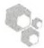
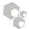

样品等分为 $10\sim 20\mu \mathrm{L}$ 保存，进行免疫印迹分析以验证抗原去除效率。

14. 用方案 1 中步骤 9 所选的冷缓冲液洗涤磁珠。

方案 1 中的预实验应该确定了免疫后沉淀洗涤条件的最佳严谨度。RNABP Nova 所用的中等洗涤方案是，用  $1 \times PXL$  洗涤缓冲液洗 3 次，再用  $5 \times PXL$  洗涤缓冲液洗 1 次，每次都用 1mL 洗液。

15. 再用 $1 \times \mathrm{PNK}$ 缓冲液洗 2 次。

用 PNK 缓冲液洗涤是为了将磁珠转换进适合 T4 PNK 酶活性的缓冲液中。

对标准的 CLIP 方案，直接进入方案 4。

## RNA 酶滴定和 SDS-PAGE 电泳（预实验）

在方案 1 和方案 2 中，裂解和免疫沉淀条件已经优化，在本方案步骤 7 中 RNA 酶也被滴定。在上述实验条件下，本预实验则被用来确定交联的 RNA-蛋白复合物的分子质量和数量。这里，RNA 直接用 T4PNK 酶进行标记。标记的 RNA-蛋白复合物则在变性 SDS 聚丙烯酰胺凝胶上进行电泳分析。标准的实验方案要用 SDS-PAGE 凝胶电泳分离 RNABP-RNA 复合物，本实验包含了相关详细操作步骤。

16. 在无RNA酶的微量离心管中，按顺序混合下列组分（单位是 $\mu \mathrm{L}$ ）制备PNK反应溶液。

| $H_{2}O$ | 64μL |
| --- | --- |
| PNK 缓冲液(10×) | 8μL |
| $[γ^{-32}P]ATP$(3000 Ci/mmol) | 4μL |
| T4 PNK 酶 | 4μL |

按实际样品数再加一个样品准备试剂，以容许移液过程中的误差。

使用  ${}^{32}$ P 时，采取标准防护措施以保护实验人员和实验室的其他人员免受放射性照射。

17. 吸去磁珠（步骤 15 中获得的包含免疫沉淀下来的 RNABP-RNA 复合物）中剩余的 PNK 缓冲液。每个样品中加入 80μL PNK 反应混合液，在温浴混合振荡器（Thermomixer R）上于 37℃ 孵育 20min，每 2min 以 1000r/min 振荡 15 s。

18. 用 $1\mathrm{mL}$ 缓冲液，按下面的顺序对磁珠进行旋转洗涤。$1\times \mathrm{PNK}$ 缓冲液洗2次，$5\times$ PXL洗涤缓冲液洗1次，再用 $1\times \mathrm{PNK}$ 缓冲液洗2次。

如果你的免疫沉淀产物在  $5 \times PXL$  等高严谨洗液中不稳定，可以用较温和的洗涤缓冲液替代。

19. 在磁珠洗涤过程中，混合下列试剂以准备  $1 \times$  LDS 样品上样缓冲液。

<table><tr><td> ${\mathrm{H}}_{2}\mathrm{O}$ </td><td>19.5μL</td></tr><tr><td>LDS 样品缓冲液</td><td>7.5μL</td></tr><tr><td colspan="2">(4×NuPAGE LDS 样品缓冲液,Life Technologies 公司)</td></tr><tr><td>样品还原剂</td><td>3μL</td></tr><tr><td>(NuPAGE 样品还原剂)</td><td></td></tr></table>

上样缓冲液可以含还原剂，也可以不含（用  $3 \mu L$  水代替）。免疫沉淀中所用的大量抗体可能会干扰 RNABP-RNA 复合物在凝胶上的迁移。根据 RNABP-RNA 复合物的大小，可以使用或不用还原剂，以避免在凝胶上出现轻链和重链 IgG（25kDa 和 50kDa）或完整 IgG（150kDa）。

20. 用  $30 \mu L$   $1 \times$  LDS 样品上样缓冲液重悬磁珠。

21. 在恒温混匀仪上于  $70^{\circ}$ C，以 1000r/min 振荡孵育 10min。

22. 用磁架捕获磁珠，并将上清上样到适当的 Novex NuPAGE Bis-Tris 凝胶上。

用 Bis-Tris 缓冲的 Novex NuPAGE 凝胶，并在 MOPS 或 MES 缓冲液中进行电泳是至关重要的。标准的 SDS-PAGE 凝胶用 Tris 缓冲，电泳时 pH 可达到约 9.5，可能导致 RNA 的碱水解。Novex NuPAGE 系统则可以在电泳时保持在中性状态。

目前有 $8\%$ 、 $10\%$ 、 $12\%$ 或 $4\% \sim 12\%$ 梯度凝胶可选择。MES（更适合 $20\sim 30\mathrm{kDa}$ 大小的小分子RNABP）或MOPS

电泳缓冲液的选择对蛋白质的迁移有显著影响。虽然我们使用 $4\% \sim 12\%$ 梯度凝胶及MOPS缓冲液进行大多数预实验，但 $12\%$ 的凝胶更适合分离35kDa大小的RNABP，而 $8\%$ 的凝胶则更适合大分子质量RNABP（如 $55\sim 100\mathrm{kDa}$）。Life Technologies公司提供了一个描述不同系统中的迁移标准的图表，非常有用。一般情况下，所选的凝胶及缓冲液让RNABP-RNA复合物比单独的RNABP滞后最少20kDa。在这个范围里可以获得最佳的分离效果，这也有助于判断免疫沉淀产物中是否有小分子的RNABP污染。

与标准的聚丙烯酰胺凝胶相比，在 Novex NuPAGE 凝胶上一些预染分子质量标准的大小可能有些不同。不过 GE Life Sciences 公司的全范围 “彩虹” 预染分子质量标准在凝胶上的大小与预期分子大小相符。我们一般在每隔一个泳道之间都上分子质量标准以避免样品间的污染。

23. 作为一个分析工具，对之前保留的免疫沉淀前样品、免疫沉淀后产物及免疫后沉淀的上清各取 $10\mu \mathrm{L}$ 等量样品进行独立的免疫印迹分析（按方案1，步骤11）。

见“疑难解答”。

24. 按照生产厂商的说明，在冷室里以 $175\sim 200\mathrm{V}$ 的电压进行Novex NuPAGE凝胶电泳。

与所上的样品相比，凝胶本身的放射性要低得多。大多数同位素，如单个的 ATP 和小分子未被交联的 RNA，将会在下槽的电泳缓冲液中。长至 100 个碱基未交联的 RNA 在凝胶上会迁移到小于 30kDa 的位置。

25. 电泳后，用 XCell II 印迹模块将凝胶上的复合物转移到 Protran BA-85 硝酸纤维膜（Whatman）上。在含 10% 甲醇的 NuPAGE 转移缓冲液中以 30V 电压转移 1h。

Protran BA-85 硝酸纤维膜易碎，但对 RNA/蛋白质提取物来说，可以取得比增强的尼龙膜更好的效果。

通过延长转膜时间来增加 RNABP-RNA 复合物的转移量的尝试并不成功。即使有更多的复合物转移到硝酸纤维膜上，但发现只有更少的 RNA 可以被克隆，这可能是因为过长的转膜时间（长至 2.5h）损伤了 RNA 分子。

26. 转膜结束后，用无 RNA 酶的  $1 \times$  PBS 漂洗，并在 KimWipe 吸水纸轻柔地吸去边缘的水分。

27. 用保鲜膜包裹硝酸纤维膜，依照交联效果，在-80℃对胶片（Kodak MR 胶片效果良好）曝光30min至3天。在保鲜膜外面至少用两个发光贴纸。

按照这个程序操作，如果RNABP-RNA复合物需要3天以上的时间才能曝光，后面很难对RNA进行克隆。这个时候需要用更多的起始材料从新进行CLIP实验。

在曝光前，可以用盖革计数器检测硝酸纤维膜上的放射性，以初步检测试验是否成功。

见“疑难解答”。

## 疑难解答

问题（步骤6）:用RQ1 DNase处理后，裂解物仍然非常黏稠，这提示DNA没有被完全降解。

解决方案:这可能是因为裂解物中  $Ca^{2+}$  和  $Mg^{2+}$  的浓度不够。补充至 1mmol/L  $Ca^{2+}$  和 10mmol/L 的  $Mg^{2+}$  有助于增加 RQ1 DNase 的活性。此外，DNase 的用量和作用时间也可以增加，要注意在 37℃时，裂解物中内源的 RNA 酶也会发挥活性。

问题（步骤 23）:用  $10 \sim 20 \mu L$  的免疫沉淀前及免疫沉淀后样品进行免疫印迹分析时，RNABP 信号不可见，不足以评估抗原消耗效率。

解决方案:可以用更大体积的样品，也可用 TCA 对蛋白质进行沉淀浓缩。注意，微型凝胶的单个泳道最多只能上  $100 \mu g$  的总蛋白样品。本问题的一个解决方案是进行一次免疫沉淀-免疫印迹操作，这样在免疫印迹之前，RNABP 蛋白先被免疫沉淀下来。为了定量，需要对剩下的上清重新进行免疫沉淀以保证第一次免疫沉淀后 100% 的蛋白质都被清除。如果裂解缓冲液中含有钾离子，要用 TCA 沉淀法去除钾离子，钾离子碰到标准上样缓冲液中 SDS 会沉淀。以钠离子为基础的缓冲液是有益的，因为这样样品可以直接进行电泳。

问题（步骤 27）:不清楚所需的 RNABP-RNA 复合物会迁移到什么位置。

解决方案:在经过交联并用最高浓度 RNA 酶处理过的样品中，放射性条带会出现在 RNABP 的预期大小附近或稍大一点点的地方（表明非常小的 RNA 标签对蛋白质迁移的影响极小），而在非交联样品和对照样品中则没有放射性条带。可以封闭硝酸纤维膜，并进行免疫印迹分析显示单独 RNBP 的迁移位置。

问题（步骤 27）:在最高浓度 RNA 酶处理的样品上，没有放射性条带。

解决方案:在某些情况下，RNA 酶的过度消化可能会抑制 T4 PNK 酶的标记反应，可能是因为导致 RNA 标签太小，或者不能接触到 T4 PNK 酶。

问题（步骤 27）:在任何泳道都没有预期大小的放射性条带。

解决方案: 如果即使用较低的 RNA 酶浓度, 在预期分子质量位置仍然没有特异的 RNA 标记条带, 需进行免疫印迹分析以分析 RNABP 是否被有效免疫沉淀下来并在胶上。如果免疫沉淀有效, 但在 2\~3 天的曝光后, 交联 RNA 仍不可见, 就需要使用本方案导言部分所描述的阳性对照对交联的效果进行分析。可以增加起始实验材料。最后, 很可能所谓的 RNABP 实际上并不能直接结合 RNA, 或者结合的 RNA 太少, 无法检测。

问题（步骤27）:在非交联样品中有弥散的RNA标记信号。

解决方案:这提示游离的 RNA 分子可能污染了免疫沉淀物。更严谨的洗涤条件，包括增加洗涤次数、洗涤时更换新的离心管，可能有助于减少背景。另外，一些 RNBP 与 RNA 结合得非常紧密，即使不进行交联，这种相互作用也能保持，如 Argonaute 与 miRNA 的相互作用就是这样。如果这是一个问题，可以用更强烈解离 RNP 的方法制备裂解物，保证去掉未交联的 RNA。

问题（步骤 27）:在非交联对照泳道，有锐利的条带。

解决方案:有时检测到蛋白质被 T4 PNK 酶直接标记的信号。在所有的泳道都有标记信号，但在非标记对照泳道信号特别强并呈锐利的条带。这通常表明蛋白质直接被  $[\gamma-^{32}P]$  ATP 标记上了。虽然 T4 PNK 酶并不能使蛋白磷酸化，磷酸化反应可能会来自下列 3 种途径之一:商品化的 T4 PNK 酶中污染了蛋白激酶，一种免疫共沉淀下来的蛋白激酶，或 RNABP 本身具有蛋白激酶活性。为避免在标准 CLIP 方案中蛋白被标记，我们收录了用  $[\gamma-^{32}P]$  ATP 标记 3' 接头，并通过 T4 RNA 连接酶反应使用标记好的接头的方法，这样就能避免蛋白激酶污染的问题（详细方案见方案 4 中的替代方案“非磷酸化 RL3 接头 5' 端的标记”）。

问题（步骤27）:在靶RNABP之上的位置，有交联到另一个非所需RNABP的RNA显著信号。

解决方案:如果比靶RNBP慢但比污染的RNBP要快的条带可以从硝酸纤维膜上切下来，这个CLIP实验有可能是成功的。虽然切下比游离RNABP大约 $20\mathrm{kDa}$ 的复合物是比较满意的，实际上 $20\sim 30\mathrm{mer}$ 的标签可以从比游离蛋白大 $7\sim 10\mathrm{kDa}$ 的位置克隆到。可以通过延长电泳时间或选用不同浓度的PAGE凝胶获得更好的分离效果。

问题（步骤27）:在靶RNABP之下的位置，有交联到另一个非所需RNABP的RNA显著信号。

解决方案:用高浓度的 RNA 酶处理，减少结合较长 RNA 标签的小分子 RNABP 与结合较短 RNA 标签的较大靶 RNABP 迁移到相同位置的可能性，这样就能切下所需条带。就这一点而言，PCR 步骤（见方案 5）之后的大小选择是有益的。不过，重新评估纯化步骤以增加免疫沉淀的特异性是非常值得去做的，这包括抗体的选择、洗涤的严谨度、洗涤时更换离心管和/或在免疫沉淀之间进行亚细胞分离。优化本方案，通过与对照比较标记的 RNABP-RNA 复合物进行评估，在一个成功的 CLIP 实验中是最重要的步骤。

## 讨论

## SDS-PAGE 凝胶分离

严谨的免疫沉淀是分离一种 RNABP-RNA 复合物的一个纯化步骤，SDS-PAGE 凝胶分离则是第二步至关重要的纯化步骤。为了从 SDS-PAGE 凝胶上去除来自任何可能污染的 RNABP 的 CLIP 标签，我们用系列 10 倍稀释的 RNA 酶优化 RNA 酶浓度。这一步也可达到确定 RNA 酶条件的目的，在这种条件下，可以按照所需的大小选择 RNA 标签（使 RNA 标签长度足以在基因组上精确定位，但又不会太长以致来自污染 RNABP-RNA 复合物的标签在 SDS-PAGE 凝胶上共迁移）（有关这一点的详细讨论见 Ule et al. 2005）。理想的结果是在被最高浓度 RNA 酶处理的样品中出现一个接近 RNABP 分子质量的放射性条带，而随着 RNA 酶浓度降低，放射性条带有拖尾现象，而且分子质量变大，如图 21-2 所示。在阴性对照样品中则没有类似信号。如果在以最高浓度 RNA 酶处理的样品中出现多条带，说明有非特异 RNABP 被免疫沉淀下来。这可能是一个问题，也可能不是，取决于下面两点:①带的大小；②是否能切下所需的 RNABP-RNA 复合物，而不被无关 RNABP-RNA 复合物污染。例如，如果污染蛋白比靶蛋白大，这就不是问题，因为可以在污染条带之下把所需的 RNABP-RNA 复合物切下来。

## 核酸酶的选择

选择核酸酶的一个重要考虑是降低 RNA 分子的大小。在预实验及标准方案中（方案 3～方案 5），使用的是 RNase A，RNA 酶可以水解单链 RNA 上的嘧啶残基（胞嘧啶和尿嘧啶）3' 端的磷酸二酯键，留下 3' 磷酸。在其他实验中，我们也用 RNase T1（Applied Biosystems/Abmion 公司 AM2280），这种酶在鸟嘌呤残基后面切割单链 RNA，并保留 3' 磷酸，或者组合使用 RNase A 和 RNase T1。RNase A 和 RNase T1 最初在 3' 端都留下 2',3' 环单磷酸中间体，这种中间体分解成 3' 羟基，RNase T1 要比 RNase A 慢（Mohr and Thach 1969）；任何残留的 2',3' 环单磷酸中间体都被随后的多聚核苷酸激酶分解。其他核酸酶也曾被使用，包括微球菌核酸酶和 RNase I。RNase I 是非特异的，能切割所有 RNA 磷酸二酯键。不过，它能被 0.1% SDS 完全且不可逆地失活。最后，发现碱水解是一个有效减小 RNA 的非酶手段，而且这一方法没有序列和结构偏性。

## 曝光时间

检测标记 RNA 所需曝光时间的长短可以粗略评估交联的蛋白质-RNA 量，以及最终纯化及测序交联 RNA 的难易程度。对 Nova 来说，如果用大约 100mg 的小鼠脑组织作为起始材料，经过 60min 的曝光就可以在放射自显影胶片上观察的信号，并且会发现这种起始量很容易操作。对其他蛋白质来说，一个成功的 CLIP 实验，长至 3 天的曝光时间仍然能获得足够的 RNA。

在进行 RNA 酶滴定的泳道，随着 RNA 酶浓度的降低，标记条带的分子质量会变大并且有拖尾现象，这反映了交联 RNA 标签分子质量的增大。如果所需的 RNABP 距离其他任何污染 RNABP 超过 10～20kDa，纯化与所需 RNABP 特异交联的 RNA 是可行的。

## 配方

为正确使用本方案中的器材和危险试剂，必须查阅相应的材料安全数据表并咨询所在机构的环境卫生和安全办公室。

CLIP 方案所用的所有试剂的制备和保存必须避免 RNA 酶的污染。见第 6 章关于实验室无 RNA 酶溶液的配制及 RNA 操作的通用准则。

PNK 缓冲液（1×）

| 试剂 | 含量(1L) | 终浓度 |
| --- | --- | --- |
| Tris-HCl(1mol/L,pH 7.4) | 50mL | 50mmol/L |
| MgCl2(1mol/L) | 10mL | 10mmol/L |
| Nonidet P-40(NP-40) | 5mL | 0.5%(V/V) |

用水补充至1L。4℃保存。

PNK（1×）+EGTA缓冲液

| 试剂 | 含量(1L) | 终浓度 |
| --- | --- | --- |
| Tris-HCl(1mol/L,pH 7.4) | 50mL | 50mmol/L |
| EGTA(0.5mol/L) | 40mL | 20mmol/L |
| Nonidet P-40(NP-40) | 5mL | 0.5%(V/V) |

用水补充至 1L。4℃保存。

## PXL 洗涤缓冲液（1×）

(参见方案1，作为中度免疫沉淀洗涤缓冲液)

| 试剂 | 含量(1L) | 终浓度 |
| --- | --- | --- |
| PBS(10×)(组织培养级,无$Mg^{2+}$,无$Ca^{2+}$) | 100mL | 1× |
| SDS(20%) | 5mL | 0.1%(V/V) |
| 脱氧胆酸钠 | 5g | 0.5%(m/V) |
| Nonidet P-40(NP-40) | 5mL | 0.5%(V/V) |

用水补充至1L。4℃保存。

PXL 洗涤缓冲液（5×）

| 试剂 | 含量(1L) | 终浓度 |
| --- | --- | --- |
| PBS(10×)(组织培养级,无$Mg^{2+}$,无$Ca^{2+}$) | 500mL | 5× |
| SDS(20%) | 5mL | 0.1%(V/V) |
| 脱氧胆酸钠 | 5g | 0.5%(m/V) |
| Nonidet P-40(NP-40) | 5mL | 0.5%(V/V) |

用水补充至 1L。4℃保存。

## 参考文献

Darnell RB. 2010. HITS-CLIP: Panoramic views of protein–RNA regulation in living cells. Wiley Interdiscip Rev RNA 1: 266–286.

Jensen KB, Darnell RB. 2008. CLIP: Crosslinking and immunoprecipitation of in vivo RNA targets of RNA-binding proteins. Methods Mol Biol 488: 85–98.

Licatalosi DD, Mele A, Fak JJ, Ule J, Kayikci M, Chi SW, Clark TA, Schweitzer AC, Blume JE, Wang X, et al. 2008. HITS-CLIP yields genome-wide insights into brain alternative RNA processing. Nature 456: 464–469.

Mohr SC, Thach RE. 1969. Application of ribonuclease T1 to the synthesis of oligoribonucleotides of defined base sequence. J Biol Chem 244:6566–6576.

Ule J, Jensen K, Mele A, Darnell RB. 2005. CLIP: A method for identifying protein–RNA interaction sites in living cells. Methods 37: 376–386.

## 方案 4 3'-接头的连接和用 SDS-PAGE 进行大小选择

在本方案中，免疫共沉淀下来的 RNA 标签用碱性磷酸酶处理去除 RNA 酶消化后留下的 3' 磷酸。去磷酸基团可以阻止连接反应时发生分子内环化。一个 RNA 接头被连接到 RNA 标签的 3' 端，这种 RNA 接头的 3' 端被嘌呤霉素封闭，不能发生接头-接头多聚化。连接上接头的 RNABP-RNA 复合物通过抗体结合在蛋白 A Dynabead 磁珠上，而游离的接头则通过洗涤被去除。最后通过 SDS-PAGE 电泳及转膜，按大小选择所需的 RNABP-RNA 复合物完成进一步的纯化步骤。

## 材料

为正确使用本方案中的器材和危险试剂，必须查阅相应的材料安全数据表并咨询所在机构的环境卫生和安全办公室。

本方案的专用试剂标注&lt;R&gt;，配方在本方案末提供。常用储备溶液、缓冲液和试剂标注&lt;A&gt;，配方见附录1。储备溶液应稀释至适用浓度后使用。

## 试剂

碱性磷酸酶（牛小肠，1U/μL，10×缓冲液）（Roche Applied Science 公司，目录号 10-713-023001）

ATP 溶液（1mmol/L）

包被了抗体的磁珠（结合免疫沉淀的交联 RNABP-RNA 复合物）（方案 3，步骤 15）

牛血清白蛋白

去磷酸缓冲液（10×）（碱性磷酸酶附带）

$$
[ \gamma - ^ {3 2} \mathrm{P} ] \mathrm{ATP}
$$

免疫沉淀洗涤缓冲液（方案1中所优化的）

上样缓冲液（4×）（LDS；NuPAGE LDS 样品缓冲液，Life Technologies 公司；目录号 NP0008）

MOPS 或 MES 电泳缓冲液（20×）（Life Technologies 公司，目录号分别是 NP0001 或 NP0002）

NuPAGE 转移缓冲液（20×）（Life Technologies 公司，目录号 NP00061）

PNK 缓冲液（1×，10×）&lt;R&gt;

PNK+EGTA 缓冲液（1×）&lt;R&gt;

嘌呤霉素封闭的 3'-接头（带 5'-磷酸）:RL3:5'-P-GUGUCAGUCACUUCCAGCGG-3'-嘌呤霉素（Dharmacon 公司；20 pmol/ $\mu$ L 水溶液，于-80℃保存）

嘌呤霉素封闭的 3'-接头（无 5'-磷酸，替代方案“去磷酸化 RL3 接头 5'端的标记”）:RL3(-P): 5'-OH-GUGUCAGUCACUUCCAGCGG-3'-嘌呤霉素（Dharmacon 公司；20pmol/μL 水溶液，于 -80℃ 保存）

PXL 缓冲液 (5×) &lt;R&gt;

RL3 RNA 接头和 RL3 (-P) 接头（凝胶纯化，并按方案 7 所述方法保存）

无 RNA 酶的 PBS

RNA 酶处理的裂解物

使用能获得所需大小 RNA 的 RNA 酶浓度制备（见方案 3）。

RNasin Plus（Promega 公司）

样品还原剂（10×）（NuPAGE 样品还原剂，Life Technologies 公司，目录号 NP0004）

T4 多聚核苷酸激酶（PNK；10U/ $\mu$ L）（NEB 公司，目录号 M0201S）

T4 RNA 连接酶（Fermentas 公司，目录号 EL0021；10U/ $\mu$ L，附带 BSA，10×缓冲液）

## 设备

G-25 柱（替代方案 “去磷酸化 RL3 接头 5' 端的标记”）（GE Healthcare 公司，目录号 27-5325-01）

发光贴纸（如 Agilent Technologies 公司的 Glogos）

微量离心管[National Scientific Supply 公司，SlickSeal tubes（RNase-free），目录号CN170S-GT，VWR#20172-945]

硝酸纤维膜（Whatman 公司的 Protran BA85）

Novex NuPage Bis-Tris 凝胶和凝胶电泳装置（Life Technologies 公司）

胶片（如 Kodak MR）

保鲜膜（如 Saran Wrap）

Thermomixer R 恒温混匀仪

涡旋设备

XCell II 印迹模块（Life Technologies 公司）

## 方法

按照方案3的步骤制备细胞裂解物，用RNase及DNase处理，离心去沉淀，并进行免疫沉淀。

## RNA 标签的去磷酸化以防止接头连接过程中的环化

1. 在最后一次用  $1 \times PNK$  缓冲液洗涤结合了 RNABP-RNA 复合物的磁珠（方案 3，步骤 15，称为 RNABP:RNA 磁珠）后，去掉所有痕量的 PNK 缓冲液，并立即用去磷酸反应混合液重悬磁珠，按如下方法准备去磷酸反应混合液:

在一个无 A 的微量离心管中，每个反应按顺序混合下列试剂:

| 无RNA酶的水 | 67μL |
| --- | --- |
| 去磷酸缓冲液(10×) | 8μL |
| 碱性磷酸酶 | 3μL |
| RNasin Plus(Promega) | 2μL |

温和涡旋重悬磁珠。

总共  $80 \mu L$  的反应体积，可用于不超过  $400 \mu L$  起始体积的 Dynabead 磁珠。

2. 在 Thermomixer R 恒温混匀仪上于  $37^{\circ}$ C 孵育 20min, 每 2min 以 1000r/min 振荡 15s。

3. 用 $1\mathrm{mL}1\times \mathrm{PNK}$ 缓冲液洗一次，用 $1\mathrm{mL}1\times \mathrm{PNK} + \mathrm{EGTA}$ 缓冲液洗一次，再用 $1\times \mathrm{PNK}$ 缓冲液洗两次。

在连接反应前，完全去掉碱性磷酸酶非常重要。不能用加热的方法（因为具有解离抗体-蛋白复合物的风险）。因此，本方案步骤3的洗涤非常重要。为彻底去除非特异吸附在微量离心管上的碱性磷酸酶，我们在洗涤过程中至少要换一次离心管。

## 3'RNA 接头的连接（在磁珠上）

4. 在一个无 RNA 酶的微量离心管中，按顺序混合下列成分制备接头混合液:

| 无RNA酶的水 | 32μL |
| --- | --- |
| RL3 RNA接头(20pmol/μL水溶液,-80°C保存) | 8μL |

5. 将 $40 \mu \mathrm{L}$ 接头混合液加到每管 RNABP:RNA 磁珠中, 温和涡旋混匀。置于冰上。

6. 在一个无 RNA 酶微量离心管中，按顺序混合下列成分，制备连接酶混合液:

| 无RNA酶的水 | 22μL |
| --- | --- |
| T4 RNA连接酶缓冲液(10×) | 8μL |
| BSA(0.2μg/μL) | 8μL |
| T4 RNA连接酶 | 2μL |

7. 将 $40 \mu \mathrm{L}$ 连接酶混合液加入到每管 RNABP:RNA 磁珠中（最终接头浓度为 $2 \mathrm{pmol} / \mu \mathrm{L}$）。

总反应体积是  $80 \mu L$ ，用于不超过  $400 \mu L$  起始体积的 Dynabead 磁珠。Fermentas 公司的  $10 \times T4 RNA$  连接酶缓冲液已包含 ATP。不过，由于在冻融过程中 ATP 非常不稳定，我们经常会在连接反应中额外补充 ATP（用保存于  $-80^{\circ}C$  的 10mmol/L 的 ATP 分装母液，加至终浓度为 1mmol/L）。

8. 在 Thermomixer R 恒温混匀仪上于  $16^{\circ}$ C 孵育过夜，每 2min 以 1000r/min 振荡 15 s。

9. 用 $1\mathrm{mL}1\times \mathrm{PNK}$ 缓冲液洗一次，用 $1\mathrm{mL}5\times \mathrm{PXL}$ 缓冲液洗一次，再用 $1\times \mathrm{PNK}$ 缓冲液洗2次。

## RNA 标签的磷酸化

10. 在一个无 RNA 酶的微量离心管中，每个反应按顺序混合下列成分:

| ${\mathrm{H}}_{2}\mathrm{O}$ | 64μL |
| --- | --- |
| PNK缓冲液(10×) | 8μL |
| $\left\lbrack {\gamma -{}^{32}\mathrm{P}}\right\rbrack \mathrm{{ATP}}$ | 4μL |
| T4 PNK 酶 | 4μL |

总反应体积是  $80 \mu L$ ，用于不超过  $400 \mu L$  起始体积的 Dynabead 磁珠。

11. 在 Thermomixer R 恒温混匀仪上于  $37^{\circ}$ C 孵育 20min, 每 2min 以 1000r/min 振荡 15s。

12. 加入  $10 \mu L$  1mmol/L 的 ATP，继续孵育 5min。

13. 用 $1\mathrm{mL} 1 \times \mathrm{PNK}$ 缓冲液洗一次，用 $1\mathrm{mL} 5 \times \mathrm{PXL}$ 缓冲液洗一次，再用 $1 \times \mathrm{PNK}$ 缓冲液洗两次。

## 通过 SDS-PAGE 纯化 RNABP-RNA 复合物

放射性标记的 RNABP-RNA 复合物通过 SDS-PAGE 凝胶电泳进行分离, 转移至硝酸纤维素膜上, 并进行放射自显影。电泳方法在预实验方案 3 的步骤 19\~步骤 27 有详细描述。

14. 在磁珠洗涤时，每份样品混合下列成分制备  $1 \times$  LDS 样品上样缓冲液:

| 无RNA酶的水 | 19.5μL |
| --- | --- |
| LDS样品上样缓冲液(NuPAGE样品上样缓冲液,Life Technologies公司) | 7.5μL |
| 样品还原剂(NuPAGE样品还原剂,Life Technologies公司) | 3μL |

制备上样缓冲液时可以加也可以不加还原剂（用  $3 \mu L$  水替代还原剂）。免疫沉淀中所用的大量抗体可能会干扰

RNABP-RNA 复合物在凝胶上的迁移。根据 RNABP-RNA 复合物的大小，可以在还原或非还原条件下进行电泳，以避免在凝胶上出现轻链和重链 IgG（25kDa 和 50kDa）或完整 IgG（150kDa）。

15. 每管用  $30 \mu L$   $1 \times$  LDS 样品上样缓冲液重悬磁珠。

16. 在 Thermomixer R 恒温混匀仪上于  $70^{\circ}$ C，以 1000r/min 振荡孵育 10min。

17. 用磁架捕获磁珠，上清上样到 Novex NuPAGE Bis-Tris 凝胶上，在冷室里按照厂商的说明以 175～200V 的电压进行电泳。

有关凝胶和缓冲液选择的讨论将方案3，步骤22。

18. 电泳结束后，用 XCELL II 印迹模块将复合物转移至 Protran BA-85 硝酸纤维膜（Whatman 公司）上。在含 10% 甲醇的 NuPAGE 转移缓冲液中以 30 V 电压转移 1h。

19. 电转结束后，用  $1 \times$  PBS（无 RNA 酶）漂洗硝酸纤维膜，并用 KimWipe 吸水纸轻柔地吸去边缘的水分。

20. 用保鲜膜包裹硝酸纤维膜，在-80℃对胶片（Kodak MR 效果良好）进行曝光，根据交联的程度，曝光时间为 30min 至 3 天。在保鲜膜外面至少使用两张发光贴纸，使滤膜与胶片对齐以准确切下所需条带。

21. 60min 后显影，如果需要可以重新曝光长达 3 天。

如果按照本程序操作，需要 3 天时间才能显出 RNABP-RNA 复合物，在后面很难对 RNA 进行克隆。

22. 根据与对照样品对比，鉴定所需的 RNABP-RNA 复合物，并评估是否有其他 RNABP 污染，这些 RNBP 交联的 RNA 可能会污染所需的 RNA 序列。分析胶片时，滤膜要保存在 -80℃。理想的结果是，标记的 RNA-蛋白复合物比游离的 RNABP 大约 20kDa，而且与对照相比，RNABP 是非常特异的。这些在方案 3 的导言部分有所讨论。

见“疑难解答”。

## 疑难解答

期望放射自显影的结果与方案 3 的相似。相关解释在方案 3 有讨论。

问题（步骤 22）:对去磷酸化 RL3 接头进行 5' 端标记，并将此  ${}^{32}$ P 标记的 3' 接头连接到 RNA 标签上，但在硝酸纤维膜上几乎检测不到信号。

解决方案:我们常常发现与用 T4 PNK 酶对 RNA 直接进行 5' 端标记相比，用标记好的接头进行连接标记的效果要差一些。这并不意味着 RNA 标签少，更难进行克隆，而只是要把滤膜在 -80℃ 曝光更久一点，因为这种方法标记的效率要低一些。

问题（步骤 22）:使用接头标记而不是直接标记时，即使经过 3～4 天的曝光，滤膜上的信号仍然很弱。

解决方案:这可能说明接头连接不成功。检查 T4 RNA 连接酶的失效日期，确认缓冲液中的 ATP（特别是  $10 \times T4$  RNA 连接酶缓冲液）是否经过多次冻融过程。用一个 RNA 设置阳性连接对照，并进行聚丙烯酰胺凝胶电泳确认连接酶的活性。

## 讨论

实验到这一步，就要根据放射自显影结果判断是否进行方案 5——分离、RT-PCR 扩增 RNA 标签。如果设置了充分的对照，包括无 RNABP 对照或 RNABP 不结合 RNA 的对照，这时应该获得了令人信服的信噪比。

## 替代方案 去磷酸化 RL3 接头 5' 端的标记

这是对 RNA 标签连接 3' 接头并进行 5' 端标记的替代方案(方案 4, 步骤 10～步骤 13)。在某些时候用这一替代方案是因为，在步骤 10～步骤 13 用 PNK 酶进行标记时蛋白质可能会被直接磷酸化，从而在放射自显影时出现较强的背景条带。如果出现这种情况，可以先将 3' 接头的 5' 端进行磷酸化标记，然后这种  ${}^{32}$ P 标记的 RL3 接头再与 RNABP-RNA 复合物进行连接，这样 RNA 标签就可以被特异性的标记了。这样，PNK 酶处理时就不需要  $[\gamma-{}^{32}P]$ ATP，在整个 25min 的 PNK 反应中可以用 1μL 的 10mmol/L ATP 代替。

## 方法

1. 在进行免疫沉淀时或之前，在无 RNA 酶的微量离心管中按顺序混合下列成分，准备  $50 \mu L$  的接头标记反应混合物:

| RL3(-P)接头(20pmol/μL) | 6μL |
| --- | --- |
| PNK缓冲液(10×) | 5μL |
| [γ-32P]ATP | 25μL |
| T4 PNK酶 | 8μL |
| RNasin Plus | 3μL |
| H2O | 3μL |

2. 在 Thermomixer R 恒温混匀仪或水浴中于  $37^{\circ}$ C 孵育 30min。

3. 加  $2 \mu L$  1mmol/L 的 ATP，再孵育 5min 以使接头的 5' 端完全磷酸化。

4. 颠倒 G-25 柱并涡旋，重悬树脂。然后折断柱子的底部，并松开盖。

5. 将 G-25 柱装到一个微量离心管中，以 735g 离心 1min，再转移至一个新的无 RNA 酶微量离心管中。

6. 将样品加到树脂上，以 735g 离心 2min。末端标记好的接头可以马上使用，也可以于 -20℃ 保存直至使用。

7. 在无 RNA 酶微量离心管中，每个反应按顺序混合下列成分（体积以微升为单位）。

| 无RNA酶的水 | 50μL |
| --- | --- |
| T4 RNA连接酶缓冲液(10×) | 8μL |
| BSA | 8μL |
| T4 RNA连接酶 | 2μL |
| RNasin Plus | 2μL |
| 5'端标记的RL3接头 | 10μL |

总反应体积是  $80 \mu L$ ，用于不超过  $400 \mu L$  起始体积的 Dynabead 磁珠。与主方案步骤 6 相似，如果 Fermentas 的  $10 \times$  缓冲液已经冻融了 2 或 3 次，可以加终浓度为 1 mmol/L 的 ATP。

8. 在 Thermomixer R 恒温混匀仪上，于  $16^{\circ}$ C 孵育 1h，每 2min 以 1000r/min 振荡 15s。
9. 加  $4 \mu L$  RL3 接头（20pmol/ $\mu L$ ，带 5' 磷酸，未标记），在 Thermomixer R 恒温混匀仪上于  $16^{\circ}C$  孵育过夜，每 2min 以 1000r/min 振荡 15s。
10. 用 $1 \mathrm{~mL} 1 \times \mathrm{PNK}$ 缓冲液洗一次，用 $1 \mathrm{~mL} 5 \times \mathrm{PXL}$ 缓冲液洗一次，再用 $1 \times \mathrm{PNK}$ 缓冲液洗3次。
11. 在一个无 RNA 酶的微量离心管中，每个反应按顺序混合下列成分:

| 无RNA酶的水 | 65μL |
| --- | --- |
| PNK缓冲液(10×) | 8μL |
| ATP(10mmol/L) | 1μL |
| T4 PNK酶 | 4μL |
| RNasin Plus | 2μL |

12. 将上面的混合液加到磁珠上，并温和涡旋重悬磁珠。
13. 在 Thermomixer R 恒温混匀仪上，于  $37^{\circ}$ C 孵育 20min，每 2min 以 1000r/min 振荡 15s。
14. 用 $1 \mathrm{~mL} 1 \times \mathrm{PNK}$ 缓冲液洗一次，用 $1 \mathrm{~mL} 5 \times \mathrm{PXL}$ 缓冲液洗一次，再用 $1 \times \mathrm{PNK}$ 缓冲液洗三次。
15. 继续进行方案 4 的步骤 14。

## 配方

为正确使用本方案中的器材和危险试剂，必须查阅相应的材料安全数据表并咨询所在机构的环境卫生和安全办公室。

CLIP 方案所用的所有试剂的制备和保存必须避免 RNA 酶的污染。见第 6 章关于实验室无 RNA 酶溶液的配制及 RNA 操作的通用准则。

PNK 缓冲液（1×）

| 试剂 | 含量(1L) | 终浓度 |
| --- | --- | --- |
| Tris-HCl(1mol/L,pH 7.4) | 50mL | 50mmol/L |
| MgCl2(1mol/L) | 10mL | 10mmol/L |
| Nonidet P-40(NP-40) | 5mL | 0.5%(V/V) |

用水补充至1L。4℃保存。

PNK（1×）+EGTA缓冲液

| 试剂 | 含量(1L) | 终浓度 |
| --- | --- | --- |
| Tris-HCl(1mol/L,pH 7.4) | 50mL | 50mmol/L |
| EGTA(0.5mol/L) | 40mL | 20mmol/L |
| Nonidet P-40(NP-40) | 5mL | 0.5%(V/V) |

用水补充至1L。4℃保存。

PXL 洗涤缓冲液（5×）

| 试剂 | 含量(1L) | 终浓度 |
| --- | --- | --- |
| PBS(10×)(组织培养级,无$Mg^{2+}$,无$Ca^{2+}$) | 500mL | 5× |
| SDS(20%) | 5mL | 0.1%(V/V) |
| 脱氧胆酸钠 | 5g | 0.5%(m/V) |
| Nonidet P-40(NP-40) | 5mL | 0.5%(V/V) |

用水补充至1L。4℃保存。

# 方案 5 RNA 标签的分离、5'-接头的连接和反转录 PCR 扩增

本方案描述了通过蛋白酶 K 消化交联的蛋白质以纯化 RNA 标签，在 RNA 标签的 5' 端加上接头，并通过 RT-PCR 进行扩增。使用本方案增加了一个重要的纯化步骤:根据大小选择 PCR 产物，这样可以富集那些与所需 RNABP 交联 RNA 的扩增产物。

## 材料

为正确使用本方案中的器材和危险试剂，必须查阅相应的材料安全数据表并咨询所在机构的环境卫生和安全办公室。

本方案的专用试剂标注&lt;R&gt;，配方在本方案末提供。常用储备溶液、缓冲液和试剂标注&lt;A&gt;，配方见附录1。储备溶液应稀释至适用浓度后使用。

## 试剂

AccuPrime Supermix（Life Technologies 公司，目录号 12344-024）

丙烯酰胺:亚甲双丙烯酰胺（40%溶液；19:1）

琼脂糖凝胶（3% MetaPhor）（可选；见步骤 56）

过硫酸铵（APS；10%，m/V；用水新鲜配制，或分装保存于-20℃）

AmpliSize 分子标尺（Bio-Rad 公司，目录号 170-8200）

溴酚蓝/二甲苯蓝溶液（各 0.5%；Sigma-Aldrich 公司，目录号 B-3269）

氯仿:异戊醇（24:1）（OmniPur；EMD公司，目录号3155-OP）

变性聚丙烯酰胺凝胶&lt;R&gt;

二硫苏糖醇（DTT；0.1mol/L）

DNA 分子质量标准（如 AmpliSize Molecular Ruler，Bio-Rad 公司）

dNTP 溶液（PCR 级；含全部 4 种 dNTP，每种浓度为 10mmol/L）（如 Life Technologies 公司，目录号 18427-088）

DP3 引物（Fisher/Operon 公司；用 TE 缓冲液配制成浓度为  $20 \mu mol/L$  的溶液）:5'-CCGCTGGAAGTGACTGACAC-3'

DP5 引物（Fisher/Operon 公司；用 TE 缓冲液配制成浓度为 20μmol/L 的溶液）:5'-AGGGAGGACGATGCGG-3'

乙醇（75%），冷的

乙醇:异丙醇（1:1）

糖原（5mg/mL）（Applied Biosystems/Ambion 公司，目录号 AM9510）

变性聚丙烯酰胺凝胶用上样缓冲液（2×）&lt;R&gt;

NaOAc（3mol/L储存液；pH 5.2；分子生物学级）（如 EMD Biosciences/Calbiochem 公司，目录号 567422）

含所需 RNABP-RNA 复合物的硝酸纤维素膜（来自方案 4，步骤 22）

蛋白酶 K 缓冲液（1×）&lt;R&gt;

蛋白酶 K 缓冲液（1×）/尿素（7mol/L）&lt;R&gt;

蛋白酶 K（20mg/mL 储存液）（Roche 公司，目录号 1373196）

RL5D RNA 接头（Dharmacon 公司；20μmol/L，胶纯化并按方案 7 所述保存），RL5D:5'-OH-AGGGAGGACGAUGCGGGr (N)r (N)r (N)r (N) G-3'-OH

RL5 RNA 接头（Dharmacon 公司；20μmol/L，胶纯化并按方案 7 所述保存）:5'-OH-AGGGAGGACGAUGCGG-3'-OH

RNA 酚（Applied Biosystems/Ambion 公司，目录号 AM9710）

使用水饱和酚（pH 6.6），不要将 pH 调至 7.9。

RNasin Plus（Promega 公司，目录号 N2611）

RQ1 DNase（1U/μL）及附带缓冲液（Promega 公司，目录号 M6101）

RT-PCR 级的水（Applied Biosystems/Ambion 公司，目录号 AM9935）

SuperScript III 反转录酶（RT）（200U/ $\mu$ L；附带 5×第一链缓冲液及 0.1mol/L DTT）（Life Technologies 公司，目录号 18080-093）

按我们的经验，对 CLIP 来说，SuperScript III 的效果最好，因为 CLIP 获得的 RNA 模板上带有至少一个共价结合的氨基酸残基。在我们所设定的条件下，这种反转录酶在通读修饰的碱基时有更高的容忍度。

SYBR Gold(Life Technologies/Molecular Probes 公司, 10 000×储存液, 目录号 S11494)

TBE 缓冲液（1×）

TBE 缓冲液 (5×) &lt;R&gt;

TE 缓冲液（1×）（10mmol/L Tris-HCl，pH 8.0，1mmol/L EDTA）

TEMED

T4 RNA 连接酶（10U/ $\mu$ L；附带缓冲液及 BSA）（Fermentas 公司，目录号 EL0021）尿素

## 设备

BA-85 硝酸纤维膜（Whatman 公司）

盖革计数器或闪烁计数器

发光贴纸

金属管塞

MetaPhor 琼脂糖凝胶（3%）（可选；见步骤 56）

微型离心机

微量离心管[National Scientific Supply 公司，SlickSeal 管（无 RNA 酶），目录号 CN170S-GT，VWR#20172-945]

PCR 仪（如 Bio-Rad 公司的 iCycler）与配套的 PCR 管

胶片（如 Kodak MR）

保鲜膜（如 Saran Wrap）

QIAquick 凝胶回收试剂盒（QIAGEN 公司，目录号 28704）

旋转振荡器

手术刀（11号或其他一次性，无RNA酶外科手术刀）

Thermomixer R 恒温混匀仪

透照仪（观测 SYBR Gold 或溴化乙锭染色的 PCR 产物）

垂直凝胶电泳系统（如 Thermo Scientific Owl，P9DS-2 双凝胶系统）

## 方法

## 含有 RNABP-RNA 复合物的硝酸纤维膜条带的切除

1. 如果还没做的话，先鉴定方案 4 步骤 12 中获得的 RNABP-RNA 复合物。避免污染其他 RNABP，因为这些 RNABP 交联的 RNA 会污染真正所需的 RNA 组分。

检查胶片结果时，将滤膜保持在冷却状态。

理想的结果是，RNA 强标记区域比游离的 RNABP 大约 20kDa，而且与对照相比是特异的。这在方案 3 进行了讨论。

2. 用发光贴纸，使胶片和硝酸纤维膜至少两点对齐。

对着光拿这种发光贴纸-胶片三明治，有助于看透滤膜。

3. 将保鲜膜包裹的滤膜固定到胶片上，防止切条带时发生移动。

4. 用手术刀，小心地把需要切取区域周围的保鲜膜切下来，并剥开以露出滤膜。

5. 用一个干净的手术刀，在游离 RNABP 上方约 20kDa 处，切下一条 1\~2mm 宽硝酸纤维膜。用干净手术刀的刀头将切下的滤膜转移到一个干净、无RNA酶的平台表面（无RNA酶吸头盒盖的内表面就是一个便捷的平台表面）。同时从阳性对照及重复样品上切下对应的样品。

实际上，在阴性对照没有信号的情况下，即使将相应的对照区域进行进一步处理以作为消减的背景，通常都得不到结果，只会克隆到接头二聚体或其梯度产物等无意义序列。

6. 用两个手术刀，将每块滤膜切成 $1\sim 2\mathrm{mm}$ 大小的方块，并转移到一个无RNA酶的微量离心管中。

## 蛋白酶 K 消化去除 RNA 标签上交联的 RNABP

7. 用 $1 \times$ 蛋白酶 K 缓冲液按 $1:5$ 稀释, 制备 $4 \mathrm{mg} / \mathrm{mL}$ 的蛋白酶 K 溶液。每个样品需要 $200 \mu \mathrm{L}$ 。至少按多一个样品准备。

8. 将准备好的蛋白酶 K 溶液在  $37^{\circ}$ C 孵育 20min，去除任何污染的 RNA 酶。

9. 将  $200 \mu L$  预处理好的蛋白酶 K 加到每管切碎的硝酸纤维膜片中。在 Thermomixer R 恒温混匀仪上，于  $37^{\circ} C$  以 1000r/min 孵育 20min。

10. 加入  $200 \mu L$   $1 \times$  蛋白酶 K /7mol/L 尿素溶液。再用 Thermomixer R 恒温混匀仪，于  $37^{\circ}C$  以 1000r/min 孵育 20min。

11. 加入  $400 \mu L$  的水饱和 RNA 酚和  $130 \mu L$  的氯仿:异戊醇（24:1），涡旋后，用 Thermomixer R 恒温混匀仪，于  $37^{\circ} C$  以 1000r/min 孵育 20min。

12. 在室温，用微型离心机以最高转速离心 5min，进行分相。

13. 收集水相（上层），转移至一个新的无 RNA 酶的微量离心管中。

14. 在水相中加  $0.75 \mu L$  的糖原，涡旋。

糖原作为共沉剂可促进少量 RNA 的回收。不过要注意，糖原可以抑制 T4RNA 连接酶的活性。

15. 再加入  $50 \mu L$  3mol/L 的 NaOAc（pH 5.2）。

16. 加入 1mL 乙醇:异丙醇（1:1）。

17. 在 $-20^{\circ}C$ 沉淀过夜。

## 5'RNA 接头连接

18. 用微型离心机，于  $4^{\circ}$ C，以最高转速离心  $20 \sim 25$ min。

19. 用 1mL 冷的 75%乙醇（存放于-20℃）漂洗沉淀两次，再去掉全部残留乙醇。

用 75%乙醇对沉淀及离心管内表面进行漂洗非常重要，因为残留的盐分会降低连接效率。我们建议用 75%乙醇洗两次。洗第二次时，涡旋，再以最高转速离心 10min 回收 RNA 沉淀。

这一步要小心操作，不要丢失 RNA。因为有糖原，沉淀可见，但如果不小心的话，RNA 还是很容易丢失。

如果洗脱下来的 RNA 放射性较强, 可以检测的话, 可以用盖革计数器检测沉淀, 也可以用闪烁计数器检测 RNA 干沉淀的契伦科夫计数 (Cerenkov counts)。

20. 打开离心管的盖，在室温晾干 10min。

不要让沉淀过干，因为 RNA 会变得难溶。如果用真空离心蒸发浓缩器，2～5min 就足够了。

21. 加入  $6.9 \mu L$  无 RNA 酶的水，温和吹打  $10 \sim 15$  次溶解 RNA。

这一步也要小心，不要丢失 RNA。例如，在重悬时，RNA 沉淀可能会粘在吸头内，造成偶然丢失。

22. 在一个无 RNA 酶的微量离心管中，每份样品按顺序加入下列成分，配制 RNA 连接混合液。

这个配方配制的是混合液。考虑到吸取误差，多准备1\~2份混合液是必要的。

| T4 RNA 连接酶缓冲液(10×) | 1μL |
| --- | --- |
| BSA(连接酶附带的) | 1μL |
| T4 RNA 连接酶 | 0.1μL |
| RL5 或 RL5D RNA 接头(20 pmol/μL) | 1μL |

23. 将  $3.1 \mu L$  RNA 连接混合物加到  $6.9 \mu L$  回收的 RNA 中。

24. 于  $16^{\circ}$ C，孵育 2h 至过夜。

因为  $5'$  接头的  $5'$  及  $3'$  端都是羟基，因此它不会自身环化。RNA 标签-3'接头也不会环化，因它有一个  $5'$ -磷酸和一个  $3'$ -嘌呤霉素基团。

25. 在一个无 RNA 酶的微量离心管中，每份样品按顺序加入下列成分，配制 DNA 消化混合液。

| 无RNA酶的水 | 79μL |
| --- | --- |
| RQ1 DNase缓冲液(10×) | 11μL |
| RNasin Plus | 5μL |
| RQ1 DNase | 5μL |

26. 将  $100 \mu L$  的 DNase 消化混合液加入到每份样品中。

27. 在  $37^{\circ}$ C 孵育 20min。

28. 每份样品中，按顺序加入下列成分:

| 无RNA酶的水 | 300μL |
| --- | --- |
| RNA酚 | 300μL |
| 氯仿:异戊醇(24:1) | 100μL |

29. 充分涡旋。

30. 用微型离心机，以最高转速离心 5min 进行分相。

31. 将水相（上层）转移到一个无 RNA 酶的微量离心管中。

32. 加入  $300 \mu L$  氯仿/异戊醇（24:1），充分涡旋，室温以最高转速离心 2min 进行分相。

33. 将水相（上层）转移到一个无 RNA 酶的微量离心管中。

34. 加入  $0.5 \mu L$  糖原，涡旋。

35. 加入  $50 \mu L$  3mol/L 的 NaOAc（pH 5.2），涡旋。

36. 加入 1mL 乙醇:异丙醇（1:1），涡旋或颠倒混匀。

37.  $-20^{\circ}C$  沉淀过夜。

## 反转录

38. 用微型离心机，于  $4^{\circ}$ C，以最高转速离心  $20 \sim 25$ min。

39. 按前述方法漂洗并干燥沉淀。

再用闪烁计数器检测回收的 RNA 量。

40. 用 $18\mu \mathrm{L}$ 水重悬RNA，分成两个 $9\mu \mathrm{L}$ 的等份，分别用作反转录和一个无反转录酶的对照。

41. 在每个 $9\mu \mathrm{L}$ 的RNA中，加入 $2\mu \mathrm{L}$ 的DP3引物(5pmol/μL的储存液)和 $1\mu \mathrm{L}10\mathrm{mmol / L}$ 的dNTP。

将 PCR 管放在 PCR 仪上，非常方便。

42.  $65^{\circ}$ C加热 5min，再置于冰上，让 DP3 引物与 RNA 复性。

43. 短暂离心，将  $12 \mu L$  的混合物置于离心管底部。

44. 在一个无 RNA 酶的离心管中, 每个反应按顺序加入下列成分, 制备反转录混合液。

这个配方配制的是混合液。考虑到吸取误差，多准备1～2份混合液是必要的。

| SuperScript 反转录缓冲液(5×) | 4μL |
| --- | --- |
| dNTP(10mmol/L) | 1μL |
| DTT(0.1mol/L) | 1μL |
| RNasin Plus | 1μL |
| SuperScript III | 1μL |

准备一份无反转录酶的对照，用等体积的水替代反转录酶。

45. 在每份 RNA+DP3 引物的样品里, 加入  $8 \mu L$  反转录混合液, 用吸头吹打 3\~4 次混匀。

46. 上述样品先在  $50^{\circ}$ C 反应 45min，在  $55^{\circ}$ C 孵育 15min，再在  $90^{\circ}$ C 处理 5min，最终保持在  $4^{\circ}$ C。将样品转移至冰上。

## PCR 扩增

47. 下面的第一种 PCR 方法通常被用来扩增反转录产物。不过，每个反应中这种方法只能利用 1/10 的第一链 cDNA 模板，从而会丢失 RNA 标签池的复杂度。最近，通过运用第二种 PCR 扩增方法，改进了操作程序，可以利用更大比例的反转录产物，从而保留 RNA 标签池的复杂度。

## 方法1:传统反转录产物PCR扩增

i. 在无 RNA 酶的微量离心管中，每个反应按顺序加入下列成分，制备 PCR 扩增混合物:

| AccuPrime Pfx Supermix | 27μL |
| --- | --- |
| DP5 引物(20pmol/mL) | 0.75μL |
| DP3 引物(20pmol/mL) | 0.75μL |

ii. 混合好的  $28.5 \mu L$  的扩增混合物分到做好标记的 PCR 管中，再在各管中加入  $2 \mu L$  的反转录产物。盖好盖，温和涡旋后短暂离心。

iii. PCR 扩增程序如下:

| 循环数 | 变性 | 复性 | 延伸 |
| --- | --- | --- | --- |
| 1 | 95°C 2min |  |  |
| 20~40 | 95°C 20s | 58°C 30s | 68°C 30s |
| 最后循环 |  |  | 68°C 5min |

保持在  $4^{\circ}$ C。

要确定 PCR 扩增的最佳循环数，每次 CLIP 实验都要同时运行多个样品，并从 24 个循环开始，每隔 2 个循环取出一管。然后用变性聚丙烯酰胺凝胶及 SYBR Gold 染色分析扩增效果。

## 方法2:保持RNA标签池复杂度的PCR扩增

i. 在无 RNA 酶微量离心管中，按顺序混合下列成分，准备 5 个  $61 \mu L$  体积（是方法 1 体积的两倍）的扩增反应。

| AccuPrime Pfx Supermix | 54μL |
| --- | --- |
| DP5 引物(20pmol/mL) | 1.5μL |
| DP3 引物(20pmol/mL) | 1.5μL |

每个 CLIP 样品共需  $285 \mu L$  的混合物。

ii. 每份  $57 \mu L$  混合物分到 5 个 PCR 管中（每个 CLIP 样品需 5 管），再在每管中加入  $4 \mu L$  反转录产物。用完  $20 \mu L$  反转录产物。

iii. 按照方法 1 步骤 iii 的扩增程序扩增 12 个循环。

iv. 在第 12 个循环  $68^{\circ}$ C 延伸结束后，将 PCR 管转移至一个放在冰上的金属块上。

v. 在一个新的离心管中将 5 管合并，对起始 cDNA 池中的每个 RNA 标签，在混合的 PCR 产物就包含了多个拷贝。

vi. 在冰上，按照每份  $30.5 \mu L$  分配到新的 PCR 管中，再在 PCR 仪上从  $95^{\circ}C$  开始进行进一步扩增循环。