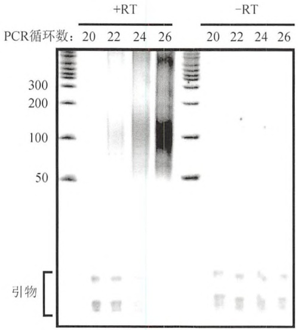
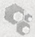
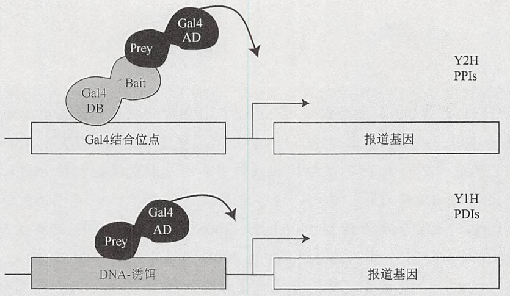
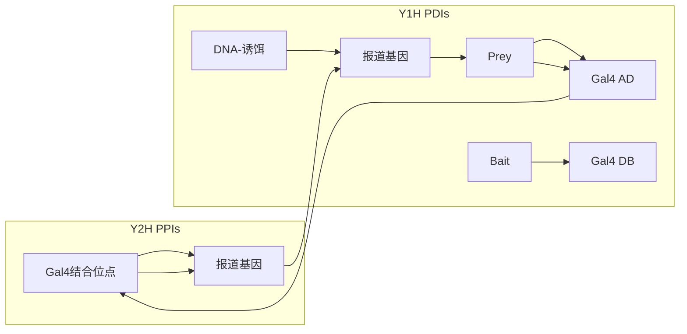
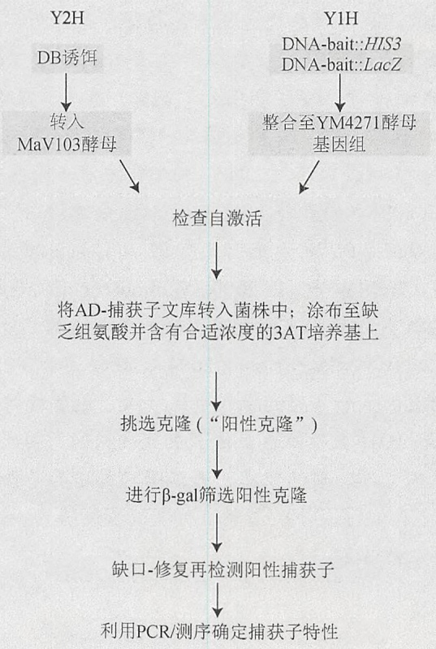
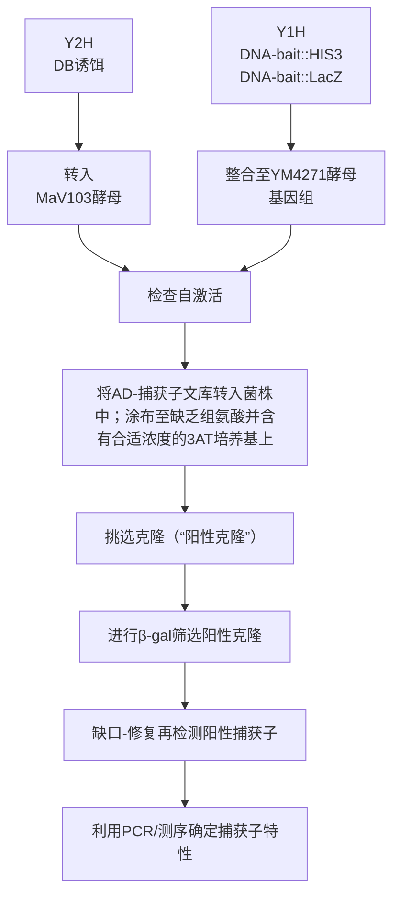
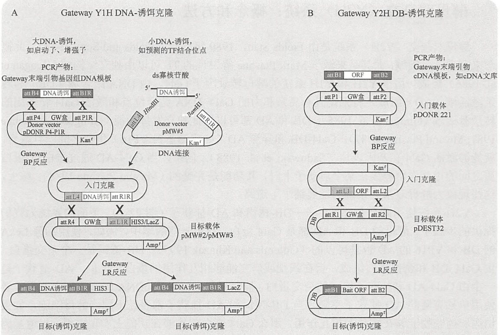

每两个循环取出一个 PCR 管，以评估最佳循环数。最佳循环次数是获得用以评估大小的可见产物的最小循环数。12 次循环后混合 PCR 产物是为了在每个 PCR 中保持起始模板的复杂度，从而避免因为低拷贝（在按 10 份分配反转录产物时，标签数会分配不均匀）导致的不均一扩增。

## PCR 扩增产物的分析

48. 在 $50 \mathrm{~mL}$ 的圆锥管中, 混合 $8.4 \mathrm{~g}$ 尿素、$4 \mathrm{~mL} 5 \times \mathrm{TBE}$ 及 $5 \mathrm{~mL}$ 水, 直至尿素溶解。加入 $5 \mathrm{~mL} 40 \%$ 的丙烯酰胺: 亚甲双丙烯酰胺溶液 (19:1), 总体积为 $20 \mathrm{~mL}$ 。

49. 装配 Owl 双垂直电泳系统的灌胶系统，按厂商说明书准备灌制一块 1.5mm 厚的凝胶。

50. 在灌胶前，加入  $200 \mu L$  10% 的过硫酸铵（APS）和  $7.5 \mu L$  的 TEMED。灌制凝胶，并在室温聚合。

51. 每份  $30.5 \mu L$  的 PCR 产物与  $30.5 \mu L$  的  $2 \times$  上样缓冲液混合，按下面的说明将每个反应上到一个泳道里。在第一个泳道，上  $3 \mu L$  的 AmpliSize 分子标尺（DNA 低分子质量标准）。

一般按这种方式上样:分子质量标准，24个、26个、28个和30个循环的实验样品；24个、26个、28个和30个循环的无RNABP阴性对照样品（如果有的话）。在第二块胶上，分子质量标准，24个、26个、28个和30个循环的无反转录酶实验样品对照；24个、26个、28个和30个循环的无RNABP无反转录酶对照（如果有的话）。

小心操作，保证对照样品及平行反应与实验样品完全隔开，因为如果有污染的 PCR 产物，会带进测序时的 PCR 重扩增。

52. 用 $1 \times \mathrm{TBE}$ 电泳缓冲液，在 $350\mathrm{V}$ 电压下电泳 $1\mathrm{h}$，直至溴酚蓝染料到达凝胶底部。

53. 拆开凝胶板，将凝胶浸入含有 SYBR Gold（按 1:10 000 稀释）的 TBE 中，在脱色摇床上温和染色 10～40min。

54. 将染色的凝胶放在一块保鲜膜上，并用透照仪进行成像。图 21-3 是一个 PCR 凝胶的例子。

许多透照仪用的是 254nm 的紫外光源，这会导致 PCR 产物发生光切刻（photonicking）和光二聚化作用。使用 312nm 波长的激发光源可以避免这一问题。参考 SYBR Gold 厂商的说明书可以获得更多有关使用 SYBR Gold 进行透照和成像的小窍门。

见“疑难解答”。

text_image

PCR循环数: 20 22 24 26
+RT
-RT
300
200
100
50
引物

图 21-3 交联 RNA-蛋白复合物的 RNA 酶滴定。每  $30.5 \mu L$  来自方案 5，步骤 47iii（传统方法）或步骤 47vi（第二种方法）与  $30.5 \mu L$  的  $2 \times$  上样缓冲液混合，每个反应上到尿素 PAGE 凝胶的一个泳道（按照步骤 51）。 $3 \mu L$  AmpliSizer 分子标尺上到每块凝胶的第一个泳道。进行电泳并按照步骤 52～54 进行观测。在这个示例凝胶上，对一个含量很丰富的 RNABP 进行了 HITS-CLIP 实验；因此，我们取

出 20～26 个循环的样品进行电泳（如图所示）。不过，更常规的实验可以取 24～30 个循环的样品进行分析。在+RT 样品中，从第 22 个循环开始就在 100bp 处出现了依赖于 RT 的 PCR 产物涂抹带，而在-RT 对照 PCR 中就没有。PCR 引物则靠近凝胶的底部，如括号所示。

55. 在评估实验成功后（见“疑难解答”及讨论部分），在透照仪上用手术刀将 $80\sim$ 100碱基的PCR产物切下来，并转移至无菌微量离心管中。

现在不再需要无RNA酶的离心管了，但还是要按标准预防措施操作，以避免PCR产物的交叉污染。

56. 按照 Qiagen 公司提供的“用户建立”的“从聚丙烯酰胺凝胶回收 DNA 片段”方案，用 QIAquick 胶回收试剂盒回收 DNA；或者，PCR 产物也可以用  $1 \times$  TBE 进行标准的琼脂糖电泳，并用 EB 染色，在 254nm 或 312nm 成像（见第 2 章，方案 1 和方案 2）。我们使用 3% 的 Metaphor 琼脂糖凝胶，这可以准确地区分小 PCR 产物的大小。按标准方案，用 QIAquick 胶回收试剂盒回收 DNA，用  $50 \mu L$  的 TE 缓冲液洗脱，这可以提高长期保存的稳定性。有关实验结果的更多细节见讨论部分。

PCR产物的测序在方案6中描述。

## 疑难解答

问题（步骤 54）:在实验组中，PCR 产物呈现阶梯状。

解决方案:在连接和克隆时，如果RNA太少，就会发生这种现象。因为这时，无用的竞争性反应（如接头-接头连接）就会占优势。有时，RNA接头的轻微降解，从而露出了末端的磷酸基团或丢失了封闭基团，这也会导致接头与接头发生连接。接头应该进行胶纯化，并按单次使用量进行分装，并于 $-80^{\circ}\mathrm{C}$ 保存。另一个解决方法是增加起始实验材料。有可能接头连接步骤会导致RNA样品明显丢失。

问题（步骤 54）:在无反转录酶对照样品中有 PCR 产物。

解决方案:这说明有 DNA 污染，这种污染通常来自之前或同时进行的 CLIP 实验的 PCR 产物。本方案中，连接好的 RNA 产物最后用 DNase 进行了处理（步骤 25～27），因此污染肯定发生在步骤 27 以后所用的试剂上。所有东西，包括微量离心管、所有试剂都应该更换或验证没有污染。为避免污染，所有试剂要单独存放，按单次使用量分装（如果可能），一直使用带滤芯的吸头，并且常用无反转录酶的对照监测实验。

问题（步骤 54）:在早期循环可见 PCR 产物，而在后期循环中产物略微变大。

解决方案:我们有时也会看到这种现象，但并不清楚原因。一旦可见，尽量从早期循环中切取所需的 PCR 产物。

问题（步骤54）:实验样品泳道有PCR产物，但不是预期（80～100个碱基）的大小。

解决方案:将实验样品泳道的 PCR 产物与无 RNABP 组进行对比，确认 PCR 产物是否来自与感兴趣 RNABP 交联的 RNA。但要注意，即使样品中完全缺乏相应抗体的最佳抗原表位，但由于竞争性和化学计量（stoichiometry）等原因，也会有不同的蛋白质可能会被免疫沉淀下来。针对同一 RNABP 的第二种抗体是一个非常好的阳性对照。在对几个 RNABP 进行的 CLIP 实验中，在游离 RNABP 上方约 20kDa 处进行切取，会得到 80～100 个碱基的 PCR 产物。不过，非常小或非常大的 RNABP 会与此有些不同。

问题（步骤 54）:PCR 产物长度小于 60 个碱基。

解决方案:要与基因组进行可靠地比对，最小的 PCR 产物 56～60 个碱基——RNA 标签为 20 个碱基，接头加起来是 36 个碱基。可以从保存在 -80℃ 硝酸纤维膜上切取更大一点的条带（与之前切取的相比），或者从使用较低 RNA 酶浓度的泳道切取所需样品。有的时候，RNABP 可能主要识别小 RNA，如 miRNA，这样就不会产生预期的 80～100 个碱基 PCR 产物。这可以在硝酸纤维膜上看出来，因为即使使用较低的 RNA 酶浓度，RNABP-RNA 复合物也不增大。

## 讨论

最后凝胶上应显示从 50bp 和 100bp 开始的分子质量标准，以及一系列不同 PCR 循环的 PCR 产物，如 24、26、28 和 30 循环。重要的是，在无反转录酶等阴性对照中，相同的循环数是否有类似的 PCR 产物。如果对在较少循环数下获得的结果还有些疑惑，对照组可以扩增多至 40 个循环。

## 理想结果

如果切取的是游离 RNABP 上方约 20kDa 的条带，理想的结果是 PCR 产物在 80～100 碱基处呈现一个拖尾的带。RNA 标签大小为 50～60 个碱基，再加 36 个碱基的接头。与较小 RNABP 交联的较长 RNA 标签会产生较大的 PCR 产物，同样，较大的污染 RNABP 交联的较小 RNA 片段会导致较小的 PCR 产物。阴性对照在 80～100bp 处没有 PCR 产物，至少在稍多几个循环后没有。例如，如果一个野生型小鼠 RNABP-CLIP 实验在 24 个循环时有很好的结果，而敲除对照小鼠在 30 个循环时开始出现 PCR 产物，这说明在野生型小鼠中，所需的 RNABP 仍很好地富集了 RNA 标签，虽然可能不是绝对干净。在分析最终序列和评估那些稀有标签是否真与靶 RNABP 结合时，这是一个需要考虑的重要数据。

## 确定切除条带

含 RNABP-RNA 复合物的硝酸纤维素膜上，选择切取哪条带是一个重要问题，Ago（Argonaute）CLIP 实验可以说明这一点。因为与 Ago 交联的很大一部分都是 miRNA，PCR 产物大小约为 57 个碱基（21 个碱基的 miRNA 和 36 个碱基的接头）。如果切取 Ago 上方 20kDa 的条带（97kDa+20kDa=117kDa），就不会有 miRNA 的 PCR 产物。实际上，进行 Ago 的 CLIP 实验时，在硝酸纤维膜上切取了比通常更宽的条带，同时包括了 Ago:miRNA 复合物及 Ago:mRNA 复合物，这样可以鉴定许多 Ago 所结合 miRNA 真正的靶 mRNA（Chi et al. 2009）。再用凝胶分析 PCR 产物时，可以同时看到两条带，一个在约 57 个碱基（约 21+36）处，另一个在 80～100 个（约 50+36）碱基处。根据测序结果，可以证实大部分 57 个碱基的产物来自 miRNA，而 80～100 个碱基的产物来自靶 mRNA 分子。

通常，可以知道切取较小的带不会丢失在细胞内结合的小RNA分子，而较大的带则可能是种类广泛的RNA。如果怀疑靶RNA不能被RNA酶充分消化，或者需要把更长的RNA定向CLIP下来时（用基因特异引物扩增回收产物，确定特异RNA分子是否与一个RNABP直接交联），甚至可以切取更大的条带。一般来说，RNA酶浓度越低，RNA标签越长，其他RNABP造成污染的可能性也越大。

## 将 3' 接头连接于 RNA 标签

CLIP方案的一个关键步骤是在RNA标签上连接 $3^{\prime}$ 接头。用T4 RNA连接酶对多个RNA结合蛋白成功地完成了实验。替代策略包括单接头连接或用环化产物进行多核苷酸延展（polynucleotide stretch）（Ingolia et al. 2009），以及iCLIP（Konig et al. 2009）及PAR-CLIP（Hafner et al. 2010）等演进CLIP方案中所用的改动方法。

## 配方

为正确使用本方案中的器材和危险试剂，必须查阅相应的材料安全数据表并咨询所在机构的环境卫生和安全办公室。CLIP 方案所用的所有试剂的制备和保存必须避免 RNA 酶的污染，见第 6 章关于实验室无 RNA 酶溶液的配制及 RNA 操作

的通用准则。

## 变性聚丙烯酰胺凝胶

20mL 的混合物可以灌制一块 1.5mm 厚的凝胶。在灌胶前再加过硫酸铵和 TEMED。

| 试剂 | 含量(20mL) | 终浓度 |
| --- | --- | --- |
| 尿素 | 8.4g | 7mol/L |
| 丙烯酰胺:亚甲双丙烯酰胺(40%,19:1) | 5mL | 10%(V/V) |
| TBE缓冲液(5×) | 4mL | 1× |
| 过硫酸铵(10%,m/V) | 200μL | 0.1%(m/V) |
| TEMED | 7.5μL | 0.0375%(m/V) |

变性聚丙烯酰胺凝胶用上样缓冲液（2×）

| 试剂 | 含量(1mL) | 终浓度 |
| --- | --- | --- |
| 去离子甲酰胺 | 950μL | 95%(V/V) |
| EDTA(100mmol/L,pH 8.0) | 50μL | 5mmol/L |

将 4 份甲酰胺混合物与 1 份 0.5% 的溴酚蓝及二甲苯蓝溶液（Sigma-Aldrich B-3269）混合，保存于 -20℃。

PK 缓冲液（1×）

| 试剂 | 含量(1L) | 终浓度 |
| --- | --- | --- |
| Tris-HCl(1mol/L,pH 7.5) | 100mL | 100mmol/L |
| NaCl(5mol/L) | 10mL | 50mmol/L |
| EDTA(0.5mol/L,pH 8.0) | 20mL | 10mmol/L |

用水补充至1L。4℃保存。

PK 缓冲液（1×）/尿素（7mol/L）

| 试剂 | 含量(10mL) | 终浓度 |
| --- | --- | --- |
| Tris-HCl(1mol/L,pH 7.5) | 1mL | 100mmol/L |
| NaCl(5mol/L) | 0.1mL | 50mmol/L |
| EDTA(0.5mol/L,pH 8.0) | 0.2mL | 10mmol/L |
| 尿素 | 4.2g | 7mol/L |

用水补充至 10mL。此缓冲液每次需新鲜配制。

TBE 缓冲液（5×）

| 试剂 | 含量(1L) | 终浓度 |
| --- | --- | --- |
| Tris 碱 | 54g | 445mmol/L |
| 硼酸 | 27.5g | 445mmol/L |
| EDTA(0.5mol/L,pH 8.0) | 20mL | 10mmol/L |

用水补充至 1L。用 4 份水将 1 份  $5 \times TBE$  稀释成  $1 \times TBE$ 。

## 参考文献

Chi SW, Zang JB, Mele A, Darnell RB. 2009. Argonaute HITS-CLIP decodes microRNA-mRNA interaction maps. Nature 460: 479–486.
Hafner M, Landthaler M, Burger L, Khorshid M, Hausser J, Berninger P, Rothballer A, Ascano MJ, Jungkamp AC, Munschauer M, et al. 2010. Transcriptome-wide identification of RNA-binding protein and microRNA target sites by PAR-CLIP. Cell 141: 129–141.

- Ingolia NT, Ghaemmaghami S, Newman JR, Weissman JS. 2009. Genome-wide analysis in vivo of translation with nucleotide resolution using ribosome profiling. Science 324: 218–223.
- Konig J, Baumann S, Koepke J, Pohlmann T, Zarnack K, Feldbrugge M. 2009. The fungal RNA-binding protein Rrm4 mediates long-distance transport of ubi1 and rho3 mRNAs. EMBO J 28: 1855–1866.

## 方案 6 RNA CLIP 标签测序

对 CLIP 下来 RNA 标签的 PCR 产物，有两种测序策略。低通量测序是对 PCR 产物进行克隆、常规抽提及测序。对方案 5 获得的 PCR 产物，可以用 PCR 加 A 尾及 TA 克隆等常规方案处理（见第 3 章，方案 12）。分析少量克隆时，这是一个有价值的策略。例如，对一个 CLIP 预实验，可以测 50 条序列，以验证这些序列来自所用物种而不是来自细菌 RNA 污染。在刚开始建立 CLIP 方法时，细菌 RNA 污染是一个严重问题，因为一些商品化的酶被来自其他物种的 RNA 污染，而且这些 RNA 不幸被克隆进去了。我们发现 T4 RNA 连接酶是这种污染的一个常见污染源，现在我们一直用 Fermentas 公司的产品，因为它污染最少。在新 CLIP 实验中，特别是处理微量的 RNA 样品时，这一问题需要注意。

一般来说，考虑到费用的降低，如果要对 CLIP 获得的 RNA 进行测序，高通量测序策略是首选。本方案描述的是用适配 Illumina 公司 Solexa 平台的引物对 PCR 产物进行重扩增的方法。虽然本方案是特别针对 Illumina 公司 Solexa 平台的，与此类似，对初始 PCR 产物进行重扩增时，也可以将平台特异的序列加到 PCR 扩增的 DNA 末端（见 11 章）。

## 材料

为正确使用本方案中的器材和危险试剂，必须查阅相应的材料安全数据表并咨询所在机构的环境卫生和安全办公室。

本方案的专用试剂标注&lt;R&gt;，配方在本方案末提供。常用储备溶液、缓冲液和试剂标注&lt;A&gt;，配方见附录1。储备溶液应稀释至适用浓度后使用。

## 试剂

AccuPrime Pfx Supermix（Life Technologies 公司，目录号 12344-040）

琼脂糖凝胶，高分辨率（如 MetaPhor）

AmpliSize 分子标尺（Bio-Rad 公司）

DSFP3 引物（Fisher/Operon 公司；20pmol/μL）:5'-CAAGCAGAAGACGGCATACG ACCGCTGGAAGTGACTGACAC-3'

DSFP5 引物 (Fisher/Operon 公司; 20pmol/μL): 5'-AATGATACGGCGACCACCGACTA TGGATACTTAGTCAGGGAGGACGATGCGG-3'

溴化乙锭溶液

Illumina 测序引物 SSP1(也称为 Solexa 测序引物)(Fisher/Operon 公司): 5'-CTATGGA TACTTAGTCAGGGAGGACGATGCGG-3'

来自方案 5 的 PCR 产物（用 DP3 及 DP5 引物进行扩增的）

TBE 缓冲液（1×）（配制凝胶和电泳用）&lt;A&gt;

Tris-EDTA（TE）缓冲液（1×）（10mmol/L Tris-HCl，pH 8.0；1mmol/L EDTA）&lt;A&gt;

## 设备

使用高通量测序设备

本方案针对 Illumina 的测序平台，其他平台需要不同的引物。

垂直电泳系统（如 Thermo Scientific Owl B1A EasyCast 微型凝胶系统）

金属块（Metal block）

微量离心管(National Scientific Supply 公司, SlickSeal 管[无 RNA 酶], 目录号 CN170S-

GT, VWR#20172-945)

PCR 仪（如 Bio-Rad 公司的 iCycler）及 PCR 管

QIAquick 凝胶回收试剂盒（QIAGEN 公司，目录号 28704）

Quant-iT DNA 分析试剂盒（高灵敏度）（Life Technologies 公司，目录号 Q33120）

透照仪（312nm）（如 Spectroline）

## 方法

## 用 Illumina/Solexa 融合引物进行 PCR 重扩增

1. 在一个微量离心管中，每个反应混合下列成分制备 PCR 混合物:

| AccuPrime Pfx Supermix | 27μL |
| --- | --- |
| DSFP5 引物(20μmol/L) | 0.5μL |
| DSFP3 引物(20μmol/L) | 0.5μL |

2. 在置于冰上的金属块上放置足够的做好标记的 PCR 管，来自方案 5 的每个样品做 4 个 PCR 反应。

与方案 5 类似，这些 PCR 反应用来评估不同循环次数的扩增效果。

3. 按  $28 \mu L/$  管，将 PCR 混合物分装至前面准备好的 PCR 管中。

4. 每个 PCR 管中加  $3 \mu L$  纯化的 PCR 产物（来自方案 5）。

5. 按下面的程序进行 PCR 扩增。

| 循环数 | 变性 | 复性 | 延伸 |
| --- | --- | --- | --- |
| 1 | 95°C 2min |  |  |
| 6~12 | 95°C 20s | 58°C 30s | 68°C 40s |
| 最后循环 |  |  | 68°C 5min |

保持在  $4^{\circ}$ C，并转移至冰上。

6. 灌制含溴化乙锭的 2%\~3% 的高分辨率琼脂糖凝胶（如 MetaPhor）。

注意生产厂商有关使用 MetaPhor 琼脂糖的说明。若不遵循说明，它很难操作。

7. 将全部 PCR 产物上到紧邻低分子质量梯度标准的泳道，进行电泳。

8. 用透照仪观测 DNA，最好用 312nm 的激发光，避免 254nm 紫外线通过光分解及光二聚化对 DNA 损伤。

见“疑难解答”。

9. 从凝胶上切下 150\~170 碱基处的 DNA。

10. 用 QIAquick 凝胶回收试剂盒从凝胶上回收 DNA。

高灵敏的 Quant-iT DNA 分析试剂盒可以有效定量用于高通量测序的微量 DNA。

11. 每个样品准备  $10 \sim 30 \mu L$  10nmol/L 的 DNA，用于 Illumina 测序。如果合适的话，联系测序机构或资源中心，获得有关样品递交的具体细节。有关测序结果生物信息学分析的讨论，见 HITS-CLIP 数据分析信息栏。

## 疑难解答

问题（步骤 8）:在 12 轮扩增后，没有明显的产物。

解决方案:使用阳性对照以确认 PCR 工作正常。对样品来说，AccuPrime Pfx 可能会因为因为多次冻融而丧失活性。确认第一次扩增的 PCR 产物（本方案的模板）被有效回收。

## 方案 7 RNA 接头胶回收及保存

在从生产厂商收到前面方案中要用的 RNA 接头后, 它们必须用变性聚丙烯酰胺凝胶进行纯化, 并按单次使用量分装, 保存在 $-80^{\circ} \mathrm{C}$ 。如果 $3^{\prime}$ 接头丢失了嘌呤霉素封闭基团, 在 $3^{\prime}$ 接头连接过程中会发生 $3^{\prime}$ 接头的连环化。此外, 缩短的接头也会使测序结果的生物信息学分析变得更困难。按下面的方案, 可以在 $20 \%$ 的变性聚丙烯酰胺凝胶对 $50 \mu \mathrm{L}$ 去保护的 RNA 接头 (500μmol/L) 进行电泳及纯化。

## 材料

为正确使用本方案中的器材和危险试剂，必须查阅相应的材料安全数据表并咨询所在机构的环境卫生和安全办公室。

本方案的专用试剂标注&lt;R&gt;，配方在本方案末提供。常用储备溶液、缓冲液和试剂标注&lt;A&gt;，配方见附录1。储备溶液应稀释至适用浓度后使用。

## 试剂

丙烯酰胺:亚甲双丙烯酰胺（40%溶液；19:1）

过硫酸铵（APS; 10%, m/V；用水新鲜配制，或分装保存于-20℃）

AmpliSize 分子标尺（Bio-Rad 公司，目录号 170-8200）

溴酚蓝/二甲苯蓝溶液（各 0.5%；Sigma-Aldrich 公司，目录号 B-3269）

乙醇（75%，保存于-20℃）

乙醇:异丙醇（1:1）

变性聚丙烯酰胺凝胶用上样缓冲液（2×）&lt;R&gt;

RL3、RL3（-P）、RL5 和 RL5D RNA 接头

RNA 凝胶洗脱缓冲液（1mol/L NaOAc，pH 5.2；1mmol/L EDTA）

RT-PCR 级水（Applied Biosystems/Ambion 公司，目录号 AM9935）

TBE 缓冲液 (1×) &lt;A&gt;

TBE 缓冲液 (5×) &lt;R&gt;

TEMED

尿素

## 设备

KODAK BioMax TranScreen LE(8in×10in)(PerkinElmer 公司, 目录号 1622034001EA)
微量离心管[National Scientific Supply 公司, SlickSeal 管(无 RNA 酶), 目录号 CN170S-GT, VWR#20172-945]

Nanosep MF Spin 柱（0.45μm 滤膜，Part #: ODM45C34；Pall 公司）

保鲜膜（如 Saran Wrap）

手术刀（11 号或其他一次性的无 RNA 酶外科手术刀）

分光光度计

橡胶活塞注射器（1mL）

恒温混匀仪

紫外灯（手持式，检查 RNA 条带用）

垂直电泳系统（如 Thermo Scientific Owl 公司，P9DS-2 双凝胶系统）

Whatman 无黏合剂玻璃超细纤维滤膜（GF/D 型，直径 1.0cm；Whatman 公司，目录号 1823-010）

## 方法

1. 混合下列成分制备 20mL 20% 的凝胶:

| 尿素 | 8.4g |
| --- | --- |
| 丙烯酰胺:亚甲双丙烯酰胺(40%;19∶1) | 10mL |
| TBE(5×) | 4mL |
| $H_2O$ | 补充至20mL |

2. 装配垂直电泳系统的灌胶系统，准备灌制一块 1.5mm 厚的凝胶。

3. 灌胶前，加入  $200 \mu L$  10% 的过硫酸铵（APS）和  $7.5 \mu L$  的 TEMED。充分混合，按厂商说明灌制凝胶。

4. 用无 RNA 酶的水将 RNA 接头配制成 500mmol/L 的溶液。

5. 在 $50\mu \mathrm{L}$ RNA接头中加入 $50\mu \mathrm{L}$ 的 $2\times$ 甲酰胺上样缓冲液，上样到配好的 $20\%$ 聚丙烯酰胺凝胶。

6. 用  $1 \times$  TBE 缓冲液，在 350V 电压下电泳，直至溴酚蓝到达凝胶底部。

7. 拆开凝胶板，将凝胶转移至一块置于成像屏[如 KODAK BioMax TranScreen LE（8in×10in）]上方的保鲜膜上。与荧光背景相比，RNA 接头在紫外线下呈现为黑色的条带。

见“疑难解答”。

8. 小心操作，只切取全长的 RNA 接头条带，并将凝胶块转移至无 RNA 酶的微量离心管中。

9. 加入  $350 \mu L$  RNA 凝胶洗脱缓冲液。

10. 用 1mL 注射器的橡胶活塞将凝胶块压碎，小心操作避免溅出。

11. 用恒温混匀仪，在  $37^{\circ}$ C 温和振摇 30min，使凝胶浆充分浸泡。

12. 用 1mL 吸头，将凝胶浆转移至一个或多个 Nanosep spin 滤器（在 Nanosep spin 柱的底部放置一块 Whatman GF/D 滤膜）上，并按厂商的说明进行离心。

13. 将洗脱液转移至一个新的无 RNA 酶的微量离心管中，在微型离心机上以最高转速离心 1min。

14. 加入 1mL 乙醇:异丙醇（1:1），充分混合，于-20℃沉淀几小时至过夜。

15. 用微型离心机，于  $4^{\circ}$ C，以最高转速离心  $20 \sim 25$ min。

16. 用 1mL 预冷的 75%乙醇（存放于-20℃）漂洗沉淀，去掉残留乙醇。

17. 在室温，空气干燥 5\~10min。

18. 用  $50 \mu L$  RT-PCR 级的水重悬沉淀。

19. 用分光光度计测量 260nm 的吸光度，检测 RNA 的浓度，并用 RT-PCR 级的水配制成 20mmol/L 的工作液。

用 NanoDrop 分光光度计进行检测非常方便。

20. 按单次使用量（注意:每次实验样品和对照样品都要进行几个接头连接反应）对凝胶纯化的 RNA 接头进行分装，并于  $-80^{\circ}C$  保存。

## 疑难解答

问题（步骤 7）:电泳时，RNA 呈现宽且弥散的带，或有拖尾现象。

解决方案:可能是上样量过大。使用更宽的上样孔（3～5cm），将样品上到多个上样孔中，或者每个孔上较少的样品，这三种办法都能提高电泳分辨率。

## 讨论

RNA 接头的完整性对成功的 CLIP 实验来说是非常关键的。要用凝胶纯化小批量的 RNA 接头，然后-80℃保存，并避免 RNA 接头的多次冻融。对非常微量的 RNA 样品来说，这样可以明显促进接头连接以及随后扩增的效果。在处理接头时，必须使用最高质量的试剂，并保证无 RNA 酶操作。

## 配方

为正确使用本方案中的器材和危险试剂，必须查阅相应的材料安全数据表并咨询所在机构的环境卫生和安全办公室。

CLIP 方案所用的所有试剂的制备和保存必须避免 RNA 酶的污染。见第 6 章关于实验室无 RNA 酶溶液的配制及 RNA 操作的通用准则。

变性聚丙烯酰胺凝胶用上样缓冲液（2×）

| 试剂 | 含量(1mL) | 终浓度 |
| --- | --- | --- |
| 去离子甲酰胺 | 950μL | 95%(V/V) |
| EDTA(100mmol/L,pH 8.0) | 50μL | 5%(V/V) |

将 4 份甲酰胺混合物与 1 份 0.5% 的溴酚蓝及二甲苯蓝溶液（Sigma-Aldrich B-3269）混合，保存于 -20℃。

TBE 缓冲液（5×）

| 试剂 | 含量(1L) | 终浓度 |
| --- | --- | --- |
| Tris 碱 | 54g | 445mmol/L* |
| 硼酸 | 27.5g | 445mmol/L* |
| EDTA(0.5mol/L,pH 8.0) | 20mL | 10mmol/L |

用水补充至 1L。用 4 份水将 1 份 5×TBE 稀释成 1×TBE。

## 信息栏

## 紫外蛋白交联的机制和特异性

紫外线介导的交联机制现在还不完全清楚，但据信是因为核酸碱基吸收了 250～

<small>\* 原文为 445nmol/L，译者注。</small>

280nm 波长的紫外线（Brimacombe et al. 1988）。基态电子激发到单线高能状态，从而在与核苷酸直接结合的分子间形成了一个新的共价键（Fecko et al. 2007）。由于交联只发生在距离以埃计的分子之间，所以在 CLIP 实验中，只有直接的蛋白质-RNA 结合才能被交联以及进行深入分析。虽然会导致 DNA-DNA 及 RNA-RNA 交联，紫外照射并不会诱导蛋白-蛋白交联（Zwieb et al. 1978; Brimacombe et al. 1988），因此被广泛用于核糖体结构制图等各种生物化学分析领域。

蛋白质-RNA 交联反应只在极少数结合位点发生[在我们自己的研究中用纯化的重组蛋白和一个高亲合力 RNA 适配子对交联效率进行了评估，结果发现最大交联效率在 $1\% \sim 5\%$ ，不过不同蛋白的效率可能不同（Fecko et al. 2007）。]值得注意的是，蛋白质和 RNA 紫外交联的特异性与甲醛交联不同，甲醛交联用于 DNA ChIP，也曾被用于分析蛋白质-RNA 相互作用（Vasudevan and Steitz 2007; Yong et al. 2010）。甲醛交联通常会产生更广泛的蛋白质-核酸及蛋白质-蛋白质复合物，因为甲醛必须浸入组织，因此还有时间限制。甲醛交联的这些特征会让全基因组范围鉴定 RNA-蛋白直接相互作用位点的努力变得更麻烦。

核酸碱基和氨基酸侧链交联的特异性在生物物理水平还没有完全阐释。据报道，紫外线更偏好交联某些氨基酸和核苷酸，用高强度激光研究蛋白蛋白质-DNA相互作用（8纳秒Nd:YAG激光，约100MW cm²）（Hockensmith et al. 1986）时特别偏好胸苷。但这也不完全确定，部分是因为在评估蛋白质-核酸交联的手段或作用机制方面都缺乏共识（Fecko et al. 2007）。RNA-蛋白质相互作用研究显示紫外交联可以在许多氨基酸和嘌呤及嘧啶之间都可以诱导产生共价键（Havron and Sperling 1977）。例如，所有20种氨基酸都被发现可以与多聚尿苷酸在体外交联（Shetlar et al. 1984）。按照这种认识，可以相信任何氨基酸可以与任何核苷酸残基发生紫外交联（Hockensmith et al. 1986）。与这些体外研究一致，CLIP可用来在广泛序列（YCAY，CU，U富集区，GA元件）中鉴定RNABP特异的结合位点。而且，Ago蛋白（通过特定位点与miRNA结合，但也能与周围的mRNA序列交联）的HITS-CLIP分析显示，Ago蛋白对周围的mRNA序列也没有显示任何核苷酸偏好（Chi et al. 2009; Hafner et al. 2010; Zisoulis et al. 2010）。

考虑到紫外交联与甲醛交联相比在精确度上的优势，与目前的 ChIP 测序方法相比，DNA CLIP（Law et al. 1998）理论上是一个可提供更高分辨率的 DNA-蛋白相互作用分析手段。不过在解析 DNA-蛋白相互作用位点方面，DNA-CLIP 不一定能竞争过当前生物信息学方法的能力和速度（Johnson et al. 2007）。

## 参考文献

Brimacombe R, Stiege W, Kyriatsoulis A, Maly P. 1988. Intra-RNA and RNA-protein cross-linking techniques in Escherichia coli ribosomes. Methods Enzymol 164: 287–309.
Chi SW, Zang JB, Mele A, Darnell RB. 2009. Argonaute HITS-CLIP decodes microRNA-mRNA interaction maps. Nature 460: 479–486.
Fecko CJ, Munson KM, Saunders A, Sun G, Begley TP, Lis JT, Webb WW. 2007. Comparison of femtosecond laser and continuous wave UV sources for protein-nucleic acid crosslinking. Photochem Photobiol 83: 1394–1404.

Hafner M, Landthaler M, Burger L, Khorshid M, Hausser J, Berninger P, Rothballer A, Ascano MJ, Jungkamp AC, Munschauer M, et al. 2010. Transcriptome-wide identification of RNA-binding protein and microRNA target sites by PAR-CLIP. Cell 141: 129–141.
Havron A, Sperling J. 1977. Specificity of photochemical cross-linking in protein–nucleic acid complexes: Identification of the interacting residues in RNase–pyrimidine nucleotide complex. Biochemistry 16: 5631–5635.

- Hockensmith JW, Kubasek WL, Vorachek WR, von Hippel PH. 1986. Laser cross-linking of nucleic acids to proteins. Methodology and first applications to the phage T4 DNA replication system. J Biol Chem 261:3512–3518.
- Johnson DS, Mortazavi A, Myers RM, Wold B. 2007. Genome-wide mapping of in vivo protein–DNA interactions. Science 316: 1497–1502.
- Law A, Hirayoshi K, O'Brien T, Lis JT. 1998. Direct cloning of DNA that interacts in vivo with a specific protein: Application to RNA polymerase II and sites of pausing in Drosophila. Nucleic Acids Res 26: 919–924.
- Shetlar MD, Carbone J, Steady E, Hom K. 1984. Photochemical addition of amino acids and peptides to polyuridylic acid. Photochem Photobiol 39:141–144.
- Vasudevan S, Steitz JA. 2007. AU-rich-element-mediated upregulation of translation by FXR1 and Argonaute 2. Cell 128: 1105–1118.
- Yong J, Kasim M, Bachorik JL, Wan L, Dreyfuss G. 2010. Gemin5 delivers snRNA precursors to the SMN complex for snRNP biogenesis. Mol Cell 38: 551–562.
- Zisoulis DG, Lovci MT, Wilbert ML, Hutt KR, Liang TY, Pasquinelli AE, Yeo GW. 2010. Comprehensive discovery of endogenous Argonaute binding sites in Caenorhabditis elegans. Nat Struct Mol Biol 17: 173–179.
- Zwieb C, Ross A, Rinke J, Meinke M, Brimacombe R. 1978. Evidence for RNA–RNA cross-link formation in Escherichia coli ribosomes. Nucleic Acids Res 5: 2705–2720.

## HITS-CLIP 数据分析

## 将 HITS-CLIP 与其他方法结合使用

HITS-CLIP 可以在全基因组范围分析相互作用位点。从这些研究中得出的一个原则是:在分析这种结合位点时，如果与对 RNA 的全基因组功能分析相结合，在许多情况下都更有成效。这些全基因组功能分析的例子包括:通过微阵列或 RNA 测序分析一些扰动（通常是基因敲减或遗传缺失等遗传扰动）导致的 RNA 变化。不出意料，考虑到这些实验给出的巨大数据量，一个重要的第三种分析工具是生物信息学/计算方法。最近，对有关在分析 HITS-CLIP 数据时组合使用这些工具的讨论，进行了综述(Licatalosi and Darnell 2010)。

有研究人员根据 PTB 蛋白（polypyrimidine tract-binding protein）依赖的剪接变体的全基因组分析（Llorian et al. 2010），对 HITS-CLIP 数据进行了再分析（Xue et al. 2009），这是一个有关组合使用这些功能分析工具的很有价值的例子。组合使用这些办法，在结合生物信息学分析，可以重新阐释 CLIP 数据，从而揭示有关 PTB 结合位点决定剪接抑制或增强结果的 RNA 调控图谱（Llorian et al. 2010）。在某种意义来说，其他一些 RNABP 与此相似，包括 Nova（Ule et al. 2006），Fox2（Zhang et al. 2008；Yeo et al. 2009），不均一核糖核蛋白 L（hnRNP L）（Hung et al. 2008），hnRNP C（Konig et al. 2010），类盲肌蛋白（muscleblind-like protein，MBNL）（Du et al. 2010）和 TIA1/L（Wang et al. 2010）。

## HITS-CLIP 数据的生物信息学和计算分析

有文献报道通过使用生物信息学将结合位点及 CLIP 标签簇描绘为精确的结合足迹（Licatalosi et al. 2008; Granneman et al. 2009; Sanford et al. 2009; Wang et al. 2010; Khorsid et al. 2011; Kishore et al. 2011），利用 Argonaute 的 mRNA 足迹预测 miRNA 结合位点（Licatalosi et al. 2008; Granneman et al. 2009; Sanford et al. 2009; Wang et al. 2010），或建立预测计算工具（Zhang et al. 2010）。

关于这种策略的一些要点还是有必要描述一下。有关处理大规模下一代测序数据的基本生物信息学途径有几个部分构成。第一，原始标签，一般是20～50碱基或更长，通过生物信息学方法去掉任何接头序列，并匹配到基因组上（见第8章，方案5）。虽然只保留匹配到单一基因组位点的序列标签是必要的常规策略，你也必须意识到假基因或重复基因（如核糖体RNA）会排除掉一些真正有效的标签，因为这些标签会匹配到多个基因组位点。多数时候，单个标签的多次出现被折算单个序列组合。这样可以消除PCR扩增步骤带来的过扩增偏性。将来，RNA直接测序用来分析HITS-CLIP标签可以消除这种担心。同时，在使用RT-PCR的方案中，含条形码的接头（bar-coded linker）有助于从真正的单一RNA标签中区分PCR副本（Konig et al. 2010）。与此类似，如果有污染问题（特别是同时开展多个CLIP实验时），除了标准的PCR预防措施，可以考虑使用索引接头（indexed linker）（Cronn et al. 2008），这样使每个实验都具有唯一的核苷酸代码。

有了一套筛选过的，并能匹配到基因组的单一序列，对数据进行更高级的分析就成为可能。RNA 结合蛋白对一些异常（非功能性）RNA 序列可能需要一定的转运时间，对这些生理及生化的背景标签，一般都要排除。一种方法是将数据标准化成每个转录物的预期标签，就像描绘 Ago 的 mRNA 足迹实验中所做的一样（Chi et al. 2009）。另一种通用方法是聚焦于那些有重叠的 RNA 标签，因为这些序列可以确定可重复的 RNA-蛋白质相互作用位点；在复杂的生物学实验中，我们发现重点关注那些在多次生物学重复实验出现的序列很有价值（用“生物复杂性”的＞n 来定义位点，n 代表重复实验的次数）（Licatalosi et al. 2008）。可以设置每个簇的标签数阈值（峰值），对这些位点进行进一步精简（也见第 8 章，方案 6）。一般来说，运用类似 Excel 的程序，HITS-CLIP 数据的这种分析并不困难，很容易完成，即使要处理的是大数据集。

最近生物信息学研究将标准 HITS-CLIP 方案获得的 RNA-蛋白质图谱分辨率精确到单核苷酸。这最初被认为是 PAR-CLIP 特有的优势，PAR-CLIP 可以通过分析紫外照射诱导的核苷酸替代物的突变来确定交联位点。不过在标准的 CLIP 中，早就注意到交联簇内的特定位置，突变会增加（Ule et al. 2005; Granneman et al. 2009）。在对 Nova 和 Ago HITS-CLIP 实验进行交联诱导突变（cross-link-induced mutation, CIMS）分析时，这被生物信息学分析证明有效，可以通过这些突变来确定交联的核苷酸。这种方法并不需要使用核苷酸替代物（可以使用正常的细胞或组织进行分析），相对于 PAR-CLIP 来说，这也是一个明显的优势（Kishore et al. 2011）。

在论文发表时，按惯例要将 HITS-CLIP 获得的 CLIP 标签数据保存在美国国立卫生研究院维护的公开访问网站[基因表达综合数据库（GEO）；http://www.ncbi.nlm.nih.gov/geo/]。

(付汉江 译，郑晓飞 校)

# 第 22 章 Gateway 相容酵母单杂交和双杂交系统

## 导言

酵母双杂交（Y2H）系统:概念和方法 1468

酵母单杂交（Y1H）系统:概念和方法学 1470

Y2H 和 Y1H 系统:优点和缺点 1471

假阳性 1472

酵母单杂交和酵母双杂交的操作步骤 1472

## 方案

1 构建酵母单杂交 DNA-诱饵菌株 1474

\- 替代方案 用复性引物从 DNA
诱饵中获得入门克隆产物 1481

2 生成酵母双杂交 DB-诱饵菌株 1484

3 从活化域捕获文库中鉴定相互作用分子 1490

4 高效的酵母转化 1496

5 用于β-半乳糖苷酶活力的菌落转移比色测定 1500

6 酵母克隆的 PCR 1502

## 信息栏

为什么整合 DNA-诱饵？ 1504

选择载体和酵母菌 1504

使用绒布影印平板和影印平板 1505

## 导言

蛋白质-DNA 间（PDI）和蛋白质-蛋白质间（PPI）的相互作用在生物学领域中发挥着举足轻重的作用。PDI 在基因转录、DNA 复制、重组和 DNA 修复中至关重要。基因转录涉及特定的转录因子（TF）之间的相互作用，以及顺式调控元件如启动子和增强子与转录因子之间的相互作用等。总之，这些 PDI 是基因调控网络不可分割的一部分，参与调控众多机体的发育和生理活动（Walhout 2006）。有 5%\~10% 的真核基因编码 TF（Reece-Hoyes et al. 2005；Kummerfeld et al. 2006；Vaquerizas et al. 2009）。描述基因调控网络非常必要的一点就是鉴定与所有顺式调控序列相互作用的 TF，以及确定 DNA 结合每一个 TF 的特异性和亲和力。

PPI 在大多数（如果不是全部的话）过程中发挥功能，从抗体-抗原相互作用到信号的转导级联需要多种类型的相互作用以将信息从细胞质膜传递至细胞核。识别蛋白与 DNA 片段或者目的蛋白之间的相互作用可以很好地认知它们的功能。例如，如果某些蛋白质与 TF 在生理条件下具有相互作用，就有可能具有参与基因表达的功能。这些蛋白质可能是二聚体、共调节因子、染色体蛋白或蛋白转录机器。同样，TF 结合某一 DNA 片段，诱导该基因在特定组织中表达，那么这些 TF 就有可能参与了这种组织的生理活动和发育过程。有几种方法可用于识别 PDI 和 PPI。在这里，我们重点描述酵母“杂交”分析，既可以小规模也可以大规模应用。

在第一部分，我们描述酵母双杂交（Y2H）的背景及分析，为鉴定两个蛋白质间相互作用的其他生化方法如免疫沉淀反应提供一个互补的方法（综述，见 Cusick et al. 2005）。在第二部分，我们将讨论酵母单杂交（Y1H）系统，提供一种“以基因为中心”（从 DNA 到蛋白质）的研究方法，以鉴定顺式调控元件与 TF 之间的相互作用。这种方法是“以转录因子为中心”（从蛋白质到 DNA）的生化方法如染色质免疫沉淀反应（ChIP；参见第 20 章）（Walhout 2006）的互补。Y2H 和 Y1H 系统均用“诱饵”去“钓”与之相互作用的“猎物”。“酵母杂交系统”的示意图见图 22-1。该系统很大程度上受益于 Gateway 克隆系统的开发和应用（Hartley et al. 2000; Walhout et al. 2000b）（见第 4 章）。使用 Gateway 技术，多个 DNA 片段可以平行克隆，从而大大增加了产量，并降低了杂交系统的成本（Walhout et al. 2000; Deplancke et al. 2004）。在描述了 Y2H 和 Y1H 系统的概念、方法的优缺点后，我们提供了一系列的操作步骤。除了制备诱饵和使用不同的菌株及标记外（图 22-2），Y1H 和 Y2H 文库筛选在技术上非常相似。因此，我们将分别提供制备诱饵的步骤以及一个单独文库的筛选步骤，并说明哪种培养条件适用于哪种类型（Y2H 或 Y1H）的筛选。最后，我们讨论并提供专门用于该系统的 Gateway 克隆步骤。Gateway 克隆 Y1H 和 Y2H 的步骤如图 22-3 所示。

flowchart

图 22-1 Y2H 和 Y1H 系统实验原理。（上图）酵母双杂交（Y2H）分析检测蛋白质-蛋白质相互作用（PPI）。“诱饵”蛋白以融合（或“杂交”）方式与酵母转录因子 GAL4 的 DNA 结合结构域（DB）融合表达，而“捕获子”蛋白表达为融合的 Gal4 的激活结构域（AD）。DB-诱饵融合蛋白可以结合到含有 Gal4 结合位点的人工克隆的报道基因上游，随后整合到宿主酵母菌株的基因组中。当诱饵蛋白与捕获蛋白相互作用时，Gal4 的 TF 具有转录激活功能，从而激活报道基因的表达。（下图）酵母单杂交（Y1H）测定法检测蛋白-DNA 相互作用（PDI）。“捕获子”通常是一种转录因子（TF），表达为融合的 GAL4-AD，而“诱饵”是目的 DNA 片段。该 DNA-诱饵序列位于报道基因上游，且该 DNA 诱饵/报道基因盒整合到酵母基因组中。如果捕获子上钩，无论 TF 本身是否是激活子还是抑制基因，AD 都可以诱导报道基因的表达。

flowchart

图 22-2 Y2H/Y1H 文库筛选流程。该流程图概括了 Y1H/Y2H 中设置和操作 AD-捕获物库筛选的步骤。一旦制备了诱饵菌株，Y1H 和 Y2H 在文库筛选的技术上是非常相似的。

图 22-3 Y1H 和 Y2H Gateway 诱饵/猎物克隆流程概述。Gateway 克隆使用重组技术将

DNA 片段转移到质粒上。这种转移的方向是由重组酶和重组质粒（或“ATT”）位点所决定的。例如，BP 酶将 attB（黑色）和 attP 位点重组至 attL 和 attR 位点，而 LR 酶将 attL（灰色）和 attR 位点重组，以产生 attB 和 attP 位点。只有能够互相兼容的 att 位点的不同异构体之间可以使用。例如，attB1 只有与 attP1 位重组，而不是 attP2 位。（A）构建 Y1H 的 DNA 诱饵克隆。DNA 诱饵可以利用 Gateway BP 反应体系，使用 Gateway-attB 为 attB 在末端引物（注意，从基因组 DNA 中扩增用于 DNA 诱饵克隆的 att 位点不同于那些在 Y2H 时所用的 ORF 克隆）克隆到包含 attP 位点的载体。产生的 DNA-诱饵是由一个 attL 位点和一个侧翼的 attR Gateway 克隆位点组成（兼容的 attR 和 attL 位点和 Gateway 盒；未显示出）。小 DNA 诱饵（小于 100bp）可经复性的寡核苷酸形成双链 DNA，克隆到 pMW#5 载体中，以产生一个含有目的序列的载体；具有单链突出端的双链 DNA 片段可克隆到 pMW#5 载体的限制性酶切位点中（我们经常使用 HindIII 和 BamHI，但 pMW#5 多克隆位点含有 HindIII、SphI、SalI、BamHI、SmaI 和 KpnI）（见方案 1 图 22-3）。利用 Gateway LR 反应体系，该 DNA-诱饵能从载体转移至两个含有 attR 和 attL 位点或者含有其中之一的 Y1H 报道基因（HIS3 或 LacZ）目标载体中。（B）构建 Y2H DB-诱饵克隆。ORF 可以通过使用 Gateway-attB 在末端引物的 cDNA 源进行扩增并克隆到含有 GatewayBP 反应体系的 attP 位点的 pDONR 221 载体上。这将获得含有 ORF 并位于 attL 位点两侧的起始克隆（attR 位点和 Gateway 盒的副产物；未显示）。ORF 可再经过 Gateway LR 反应从起始克隆转移到包含 attR 位点的 pDEST32 目的载体中。该目的克隆由 ORF 与 Gal4 DNA 结合域（DB）融合而成。这些 DB 融合物在 Y2H 实验中被用作诱饵。尽管本章具体使用 AD-捕获子结构的克隆库时采用常规方法，使用 Gateway 克隆产生的 AD-捕获克隆，也可用作 Y1H 和 Y2H 实验的捕获物（见介绍）。GW cassette, Gateway 盒（内含有毒 CCDB 基因和氯霉素抗性基因）；ORF，可读框；Kan，卡那霉素；Amp，氨苄青霉素；DB，Gal4 DNA 结合域；AD，Gal4 激活结构域。