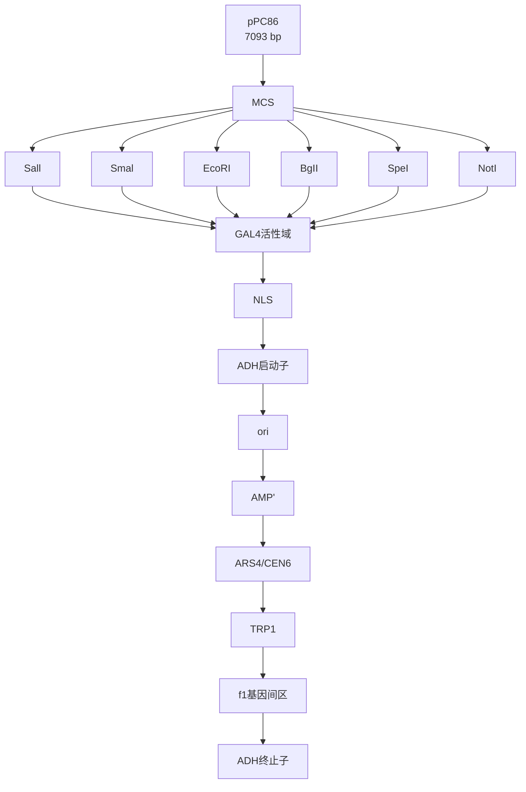

## 方案 2 生成酵母双杂交 DB-诱饵菌株

制备用于与 Gateway 相容的用于酵母双杂交筛选的 DB-诱饵蛋白包括三步（参见本章导言部分的图 22-3B），首先构建入门克隆，该克隆具有编码目的蛋白的 DNA 片段（如目的基因的可读框）；然后是将该 DNA 片段从入门克隆转移至酵母双杂交目的载体 pDEST32（这些载体的图谱参见图 22-7）中；最后将该载体转化酵母细胞株 MaV103。该实验流程需要 24～37 天。

图 22-7 酵母双杂交的入门载体和目标载体图谱（摘自 Life Technologies 公司）。

## 材料

为正确使用本方案中的器材和危险试剂，必须查阅相应的材料安全数据表并咨询所在机构的环境卫生和安全办公室。

本方案的专用试剂标注&lt;R&gt;，配方在本方案末提供。常用储备溶液、缓冲液和试剂标注&lt;A&gt;，配方见附录1。储备溶液应稀释至适用浓度后使用。

## 试剂

琼脂糖

cDNA

DH5α感受态细菌（>10$^{7}$cfu/μg）

DB 引物（5'-GGCTTCAGTGGAGACTGATATGCCTC-3')

DNA 分子质量标准

dNTP 溶液（PCR 级别）

Gateway BP clonase II 酶混合物

Gateway LR clonase II 酶混合物

灭菌的甘油稀释液（15%，V/V；30%，V/V）；

含 50g/mL 氨苄青霉素的液体 LB 与 LB 琼脂平板&lt;A&gt;

含 50g/mL 卡那霉素的液体 LB 与 LB 琼脂平板&lt;A&gt;

LB 液体培养基&lt;A&gt;

M13F 引物（5'-GTAAAACGACGGCCAGT-3')

M13R 引物（5'-CAGGAAACAGCTATGAC-3')

MaV103 酵母细胞株

基因型为:MATa, leu2-3, 112, trp1-901, his3- $\Delta$ 200, ura3-52, gal4 $\Delta$ , gal80 $\Delta$ , cyh2 $^{r}$ , can1 $^{r}$ , GAL1::HIS3@LYS2, GAL1::LacZ, SPAL10::URA3@ura3。

硝酸纤维素膜（45mm、137mm 两种规格）（Fisher Scientific, 目录号 WP4HY13750）

pDEST32

Pdonr221

鲑精 DNA（10mg/mL）&lt;A&gt;

Sc-Leu 平板（150mm）&lt;A&gt;

Sc-Leu-His+3AT(3AT为氨基三唑的缩写,以下均缩写为3AT)平板(分别含10mmol/L、20mmol/L、40mmol/L、60mmol/L、80mmol/L 3AT; 150mm) &lt;A&gt;;

TBE 缓冲液（10×）&lt;A&gt;;

TE 缓冲液（pH 8.0）&lt;A&gt;、TE/LiAc 溶液&lt;R&gt;;

TE/LiAc/PEG 溶液&lt;R&gt;;

TERM 引物（5'-GGAGACTTGACCAAACCTCTGGCG-3')

热稳定的高保真 DNA 聚合酶（如 Pfu）和相关 PCR 缓冲液（10×）

热稳定的常规 DNA 聚合酶（如 Taq）

相关 PCR 缓冲液（10×）

YAPD 平板（150mm）&lt;R&gt;

## 设备

灭菌的培养用的试管（15mL）

灭菌的玻璃珠；温度设为  $25^{\circ}C$ 、 $37^{\circ}C$ 、 $30^{\circ}C$ 、 $15^{\circ}C$  的培养箱

质粒小量制备试剂盒

PCR 板（96 孔）

平板影印装置（Cora Styles 公司，目录号 4006，用于影印 150mm 平板）

能够测定 DNA 浓度的分光光度计（波长为 260nm）

PCR 仪

灭菌的牙签或可经灭菌处理的塑料环

绒布（22cm×22cm，100%棉绒，没有人造丝成分）

温度可设定为  $37^{\circ}$ C 和  $42^{\circ}$ C 的水浴锅

## 方法

## 通过 Gateway 克隆构建含目的基因编码序列的入门克隆

该方法包括测序需 5\~8 天时间。

1. 按照第 4 章方案 2 的步骤 1\~15 进行。

pDONR 221 的入门克隆与目标载体 pDEST32 相匹配，pDEST32 载体中目的基因编码序列与 DB 的 N 端序列形成融合蛋白。

参见“疑难解答”。

# 通过 Gateway 克隆方法将诱饵从入门克隆转移至酵母双杂交 DB 目标载体中

该部分算上测序需要 4\~7 天时间。

2. 对于每一个入门克隆，在 $1.5 \mathrm{~mL}$ 灭菌的小离心管中在冰上加入下列试剂:

| 入门克隆 | 100ng |
| --- | --- |
| pDEST32 | 100ng |
| Gateway LR clonase II 酶混合物 | 1μL |
| TE 缓冲液(pH8.0) | 补至 5μL |

混匀，25℃孵育过夜。

质粒可以通过分光光度计进行定量。将 Gateway LR clonase II 酶混合物用前在冰上融化，所有需要制备的非重组的 Gateway 储存载体根据第 4 章的实验步骤进行制备。作为阴性对照，用 TE 缓冲液替代入门克隆制备相同的 LR 反应混合液。

孵育可在热循环仪或恒温箱中进行，不建议在常温下孵育（如在实验台上），因为温度变化很大。

3. 转化反应产物至  $50 \mu L$  的 E.coli DH5α 感受态细胞中，该感受态细胞每微克 DNA 能产生超过  $10^{7}$  的转化子。就阴性对照组而言，将转化的所有产物涂至 LB 氨苄平板上（ $50 \mu g/mL$ ）。对进行克隆反应的实验组，取转化产物的 1/10 涂至 LB 氨苄平板上，余下的转化产物接种于 3mL 的 LB-氨苄液体培养基中， $37^{\circ}C$  振荡培养过夜，将平板在  $37^{\circ}C$  孵育过夜。

入门克隆和目标载体中的基因编码序列是以 PCR 产物混合体的形式存在的，由于 PCR 诱发的错误会引进错义和无义突变，因此，如果需要制备单个克隆，需要对其中的插入片段进行全序列测序以检测错误。在克隆平板上的转化子应当至少为 50 个，转化子如太少会增加基因编码序列产生突变的概率，如果这种情况发生，建议重复实验，可多加入些入门克隆和目标载体的数量直至转化子超过 50 个，阴性对照平板中应当少于 5 个克隆。

4. 在灭菌的 $1.5\mathrm{mL}$ 小离心管中，将 $50\mu \mathrm{L}$ 过夜培养菌与 $50\mu \mathrm{L}30\%$ 的甘油溶液（$V / V$）混合，将终浓度为 $15\%$ （$V / V$）的细菌甘油冻存液保存在 $-80^{\circ}\mathrm{C}$，余下的培养菌用于质粒制备（参见第1章，步骤1），质粒在 $-20^{\circ}\mathrm{C}$ 保存。

5. 在无菌的 PCR 管中（或者 PCR 板的小孔），制备如下 PCR 混合液:

| 质粒 DNA(来自步骤4) | 0.5μL |
| --- | --- |
| DB 引物(10μmol/L) | 1μL |
| TERM 引物(10μmol/L) | 1μL |
| dNTP(1mmol/L) | 2.5μL |
| PCR 缓冲液(10×) | 2.5μL |
| 热稳定的 DNA 聚合酶 | 1U |
| $H_2O$ | 补至 25μL |

在此处对克隆总混合物的分析是很必要的，这样可以证实只有所需目的基因编码序列的存在，使用一个通用引物和一个基因编码序列特异的引物是不合适的，这是由于不能扩增污染物，记住 PCR 时设一个不加模板的阴性对照。

6. 将试管放入热循环仪中, 运行以下程序:

<table><tr><td>循环数</td><td>变性</td><td>复性</td><td>聚合</td></tr><tr><td>1</td><td>94°C, 2min</td><td></td><td></td></tr><tr><td>35 循环</td><td>94°C, 1min</td><td>56°C, 1min</td><td rowspan="2">72°C, 1min/kbDB-bait 序列72°C, 7min</td></tr><tr><td>最后一个循环</td><td></td><td></td></tr></table>

PCR 的条件根据需要可以优化（参见第 7 章，方案 1）。

7. 取 $5\sim 10\mu \mathrm{L}$ 的PCR产物在 $1\% (m / V)$ 琼脂糖胶中进行电泳，电泳液为TBE，同时加入 DNA 标准分子质量做对照（参见第 2 章，方案 1），如果产生了具有不同大小的 PCR 产物，继续进行步骤 8，如果只有一条正确的 PCR 产物，用 DB 引物（可同时使用 TERM 引物或单独使用 TERM 引物）。如果测序证实正确的可读框得到了扩增且只有需要的可读框产物，跳至步骤 11。

当分析 PCR 产物时，注意使用 DB 和 TERM 引物会将目的扩增产物增加 200bp，另外，使用通用引物时，如果克隆不正确，可能扩增出大约 100bp 的引物二聚体或者大约 2000bp 的 Gateway 盒。在测序反应中出现多于 1 个可读框的明显特征是紧挨着克隆位点或者在峰图中其他位置的测序结果不可读，也有可能检测出的外源可读框是目的基因的不同剪切形式，因此需要以下步骤再将其分离出来。

8. 用经灭菌的加样器尖头在步骤 4 冻存的甘油菌液中划取少许（大约  $2 \mu L$ ）至 1 mL LB 中，并将其按 1:1000 和 1:10000 用 LB 稀释，取  $100 \mu L$  将不同的稀释液用灭菌的玻璃珠涂至 LB 平板中， $37^{\circ}C$  培养过夜。

该步是为了产生彼此很好分离的细菌克隆，因此需要更高的稀释度。

9. 按实验流程 1、步骤 7～9 进行菌落 PCR，每一个 DB 诱饵克隆的平板上至少分析 24 个克隆，所用的引物为 DB 和 TERM 引物，使用通用引物对所有的 PCR 产物进行测序。

细菌可在 LB 氨苄平板中于  $4^{\circ}$ C 储存 2 周。

10. 转接克隆 PCR 中产生的细菌克隆且至少含有正确插入片段的 10 个克隆于 3mL LB 氨苄液体培养基中（相同的培养液包含所有正确的克隆），37℃振荡培养过夜，在 1.5mL 小离心管中，将 50μL 的过夜培养菌与 50μL 的 30%（V/V）甘油溶液混匀，将此 15%（V/V）的甘油细菌储存液于 -80℃保存。余下的菌液用于质粒的小量制备（参加第 1 章，方案 1）。该混合克隆在转入目标载体时应当按照步骤 8～10 再进行检验以确保只含有单个的基因编码序列/剪切体。

## DB-诱饵质粒低效转入 MaV103 酵母中

该部分的方法包括测序证实需要 8\~10 天。

11. 使用灭菌的牙签或一次性的塑料环接种一些 MaV103 细胞于 YAPD 固体培养基中（参见方案 1，图 1），将平板于  $37^{\circ}$ C 培养过夜。

12. 在 1.5mL 的小离心管中，从步骤 11 中的平板中挑取克隆重悬于 1mL 无菌水中。

对于低效率的转化而言这些酵母足够了。

13. 700g 在室温下离心 30s。

14. 准备一些鲑鱼精 DNA（在步骤 12 中的每个管子中至少加入  $20 \mu L$ ）（单链 DNA，10mg/mL），在螺丝盖子的管中沸水煮 5min，放在冰上至少 3min。

15. 在步骤 13 的每个管子中，吸弃液体，将细胞重悬于 1mL 新鲜制备的 TE/LiAc 溶液中，按步骤 13 离心，再吸弃上清液。

关键的一点是在转化的当天从储存液中制备新鲜的 TE/LiAc 和 TE/LiAc/PEG 溶液。

16. 将细胞悬于  $200 \mu L$  的 TE/LiAc 溶液。

17. 加入  $20 \mu L$  经煮沸随后又经冰浴的单链 DNA，用加样器尖头上下混匀。

18. 在每个转化组中分别分装  $50 \mu L$  TE/LiAc/单链 DNA 至相应的无菌离心管中。

19. 从步骤 7\~10 的 DB-诱饵质粒中，取大约 50ng 至步骤 18 分装的酵母中。

注意保留一份没有加入质粒 DNA 的酵母细胞作为对照。

20. 加入  $300 \mu L$  新鲜制备的 TE/LiAc/PEG 溶液，用尖头上下混匀。

21. 将酵母细胞于  $30^{\circ}$ C 孵育至少 30min。

该步可持续至少 4h，但是如果孵育时间少于 30min 或者超过 4h，转化效率会显著降低。

22. 将酵母细胞于  $42^{\circ}$ C 热激 20min。

水浴是最好的选择，可以确保有效的热传递，按我们的经验，热激时间少于或者大于20min会减少转化效率，

但注意热激结束到涂平板的时间对转化效率的影响不很重要。

23. 700g 室温离心 1min，小心去除上清液。

24. 将细胞用 $20 \mu \mathrm{L}$ 的无菌水重悬, 按 96 个点阵的形式将其用加样器滴加到 Sc-Leu 平板的几个区域 (参见方案 1, 图 22-4), 将平板于 $30^{\circ} \mathrm{C}$ 培养 5 天 (不要涂)。

培养 3 天后，DNA 转化的酵母克隆应当可以看到，而没用 DNA 转化的平板则没有克隆生长。

参见“疑难解答”。

25. 对每一个 DB 诱饵质粒而言，使用无菌的牙签或者一次性的塑料环，将至少 50 个酵母克隆混匀在一起，转移至一新鲜的 Sc-Leu 平板，30℃培养过夜。

26. 使用灭菌的牙签，从步骤 25 中新长出的酵母中挑取火柴头大小转移至 1.5mL 含 200μL 无菌 15%（V/V）的甘油溶液中，混匀 5s，将其保存于 -80℃。或者按照步骤 6 进行最后的一致性检测，在检测酵母自激活之前进行测序。

这些冻存的酵母可以通过以下方式复苏:取少许冻存的储存液（大约  $5 \mu L$ ）于 YAPD 平板上， $30^{\circ}C$  生长 2 天，然后将其转移至 Sc-Leu 平板中保存。

## 诱饵蛋白转化的酵母细胞自激活的检测

该方法需要 7\~12 天。

自激活是 DNA 结合诱饵蛋白在没有活化域捕获蛋白时激活报道基因表达的能力，当 DB 诱饵蛋白具有转录激活结构域时这种情形会发生，该自激活将使报道基因表达的背景很高。

27. 使用一无菌的牙签将步骤 26 中的 Sc-Leu 平板中的酵母转接至一新鲜的 150mm Sc-Leu 平板中, 如果有许多酵母双杂交 DB-诱饵细胞需要检测, 可将它们按照 “96 点方式” (参见方案 1, 图 22-4) 转移至相同的平板, 30°C 培养过夜。

为判断自激活的程度，运用具有低、中和高水平报道基因表达的对照 Y2H 酵母细胞，如可能，将它们转接至 Sc-Leu 平板中生长。

28. 将步骤 27 中的酵母平板影印至一新鲜的 150mm Sc-Leu 平板（没有 3AT）中，以及几个分别含有 10mmol/L、20mmol/L、40mmol/L、60mmol/L 和 80mmol/L 3AT 的 150mm Sc-Leu-His 平板中，还有一个 150mm 含有硝酸纤维素膜的平板中（酵母将在滤纸中出现）。将含有 3AT 的选择培养基的平板影印清洗干净直至没有可见的酵母（通常 3 次），30℃ 培养过夜。

参考使用天鹅绒进行影印平板和影印清洗的步骤。

29. 30℃培养1～2天后，使用150mm含有硝酸纤维素膜的平板按照实验5进行比色分析，通过照相并以定量的方式记录每一种酵母蓝色复合物产生的水平（如白色、淡蓝色、深蓝色、蓝黑色）。

30. 30℃培养 5～10 天后，检测步骤 28 的 Sc-Leu-His+3AT 平板，记录抑制 DB-诱饵转化的酵母的生长所需要的 3AT 的浓度。

理想情况是，DB-诱饵转化的酵母在 10mmol/L 3AT 的平板上进行比色分析时将产生少量的蓝色物质，同时也会有一些生长，但是在 20mmol/L 3AT 的平板上生长极少或者就没有生长，在 80mmol/L 3AT 的平板上生长的酵母不能够用于酵母双杂交筛选，这是由于很少的相互作用能够通过激活 HIS3 报道基因而克服如此高背景的抑制作用。但是具有较低 HIS3 自激活能力和较高的 LacZ 自激活能力的酵母是能够筛选的，因为相互作用首先是通过 HIS3 报道基因进行检测，而如果仔细观察的话，这些 HIS3 阳性的酵母的 LacZ 的活性会高于背景。注意一些诱饵蛋白（大约 10%）对两个报道基因的自激活活性由于太高而不能进行双杂交筛选。对于这些诱饵蛋白而言，可以筛选小片段或者特定的蛋白结构域，最后，DB 融合蛋白对酵母也可能具有毒性。

31. 按方案 3 进行。

## 疑难解答

问题（步骤 1）:PCR 不能扩增 DNA 片段。

解决方案:根据我们的经验，用 cDNA 进行的 PCR 失败的最常见原因是由于目的分子不在其中，这可能是由于基因产物不正确，与真实的基因不匹配。或者是由于收集转录物时 mRNA 没有表达，因此目的分子在 cDNA 中丢失，不同类型的或者发育时间点的组织可能是目的 cDNA 的更好来源。模板丢失的另一个原因是转录物太长，反转录不能产生全长的 cDNA。如果基因产物不正确，可以考虑使用其他的引物扩增其他的区域，或者先使用 RACE 以确定转录物的 5' 端和 3' 端。

问题（步骤 1）:Gateway 反应不能够产生转化的细菌。

解决方案:参照第 4 章方案 2 “疑难解答” 部分。

问题（步骤 24）:转化不能够产生酵母克隆。

解决方案:由于转化效率依赖于酵母的健康状态，使用在 YAPD 培养基中新长出的 MaV103 酵母，在各步都不要用力混匀，确保所有的感受态在室温下进行操作，由于待转化质粒 DNA 的数量和质量也很重要，在进行转化前检测质粒的质量和浓度，通常新制备的质粒有利于转化，如果怀疑培养基会产生问题，将在方案 4 的“疑难解答”部分进行讨论。

## 配方

为正确使用本方案中的器材和危险试剂，必须查阅相应的材料安全数据表并咨询所在机构的环境卫生和安全办公室。

TE/LiAc/PEG 溶液

| 试剂 | 体积(500mL) |
| --- | --- |
| TE(10×,pH 8.0) | 50mL |
| LiAc(1mol/L) | 50mL |

加入无菌的 PEG3350 溶液（50%, m/V; 溶于水）至 500mL 使 PEG 的终浓度为 40%。

TE/LiAc/PEG 溶液

| 试剂 | 体积(500mL) |
| --- | --- |
| TE(10×,pH 8.0) | 50mL |
| LiAc(1mol/L) | 50mL |

加入无菌水至 500mL。

YAPD 平板

| 试剂 | 含量(500mL) |
| --- | --- |
| 蛋白胨 | 40g |
| 酵母提取物 | 20g |
| 无水硫酸腺嘌呤 | 0.32g |
| 琼脂 | 35g |

葡萄糖（40%, m/V，溶于水，无菌）100mL。

许多酵母含有 ADE5 突变，如果在培养基中不额外加入腺嘌呤，酵母会变为粉红色，外加的腺嘌呤对野生型的 ADE5 酵母没有影响，这些颜色变化不会影响酵母单或双杂交的结果，只要将粉红色的酵母转入 YAPD 培养基 1 或 2 次，颜色将变回正常的灰白色，在一个 2L 的烧瓶中，将各试剂的粉末溶解于 950mL 的水中，将搅拌子放入其中，在另外一个 2L 的烧瓶中将琼脂加入至 950mL 的水（不能加入搅拌子，否则在高压时它将使琼脂聚集而沸腾溢出），15psi 高压 40min，将第一个烧瓶中的液体立即倒入第二个烧瓶中，加入葡萄糖，搅拌器上混匀，冷却至 55℃（最好将烧瓶放在温度设为 55℃ 的水浴锅中），将其倒入 150mm 无菌的平板中（每个平板大约 80mL），室温晾干 3～5 天，包在塑料袋或铝箔中，室温下可储存 6 个月。

## 方案 3 从活化域捕获文库中鉴定相互作用分子

在酵母双杂交检测中，有必要将表达活化域捕获蛋白的质粒转入含有诱饵的细胞中，这可以通过两种途径:首先可以将两个相反交配型的单倍体酵母细胞进行交配，其中一种交配型含有表达活化域捕获蛋白的质粒，另一种交配型含有表达诱饵的质粒；其次可以将表达活化域捕获蛋白质质粒直接转入具有诱饵的单倍体酵母株中。我们运用单倍体转化进行文库筛选，但每种方法都能用于基于阵列依赖的方法（Vermeirssen et al. 2007b）。对于高通量大规模实验而言，交配实验比较划算，因为它并不需要重复地制备活化域捕获蛋白的克隆，但是，当捕获蛋白和诱饵蛋白通过交配的方法放在一起时，有些相互作用会诱发中度至弱的酵母表型。与酵母单杂交相比，这对于酵母双杂交更是一个问题。灵敏度的问题可以通过改变载体或者酵母菌株解决，而对一些实验而言（比如大规模的基因组水平的工程），灵敏度的降低与费用的减少是等价的。

发现与目的诱饵相互作用的捕获蛋白的过程包括几个步骤:①在本实验流程中，将诱饵酵母株用活化域捕获蛋白文库转化，并涂在含有3AT的选择性培养基中，这将筛选出能激活HIS3报道基因表达的活化域捕获蛋白的酵母株；②这些HIS阳性的克隆可用于LacZ诱导的分析（或者在酵母双杂交实验中选择诱导URA3）；③在双阳性的克隆中用酵母PCR的方法扩增出活化域捕获蛋白质粒中的插入片段；④一些PCR片段用于进行缺口修复检验以证实在新鲜制备的诱饵酵母株中发生的相互作用，余下的则用于DNA测序以证实经过重复测试的捕获蛋白的身份，最后，仔细检测相互作用以排除可能存在的假阳性。活化域捕获蛋白克隆文库可商业购买（如Clontech公司），或者从实验室获取，从cDNA产生克隆文库可通过标准的方法或者从几个生产厂家购买商业的cDNA试剂盒实现，这些方法适用于使用合适的诱饵-融合载体（比如Life Technologies公司的pPC86载体），这些载体能够复制，可在细菌和酵母中进行筛选。

该实验包括测序在内需要 20～43 天完成。

## 材料

为正确使用本方案中的器材和危险试剂，必须查阅相应的材料安全数据表并咨询所在机构的环境卫生和安全办公室。

本方案的专用试剂标注&lt;R&gt;，配方在本方案末提供。常用储备溶液、缓冲液和试剂标注&lt;A&gt;，配方见附录1。储备溶液应稀释至适用浓度后使用。

## 试剂

AD-cDNA 文库 DNA（溶于 pH 7.0 的 TE 中，浓度为  $1 \mu g/\mu L$ ）

几个公司可提供该文库，如 Clontech 公司、Life Technologies 公司以及 Dualsystems Biotech 公司，有的研究型的实验室也能提供。

AD 引物（5'-CGCGTTTGGAATCACTACAGGG-3')

琼脂糖

牛血清白蛋白（BSA）（溶于水，1mg/mL）

dNTP 溶液（PCR 级别）

空载体质粒（如 Ppc86）（参见图 22-8）

flowchart

图 22-8 Ppc86 载体图谱（摘自 Life Technologies 公司）。

硝酸纤维素膜（45μm，137mm；Fisher Scientific WP4HY13750）

限制性内切核酸酶（不同种类，见下文）与相关的  $10 \times$  缓冲液

鲑鱼精 DNA（10mg/mL）&lt;A&gt;

Sc-Leu 平板（150mm）（用于 Y2H 酵母株的液体培养）&lt;A&gt;

Sc-Leu-His-Trp+3AT 平板（含 10mmol/L、20mmol/L、40mmol/L、60mmol/L、80mmol/L 不同浓度的 3AT；150mm）（用于涂酵母双杂交的筛选细胞株）&lt;A&gt;

Sc-Leu-Trp 平板（150mm）（涂布转化的酵母双杂交诱饵细胞株，包括酵母双杂交的对照）&lt;A&gt;

Sc-Ura-His-Trp 平板（150mm）（用于转化的酵母单杂交诱饵细胞株，包括酵母单杂交的对照）&lt;A&gt;

Sc-Ura-His-Trp+3AT 平板（含 10mmol/L、20mmol/L、40mmol/L、60mmol/L、80mmol/L 3AT；150mm）（用于酵母单杂交筛选）&lt;A&gt;

TBE 缓冲液（10×）&lt;A&gt;

TE/LiAc 溶液&lt;R&gt;

TE/LiAc/PEG 溶液&lt;R&gt;

TERM 引物（5'-GGAGACTTGACCAAACCTCTGGCG-3')

热稳定的常用 DNA 聚合酶（比如 Taq）与相关的 PCR 缓冲液（10×）

YAPD 平板（150mm）（用于酵母单杂交酵母细胞株的液体培养）&lt;R&gt;

## 设备

灭菌的玻璃珠

稳定设定为  $30^{\circ}$ C 和  $37^{\circ}$ C 的水浴锅

PCR 反应板（96 孔）

平板影印装置（Cora Styles，目录号 4006，用于 150mm 平板）

热循环仪

灭菌的牙签和无菌的一次性塑料环

棉绒布（22cm×22cm），无菌

温度设定为  $37^{\circ}$ C 和  $42^{\circ}$ C 的水浴锅

## 方法

将 AD-Prey 文库转入酵母单杂交或酵母双杂交 DNA-诱饵酵母细胞中。

该步需要6\~18天完成。

1. 向每个待检测的诱饵酵母细胞按照方案 4 进行如下的高效转化。

i. 将 $30 \mu \mathrm{g}$ 的AD-cDNA文库加入至 $2 \mathrm{~mL}$ 的TE/LiAc/单链DNA诱饵酵母悬液中。  
ii. 将 $50 \mathrm{ng}$ 的空文库质粒（即无cDNA插入的质粒）加入至 $30 \mu \mathrm{L} 2 \mathrm{~mL}$ 的TE/LiAc/单链DNA诱饵酵母悬液中。

文库 DNA 的转化数量取决于文库的复杂度，这里列出的量是包含  $4 \times 10^{7}$  个克隆的线虫 cDNA 文库，代表 20 000 个基因中的 16 000 个，在文库质粒的骨架为非 Gateway pPC86（Walhout et al. 2000），同时注意制备无 DNA 加入的酵母阴性对照组，这些酵母在 Sc-Ura-His-Trp （酵母单杂交）或者在 Sc-Leu-Trp（酵母双杂交）平板中不生长，酵母/文库/PEG 混合物应当在 15mL 的试管中首先制备好，然后分装至 1.5mL 小离心管中（每管 1mL），已保证在 30℃ 和 42℃ 加热时每管受热相同，转化后，将分装的各组在离心之前混合在一个无菌的 15mL 试管中。

2. 将 cDNA 文库的转化产物用 $5\mathrm{mL}$ 的无菌水重悬，空质粒对照酵母悬于 $30\mu \mathrm{L}$ 的无菌水中。

3. 从步骤 2 中的文库转化混合物取出  $5 \mu L$  加入至  $495 \mu L$  的无菌水中制备 1:100 的稀释液，从中取  $50 \mu L$  加入至  $450 \mu L$  的无菌水中以制备 1:100 的稀释液，使用无菌的玻璃珠将其涂布在 150 mm 的 Sc-Ura-His-Trp 平板（用于酵母单杂交）或者在 Sc-Leu-Trp 平板（用于酵母双杂交）中。

这些平板不含有 3AT，是因为它们将用于转化效率的计算，有效的文库筛选需要至少转化出 100 万个克隆，随着转化效率的增加，发现相互作用的概率也增加。注意，随着文库复杂度的提高（也就是说有更多的基因或者基因的剪切体），需要筛选更多的克隆数目，如果转化效率低于 100 万，需要进行重复筛选直至获得了需要的筛选数量。

4. 使用无菌的玻璃珠，将余下的转化的酵母涂至 10 个 150mm 的 Sc-Ura-His-Trp+3AT 平板（用于酵母单杂交）或者 Sc-Leu-His-Trp+3AT 平板中（用于酵母双杂交）。

这些平板中 3AT 浓度是在 HIS3 自激活检测中使酵母生长至最小时 3AT 的浓度，需要多个大的平板以确保彼此分开的酵母能够生长。

5. 取  $5 \mu L$  空质粒对照酵母悬液点在 Sc-Ura-His-Trp 平板（用于酵母单杂交）或者 Sc-Leu-His-Trp 平板中（用于酵母双杂交）。

不需要将单个克隆在平板上涂匀，空文库载体转化的酵母将作为阴性对照来展示在没有相互作用时报道基因的表达水平。

6. 将所有平板于  $30^{\circ}$ C 孵育。

7. 3 天后，来自步骤 3 和步骤 5 的酵母克隆明显生长，如果在阴性对照平板中出现了克隆，该筛选不能进行，这是由于某种试剂发生了污染。转化效率（每微克 DNA 转出的克隆数目）可以使用步骤 3 的平板计算，来自步骤 5 的平板可在室温储存至需要进一步实验时为止，来自步骤 4 的平板可在  $30^{\circ}$ C 生长 14 天，经常检查这些平板，当克隆明显时挑选阳性克隆。

根据使用的诱饵蛋白不同，获得的克隆的数目和大小差别很大，由于强和弱的酵母表型通常取决于不同的转录因子，在可能的情况下同时选择大的和小的克隆。

参见“疑难解答”。

8. 使用无菌的牙签，将从步骤 4 平板中获得的 HIS 阳性的克隆转移至 150mm Sc-Ura-His-Trp 平板（用于酵母单杂交）或者 Sc-Leu-His-Trp 平板中（用于酵母双杂交），按照 “96 点方式”（参见方案 1 图 22-4）。另外，将来自步骤 7 的一些空质粒对照克隆转移至这些平板-它们将被用来判断报道基因的诱导情况，如果有表达已知水平报道基因的阳性对照酵母株，也将它们转移至这些平板中，30℃孵育 1～2 天。

从每个诱饵筛选平板中挑取的克隆数量仅仅取决于克隆生长的数目，但我们通常不超过96个[它们可以转移至同一块平板（参见方案1图22-4），以便方便地进行96孔PCR]，一些诱饵转化株由于没有好的转化效率并不能够得到克隆，这些诱饵可以再进行筛选，尽可能使用低浓度的3AT或者不同的cDNA文库（如从其他组织来源的mRNA），但是也可能一些诱饵株得到几百个克隆，这些诱饵蛋白能够与许多伴侣结合（也就是说它们在相互作用网络中处于重要地位），或者它们与文库中高丰度的蛋白质作用（这个问题对于没有经过标准化的cDNA文库尤其重要），有许多相互作用分子的诱饵可能需要在更高浓度的3AT中进行筛选。

## “双阳性”酵母细胞的鉴定

该步骤需要5\~10天。

9. 影印 “HIS 阳性”（与空质粒对照）平板至一块新鲜制备的 150mm Sc-Ura-His-Trp（或者 Sc-Leu-Trp）平板、一块含有 3AT（其浓度与进行筛选时的浓度一致）的 150mm Sc-Ura-His-Trp（或者 Sc-Leu-His-Trp）平板，以及一块 150mm 含硝酸纤维素膜的 YAPD 平板。

10. 将含 3AT 的平板复制干净（通常复制 3 次），30℃ 孵育 5～10 天。

该平板将证实 “HIS 阳性” 结果。

11. 30℃孵育 1～2 天后，按方案 5 进行菌落转移比色测定法检测含硝酸纤维素膜的 YAPD 平板，根据检测结果，发现那些双阳性的克隆（这些克隆中两个报道基因的诱导水平将比阴性对照组高）。

对于具有中度或高度自激活活性的诱饵蛋白而言，在结果确定之前常将可能是阳性的酵母细胞与空载体转化的对照酵母细胞进行比较，以便确定报道基因的激活，这一点很有必要。

## 通过切口-修复复检证实相互作用

完成该部分的方法包括序列测定在内需要9\~15天。

对步骤 11 中发现的相互作用进行重新检测是非常必要的，这是因为一些 “双阳性” 的酵母表型并非是由于活化域捕获蛋白与诱饵蛋白的相互作用而产生的（比如当诱饵酵母细胞株具有自激活活性时——参见导言），证实相互作用最早的方法是运用切口-修复实验，它包括在每一个阳性的酵母克隆中运用 PCR 方法从 pPC86 克隆中扩增基因编码序列，将每一个扩增片段与线性载体 pPC86 共转染至新鲜的诱饵酵母株中。载体与 PCR 扩增片段在酵母中进行重组为新的质粒，然后在转化的酵母中检测报道基因的激活。如果没有切口-修复实验，每个相互作用的验证均需要将活化域捕获载体转入新鲜的酵母中，虽然从双阳性的酵母中抽提质粒是可行的，但是如果同时检测许多相互作用将带来很大的挑战。而当获得 AD-cDNA（从酵母中提取）或者 AD-cDNA（从基因组编码的可读框架文库中分离）的克隆时，可以运用方案 2 步骤 11～23 中低效转化技术，或者方案 6 的高效转化方法进行重新验证，然后再按照下面的步骤 16 进行实验。

12. 使用无菌的牙签（或者复制的平板）将步骤 11 中发现的双阳性酵母转移至 150mm 新鲜制备的 Sc-Ura-His-Trp 平板（用于酵母单杂交）或者 Sc-Leu-Trp 平板中（用于酵母双杂交）中，30℃ 孵育过夜。

13. 按照实验 6 使用 AD 和 TERM 引物对可能发生相互作用的所有酵母克隆进行 PCR 扩增，PCR 产物保存于 -20°C。

PCR 延伸时间应当反映插入片段的平均长度，只有扩增出一条片段的 PCR 产物才能用于后续实验，含有多个片段的酵母裂解物中可能含有多个活化域捕获克隆，因此不能够通过测序发现相互作用分子。

14. 在无菌的 $1.5 \mathrm{~mL}$ 小离心管中, 建立如下的限制性内切核酸酶反应体系:

| pPC86 (non-Gateway AD 载体) | 10μg |
| --- | --- |
| 牛血清白蛋白(1mg/mL) | 4μL |
| 限制性内切核酸酶缓冲液(10×) | 4μL |
| SalI | 2μL(20U) |
| BgII | 2μL(20U) |
| $H_2O$ | 补平至 40μL |

混匀，37℃孵育过夜。

该酶切将从载体的多克隆位点切出小的（大约20bp）片段，结果产生末端不匹配的线性片段，如果选择的文库不是基于pPC86载体，应当根据载体选择合适的限制酶以便产生相同类型的线性片段，没有必要将酶切后的载体片段从酶切反应体系中纯化出来。

15. 对每个诱饵酵母株而言，按照方案 4 进行酵母的高效转化，取 40ng 线性的 pPC86 和 5μL 的捕获 PCR 产物（来自步骤 13）加入至 20μL 的 TE/LiAc/单链鲑精 DNA 酵母混悬液中，没有 PCR 产物的三个阴性对照应当包括:无 DNA、40ng 线性 pPC86 及 40ng 未经酶切的 pPC86 载体。

该转化可在96孔PCR板中（每孔 $200\mu \mathrm{L}$ 体积）进行，PCR产物末端是与载体序列匹配的大约为100bp大小的片段，该序列有利于同源重组。

16. 将转化的酵母悬于 $20\mu \mathrm{L}$ 的无菌水中，用加样器尖头上下混匀，使用 $5\mu \mathrm{L}$ 的悬液在Sc-Ura-His-Trp平板（用于酵母单杂交）或者Sc-Leu-Trp平板（用于酵母双杂交）中点一个点（96点方式）（参见方案1的图22-4），如果手头有表达已知水平的报道基因的酵母阳性对照株的话，也应当将其转移至这些平板中，$37^{\circ}C$ 孵育2天。

转化子的数量会比切口-修复样品转化子数多一个数量级，没有酶切的pPC86对照组比线性pPC86对照组转化子的数量也高一个数量级，没有DNA的对照组将没有转化子出现。

参见“疑难解答”。

17. 将转化的平板复制到一新鲜制备的 150mm Sc-Ura-Trp 平板（用于酵母单杂交）或者 Sc-Leu-Trp 平板（用于酵母双杂交）、含有 3AT（其浓度与进行筛选时的浓度一致）的 Sc-Ura-His-Trp 平板（用于酵母单杂交）或者 Sc-Leu-Trp 平板（用于酵母双杂交）中，以及一个 150mm 含硝酸纤维素膜的 YAPD 平板中，以用于β-Gal 检测，第一类平板用于维持酵母生长，其他平板用于重新验证 HIS3 和 LacZ 的表达。

18. 根据步骤 10 和步骤 11 检测双阳性的酵母克隆。

19. 通过使用 AD 引物对步骤 13 产生的 PCR 产物进行测序，确定通过切口修复验证的双阳性猎物分子的特征。

参见“疑难解答”。

## Y1H 及 Y2H 预期结果和解释

参见表 22-6 对杂交到的相互作用进行评价。在酵母单杂交筛选中，使用单个的 DNA-诱饵可以发现 0～40 个相互作用蛋白（Deplancke et al. 2006; Vermeirssen et al. 2007a; Martinez et al. 2008）。通常，大的、复杂性高的 DNA 诱饵如启动子将获得更多的蛋白分子，而转录因子结合位点或者小的顺式作用元件通常仅获得一个或几个相互作用蛋白（Reece-Hoyes et al. 2009; 数据未显示）。大多数（>95%）获得蛋白为转录因子，但是没有可预测的 DNA 结合域的蛋白质仅占相互作用的少数（<5%），这些蛋白质可能具有一个新型的 DNA 结合结构域或者间接与 DNA-诱饵作用（Deplancke et al. 2006; Vermeirssen et al. 2007a），由于酵母单杂交捕获蛋白含有很强的激活结构域，因此，激活子和抑制基因都能够被发现，相互作用分子的功能需要用其他实验进行检测。

表 22-6 Y1H/Y2H 相互作用的评价

| 特征 | 说明 |
| --- | --- |
| 相互作用发现的频率 | 如果一种相互作用出现了多次,那非常令人振奋,但是,也不能排除它是单个克隆的重复,特别是当这些蛋白质表现出特定的表达方式和水平时 |
| 诱饵蛋白具有弱的自激活活性 | 如果筛选到的克隆中报道基因的激活明显高于背景时,可以认为它具有与诱饵蛋白相互作用的可能性 |
| 诱饵蛋白自激活活性非常高 | 在这种情况下要对发现的相互作用非常慎重,获得假阳性的可能性很高 |
| 过缺刻修复对猎物进行验证 | 这对减少假阳性非常必要,除非用含基因编码序列/cDNA的克隆进行验证,经验证后的相互作用是真实的,除非诱饵蛋白具有弱的/强的自激活活性 |
| 相位 | 确保猎物与Gal4 AD的编码序列相位一致,如不能,将是假的多肽赋予了相互作用的表型 |

YIH，酵母单杂交；Y2H，酵母双杂交；AD，激活结构域。

酵母双杂交能够得到 0～10 个克隆,有时甚至可以得到几百个相互作用蛋白(Rual et al. 2004),与大量蛋白结合的蛋白质在相互作用网络中处于中心地位,这些蛋白质在不同的生物学过程中起核心作用,与许多蛋白相互作用的分子可以作为大的复合物的组分与其他分子结合或者在不同的组织、不同的环境或生理条件下中具有不同的作用分子,需要进一步的实验来解释通过酵母杂交发现的相互作用的生物学功能。

## 疑难解答

问题（步骤 7）:转化效率低。

解决方案:高效的转化效率应当达  $1 \times 10^{6}/mg$  DNA（环状的），如果出现的克隆太少，注意酵母的转化效率是否严重受到酵母生长状态的影响，因此，只用新鲜生长的酵母株，不要振荡，确保所有的溶液保存在室温下。由于待转化质粒的数量和质量也非常重要，制备 DNA 时应当使用乙醇沉淀以去除污染物，DNA 浓度应当用分光光度计进行测定。如果根本没有克隆生长，很可能培养液不正确（如葡萄糖没有加入、溶液的交叉污染），这将在方案 4 的“疑难解答”部分进行讨论。

问题（步骤 16）:切口-修复转化失败。

解决方案:切口-修复样品不能够产生比线性载体对照更多的克隆的原因主要有两个。首先，载体没有被有效地消化，这时线性载体与没有酶切的载体将产生相同数目的克隆，如果是这样，应当制备新的线性化载体（在重复切口-修复转化之前应当先进行对照组的转化实验）。其次，在转化中没有足量的 PCR 产物，对于这些样品而言，转化更多的 PCR 产物（最多可以转  $20\mu L$ ），或者取一些 PCR 产物为模板（ $0.5\mu L$ ）进行下一轮 PCR 以便获得更高浓度的 PCR 产物，如果没有克隆出现，很可能是培养基不正确，这将在方案 4 的“疑难解答”部分进行讨论。

问题（步骤 19）:你不能检测到用另外的一种方法发现的相互作用。

解决方案:酵母杂交检测相互作用的说明在介绍中进行了讨论（参见表 22-3）。

## 配方

TE/LiAc 溶液

| 试剂 | 含量(500mL) |
| --- | --- |
| TE(10×,pH8.0) | 50mL |
| LiAc(1mol/L) | 50mL |

加入灭菌水至终体积。

TE/LiAc/PEG 溶液

| 试剂 | 用量(500mL) |
| --- | --- |
| TE(10×,pH8.0) | 50mL |
| LiAc(1mol/L) | 50mL |

加入灭菌 PEG 3350 溶液（50%，m/V；水配置）至终体积（PEG 终浓度为 40%）。

YAPD 平板

| 试剂 | 用量(2L) |
| --- | --- |
| 蛋白胨 | 40g |
| 酵母提取物 | 20g |
| 脱水硫酸腺嘌呤 | 0.32g |
| 琼脂粉 | 35g |
| 葡萄糖(40%,m/V)水溶液,灭菌 | 100mL |

我们使用的很多酵母菌株是 ADE5 基因突变株，因此如果不在培养基中加入腺嘌呤，这些菌株生长出来的酵母克隆是粉红色的。需要注意的是，腺嘌呤对 ADE5 野生型的酵母菌株没有影响，这种不同的颜色也不会影响酵母单杂交和酵母双杂交的实验结果。将粉红色的酵母菌转移到 YAPD 培养基中，培养一到两次后菌液的颜色就会回复到正常的乳白色。配制 YAPD 培养板需准备两个烧瓶，在第一个 2L 的烧瓶中，用 950mL 水溶解粉末，并将搅拌棒置于烧瓶中；在第二个烧瓶中，在 950mL 水中加入琼脂粉（不要加入搅拌棒，否则会导致浓缩的琼脂粉在高压时沸腾溢出），15psi 高压 40min，立即将第一个烧瓶中的内容物（含搅拌棒）倒入装有琼脂粉的烧瓶，加入葡萄糖，磁力搅拌器上混合均匀，冷却至 55℃（可以将烧瓶在 55℃水浴锅中放置至少 1h）。将烧瓶中的液体倒入 150mm 灭菌培养皿中（每皿约 80mL），室温干燥 3～5 天，用塑料袋或箔纸包裹，室温可保存 6 个月。

## 参考文献

- Deplancke B, Mukhopadhyay A, Ao W, Elewa AM, Grove CA, Martinez NJ, Sequerra R, Doucette-Stamm L, Reece-Hoyes JS, Hope IA, et al. 2006. A gene-centered C. elegans protein-DNA interaction network. Cell 125: 1193–1205.
- Martinez NJ, Ow MC, Barrasa MI, Hammell M, Sequerra R, Doucette-Stamm L, Roth FP, Ambros VR, Walhout AJ. 2008. A C. elegans genome-scale microRNA network contains composite feedback motifs with high flux capacity. Genes Dev 22: 2535–2549.
- Reece-Hoyes JS, Deplancke B, Barrasa MI, Hatzold J, Smit RB, Arda HE, Pope PA, Gaudet J, Conradt B, Walhout AJ. 2009. The C. elegans Snail homolog CES-1 can activate gene expression in vivo and share targets with bHLH transcription factors. Nucleic Acids Res 37: 3689–3698.
- Rual JF, Hirozane-Kishikawa T, Hao T, Bertin N, Li S, Dricot A, Li N, Rosenberg J, Lamesch P, Vidalain PO, et al. 2004. Human ORFeome

version 1.1: A platform for reverse proteomics. Genome Res 14: 2128–2135.

Vermeirssen V, Barrasa MI, Hidalgo CA, Babon JA, Sequerra R, Doucette-Stamm L, Barabási AL, Walhout AJ. 2007a. Transcription factor modularity in a gene-centered C. elegans core neuronal protein-DNA interaction network. Genome Res 17: 1061–1071.

Vermeirssen V, Deplancke B, Barrasa MI, Reece-Hoyes JS, Arda HE, Grove CA, Martinez NJ, Sequerra R, Doucette-Stamm L, Brent MR, et al. 2007b. Matrix and Steiner-triple-system smart pooling assays for high-performance transcription regulatory network mapping. Nat Methods 4: 659–664.

Walhout AJ, Temple GF, Brasch MA, Hartley JL, Lorson MA, van den Heuvel S, Vidal M. 2000. GATEWAY recombinational cloning: Application to the cloning of large numbers of open reading frames or ORFeomes. Methods Enzymol 328: 575–592.

## 方案 4 高效的酵母转化

高效的酵母转化适用于以下实验:①将外源质粒整合到 YM4271 菌株（以产生酵母单杂交的 DNA-诱饵菌株）；②将 AD-捕获文库转化到酵母单杂交和酵母双杂交诱饵菌株；③用于缺口修复。尽管这是一个稳定且可靠的转化方法，但是偶尔转化效率会很低，一旦发生这种情况，可以参考该部分和方案 3 的“疑难解答”部分。完成该方案需要 2 天。

## 材料

为正确使用本方案中的器材和危险试剂，必须查阅相应的材料安全数据表并咨询所在机构的环境卫生和安全办公室。

本方案的专用试剂标注&lt;R&gt;，配方在本方案末提供。常用储备溶液、缓冲液和试剂标注&lt;A&gt;，配方见附录1。储备溶液应稀释至适用浓度后使用。

## 试剂

## 转化用 DNA

线性化的 pMW#2/pMW#3 载体（用于整合）、AD-cDNA 文库（用于筛选），或者线性化的 pPC86 和 AD-TERM PCR 产物（用于缺口修复）。

葡萄糖水溶液（40%，m/V），灭菌

鲑精 DNA（10mg/mL）&lt;A&gt;

Sc-Leu 平板（150mm）（用于培养酵母双杂交 DB-诱饵菌株的液体培养基）

Sc-Leu-His-Trp+3AT 平板（10mmol/L、20mmol/L、40mmol/L、60mmol/L 或者 80mmol/L 3AT；150mm）（用于酵母双杂交筛选）&lt;A&gt;

Sc-Leu-Trp 平板（150mm）（用于酵母双杂交缺口修复的重复实验）

Sc-Ura-His 平板（150mm）（用于酵母单杂交 DNA 诱饵整合）

Sc-Ura-His-Trp 平板（150mm）（用于酵母单杂交缺口修复的重复实验）

Sc-Ura-His-Trp+3AT 平板（10mmol/L、20mmol/L、40mmol/L、60mmol/L 或者 80mmol/L 3AT；150mm）（用于酵母单杂交筛选）&lt;A&gt;

TE/LiAc 溶液&lt;R&gt;

TE/LiAc/PEG 溶液&lt;R&gt;

YAP 溶液&lt;R&gt;

YAPD 平板（150mm）（用于酵母单杂交 DNA-诱饵株液体培养）&lt;R&gt;

## 设备

合适体积的锥形管，灭菌

玻璃珠，灭菌

$30^{\circ}\mathrm{C}$ 孵箱

PCR 板（96 孔）

$30^{\circ} \mathrm{C}$ 振荡孵育器

分光光度计

灭菌牙签和/或灭菌一次性塑料接种环

$37^{\circ} \mathrm{C}$ 和 $42^{\circ} \mathrm{C}$ 水浴锅

## 方法

1. 使用灭菌牙签或一次性塑料接种环将酵母单杂交 DNA-诱饵菌株转移到一个 YAPD（或 Sc-Ura-His）平板，或将酵母双杂交 DB-诱饵菌株转移到 Sc-Leu 平板。如方案 1 中图 22-4 所示，多种酵母菌株可以接种到单个 150mm 平板，30℃过夜培养。

酵母双杂交 DB-诱饵菌株需要在选择性培养基中培养，在无选择性培养基中培养会丢失 DB 诱饵质粒，而酵母单杂交 DNA-诱饵菌株由于已经整合到酵母基因组中，因此不会丢失报告质粒。

2. 计算体积，即方案1（整合）步骤17或方案3步骤1（文库转化）或步骤15（缺口修复重复试验）转化所需要的酵母重悬物的总体积（Q）。

3. 用液体 YAPD 培养基重悬诱饵菌至 $\mathrm{OD}_{600} = 0.15 \sim 0.20$，起始培养基为 $200\mathrm{Q}$。

在 YAPD 中培养的这段时期，酵母双杂交 DB 诱饵菌所丢失的 DB-诱饵质粒的量是很少的。

4. 步骤 3 得到的重悬物在摇床（30℃，200r/min）培养，直到  $OD_{600}=0.4\sim0.6$ 。

大约需要培养 5h，定期检查培养基 OD 值。

参考“疑难解答”。

5. 室温 700g 离心 5min 以收集细胞。

在锥形管中离心会得到更好的效果。

6. 至少准备 Q/10 鲑精 DNA（单链 DNA，10mg/mL），煮 5min，冰上放置至少 3min。

7. 倒去步骤 5 中的上清液（酵母菌会形成牢固的沉淀物），加入 20 Q 的灭菌水，上下颠倒或摇动使细胞重悬，不要振荡。

8. 按照步骤 5 的方法离心，弃上清，加入 4 Q 的新鲜配制的 TE/LiAc 溶液，上下颠倒重悬细胞，不要振荡。

应在转化的当天用母液配置 TE/LiAC 和 TE/LiAC/PEG 溶液。

9. 按照步骤 5 的方法离心，吸出并弃去上清，加入 Q 的 TE/LiAc 溶液，上下颠倒重悬细胞。

10. 将步骤 6 经煮沸/冰浴的 Q/10 的鲑精单链 DNA 加入酵母重悬液，上下颠倒混匀。

11. 将每次转化需要的 TE/LiAC/单链 DNA 分装至灭菌管中(1.5mL 或 15mL)或者 PCR 板的小孔中。

12. 加入需要转化的 DNA（线性化的用于整合到酵母单杂交 DNA-诱饵的 pMW#2/pMW#3 载体，用于酵母单杂交或酵母双杂交筛选的 AD-捕获载体，或者是用于缺口修复的线性化的 pPC86 载体和 PCR 产物）。

13. 加入 5 倍转化物（步骤 11+步骤 12）体积的新鲜配制的 TE/LiAc/PEG 溶液，上下颠倒多次混匀，不要振荡。

14.  $30^{\circ}$ C 孵育 30min

孵育时间可延长至 4h，但是 <30min 或 >4h 都会大大降低转化效率。

15.  $42^{\circ}$ C 热激 20min。

最好用水浴以保证有效地导热，根据我们的经验，超过或不足 20min 都会有效降低转化效率，但是从热激结束到涂板的时间间隔不是很重要。

16. 室温 700g 离心 1min，小心吸出并去除上清液。

17. 用合适体积（按照方案1中的步骤18，方案3中的步骤2或步骤16）的灭菌水重悬细胞，上下颠倒（不要振荡），并涂布在相应的选择性平板上。

参考“疑难解答”。

## 疑难解答

问题（步骤4）:酵母菌在5h内即达到 $OD_{600}=0.4\sim0.6$ ，或者长时间培养也不能达到所需的OD值。

解决办案:酵母在 YAPD 液体培养基中的生长速度遵循经充分研究过的生长率，因此，如果在 <4h 即达到需要的 OD 值，提示起始培养物太浓或被细菌等污染，如果培养基中含有细菌，离心下来的沉淀不会太牢固，而且培养基会发臭（步骤 7）。可以通过划线挑取单克隆的方法排除酵母中的细菌污染，YAP 液体培养基使用前也应该检查是否有污染。如果起始培养物浓度过低，需要更长的时间才能达到需要的 OD 值，但是如果培养 8h 之后  $OD_{600}$  仍不能达到 0.4，可能是由于 YAP 培养基中未加入葡萄糖。

问题（步骤 17）:转化后未长出酵母克隆。

解决方案:YAPD 培养基可以用于培养很多污染的微生物，包括细菌、真菌、YM4271 及 MaV103 以外的酵母菌。识别是需要的酵母菌还是其他微生物的污染很重要，这些酵母菌需要 3 天时间长出乳白色的针头大小的克隆，3 天后克隆变成圆锥形并逐渐突起。酵母闻起来像是新烤出来的面包，如果克隆的生长情况或味道发生改变，提示可能不是需要的酵母克隆。

问题（步骤 17）:平板上长不出克隆。

解决方案:转化失败的两个主要原因是培养板或转化技术有问题，可以通过检测下列酵母菌的生长情况检测培养板是否有问题:YM4271、MaV103、酵母单杂交 DNA-诱饵菌（±AD-捕获载体）或者酵母双杂交 DB-诱饵菌（±AD-捕获载体）。菌株生长或不生长的结果可以反映平板中缺少哪种成分。例如，仅有酵母双杂交菌株（±AD-捕获载体）生长，提示亮氨酸缺失或者失活；如果都没有长，可能是更基础的问题，如是否添加葡萄糖和 pH 是否正确，这两个问题可用试纸检测，其他成分的缺失或错误需要用新的或已经被证明过的试剂进行检测，找到问题后重新配制培养板。如果是转化技术的问题，根据我们的经验，最可能的过程是热激的温度和时间，确定热激的温度是准确的 42℃，热激时间是 20min。

## 配方

为正确使用本方案中的器材和危险试剂，必须查阅相应的材料安全数据表并咨询所在机构的环境卫生和安全办公室。

TE/LiAc/PEG 溶液

| 试剂 | 含量(500mL) |
| --- | --- |
| TE(10×,pH 8.0) | 50mL |
| LiAc(1mol/L) | 50mL |

加入灭菌 PEG 3350 溶液（50%，m/V；水配制）至终体积（PEG 终浓度为 40%）。

TE/LiAc 溶液

| 试剂 | 含量(500mL) |
| --- | --- |
| TE(10×,pH 8.0) | 50mL |
| LiAc(1mol/L) | 50mL |

加入灭菌水至终体积。

YAPD 平板

| 试剂 | 含量(2L) |
| --- | --- |
| 蛋白胨 | 40g |
| 酵母提取物 | 20g |
| 脱水硫酸腺嘌呤 | 0.32g |
| 琼脂粉 | 35g |
| 葡萄糖(40%,m/V)水溶液,灭菌 | 100mL |

我们使用的很多酵母菌株是 ADE5 基因突变株，因此如果不在培养基中加入腺嘌呤，这些菌株生长出来的酵母克隆是粉红色的。需要注意的是，腺嘌呤对 ADE5 野生型的酵母菌株没有影响，这种不同的颜色也不会影响酵母单杂交和酵母双杂交的实验结果。将粉红色的酵母菌转移到 YAPD 培养基中，培养 1～2 次后菌液的颜色就会回复到正常的乳白色。配制 YAPD 培养板要准备两个烧瓶，在第一个 2L 的烧瓶中，用 950mL 水溶解粉末，并将搅拌棒置于烧瓶中，在第二个烧瓶中，在 950mL 水中加入琼脂粉（不要加入搅拌棒，否则会导致浓缩的琼脂粉在高压时沸腾溢出），15psi 高压 40min，立即将第一个烧瓶中的内容物（含搅拌棒）倒入装有琼脂粉的烧瓶，加入葡萄糖，磁力搅拌器上混合均匀，冷却至 55℃（可以将烧瓶在 55℃水浴锅中放置至少 1h）。将烧瓶中的液体倒入 150mm 灭菌培养皿中（每皿约 80mL），室温干燥 3～5 天，用塑料袋或箔纸包裹，室温可保存 6 个月。