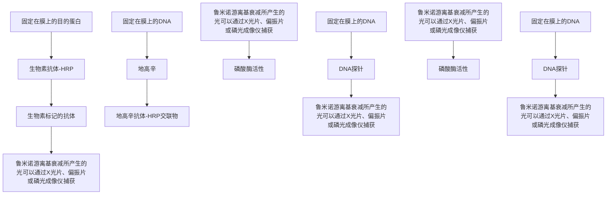

其疏水性基团对去磷酸化的反应中间体的螯合作用，从而稳定和减少中间体的非发光性降解。碱性磷酸酶标记的化学发光分析目前被广泛地用于印迹试验及 DNA 序列测定（Beck and köster 1990; Tizard et al. 1990）。

## β-半乳糖苷酶

AMPGD（adamantyl 1,2-dioxetane aryl galactoside）作为这种酶的底物现已越来越流行。这种酶从芳香环的第3位裂解半乳糖苷基团产生一种苯氧化物中间体，这种中间体的降解可导致发光。β-半乳糖苷酶用这种分析方法的检测限为30zmol。

## 辣根过氧化物酶

鲁米诺及其他环状二酰基酰肼（cyclic diacylhydrazides）化合物是辣根过氧化物酶的化学发光协同底物。采用鲁米诺、过氧化氢及一种增效剂（如4-碘苯酚或4-羟基肉桂酸），辣根过氧化物酶的碱性同工酶可被检测出的最小量 $< 5\mathrm{amol}(5\times 10^{-18}\mathrm{mol / L})$ （Whitehead et al. 1983; Thorpe et al. 1985; Thorpe and Kricka 1986）。过氧化物酶的酸性同工酶被增强的效率较低。增效剂的作用是增强发光亮度并减少由于过氧化物或其他氧化剂导致鲁米诺氧化所产生的背景发光。这种双重效果能奇迹般地使过氧化物酶活性的分析以及分析的信噪比增强数千倍（这种增强化学发光试剂可从Amersham获得）。过氧化物酶的这种灵敏的检测方法（较比色分析的灵敏度高10倍以上）已经与催化报道分子沉积方案（catalyzed reporter deposition protocol）有效的结合（Wigle et al. 1993）。在这个放大方案中，过氧化物酶标记与酪胺生物素底物反应所产生的高活性基团再与标记物，以及与标记物直接相邻的任何蛋白质反应。然后，沉积的生物素与链霉亲和素过氧化物酶作用（通过这种方式，原来的过氧化物酶标记被放大了许多倍），从而使结合的过氧化物酶通过增强的化学发光法得到检测。采用催化报道分子沉积方案与化学发光分析相结合的方法，与沉积过氧化物酶比色分析（colorimetric detection）相比可使灵敏度显著提高。

## 黄嘌呤氧化酶

采用鲁米诺及铁 EDTA 络合物可对此酶进行分析（Baret et al. 1990; Baret and Fert 1990）。反应的灵敏度很高（检测限为 3amol）。采用黄嘌呤氧化酶催化的化学发光反应的显著特点是发光的持续时间非常长（>96h）。

## 葡萄糖氧化酶

目前已经发展了几种用于葡萄糖氧化酶的法学发光分析。异鲁米诺或鲁米诺在微过氧化物酶催化剂存在的情况下可用于分析葡萄糖氧化酶与葡萄糖反应所产生的过氧化物（Sekiya et al. 1991）；另一种方法是采用化学发光荧光基团致敏的 bis(2,4,6-trichlorophenyl) oxalate 反应来检测（Arakawa et al. 1982）。

## 市售试剂、试剂盒及光度计

对于可获得的化学发光试剂和试剂盒，以及用于发光测定的光度计的全面的评述已有发表（见 Stanley 1992, 1993）。一系列关于化学发光在基础及应用领域的当前进展的资料汇编也同样可以得到（见 Kricka and Stanley 1992; Kricka et al. 1993; Wilkinson 1998）。化学发光可采用一系列的检测设备来进行，包括光电倍增管[采用光子计数或灵敏度较低的光子流模式（photon current mode）]、硅光电二级管、用 CCD 照相机（Wick 1989）进行摄影或胶片摄影（Kricka and Thorpe 1986）。由于 CCD 照相机是检测二维光源（如膜以及 96 孔微板）的方便且灵敏的方法而被广泛使用。除此以外，它还能容易地监测发光动力学，可通过图像增强及背景减影来改善结果质量。

## 参考文献

- Allen RC, Loose LD. 1976. Phagocytic activation of a luminol-dependent chemiluminescence in rabbit alveolar and peritoneal macrophages. Biochem Biophys Res Commun 69: 245–252.
- Arakawa H, Maeda M, Tsuji A. 1982. Chemiluminescence enzyme immunoassay of 17 α-hydroxyprogesterone using glucose oxidase and bis(2,4,6-trichlorophenyl)oxalate: fluorescent dye system. Chem Pharm Bull 30: 3036–3039.
- Arnold LJ Jr, Hammond PW, Wiese WA, Nelson NC. 1989. Assay formats involving acridinium-ester-labeled DNA probes. Clin Chem 35:1588–1594.
- Baret A, Fert V. 1990. T₄ and ultrasensitive TSH immunoassays using luminescent enhanced xanthine oxidase assay. J Biolumin Chemilumin 4:149–153.
- Baret A, Fert V, Aumaille J. 1990. Application of a long-term enhanced xanthine oxidase-induced luminescence in solid-phase immunoassays. Anal Biochem 187: 20–26.
- Beck S, Köster H. 1990. Applications of dioxetane chemiluminescent probes to molecular biology. Anal Chem 62: 2258–2270. (Erratum Anal Chem [1991] 63: 848.)
- Beck S, O'Keeffe T, Coull JM, Köster H. 1989. Chemiluminescent detection of DNA: Application for DNA sequencing and hybridization. Nucleic Acids Res 17: 5115–5123.
- Bierwerth S, Kahl G, Weigand F, Weising K. 1992. Oligonucleotide fingerprinting of plant and fungal genomes: A comparison of radioactive, colorigenic and chemiluminescent detection methods. Electrophoresis 13: 115–122.
- Bowman RA, O'Neil GL, Riley TV. 1991. Non-radioactive restriction fragment length polymorphism (RFLP) typing of Clostridium difficile. FEMS Microbiol Lett 63: 269–272.
- Bronstein I, Voyta JC. 1989. Chemiluminescent detection of herpes simplex virus I DNA in blot and in situ hybridization assays. Clin Chem 35: 1856–1860.
- Bronstein I, Edwards B, Voyta JC. 1989. 1,2-dioxetanes: Novel chemiluminescent enzyme substrates. Applications to immunoassays. J Biolumin Chemilumin 4: 99–111.
- Bronstein I, Voyta JC, Lazzari KG, Murphy O, Edwards B, Kricka LJ. 1990. Rapid and sensitive detection of DNA in Southern blots with chemiluminescence. BioTechniques 8: 310–314.
- Bronstein I, Juo RR, Voyta JC, Edwards B. 1991. Novel chemiluminescent adamantyl 1,2-dioxetane enzyme substrates. In Bioluminescence and chemiluminescence: Current status (ed Stanley PE, Kricka LJ), pp. 73–82. Wiley, Chichester, UK.
- Bronstein I, Voyta JC, Murphy OJ, Bresnick L, Kricka LJ. 1992. Improved chemiluminescent western blotting procedure. BioTechniques 12: 748–753.
- Campbell AK. 1988. Chemiluminescence. Ellis Horwood, Chichester, UK.
  Cate RL, Ehrenfels CW, Wysk M, Tizard R, Voyta JC, Murphy OJ, Bronstein I. 1991. Genomic Southern analysis with alkaline phosphatase-conjugated oligonucleotide probes and the chemiluminescent substrate AMPPD. Genet Anal Tech Appl 8: 102–106.
- Cook RF, Cook SJ, Issel CJ. 1992. A nonradioactive micro-assay for released reverse transcriptase activity of a lentivirus. BioTechniques 13: 380–386.
- Creasey A, D'Angio LJ, Dunne TS, Kissinger C, O'Keefe T, Perry-O'Keefe H, Moran L, Roskey M, Schildkraut I, Sears LE, et al. 1991. Application of a novel chemiluminescent-based DNA detection method to a single vector and multiplex DNA sequencing. BioTechniques 11: 102–109.
- Decorte R, Cassiman JJ. 1991. Detection of amplified VNTR alleles by direct chemiluminescence: Application to the genetic identification of biological samples in forensic cases. Exper Suppl 58: 371–390.
- Dooley S, Welter C, Blin N. 1992. Nonradioactive southwestern analysis using chemiluminescent detection. BioTechniques 13: 540–542.
- Engler-Blum G, Meier M, Frank J, Muller GA. 1993. Reduction of background problems in nonradioactive northern and Southern blot analyses enables higher sensitivity than  ${}^{32}$ P-based hybridizations. Anal Biochem 210: 235–244.
- Gundermann K-D, McCapra F. 1987. Chemiluminescence in organic chemistry, Springer-Verlag, Berlin.
- Holmstrom K, Rossen L, Rasmussen OF. 1993. A highly sensitive and fast nonradioactive method for detection of polymerase chain reaction products. Anal Biochem 209: 278–283.
- Höltke H-J, Ettl J, Obermaier J, Schmitz G. 1991. Sensitive chemiluminescent detection of digoxigenin (DIG) labeled nucleic acids. A fast and simple protocol and its applications. In Bioluminescence and chemiluminescence: Current status (ed Stanley PE, Kricka LJ), pp. 179–182. Wiley, Chichester, UK.
- Ikeda S, Oda T. 1993. Nonisotopic gel-mobility shift assay using chemiluminescent detection. BioTechniques 14: 878–880.
- Jain VK, Magrath IT. 1991. A chemiluminescent assay for quantitation of $\beta$-galactosidase in the femtogram range: Application to quantitation of $\beta$-galactosidase in lac Z-transfected cells. Anal Biochem 199: 639-650.
- Karger AE, Weiss R, Gesteland RF. 1993. Line scanning system for direct digital chemiluminescence imaging of DNA sequencing blots. Anal Chem 65: 1785–1793.
- Kinkel T, Lubbers H, Schmidt E, Molz P, Skrzipczyk HJ. 1989. Synthesis
- and properties of new luminescent acridinium-9-carboxylic acid derivatives and their application in luminescence immunoassays (LIA). J Biolumin Chemilumin 4: 136–139.
- Kohen F, Pazzagli M, Kim JB, Lindner HR. 1979. An assay procedure for plasma progesterone based on antibody enhanced chemiluminescence. FEBS Lett 104: 140–143.
- Kricka LJ. 1992. Nonisotopic DNA probe techniques Academic, San Diego.
- Kricka LJ, Stanley PE. 1992. Bioluminescence and chemiluminescence literature—1991: Part I. J Biolumin Chemilumin 7: 47–73.
- Kricka LJ, Thorpe GH. 1986. Photographic detection of chemiluminescent and bioluminescent reactions. Methods Enzymol 133: 404–420.
- Kricka LJ, Nozaki O, Stanley PE. 1993. Bioluminescence and chemiluminescence literature-1992: Part I. J Biolumin Chemilumin 8:169–182.
- Law S-J, Miller T, Piran U, Klukas C, Chang S, Unger J. 1989. Novel polysubstituted aryl acridinium esters and their use in immunoassay. J Bio-lumin Chemilumin 4: 88–98.
- Martin C, Bresnick L, Juo RR, Voyta JC, Bronstein I. 1991. Improved chemiluminescent DNA sequencing. BioTechniques 11: 110–113.
- Masuya H, Kondo K, Aramaki Y, Ishimori Y. 1992. Pyrido-pyridazine compounds and their use. European Patent No. EP0491477.
- Mattingly PG. 1991. Chemiluminescent 10-methyl-acridinium-9-(N-sulphonylcarboxamide) salts. Synthesis and kinetics of light emission. J Biolumin Chemilumin 6: 107–114.
- Meier T, Arni S, Malarkannan S, Poincelet M, Hoessli D. 1992. Immunodetection of biotinylated lymphocyte-surface proteins by enhanced chemiluminescence: A nonradioactive method for cell-surface protein analysis. Anal Biochem 204: 220–226.
- Nguyen N, Hansen C, Braman J. 1992. Detection of bcl-2 t(14;18) chromosomal translocation using PCR and chemiluminescent probes. Clin Chem 38: 469.
- Nozaki O, Kricka KJ, Stanley PE. 1992. Nucleic acid hybridization assays. J Biolumin Chemilumin 7: 223–228.
- Pazzagli M, Bolelli GF, Messeri G, Martinazzo G, Tomassi A, Salerno R, Serio M. 1982. Homogeneous luminescent immunoassay for progesterone: A study on the antibody-enhanced chemiluminescence. In Luminescent assays: Perspectives in endocrinology and clinical chemistry (ed Serio M, Pazzagli M), pp. 191–200. Raven Press, New York.
- Schaap AP, Akhavan H, Romano LJ. 1989. Chemiluminescent substrates for alkaline phosphatase: Application to ultrasensitive enzyme-linked immunoassays and DNA probes. Clin Chem 35: 1863–1864.
- Schroeder HR, Boguslaski RC, Carrico RJ, Buckler RT. 1978. Monitoring specific binding reactions with chemiluminescence. Methods Enzymol 57: 424–445.
- Sekiya K, Saito Y, Ikegami T, Yamamoto M, Sato Y, Maeda M, Tsuji A. 1991. Fully-automated analyzer for chemiluminescent enzyme immunoassay. In Bioluminescence and chemiluminescence: Current status (ed Stanley PE, Kricka LJ), pp. 123–126. Wiley, Chichester, UK.
- Stanley PE. 1992. A survey of more than 90 commercially available luminometers and imaging devices for low-light measurements of chemiluminescence and bioluminescence including instruments for manual, automatic and specialized operation, for HPLC, LC, GLC, and microtiter plates. I. Descriptions. J Biolumin Chemilumin 7: 77–108.
- Stanley PE. 1993. A survey of some commercially available kits and reagents which include bioluminescence or chemiluminescence for their operation: Including immunoassays, hybridization, labels, probes, blots and ATP-based rapid microbiology. J Biolumin Chemilumin 8:51–63.
- Stone T, Durrant I. 1991. Enhanced chemiluminescence for the detection of membrane-bound nucleic acid sequences: Advantages of the Amer-sham system. Genet Anal Tech Appl 8: 230–237.
- Suzuki S, Craddock BP, Kana T, Steigbigel RT. 1993. Chemiluminescent enzyme-linked immunoassay for reverse transcriptase illustrated by detection of HIV reverse transcriptase. Anal Biochem 210: 277–281.
- Thorpe GH, Kricka LJ. 1986. Enhanced chemiluminescent reactions catalyzed by horseradish peroxidase. Methods Enzymol 133: 331–353.
- Thorpe GHG, Kricka LJ, Moseley SB, Whitehead TP. 1985. Phenols as enhancers of the chemiluminescent horseradish peroxidase-luminol-hydrogen peroxide reaction: Application in luminescence monitored enzyme immunoassays. Clin Chem 31: 1335–1341.
- Tizard R, Cate RL, Ramachandran KL, Wysk M, Voyta JC, Murphy OJ, Bronstein I. 1990. Imaging of DNA sequences with chemiluminescence. Proc Natl Acad Sci 87: 4514–4518.
- Van Dyke K, Van Dyke R. eds. 1990. Luminescence immunoassay and molecular applications. CRC Press, Boca Raton, FL.
- Weeks I, Beheshti I, McCapra F, Campbell AK, Woodhead JS. 1983. Acridinium esters as high-specific activity labels in immunoassay. Clin Chem 29: 1474–1479.
- Whitehead TP, Thorpe GHG, Carter TJN, Groucutt C, Kricka LJ. 1983. Enhanced luminescence procedure for sensitive determination of peroxidase-labelled conjugates in immunoassay. Nature 305: 158–159.
- Wick RA. 1989. Photon counting imaging: Applications in biomedical research. BioTechniques 7: 262–268.
- Wigle DA, Radakovic NN, Venance SL, Pang SC. 1993. Enhanced chemiluminescence with catalyzed reporter deposition for increasing the sensitivity of Western blotting. BioTechniques 14: 562–563.
- Wilkinson D. 1998. Products for the chemiluminescent detection of DNA. Scientist 12: 20–22.

## 信息栏

## 辣根过氧化物酶

辣根过氧化物酶（horseradish peroxidase, HRP）是一种含血红素蛋白，通常是从野生山葵的根部提取的几种同工酶（isozyme）的混合物。经典的制剂（Shannon et al. 1966）主要是两种形式酶（同工酶 B 和 C）的混合物，每个的相对分子质量均为约 40 000。HRP 催化两个电子从底物转移到过氧化氢，生成水和氧化了的供体。当 3,3'-二氨基联苯胺（3,3'-diaminobenzidine, DAB）作为底物时（Graham and Karnovsky 1966），氧化产物会聚合形成不溶于水和乙醇的深棕褐色残渣。在过渡元素（如钴和镍）存在的情况，残渣是石板样的蓝黑色。这个反应形成了过氧化物酶的灵敏显色分析的基础，它已在电子显微镜（Robbins et al. 1971）、免疫细胞化学（Nakane and Pierce 1967）、不同的酶联免疫吸附分析和 Western 印迹（图 1）中使用多年。但是，二氨基联苯胺作为底物有一些不利之处:它可能是致癌物（Garner1975; Weisburger et al. 1978），并且它检测 HRP 的活性不如 3,3',5,5'-四甲基联苯胺（3,3',5,5'-tetramethylbenzidine, TMB）（例如，请见 Roberts et al. 1991）等新近开发的复合物灵敏。TMB 的氧化产物通常是可溶的，但是可通过硫酸葡聚糖（dextran sulfate）的预印迹（pretreating blot）捕获（McKimn-Breschkin 1990），或通过使用商品化的特定形式 TMB 捕获。经过这些修改，TMB 适合 HRP-抗体交联物的检测，这些抗体针对蛋白质（包括异种抗体）或可以结合核酸探针的配体。

flowchart

图 1 用辣根过氧化物酶（HRP）检测固定的核酸和蛋白的实验原理图。氧化的鲁米诺游离基衰变所发出的光由 X 光胶片或 CCD 相机捕获。h，普朗克常量；v，光频率。

除 DAB 和 TMB 外，其他可以氧化成不溶于水的显色产物的 HRP 底物有 4-氯-1-萘酚（4-chloro-1-naphthol）（紫色沉淀物）和 3-氨基-4-乙基咔唑（3-amino-4-ethycarbazole）（红色沉淀物）。这些底物检测 HRP 活性的灵敏度没有一个比二氨基联苯胺更高。另外，还有许多其他的 HRP 显色底物，它们生成的氧化产物显色效果好，并且可溶。除 TMB 外，还包括二盐酸邻苯二胺（O-phenylenediamine dihydrochloride, OPD）（橙色）（Wolters et al. 1976）和 2,2'-连氮-双-(3-乙基苯并噻唑啉磺酸)[2,2'-azino-di(3-ethylbenzthiazoline-6-sulphonic acid), ABTS]（绿色）（Engvall 1980）。最好的荧光底物是 3-对羟基苯基丙酸 [3-(p-hydroxyphenyl) propionic acid, HPPA]（紫罗兰色）（Roberts et al. 1991）。

过氧化氢存在时，HRP也可用于激发化学发光连锁反应，这个反应能使鲁米诺氧化成邻苯二甲胺（3-aminophthalate）的激发态（Isaacson and Wettermark 1974; Roswell and White 1978; Durrant 1990; Stone and Durrant 1991）（图2）。此复合物返回至基态时，将发射 428nm 的蓝光。然而，由于这个反应的低效率，可采用不同的基于苯酚的侧链取代化合物来增加发射光的强度和持续时间（Whitehead et al. 1983；Hodgson and Jones 1989）。例如，加入对碘苯酚（p-iodophenol）后，生成光的强度会增加 1000 倍以上，并持续几个小时。另外，这些增效剂通过抑制鲁米诺的化学氧化反应来减少背景。这些增效剂被认为是通过:①与 HRP 反应；②形成增效剂游离基并与鲁米诺作用形成鲁米诺游离基（图 2）来消除连锁反应的限速步骤达到这个效果的。总体效果是增加了反应的效率和速度，但没有改变发光反应的特性。从反应中发出的光可通过 X 光片、磷光成像仪（phosphorimager）或 CCD 相机来捕获。

图 2 HRP 催化鲁米诺氧化发光的连锁反应示意图。

HRP 可以直接交联到单链核苷酸探针上（Renz and Kurz 1984; Stone and Durrant 1991），或可以交联到如针对生物素或地高辛之类配体的特异性抗体上，生物素或地高辛配体可以通过标准的酶学技术连接到核酸探针上。不管哪种情况，对于 Southern 和 Northern 杂交，HRP/鲁米诺反应对核酸的非放射性检测都非常灵敏（Thorpe and Kricka 1986）。理想条件下，检测核酸探针的下限约为 $5 \times 10^{-17} \mathrm{~mol}$ （Urdea et al. 1988）。但是，HRP/鲁米诺反应远没有碱性磷酸酶催化的 1,2-二氧杂环丁烷（1,2-dioxetanes）分解反应的化学发光反应灵敏（参见信息栏中有关 AMPPD 的内容）。另外，要达到最大的敏感度，HRP/鲁米诺反应需要对不同成分进行最大限度的优化。由于以上原因，目前 HRP 比碱性磷酸酶较少用于核酸和蛋白质的化学发光检测。

## 参考文献

- Durrant I. 1990. Light-based detection of biomolecules. Nature 346: 297–298.
- Engvall E. 1980. Enzyme immunoassay ELISA and EMIT. Methods Enzymol 70: 419–439.
- Garner RC. 1975. Testing of some benzidine analogues for microsomal activation to bacterial mutagens. Cancer Lett 1: 39–42.
- Graham RC Jr, Karnovsky MJ. 1966. The early stages of absorption of injected horseradish peroxidase in the proximal tubules of mouse kidney: Ultrastructural cytochemistry by a new technique. J Histochem Cytochem 14: 291–302.
- Hodgson M, Jones P. 1989. Enhanced chemiluminescence in the peroxidase-luminol- $H_{2}O_{2}$ system: Anomalous reactivity of enhancer phenols with enzyme intermediates. J Biolumin Chemilumin 3: 21–25.
- Isaacson U, Wettermark G. 1974. Chemiluminescence in analytical chemistry. Anal Chim Acta 68: 339–362.
- McKimm-Breschkin JL. 1990. The use of tetramethylbenzidine for solid phase immunoassays. J Immunol Methods 67: 1–11.
- Nakane PK, Pierce GB Jr. 1967. Enzyme-labeled antibodies for the light and electron microscopic localization of tissue antigens. J Cell Biol 33: 307–318.
- Renz M, Kurz C. 1984. A colorimetric method for DNA hybridization. Nucleic Acids Res 12: 3435–3444.
- Robbins D, Fahimi HD, Cotran RS. 1971. Fine structural cytochemical localization of peroxidase activity in rat peritoneal cells: Mononuclear cells, eosinophils and mast cells. J Histochem Cytochem 19: 571–575.
- Roberts IM, Jones SL, Premier RR, Cox JC. 1991. A comparison of the sensitivity and specificity of enzyme immunoassays and time-resolved fluoroimmunoassay. J Immunol Methods 143: 49–56.
- Roswell DF, White EH. 1978. The chemiluminescence of luminol and related hydrazides. Methods Enzymol 57: 409–423.
- Shannon LM, Kay E, Lew JY. 1966. Peroxidase isozymes from horseradish roots. I. Isolation and physical properties. J Biol Chem 241: 2166–2172.
- Stone T, Durrant I. 1991. Enhanced chemiluminescence for the detection of membrane-bound nucleic acid sequences: Advantages of the Amer-sham system. Genet Anal Tech Appl 8: 230–237.
- Thorpe GH, Kricka LJ. 1986. Enhanced chemiluminescent reactions catalyzed by horseradish peroxidase. Methods Enzymol 133: 331–353.
- Urdea MS, Warner BD, Running JA, Stempien M, Clyne J, Horn T. 1988. A comparison of non-radioisotopic hybridization assay methods using fluorescent, chemiluminescent and enzyme labeled synthetic oligodeoxyribonucleotide probes. Nucleic Acids Res 16: 4937–4956.
- Weisburger EK, Russfield AB, Homburger F, Weisburger JH, Boger E, Van Dongen CG, Chu KC. 1978. Testing of twenty-one environmental aromatic amines or derivatives for long-term toxicity or carcinogenicity. J Environ Pathol Toxicol 2: 325–356.
- Whitehead TP, Thorpe GHG, Carter TJN, Groucutt C, Kricka LJ. 1983. Enhanced luminescence procedure for sensitive determination of peroxidase-labelled conjugates in immunoassay. Nature 305: 158–159.
- Wolters G, Kuijpers L, Kacaki J, Schuurs A. 1976. Solid-phase enzyme-immunoassay for detection of hepatitis B surface antigen. J Clin Pathol 29: 873–879.

## 地高辛

地高辛卡烯内脂（cardenolide digoxygenin）（Mr=390.53）可以通过化学或酶学方法将从紫花洋地黄（Digitalis purpurea）中分离的 desacetylanatoside C 去掉 4 个糖基而得到（Reichstein 1962），也可以直接从 D. orientalisi 和 D. lanata L. Scrophulariaceae 中提取出来（Maanich and Schneider 1941；Hegenauer 1971）。地高辛的化学结构（Cardwell Smith 1953，1954；Patali et al. 1963）见右边的方框。

chemical

Molecular structure of a steroid derivative with hydroxyl and carbonyl functional groups

在分子克隆中，地高辛可以作为结合 DNA 和 RNA 探针的配基，并在杂交后用抗地高辛的酶标抗体进行检测（Kessler et al. 1989；Kessler1991）（图 1）。地高辛标记的探针因而可以用于 Southern、Northern 和点杂交。它在原位杂交中也有相当的优势，部分原因是因为动物细胞中没有地高辛半抗原（例如，见 Tautz and Pfeifle 1989；Hemmati-Brvanlou et al. 1990），从而消除了内源分子产生的背景。而生物素标记的探针就不总是这样。在大体积的 0.1%SDS、2mmol/L EDTA（pH 8.0）溶液中将尼龙滤膜加热到 37℃保持 20～30min，就能将地高辛标记的核酸探针从尼龙滤膜上剥离下来（Church and Kieffer-Higgin 1988）。清洗之后，滤膜还可以重新结合探针，效能和敏感性也不会有明显下降。

图 1 用 BCIP/NPT 或 AMPPD 检测地高辛标记的核酸探针。

需要注意的是，在经过探针杂交、剥离、再杂交的几个循环之后，化学发光的背景可能会因为滤膜上碱性磷酸酶残留的累积而显著增加。这个问题可以通过在每个循环的第二步和第三步杂交时用蛋白酶 K 和甲酰胺处理滤膜而避免（Dubitsky et al. 1992）。

## 地高辛标记核酸

对于核酸的标记，生产商 Boehringer Mannheim 提供了两种形态的地高辛:地高辛-11-dUTP（DIG-11-dUTP）和地高辛-11-UTP（DIG-11-UTP）。每种形态的地高辛都分别由一个耐碱的连接和一个间隔臂分别与脱氧尿苷三磷酸或尿苷三磷酸相连。

chemical

Complex peptide or glycoside molecular structure with phosphate groups and a sugar moiety

\- DIG-ll-dUTP 是大肠杆菌 DNA 聚合酶、DNA 聚合酶 I 的 Klenow 片段、耐热聚合酶如 Taq、反转录酶和末端转移酶的底物。因而地高辛可通过不同的标准反应结合到 DNA，包括随机引物法、缺口平移、扩增、末端补平和 3'端加尾。

\- DIG-11-UTP 是在体外用噬菌体编码的 DNA 依赖的 RNA 聚合酶（T3、T7 和 SP6 聚合酶）转录 DNA 模板时结合到 RNA 上的（表 1）。

表 1 地高辛标记核酸的方法

| 标记方法 | 酶 | 结合的地高辛分子数 | 参考文献 |
| --- | --- | --- | --- |
| 随机引导 | Klenow 片段 | 每 25~36 个核苷酸 1 个 | Kessler et al. (1990) |
| 缺口平移 | 大肠杆菌 DNA 聚合酶 I | 每 25~36 个核苷酸 1 个 | Holtke et al. (1990) |
| 加尾 | 末端转移酶 | 每 12 个核苷酸 1 个 | Schmitz et al. (1991) |
| PCR 扩增 | Taq 和其他耐热聚合酶 | 每 25 个核苷酸 1 个 | Seibl et al. (1990) |
| 转录 | T3、T7 和 SP6 聚合酶 | 每 25~36 个核苷酸 1 个 | Kessler and Holtke (1990) |
| CDNA 合成 | 反转录酶 | 每 25~36 个核苷酸 1 个 | McCracken (1989) |

综述请见 Kessler（1991）。

合成中被 5'端氨基化的寡聚核苷酸可以通过与 NHS-地高辛（digoxygenin-3-O-methylcarbonyl-ε-aminocaproic acid-N-hydroxysuccinamide ester; Boehringer Mannheim）反应来进行标记（Richterich and Church 1993）。

## 地高辛特异性抗体与报道酶的偶联

可以通过用地高辛包裹的麻仁球蛋白（edestin）和牛血清白蛋白（bovine serum albumin）免疫绵羊来获得高亲和力的地高辛特异的抗体。用于检测地高辛标记探针的最为通用的免疫试剂是偶联着碱性磷酸酶（Boehringer Mannheim）的抗地高辛免疫球蛋白的 Fab 片段。针对免疫定位（immunolocalized）的碱性磷酸酶最好的显色底物是二元试剂 BCIP（5-溴-4-氯-3-吲哚磷酸盐，5-bromo-4-chloro-3-indolyl phosphate）和 NBT（盐酸氮蓝四唑，4-nitroblue tetrazolium chloride）。有关这些试剂更多的信息请参见信息栏中有关 BCIP 的内容。

最理想的条件下，在杂交阶段用高浓度（50～100ng/mL）的地高辛标记探针并且延长显色反应孵育时间（16～24h），有可能在斑点印迹实验中检测到小于1pg的目标DNA（例如，见Kerkhof 1992）。然而，利用可溶的化学发光底物AMPPD(adamantyl 1,2-dioxetane phosphate; Tropix; Inc.; Roche）能够得到更高的灵敏度和线性度更好的反应（Kerkhof 1992; Bronstein et al. 1993）。近几年，AMPPD发光系统得到极快的普及，在该系统中，用碱性磷酸酶去除磷酸残基会刺激底物发出477nm的化学发光，这可由光度计测量。发光在溶液中可持续数小时，在尼龙表面则持续时间更长（Tizard et al. 1990）。可以用X光胶片、偏振的快速黑白胶片（polaroid instant black and white film）（Kricka and Thrpe 1986）、磷光成像仪和CCD照相机来捕获印迹的图像（Karger et al. 1993）。在最好的情况下，地高辛标记探针化学发光检测的灵敏度会达到极高的水平（0.03pg的目标DNA或RNA），并且速度很快（曝光时间小于30min）。因而这种方法比 $^{32}$ P标记的核酸探针放射自显影检测的灵敏度高10倍，速度快50倍。另外，由于不怎么需要对滤膜进行剥离再生，所以重新检测也就简化了。鉴于以上优势，碱性磷酸酶标记的化学发光检测被用于检测固定核酸序列的许多技术中，包括印迹和DNA测序。有关AMPPD更多的信息请参见信息栏中有关AMPPD的内容。

## 参考文献

- Allefs JJ, Salentijn EM, Krens FA, Rouwendal GJ. 1990. Optimization of non-radioactive Southern blot hybridization: Single copy detection and reuse of blots. Nucleic Acids Res 18: 3099–3100.
- Bronstein I, Voyta JC, Murphy OJ, Tizard R, Ehrenfels CW, Cate RL. 1993. Detection of DNA in Southern blots with chemiluminescence. Methods Enzymol 217: 398–414.
- Cardwell HME, Smith S. 1953. The structure of digoxygenin. Experientia 9:267–368.
- Cardwell HME, Smith S. 1954. Digitalis gluosides. VII. The structure of the digitalis anhydrogenins and the orientation of the hydroxy-groups in digoxygenin and gitoxigenin. J Chem Soc 1954: 2012–2023.
- Church GM, Kieffer-Higgins S. 1988. Multiplex DNA sequencing. Science 240: 185–188.
- Dubitsky A, Brown J, Brandwein H. 1992. Chemiluminescent detection of DNA on nylon membranes. BioTechniques 13: 392–400.
- Hegenauer R. 1971. Pflanstoffe und Pflanzensystematik. Naturwissenschaften 58: 585–598.
- Hemmati-Brivanlou A, Frank D, Bolce ME, Brown BD, Sive HL, Harland RM. 1990. Localization of specific mRNAs in Xenopus embryos by whole-mount in situ hybridization. Development 110: 325–330.
- Karger AE, Weiss R, Gesteland RF. 1993. Line scanning system for direct digital chemiluminescence imaging of DNA sequencing blots. Anal Chem 65: 1785–1793.
- Höltke H-J, Kessler C. 1990. Non-radioactive labeling of RNA transcripts in vitro with the hapten digoxigenin (DIG): Hybridization and ELISA-based detection. Nucleic Acids Res 18: 5843–5851.
- Höltke H-J, Seibl R, Burg J, Mühlegger K, Kessler C. 1990. Non-radioactive labeling and detection of nucleic acids. II. Optimization of the digoxigenin system. Biol Chem Hoppe-Seyler 371: 929–938.
- Kerkhof L. 1992. A comparison of substrates for quantifying the signal from a nonradiolabeled DNA probe. Anal Biochem 205: 359–364.
- Kessler C. 1991. The digoxigenin:anti-digoxigenin (DIG) technology—A survey on the concept and realization of a novel bioanalytical indicator system. Mol Cell Probes 5: 161–205.
- Kessler C, Höltke H-J, Seibl R, Burg J, Mühlegger K. 1989. A novel DNA
- labeling and detection system based on digoxigenin: Anti-digoxigenin ELISA principle. J Clin Chem Clin Biochem 27: 130–131.
- Kessler C, Höltke H-J, Seibl R, Burg J, Mühlegger K. 1990. Non-radioactive labeling and detection of nucleic acids. I. A novel DNA labeling and detection system based on digoxigenin:anti-digoxigenin ELISA principle (digoxigenin system). Biol Chem Hoppe-Seyler 371: 917–927.
- Kricka LJ, Thorpe GH. 1986. Photographic detection of chemiluminescent and bioluminescent reactions. Methods Enzymol 133: 404–420.
- Maanich C, Schneider W. 1941. Uber die Glykoside con Digitalis orientalis L. Arch Pharm 279: 223–248.
- McCracken S. 1989. Preparation of RNA transcripts using SP6 RNA polymerase. In DNA probes (ed Keller GH, Manak MM), pp. 119–120. Stockton Press, New York.
- Pataki S, Meyer K, Reichstein T. 1953. Die Konfiguration des Digoxygenins. Experientia 9: 253–254.
- Reichstein T. 1962. Besonderheiten der Zucker von herzaktiven Glkosiden.
  Angew Chem 74: 887–918.
- Richterich P, Church GM. 1993. DNA sequencing with direct transfer electrophoresis and nonradioactive detection. Methods Enzymol 218: 187–222.
- Schmitz GG, Walter T, Seibl R, Kessler C. 1991. Nonradioactive labeling of oligonucleotides in vitro with the hapten digoxigenin by tailing with terminal transferase. Anal Biochem 192: 222–231.
- Seibl R, Höltke H-J, Ruger R, Meindl A, Zachau HG, Rasshofer R, Roggendorf M, Wolf H, Arnold N, Wienberg J, et al. 1990. Non-radioactive labeling and detection of nucleic acids. III. Applications of the digoxigenin system. Biol Chem Hoppe-Seyler 371: 939–951.
- Tautz D, Pfeifle C. 1989. A non-radioactive in situ hybridization method for the localization of specific RNAs in Drosophila embryos reveals translational control of the segmentation gene hunchback. Chromosoma 98: 81–85.
- Tizard R, Cate RL, Ramachandran KL, Wysk M, Voyta JC, Murphy OJ, Bronstein I. 1990. Imaging of DNA sequences with chemiluminescence. Proc Natl Acad Sci 87: 4514–4518.

## BCIP

BCIP[5-溴-4-氯-3-吲哚磷酸盐，5-bromo-4-chloro-3-indolyl phosphate，相对分子质量:

370.4（钠盐）；433.6（甲苯铵盐）]与氮蓝四唑盐（nitroblue-tetrazolium salt, NBT）共同用来检测原位的碱性磷酸酶。该二元试剂在碱性磷酸酶的活性位置形成不溶于水的沉淀，它是适用于碱性磷酸酶交联物发色检测的最灵敏的指示系统。此反应中（图1），碱性磷酸酶催化BCIP磷去除酸根基团，生成5-溴-4-氯-3-吲哚的羟化物；该羟化物二聚化形成不溶的蓝色化合物，即5,5'-溴-4,4'-二氯吲哚。在二聚化反应中生成的两个还原当量（reducing equivalent）会将一分子的氮蓝四唑还原为不可溶的浓紫色染料二甲腈（McGadey 1970；Franci and Vidal 1988）。显色过程超过几个小时，但是产生最强信号需要的时间变化很大，依赖于结合到目标分子上的抗体数量。

chemical

Chemical structure of a brominated pyridine derivative with chloro, hydroxyl, and phosphoroborate groups

chemical

Chemical reaction pathway showing oxidation of nitrobenzaldehyde to chlorinated and hydroxylated compounds via chlorination and reduction steps

图 1 在 BCIP/NPT 指示剂反应中 BCIP 的氧化和 NBT 的还原（经 Elsevier 允许，翻印自 Kessler 1991）。

BCIP/NBT 是一个敏感的碱性磷酸酶活性检测剂，但不能定量。碱性磷酸酶活性的定量分析需要用到生色底物——硝基磷酸苯（p-nitrophenyl phosphate）（McComb and Bowers 1972；Brickman and Beckwith 1975；Michaelis et al. 1983）。这个底物在 Sigma 公司的商用名称是“Sigma 104 号磷酸酶底物”（Sigma No.104 phosphatase substrate）。Sigma 104 水解生成硝基苯酚，在水溶液中其在 420nm 处有很强的吸收峰。有文献报道，萤光素-磷酸酯（D-luciferin-O-phosphate）作为底物时生物发光分析会更敏感（Miska and Geiger 1987）。用萤光素酶滴定可以测量该底物水解后释放的萤光素量，然后用照度计测量光脉冲。

在分子克隆中，BCIP/NBT 广泛用作非放射性系统的指示剂，用来检测核酸或蛋白质。几乎自始至终，这些系统由按顺序使用的多种成分组成。最佳工作状况下，BCIP/NBT 指示剂系统的灵敏度足以在 Southern 杂交中检测哺乳动物全部 DNA 中的单拷贝基因。典型的设计如图 2 所示。

用 N,N-二甲基甲酰胺（N,N-dimethylformamide）从带电的尼龙膜剥离二甲腈沉淀后，Southern、Northern 和斑点印迹可以重新杂交。注意，N,N-二甲基甲酰胺蒸汽对皮肤和黏膜有刺激作用，因此应该在通风良好的化学通风橱中使用。在室温用 N,N-二甲基甲酰胺或在含有高浓度的 SDS 缓冲液中 70～75℃ 加热，可以从膜上除去地高辛标记的寡聚核苷酸探针（Richerich and Church 1993）。之后膜可以再次探针杂交。

碱性磷酸酶生色检测的灵敏度远没有使用可溶的1,2-二氧杂环丁烷底物AMPPD的发光方法的灵敏度高（Schaap et al. 1987）。在这个系统中，斑点印迹的灵敏度可以从16h检测到0.2pg上升到1h检测到1fg。在Southern杂交中，使用AMPPD作为指示剂，灵敏度为1h检测到约70fg（例如，见Allefs et al. 1975）。

BCIP/NBT 除了用作碱性磷酸酶交联物的指示剂外，它还可用于检测脊椎动物组织切片中表达的碱性磷酸酶(Fields-Berry et al. 1992)和鉴定表达BAP的细菌群落(Brickman and Beckwith 1975；综述请见Manoil et al. 1990)。

图 2 用 BCIP/NPT 检测地高辛和生物素标记的核酸探针。

BCIP 一般以钠盐或甲苯铵盐形式出售。甲苯铵盐形式的 BCIP 适合在商品化的蛋白质和核酸的非放射性探测系统中使用。

## 参考文献

- Allefs JJ, Salentijn EM, Krens FA, Rouwendal GJ. 1990. Optimization of non-radioactive Southern blot hybridization: Single copy detection and reuse of blots. Nucleic Acids Res 18: 3099–3100.
- Brickman E, Beckwith J. 1975. Analysis of the regulation of Escherichia coli alkaline phosphatase synthesis using deletions and phi80 transducing phages. J Mol Biol 96: 307–316.
- Fields-Berry SC, Halliday AL, Cepko CL. 1992. A recombinant retrovirus encoding alkaline phosphatase confirms clonal boundary assignment in lineage analysis of murine retina. Proc Natl Acad Sci 89: 693–697.
- Franci C, Vidal J. 1988. Coupling redox and enzymic reactions improves the sensitivity of the ELISA-spot assay. J Immunol Methods 107: 239–244.
- Michaelis S, Guarente L, Beckwith J. 1983. In vitro construction and characterization of phoA-lacZ gene fusions in Escherichia coli J Bacteriol 154: 356–365.
- Miska W, Geiger R. 1987. Synthesis and characterization of luciferin derivatives for use in bioluminescence enhanced enzyme immunoassays. New ultrasensitive detection systems for enzyme immunoassays, I. J Clin Chem Clin Biochem 25: 23–30.
- Kessler C. 1991. The digoxigenin:anti-digoxigenin (DIG) technology—A survey on the concept and realization of a novel bioanalytical indicator system. Mol Cell Probes 5: 161–205.
- Manoil C, Mekalanos JJ, Beckwith J. 1990. Alkaline phosphatase fusions: Sensors of subcellular location. J Bacteriol 172: 515–518.
- McComb RB, Bowers GN Jr. 1972. Study of optimum buffer conditions for measuring alkaline phosphatase activity in human serum. Clin Chem 18: 97–104.
- McGadey J. 1970. A tetrazolium method for non-specific alkaline phosphatase. Histochemie 23: 180–184.
- Richterich P, Church GM. 1993. DNA sequencing with direct transfer electrophoresis and nonradioactive detection. Methods Enzymol 218: 187–222.
- Schaap AP, Sandison MD, Handley RS. 1987. Chemical and enzymatic triggering of 1,2-dioxetanes. 3. Alkaline phosphatase-catalyzed chemiluminescence from an aryl phosphate substituted dioxetane. Tetrahedron Lett 28: 1159–1162.

## AMPPD

金刚烷基-1,2-二氧杂环丁烷磷酸（adamantyl 1,2-dioxetane phosphate 也称为[2'spiroadamantane]-4-methoxy-3-[3''-(phosphoryl)phenyl]1,2,-dioxetane 或 disodium 3-(4-methoxyspiro{1,2-dioxetane-3,2'-tricyclo-[3.3.13,7]decan}-4-yl)-phenyphosphate））是碱性磷酸酶引发化学发光反应中的底物，可用来检测在尼龙或 PVDF 膜上固定的生物多聚体（Bronstein and McGrath 1989；Bronstein et al. 1990；Tizard et al. 1990；Gillespie and Hudspeth 1991）。图1显示了典型的用于 Western 印迹蛋白质和固定核酸杂交检测流程。

图 1 用 AMPPD 检测固定的核酸和蛋白质。（上）Western 印迹检测目标蛋白质；（下）Southern 和 Northern 印迹检测核酸序列。

采用 AMPPD 化学发光检测 DNA、RNA 和蛋白质的灵敏度高于比色法、生物发光法或荧光测定法，并且至少相当于过去 20 年处于分子克隆领先地位的放射自显影技术（Beck and Koster 1990；Bronstein et al. 1990；Carlson et al. 1990；Pollard-Knight et al.

1990)。在溶液中，有可能测量出少于 1000 个碱性磷酸酶分子（1zmol 或 $10^{-21}\mathrm{mol}$）活性的光输出(Schaap et al. 1989)。标准的 Southern 和 Northern 杂化或许可以检测出少于 0.1pg 的 RNA 或 DNA（Beck et al. 1989），而 Western 印迹也许可以检测出全细胞蛋白中少于 1pg 的目标蛋白（Gillespie and Hudspeth 1991）。

图 2 显示的是 AMPPD 去磷酸化所引发的光生成。碱性磷酸酶催化 AMPPD 单个磷酸基团的去除，产生一个中度稳定的二氧杂环丁烷阴离子（dioxetane anion），该阴离子能分解成金刚烷酮（adamantanone）和激发态的 methyl-metaoxybenzoate 阴离子。当返回基态时，该阴离子发射出可见的黄绿光（Bronstein et al. 1989）。碱性磷酸酶催化二氧杂环丁烷去磷酸化的效率很高，周转率（turnover rate）约为每秒  $4.0 \times 10^{3}$  分子（Schaap，引自 Beck and Koster 1990）。然而，激发态的 1, 2-二氧杂环丁烷阴离子的半衰期比较长，变化范围从 2min 到数小时，与局部环境有关（Bronstein 1990）。因而，在过量 AMPPD 情况下进行的去磷酸化反应，最初二氧杂环丁烷阴离子产生的速度比衰减的速度快。这就解释了为什么化学发光是以“辉光”的形式辐射，且它的强度在数分钟不断增强，然后持续几个小时（图 3）。在尼龙膜上，动力学过程甚至更慢，因为膜上的疏水口袋会稳定二氧杂环丁烷阴离子的激发态（Tizard et al. 1990）。尼龙和阴离子之间的疏水作用也会导致发射光大约 10nm 的“蓝移”[例如，从 477nm 到 466nm（Beck and Koster 1990；Bronstein et al. 1990）]。

chemical

Chemical reaction scheme showing the synthesis of 金刚烷酮 from AMPPD and its intermediate with HPO4^2- under UV light irradiation

图2 AMPPD去磷酸化产生的化学发光。

在大多数实验情况下，在尼龙膜上延长的化学发光动力学过程是一个优势，因为这可以为捕获图像提供多次曝光的时间。然而，当碱性磷酸酶引发的化学发光用于检测浓度特别低的DNA、RNA和蛋白质（如滤膜上的DNA目标带预计包含少于 $10^{-18}$ 个分子时）时，慢动力学过程可能会十分重要。在这种情况下，CSPD（AMPPD的卤素取代的衍生物）可能是一个更好的选择。在金刚烷基（adamantyl group）的第5位加入一个氯原子消除了1,2二氧杂环丁烷自我聚集的趋势，并限制了其与尼龙膜的作用。CSPD显著地减少了到达最大光发射所需的时间，从而能够快速地检测到很少量的目标分子（Martin et al. 1991）。

图 3 AMPPD 化学发光的动力学。碱性磷酸酶催化 AMPPD 分解的化学发光动力学:（A）于 0.05mol/L 碳酸盐/碳酸氢盐/1mmol/L MgCl₂（pH 9.5）溶液中；（B）在 Biodye A 膜上。发光速率用相对光单位（relative light units, RLU）表示（经允许复制于 Tizard et al. 1990）

CDP-Star 是第三个 1,2 二氧杂环丁烷的底物，遵循与 AMPPD 和 CSPD 相似的降解途径，但它产生的信号亮几倍。与其他竞争对手对比，CDP-Star 信号在反应中更早达到峰值，并能持续更长的时间（达几天）（来源:Life Technologies 网站 www.lifetechnologies.com）。

硝基纤维素膜缺乏合适的疏水表面，因而不建议与 AMPPD、CSPD 或 CDP-Star 一起使用；但 PVDF 膜可用于这三个底物。

AMPPD 是一个非常稳定的化合物，其在水中热分解的活化能是 21.5kcal/mol，在  $25^{\circ}$ C 时它的半衰期约 20 年。因为非酶水解非常慢，所以对于印迹法，它的化学发光背景很弱。实际上，蛋白质和核酸的化学发光检测的灵敏度通常不受 AMPPD 自发衰变的限制，而受缓冲液中细菌来源的痕量碱性磷酸酶的影响（Bronstein et al. 1990）。

## 参考文献

- Beck S, Köster H. 1990. Applications of dioxetane chemiluminescent probes to molecular biology. Anal Chem 62: 2258–2270. (Erratum Anal Chem [1991] 63: 848.)
- Beck S, O'Keeffe T, Coull JM, Köster H. 1989. Chemiluminescent detection of DNA: Application for DNA sequencing and hybridization. Nucleic Acids Res 17: 5115–5123.
- Bronstein I. 1990. Chemiluminescent 1,2-dioxetane-based enzyme substrates and their applications. In Luminescence immunoassays and molecular applications (ed Van Dyke K, Van Dyke R), pp. 255–274. CRC Press, Boca Raton, FL.
- Bronstein I, McGrath P. 1989. Chemiluminescence lights up. Nature 338:599–600.
- Bronstein I, Edwards B, Voyta JC. 1989. 1,2-dioxetanes: Novel chemiluminescent enzyme substrates. Applications to immunoassays. J Biolumin Chemilumin 4: 99–111.
- Bronstein I, Voyta JC, Lazzari KG, Murphy O, Edwards B, Kricka LJ. 1990. Rapid and sensitive detection of DNA in Southern blots with chemiluminescence. BioTechniques 8: 310–314.
- Carlson DP, Superko C, Mackey J, Gaskill ME, Hansen P. 1990. Chemiluminescent detection of nucleic acid hybridization. Focus (Life Technologies) 12: 9–12.
- Gillespie PG, Hudspeth AJ. 1991. Chemiluminescence detection of proteins from single cells. Proc Natl Acad Sci 88: 2563–2567.
- Martin C, Bresnick L, Juo RR, Voyta JC, Bronstein I. 1991. Improved chemiluminescent DNA sequencing. BioTechniques 11: 110–113.
- Pollard-Knight D, Simmonds AC, Schaap AP, Akhavan H, Brady MA. 1990. Nonradioactive DNA detection on Southern blots by enzymatically triggered chemiluminescence. Anal Biochem 185: 353–358.
- Schaap AP, Akhavan H, Romano LJ. 1989. Chemiluminescent substrates for alkaline phosphatase: Application to ultrasensitive enzyme-linked immunoassays and DNA probes. Clin Chem 35: 1863–1864.
- Tizard R, Cate RL, Ramachandran KL, Wysk M, Voyta JC, Murphy OJ, Bronstein I. 1990. Imaging of DNA sequences with chemiluminescence. Proc Natl Acad Sci 87: 4514–4518.

## 免疫球蛋白结合蛋白: 蛋白 A、G 和 L

## 蛋白 A

蛋白A是金黄色葡萄球菌细胞壁的一种成分，能结合很多哺乳动物免疫球蛋白(IgG)的Fc区，因而帮助细菌躲避宿主的免疫应答（Forsgren and Sjöquist 1966；综述请见Langone 1982；Boyle and Reis 1987；Boyle 1990；Bouvet 1994）（表1）。蛋白A与IgG分子Fc部分的相互作用并不影响该抗体结合其抗原的能力（图1）。蛋白A已被广泛用于免疫化学反应的定量和定性分析（Goding 1978；Harlow and Lane 1988,1999）。

表 1 蛋白 A 和蛋白 G 与哺乳动物免疫球蛋白 Fc 的结合

| 免疫球蛋白 | 蛋白A(金黄色葡萄球菌) | 蛋白G(C组和G组的链球菌菌株) |
| --- | --- | --- |
| 人IgG1 | ++ | ++ |
| 人IgG2 | ++ | ++ |
| 人IgG3 | - | ++ |
| 人IgG4 | ++ | ++ |
| 小鼠IgG1 | + | + |
| 小鼠IgG2a | ++ | ++ |
| 小鼠IgG2b | ++ | ++ |
| 小鼠IgG3 | ++ | ++ |
| 大鼠IgG1 | + | + |
| 大鼠IgG2A | - | ++ |
| 大鼠IgG2b | - | + |
| 大鼠IgG2c | ++ | ++ |
| 兔IgG | ++ | ++ |
| 牛IgG1 | - | ++ |
| 牛IgG2 | ++ | ++ |
| 绵羊IgG | - | ++ |
| 绵羊IgG2 | ++ | ++ |
| 山羊IgG1 | + | ++ |
| 山羊IgG2 | ++ | ++ |
| 马IgG(ab) | + | ++ |
| 马IgG(c) | + | (+) |
| 小鸡 | - | (+) |
| 大颊鼠 | (+) | + |
| 几内亚猪 | ++ | + |

人的 IgG 数据来自 Forsgren and Sjoquist（1966）、Kronvall（1973）和 Myhre and Kronall（1977，1980a）；小鼠的来自 Kronall et al.（1970a）、Chlon et al.（1979）和 Myhre and Kronvall（1980b）；大鼠的来自 Medgyesi et al.（1978）和 Nilsson et al.（1982）；兔的来自 Forsgren and Sjoquist（1967）、Kronvall（1973）和 Myhre and Kronal I（1977）；牛的来自 Lind et al.（1970）、Myhre and Kronall（1981）；绵羊、马和山羊的资料来自 Kronall et al.（1970b）和 Sjöquist et al.（1972）；其他动物的数据来自 Richman et al.（1982）、Bjorck and Kronvall（1984）、Akerstrom et al.（1985）和 Akerstrom and Bjorck（1986）。

- 当偶联到放射性、酶活性或荧光标签时，蛋白 A 是一种很好的试剂，用来检测和定量对其有高亲和力的抗体。化学偶联到胶体金颗粒上的蛋白 A 可用于电子显微镜中 IgG 的定位。
- 固定在固相介质上的蛋白 A 可用于纯化抗体和收集免疫复合物、抗原或完整的细胞（图 2）。

```mermaid
graph TD
  A["蛋白L"] --> B["V1"]
  A --> C["C1"]
  D["蛋白Fv"] --> E["Vf"]
  F["蛋白A (FabR)"] --> G["CH1"]
  H["蛋白质 (FabR)"] --> I["CH2"]
  J["蛋白A和蛋白G (FcR)"] --> K["CH3"]
  B --> L["抗原结合位点"]
  C --> M["s-s"]
  N["s-s"] --> O["s-s"]
  P["s-s"] --> Q["s-s"]
  R["s-s"] --> S["s-s"]
  T["s-s"] --> U["s-s"]
  V["s-s"] --> W["s-s"]
  X["s-s"] --> Y["s-s"]
  Z["s-s"] --> AA["s-s"]
  AB["s-s"] --> AC["s-s"]
  AD["s-s"] --> AE["s-s"]
  AF["s-s"] --> AG["s-s"]
  AH["s-s"] --> AI["s-s"]
  AJ["s-s"] --> AK["s-s"]
  AL["s-s"] --> AM["s-s"]
  AN["s-s"] --> AO["s-s"]
  AP["s-s"] --> AQ["s-s"]
  AR["s-s"] --> AS["s-s"]
  AT["s-s"] --> AU["s-s"]
  AV["s-s"] --> AW["s-s"]
  AX["s-s"] --> AY["s-s"]
  AZ["s-s"] --> BA["s-s"]
  BB["s-s"] --> BC["s-s"]
  BD["s-s"] --> BE["s-s"]
  BF["s-s"] --> BG["s-s"]
  BH["s-s"] --> BI["s-s"]
  BJ["s-s"] --> BK["s-s"]
  BL["s-s"] --> BM["s-s"]
  BN["s-s"] --> BO["s-s"]
  BP["s-s"] --> BR["s-s"]
  BC["s-s"] --> BD
  BC --> BE
  BC --> BF
  BC --> BG
  BC --> BH
  BC --> BI
  BC --> BM
  BC --> BN
  BC --> BO
  BC --> BW
  BC --> BX
  BC --> BY
  BC --> BB
  BC --> BC
  BC --> BD
  BC --> BE
  BC --> BF
  BC --> BG
  BC --> BH
  BC --> BI
  BC --> BM
  BC --> BN
  BC --> BO
  BC --> BW
  BC --> BX
  BC --> BY
  BC --> BB
  BC --> BG
  BC --> BH
  BC --> BI
  BC --> BM
  BC --> BN
  BC --> BO
  BC --> BW
  BC --> BX
  BC --> BY
  BC --> BB
  BC --> BG
  BC --> BH
  BC --> BI
  BC --> BW
  BC --> BX
  BC --> BY
  BC --> BB
  BC --> BG
  BC --> BH
  BC --> BI
  BC --> BW
  BC --> BX
  BC --> BY
  BC --> BB
  BC --> BG
  BC --> BH
  BC --> BI
  BC --> BW
  BC --> BX
  BC --> BY
  BC --> BB
  BC --> BG
  BC --> HB
  BC --> BI
  BC --> BIY
  BC --> BI3
  BC --> BI4
  BC --> BI5
  BC --> BI6
  BC --> BI7
  BC --> BI8
  BC --> BI9
  BC --> BI10
  BC --> BI11
  BC --> BI12
  BC --> BI13
  BC --> BI14
  BC --> BI15
  BC --> BI16
  BC --> BI17
  BC --> BI18
  BC --> BI19
  BC --> BI20
  BC --> BI21
  BC --> BI22
  BC --> BI23
  BC --> BI24
  BC --> BI25
  BC --> BI26
  BC --> BI27
  BC --> BI28
  BC --> BI29
  BC --> BI30
  BC --> BI31
  BC --> BI32
  BC --> BI33
  BC --> BI34
  BC --> BI35
  BC --> BI36
  BC --> BI37
  BC --> BI38
  BC --> BI39
  BC --> BI40
  BC --> BI41
  BC --> BI42
  BC --> BI43
  BC --> BI44
  BC --> BI45
  BC --> BI46
  BC --> BI47
  BC --> BI48
  BC --> BI49
  BC --> BI50
```

flowchart

图 1 Fab 结合分子识别的免疫球蛋白区（经 Elsevier 允许，翻印自 Bouvet 1994）。

flowchart

图 2 用 LacI-SpA 融合蛋白提取抗原或整个细胞。图示为用包含乳糖操纵子(lac operator, lacO)的 DNA 片段偶联磁珠，乳糖操纵子阻碍蛋白(lac repressor)与蛋白 A 的融合蛋白 LacI-SpA 可用于可逆回收蛋白质抗原或全细胞。

\- 采用双抗体夹心 ELISA（ELISA-like sandwich）技术，用纯化的蛋白 A 或包含蛋白 A 的 IgG 结合结构域的工程融合蛋白可以纯化和检测 DNA 片段（Lindbladh et al. 1987；Peterhans et al. 1987；Werstuck and Capone；综述请见 Stahl et al. 1993）。

包含两个独立配体结合结构域的嵌合蛋白也曾被用作免疫学的黏附试剂来研究。例如:

- 地高辛标记的分子可以用包含蛋白 A 的 IgG 结合结构域和地高辛抗体的抗原结合位点的融合蛋白来标记。任何能与蛋白 A 结合的抗体都可以检测到此标记(Tai et al. 1990)。
- 链霉亲和素-蛋白 A 嵌合蛋白可以用于酶对抗体间接的标记（Sano and Cantor 1991）。
- 蛋白 A-麦芽糖结合蛋白嵌合蛋白可作为将抗体结合到固态基质的双功能试剂（Xue et al. 1995）。

\- 蛋白 A 可以作为亲和标签以纯化在原核和真核细胞中表达的融合蛋白（如 Kobatake et al. 1995; Nilsson et al. 1985; 综述见 Nilsson and Abrahmsen 1990; Uhlen and Moks 1990; Uhlen et al. 1992; Stahl et al. 1993）。最简单的实验方案包括用 IgG 填料的亲和层析来纯化包含蛋白 A 的 Fc 区结合结构域的融合蛋白（Uhlèn et al. 1983; Nilsson et al. 1985）。

蛋白 A 的基因（Uhlèn et al. 1984）编码 509 个氨基酸的蛋白质前体，该前体包括:在分泌时去除的信号肽；5 个同源的、独立的 IgG 结合结构域，每个结构域有 58 个氨基酸；以及一个重复的、180 个氨基酸的 C 端锚定区（X 区）。对蛋白 A 单个 IgG 结合结构域与人 Fc 复合物的晶体学分析表明，IgG 结合结构域由两条 α 螺旋组成，两条螺旋与 Fc 结构域的第二和第三个恒定区之间形成广泛的疏水作用（Deisenhofer 1981）。

## 蛋白G

蛋白 G 最初从 C 群和 G 群的链球菌菌株中分离出来（Björck and Kronvall 1984）。与葡萄球菌蛋白 A 一样，蛋白 G 与哺乳动物抗体的 Fc 区也具有很高的亲和力。但是，这两个蛋白结构上差别很大，而且对抗体的亲和力也不同（表 2）（Akerstrom et al. 1985）。蛋白 A 富含α螺旋，与免疫球蛋白之间形成疏水作用，而蛋白 G 的β折叠结构含量很高（Olsson et al. 1987; Gronenborn et al. 1991）。蛋白 G 与 IgG 的第一个恒定区（Erntell et al. 1985）结合，并且两个分子之间的作用将折叠股沿着作用表面排列成折叠片（Derrick and Wigley 1992）。蛋白 G 和蛋白 A 识别的结构密切相关（Stone et al. 1989）。然而，很多种属和亚类的 IgG 与蛋白 A 的结合并不好，但却能与蛋白 G 高效结合。例如，蛋白 G 能够有效地与 IgG3 亚类的人免疫球蛋白结合，而蛋白 A 则不能（Sjöbring et al. 1991）。包含蛋白 G 和蛋白 A 配体结合结构域的嵌合蛋白显示出两者的亲本蛋白特异性（Eliasson et al. 1988,1989）。

表 2 免疫球蛋白对蛋白 L、蛋白 A 和蛋白 G 的结合

<table><tr><td>免疫球蛋白</td><td>蛋白L</td><td> $蛋白LA^a$ </td><td>蛋白A</td><td>蛋白G</td></tr><tr><td colspan="5">人</td></tr><tr><td>IgG</td><td>++</td><td>++</td><td>+</td><td>+++</td></tr><tr><td>IgM</td><td>++</td><td>++</td><td>+</td><td>-</td></tr><tr><td>IgA</td><td>++</td><td>++</td><td>+</td><td>-</td></tr><tr><td>IgE</td><td>++</td><td>++</td><td>+</td><td>-</td></tr><tr><td>IgD</td><td>++</td><td>++</td><td>+</td><td>-</td></tr><tr><td>Fab</td><td>++</td><td>++</td><td>+</td><td>+</td></tr><tr><td>F(ab&#x27;)2</td><td>++</td><td>++</td><td>-</td><td>+</td></tr><tr><td>κ轻链</td><td>++</td><td>++</td><td>+</td><td>-</td></tr><tr><td>ScFv</td><td>++</td><td>++</td><td>+</td><td>-</td></tr><tr><td colspan="5">小鼠</td></tr><tr><td>IgG1</td><td>++</td><td>++</td><td>+</td><td>++</td></tr><tr><td>IgG2a</td><td>++</td><td>++</td><td>++</td><td>++</td></tr><tr><td>IgG2b</td><td>++</td><td>++</td><td>++</td><td>++</td></tr><tr><td>IgG3</td><td>++</td><td>++</td><td>+</td><td>++</td></tr><tr><td>IgM</td><td>++</td><td>++</td><td>+</td><td>-</td></tr><tr><td>IgA</td><td>++</td><td>++</td><td>++</td><td>+</td></tr></table>