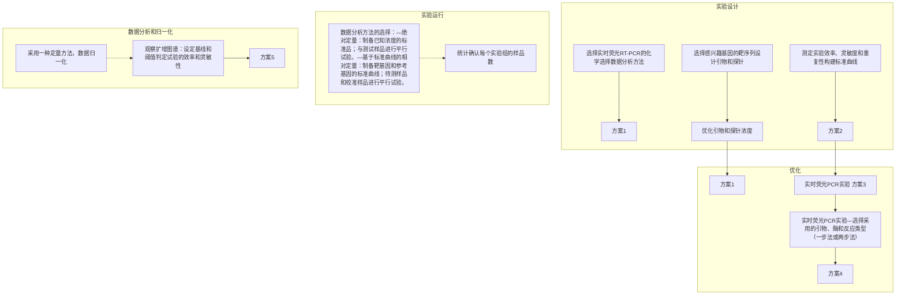

# 第9章 实时荧光聚合酶链反应定量检测DNA及RNA

原始 PDF 第 20–61 页。

# 第9章 实时荧光聚合酶链反应定量检测 DNA 及 RNA

<table><tr><td rowspan="4">导言</td><td>实时荧光 PCR 化学原理</td><td>511</td><td>标准曲线的构建</td><td>524</td></tr><tr><td>实时荧光 PCR 仪</td><td>516</td><td>实时荧光 PCR 反应运行</td><td>525</td></tr><tr><td>实时荧光 PCR 实验数据的处理: 数据分析及归一化方法</td><td>518</td><td>反转录实时荧光 PCR 反应运行MIQE 指南</td><td>526529</td></tr><tr><td>实时荧光 PCR 反应引物、探针设计和反应条件优化</td><td>520</td><td>实时荧光 PCR 实验方案</td><td>529</td></tr></table>

<table><tr><td rowspan="3">方案</td><td>1 实时 PCR 反应用引物和探针浓度的优化</td><td>532</td><td>4 实时荧光 PCR 定量检测 RNA</td><td>542</td></tr><tr><td>2 制作标准曲线</td><td>537</td><td>5 实时荧光 PCR 实验数据的分析和归一化</td><td>545</td></tr><tr><td>3 实时荧光 PCR 定量检测 DNA</td><td>540</td><td></td><td></td></tr></table>

| 信息栏 | 多重 PCR | 550 |
| --- | --- | --- |
|  | SNP 基因分型 | 550 |

---

## 导言

普通聚合酶链反应（PCR）仅能在反应结束后粗略地检测扩增产物的量（即所谓的终点法），不能用于定量检测样品中的核酸，这主要是因为，随着反应的进行引物和核苷酸不断被消耗而变得极为有限，从而降低了扩增效率。由于 PCR 反应是一个模板指数增长过程，每一轮循环中扩增效率的小差异都能导致最终扩增产物得率的大不同。因此，在传统 PCR 中，扩增产物最终得率与模板起始拷贝数之间不具有线性关系。

定量 PCR 的基本原理是:在反应体系中加入已知浓度的核酸模板作为参照，扩增这个参照模板所使用的引物与扩增样本中的靶序列所使用的引物是一致的。通过比较参照模板和靶基因模板所产生的扩增产物量，确定反应开始前反应体系中参照模板和靶基因之间的比例，从而实现定量检测。通常，这个方法中需要对 PCR 指数增长期间的参照基因及靶基因进行定量。有许多不同的方法可用于检测和定量扩增产物，包括扩增时测定放射性掺入量或使用计算机软件分析溴化乙锭染色的凝胶等。

近年来，随着精密实时荧光PCR仪的开发，它们能扩增特异核酸序列并同时测定其浓度，可在反应过程中实时监测PCR扩增的动力学过程，这使核酸定量检测的方法产生了革命性变化。实时荧光PCR，或称实时定量PCR[或简称为定量PCR（qPCR）]，亦或称为动态PCR，是通过对荧光报告基团信号的检测及定量来实现对扩增DNA量的测定，反应过程中荧光信号增长与扩增产物的量成正比。荧光报告基团可被实时荧光PCR仪（荧光检测热循环仪）的光源所激发。通过记录每个循环的荧光发射量，可以监测PCR进入指数增长期的过程，此时PCR产物量首次显著跃升，而此时的PCR产物量与模板起始量是相关的（见第7章PCR理论）。在所有反应组分充足的情况下，在PCR指数增长期定量检测核酸的能力，显著提高了靶序列定量的准确性。此外，由于荧光检测的高敏感性，实时定量PCR能够检测较宽动力学范围内靶DNA的起始浓度（高至8或9个数量级的差别），并且高度灵敏（少至1个拷贝的模板DNA）。

实时荧光 PCR 技术广泛应用于基础及临床研究（Klein 2002）。在研究性实验室，实时荧光 PCR 结合反转录（称为实时反转录 PCR 或定量 RT-PCR）可用来定量检测 microRNA（miRNA）水平（Benes and Castoldi 2010），并已成为定量信使 RNA（mRNA）水平、验证微阵列分析和其他基因组技术生成的基因表达数据（Nolan et al. 2006）的首选方法。实时荧光 PCR 也可以用来检测基因拷贝数的改变（D'Haene et al. 2010），或者对样本中特定 DNA 序列的丰度进行定量，如从染色质免疫沉淀中获得的 DNA（Taneyhill and Adams 2008）。在临床上，实时荧光 PCR 技术促进了一些新型生物医学诊断的发展，包括病原微生物检测（Gupta et al. 2008）、定量病毒载量（Niesters 2001）及监测癌症患者中的癌细胞等（Martinelli et al. 2006）。实时荧光 PCR 还可以用于等位基因的区别和鉴定，以及单核苷酸多态性（SNP）基因分型（见信息栏“SNP 基因分型”）。

实时荧光 PCR 技术最主要的优点是定量范围宽, 灵敏度高, 并能同时处理多个样本。虽然这一技术功能强大, 但是由于方法没有标准化, 研究人员还是经常面临实验可靠性及重复性等困扰。因此在进行 PCR 实验时, 为了得到准确的、可重复的结果, 务必要对反应体系和反应条件进行优化, 包括适当的内部和外部对照, 并执行严格的数据分析。

---

第 9 章 实时荧光聚合酶链反应定量检测 DNA 及 RNA

511

## 实时荧光 PCR 化学原理

现已有多种可产生荧光信号的化学方法被用于检测实时荧光 PCR 产物（Mackay and Landt 2007）。它们可分为三个基本类型:DNA 结合染料法、基于探针的化学法和猝灭染料引物法（表 9-1）。

表 9-1 实时荧光 PCR 化学原理概述

|  | DNA 结合染料法 | 基于探针的化学法 | 猝灭染料引物法 |
| --- | --- | --- | --- |
| 基本原理 | 应用一种带有荧光的、非特异的DNA 结合染料检测 PCR 过程中积累的扩增产物 | 应用一个或多个荧光标记的寡核苷酸探针检测 PCR 扩增产物;依赖荧光能量共振传递(FRET)检测特异性扩增产物 | 采用荧光标记引物扩增,从而使荧光标记基团直接掺入PCR 扩增产物中;依赖荧光能量共振传递(FRET) |
| 特异性 | 检测所有双链 DNA 扩增产物,包括非特异反应产物,如引物二聚体 | 仅检测特异性扩增产物 | 检测特异性扩增产物及非特异反应产物,如引物二聚体 |
| 应用 | DNA 及 RNA 定量;基因表达验证 | DNA 及 RNA 定量;基因表达验证;等位基因鉴别;SNP 分型;病原体和病毒检测;多重 PCR | DNA 及 RNA 定量;基因表达验证;等位基因鉴别;SNP 分型;病原体和病毒检测;多重 PCR |
| 优点 | 可对任何双链 DNA 进行定量;不需要探针,因此减少了实验设计及运转成本;适合于大量基因的分析;简单易用 | 探针和目标片段的特异性杂交产生荧光信号,因此减少了背景荧光和假阳性;探针可标记不同波长的荧光基团,用于多重 PCR 反应 | 探针和目标片段的特异性结合产生荧光信号,因此减少了背景荧光和假阳性;探针可标记不同波长的荧光基团,用于多重 PCR 反应 |
| 缺点 | 由于染料可同时检测特异性及非特异性 PCR 产物,因此会产生假阳性;需要 PCR 后处理过程 | 对于不同的靶序列需要合成不同的探针,原料成本较高 | 对于不同的靶序列需要合成不同的探针,原料成本较高 |
| 举例 | SYBR Green I | TaqMan、分子信标、Scorpion 和杂交探针 | Amplifluor 和 LUX 荧光引物 |

## DNA 结合染料法

荧光 DNA 结合染料以一种非序列特异的方式结合到双链 DNA 上。在溶液中荧光染料几乎不发荧光，当结合到 DNA 上时荧光被激发，发出强荧光（图 9-1）。由于每个 DNA 产物可以结合许多染料分子，因此产生的信号很强并与 PCR 产生的 DNA 总量成正比。

text_image

引物
未掺入染料（无荧光）
单链DNA模板
DNA结合染料（有荧光）

图 9-1 与双链 DNA 结合后荧光染料的荧光强度增强。在溶液中荧光染料不发荧光，但与双链 DNA 结合后被激发，发出强荧光信号。荧光 DNA 结合染料以非序列依赖方式与双链 DNA 结合。

最常用的荧光 DNA 结合染料是 SYBR Green I。事实上，由于 SYBR Green I 具有相对高的灵敏度和可靠性、成本低、简单易用等特点，它已成为目前最流行的实时荧光 PCR 化学检测试剂。对于涉及大量基因的检测，SYBR Green I 不失为一种经济的选择，它不像探针法和猝灭染料引物法，需要为待检的所有靶序列合成昂贵的荧光标记寡核苷酸探针（后文会详细介绍）。SYBR Green I 的最大吸收和发射波长分别为 494nm 和 521nm，与 DNA 双链结合后，该染料的荧光可增强约 1000 倍。有报道称 SYBR Green I 的灵敏度低于探针法；但是，它与传统 PCR 一样，灵敏度在很大程度上依赖于 PCR 过程中使用的引物。通过适当的设计，SYBR Green I 可得到与探针法相当甚至是更好的灵敏度（Schmittgen et al.2000;

---

512

分子克隆实验指南（原书第四版）

Newby et al. 2003)。其他可用于实时荧光 PCR 的 DNA 结合染料包括 LC Green I (Wittwer et al. 2003)、SYTO 9 (Monis et al. 2005)，以及非对称花青素小沟结合物家族 BEBO (Bengtsson et al. 2003; Karlsson et al. 2003b)、BETO (Karlsson et al. 2003a)、BETIBO (Ahmad and Ghasemi 2007)、BOXTO (Karlsson et al. 2003a)、BOXTO-PRO (Eriksson et al. 2006) 和 BOXTO-MEE (Eriksson et al. 2006)，它们可同时结合单链和双链 DNA 分子。

荧光 DNA 结合染料法的缺点是它们能在反应中结合所有 DNA 双链，其中包括在实时荧光 PCR 过程中产生的、可引起大量背景噪声信号的引物二聚体，以及其他非特异的反应产物。因为荧光强度与双链 DNA 的总量相关，这种非特异噪声信号可能会导致对靶基因浓度的高估。最糟的情况下，所发射的荧光强度可能与靶 DNA 起始量及全长产物量没有多大关系或根本没有关系。出于这个原因，使用 DNA 结合染料法检测需要大量优化并进行后续分析以验证结果。通常在 PCR 结束时，需要生成扩增 DNA 的熔解曲线（也称为热变性曲线或解离曲线）以测定 PCR 产物的熔解温度（ $T_{m}$ ）。熔解曲线的形状可表明扩增产物是否单一，而  $T_{m}$  值可进一步确认是否扩增出了特异的正确产物（详细信息见方案 1）。长度较短的引物二聚体通常在较低温度进行变性，因此可以与扩增的目标 DNA 进行区分。但是，对于单一 PCR 产物的反应，通过精心设计引物（如为进行高特异扩增设计的引物）、SYBR Green I 也可以得到非常好的结果，虚假的非特异性背景仅在后期扩增循环中出现。

在精心设计后可产生高特异性扩增的前提下，DNA 结合染料法可用于核酸的定量和基因表达的验证。但是，在临床诊断使用中，一般建议采用基于探针的方法，以确保扩增产物的特异性。

## 基于探针的化学法

基于探针的化学法包含一个或多个能与扩增产物内部序列杂交的荧光标记的寡核苷酸探针。荧光信号强度与靶基因扩增产物量成正比，并且不受引物二聚体等非特异扩增产物的影响。通常，基于探针的化学法使用一对荧光染料，它们可以同时标记在同一条探针上，也可以标记在两条不同的探针上，通过荧光（或 Förster）共振能量转移（FRET）从一个荧光基团转移到另一个荧光基团来产生荧光信号。当 FRET 发生时，一种染料的发射光谱必须与另一种染料的激发光谱有部分重叠，这样，当两种染料彼此接近时才会发生能量转移。

探针法可应用于所有实时荧光 PCR 检测，包括核酸定量、基因表达分析、微阵列数据验证、SNP 基因分型和临床诊断。此外，探针法可实现在同一样本中扩增不同 DNA（多重 PCR），因为每条探针可以设计不同的荧光染料对（详见信息栏“多重 PCR”）。探针法的鉴别能力远远大于 DNA 结合染料法，因为它们仅与真正的目标产物结合，而不与引物二聚体或其他非特异产物结合。因此，与 DNA 结合染料法相比，探针法不需要 PCR 后处理。探针法最大的缺点是它的合成价格相对昂贵；因为需要对欲分析的每个基因进行探针合成，所以探针法对涉及大量基因分析的应用来说不是一种经济的选择。

探针法包括 TaqMan 探针、分子信标、蝎型（scorpion）探针和杂交探针。其中，TaqMan 探针和分子信标最为常用。

## TaqMan 探针

TaqMan 探针（又称水解探针或双标记探针）是线性分子，通常长 18～24 个碱基，5' 端标记有荧光报告基团，3'端标记猝灭基团（Heid et al. 1996）。在非杂交状态下，荧光基团与猝灭基团距离较近，当受到照射时，荧光报告基团通过荧光能量共振转移原理将能量转移到邻近的猝灭基团上，从而抑制荧光报告基团发射出荧光信号。进行 PCR 时，TaqMan 探针可特异地复性杂交到 PCR 产物上。Taq 酶在链延伸过程中遇到与模板结合的 TaqMan 探针，其 5'→3' 外切酶活性将探针降解，使荧光报告基团与猝灭基团分开，破坏了 FRET，

---

第 9 章 实时荧光聚合酶链反应定量检测 DNA 及 RNA

513

从而产生荧光信号（图 9-2），荧光信号强度与 PCR 过程中扩增得到的靶 DNA 产物量成正比。因为只有靶序列与探针互补时荧光信号才会增加，所以不会检测到非特异扩增。

图9-2 依赖于报告基团(R)和猝灭基团(Q)的FRET探针法。蝎型探针（scorpion probe）中，探针是通过一个不参与扩增的“茎”（B）与PCR引物序列相连接的。杂交探针成对使用，其供体（D）与受体（A）需紧密靠近才能发生荧光能量共振转移。

多种荧光报告基团和猝灭基团可用于TaqMan探针及其他基于探针的化学法，如分子信标和蝎型探针（见下文）（表9-2）。常用的荧光报告基团有:6-羧基荧光素（6-FAM）、六氯荧光素（HEX）和四氯荧光素（TET)；花青染料家族成员的Cy3和Cy5；罗丹明类染料四甲基罗丹明（TAMRA）和得克萨斯红。

表 9-2 实时荧光 PCR 中常用报告基团及猝灭基团

<table><tr><td></td><td>最大吸光波长/nm</td><td>最大发射波长/nm</td></tr><tr><td colspan="3">报告基团</td></tr><tr><td>6-羧基荧光素(6-FAM)</td><td>495</td><td>517</td></tr><tr><td>六氯荧光素(HEX)</td><td>537</td><td>553</td></tr><tr><td>四氯荧光素(TET)</td><td>521</td><td>538</td></tr><tr><td>花青素3(Cy3)</td><td>550</td><td>570</td></tr><tr><td>花青素5(Cy5)</td><td>650</td><td>667</td></tr><tr><td>JOE</td><td>520</td><td>548</td></tr><tr><td>ROX</td><td>581</td><td>607</td></tr><tr><td>四甲基罗丹明(TAMRA)</td><td>550</td><td>576</td></tr><tr><td>得克萨斯红(Texas Red)</td><td>589</td><td>610</td></tr><tr><td colspan="3">猝灭基团</td></tr><tr><td>黑洞猝灭剂(BHQ-1)</td><td>535</td><td>无</td></tr><tr><td>BHQ-2</td><td>579</td><td>无</td></tr><tr><td>4-[4-(二甲基氨基)苯偶氮]苯甲酸(DABCYL)</td><td>453</td><td>无</td></tr><tr><td>四甲基罗丹明(TAMRA)</td><td>550</td><td>576</td></tr></table>

由于猝灭基团必须与荧光报告基团有光谱重叠，因此需要进行相应的选择。常用的猝

---

514

分子克隆实验指南（原书第四版）

灭基团有四甲基罗丹明（TAMRA）和4-[4-（二甲基氨基）苯偶氮]苯甲酸（DABCYL），但它们也有一定的局限性:TAMRA本身具有荧光导致信噪比较低，而DABCYL与 $480\mathrm{nm}$ 以上的荧光发射光谱重叠较少，猝灭范围较窄。为了克服这些局限性，研究者开发出一类新型、高效、被称为“黑洞猝灭剂”（BHQ-1、BHQ-2和BHQ-3）的“暗”猝灭剂。BHQ染料本身无荧光，因此荧光背景更低，信噪比更高，从而提供更高的灵敏度和准确性（综述见Marras et al. 2002）。此外，它们具有最大的光谱重叠，所以猝灭范围宽。

TaqMan 探针最常用的荧光-猝灭剂组合是: 6-FAM 或 TET 作为 5'端报告基团, TAMRA 作为 3'端猝灭基团; 其他常用的 TaqMan 探针荧光-猝灭对见表 9-3。

表 9-3 TaqMan 探针常用荧光-猝灭对

| 5'端报告染料 | 3'端猝灭染料 |
| --- | --- |
| HEX | TAMRA、BHQ-1或BHQ-2 |
| TET | TAMRA或BHQ-1 |
| 6-FAM | TAMRA或BHQ-1 |
| JOE | BHQ-1 |
| Cy3 | BHQ-2 |
| Cy5 | BHQ-2 |
| ROX | BHQ-2 |
| TAMRA | BHQ-2 |
| Texas Red | BHQ-2 |

## 分子信标探针

分子信标是一种呈发夹结构的茎环双标记探针分子，与 TaqMan 探针一样，包含有 5' 端的荧光报告基团和 3' 端的无荧光猝灭基团（Tyagi and Kramer 1996）。通常，分子信标探针长 28～44 个核苷酸，两端有 5～7 个核苷酸可相互配对形成茎结构，中间形成环结构的 18～30 个核苷酸与靶 DNA 互补。当分子信标游离在溶液中时，茎部分的报告基团与荧光基团相互靠近，通过 FRET 使荧光基团的荧光被猝灭基团所猝灭（见图 9-2）。进行 PCR 时，探针的环部分与靶 DNA 杂交，致使报告基团与猝灭基团分开，破坏了 FRET，从而产生荧光信号。虽然 DABCYL 是一种相对较弱的猝灭基团（见上文），但它非常适合用在分子信标中，这是因为发夹结构使猝灭基团与荧光报告基团极为贴近（表 9-4）。与 TaqMan 探针不同的是，分子信标在整个 PCR 扩增过程中保持完整不变，因此每个循环都必须再结合到靶序列上以进行信号检测。

表 9-4 分子信标探针常用荧光-猝灭对

| 5'端报告基团染料 | 3'端猝灭基团染料 |
| --- | --- |
| HEX | DABCYL |
| TET | DABCYL |
| 6-FAM | DABCYL |
| Cy3 | DABCYL |
| Cy5 | DABCYL |
| TAMRA | DABCYL |
| ROX | DABCYL |
| Texas Red | DABCYL |

## 蝎型探针

蝎型探针是双功能分子，其中荧光探针共价连接在 PCR 引物上（Whitcombe et al. 1999）。探针为发夹结构的分子，5'端标记有荧光报告基团，而内部猝灭分子直接连接在引物的 5'端（见图 9-2）。探针与引物之间被一个扩增阻滞分子（如六乙二醇 HEG）分隔开，

---

第 9 章 实时荧光聚合酶链反应定量检测 DNA 及 RNA

515

以阻止在 PCR 过程中扩增到探针序列。发夹结构的序列与 PCR 延伸产物互补。在非杂交状态下，蝎型探针保持发夹结构，荧光基团和猝灭基团相互靠近使得荧光被猝灭。进行 PCR 时，Taq 聚合酶延伸 PCR 产物，在随后的循环中，发夹结构被解开，探针的环状部分与新生成的靶扩增序列中的互补序列进行分子内杂交（探针可有效地卷曲回原形，因此绰号“蝎子”），此时，荧光和猝灭分子不再互相靠近而产生荧光。蝎型探针适用的荧光-猝灭对如表 9-5 所示。

表 9-5 蝎型探针常用荧光-猝灭对

| 5'端报告基团染料 | 3'端猝灭基团染料 |
| --- | --- |
| HEX | DABCYL、BHQ-1或BHQ-2 |
| TET | DABCYL或BHQ-1 |
| 6-FAM | DABCYL或BHQ-1 |
| Cy3 | DABCYL或BHQ-2 |
| Cy5 | DABCYL或BHQ-2 |
| TAMRA | DABCYL或BHQ-2 |
| ROX | DABCYL或BHQ-2 |
| Texas Red | DABCYL或BHQ-2 |
| JOE | BHQ-1 |

蝎型探针的主要优点在于，探针分子与引物物理耦合，这样通过单分子重排即可生成荧光信号。而TaqMan探针或分子信标等其他探针法需要两个分子的碰撞。单分子重排的好处是显著的:在发生任何竞争性或副反应（如靶扩增子的复性或错误的靶折叠）之前，反应能有效地瞬时进行，这样导致信号更强，探针设计更可靠，反应时间更短，鉴别能力更好。

## 杂交探针

杂交探针系统使用一对能杂交到模板 DNA 相邻区域（相隔 1～5 个碱基）的探针（Wittwer et al. 1997）。与基于探针的化学法相比，杂交探针设计采用了一对荧光基团——称为“供体”和“受体”，只有当两个荧光基团靠近时才会有荧光信号（见图 9-2）。通常，上游探针 3'端标记“供体”染料，如荧光素；而下游探针 5'端标记“受体”染料，如 LC Red 640 或 LC Red 705。为了阻止 DNA 聚合酶的延伸，上游探针连接一个扩增阻滞剂，如 3' 磷酸基团或一个碳基基团（Cradic et al. 2004）。在 PCR 每轮循环的复性完成时采集荧光信号，当探针与特异的目标区域杂交时，供体发射的能量激发受体染料发出荧光信号。探针在随后的高温（72℃）延伸步骤熔解离，即使有一些探针仍与靶序列结合，也会被聚合酶取代下来（注意，此类化学原理是 LightCycler 探针的基础，该探针针对 Roche 公司的 LightCycler 热循环仪设计）。杂交探针在信号检测中能提供高特异性和高灵敏度，适用于众多实时荧光 PCR 检测。但杂交探针不适用于多重检测，这是因为除了两条 PCR 引物之外，额外的寡核苷酸杂交探针增加了 PCR 系统的复杂性，并限制了多重检测的能力。

## 猝灭染料引物法

猝灭染料引物将引物与探针组合成一个分子，随着引物延伸，它们依赖 FRET 产生荧光信号。与 DNA 结合染料法一样，即使生成的是非特异扩增产物，猝灭染料引物也可以发出荧光信号，因此，使用这种猝灭染料引物也需要仔细验证。但与染料法不同的是，猝灭染料引物可进行多重 PCR 扩增。事实上，猝灭染料引物常被用于 SNP / 突变检测研究，标记不同荧光基团的引物与共同的反向引物一起使用可鉴定单个碱基的序列差异。

---

516

分子克隆实验指南（原书第四版）

## Amplifluor 引物

与蝎型探针一样，Amplifluor 引物由引物序列和分子内可形成发夹结构的探针连接组成，这个探针是能够保持荧光信号正常猝灭的（图 9-3）。在 PCR 的第一个循环，Amplifluor 引物结合到模板上并开始延伸，在随后的扩增循环中，互补链的延伸取代并打开发夹结构，从而使荧光基团和报告集团分开产生荧光信号。

text_image

Amplifluor引物
R Q 引物
R Q
R
R 引物
Lux引物

图9-3 猝灭染料引物将引物与探针组合成一个分子。与基于探针的化学法一样，Amplifluor引物也依赖于报告基团（R）和猝灭基团（Q）间的FRET。Lux引物标记单一的荧光基团，不含猝灭分子。LUX引物

LUX（light upon extension）引物为标记单一荧光基团的寡核苷酸链，通常长20～30个碱基，不含猝灭基团。该技术基于某些荧光染料能被邻近的鸟苷酸残基或DNA的二级结构所自然猝灭的原理设计而成（Crockett and Wittwer 2001）。因此，LUX引物需通过专业的软件设计（D-LUX Designer），以形成发夹结构，使得荧光基团靠近鸟苷酸残基。当引物掺入到双链PCR产物上时，发夹结构打开，荧光基团不能被猝灭，从而产生荧光信号（见图9-3）。LUX引物常用FAM或者JOE染料标记，但其他荧光基团也可以使用，如HEX、TET、ROX和TAMRA等，它们都需依赖寡核苷酸的序列及结构来产生荧光信号。

## 实时荧光 PCR 仪

实时荧光PCR系统包括热循环仪，用于荧光激发和发射收集的光学系统和计算机，以及用于数据采集、管理和分析的配套软件。这项技术发展迅速，市场上已有许多实时荧光PCR仪，这使得选择一台合适的仪器可能非常有挑战性。购买一款实时荧光PCR仪时需要考虑以下几个参数:

\- 样品容量。有些是标准的 96 孔式；有些只能处理较少的样本，或是需要使用专门的玻璃毛细管。

---

第 9 章 实时荧光聚合酶链反应定量检测 DNA 及 RNA

517

- 激发方式。有些使用激光器，有些使用广谱光源和可调谐滤波器，如光发射二极管（LED）或卤钨灯。
- 光学检测方法。有些使用光电二极管，有些使用 CCD 相机。
- 整体灵敏度。有些机器可以检测到一个拷贝的靶序列。
- 动力学范围。通常线性动力学范围是 4～9 个数量级。
- 多重检测的能力。
- 支持的荧光种类。例如，SYBR Green 染料、TaqMan 探针等。

实时荧光 PCR 系统相对昂贵，在写这本书时，它们的价格为 25 000～95 000 美元。

选购实时荧光PCR系统时需考虑的一个重要参数是仪器的激发方法，或者更具体地说，是仪器的激发范围。依靠单一激发激光器的仪器往往不灵活，因为激光的激发范围（488～514nm）太窄以至于不能有效激发现在常用的广谱荧光基团。另外，激光器仅对位于其波长中段的荧光基团提供高光谱亮度和灵敏度。与此相反，卤钨灯可在较宽的波长范围提供均匀激发，这对于多重PCR来说是非常重要的，因为多重PCR需要选择合适的荧光基团以尽量减少荧光的交叉干扰。

下面罗列了几种目前常用的实时荧光PCR系统。详情可登录各制造商的网站进行查阅。

- 7500 实时荧光 PCR 系统和 7500 Fast 实时荧光 PCR 系统是 Applied Biosystems 公司的第三代实时荧光 PCR 系统。其热循环系统是一个基于珀尔帖效应的 96 孔模块，可使用 96 孔光学板或 0.2mL 管。光学系统由卤钨灯和 5 个一组的校准滤波器组所组成，这组校准过滤器可对新染料重新校准，而无需额外的过滤器组。与 Applied Biosystems 公司上一代仪器相比，这些系统提供了更可靠和更完整的数据分析软件。值得一提的是，7500 Fast 实时荧光 PCR 仪据称能在短短的 30min 内提供高质量的结果。这些系统需使用一个被动内部参考染料——ROX，它的荧光输出可在 PCR 每个循环的变性阶段进行测定，从而给出一条基线，可对非 PCR 相关的、孔与孔间的差异进行校准。
- Bio-Rad 公司的 iCycler IQ 实时荧光 PCR 系统采用了卤钨灯，与合适的过滤器组合可激发 400～700nm 范围的荧光团，这可实现在同一样本管中进行多至 5 种荧光报告基团的多重 PCR 扩增。它配备有简单、直观的软件用于获取原始数据。该系统可同时进行 96 个样品的扩增，最近新推出的模块容量扩大到了 384 个样品。
- Roche 应用科学部推出两种不同的 LightCycler 实时荧光 PCR 系统用于实时荧光 PCR。原 RocheLightCycler2.0 实时荧光 PCR 系统价格相对较低，对于个别实验室非常有吸引力。PCR 混合液被加入到一次性玻璃毛细管中进行热循环反应，而不是加入到 EP 管或是 PCR 板中。玻璃毛细管利用气流进行升降温，从而大大减少了每轮 PCR 循环所需的时间。LightCycler 480 实时荧光 PCR 系统是一种高通量的基因定量或基因分型的实时荧光 PCR 平台，有可调换的 96 孔和 384 孔模块。
- QIAGEN 公司的 Rotor-Gene Q 系统运用了独特的离心式旋转设计, 这与传统模块式 PCR 仪完全不同: 反应在一个被放置于转速为 $500 \mathrm{r} / \mathrm{min}$ 的 36 孔或 72 孔转子内的标准微量离心管中进行, 这可确保热循环过程中所有样品都处在同一温度下。整个反应过程中始终保持高速运转, 包括数据分析阶段和升降温阶段。所有的管子通过光学检测器的时间为 0.15s, 保证数据能被快速采集。转子的离心力可消除由移液或水蒸气冷凝所引入的任何气泡, 这样无需等待温度平衡就可使样品间达到热均一。因此, 样本间温度差异小于 $0.01^{\circ} \mathrm{C}$, 这种差异比模块式 PCR 仪小了约 1/20。该系统具有很宽的光学检测范围, 跨越紫外线到红外线波段, 可检测多至 6 个通道。
- Stratagene 公司的 MX4000 多重定量 PCR 系统使用激发范围 350～750nm 的卤钨灯和检测波长 350～830nm 的 4 个光电倍增管。比较独特的是，该系统中为用户提供

---

518

分子克隆实验指南（原书第四版）

操作界面的计算机与嵌入式微处理器可独立运行。在计算机断电或是通信错误的情况下，数据不会丢失，因为一旦通信恢复，数据将从仪器的嵌入式软件自动传输到外部计算机的软件上。这样，实验数据会被保存，实验就可以完成。此仪器进行了多路记忆设计，4个扫描光纤头分别独立地激发和检测染料，这样在单管中可读取多至4种染料。优化的干涉滤光片能精确匹配每种荧光团的发射波长和吸收波长，可防止相邻荧光团的无关交叉，从而最大限度地减少背景和干扰，同时提高对染料的辨识力。

## 实时荧光PCR实验数据的处理:数据分析及归一化方法

实时荧光 PCR 系统以扩增曲线图的方式输出结果，以 PCR 循环数和荧光强度来作图（图 9-4）（见盒内参考染料）。扩增曲线是一个 S 形曲线。对于前 10～20 个循环，曲线是平坦的，处于基线水平，因为扩增产物的量还没有积累到可检测到荧光信号的临界点。曲线在接下来的几个循环中会陡增。这种急剧增加的时段是相当窄的，代表了反应的指数增长。只有在这个阶段，可以认定荧光信号的强度和反应产物积累的量是正相关的。最后，随着反应试剂的消耗变少，曲线进入平台期，又重新变平。

反应中起始模板量越大（即起始拷贝数越高），PCR 中观察到荧光信号显著增加的时间点也就越早，并且达到特定扩增产物量时所需的循环数也就越少。靶基因的起始浓度可以用扩增达到阈值的循环数表示。这个值被称为循环阈值，或  $C_{T}$  值。该阈值代表荧光信号强度显著超过背景荧光，与 PCR 对数增长期相关（图 9-4）。

line

| 循环数 | 样品“A” \((\Delta Rn)\) | 样品“B” \((\Delta Rn)\) |
| --- | --- | --- |
| 0 | 0 | 0 |
| 15 | ~0.2 | 0 |
| 20 | ~0.8 | ~0.1 |
| 25 | ~1.0 | ~0.8 |
| 30 | ~1.0 | ~1.0 |
| 40 | ~1.0 | ~1.0 |

图9-4 以PCR循环数对增加的荧光强度（$\Delta R_{n}$值）作图得到的扩增曲线示意图。靶基因的起始浓度可以用扩增达到阈值的循环数表示。这个值被称为循环阈值，或 $C_{\mathrm{T}}$ 值。在这个例子中，样品A较样品B起始浓度高，因此 $C_{\mathrm{T}}$ 值小。

采用下面两种数据分析方法之一可将 $C_{\mathrm{T}}$ 值转换成一个有意义的数值:绝对定量或相对定量。方法的选择取决于实验用途并且会影响实验设计。

## 绝对定量

在绝对定量中，将待检样品中靶基因的 $C_{\mathrm{T}}$ 值与标准曲线（$C_{\mathrm{T}}$ 值对浓度的对数）上已知浓度的标准品的 $C_{\mathrm{T}}$ 值进行比较，通过标准曲线换算得到靶基因的浓度。这个方法可用来测定样品中靶分子的具体量，例如，测定血液样品中的病毒颗粒数（DNA或RNA）、染色体或细胞中基因的拷贝数。因此，从标准曲线中计算得到的靶基因的量需要用样本的单位量来进行归一化，如细胞数、体积或核酸总量。最终结果是对单个样品的定量描述，不依

---

第 9 章 实时荧光聚合酶链反应定量检测 DNA 及 RNA

519

赖任何其他样品的特性。这种定量检测法概念简单，并且运算分析容易进行。

运用这种方法，必须有来源可靠、浓度已知（通过其他独立的方法来检测）的模板，而且每次试验时标准品都必须能和样品一起平行扩增。绝对定量还要求靶序列与外部标准品有同等的扩增效率。值得注意的是，标准曲线只可用于推测标准品覆盖范围内未知样品的浓度，不能用于推算覆盖范围外样品的浓度，因为标准品覆盖范围之外的检测可能不是线性的。

## 相对定量

在相对定量中，将待检样品中靶基因的 $C_{\mathrm{T}}$ 值与质控品或参考品（一般称为校准品）的$C_{\mathrm{T}}$ 值进行比较。因此，结果用样本中的靶基因量相对于校准品量的比值（或差异倍数）来表示。此方法用来测定两个不同样品中靶基因量的差异，例如，特殊处理后基因表达水平的改变。这种方法在实时RT-PCR法定量检测mRNA水平中最为常见，足以研究生理变化对基因表达水平的影响。这种情况下，校准品可以是未处理的对照组、随时间过程而变化的0时间点的样本或正常的组织样本等。

在相对定量中，非常重要的一点是要确保待检样品和校准品中的靶基因是从等量起始原料中得到的（因为有研究显示，如果待检样品的起始量是校准品的2倍，那么待检样品中靶mRNA的量是校准品的2倍就没有任何意义）。现在已有一些归一化方法，包括归一化起始细胞数或总RNA的量（Huggett et al. 2005）。但最常见的仍是用内参基因（endogenous reference gene）（传统上称为持家基因，housekeeping gene）的水平来归一化靶基因的表达水平，因为所有待检样品中持家基因的表达是恒定不变的；内参基因可代表样品中mRNA的总量。在相对定量时，待检样品和校准品中的靶基因首先采用内参基因进行归一化，然后将归一化的两个数值进行比较得出差异倍数。通常，校准品的归一化后靶基因表达量被设置为“1”，样本的归一化后靶基因表达量以比校准品增加或降低n倍来表示。与绝对定量相比，相对定量的优点在于内标（内参基因）的使用可以最大限度地减少样本制备和处理过程中产生的潜在差异，规避对起始材料进行精确定量和精确上样的要求。

相对定量可以使用以下两种方法之一来进行:标准曲线法或比较  $C_{T}$  值法。

## 标准曲线法

在标准曲线法中，首先用标准曲线确定样本和校准品中靶基因及内参基因的量，然后用内参基因归一化两样本中的靶基因量。与绝对定量中的标准曲线法不同，相对定量中的标准品不需要已知浓度，因为最终归一化后的测试样品中靶基因表达量要除以校准品中的靶基因量，从标准曲线中换算得到的单位也会被去掉。

该方法的准确度取决于选用合适的参照模板作为标准品。对于每个要分析的靶基因，都必须同内参基因一起单独建立标准曲线，并同时在测试样品和校准样品中运行。因此，当需要分析大批基因时，这种方法可能有点费时、费力且费试剂。此外，每次试验都要带上标准曲线限制了可同时分析的样本数量。因此，这种方法适合于仅分析一个或几个基因的低通量实验。

## 比较 $C_{\mathrm{T}}$ 值法

比较 $C_{\mathrm{T}}$ 值法，也被称为 $\Delta \Delta C_{\mathrm{T}}$ 法或Livak法，使用计算公式来比较靶基因与内参基因的 $C_{\mathrm{T}}$ 值。这种方法不要求使用标准曲线，因此表面上看起来比标准曲线法简单。但是，使用比较 $C_{\mathrm{T}}$ 值法，靶基因与内参基因的扩增效率必须大致相同（等于或接近 $100\%$ 的范围，彼此差异在 $5\%$ 以内），这就需要大量的优化。但这种方法还是非常适合用于高通量试验的。

---

520

分子克隆实验指南（原书第四版）

## 实时荧光 PCR 反应引物、探针设计和反应条件优化

接下来的几节将详细介绍实时荧光 PCR 或实时荧光 RT-PCR 实验的每个步骤:设计引物和探针、优化引物探针浓度、构建标准曲线及实验运行。

实时荧光PCR（或RT-PCR）的准确性取决于对反应条件的恰当优化，以得到最佳的效率、特异性及灵敏度。对于病毒定量和SNP基因分型的实时荧光PCR来说，高特异性十分重要；对于病原体及罕见mRNA检测，高灵敏度十分重要。恰当的优化对确保定量准确和结果的重复性至关重要。

实时荧光 PCR 的优化关键在于使 DNA 扩增效率最大化。理想情况下，实时荧光 PCR 实验中 DNA 扩增效率应该非常高，为 85%～110%（效率 100% 意味着每个循环后扩增产物的量恰好翻倍）。与传统 PCR 一样，一些技术变量可以影响实时荧光 PCR 的效率，包括扩增片段的长度、模板质量、是否存在二级结构，以及引物的质量（即杂交效率、特异性、形成引物二聚体能力）。引物浓度同样可以影响 PCR 效率，它会影响引物-靶基因二聚物结构的热稳定性。

实时荧光 PCR 优化包括一系列步骤:选择合适的扩增靶序列，设计引物（和探针），优化引物（和探针）的浓度，分析扩增图谱（后两步在方案 1 中详细介绍）。此外，如果使用 SYBR Green I，还需要在扩增后进行熔解曲线分析（见方案 1），以确定是否有降低反应效率和灵敏度的非特异性产物（如引物二聚体）。一旦确定引物（和探针）的最佳浓度，就可在较宽的模板浓度范围内进行测试，通过建立、分析标准曲线来确定实验效率、灵敏度和重复性（方案 2）。每设计一次新的实验（如新的引物对）都需要进行这些优化步骤。

## 靶序列的选择

设计实时荧光 PCR 所需引物和探针的第一步是确定靶序列。选择扩增的靶区域时有几个参数需要考虑。

\- 长度。为了得到高效率的扩增，扩增序列的长度要相对短些，最好在 50～150 个碱基之间（不超过 400 个碱基）。较短的扩增产物可得到较高的扩增效率，需要的扩增时间较短，这样污染进来的基因组 DNA 被扩增的可能性就会更低。

\- 序列。使用 BLASTN 搜索引擎（http://blast.ncbi.nlm.nih.gov/Blast.cgi）分析靶序列是否存在多态性或测序错误，这些因素会影响引物与模板的结合，因此，引物（探针）设计时要避开多态性或测序错误的区域。靶序列中的重复序列，以及与其他基因组的同源序列会导致引物非特异性结合，从而降低 DNA 扩增效率和检测灵敏度，因此引物（探针）设计也应该避开这些序列。

\- GC 含量。扩增序列中的 GC 含量必须 $\leqslant 60\%$，以确保热循环过程中能有效变性，从而提高扩增效率。此外，高 GC 含量容易产生非特异性扩增，在使用 SYBR Green 等 DNA 结合染料时，会在实验中产生非特异性信号。

\- 二级结构。扩增子应该不含反向重复序列，因为这些区域高度结构化的形成不利于引物或探针与靶序列的有效杂交。

\- 内含子数目。对于实时荧光 RT-PCR，扩增子的选择非常重要，基因组位点上的扩增子要包含两个或更多个内含子，以避免污染的基因组序列、假基因及其他相关基因的共扩增（详细信息参阅“引物和探针设计”）。可采用 BLAST 检索来确定基因组 DNA 数据库中靶 cDNA 序列的内含子位置。对 mRNA 的各类可能的拼接体进行确认也很重要，要确保实时 PCR 实验中检测的 mRNA 拼接体种类在所分析的细胞中是的确存在的。如果在反转录聚合酶链反应中使用 oligo（dT）引物，扩增子应

---

第 9 章 实时荧光聚合酶链反应定量检测 DNA 及 RNA

521

该设计在模板的3'端区。

## 模板的质量

当模板能进行扩增且扩增方法没有错误时，实时荧光 PCR 才能可靠使用。PCR 仅扩增在引发位点间具有完整磷酸二酯骨架的 DNA。此外，DNA 损伤会影响扩增效率，如碱基位点缺失和胸腺嘧啶二聚体，这种损伤的 DNA 在实时荧光 PCR 中将不能充分扩增或根本不能扩增。最后，一些 PCR 添加剂（如 DMSO）和污染物（如提取过程中残留的 SDS）能抑制 DNA 聚合酶，从而影响实时荧光 PCR 的结果。如果使用长寡核苷酸作为扩增靶分子，需要进行 PAGE 纯化。

## 引物和探针设计

下面我们讨论实时荧光 PCR 或实时荧光 RT-PCR 引物和探针设计的基本原则。但是，在开始设计你所需基因或感兴趣靶序列的引物探针这个费时过程之前，有必要去检索已发表文献和在线公共数据库以确定针对你的基因是否已建立有经过验证的实时荧光 PCR 方法，是否有扩增效率、特异性、灵敏度和引物二聚体等信息。即使已有验证过的方法，也有所有相关信息，仍需要亲自去验证这个方法的性能，尤其是要验证其扩增效率和最低检测限。现已有几个可用的公共的引物探针数据库，以下三个数据库都是很好的信息资源。

- RTPrimerDB（http://medgen.ugent.be/rtprimerdb/）（Pattyn et al. 2003, 2006; Lefever et al. 2009）。这个数据库含有经验证的、约6000个基因的引物和探针序列，这些序列均由研究人员提交，且大部分（约 $70\%$ ）已发表。该数据库可使用多种参数（例如，官方的基因名或特征，Entrez或集成的基因标识码、SNP识别码）进行检索。此外，可以将检索词限定成某种特定用途（例如，基因表达定量/检测，DNA拷贝数定量/检测，SNP检测，突变分析，基因融合定量/检测，染色质免疫沉淀）、微生物（例如，人、小鼠、斑马鱼或果蝇）或化学反应等进行查询。
- PrimerBank（http://pga.mgh.harvard.edu/primerbank/index.html）（Wang and Seed 2003;Spandidos et al. 2008）。这个数据库是公共数据库，有超过300 000条PCR引物，这些引物由一种算法设计得到，该算法的PCR效率和特异性已经过实时荧光PCR试验广泛测试。数据库引物包括人类和小鼠基因。到目前为止，有约27 000对小鼠引物已得到验证，其成功率为 $83\%$ ，PrimerBank网站可提供所有实验验证数据。该数据库可以使用多种参数进行查询（例如，GenBank登录号、NCBI基因ID或基因符号，或蛋白质识别码），也可以在数据库中对自己的基因序列进行BLAST。
- Real Time PCR Primer Sets (http://www.realtimeprimers.org/)。这个数据库列出的引物对和探针，都经过合成、测试及优化。该数据库首先根据引物/探针的类型进行检索（如SYBR Green引物、杂交探针、水解探针[TaqMan]、分子信标），然后是生物类型（人、小鼠、大鼠或其他），最后由基因名称进行检索。

还应当指出，现在有许多商业软件程序和免费的网站工具可辅助进行引物和探针设计。市售最全面的程序可能是 Beacon Designer（Premier Biosoft International 公司产品，http://www.premierbiosoft.com），它可以用来设计 SYBR Green 法 PCR 实验的引物和各种基于探针的化学法的引物/探针组。Beacon Designer 通过自动分析 BLAST 结果来避开显著同源的区域，并通过热力学特性和二级结构来筛选引物/探针，因此设计的引物/探针具有很高的特异性。另一个出色的市售软件程序是 Primer Express（Applied Biosystems 公司开发），它可用于设计 SYBR Green I 染料法及 TaqMan 探针法实时荧光 PCR 的引物和探针。另一个可供自由选择的优秀软件是 RealTimeDesign，可在 Biosearch Technologies 公司技术网站上（http://www.biosearchtech.com/realtimedesign）获取。要设计 SYBR Green I 实验中的引物，

---

522

分子克隆实验指南（原书第四版）

使用在线的免费软件，如 Primer3Plus（http://www.bioinformatics.nl/cgi-bin/primer3-plus/primer3plus.cgi）往往能得到很好的结果。

## 引物

使用同一标准的引物设计算法设计得到的实时荧光PCR引物对，也可用于传统PCR中（详细的信息请参阅第7章）。

- 长度。为了最大限度地提高结合特性，引物的长度应为 18～30 个核苷酸。
- 熔解温度($T_m$)。引物的 $T_m$ 应为 55\~60°C，引物对中的两条引物 $T_m$ 之差应在 2\~3°C。
- 序列。每条引物的 3'端最后 5 个碱基中应该有一个（但是最多 2～3 个）G 或者 C。3'端单个的 G 或者 C 可以减少 PCR 过程中的非特异扩增。但是，3'端过多的 G 或 C 可能会导致引物与目标位点的非特异结合，最终导致错误延伸（称为“滑动效应”）。此外，每条探针都不应该有连续的（例如，多于 3 或 4 个核苷酸）的同一核苷酸（尤其是 G 和 C），因为聚合物延伸同样会引起“滑动效应”。最后，引物对的 3'端不应有任何可能导致引物二聚体形成的互补序列。因为引物二聚体有负的自由能 $\Delta G$，所以应选择自由能 $\Delta G$ 不少于 -10kcal/mol 的引物。

\- GC 含量。引物 GC 含量应为 50% 左右（理想的是 40%～60%）。如果引物要结合到富含 AT 的模板上（富含 70% 的 AT 序列），一种非常有用的方法是用锁核酸（LNA）类似物代替引物中的一个或多个碱基，这样可以在保持 $T_m$ 值不变的前提下，减少引物的总长度（见下文“LNA 类似物”的讨论）。

\- 二级结构。引物中应避免出现任何反向重复序列，因为反向重复序列可形成稳定的发夹结构，使得引物不能有效结合（或使引物完全失去结合能力）。

\- 避免基因组 DNA。在实时荧光 RT-PCR 实验中，因为基因组 DNA 的扩增而产生假阳性。因此，引物应该设计在长内含子侧翼或是多个短内含子上，抑或跨越外显子-外显子交界区（图 9-5）。

text_image

A
基因组 DNA
mRNA
B
基因组 DNA
mRNA

图 9-5 RT-PCR 试验引物设计原理图。（A）内含子侧翼引物。设计的引物在长内含子的侧翼（头部）或多个短内含子（尾部）。（B）跨外显子-外显子交界区的引物。引物仅有部分与基因组 DNA 互补，除非复性温度极低，否则将不与 PCR 产物杂交或扩增出 PCR 产物。方块表示外显子；灰色线表示内含子；箭头表示引物。

\- 引物需进行脱盐纯化。

应该注意的是，尽管为优化反应条件做了所有的尝试，但仍有许多引物组合不能扩增出想要的模板，因此，必须重新设计新的引物进行试验。

---

第 9 章 实时荧光聚合酶链反应定量检测 DNA 及 RNA

523

## TaqMan 探针

精心设计的 TaqMan 探针几乎不需要优化。TaqMan 探针的设计应考虑以下因素。

\- 长度。TaqMan 探针最佳长度为 20 个核苷酸（不超过 30 个核苷酸），可实现最大猝灭。长度大于 30 个核苷酸也是可行的，但在这种情况下，内部猝灭基团应在距离 5' 端 18～25 个碱基处。

\- 熔解温度。TaqMan 探针的 $T_{\mathrm{m}}$ 要求比引物的 $T_{\mathrm{m}}$ 高约 $10^{\circ} \mathrm{C}$, 通常在 $65 \sim 70^{\circ} \mathrm{C}$ 之间。$T_{\mathrm{m}}$ 差异对于确保探针先于引物杂交结合到模板上是必要的。如果探针 $T_{\mathrm{m}}$ 值较引物高出 $8 \sim 10^{\circ} \mathrm{C}$, 当邻近引物延伸时, 探针将先于引物与靶序列复性结合以确保检测的进行。

\- 序列。应该避免连续的单碱基重复序列，尤其是 G，因为这可能会影响探针的二级结构，并降低杂交效率。在没有其他序列可选择的情况下，用肌苷替代以中断连续的 G 可显著改善探针性能。此外，探针 5'端不应该含有太多的 G，因为它能够猝灭荧光。一般情况下，应该避免探针和靶序列之间的错配（除非用探针进行 SNP 基因分型检测）（见信息栏 “SNP 基因分型”），并且探针不应该与任一引物互补。

\- GC 含量。设计的 TaqMan 探针的 G / C 含量约为 50%（理想情况下 30%～80%）。如果靶序列是富含 AT 的序列，可掺入锁核酸（LNA）（LNA；Roche 公司）或小沟结合剂（MGB；Applied Biosystems 公司）等核酸类似物（LNA 和 MGB 详见下一节）。

\- 探针 5'端应该尽可能接近引物 3'端，但不能重叠，以确保 Taq DNA 聚合酶快速切割降解。

\- TaqMan 探针应采用 HPLC 纯化。

## 锁核酸（LNA）碱基和小沟结合剂（MGB）

新型 TaqMan 探针采用 LNA 碱基或共轭 MGB 基团，大大提高了探针与靶序列结合的热稳定性（Letertre et al. 2003）。LNA 碱基是一种核苷酸类似物，其化学结构限制了呋喃核糖环的灵活性，使其构象刚性地锁定为理想的 Watson-Crick 双螺旋结构。根据序列信息，插入一个 LNA 碱基可以使 $T_{\mathrm{m}}$ 值增加 $3 \sim 6^{\circ} \mathrm{C}$ 。MGB 基团由一个能结合到 DNA 小沟上的三肽分子组成（例如，双氢环吡咯并吲哚三肽 DPI3），其能与互补的单链 DNA 高特异和高强度结合。探针-靶序列二聚体间的稳定性增加具有两个好处。首先，增强了探针的杂交特异性（Kutyavin et al. 2000），同时减少非特异性的背景荧光，提高了信噪比，从而提高整个实验的灵敏度。其次，它允许使用更短的探针序列，可以克服许多与探针设计有关的限制。例如，为满足设计需求，AT 序列丰富的探针的长度通常是 $30 \sim 40$ 个核苷酸，而单个 LNA 碱基或 MGB 基团的取代使高特异、更短探针的优化设计变得非常容易，即使长度为 $13 \sim 20$ 个核苷酸也能很好的工作。

TaqMan探针中加入一个LNA碱基或MGB基团的情况最常用于SNP基因分型(Johnson et al. 2004)。单碱基错配的存在对LNA/MGB探针和靶核酸间二聚物形成的破坏性影响远远大于其对传统DNA探针的影响（见信息栏“SNP基因分型”）。掺入LNA碱基和MGB基团也使调整引物和探针的 $T_{\mathrm{m}}$ 值成为可能，这对于要求所有引物、所有探针的复性温度必须一致的多重PCR试验来说是十分重要的（见信息栏“多重PCR”）。需要注意的是，所谓的TaqMan MGB探针除了MGB基团外，还包含一个无荧光的猝灭剂，它可实现报告染料的荧光的更准确测定。

## 引物和探针的保存

引物和探针储备溶液应使用无 DNA 酶/RNA 酶的水进行制备和分装，以避免反复冻融和整批次污染。引物需储存在-20℃，工作浓度为 10～100μmol/L。无论探针是干粉，还是

---

524

分子克隆实验指南（原书第四版）

2～10μmol/L 的溶液，都需要避光保存在-70℃。储备溶液长期保存时间是可变的，从 6 个月到数年不等。

## 引物和探针浓度的优化

实时荧光PCR试验最佳引物浓度需要凭借经验确定。由扩增图谱分析发现，能够得到最佳灵敏度和重复性的引物组合是那些能产生最低 $C_{\mathrm{T}}$ 值（荧光信号超过阈值时的循环数）（见“实时荧光PCR实验数据的处理”部分）和最高 $\Delta R_{n}$ （PCR产生的荧光信号强度的指标，是敏感度的度量指标）的引物组合。为了便于筛选出符合这个标准的引物浓度，需要设计引物优化矩阵，在该矩阵中正向和反向引物的浓度都是独立变量且需组合进行试验(方案1）。

对于使用 TaqMan 探针的试验，制备引物优化矩阵时需保持探针浓度不变。由于 TaqMan 探针在反应过程中被破坏，保持足量的探针是十分重要的。由于这个原因，一个标准的探针浓度即 250nmol/L（反应体系中的终浓度）被推荐用于多数实时荧光 PCR 引物优化试验，这个浓度可避免探针不足并确保最高的灵敏度。但如果不需要高灵敏度（如靶序列足量时），少量探针就足够了，这样的好处是能减少检测成本。探针优化试验可以使用一个恒定的最佳引物浓度来测试几种探针浓度，通常在 50～250nmol/L 范围内对探针进行优化。同样，分析得到的扩增图谱可确定能产生最低  $C_{T}$  值和最高  $\Delta R_{n}$  的探针浓度。实际上，需要注意的是，即使设计的实时荧光 PCR 采用的是 TaqMan 探针法，也可用 SYBR Green I 法对引物浓度进行优化，这样可检测到那些会降低扩增效率和特异性的引物二聚体，以及其他非特异性扩增产物。

虽然我们推荐进行引物浓度优化试验，以确保获得最大的特异性，但试验建立和分析有些繁琐且耗时。相反，在实践中，大多数研究者仅仅从一个标准的引物浓度开始优化——一般 TaqMan 探针法为 500nmol/L（探针浓度为 250nmol/L），SYBR Green I 法为 200～400nmol/L（反应体系中的终浓度）。引物浓度根据标准曲线实验进行测定和评估（方案 2）。如果测试的标准品范围是线性的，且效率大于 85%，就不需要进行进一步的引物探针浓度优化了。

进行优化实验时，模板序列可以使用人工合成的扩增子（最适用于可靠的定量）、线性质粒、PCR产物，或包含有目标PCR片段的cDNA。引物/探针优化实验不需要知道模板自身的浓度，但应该选择 $C_{\mathrm{T}}$ 值在 $20\sim 30$ 之间的模板浓度。这个模板浓度是凭经验确定的。

尽管大多数厂家建议使用 $50\mu \mathrm{L}$ 反应体系，本章方案中使用的PCR体积为 $20\mu \mathrm{L}$ 。但是，如果PCR靶标模板的量不是很充足（如每个样本中只有 $1\sim 10$ 拷贝），采用大体积则可以得到更好的重复性。

## 标准曲线的构建

制定标准曲线是每个实时荧光 PCR 实验的重要组成部分。当设计试验和优化引物浓度时，标准曲线被用来测定实验的扩增效率、灵敏度、重复性和工作范围。随后，在数据分析时，标准曲线被用于进行绝对定量，或用于相对定量的标准曲线法中。在使用比较  $C_{T}$  值法时，为了表示靶序列和内参基因扩增效率是等效的，也需要使用标准曲线。

构建标准曲线（方案2），需要制备一系列梯度稀释的参照模板，并用与待检样品相同的条件进行扩增。标准曲线最少需要3次重复（理想情况是5次或更多次），并且需要至少5个对数级的模板浓度。这种严谨度对于准确定量和扩增效率计算来说是需要的。此外，标准曲线的动力学范围上限和下限应该能超出待检样品预期最高和最低的 $C_{\mathrm{T}}$ 值范围。在绝对定量中，只有当未知拷贝数的样品落在这个稀释浓度范围内，才可进行定量。为了进行

---

第 9 章 实时荧光聚合酶链反应定量检测 DNA 及 RNA

525

优化，重要的是确定实验在测试浓度范围内是有效的、灵敏的和可重复的。

当构建定量标准曲线时，以 $C_{\mathrm{T}}$ 值对已知浓度的对数值作图得到的标准曲线是一条直线。如果建立的标准曲线仅用于测定实验的效率、灵敏度和重复性，就没有必要知道模板的浓度，可用 $C_{\mathrm{T}}$ 值对稀释倍数（可以是任意单位）的对数值进行作图获得标准曲线。观察图中不同浓度对应的 $C_{\mathrm{T}}$ 值可获取扩增效率、灵敏度和重复样品间的一致性（如重复性）等重要信息。

## 斜率

在以浓度的对数或稀释倍数的对数（$x$ 轴）对 $C_{\mathrm{T}}$ 值（$y$ 轴）作图获得的标准曲线中，扩增效率可以通过这条直线的斜率进行计算。大多数实时荧光PCR系统的自带软件都能够作出标准曲线，并计算扩增效率。如果没有这个功能，可用 $C_{\mathrm{T}}$ 值对核酸起始量的对数（或稀释倍数的对数）作图，并进行线性回归。运用下列公式计算这条线的斜率:

$$
E = 1 0 ^ {(- 1 / \text {slope})}
$$

如果效率为 $100\%$ ，每轮循环的产物量恰好翻倍，图中直线的斜率为-3.32（需要注意的是，一些仪器将 $C_{\mathrm{T}}$ 值作为 $x$ 轴，将浓度或稀释倍数的对数作为 $y$ 轴；在这种情况下，如果效率为 $100\%$ ，则直线的斜率为-0.301）。

$$
\begin{array}{l} \text {效率} = 1 0 ^ {(- 1 / \text {slope})} \\ = 1 0 ^ {(- 1 / - 3. 3 2)} \\ = 1 0 ^ {(0. 3 0 1 2)} \\ = 2. 0 0 \\ \end{array}
$$

将 $E$ 值转换成百分比，使用下面的公式:

$$
\mathrm{效率}
$$

## $R^2$ 值

另一个计算 PCR 效率的关键参数是决定系数（或相关系数）—— $R^{2}$ ，这是一个衡量实验数据与回归线拟合度的方法（或换句话说，标准曲线的线性衡量标准）。如果所有数据点都完全落在这条线上， $R^{2}$  值等于 1。实际上， $R^{2}$  值大于 0.98 就被认为实验结果可信。

请注意，虽然标准曲线法是计算扩增效率最常用的方法，但现在又开发了几种计算效率的方法，这些方法基于单个反应的动力学来计算扩增效率（见 Tichopad et al. 2003; Zhao and Fernald 2005）。这些替代方法无需建立标准曲线，节省了时间和金钱。

## 灵敏度

任何能够有效地扩增和检测一个拷贝的起始模板的测定实验已经达到了灵敏度的极限水平，不论其 $C_{\mathrm{T}}$ 的绝对值是多少。效率 $< 100\%$ 的实时荧光PCR的灵敏度较低。

## 重复性

一般情况下，实时荧光 PCR 检测的每个样品都应该进行一式三份的重复测试和分析。同一样本的副本产生相似定量值的程度被称为“重复性”。最常见的重复性检测法是标准偏差法（即方差的平方根）。

## 实时荧光 PCR 反应运行

在实时热循环仪（方案3）和标准PCR（见第7章）中，DNA模板扩增的必需步骤有

---

526

分子克隆实验指南（原书第四版）

所不同。如上所述，在实时荧光PCR中，引物探针浓度的优化及标准曲线的建立是必需的，考虑将采用的数据分析方法也是很重要的（见上文）。

## 反转录实时荧光 PCR 反应运行

实时荧光 RT-PCR[通常也被称为定量 RT-PCR（简称 qRT-PCR、为 RT-qPCR）]是目前可采用的最敏感的 RNA 检测和定量技术。事实上，实时荧光 RT-PCR 的灵敏度足以对单个细胞中的 RNA 进行定量检测（Ståhlberg and Bengtsson 2010）。近年来，实时荧光 RT-PCR 法已成为 mRNA 水平检测分析的最常用方法，如验证微阵列分析结果和分析药物处理前后基因表达变化。与 Northern 印迹、RNase 酶保护测定、原位杂交等其他 mRNA 分析技术相比，实时荧光 RT-PCR 技术的速度更快，且不需要使用有毒化学物质或放射性探针。实时荧光 RT-PCR 技术同样可用于细胞中 mRNA 绝对拷贝数的定量（Bustin 2000），以及病毒载量的检测和定量（例如，Le Guillou-Guillemette and Lunel-Fabiani 2009）。

与常规 RT-PCR（参见第 7 章，方案 8）一样，实时定量 RT-PCR 包括两个步骤。第一步，RNA 利用依赖 RNA 的 DNA 聚合酶（反转录酶）反转录成与之互补的 DNA（cDNA）；第二步，cDNA 利用耐热 DNA 聚合酶进行扩增。实时 RT-PCR 法定量结果差异大，且重复性差，因此，评价实时荧光 RT-PCR 试验每一步的质量是十分关键的。样本采集和 RNA 纯化是每个实时荧光 RT-PCR 试验的起始步骤，模板的质量对实时荧光 RT-PCR 试验的可重复性起着极其重要的决定性作用。对于基因表达研究，反转录步骤必须使用高纯度的试剂，并且需要多孔重复试验，因为这一步可能引起模板复制的差异。尽管反转录步骤是高度可变的，但在最佳条件下运行时，试验的 PCR 扩增部分还是有高度重复性的。

## 制备高质量 RNA

## 纯度

选择 RNA 提取方法时，一个重要的考虑因素是 RNA 模板制备中可能残留有抑制剂。培养基的存在、RNA 提取试剂的组分（如苯酚），或生物样本中共纯化出的组分都会导致实时荧光 PCR 的动力学范围及灵敏度的显著降低（Guy et al. 2003; Perch-Nielsen et al. 2003; Lefevre et al. 2004; Rådström et al. 2004; Suñén et al. 2004; Jiang et al. 2005）。最好的情况下，抑制剂也会导致不准确的定量结果；最坏的情况下，高度抑制甚至会造成假阴性结果。

使用单相裂解试剂提取的 RNA 是实时荧光 PCR 的最佳模板（使用单相裂解试剂提取总 RNA 的步骤在第 6 章，方案 1～4），尽管单相裂解试剂提取的产量较高，但能抑制后期 PCR 的酚类化合物极有可能被同时纯化，因此有必要小心去除 RNA 样本中的所有痕量酚类物质。

另外一个麻烦的污染物是混在 RNA 中的基因组 DNA，它可能会与靶 mRNA 共扩增，从而干扰准确定量。如果靶 mRNA 相对富余（每个细胞含有成百上千个拷贝），则基因组 DNA 的含量相对于靶 mRNA 就显得微不足道。相反，若 mRNA 的相对含量较低（每个细胞低于 100 个拷贝），则基因组 DNA 的扩增会导致 mRNA 水平的错误高估。为避免 RT-PCR 过程中的基因组 DNA 扩增，应选择一段包含一个或更多内含子的扩增子，设计引物时应跨过内含子，从而避免基因组 DNA 的共扩增（见图 9-5）。如果靶基因不含任何内含子或 RT-PCR 中的引物只在单一外显子区域或短内含子区域，则需用无 RNA 酶的扩增级的 DNA 酶进行处理以去除里面所混的基因组 DNA（见第 6 章，方案 8）。通过运行无反转录酶的对照试验（通常称为 “no-RT” 对照），很容易就能检测到基因组 DNA 的扩增；若发生基因组 DNA 扩增，在 no-RT 对照中可观察到信号。

---

第 9 章 实时荧光聚合酶链反应定量检测 DNA 及 RNA

527

## 完整性

只要靶 mRNA 的表达量用内参进行归一化且扩增子较短(<250bp)，则中度降解的 RNA 样本也可进行可靠的分析和定量（Fleige and Pfaffl 2006），为评价总 RNA 的完整性，可取一份提纯 RNA 样品在 EB 染色的变性琼脂糖凝胶上进行电泳（见第 6 章的末尾，方案 10，检测所制备 RNA 的质量）。另外，RNA 样本也可用安捷伦 2100 生物分析仪（Agilent Technologies 公司）进行分析，它能同时分析一个样本中 RNA 的浓度、完整性及纯度。如果没有对 mRNA 的完整性进行测定的可靠方法，可分析指定样本中的特定 mRNA 序列来反映总 mRNA 的完整性（Nolan et al. 2006）。在这类分析方法中，一般测定一些广泛表达的 mRNA（如 GAPDH）的完整性。可通过设计多重 PCR 实验来测定，定量检测 GAPDH 序列上三个不同的目标扩增子的水平。这三种扩增子的比例可反映 RT-PCR 是否可在全长的转录物上成功运行。但因为不同的 mRNA 降解速率不同，所以有必要用相同的方法检测多个目的片段。

## 选择反转录反应的引发方法

在荧光定量 RT-PCR 实验中，RNA 转换成 cDNA 模板的过程对检测结果的可变性和缺乏重复性具有重要的潜在贡献。如果 mRNA 丰度低，则由模板丰度决定的 RNA-cDNA 的转化效率也会很低（Karrer et al. 1995）。而且，每种不同的合成 cDNA 的引发方法——基因特异引物法、oligo（dT）引物法、随机引物法，或者 oligo（dT）和随机引物的组合法，在特异性和 cDNA 产量方面也存在显著差异（见第 7 章，方案 8）。因此，只有在相同引发策略和反应条件下，实时定量 PCR 的结果才具有可比性（Ståhlberg et al. 2004）。

目前最常用的实时荧光 RT-PCR 的引发方法是 oligo（dT）引物法，它比随机引物法的特异性更好，此方法是从有限的 RNA 样本中同时扩增几个目标 mRNA 的最佳方法。首先用 oligo（dT）引物反转录产生一个 cDNA 池，然后将 cDNA 池分成几份，以便对每个靶基因各自进行 PCR 扩增。由于扩增长度的限制，当所有目标扩增子均位于 mRNA 的 3'poly(A)末端附近时，oligo（dT）是个很好的选择。但是，如果存在二级结构，或者靶 mRNA 中包含一个很长的 3'端非翻译区，反转录酶可能无法达到上游引物结合位点（Sanderson et al. 2004）。另外，因为 oligo（dT）引物法需要 oligo（dT）与 3'poly(A)尾复性，所以它不适用于对可能已降解的 RNA 进行有效的反转录。

下一个要介绍的最常用的实时荧光 RT-PCR 实验引发方法是随机引物法（Bustin et al. 2005）。由于随机引物（六聚体、八聚体、10 聚体、11 聚体或 12 聚体）包括所有可能的碱基组合，因此，针对每一个原始 mRNA 模板，它们会产生不止一种 cDNA 靶标。此外，从总 RNA 反转录得到的 cDNA 大多数来自核糖体 RNA（rRNA）。因此，如果感兴趣的目的 mRNA 的水平较低，可能不能成比例地被引发，则后续的扩增不能进行定量。事实上，现已证明，与特异性引物相比，使用随机六聚体可能导致 mRNA 拷贝数被高估 19 倍之多（Zhang and Byrne 1999）。随机引物法的另一个缺点是，与特异性引物引发的反应相比，随机引物引发的反应线性范围更窄（Bustin and Nolan 2004）。然而，如果 PCR 产物距离 3'端几千个碱基或 RNA 不是聚腺苷化的，随机引物将比 oligo（dT）给出更好的检测结果。如果 PCR 产物的位置或 RNA 的 polyA 水平发生变化，把 oligo（dT）和随机引物混合将会得到更好的结果。

使用最少的实时荧光PCR引发方法为基因特异性引物法。虽然它可能为定量实验带来最大的灵敏度（Lekanne Deprez et al. 2002），但这种方法需要为每个待分析的靶RNA设计单独的引物，而在后来需要的时候，不可能回过头来再对其他靶基因进行相同的制备和扩增。虽然这种方法能在单一的反应管里扩增一个以上的靶基因（多重RT-PCR）（Wittwer et

---

528

分子克隆实验指南（原书第四版）

al. 2001)，但需要仔细的实验设计和优化，以获得准确的定量数据。基因特异性引物的一个优点是，所有的反转录产物将编码感兴趣的基因，这可能会实现极低丰度的 mRNA 的定量，而这是非特异性反转录引物无法实现的。

## 酶的选择

进行 RT-PCR 实验，可使用既有反转录活性又有 DNA 聚合酶活性的单一酶种，也可分别使用反转录酶和 DNA 聚合酶两种酶。

## 反转录和 PCR 使用单一酶种

Tth 聚合酶同时具有 DNA 聚合酶活性和反转录酶活性，可用于实时荧光 PCR。该方法中，所有的试剂在反应开始时就被加入到一个管中（Cusi et al. 1994；Juhasz et al. 1996），从而减少操作时间和潜在的污染。但是它不可能将两个反应分开来优化，并且，Tth 聚合酶的反转录活性较低，所以此法灵敏度不高（Easton et al. 1994）。此外，这种方法只能使用基因特异性引物，而且经常会产生大量引物二聚体，这可能会掩盖定量的真实结果（Vandesompele et al. 2002）。由于这些原因，单一酶种的方法很少使用。

## 反转录和 PCR 使用不同的酶

两酶法具有更大的灵活性、敏感性和优化潜力，与单酶法相比，通常会得到优先选择。在两酶法中，反应可在单管或两管中进行。

在一步法反应（单管）中，反转录和 PCR 反应在同一体系内进行。在高浓度 dNTP 和特异下游引物存在时，反转录酶合成 cDNA，随后在同一管里加入耐热 DNA 聚合酶、PCR 缓冲液（不含  $Mg^{2+}$ ）和基因特异引物，并进行 PCR 反应。一步法 RT-PCR 简化了高通量应用，并有助于减少交叉污染，因为在 cDNA 合成及扩增过程中反应管始终保持封闭状态。这种方法有两个主要的缺点:首先，病毒反转录酶的模板开关活性能在反转录过程中形成副产物（Mader et al. 2001）；其次，反转录酶失活后也能抑制 PCR 扩增，导致扩增效率和靶基因的定量值被高估。

在两步法 PCR 反应中（方案 4），反转录和 PCR 在两个反应管内进行，在第一管中反转录酶与 oligo（dT）、随机引物或特异下游引物一起以最佳条件合成 cDNA。然后部分反转录产物转到装有 DNA 聚合酶、缓冲液和 PCR 引物的第二管中，并在最佳反应条件下进行 PCR 反应。这种方法适应性最强，使得 cDNA 合成引物的选择更为灵活，并能实现从单个 RNA 样品中检测多种基因，因此也最常用。

## 选择内参基因

使用内参基因来归一化实时 RT-PCR 实验是一个简单而常用的方法，是目前首选的方法（Huggett et al. 2005）。作为一个合适的归一化因子，所有待检样品中的内参基因的表达量必须是恒定不变的，它的表达不能因研究过程中的各种处理而发生改变。从历史上看，最常用的内参基因是那些在所有细胞类型中表达量都较高的基因，如β-肌动蛋白（β-actin）、3-磷酸甘油醛脱氢酶（GAPDH）、次黄嘌呤-鸟嘌呤磷酸核糖转移酶（HPRT）和 18S 核糖体 RNA。但是，有实验表明在某些细胞类型或某种条件下，这些经典的内参基因的表达水平也会发生变化。例如，巨细胞病毒感染后 18S rRNA 的水平增加（Tanaka et al. 1975）。许多人类组织中的 HPRT 基因表达始终处于较低水平，但在中枢神经系统的某些部分的表达水平很高（Stout et al. 1985）；β-肌动蛋白 mRNA 在不同白血病肿瘤样本中存在差异表达（Blomberg et al. 1987）；GAPDH 在某些侵入性癌症里表达明显升高（Goidin et al. 2001）。因此，在任何实验中，验证待分析样品中的内参基因的表达是否恒定都是非常重要的，这

---

第 9 章 实时荧光聚合酶链反应定量检测 DNA 及 RNA

529

可以通过实时 RT-PCR 实验进行验证，在该实验中，内参基因的表达量用样品中总 RNA 的量来进行归一化。如果样品间  $C_{T}$  值的差异较小，且待测样本的差异远大于内参基因的差异，则内参基因仍然可以使用（Huggett et al. 2005）。

在某些情况，可能有必要使用多个内参基因，而不是一个基因，以获得准确的定量和归一化（Vandesompele et al. 2002）。使用多基因的归一化是一个能得到准确结果的强大方法，也是精密测量的更可取方法。但是，这种方法需要大量的样品，增加了试验的成本，因此，这种方法不推荐使用。现有多种方案可进行多内参基因的评价，但必须在实验条件下认真分析内参基因的表达，并测定和报告其差异性。

- 免费软件 geNorm 通过计算候选 cDNA 的几何平均数来鉴定最合适的内参基因（Vandesompele et al. 2002）。
- BestKeeper 与 geNorm 类似，选择几何平均数变异最小的基因。与 geNorm 不同的是，BestKeeper 使用原始数据（Pfaffl et al. 2004）。
- NormFinder 不仅测量差异, 而且根据试验条件下对表达的影响大小来对潜在的内参基因进行分组 (Andersen 2004)。

在设计实时荧光 RT-PCR 实验时，重要的是要考虑采用的定量方法（数据分析）类型（见本章导言），因为这个选择将影响实验设计。首先，当使用绝对定量或相对定量的标准曲线法时，系列稀释的标准品必须与测试样品平行运行（见方案 1）。当为多个反应板制备标准曲线时，必须使用同一储存模板，使不同反应板间的相对量具有可比性。最后，需要牢记的是，通常不能使用 DNA 作为 RNA 绝对定量的标准品，因为它不能监控反转录过程的效率。

## MIQE 指南

虽然实时荧光 PCR 的概念和实践的简单性使其成为最常见的核酸定量方法，但是在如何能最好地实施荧光 PCR、解释其实验结果等方面还未达成共识。因此，实时荧光 PCR 的数据质量是可变的，导致难以对结果进行评价，甚至实验结果难以重现。与此问题共存的是发表的文献中没有提供足够的实验细节，这就进一步妨碍了对数据的关键评价。为了应对这些问题，Bustin 开发了一套名为 MIQE（The Minimum Information for Publication of Quantitative Real Time PCR Experiments，定量 PCR 实验数据发表所需最低限度信息）的指南，作为发表论文中全面描述实时荧光 PCR 实验的标准（Bustin et al. 2009）。这项指南的目的是为了“给作者、读者及编辑提供关于 qPCR 实验中必须提供的最低信息的详细说明，以确保实验的相关性、精确性、正确的解释及重复性。”这些指南的目的是帮助提高实验室之间的一致性和实验透明度。当前需努力使各期刊采纳 MIQE 标准，这将强制要求发表文章时附一份完整的清单，如同发表微阵列数据的 MIAME 标准（Minimum Information about a Microarray Experiment，关于微阵列实验的最低限度信息）。

## 实时荧光 PCR 实验方案

本章的余下部分将介绍两种最常用化学法（SYBR Green I 和 TaqMan 探针）的实时荧光 PCR 和 RT-PCR 实验方案。至于其他化学法，请参照上文关于引物/探针设计和试验部分提及的文献。通常，实时荧光 PCR 的基本做法与传统 PCR 类似（见第 7 章），同样需要制备纯化的模板、设计引物和优化反应体系。实验流程图如图 9-6 所示:首先优化实时荧光 PCR 的引物和探针浓度（方案 1）；然后建立标准曲线（方案 2）；再进行实时荧光 PCR（方

---

530

分子克隆实验指南（原书第四版）

案3）或实时RT-PCR（方案4）实验；最后分析实时荧光PCR或RT-PCR实验的原始数据（方案5）。

flowchart

图 9-6 实时荧光 PCR 和 RT-PCR 实验流程图。

## 内部被动参考品染料

对于某些实时 PCR 仪器，被动参考染料（因其不参与 PCR 反应而得名）被加入到所有样品中，用以归一化可能存在于样品之间的非 PCR 相关荧光信号的差异，这些差异的产生可由移液误差、样品挥发或仪器的局限性带来。常见的被动参考染料是 ROX（5-羧基-X-碱性蕊香红），它应用于 ABI 公司和 Stratagene 公司的实时 PCR 仪上。

当使用被动参考染料时,仪器将会以荧光值对  $\Delta R_{n}$  值进行绘图,它表示在给定的 PCR 条件下产生的荧光信号的强度:

$$
\Delta R _ {n} = (R _ {n} ^ {+}) - (R _ {n} ^ {-})
$$

式中， $R_{n}$  表示报告染料发射的荧光强度与被动参考染料发射荧光强度的比值； $R_{n}^{+}$ 表示含有所有组分（包括模板）的反应的  $R_{n}$  值。 $R_{n}^{-}$ 表示未反应样品的  $R_{n}$  值，此值可来自无模板对照，更为常见的是来自 PCR 实验中的早期循环，此时尚不能检测到显著的荧光增强。

---

第 9 章 实时荧光聚合酶链反应定量检测 DNA 及 RNA

531

## 参考文献

- Ahmad AI, Ghasemi JB. 2007. New unsymmetrical cyanine dyes for real-time thermal cycling. Anal Bioanal Chem 389: 983–988.
- Andersen CL, Jensen JL, Orntoft TF. 2004. Normalization of real-time quantitative reverse transcription-PCR data: A model-based variance estimation approach to identify genes suited for normalization, applied to bladder and colon cancer data sets. Cancer Res 64: 5245–5250.
- Benes V, Castoldi M. 2010. Expression profiling of microRNA using real-time quantitative PCR, how to use it and what is available. Methods 50:244–249.
- Bengtsson M, Karlsson HJ, Westman G, Kubista M. 2003. A new minor groove binding asymmetric cyanine reporter dye for real-time PCR. Nucleic Acids Res 31: e45. doi: 10.1093/nar/gng045.
- Blomberg J, Andersson M, Fäldt R. 1987. Differential pattern of oncogene and β-actin expression in leukaemic cells from AML patients. Br J Haematol 65: 83–86.
- Bustin SA. 2000. Absolute quantification of mRNA using real-time reverse transcription polymerase chain reaction assays. J Mol Endocrinol 25:169–193.
- Bustin SA, Nolan T. 2004. Pitfalls of quantitative real-time reverse-transcription polymerase chain reaction. J Biomol Tech 15: 155–166.
- Bustin SA, Benes V, Nolan T, Pfaffl MW. 2005. Quantitative real-time RT-PCR—A perspective. J Mol Endocrinol 34: 597–601.
- Bustin SA, Benes V, Garson JA, Hellemans J, Huggett J, Kubista M, Mueller R, Nolan T, Pfaffl MW, Shipley GL, et al. 2009. The MIQE guidelines: Minimum information for publication of quantitative real-time PCR experiments. Clin Chem 55: 611–622.
- Cradic KW, Wells JE, Allen L, Kruckeberg KE, Singh RJ, Grebe SK. 2004. Substitution of 3'-phosphate cap with a carbon-based blocker reduces the possibility of fluorescence resonance energy transfer probe failure in real-time PCR assays. Clin Chem 50: 1080–1082.
- Crockett AO, Wittwer CT. 2001. Fluorescein-labeled oligonucleotides for real-time PCR: Using the inherent quenching of deoxyguanosine nucleotides. Anal Biochem 290: 89–97.
- Cusi MG, Valassina M, Valensin PE. 1994. Comparison of M-MLV reverse transcriptase and Tth polymerase activity in RT-PCR of samples with low virus burden. BioTechniques 17: 1034–1036.
- D'Haene B, Vandesompele J, Hellemans J. 2010. Accurate and objective copy number profiling using real-time quantitative PCR. Methods 50: 262–270.
- Easton LA, Vilcek S, Nettleton PF. 1994. Evaluation of a 'one tube' reverse transcription-polymerase chain reaction for the detection of ruminant pestiviruses. J Virol Methods 50: 343–348.
- Eriksson M, Westerlund F, Mehmedovic M, Lincoln P, Westman G, Larsson A, Akerman B. 2006. Comparing mono- and divalent DNA groove binding cyanine dyes—Binding geometries, dissociation rates, and fluorescence properties. Biophys Chem 122: 195–205.
- Fleige S, Pfaffl MW. 2006. RNA integrity and the effect on the real-time qRT-PCR performance. Mol Aspects Med 27: 126–139.
- Goidin D, Mamessier A, Staquet MJ, Schmitt D, Berthier-Vergnes O. 2001. Ribosomal 18S RNA prevails over glyceraldehyde-3-phosphate dehydrogenase and $\beta$-actin genes as internal standard for quantitative comparison of mRNA levels in invasive and noninvasive human melanoma cell subpopulations. Anal Biochem 295: 17–21.
- Gupta V, Cobb RR, Brown L, Fleming L, Mukherjee N. 2008. A quantitative polymerase chain reaction assay for detecting and identifying fungal contamination in human allograft tissue. Cell Tissue Bank 9: 75–82.
- Guy RA, Payment P, Krull UJ, Horgen PA. 2003. Real-time PCR for quantification of Giardia and Cryptosporidium in environmental water samples and sewage. Appl Environ Microbiol 69: 5178–5185.
- Heid CA, Stevens J, Livak KJ, Williams PM. 1996. Real time quantitative PCR. Genome Res 6: 986–994.
- Huggett J, Dheda K, Bustin S, Zumla A. 2005. Real-time RT-PCR normalisation; strategies and considerations. Genes Immun 6: 279–284.
- Jiang J, Alderisio KA, Singh A, Xiao L. 2005. Development of procedures for direct extraction of Cryptosporidium DNA from water concentrates and for relief of PCR inhibitors. Appl Environ Microbiol 71: 1135–1141.
- Johnson MP, Haupt LM, Griffiths LR. 2004. Locked nucleic acid (LNA) single nucleotide polymorphism (SNP) genotype analysis and
- validation using real-time PCR. Nucleic Acids Res 32: e55. doi:10.1093/nar/gnh046.
- Juhasz A, Ravi S, O'Connell CD. 1996. Sensitivity of tyrosinase mRNA detection by RT-PCR: rTth DNA polymerase vs. MMLV-RT and AmpliTaq polymerase. BioTechniques 20: 592–600.
- Karlsson HJ, Eriksson M, Perzon E, Akerman B, Lincoln P, Westman G. 2003a. Groove-binding unsymmetrical cyanine dyes for staining of DNA: Syntheses and characterization of the DNA-binding. Nucleic Acids Res 31: 6227–6234.
- Karlsson HJ, Lincoln P, Westman G. 2003b. Synthesis and DNA binding studies of a new asymmetric cyanine dye binding in the minor groove of [poly(dA-dT)] $_{2}$ . Bioorg Med Chem 11: 1035–1040.
- Karrer EK, Lincoln JE, Hogenhout S, Bennett AB, Bostock RM, Martineau B, Lucas WJ, Gilchrist DG, Alexander D. 1995. In situ isolation of mRNA from individual plant cells: Creation of cell-specific cDNA libraries. Proc Natl Acad Sci 92: 3814–3818.
- Klein D. 2002. Quantification using real-time PCR technology: Applications and limitations. Trends Mol Med 8: 257–260.
- Kutyavin IV, Afonina IA, Mills A, Gorn VV, Lukhtanov EA, Belousov ES, Singer MJ, Walburger DK, Lokhov SG, Gall AA, et al. 2000. 3'-Minor groove binder-DNA probes increase sequence specificity at PCR extension temperatures. Nucleic Acids Res 28: 655–661.
- Lefever S, Vandesompele J, Speleman F, Pattyn F. 2009. RTPrimerDB: The portal for real-time PCR primers and probes. Nucleic Acids Res 37:D942–D945.
- Lefevre J, Hankins C, Pourreaux K, Voyer H, Coutlée F, Canadian Women's HIV Study Group. 2004. Prevalence of selective inhibition of HPV-16 DNA amplification in cervicovaginal lavages. J Med Virol 72: 132–137.
- Le Guillou-Guillemette H, Lunel-Fabiani F. 2009. Detection and quantification of serum or plasma HCV RNA: Mini review of commercially available assays. Methods Mol Biol 510: 3–14.
- Lekanne Deprez RH, Fijnvandraat AC, Ruijter JM, Moorman AF. 2002. Sensitivity and accuracy of quantitative real-time polymerase chain reaction using SYBR green I depends on cDNA synthesis conditions. Anal Biochem 307: 63–69.
- Letertre C, Perelle S, Dilasser F, Arar K, Fach P. 2003. Evaluation of the performance of LNA and MGB probes in 5'-nuclease PCR assays. Mol Cell Probes 17: 307–311.
- Mackay J, Landt O. 2007. Real-time PCR fluorescent chemistries. Methods Mol Biol 353: 237–261.
- Mader RM, Schmidt WM, Sedivy R, Rizovski B, Braun J, Kalipciyan M, Exner M, Steger GG, Mueller MW. 2001. Reverse transcriptase template switching during reverse transcriptase-polymerase chain reaction: Artificial generation of deletions in ribonucleotide reductase mRNA. J Lab Clin Med 137: 422–428.
- Marras SA, Kramer FR, Tyagi S. 2002. Efficiencies of fluorescence resonance energy transfer and contact-mediated quenching in oligonucleotide probes. Nucleic Acids Res 30: e122. doi: 10.1093/nar/gnf121.
- Martinelli G, Iacobucci I, Soverini S, Cilloni D, Saglio G, Pane F, Baccarani M. 2006. Monitoring minimal residual disease and controlling drug resistance in chronic myeloid leukaemia patients in treatment with imatinib as a guide to clinical management. Hematol Oncol 24: 196–204.
- Monis PT, Giglio S, Saint CP. 2005. Comparison of SYTO9 and SYBR Green I for real-time polymerase chain reaction and investigation of the effect of dye concentration on amplification and DNA melting curve analysis. Anal Biochem 340: 24–34.
- Newby DT, Hadfield TL, Roberto FF. 2003. Real-time PCR detection of Brucella abortus: A comparative study of SYBR green I, 5'-exonuclease, and hybridization probe assays. Appl Environ Microbiol 69: 4753–4759.
- Niesters HG. 2001. Quantitation of viral load using real-time amplification techniques. Methods 25: 419–429.
- Nolan T, Hands RE, Bustin SA. 2006. Quantification of mRNA using real-time RT-PCR. Nat Protoc 1: 1559–1582.
- Pattyn F, Speleman F, De Paepe A, Vandesompele J. 2003. RTPrimerDB: The real-time PCR primer and probe database. Nucleic Acids Res 31:122–123.

---

532

分子克隆实验指南（原书第四版）

- Pattyn F, Robbrecht P, De Paepe A, Speleman F, Vandesompele J. 2006. RTPrimerDB: The real-time PCR primer and probe database, major update 2006. Nucleic Acids Res 34: D684–D688.
- Perch-Nielsen IR, Bang DD, Poulsen CR, El-Ali J, Wolff A. 2003. Removal of PCR inhibitors using dielectrophoresis as a selective filter in a microsystem. Lab Chip 3: 212–216.
- Pfaffl MW, Tichopad A, Prgomet C, Neuvians TP. 2004. Determination of stable housekeeping genes, differentially regulated target genes and sample integrity: BestKeeper—Excel-based tool using pair-wise correlations. Biotechnol Lett 26: 509–515.
- Piqueur MA, Verstrepen WA, Bruynseels P, Mertens AH. 2009. Improvement of a real-time RT-PCR assay for the detection of enterovirus RNA. Virol J 6: 95. doi: 10.1186/1743-422X-6-95.
- Rådström P, Knutsson R, Wolffs P, Lövenklev M, Löfström C. 2004. Pre-PCR processing: Strategies to generate PCR-compatible samples. Mol Biotechnol 26: 133–146.
- Sanderson IR, Bustin SA, Dziennis S, Paraszczuk J, Stamm DS. 2004. Age and diet act through distinct isoforms of the class II transactivator gene in mouse intestinal epithelium. Gastroenterology 127:203–212.
- Schmittgen TD, Zakrajsek BA, Mills AG, Gorn V, Singer MJ, Reed MW. 2000. Quantitative reverse transcription-polymerase chain reaction to study mRNA decay: Comparison of endpoint and real-time methods. Anal Biochem 285: 194–204.
- Spandidos A, Wang X, Wang H, Dragnev S, Thurber T, Seed B. 2008. A comprehensive collection of experimentally validated primers for polymerase chain reaction quantitation of murine transcript abundance. BMC Genomics 9: p633. doi: 10.1186/1471-2164-9-633.
- Stahlberg A, Bengtsson M. 2010. Single-cell gene expression profiling using reverse transcription quantitative real-time PCR. Methods 50: 282–288.
- Ståhlberg A, Håkansson J, Xian X, Semb H, Kubista M. 2004. Properties of the reverse transcription reaction in mRNA quantification. Clin Chem 50: 509–515.
- Stout JT, Chen HY, Brennand J, Caskey CT, Brinster RL. 1985. Expression of human HPRT in the central nervous system of transgenic mice. Nature 317: 250–252.
- Suñén E, Casas N, Moreno B, Zigorraga C. 2004. Comparison of two methods for the detection of hepatitis A virus in clam samples (Tapes
- spp.) by reverse transcription-nested PCR. Int J Food Microbiol 91:147–154.
- Suslov O, Steindler DA. 2005. PCR inhibition by reverse transcriptase leads to an overestimation of amplification efficiency. Nucleic Acids Res 33:e181. doi: 10.1093/nar/gni176.
- Tanaka S, Furukawa T, Plotkin SA. 1975. Human cytomegalovirus stimulates host cell RNA synthesis. J Virol 15: 297–304.
- Taneyhill LA, Adams MS. 2008. Investigating regulatory factors and their DNA binding affinities through real time quantitative PCR (RT-QPCR) and chromatin immunoprecipitation (ChIP) assays. Methods Cell Biol 87: 367–389.
- Tichopad A, Dilger M, Schwarz G, Pfaffl MW. 2003. Standardized determination of real-time PCR efficiency from a single reaction set-up. Nucleic Acids Res 31: pe122. doi: 10.1093/nar/gng122.
- Tyagi S, Kramer FR. 1996. Molecular beacons: Probes that fluoresce upon hybridization. Nat Biotechnol 14: 303–308.
- Vandesompele J, De Preter K, Pattyn F, Poppe B, Van Roy N, De Paepe A, Speleman F. 2002. Accurate normalization of real-time quantitative RT-PCR data by geometric averaging of multiple internal control genes. Genome Biol 3: presearch0034–research0034.11.
- Wang X, Seed B. 2003. A PCR primer bank for quantitative gene expression analysis. Nucleic Acids Res 31: e154. doi: 10.1093/nar/gng154.
- Whitcombe D, Theaker J, Guy SP, Brown T, Little S. 1999. Detection of PCR products using self-probing amplicons and fluorescence. Nat Biotechnol 17: 804–807.
- Wittwer CT, Herrmann MG, Moss AA, Rasmussen RP. 1997. Continuous fluorescence monitoring of rapid cycle DNA amplification. BioTechniques 22: 130–131, 134–138.
- Wittwer CT, Herrmann MG, Gundry CN, Elenitoba-Johnson KS. 2001. Real-time multiplex PCR assays. Methods 25: 430–442.
- Wittwer CT, Reed GH, Gundry CN, Vandersteen JG, Pryor RJ. 2003. High-resolution genotyping by amplicon melting analysis using LCGreen. Clin Chem 49: 853–860.
- Zhang J, Byrne CD. 1999. Differential priming of RNA templates during cDNA synthesis markedly affects both accuracy and reproducibility of quantitative competitive reverse-transcriptase PCR. Biochem J 337:231–241.
- Zhao S, Fernald RD. 2005. Comprehensive algorithm for quantitative real-time polymerase chain reaction. J Comput Biol 12: 1047–1064.

## 网络资源

Biosearch Technologies http://www.biosearchtech.com/products/probe\_design.asp

BLASTn searching http://blast.ncbi.nlm.nih.gov/Blast.cgi

Premier Biosoft International http://www.premierbiosoft.com

PrimerBank http://pga.mgh.harvard.edu/primerbank/index.html

Primer3Plus http://www.bioinformatics.nl/cgi-bin/primer3plus/primer3plus.cgi

Real Time PCR Primer Sets http://www.realtimeprimers.org/

RTPrimerDB http://medgen.ugent.be/rtprimerdb/

## 方案 1 实时 PCR 反应用引物和探针浓度的优化

设计和选定引物、探针后（见导言部分），有必要优化 PCR 体系中引物和探针的使用浓度。设计一组 PCR 实验，在这些实验中，上、下游引物浓度可以单独改变。通过扩增曲线进行比较分析。通过制作标准曲线（见方案 2）可以确定实验的扩增效率、灵敏度和重复性。若用 SYBR Green I 代替探针，还需要分析熔解曲线。

## 材料

为正确使用本方案中的器材和危险试剂，必须查阅相应的材料安全数据表并咨询所在机构的环境卫生和安全办公室。

本方案专用试剂的配方以&lt;R&gt;表示，在本方案末尾提供。附录1给出了常用储备溶液、缓冲液和试剂的配方，标记为&lt;A&gt;。使用时稀释储备溶液到合适浓度。

本方案的专用试剂标注&lt;R&gt;，配方在本方案末提供。常用储备溶液、缓冲液和试剂标注&lt;A&gt;，配方见附录1。储备溶液应稀释至适用浓度后使用。

---

第 9 章 实时荧光聚合酶链反应定量检测 DNA 及 RNA

533

## 试剂

上游和下游引物（10μmol/L）

无 RNA 酶的水

探针（假设用 TaqMan 探针）(10μmol/L)

用于 SYBR Green I 或 TaqMan 的实时荧光 PCR 预混液 &lt;R&gt;

预制的实时荧光 PCR 预混液包含除模板和引物以外的所有 PCR 所需试剂，可从公司（如 Applied Biosystems、QIAGEN、Life Technologies、Bio-Rad）购买。这种预混液可以简化实验过程，降低污染概率，提供最佳性能。另外，可以参考本章节附录自己配制预混液。

模板 DNA

如本章导言部分所述， $C_{T}$  在 20～30 范围的模板 DNA 浓度需要凭经验测定，而 10～50ng 的基因组 DNA 或 0.1～1ng 的质粒 DNA 是一个较好的起点。

## 设备

适用于自动微量移液器的滤芯吸头

微量离心管（0.4～1.5mL，无菌）

PCR 塑料制品（PCR 管，单排或 96/384 孔板）

PCR 塑料制品要根据 PCR 制造商的说明要求来选择。所使用的反应板必须与 PCR 仪的加热模块完全匹配才能保证高效的传热性能和孔间均一性。假如系统通过管盖收集信号，那么必须使用光学等级的管盖。为避免样品蒸发，必须确保反应管或板有良好的密封性。有些系统（但不是所有的），能很好地与热封覆盖膜兼容。

实时荧光 PCR 热循环仪

## 方法

## 配制和运行 PCR

1. 在无菌微量离心管中, 用无 RNA 酶水制备 $20 \mu \mathrm{L}$ 浓度分别为 $1 \mu \mathrm{mol} / \mathrm{L} 、 2 \mu \mathrm{mol} / \mathrm{L} 、 3 \mu \mathrm{mol} / \mathrm{L}$ 和 $6 \mu \mathrm{mol} / \mathrm{L}$ 的上、下游引物溶液。

2. 参照下面的引物浓度优化矩阵，每管各加入 $1\mu \mathrm{L}$ 上、下游引物，这样每管的体积为 $2\mu \mathrm{L}$，每个反应重复3管。另外再配制3管或3孔含最低和最高引物浓度的反应液（如$1\mu \mathrm{mol} / \mathrm{L}$ 上游 $+1\mu \mathrm{mol} / \mathrm{L}$ 下游、$6\mu \mathrm{mol} / \mathrm{L}$ 上游 $+6\mu \mathrm{mol} / \mathrm{L}$ 下游）。这些样品不加模板作为实验的阴性对照（通常称之为无模板对照NTC）。

<table><tr><td>上游引物</td><td>1μmol/L</td><td>2μmol/L</td><td>3μmol/L</td><td>6μmol/L</td></tr><tr><td>下游引物</td><td colspan="4">终浓度/(nmol/L)</td></tr><tr><td>1μmol/L</td><td>50/50</td><td>50/100</td><td>50/150</td><td>50/300</td></tr><tr><td>2μmol/L</td><td>100/50</td><td>100/100</td><td>100/150</td><td>100/300</td></tr><tr><td>3μmol/L</td><td>150/50</td><td>150/100</td><td>150/150</td><td>150/300</td></tr><tr><td>6μmol/L</td><td>300/50</td><td>300/100</td><td>300/150</td><td>300/300</td></tr></table>

3. 在无菌微量离心管中配制含样品模板的 PCR 反应混合液。下表列出了单个反系的体积，你所需配制的反应体积为反应份数乘以单个反应体积。

在本例子中，总反应体积为  $16 \times 3 = 48$ 。配制 PCR 反应混合物时，可能会出现移液不准，建议要为所有样品和对照多配制出 1 或 2 个反应的体积量。

如果使用热启动酶，如 ABI 公司的 AmpliTaq Gold DNA 聚合酶，需要 9～12min 的热启动（92～95℃）来激活酶的活性，因为 AmpliTaq Gold DNA 聚合酶在室温条件下无活性，所以无需在冰上配制反应液。

---

534

分子克隆实验指南（原书第四版）

SYBR Green I 法

| 组分 | 单个反应加入量/μL |
| --- | --- |
| 水 | 3 |
| 模板 | 5 |
| SYBR Green I 预混液 | 10 |

TaqMan 探针法

| 组分 | 单个反应加入量/μL |
| --- | --- |
| 水 | 2.5 |
| 探针/(10μmol/L) | 0.5 |
| 模板 | 5 |
| TaqMan 预混液 | 10 |

## 4. 在另一个无菌微量离心管中配制无模板对照的反应体系。

在本例子中，需要6个无模板对照反应，因此需要配制7次分量反应体系。

SYBR Green I

| 组分 | 单个反应加入量/μL |
| --- | --- |
| 水 | 8 |
| SYBR Green I 预混液 | 10 |

TaqMan

| 组分 | 单个反应加入量/μL |
| --- | --- |
| 水 | 7.5 |
| 探针/(10μmol/L) | 0.5 |
| TaqMan 预混液 | 10 |

5. 在含有上、下游引物溶液的 PCR 管/孔里加入  $18 \mu L$  PCR 混合液，用吸头上下反复轻柔吹打，并避免产生气泡。小心盖上盖子。短暂离心，将溶液收集到管底。

为了避免潜在的交叉污染，在所有试剂分装完后，需要设置不加模板的空白对照。

6. 把 PCR 板或管放到实时热循环仪上。使用以下热循环参数设置程序并运行仪器。下面的反应程序是专为使用 AmpliTaq Gold 热启动 DNA 聚合酶的实时荧光 PCR 实验设置的。

SYBR Green I

<table><tr><td></td><td>温度</td><td>时间</td></tr><tr><td colspan="3">起始步骤</td></tr><tr><td>1. AmpErase UNG 酶激活 $^a$ </td><td>50°C</td><td>2min</td></tr><tr><td>2. AmpliTaq Gold 热启动酶激活PCR(40个循环)</td><td>95°C</td><td>10min</td></tr><tr><td>3. 变性</td><td>95°C</td><td>15s</td></tr><tr><td>4. 复性/延伸</td><td>60°C</td><td>1min</td></tr><tr><td colspan="3">熔解曲线</td></tr><tr><td>5. 变性</td><td>55~95°C</td><td></td></tr></table>

a. 该步骤仅适用于含有 AmpErase UNG（尿嘧啶-N-糖基化酶）酶的体系。

---

第 9 章 实时荧光聚合酶链反应定量检测 DNA 及 RNA

535

TaqMan

<table><tr><td></td><td>温度</td><td>时间</td></tr><tr><td colspan="3">起始步骤</td></tr><tr><td>1. AmpErase UNG 酶激活 $^a$ </td><td>50°C</td><td>2min</td></tr><tr><td>2. AmpliTaq Gold 热启动酶激活PCR(40个循环)</td><td>95°C</td><td>10min</td></tr><tr><td>3. 变性</td><td>95°C</td><td>15s</td></tr><tr><td>4. 复性/延伸</td><td>60°C</td><td>1min</td></tr></table>

a. 该步骤仅适用于含有 AmpErase UNG 酶的体系。

配制好反应液后应尽快进行 PCR 反应。一些市售的混合液含有甘油和 DMSO，可以在  $-20^{\circ}C$  储存 12h 以上。但其他的体系不宜长时间放置。请参阅生产商的说明。

## 分析扩增曲线

## 7. 观察扩增曲线（$\Delta R_{n}$ 对循环数）（图9-7）

首先检查所有样品的扩增曲线（线图），找出扩增异常曲线（详见方案5）。大多数实时荧光PCR仪器都可以自动设置基线和阈值，在这一点上，通常可以让机器设置这些参数。其次，确认无模板对照组没有扩增信号，如果有检测信号，应该排查原因。最后，确定实验的最佳引物浓度。能同时给出最低 $C_{\mathrm{T}}$ （20～30）和最高 $\Delta R_{n}$ 的引物组合的灵敏度最高，重复性最好。如果 $C_{T}$ 在此范围以外，模板的浓度需要进行调整。根据经验，一般10倍的浓度差相当于3.3个循环，按照此算法可相应减少/增加引物浓度。

line

| 循环数 | \(\Delta\)Rn (Curve 1) | \(\Delta\)Rn (Curve 2) | \(\Delta\)Rn (Curve 3) | \(\Delta\)Rn (Curve 4) | \(\Delta\)Rn (Curve 5) |
| --- | --- | --- | --- | --- | --- |
| 1 | ~0.0 | ~0.0 | ~0.0 | ~0.0 | ~0.0 |
| 10 | ~0.0 | ~0.0 | ~0.0 | ~0.0 | ~0.0 |
| 20 | ~0.2 | ~0.1 | ~0.0 | ~0.0 | ~0.0 |
| 30 | ~3.2 | ~3.1 | ~2.8 | ~2.5 | ~1.8 |
| 40 | ~4.5 | ~4.4 | ~4.3 | ~4.2 | ~3.7 |

图 9-7 扩增曲线（线图）示例。每组重叠的曲线表示三份不同引物浓度组合的反应。 $C_{T}$ 值在20～30之间的引物组合得到的实验结果最佳。

8. 分析扩增曲线后，根据标准曲线，确定实验的检测效率、灵敏度和重复性（见方案2）。

## 分析熔解曲线

9. 若使用的是 SYBR Green 染料，还需要分析熔解曲线（图 9-8）。

在熔解曲线分析过程中，随着扩增后反应混合物的温度逐渐升高，会引起双链DNA分离，导致结合的荧光染料释放，荧光信号也相应减少。DNA解链温度（又称 $T_{\mathrm{m}}$ ）和荧光强度降低依赖于扩增产物的大小和序列。因此，可以根据他们的 $T_{\mathrm{m}}$ 值来鉴定扩增产物。最佳的引物浓度就是含模板组可以产生单一的尖锐峰，而无模板组没有信号时的浓度（见“疑难解答”），该单一峰表明靶序列的特异扩增（图9-8A）。如果形成引物二聚体，其产物较短，$T_{\mathrm{m}}$ 也比长靶扩增子的 $T_{\mathrm{m}}$ 低，从而产生两种不同的熔解曲线峰（图9-8B）。当加入的RNA浓度较低时，引物二聚体的量会增加。

---

536

分子克隆实验指南（原书第四版）

line

| Temperature \(({}^{\circ}C)\) | Number of Cycles |
| --- | --- |
| ~63 | ~0.05 |
| ~65 | ~0.06 |
| ~70 | ~0.05 |
| ~75 | ~0.04 |
| ~79 | ~0.08 |
| ~81 | ~0.28 |
| ~82 | ~0.30 |
| ~83 | ~0.12 |
| ~84 | ~0.01 |
| ~85 | 0.00 |

line

| Temperature \(({}^{\circ}C)\) | Number of Cycles |
| --- | --- |
| ~62 | ~0.05 |
| ~75 | ~0.15 |
| ~80 | ~0.55 |
| ~85 | ~0.05 |

line

| Temperature \(({}^{\circ}C)\) | Value (Series 1) | Value (Series 2) | Value (Series 3) |
| --- | --- | --- | --- |
| 63 | ~-0.005 | ~-0.005 | ~-0.005 |
| 65 | ~0.022 | ~0.021 | ~0.020 |
| 70 | ~0.021 | ~0.020 | ~0.019 |
| 75 | ~0.070 | ~0.065 | ~0.060 |
| 77 | ~0.015 | ~0.012 | ~0.008 |
| 80 | ~0.045 | ~0.030 | ~0.025 |
| 85 | ~0.001 | ~0.001 | ~0.001 |
| 90 | 0.000 | 0.000 | 0.000 |

图 9-8 熔融曲线示例。(A) 单峰, 来自特异性扩增。(B) 双峰, 其中较低的峰值表明形成引物二聚体。(C) 双峰, 其中较高的峰值表示基因组 DNA 的扩增

## 疑难解答

问题（步骤 7 和步骤 9）:无模板对照组的引物组合产生信号。

解决方案:如果无模板组的熔解温度比有模板组的熔解温度低，选择在无模板对照组中产生最小低熔解温度峰的引物组合，其可能是引物二聚体。在每个循环的复性/延伸步骤后，加入一个测量荧光的步骤，该步骤的温度比预期PCR产物的溶解温度低 $3^{\circ}\mathrm{C}$，时长15s，即可避免检测到非特异信号，或至少可以最小化。

## 配方

为正确使用本方案中的器材和危险试剂，必须查阅相应的材料安全数据表并咨询所在机构的环境卫生和安全办公室。

## SYBR Green I 或 TaqMan 实验所用的实时荧光 PCR 混合物

该配方可替代预制的实时荧光 PCR master mix。各组分的最佳浓度如下:

终浓度  $200 \mu mol/L$  的 dNTP

若用 dUTP 代替 dTTP（见 UNG 介绍），dUTP 终浓度应为  $400 \mu mol/L$ 。

## 0.1μL (0.5U) Taq 聚合酶

使用热启动 Taq 聚合酶可以提高实时荧光 PCR 的特异性，如 JumpStart Taq（Sigma-Aldrich 公司）、HotStarTaq（（QIAGEN 公司）或 AmpliTaq Gold（Applied Biosystems 公司）。一般每 20μL 体系加入 0.1μL（0.5U）Taq DNA 聚合酶（5.0U/μL）。必要时可以按 0.1U 浓度梯度增加来优化反应酶用量。在 TaqMan 实验中，所使用 Taq 酶需具有 5'→3' 外切酶活性，如 AmpliTaq 或 AmpliTaq Gold（Applied Biosystems 公司）。

$4\sim 7\mathrm{mmol / L MgCl_2}$

UNG

先前通过 PCR 得到的扩增产物可能是实时荧光 PCR 实验的潜在污染源。为防止潜在 PCR 产物的污染，可以在反应体系中加入尿嘧啶-N-糖基化酶（UNG 酶，如 Applied Biosystems 公司的 AmpErase UNG），它能酶切破坏污染

---

第 9 章 实时荧光聚合酶链反应定量检测 DNA 及 RNA

537

物，防止外来产物的再次扩增。含 UNG 的预混液，需用 dUTP 部分或全部替换 dTTP。UNG 酶可将反应体系中含 U 的 DNA 污染物中的尿嘧啶碱基降解，从而造成污染 DNA 链的断裂。因此在后续的 PCR 循环中，只有靶基因 DNA 能进行扩增，由前期实验中带来的污染物不会被扩增。

被动参考染料

在用 Applied Biosystems 仪器进行实时荧光 PCR 实验时, ROX 染料可作为内部参考; 但在 LightCycler 或 iCycler 仪器上, ROX 不适用。ROX 使用终浓度为 0.45nmol/L。

## 方案 2 制作标准曲线

每次实时荧光 PCR 实验都必须制作标准曲线（见本章导言）。本方案用于制作浓度未知的模板的标准曲线，这种标准曲线适用于优化实验和用标准曲线法进行相对定量。此处所述的制作原则同样适用于制作绝对定量标准曲线，但是标准品的浓度必须用一个独立的方法来测定，通常为  $A_{260}$  吸光度法或基于染料的 DNA 测定法，详情参见第 1 章中的“DNA 定量的介绍”和“分光光度法”信息栏；至于 RNA，可参见第 6 章的方案 6。质粒 DNA 和体外转录 RNA 常用来制备绝对定量标准品。采用  $A_{260}$  吸光度法，要确保 DNA 或 RNA 标准品是单一的、纯净的。例如，从大肠杆菌提取的质粒 DNA 经常污染 RNA，致使  $A_{260}$  升高，影响质粒拷贝数的计算。为了精确测定  $A_{260}$  值，质粒 DNA 或体外转录 RNA 需要浓缩，然后浓缩的 DNA 或 RNA 要稀释 100 或 1000 倍，使其与生物样品中靶基因的浓度相似。另外，一般不能用 DNA 作为标准品来定量 RNA，因为其无法监控 RNA 的反转录效率。

## 材料

为正确使用本方案中的器材和危险试剂，必须查阅相应的材料安全数据表并咨询所在机构的环境卫生和安全办公室。

## 试剂

上游和下游引物（最佳浓度，见方案1）

无 RNA 酶的水

探针（如果采用 TaqMan 探针）（最佳浓度，见方案 1）

用于 SYBR Green I 或 TaqMan 的实时荧光 PCR 预混液

预制的实时荧光 PCR 预混液包含除模板和引物以外的所有 PCR 所需试剂，可从公司（如 Applied Biosystems、QIAGEN、Life Technologies、Bio-Rad）购买。这种预混液可以简化实验过程，降低污染概率，提供最佳性能。另外，可以参考本章节附录自己配制预混液。

DNA 模板

## 设备

适用于自动微量移液器的滤芯吸头

微量离心管（0.4～1.5mL，无菌）

PCR 塑料制品（PCR 管，单排或 96/384 孔板）

PCR塑料制品要根据PCR制造商的说明要求来选择。所使用的反应板必须与PCR仪的加热模块完全匹配才能保证高效的传热性能和孔间均一性。若系统通过管盖收集信号，那么必须使用光学等级的管盖。为避免样品蒸发，必须确保反应管或板有良好的密封性。有些系统（但不是所有的）能很好地与热封覆盖膜兼容。

实时荧光 PCR 热循环仪

---

538

分子克隆实验指南（原书第四版）

## 方法

1. 在无菌微量离心管中，用无 RNA 酶水制备至少 5 个 10 倍梯度稀释的模板。

制备系列稀释液时，精确移液非常重要。

2. 每个反应管/孔里加入 $5 \mu \mathrm{L}$ 稀释液, 一式三份; 无模板对照组, 三份中各加入 $5 \mu \mathrm{L}$ 水。

3. 在无菌微量离心管中，按照下表配制PCR混合液。每个反应体积为 $5\mu \mathrm{L}$，乘以所需反应数即为所需配制总体积量。

配制 PCR 反应混合物时，可能会出现移液不准的情况，建议要为所有样品和对照多配制 1～2 人份的体积量。如果使用热启动酶，如 Applied Biosystems 公司的 AmpliTaq Gold DNA 聚合酶，需要 9～12min 的热启动（92～95℃）来激活酶的活性，因为 AmpliTaq Gold DNA 聚合酶在室温条件下无活性，所以无需在冰上配制反应液。

SYBR Green I

| 组分 | 单个反应加入量/μL |
| --- | --- |
| 水 | 3 |
| 上游引物(最佳浓度) | 1 |
| 下游引物(最佳浓度) | 1 |
| SYBR Green I 混合液 | 10 |

TaqMan

| 组分 | 单个反应加入量/μL |
| --- | --- |
| 水 | 2.5 |
| 探针(最佳浓度) | 0.5 |
| 上游引物(最佳浓度) | 1 |
| 下游引物(最佳浓度) | 1 |
| TaqMan 混合液 | 10 |

4. 将 $15 \mu \mathrm{L}$ PCR 混合液加到 PCR 孔或板里，用吸头上下轻轻吹打混匀，避免产生气泡。小心盖上管盖。短暂离心，将溶液收集到管底。

5. 将反应板或管移至实时荧光 PCR 仪上，按下表参数设置程序并运行。

SYBR Green I

<table><tr><td></td><td>温度</td><td>时间</td></tr><tr><td colspan="3">起始步骤</td></tr><tr><td>1. AmpErase UNG 酶激活 $^a$ </td><td>50°C</td><td>2min</td></tr><tr><td>2. AmpliTaq Gold 热启动酶激活PCR(40个循环)</td><td>95°C</td><td>10min</td></tr><tr><td>3. 变性</td><td>95°C</td><td>15s</td></tr><tr><td>4. 复性/延伸</td><td>60°C</td><td>1min</td></tr><tr><td colspan="3">熔解曲线</td></tr><tr><td>5. 变性</td><td>55~95°C</td><td></td></tr></table>

a. 该步骤仅适用于含有 AmpErase UNG 酶的体系。

TaqMan

<table><tr><td></td><td>温度</td><td>时间</td></tr><tr><td colspan="3">起始步骤</td></tr><tr><td>1. AmpErase UNG 酶激活 $^a$ </td><td>50°C</td><td>2min</td></tr><tr><td>2. AmpliTaq Gold 热启动酶激活PCR(40个循环)</td><td>95°C</td><td>10min</td></tr><tr><td>3. 变性</td><td>95°C</td><td>15s</td></tr><tr><td>4. 复性/延伸</td><td>60°C</td><td>1min</td></tr></table>

a. 该步骤仅适用于含有 AmpErase UNG 酶的体系。

---

第 9 章 实时荧光聚合酶链反应定量检测 DNA 及 RNA

539

配好反应液后应尽快进行 PCR 反应。一些市售的混合液含有甘油和 DMSO，可以在-20℃储存 12h 以上，但其他的体系不宜长时间放置。请参阅生产商的说明。

6. 使用仪器自带软件进行分析，以 $C_{\mathrm{T}}$ 值对稀释倍数的对数作图，得到图9-9所示的图形，测定斜率（评价有效性）和 $R^2$ 值

如上所述，最佳斜率为-3.32，但-3.10～-3.74（85%～110%的效率）的斜率范围也是能接受的（若结果不理想，见“疑难解答”）。 $R^{2}$ 最佳值为1，但大于0.98即可（若结果不符，见“疑难解答”）。

line

| log C0 | CT |
| --- | --- |
| -1.375 | 32.45 |
| -0.375 | ~29.0 |
| 0.625 | ~25.5 |
| 1.625 | ~22.0 |
| 2.398 | 18.55 |

图9-9 标准曲线示例。每个数据点集代表模板浓度重复3次。该线性的斜率为-3.45（效率为$94.9\%$），$R^2$为0.99，表明该定量结果可靠。

7. 若使用的是SYBR Green I染料，要分析熔解曲线以确保仅有特异产物扩增，并且模板浓度在分析范围内（见方案1，步骤9）。

## 比较 $C_{\mathrm{T}}$ 值法的标准曲线

使用比较 $C_{\mathrm{T}}$ 值法的前提是靶基因和内参基因的扩增效率接近 $100\%$ 且偏差在 $5\%$ 以内。这两个参数可以通过归一化实验进行判定。将同时表达靶基因和内参基因的样品进行梯度稀释，在不同的管里分别对两基因进行实时荧光PCR扩增，获得不同稀释浓度的靶基因和内参基因的 $C_{\mathrm{T}}$ 值，然后可以计算出其差值: $\Delta C_{\mathrm{T}} = C_{\mathrm{T}}$ （靶基因）- $C_{\mathrm{T}}$ （内参基因）；

以该  $\Delta C_{T}$  值对起始浓度的对数作图获得一条半对数回归直线。若在起始模板浓度范围内，靶基因和内参基因的扩增效率相同，则直线斜率为 0；若斜率小于 0.1 或大于 0.1，说明扩增效率不一致，实验需要重新优化。

## 疑难解答

问题（步骤 6）:PCR 扩增效率太低。

解决方案:低扩增效率说明引物设计得不好、反应条件不合适或有移液误差。为提高扩增效率，需要优化引物浓度，设计合适的引物，并小心移液以尽量避免移液误差。

问题（步骤6）:PCR扩增效率太高。

解决方案: 效率超过 100% 可能是因为样品中的抑制剂导致高浓度样品  $C_{T}$  值滞后, PCR 抑制剂可来源于原始材料（如蛋白质或多糖），也可由核酸提取过程引入（如 SDS、苯酚、乙醇、蛋白酶 K、离液剂或乙酸钠），此时，可尝试用其他适合该样品类型的试剂盒对提取的 DNA 样品重新提取。

问题（步骤6）: $R^{2}$ 值太低（<0.9）。

解决方案:低 $R^2$ 值可能意味着引物设计不好。重新设计引物。

问题（步骤6）:重复性差。

---

540

分子克隆实验指南（原书第四版）

解决方案:许多技术方面的因素会造成重复性的损失，如移液不精确、组分混合不完全、反应孔中有气泡、孔边缘的信号下降、在管/板盖上做标记等。为提高重复性，要小心移液，确保反应组分混合均匀，离心样品以去除气泡，确保所有组分位于反应管/孔底部，并且不在管盖上做标记。

问题（步骤6）:最低浓度起始核酸对应的一个或多个点偏离曲线图的线性范围。

解决方案:当浓度水平低于检测灵敏度时，这是完全可能的。为提高灵敏度，需要优化引物浓度或设计不同的引物。

问题（步骤6）:最高浓度起始核酸对应的一个或多个点偏离曲线图的线性范围。

解决方案:当靶基因浓度超出实验的有效范围和反应饱和时有可能发生这种现象。为解决这种问题，可减少核酸的加入量或将样品核酸进行稀释。

问题（步骤6）:几个随机点高于或低于直线。

解决方案:可能是精确移液的问题。检查吸头是否与移液器完全匹配且体积分装均匀。

## 方案 3 实时荧光 PCR 定量检测 DNA

在进行实时荧光 PCR 实验前，进行引物浓度优化（TaqMan 法还需优化探针浓度）以确定实验的有效性、灵敏性和重复性是非常重要的（见方案 1 和方案 2）。在设计实时荧光 PCR 时，确定采用哪种定量方法（或数据分析）也很重要（见本章导言中的“实时荧光 PCR 实验数据处理”）。若采用绝对定量，必须与测试样品一起运行标准曲线（见方案 2）。可以用已知绝对浓度的质粒 DNA 或其他 DNA 来制作标准曲线。但是，必须确定所使用标准品的 PCR 扩增效率与未知样本相同。若采用相对定量，内参基因也必须要和检测样本同步实验（见本章导言）。

## 材料

为正确使用本方案中的器材和危险试剂，必须查阅相应的材料安全数据表并咨询所在机构的环境卫生和安全办公室。

## 试剂

上游和下游引物（最佳浓度，见方案1）

无 RNA 酶的水

探针（若使用TaqMan探针法）（最佳浓度，见方案1）

用于 SYBR Green I 或 TaqMan 的实时荧光 PCR 预混液

预制的实时荧光 PCR 预混液包含除模板和引物以外的所有 PCR 所需试剂，可从公司（如 Applied Biosystems、QIAGEN、Life Technologies、Bio-Rad）购买。这种预混液可以简化实验过程，降低污染概率，提供最佳性能。另外，可以参考本章节附录自行配制预混液。

DNA 模板

## 设备

适用于自动微量移液器的滤芯吸头

---

第 9 章 实时荧光聚合酶链反应定量检测 DNA 及 RNA

541

微量离心管（0.4～1.5mL，无菌）

PCR 塑料制品（PCR 管，单排或 96/384 孔板）

PCR 塑料制品要根据 PCR 制造商的说明要求来选择。所使用的反应板必须与 PCR 仪的加热模块完全匹配才能保证高效的传热性能和孔间均一性。假如系统通过管盖收集信号，那么必须使用光学等级的管盖。为避免样品蒸发，必须确保反应管或板有良好的密封性。有些系统（但不是所有的）能很好地与热封覆盖膜兼容。

实时荧光 PCR 热循环仪

## 方法

1. 每个反应体系里加入  $5 \mu L$  DNA 模板，一式三份；对照组加入  $5 \mu L$  水，一式三份。
2. 在无菌微量离心管中，按照下表配制 PCR 混合液。每个反应体积为 $15 \mu \mathrm{L}$，乘以所需反应数即为所需配制总体积量。

配制 PCR 反应混合物时，可能会出现移液不准的情况，建议要为所有样品和对照多配制 1～2 人份的体积量。如果使用热启动酶，如 Applied Biosystems 公司的 AmpliTaq Gold DNA 聚合酶，需要 9～12min 的热启动来激活酶的活性，因为 AmpliTaq Gold DNA 聚合酶在室温条件下无活性，所以无需在冰上配制反应液。

SYBR Green I

| 组分 | 单个反应加入量/μL |
| --- | --- |
| 水 | 3 |
| 上游引物(最佳浓度) | 1 |
| 下游引物(最佳浓度) | 1 |
| SYBR Green I 混合液 | 10 |

TaqMan

| 组分 | 单个反应加入量/μL |
| --- | --- |
| 水 | 2.5 |
| 探针(最佳浓度) | 0.5 |
| 上游引物(最佳浓度) | 1 |
| 下游引物(最佳浓度) | 1 |
| TaqMan 混合液 | 10 |

3. 将 $15 \mu \mathrm{L}$ PCR 混合液加到 PCR 孔或板里, 用吸头上下轻轻吹打混匀, 避免产生气泡。小心盖上管盖。短暂离心, 将溶液收集到管底。

4. 将反应板或管移至实时荧光 PCR 仪上，按下表参数设置程序并运行。

SYBR Green I

<table><tr><td></td><td>温度</td><td>时间</td></tr><tr><td colspan="3">起始步骤</td></tr><tr><td>1. AmpErase UNG 酶激活 $^a$ </td><td>50°C</td><td>2min</td></tr><tr><td>2. AmpliTaq Gold 热启动酶激活PCR(40个循环)</td><td>95°C</td><td>10min</td></tr><tr><td>3. 变性</td><td>95°C</td><td>15s</td></tr><tr><td>4. 复性/延伸</td><td>60°C</td><td>1min</td></tr><tr><td colspan="3">熔解曲线</td></tr><tr><td>5. 变性</td><td>55~95°C</td><td></td></tr></table>

a. 该步骤仅适用于含有 AmpErase UNG 酶的体系。

---

542

分子克隆实验指南（原书第四版）

TaqMan

<table><tr><td></td><td>温度</td><td>时间</td></tr><tr><td colspan="3">起始步骤</td></tr><tr><td>1. AmpErase UNG 酶激活 $^a$ </td><td>50°C</td><td>2min</td></tr><tr><td>2. AmpliTaq Gold 热启动酶激活PCR(40个循环)</td><td>95°C</td><td>10min</td></tr><tr><td>3. 变性</td><td>95°C</td><td>15s</td></tr><tr><td>4. 复性/延伸</td><td>60°C</td><td>1min</td></tr></table>

a. 该步骤仅适用于含有 AmpErase UNG 酶的体系。

配制好反应液后应尽快进行 PCR 反应。一些市售的混合液含有甘油和 DMSO，可以在-20℃储存 12 h 以上。但其他的体系不宜长时间放置。请参阅生产商的说明。

PCR 运行结束后，分析实验数据（方案 5）。

## 方案 4 实时荧光 PCR 定量检测 RNA

本方案所介绍的是使用两种酶（见本章导言的选酶部分）和两步法的实时荧光 PCR 实验，可以采用 SYBR Green 或 TaqMan 探针法。本方案所使用的 PCR 体系为 20μL（多数生产商建议使用 50μL 体系）。但在靶基因浓度很低时（如样本浓度为 1～10 个拷贝），使用较大体积，样品间的重复性可能会更好。

有关制备高质量 RNA、选取引发方法和内参基因的其他信息请参加本章导言中实时荧光 PCR 操作部分。

## 材料

为正确使用本方案中的器材和危险试剂，必须查阅相应的材料安全数据表并咨询所在机构的环境卫生和安全办公室。

▲为了减少污染外源 DNA 的概率，要准备和使用 PCR 专用试剂和耗材。所使用的玻璃器皿要在  $150^{\circ}$ C 烘烤 6h，塑料器皿要高压灭菌。至于更多的信息，参看本章介绍中 PCR 污染部分。

## 试剂

## 脱氧核糖核酸酶 I （DNase I）

有几种选择可供采用。第一种，使用 Ambion 公司的 DNA 酶处理和去除试剂有可能在溶液中进行消化。成本较低的方法是使用 DNase I 处理 RNA 样本，然后用苯酚抽提处理 DNase I，再用乙醇纯化（见第 6 章，方案 8），但这样处理很可能导致 RNA 损失和苯酚污染。QIAGEN 公司的 DNase 可以直接用于 RNA 柱提，因此减少了污染和引入 PCR 抑制剂的机会。

dNTP 混合液（10mmol/L）

DTT (0.1mol/L)

上游和下游引物（最佳浓度，见方案1）

无 RNA 酶的水

$\mathrm{MgCl_{2}}$ (25 mmol/L)

聚合酶

两步法扩增，需使用热稳定性反转录酶（如 Life Technologies 公司的 Superscript III）和热启动 Taq 聚合酶（如 ABI 的 AmpliTaq 酶或 AmpliTaq Gold 酶）

---

第 9 章 实时荧光聚合酶链反应定量检测 DNA 及 RNA

543

反转录引物 $[50\mu \mathrm{mol} / \mathrm{L}$ oligo（dT）$_{20}$，$2\mu \mathrm{mol} / \mathrm{L}$ 特异性引物，或 $50\mathrm{ng} / \mu \mathrm{L}$ 随机引物]探针（若使用TaqMan探针法）（最佳浓度，见方案1）

用于SYBR GreenI或TaqMan的实时荧光PCR预混液

预制的实时荧光 PCR 预混液包含除模板和引物以外的所有 PCR 所需试剂，可从公司（如 Applied Biosystems、QIAGEN、Life Technologies、Bio-Rad）购买。这种预混液可以简化实验过程，降低污染概率，提供最佳性能。另外，可以参考本章附录自己配制预混液。

## 参照模板

该模板用于对照或制作标准曲线（如通用 RNA；Stratagene 公司）

反转录酶（如 Life Technologies 公司的 SuperScript III 酶）（200U/μL）

目前市售的 M-MLV 反转录酶是经过改进的反转录酶，降低了 RNase H 活性，增强了其热稳定性（Life Technologies、Stratagene）。该酶在 42～55℃ 条件下可以将纯化的 poly(A) $^{+}$ 或总 RNA 合成 cDNA 第一条链，其特异性高于其他反转录酶，cDNA 产物量越多，合成的链越长。后述实验使用 SuperScript III 酶（Life Technologies）。

RNase H（可从 Life Technologie 公司购买）(2U/μL)

RNase 抑制剂（可从 Life Technologie 公司购买）(40U/μL)

请参阅第 6 章信息栏 “RNase 抑制剂”。

RT 缓冲液（10×）

SuperScript III 的  $10 \times RT$  缓冲液含有 200mmol/L Tris-HCl （pH 8.4）和 500mmol/L KCl。

总RNA模板，不含DNA，浓度已知且片段完整

用单相裂解试剂提取的RNA是进行实时RT-PCR最好的模板（见第6章中“用单相裂解试剂提取总RNA方案”，方案 $1\sim 4$ )。提取后，必须检测RNA的完整性（见第6章“检测所制备RNA的质量”，方案10）并进行定量。使用 $\mathrm{A}_{260}$ 读数测定的RNA浓度来进行实时RT-PCR不太准确。取而代之的是NanoDrop分光光度计或Ribo-Green法（见第6章，方案6）。重要的是，同批实验要用同一方法测量所有样品的浓度，并且不能将不同程序得到的数据相比较，因为采用不同的方法会产生不同的结果。

## 设备

适用于自动微量移液器的滤芯吸头

微量离心管（0.4～1.5mL，无菌）

PCR塑料制品（PCR管，单排或96/384孔板）

PCR 塑料制品要根据 PCR 制造商的说明要求来选择。所使用的反应板必须与 PCR 仪的加热模块完全匹配才能保证高效的传热性能和孔间均一性。假如系统通过管盖收集信号，那么必须使用光学等级的管盖。为避免样品蒸发，必须确保反应管或板有良好的密封性。有些系统（但不是所有的）能很好地与热封覆盖膜兼容。

实时荧光 PCR 热循环仪

水浴锅或加热块，预设成  $25^{\circ}$ C（若需要的话）、 $50^{\circ}$ C、 $65^{\circ}$ C、 $85^{\circ}$ C

## 方法

## 反转录

1. 在无菌微量离心管中配制如下反应混合液，一式三份（一份作为无反转录酶对照）。

| 总 RNA | 最多 5μg |
| --- | --- |
| 引物 | 1μL |
| dNTP 混合液(10mmol/L) | 1μL |
| 水 | 至 10μL |

若使用oligo（dT）或随机引物，一次反应得到的cDNA产物可用于分析多种不同的mRNA。如果使用基因特异引物，针对每种待分析靶mRNA都需要配制一管反应混合物。

2. 将上述混合液在 $65^{\circ} \mathrm{C}$ 反应 $5 \mathrm{~min}$ 使 RNA 变性, 然后迅速转移到冰上放置 $1 \mathrm{~min}$ 。

---

544

分子克隆实验指南（原书第四版）

3. 在反应管中，按顺序加入如下组分。

| RT buffer (10×) | 2μL |
| --- | --- |
| ${\mathrm{{MgCl}}}_{2}$ (25mmol/L) | 4μL |
| DTT (0.1mol/L) | 2μL |
| RNaseOUT (40U/μL) | 1μL |
| SuperScript III RT (200U/μL) | 1μL |

4. 无反转录酶对照管中，按以下顺序加入反应组分。

| RT buffer (10×) | 2μL |
| --- | --- |
| $MgCl_2$(25mmol/L) | 4μL |
| DTT (0.1mol/L) | 2μL |
| RNaseOUT (40U/μL) | 1μL |
| 水 | 1μL |

无论引物是否跨越内含子，都需要验证实时 RT-PCR 实验的特异性，可通过无反转录酶对照评价 DNA 扩增的特异性来进行验证。如上所述，RT-PCR 可能会扩增含有短内含子（≤1kb）的 DNA 序列。有些基因还具有额外的副本或缺失一至多个内含子的假基因。因此，必须检测 qRT-PCR 实验中是否有潜在的 DNA 扩增，这需要通过运行包含反转录过程及同一 RNA 但不含反转录酶的反应来实现。

5. 轻弹管壁以混匀管内组分，简短离心使内容物集中于管底。如果引物使用的是 oligo（dT）或特异性引物，反应体系在  $50^{\circ}$ C 温育 50min；若使用的是随机引物，反应体系先于  $25^{\circ}$ C 反应 10min，再在  $50^{\circ}$ C 温育 50min.
6. 将反应管在  $85^{\circ}$ C 反应 5min 以终止反转录。反应管在冰上制冷至少 1min。简短离心，使内容物集中于管底。
7. 每管加入 $1\mu \mathrm{L}$ RNase H 酶，$37^{\circ}C$ 孵化 $20\mathrm{min}$，以去除 cDNA:RNA 杂交体中的 RNA 模板。

合成的 cDNA 可以立即用于 PCR 反应，也可在  $-20^{\circ}C$  保存至多 6 个月。

## 实时荧光 PCR

8. 每个反应体系里加入  $5 \mu L$  cDNA 模板，一式三份；对照组加入  $5 \mu L$  水，一式三份。

若需要作标准曲线，用无 RNA 水制备出至少 5 个 10 倍梯度稀释的模板，每管加入  $5 \mu L$  稀释模板，各重复 3 管。

9. 在无菌微量离心管中，按照下表配制 PCR 混合液。每个反应体积为  $15 \mu L$ ，乘以所需反应数即为所需配制的总体积量。

配制 PCR 反应混合物时，可能会出现移液不准的情况，建议要为所有样品和对照多配制 1～2 人份的体积量。如果使用热启动酶，如 Applied Biosystems 公司的 AmpliTaq Gold DNA 聚合酶，需要 9～12min 的热启动来激活酶的活性，因为 AmpliTaq Gold DNA 聚合酶在室温条件下无活性，所以无需在冰上配制反应液。

SYBR Green I

| 组分 | 单个反应加入量/μL |
| --- | --- |
| 水 | 3 |
| 上游引物(最佳浓度) | 1 |
| 下游引物(最佳浓度) | 1 |
| SYBR Green I 混合液 | 10 |

TaqMan

| 组分 | 单个反应加入量/μL |
| --- | --- |
| 水 | 2.5 |
| 探针(最佳浓度) | 0.5 |
| 上游引物(最佳浓度) | 1 |
| 下游引物(最佳浓度) | 1 |
| TaqMan 混合液 | 10 |

---

第 9 章 实时荧光聚合酶链反应定量检测 DNA 及 RNA

545

10. 将 $15\mu \mathrm{L}$ PCR混合液加到PCR孔或板里，用吸头上下轻轻吹打混匀，避免产生气泡。小心盖上管盖。简短离心，将溶液收集到管底。

11. 将反应板或管移至实时荧光 PCR 仪上，按下表参数设置程序并运行。

SYBR Green I

<table><tr><td></td><td>温度</td><td>时间</td></tr><tr><td colspan="3">起始步骤</td></tr><tr><td>1. AmpErase UNG 酶激活 $^a$ </td><td>50°C</td><td>2min</td></tr><tr><td>2. AmpliTaq Gold 热启动酶激活PCR(40个循环)</td><td>95°C</td><td>10min</td></tr><tr><td>3. 变性</td><td>95°C</td><td>15s</td></tr><tr><td>4. 复性/延伸</td><td>60°C</td><td>1min</td></tr><tr><td colspan="3">熔解曲线</td></tr><tr><td>5. 变性</td><td>55~95°C</td><td></td></tr></table>

a. 该步骤仅适用于含有 AmpErase UNG 酶的体系。

TaqMan

<table><tr><td></td><td>温度</td><td>时间</td></tr><tr><td colspan="3">起始步骤</td></tr><tr><td>1. AmpErase UNG 酶激活 $^a$ </td><td>50°C</td><td>2min</td></tr><tr><td>2. AmpliTaq Gold 热启动酶激活PCR(40个循环)</td><td>95°C</td><td>10min</td></tr><tr><td>3. 变性</td><td>95°C</td><td>15s</td></tr><tr><td>4. 复性/延伸</td><td>60°C</td><td>1min</td></tr></table>

a. 该步骤仅适用于含有 AmpErase UNG 酶的体系。

配制好反应液后应尽快进行 PCR 反应。一些市售的混合液含有甘油和 DMSO，可以在  $-20^{\circ}C$  储存 12h 以上。但其他的体系不宜长时间放置。请参阅生产商的说明。

PCR 运行结束后，分析实验数据（方案 5）。

## 疑难解答

问题（步骤 11）:无 RT 酶对照组产生信号。

解决方案:如果无 RT 酶对照组的  $C_{T}$  值比正常组大 5 个以上（少 32 倍），则 DNA 扩增不受影响。但是，如果无 RT 酶对照组的  $C_{T}$  值与正常组的差异小于 5 个循环，DNA 扩增可能不能正确反映 mRNA 的量。在 DNA 扩增子含量较高时，进行 qRT-PCR 前应该用无 RNA 酶的 DNase I 消化 RNA，以得到可信的 mRNA 定量结果。

## 方案 5 实时荧光 PCR 实验数据的分析和归一化

实时荧光 PCR 实验产生大量的实验数据，一般可用实时荧光 PCR 仪器自带软件进行数据分析。实验设计和使用的仪器不同，数据分析也会不一样，因此按照制造商说明书上提供的合适方式进行数据分析是非常必要的。但是，即使有分析数据的软件，为了生成可报告的结果，也要对原始荧光数据进行检查，然后再评价数据的质量和可靠性。这需要三个基本步骤。

---

546

分子克隆实验指南（原书第四版）

- 查看原始数据（扩增曲线），如果有必要可以调节基线和阈值。 $C_{T}$ 值是基线和阈值的函数。软件的默认选项提供了一定程度的主观性，但这些设置并不总是适合，可能需要改变。
- 验证实验的效率和灵敏度。
- 应用定量方法并归一化数据。

一旦数据被分析，研究者面临数据进一步处理的一系列选择。本文将以一个广泛应用于归一化 ChIP-qPCR 数据的方法作为例子进行介绍（见下文）。另外，绝对定量和相对定量需要假设靶基因和内参基因的扩增效率一致，并且整个 PCR 过程都保持恒定（尽管并非总是如此）。为了规避扩增效率问题，现已开发出几个数学模型用来处理 PCR 数据（Cikos and Koppel 2009）。这样的数据处理可以极大地影响实时荧光 PCR 结果的解释，并显著影响最终结果，使得难以对已发表的数据集进行比较。在没有公认的参考程序（请看本章导言部分的“MIQE 指南”）前，由研究者自行决定数据处理的方法。

## 材料

为正确使用本方案中的器材和危险试剂，必须查阅相应的材料安全数据表并咨询所在机构的环境卫生和安全办公室。

## 设备

实时荧光 PCR 热循环仪和配套的数据管理分析软件。

## 方法

## 查看原始数据（扩增曲线）

## 设置基线

数据分析的目的之一就是确定靶基因的扩增信号明显高于背景信号，以便更准确地测定荧光。基线范围通常由仪器自动生成，绝大多数仪器的基线设置范围为循环数3～15。尽管该设置方法适合大多数实验，但检查生成的基线正确与否、是否需要进行调整还是极其重要的。为此，需要查看所有样本的扩增曲线（如用来制作扩增曲线的标准品），找出所有不正常曲线。多数情况下，不规则的扩增曲线都是由不合适的基线造成的，需要手动调节基线（这可能要根据情况对每个孔进行单独的调节）。正确设置的基线需要凭经验决定。一个较好的做法是，基线的最小值（有时也称为“起始循环数”）应该设置在背景噪声的尾巴之后，最大值（称之为“结束循环数”）应该设置在信号对数扩增起始点。设置范围不应太宽，大概5个循环就可以，但多一些循环数会更好。正确的基线设置最好由扩增曲线的对数图来设定，因为这样可以看到背景信号的变化情况。

## 1. 分析扩增曲线对数图

假如样本扩增曲线刚好在基线最大值处开始出现（如最高浓度的样品），基线不用再调节（图9-10A）。一般如果最大浓度的样本 $C_{T}$ 小于15（基线的上限），基线也不必再调节。如果最大浓度样本的扩增曲线出现在基线最大值的前面，表明基线太高，需要进行调节。基线若太高，扩增曲线的中间有“破坏断裂”发生（图9-10B）。在这种情况下，可以将基线的结束值调小1～2个循环数，使其位于最大浓度的扩增曲线之前，再进行重新分析。假如最大浓度样本的扩增曲线起始点距基线最大值太远，表明基线太低。这时，扩增曲线在较低 $C_{T}$ 值处出现“破坏断裂”（图9-10C）。可以将基线结束值调大1～2个循环数，使其在最早扩增曲线的前面，再进行重新分析。

如果基线调节不能纠正扩增曲线的不规则，见“疑难解答”。

---

第 9 章 实时荧光聚合酶链反应定量检测 DNA 及 RNA

547

图 9-10 扩增曲线图（对数图）示例。每组重叠的曲线代表不同 DNA 样本重复 3 次的结果。（A）正常的曲线图，最早扩增的样品在基线最大值的后面。（B）基线偏高的不正常的扩增曲线，该图显示曲线在中间位置出现特有的断裂（圆圈标示处）。（C）基线偏低的不正常扩增曲线，该图显示曲线在较早循环位置出现特有的断裂（圆圈标示处）。

## 设置域值

域值是分配给每个反应的数值，它由早期 PCR 循环数的平均标准偏差  $R_{n}$  乘以归一化因子计算得到。域值是荧光信号相对于基线有统计学意义的显著增强的点，它应该被设置在 PCR 产物指数扩增区。大多数仪器根据基线（背景）平均信号自动计算荧光信号的阈值水平，设定一个比平均值高 10 倍的阈值。一旦基线已正确设置，也可以手动调整阈值。与基线设置一样，可以根据经验调节阈值。要注意的是，正在读取阈值相关的分析数据时，不得改变阈值设置。只有分析相同或不同的样品，或同一标准曲线的样品中不同的靶基因时，才可以调整阈值来读取不同基因的分析数据。

2. 查看对数扩增曲线，在能代表指数扩增的区域设置域值，既不能设置在扩增的起始阶段，也不能设置在背景荧光区域内。
3. 一旦改变域值，就要查看标准曲线的斜率和 $R^2$ 有无改善。若没有使用标准曲线，可检查三复孔的标准偏差，好的域值设置可以减少 $C_{\mathrm{T}}$ 值的散乱。

---

548

分子克隆实验指南（原书第四版）

## 其他分析

4. 检测复孔。所有复孔间的差别应该在 $0.5C_{\mathrm{T}}$ 内。在35个循环以后，$C_{\mathrm{T}}$ 值变化较大，定量结果可能不太可靠。
5. 若使用标准曲线，要确保所有数据点都在标准曲线的定值浓度范围内。
6. 若使用标准曲线，通过标准曲线的斜率和 $R^2$ 来判断PCR的效率和灵敏度。斜率必须在 $-3.2\sim -3.5$ 之间， $R^2$ 必须大于0.98。
7. 若使用 SYBR Green I 染料，需要检测熔解曲线。理想的熔解曲线应该是单一峰，如方案 1 中图 9-8A 所示。

## 运用定量方法和归一化数据

## 绝对定量

需要提醒的是，进行绝对定量时，必须满足两个标准。首先，待测样品的  $C_{T}$  值必须落在标准曲线的  $C_{T}$  值范围内才可进行定量。其次，为了在待测样品和标准曲线间进行精确的比较，样本和标准品的扩增效率必须一致。理想情况下，测试样本和标准品的扩增效率要优化到接近 100%。

准确计算反应效率和起始模板量依赖于能不能确定原始荧光强度数据的哪部分落在对数线内。斜率的一个小变化将引起计算值的大不同，因此，点的选择是至关重要的。现已有几种方法发表，包括用眼睛选择恰好落在最佳直线上的点，计算数据的二阶导数(Luu-The et al. 2005)，通过反应的线性阶段来进行相当复杂的回归线的统计分析（Ramakers et al. 2003）。

绝对定量的数学公式很简单。通过标准品的拷贝数的对数（x 轴）和对应的  $C_{T}$  值（y 轴）作图来建立标准曲线。常规线性回归直线方程式为

$$
y = m x + b
$$

式中，m 表示直线的斜率；b 表示 y 轴截距，或

$$
C _ {\mathrm{T}} = m (\text {浓度的对数}) + b
$$

根据此公式，下面的公式可以推导出未知样本的浓度。

$$
\text {浓度} = 1 0 ^ {\left([ C _ {\mathrm{T}} - b ] / m\right)}
$$

根据计算公式，每个复孔样品的靶基因浓度都能计算出来，然后归一化到同一个单位，如细胞数、体积或总核酸量。这个数值通常用平均值±SD表示。

## 相对定量

对于相对定量的标准曲线法和比较 $C_{\mathrm{T}}$ 值法，选择一个合适的归一化方法很重要。为了分析靶基因表达，往往使用内参基因（如持家基因）来归一化。若对染色质免疫沉淀反应（常缩写为ChIP-qPCR）进行DNA定量，则需要对起始染色质的量、沉淀效率和ChIP后复性DNA变异方面的差异进行归一化。目前用于ChIP分析的归一化方法包括背景消减（Mutskov and Felsenfeld 2004）、输入百分比（%IP）（Nagaki et al. 2003）、富集倍数（Tariq et al. 2003）、对照序列相关的归一化（Mathieu et al. 2005）、核小体密度相关的归一化（Kristju-han and Svejstrup 2004）。关于这些方法及其优缺点的讨论可以参见Haring等（2007）。

标准曲线法。使用这个方法，靶基因和外源对照的 PCR 效率可以不同。对于每个实验样本，靶基因和外参基因都通过合适的标准曲线来测定，与前述的绝对定量方法相似。通过靶基因的量除以外源性参照的量得到归一化后的靶基因值。实验样品之一（如未处理组或不同时间点研究中的 0 时间组）被选作校正品。每个归一化后的靶基因值除以校准品归一化的靶基因值得出表达的相对水平；这种方式中，校准品的水平被设为 1。因此，归一化后的靶基因值是一个无单位的数值，所有的定量都被表示为相对于校准品的差异倍数。

---

第 9 章 实时荧光聚合酶链反应定量检测 DNA 及 RNA

549

比较  $C_{T}$  值法。如前面所述，若使用比较  $C_{T}$  值法，靶基因的扩增效率和外参基因的扩增效率必须接近 100% 且差异不能超过 5%。另外，靶基因和参照基因的动力学范围相似。这些参数均可用验证试验进行验证（见方案 2）。

当进行验证试验时,一定要确保实验数据经过严格分析且实时荧光PCR实验操作正确,PCR抑制剂、基线和域值设置不正确、重复孔出现异常值都会改变效率计算值。当预计会发生高倍数（如100倍或1000倍）的变化时，效率发生变化可以接受，因为倍数变化计算稍有误差，不会影响最终结果的解释。然而，如果只发生了较小倍数的变化（如2～4倍），对效率的改变容忍度可能会极小。这种情况下，可能需要重新设计实验，使其能够通过验证试验，或者使用相对标准曲线法。PCR效率不同引入的误差可以通过比较相对标准曲线法和比较 $C_{T}$ 法得到的结果来评价。因为相对标准曲线法的准确性不依赖于靶基因和参照基因的相对效率，这种对比方法可以用于评价比较 $C_{T}$ 法结果的误差量。因此，有必要评估出现的误差是否能被特异性实验所接受。

只要靶基因和参照基因具有相似的扩增效率及动力学范围，那么比较  $C_{T}$  值法就是最适用的方法。定量时，对于待测品和校准品，首先都要用参照基因的  $C_{T}$  值归一化靶基因的  $C_{T}$  值:

$$
\Delta C _ {\mathrm{T}} (\text {待测样}) = C _ {\mathrm{T}} (\text {靶基因，待测样}) - C _ {\mathrm{T}} (\text {参照基因，待测样})
$$

$$
\Delta C _ {\mathrm{T} (\text {校准品})} = C _ {\mathrm{T} (\text {靶基因，校准品})} - C _ {\mathrm{T} (\text {参照基因，校准品})}
$$

然后，待测样本的  $\Delta C_{T}$  用校准品的  $\Delta C_{T}$  进行归一化:

$$
\Delta \Delta C _ {\mathrm{T}} = \Delta C _ {\mathrm{T}} (\text {待测样}) - \Delta C _ {\mathrm{T}} (\text {校准品})
$$

最后，应用 $2^{-\Delta \Delta C_{\mathrm{T}}}$ 方程式可计算出归一化后的表达率，2表示 $100\%$ 的扩增效率（见本章导言中“标准曲线的构建”部分）。如果靶基因和参照基因具有相同的扩增效率，但效率不等于2，可以使用修正公式，用真实效率代替2（例如，若靶基因和参照基因的扩增效率为1.95，可以使用公式 $1.95^{-\Delta \Delta C_{\mathrm{T}}}$）。

## 疑难解答

问题（步骤 1）:通过调整基线不能纠正不规则扩增曲线。

解决方案:仪器的光源可能需要更换（多数仪器要求使用 2000h 以后进行更换）。

## 参考文献

- Cikos S, Koppel J. 2009. Transformation of real-time PCR fluorescence data to target gene quantity. Anal Biochem 384: 1–10.
- Haring M, Offermann S, Danker T, Horst I, Peterhansel C, Stam M. 2007. Chromatin immunoprecipitation: Optimization, quantitative analysis and data normalization. Plant Methods 3: 11. doi: 10.1186/1746-4811-3-11.
- Kristjuhan A, Svejstrup JQ. 2004. Evidence for distinct mechanisms facilitating transcript elongation through chromatin in vivo. EMBO J 23:4243–4252.
- Luu-The V, Paquet N, Calvo E, Cumps J. 2005. Improved real-time RT-PCR method for high-throughput measurements using second derivative calculation and double correction. BioTechniques 38: 287–293.
- Mathieu O, Probst AV, Paszkowski J. 2005. Distinct regulation of histone H3 methylation at lysines 27 and 9 by CpG methylation in Arabidopsis. EMBO J 24: 2783–2791.
- Mutskov V, Felsenfeld G. 2004. Silencing of transgene transcription precedes methylation of promoter DNA and histone H3 lysine 9. EMBO J 23: 138–149.
- Nagaki K, Talbert PB, Zhong CX, Dawe RK, Henikoff S, Jiang J. 2003. Chromatin immunoprecipitation reveals that the 180-bp satellite repeat is the key functional DNA element of Arabidopsis thaliana centromeres. Genetics 163: 1221–1225.
- Ramakers C, Ruijter JM, Deprez RH, Moorman AF. 2003. Assumption-free analysis of quantitative real-time polymerase chain reaction (PCR) data. Neurosci Lett 339: 62–66.
- Tariq M, Saze H, Probst AV, Lichota J, Habu Y, Paszkowski J. 2003. Erasure of CpG methylation in Arabidopsis alters patterns of histone H3 methylation in heterochromatin. Proc Natl Acad Sci 100: 8823–8827.

---

550

分子克隆实验指南（原书第四版）

# 信息栏

## 多重 PCR

多重 PCR 反应是指扩增一种以上的靶基因。现有多种跨越可见光谱的荧光染料可使用，这使运行多重实时荧光 PCR 成为可能。TaqMan 探针、分子信标、蝎型探针和 LUX 荧光引物都可用于多重 PCR 实验，只要每条探针标记具有不同光谱的报告-猝灭染料对。为避免检测到非特异信号，光谱范围距离越远越好。举例来说，两重 PCR 反应最好采用 FAM-BHQ-1 和 HEX-BHQ-1 或 BHQ-2。一个反应管中能同时检测的基因数目随着 DABCYL 的使用得到了增加，DABCYL 是一个可以在探针 3'端代替 TAMRA 的通用猝灭剂。

对于多重 PCR 反应，最关键的一点是所有实验要一起设计（如 Beacon Designer 软件 Premier Biosoft International 能设计出四重 PCR 反应），因为扩增长度必须相似（差异小于 5bp），而且所有引物和探针的复性温度必须一样。此外，还需规避寡核苷酸序列间潜在的交叉杂交。为了进行多重 PCR 实验，选用激光、卤钨灯或 LED 光源激发的热循环仪，因为这可使发射光谱和荧光团间的匹配更精确。此外，多重实验必须使用能检测不同荧光团的仪器。

## SNP 基因分型

SNP 分析需要两条不同的探针，每条分别与对应的特异等位基因相匹配并标记不同的荧光-猝灭对。探针与靶 DNA 错配杂交体的熔解温度较低，而完全配对杂交体的熔解温度较高。熔解温度上的差异足以用来鉴别区分野生型或突变型靶 DNA。对于等位基因鉴别实验，将多态位点放置在探针的中间位置是非常重要的，同时与多重 PCR 一样，要保证两条探针的  $T_{m}$  值是相同的。Applied Biosystems 公司推荐使用 TaqMan MGB 探针，尤其传统 TaqMan 探针长度超过 30 个核苷酸时。

TaqMan MGB 探针在 3'端含有无荧光的猝灭剂（因为猝灭剂不发荧光，所以可更加准确地测定报告染料的贡献）和小沟结合剂，小沟结合剂能增加探针的  $T_{m}$ ，从而可使用较短的探针。因此，Taq Man MGB 探针使匹配和错配探针的  $T_{m}$  差异更大，更易进行准确的等位基因鉴别。

分子信标也适用于 SNP 基因分型。分子信标的茎环结构使其比线性探针能更好地识别单碱基错配，因为与线性探针的错配杂交体相比，发夹结构使错配杂交体的热稳定性降得更低。扩增前，茎上的互补碱基杂交形成分子信标的“茎环”结构。茎的形成使探针  $T_{m}$  值升高，因此分子信标能识别靶序列上的单碱基差异。

(陈苏红 赵怡 译，陈红星 校)
