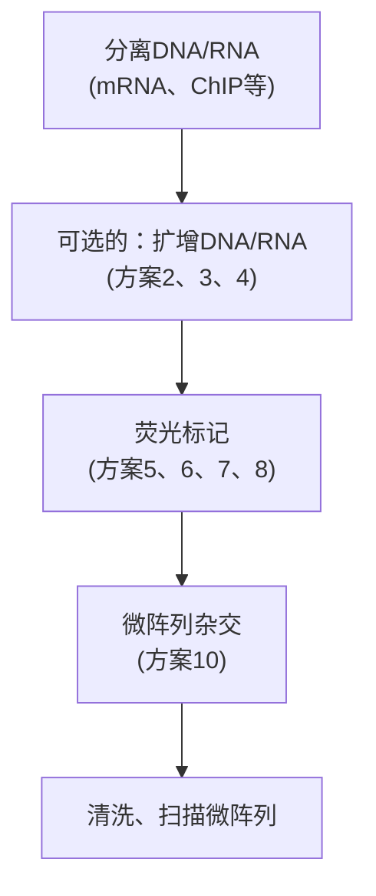
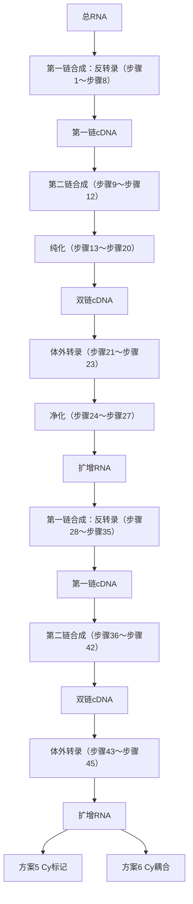

# 第10章 核酸平台技术

原始 PDF 第 62–105 页。

## 第10章 核酸平台技术

导言 | 微阵列的应用 553

进行微阵列实验 556

方案 | 1 印制微阵列 560 6 RNA 的氨基烯丙基-dUTP 间接标记 581

2 Round A/Round B DNA 扩增 564 7 用 Klenow 酶对 DNA 进行 Cyanine-dCTP
3 核小体 DNA 和其他小于 500bp 的 标记 583
DNA的T7线性扩增（TLAD） 567 8 DNA的间接标记 585
4 RNA 的扩增 572 9 封闭自制微阵列上的多聚赖氨酸 587
5 RNA 的 Cyanine-dUTP 直接标记 578 10 自制微阵列的杂交 589

---

## 导言

所有的微阵列实验都是基于共同的模式（图 10-1）。第一步，将大量的核酸“点”排列在一个基质上，常用的基质有玻璃片、硅芯片或者微球。第二步，通常用荧光染料对核酸样品（从细胞中分离、体外合成文库筛选或者其他来源）进行标记。第三步，将标记的核酸与微阵列上的互补点杂交。第四步，洗涤杂交后的微阵列，对杂交的标记物进行定量。通过对原始数据进行分析，可计算出核酸样品中每种 RNA 的表达水平。


<details>
<summary>flowchart</summary>


</details>

图 10-1 双色微阵列实验的设置及运行的基本步骤。

每一步骤的详细介绍见正文（彩图请扫封底二维码）。

微阵列可以采用单色或者双色标记的形式。在单色微阵列芯片中，只有一个样品（如肝细胞RNA）被标记，根据基因互补点的荧光强度推断目的RNA的丰度。对于每一个点来说，杂交都会受到许多因素的影响，因此对单色实验的解释可能是复杂的。数据分析时需使用适当的生物信息学工具处理这些复杂的影响因素。双色微阵列（图10-1）是一种竞争性杂交，用某一种颜色（如绿色）标记其中一种核酸样品，第二种核酸样品用另外一种颜色（如红色）标记。杂交结束后，去除未结合的核酸，然后对微阵列进行激光扫描，检测红色和绿色荧光标记的位置，确定每一个点的荧光强度，然后计算每一个

---

第 10 章 核酸平台技术

553

点的红/绿荧光值。进行数据分析时，该比值可以用来衡量两个样品中目的核酸分子数量的值。例如，正常肝脏细胞的 RNA 标记为绿色，肝脏肿瘤的 RNA 标记为红色，则红色点代表在肿瘤中表达上调的 RNA，绿色点代表表达下调的 RNA。

Tiling 微阵列由一系列按规律间隔排列的寡核苷酸组成，能够密集地覆盖部分或整个基因组。例如，酵母 III 号染色体若用长度为 50 个核苷酸、间隔 20 个碱基的寡核苷酸平铺，则点 1 包括 1～50 碱基，点 2 为 21～70 碱基，依此类推。因此 Tiling 微阵列连续地覆盖了整条染色体，可以进行全基因组范围内的转录结构、蛋白定位的研究。Tiling 微阵列的一个不足之处是，并非所有的基因组序列都适用于微阵列操作。例如，一个基因组中并不是所有的 50 核苷酸聚合体都是唯一的，这会导致平铺的路径上出现缺口，使基于杂交的方法无法确定杂交材料来源于基因组中的拷贝一或拷贝二（或拷贝 N）。更进一步说，杂交相关的特征，如 AT 残基的百分比、寡核苷酸的 $T_m$ 值均依据不同探针而变化。不过许多类似的问题可以通过对双色阵列的标准化来解决。标准化能够补偿点之间或者微阵列之间的系统性技术差异，进而区别样品之间的系统性生物学差异。


## 微阵列的应用

早期微阵列研究大多集中于 mRNA 的表达谱分析，但实际上微阵列可用于以比较两个核酸群体差异为目的的任何研究中，如比较从肿瘤细胞和正常细胞中提取的 RNA 之间的差异。在此，我们列举了一些已经发表的微阵列分析的例子（但绝不是全部）。

## mRNA 表达水平

早期的基因表达微阵列由排列的点构成，每一个点含有对应于一个基因的 cDNA。例如，第一个酵母基因表达微阵列包括 6000 个 cDNA 点，几乎涵盖了啤酒酵母（S. cerevisia）基因组的所有基因（DeRisi et al. 1997）。寡核苷酸芯片的问世，逐渐淘汰了 cDNA 芯片，随着寡核苷酸合成技术的发展，合成与任意一个给定的基因互补的长链寡核苷酸组成的基因表达微阵列已经成为可能。合成的寡核苷酸可以以液体形式出售，由点样仪排列成为阵列，类似 cDNA 阵列。也有一些商品化的微阵列是生产厂家采用“原位”合成寡核苷酸的方法，将寡核苷酸直接印制在微阵列基片上。这使得寡核苷酸微阵列的印制更加灵活，比液态寡核苷酸阵列的使用更为广泛，实验室不再需要为了进行微阵列实验而购买过量的寡核苷酸。

## 监测转录组的变化

典型的 mRNA 表达实验起始于两种相关的细胞 poly(A)tRNA 的分离，如  $30^{\circ}$ C 培养的酵母和从  $30^{\circ}$ C 升温至  $37^{\circ}$ C 培养的酵母，然后分别用分离的 mRNA 制备荧光标记的 cDNA。通常使用的花青染料是 Cy5(在芯片图像中呈现伪彩色红色)和 Cy3（伪彩色绿色）。标记的 cDNA 混合并和微阵列杂交。杂交并清洗后，用可以激发荧光团的激光扫描微阵列，处理图像，得到微阵列上每一个点的 Cy5/Cy3 值。微阵列数据经标准化后，产生每一个点的 Cy5/Cy3 值列表，进而分析全基因组的转录组变化。

微阵列数据经标准化后，使平均  $\log_{2}(\mathrm{Cy5/Cy3})$  为 0；这是微阵列数据分析必需的步骤，因为任一通道的绝对强度（Cy5 或 Cy3）均受多种因素的影响，如 RNA 的使用量、标记效率等。在解释基因微阵列的结果时应始终牢记此标准化过程。例如，肝 RNA 和精子 RNA 之间的比较结果可能表明一些 RNA 相对富集于精子，但由于两种细胞中的 RNA 丰度不同，因此精子中这些 RNA 的绝对数量可能低于肝细胞中的数量。

---

554

分子克隆实验指南（原书第四版）

## mRNA 丰度

前面描述的实验可以提供关于两种细胞群中每一个 mRNA 表达的相对丰度的信息。绝对表达水平如何呢？可以通过两种途径进行测定。第一，使用 Affymetrix 平台进行的单色实验能够合理地测定 mRNA 的丰度，因为微阵列中特定点的强度和与它互补的 mRNA 在原始的标记种群中的绝对强度有关。第二，对于双色实验，直接估算转录丰度的方法是比较标记的 mRNA 与标记的基因组 DNA，该基因组 DNA 应当以单拷贝基因存在（除非要解决的基因问题来自于一个多拷贝基因家族）。因此，基因组 DNA 用 Cy3 标记，mRNA 用 Cy5 标记，Cy5/Cy3 值提供了 mRNA 丰度的相对值。如果已知任何 RNA 的绝对丰度，这些比率可以转换为绝对 mRNA 丰度。标准化可用于设置 RNA 的绝对水平，所有其他 RNA 的丰度可以从其 Cy5/Cy3 值相对于已知标准的 Cy5/Cy3 值来推断。

## 比较基因组杂交

比较基因组杂交(CGH)用来检测整个基因组DNA拷贝数的变化(Pollack et al. 1999)。在CGH实验中，使用Klenow DNA聚合酶对两个种群的基因组DNA进行荧光标记。使用与mRNA表达分析相同的实验设计对标记的DNA进行比较。Cy5/Cy3值反映了拷贝数的变化。该方法最常用于肿瘤研究，在肿瘤发生过程中基因缺失及基因扩增的作用已有大量的报道。通过分析基因拷贝数的变化，可鉴定区域性扩增甚至整条染色体拷贝数的变化。以此方法为基础的改良方法亦已用于分析复制时相，由于S期DNA呈现拷贝数的变化，根据基因组DNA片段是否复制，可确定复制的时相。

## 转录结构的确定

用一个探针（点）检测一个基因的微阵列可以很容易地分析 mRNA 水平的变化，但需要不同的方法检测转录物的结构变异。转录物结构的变异包括剪切模式、转录的起始和终止位点的改变。这些转录物结构的改变及其他变化可用 Tiling 微阵列进行检测及作图。例如，转录起始位点可通过与上述绝对丰度杂交类似的方法，精确定位到 10～20 个核苷酸的范围。简单地说，用 Cy5 标记的 mRNA 和 Cy3 标记的基因组 DNA 进行杂交。表达的 RNA 应呈现 Cy5/Cy3 值高的一条长的“方波”:RNA 互补的点两侧对应的基因组序列 Cy5/Cy3 值应较低。高 Cy5/Cy3 值应开始于包含对应序列的 RNA 的 5'端，持续至 RNA 的末端（图 10-2）。这一技术在酵母中已被用来确定转录起始位点，分辨率可达约 20 核苷酸（Yuan et al. 2005），亦用于检测并定位人类细胞中新的转录物( Shoemaker et al. 2001)。

剪切模式的变化亦可通过微阵列进行检测和定位。在采用 Tiling 微阵列分析时，表达的外显子应呈现 Cy5/Cy3 的峰。确定外显子的另外一种方法是外显子微阵列技术，外显子微阵列中的每个点对应于一个外显子。当样品与外显子微阵列杂交时，特定组织中所有表达的外显子均呈高 Cy5/Cy3 值(Shoemaker et al. 2001)。

Tiling微阵列也被用于发现非编码RNA和新基因。因为表达微阵列只涵盖已知基因，而一个Tiling微阵列则包含了整个基因组。例如，21号和22号染色体的Tiling微阵列揭示了几乎全部人类基因组的低转录水平的基因（Kapranov et al. 2002）。

---

第 10 章 核酸平台技术

555


<details>
<summary>line</summary>

| 3号染色体坐标 | \(log_{2}\) mRNA/gDNA |
| --- | --- |
| 24585 | ~-0.7 |
| 24705 | ~-0.6 |
| 24825 | ~0.8 |
| 24945 | ~1.0 |
| 25065 | ~1.3 |
| 25185 | ~1.2 |
| 25305 | ~1.4 |
| 25425 | ~1.5 |
| 25545 | ~1.0 |
| 25665 | ~0.7 |
| 25785 | ~1.0 |
| 25905 | ~1.3 |
| 26025 | ~1.4 |
| 26145 | ~1.7 |
| 26265 | ~1.5 |
| 26385 | ~1.5 |
| 26505 | ~1.4 |
| 26625 | ~0.9 |
| 26745 | ~1.3 |
| 26865 | ~1.5 |
| 26985 | ~1.4 |
| 27105 | ~-0.6 |
</details>

图10-2 Tiling微阵列对mRNA结构的分析。图中显示的是标记的mRNA与标记的基因组DNA进行Tiling微阵列杂交获得的数据， $y$ 轴代表 $\log 2\mathrm{mRNA / gDNA}$ 值， $x$ 轴代表微阵列探针对应的基因组坐标。

## 鉴定RNA-蛋白质相互作用

采用免疫共沉淀方法分离目标蛋白，鉴定出能与特异性的 RNA 结合蛋白相互结合的 RNA 分子。这些 RNA 分子（或者 RNA 的一部分）可与不加抗体的对照免疫沉淀分离的非特异性 RNA 进行比较分析(Hieronymus and Silver 2003；Gerber et al. 2004)。

## RNA群的亚细胞定位

RNA 的功能特征（如翻译）可以用更精密的分离技术进行微阵列分析。在早期的研究中，微阵列已应用于多聚 RNA 的分析(Arava et al. 2003)。如果有合适的纯化技术，也可以研究 RNA 的亚细胞定位，如从神经元中分离树突用于鉴定相关的 RNA 群体(Eberwine et al. 2002)。

## 蛋白质定位研究

目前，Tiling微阵列最普遍的应用是“芯片上的染色质免疫共沉淀”（或ChIP-on-chip；见第20章）。通过染色质免疫共沉淀可以分析特定的蛋白质在染色质上的定位，如转录因子。简单地说，用甲醛将蛋白质共价交联于基因组，染色质通过超声处理成小片段（约500bp）。用特定蛋白的抗体（针对表位标签的抗体，或蛋白特异性的抗体，甚至特定修饰状态的抗体）通过免疫沉淀分离与此蛋白相关联的DNA。洗涤后，打断共价交联，分离基因组DNA。通常此DNA经过扩增，扩增后的样品被标记，与标记的不加抗体的对照扩增反应或沉淀前的样品进行竞争性杂交。ChIP-on-chip微阵列的结果分析能提供转录因子在基因组上定位的“快照”，且已被证明是研究转录因子和染色质对转录调节的强有力工具(Ren et al. 2000; Iyer et al. 2001)。

---

556

分子克隆实验指南（原书第四版）

## 结构探针的核酸酶可及性

Tiling 微阵列也可与标记前经核酸酶诊断性处理的基因组 DNA 杂交，此方法利用基因组的染色质结构能强烈影响核酸酶可及性的特点。目前，已两种核酸酶用于全基因组研究。第一种是 DNA 聚合酶 I，已知其超敏位点位于基因组的调控元件，如启动子、增强子及绝缘子。染色质经 DNA 聚合酶 I 轻微消化，分离被切割的位点后，使用 Tiling 微阵列可分析鉴定切割位点周围的 DNA (Sabo et al. 2006)。第二种是微球菌核酸酶（MNase），其是一种非加工的核酸酶，常切割核小体之间的 DNA 连接子。已证实分析不被 MNase 切割的 DNA(包括与全基因组 DNA 的比较)是全基因组核小体定位研究的重要工具(Yuan et al. 2005)。

## 拼接微阵列

虽然外显子微阵列（见上文）能监测微阵列上呈现的每一个外显子的表达，但不能区别转录产物的结构，特别是外显子微阵列不能检测外显子的连接方式。例如，外显子1、2、3和5的表达可能为含有所有4个外显子的单一转录物，或可能为两种或多种转录物（1-2-5及1-3-5等）。为了确定外显子的连接方式，需要采用由互补于特定拼接序列的寡核苷酸构成的拼接微阵列。

## 再测序和 SNP 检测

DNA 杂交的序列特异性也可用于再测序和多态性检测等基因组分析。在这些应用中，每一个基因组定位在微阵列上由含一个核苷酸差异的几个寡核苷酸表示。如果研究的基因组区域含有 AATGCCA 序列，含有 AATTCCA、AATCCCA 和 AATACCA 的寡核苷酸也将被印制在芯片上。将基因组 DNA 与这些寡核苷酸杂交，可用于确定这些寡核苷酸所探查位点突变或序列多态性。

利用微阵列进行再测序的一种方法即所谓的序列捕获方案（Hodges et al. 2007）。把待研究的基因组区域相对应的寡核苷酸印制于微阵列。然后用 DNA 或 RNA 与此微阵列杂交，经过清洗步骤，所有互补序列都保留于微阵列上。通过杂交保留待测基因组区域后，洗脱杂交材料，用深度测序法测序（参见第 11 章）。


## 进行微阵列实验

实验目的不同，特异性结合的寡核苷酸、标记的探针以及微阵列杂交分析的细节也有所不同，但大多数微阵列实验都包括6个步骤。

(1) 设计微阵列;
(2) 印制或者购买微阵列;
（3）分离并扩增 DNA 或 RNA 探针；
（4）用荧光基团标记 DNA 或 RNA;
（5）标记的探针与微阵列杂交；
(6) 分析微阵列杂交结果。

在本章中，我们将按顺序依次讨论每一个步骤。方案1提供了自制微阵列的印制方法；方案2～方案4提供了DNA和RNA的分离及扩增的方法；方案5～方案8提供了几种将荧光基团加至核酸分子的技术；方案9阐述了如何对结合在自制微阵列上的带正电荷的多聚赖氨酸进行封闭。最后提供了一个详细的标记探针与微阵列进行杂交、扫描、格式化以及杂交数据保存的通用方法（方案10）。微阵列分析的简要指南参见第8章。

---

第 10 章 核酸平台技术

557

## 设计微阵列

很多种类的微阵列现已商品化，对于大多数研究者来说，现成的产品足以满足需要。否则，可从厂家定制微阵列或自行设计并印制。微阵列的合理设计取决于其应用目的。对于大多数应用来说，基本的设计原则是相同的。本节介绍两种基本的微阵列，基因表达微阵列和 Tiling 微阵列。特殊形式的微阵列，如拼接微阵列和再测序微阵列，是针对不同的生物体设计的，我们推荐感兴趣的读者阅读相关文献(Hacia 1999; Mockler et al. 2005; Blencowe 2006; Hughes et al. 2006; Calarco et al. 2007; Cowell and Hawthorn 2007; Gresham et al. 2008)。

## 基因表达微阵列

设计用于微阵列的寡核苷酸需要生物信息学方面的专业知识。但是一些基本的设计要素是很容易理解的。第一，选择适当的寡核苷酸长度。目前，大多数寡核苷酸的微阵列印制长度为 $50\sim 70$ 个核苷酸。设计理想长度的寡核苷酸需要考虑几个因素，包括信号强度、特异性、费用及合成效率。越短的寡核苷酸越容易与特定基因组中许多不同的区域交互杂交，通常熔解温度（$T_{\mathrm{m}}$）非常低，易造成杂交技术上的问题。有关寡核苷酸长度与敏感性和特异性之间的关系的详细分析可见Hughes等的报道(2001)。对于大多数应用来说，可采用合理的经验法则，60个核苷酸的寡核苷酸能在这些互相制约的因素之间提供最佳平衡。

寡核苷酸设计要考虑的第二点是微阵列上的寡核苷酸与待研究的生物体的 RNA 种类的特异性或互补性的程度，一般说来，设计的寡核苷酸应当仅与一种 RNA 互补。通常 BLAST 检索（参见第 8 章）可用于筛选设计的寡核苷酸与相应的基因组序列的互补性，以鉴定其与待研究的基因组中多个序列互补的可能性。理想的情况下,使用者应选择在基因组中匹配性仅次于最低的寡核苷酸，而不是关注正常范围的 BLAST 值。

设计寡核苷酸要考虑的第三点是杂交特性的优化。有若干特性是可以优化的，但最重要的是寡核苷酸熔解温度（$T_{\mathrm{m}}$）。明确地说，微阵列上所有寡核苷酸的 $T_{\mathrm{m}}$ 值应在一个尽可能狭窄的区间。其他的一些要素，如熵（序列的复杂性）、GC含量以及自身互补性也应当同时被优化。可借助一些软件工具进行寡核苷酸的设计，包括可公开获得的工具，如ArrayOligoSelector（见下文），或由微阵列公司提供的有偿服务（有关寡核苷酸设计的更多细节见第7章、第8章）。

例如，某研究者希望为一种近期完成基因组测序的非模式生物设计基因表达微阵列。设计基因表达微阵列的第一步，当然是鉴定基因。由于基因鉴定通常可通过基因组测序完成，因此假定这些基因已用标准工具进行了预测(Zhang 2002; Ashurst and Collins 2003; Brent 2005; Solovyev et al. 2006)。

## ArrayOligoSelector

一旦编码区得到鉴定，就需要针对每一个基因设计寡核苷酸。已有许多程序可用于寡核苷酸筛选，包括应用广泛的 ArrayOligoSelector (Bozdech et al. 2003a,b)，在 http://arrayoligosel.sourceforge.net/免费提供使用（更多细节见第7章、第8章）。

ArrayOligoSelector 被设计用于全基因组分析及制备用户设定长度的寡核苷酸。对于每一条寡核苷酸，ArrayOligoSelector 可计算其唯一性、序列复杂度、自复性、GC 含量的得分。唯一性衡量的是一个特定的寡核苷酸与其最佳匹配或同源性次之的基因组序列的结合能的理论差值。序列复杂度的分析可使用户滤除含有同源聚合物的寡核苷酸，否则将导致杂交问题。自复性分数衡量的是寡核苷酸自复性产生的二级结构。自复性也是出现杂交问题的另外一个潜在原因。最后，将寡核苷酸间 GC 含量比例（%）的差异性降到最低也很

---

558

分子克隆实验指南（原书第四版）

重要，同时还有降低 $T_{\mathrm{m}}$ 值的差异、降低点之间的荧光强度的差异。

运行 ArrayOligoSelector 时，可确定以下几个特征:寡核苷酸长度、GC%、每个基因对应的寡核苷酸数量、掩蔽序列及唯一性的正常范围。通常寡核苷酸的长度为 60 聚体或 70 聚体，GC 含量取决于待研究的基因组的 GC 含量，通常选取的是基因组编码区的平均值。每一个基因的寡核苷酸数量取决于使用的微阵列是购买的还是自制的。如果购买的寡核苷酸用于自己印制微阵列，考虑到成本和可印制的点密度，一般很难采用每个基因多于 1 个或 2 个寡核苷酸。另外一种情况，如果使用商品化的微阵列，则可用的点数量决定每一个基因的寡核苷酸数量。掩蔽序列通常不是特定的，但是如果基因组中含有容易出问题的短重复元件，有时就需要将其掩蔽于微阵列的寡核苷酸之外。唯一性的正常范围通常是空白的，这将导致初始化数值的使用（更多信息见《ArrayOligoSelector 手册》）。

实验者可以对 ArrayOligoSelector 输出的结果进行过滤。例如，因为基于反转录酶的标记在基因 3'端区域效率更高，所以通常希望使用位于基因 3'端的寡核苷酸。

## Tiling 微阵列

Tiling 微阵列设计的寡核苷酸设计比基因表达微阵列的设计更简单, 因为 Tiling 微阵列假定微阵列含有待研究区域内的所有寡核苷酸。最简单的 Tiling 微阵列设计包括: 选择某一区域内的核苷酸 1～50 平铺作为点 1, 核苷酸 21～70 作为点 2, 依此类推。一旦完成所有寡核苷酸的设计, 即可用 BLAST 来寻找与目的基因有多个位点匹配的寡核苷酸, 这些寡核苷酸将被去除。更为细致的平铺设计采用了寡核苷酸定位的微小 “摆动”, 即点 2 为核苷酸 16～65, 点 3 为 45～94, 依此类推。这样做对于匹配杂交特性的处理, 如 $T_m$ 值和 GC 含量, 更优于简单的 Tiling 微阵列。

## 印制或购买微阵列

一旦完成寡核苷酸的设计，就可通过商品化渠道印制微阵列。寡核苷酸亦可经商品化渠道合成或通过自己的研究平台合成，然后用点样仪自行印制（参见方案1）。

## 用于微阵列杂交的核酸样品的分离及扩增

大多数用于微阵列的样品制备程序按照标准的方案，许多方案均可在本书的其他章节找到。例如，第1章描述了用目的样本中分离的基因组DNA进行比较基因组杂交分析（CGH）。第6章中描述了基因表达或拼接研究用的RNA或mRNA的纯化方案。第20章描述的染色质免疫共沉淀（ChIP）分离的样品是蛋白定位分析的材料。通常情况下，这些方案的后期检测是基于印迹技术或定量PCR分析，仅需要纳克级的样品。而微阵列标记通常需要几微克核酸，因此，在标记前必须对样品进行扩增。

## 扩增的一般注意事项

核酸扩增是杂交前的步骤，用以产生标记的微阵列探针，核酸扩增不能偏向基因组的任何特殊序列。因此，无偏离（或最小偏离）全基因组扩增方法是许多微阵列应用中的关键部分。

此章节包括 3 种扩增方案:两种适用于 DNA（方案 2 和方案 3），一种适用于 RNA（方案 4）。在进行扩增实验时，要注意以下几点:第一，初次尝试一个扩增方法时，采用量大且易于获得的材料（如肝脏 RNA）扩增小量的起始材料。对扩增材料和起始的“大宗池”的微阵列对比，能提供有价值的扩增偏离数据。完美的扩增结果是一个“黄色”的阵列，所有的原始材料和扩增材料均无任何差异的点。第二，避免任何可能含有 DNA 或 RNA 的物质污染样品。即使是极微量的外源核酸，也将被扩增、污染样品并破坏微阵列实验。

---

第 10 章 核酸平台技术

559

在进行分离和扩增实验时，需戴手套并使用带滤膜的吸头。第三，实验中需设置用水（无DNA或RNA）进行的对照扩增实验，以确定试剂没有被可扩增材料污染。

## 用于表达谱研究的 RNA 扩增

相对于DNA扩增，RNA扩增不是很普遍，但在一些使用微量的细胞种群的实验中仍然有可能用到，如用激光捕获的细胞群进行的神经生物学研究。RNA扩增试剂盒可以从若干供应商获得（如Ambion公司），或者按照方案4的方法进行扩增。

## 荧光标记核酸探针

除了 Affymetrix 微阵列外，用于微阵列的核酸标记与大多数微阵列实验平台中的核酸标记类似。对于大多数平台（自制或购买），荧光分子通过 DNA 聚合酶 I 的 Klenow 片段结合于 DNA。对于 RNA 标记，反转录酶用于制备标记的 cDNA。标记方法包括标记反应中所用的荧光标记的 dNTP（方案 5 和方案 7）。这一方法快速但昂贵，另外有一种便宜但是较为烦琐的替代方案，首先将氨基烯丙基核苷酸结合于核酸分子，然后再将氨基烯丙基基团偶联于荧光基团（方案 6 和方案 8）。在所有的标记实验方案中，标记前的源核酸可未经扩增抑或是扩增后的样品。

## 与微阵列杂交

使用自制微阵列和商品化的微阵列时，标记探针与微阵列杂交的方法明显不同。对于自制的微阵列，首先要封闭玻片，因为残留在玻片上的多聚赖氨酸可与标记材料结合，若不用琥珀酸酐处理以中和，将导致背景显著升高。方案9和方案10分别提供了自制微阵列的封闭和杂交方案。如果使用商品化的微阵列，通常由厂商提供杂交方案。杂交后，使用台式扫描仪进行扫描。数据经收集、格式化，并以数字形式保存用于后续的分析。

## 分析微阵列数据

对微阵列进行数据分析时采用的工具取决于要解决的实验问题:基因定位研究和基因表达研究需要的工具不同。第8章中提供了一些可用的资源。以下我们概括了数据分析的基本步骤。

微阵列数据分析的第一步是去掉错误数据（一些被“标示”的点的数据，因为这些点受荧光沉淀的影响而变得模糊等），然后将其余数据标准化。GenePix 软件输出的标准数据格式是“.gpr”文件，对这些文件进行操作时，通常去掉所有被标示（flagged）的探针，然后处理  $\log_{2}$  比值数据。更高级的用户可以考虑使用特定的功能，如前景和背景强度。

大多数双色微阵列研究采用的标准化方法是  $\log_{2}$  比值平均为 0。此标准化过程隐含的假设是所有被评估的点均未发生整体的变化。因此，面对这些标准化数据时，重要的是记住评估的是相对数值而不是绝对数值。实际上，标准化可通过将未标记的对数比值数据进行平均，然后将表中每一项均减去此数值来实现。这一过程可用电子表格手工计算或用通用命令的语言，如 MATLAB、Perl 或 R。

完成标准化后，根据 log 比值的数据对表格进行归类，以鉴别出明显表达上调或者下调的基因（如果是基因表达微阵列）或鉴别出待研究的蛋白质中的高丰度位点。数据分析途径依据要解决的问题不同而不同。很多微阵列研究都设计多重微阵列，通常将数据进行聚类分析以鉴别行为相似的基因或位点。

聚类分析和聚类的可视化，网上有很多程序可用。本书使用的是经典的 Cluster 和 TreeView 程序(Eisen et al. 1998)，可通过 SourceForge（http://sourceforge.net/）或通过 Eisen

---

560

分子克隆实验指南（原书第四版）

实验室网站（http://www.eisenlab.org/）在线获得。用于指导聚类文件格式化的范例文件也可找到，此处不再描述格式化的过程。简言之，将数据上传于Cluster，设置各种阈值（对于特定基因缺失的数据、超出某些阈值的基因数量等），选用几个聚类算法之一进行分析。聚类的数据输出通过TreeView可视化，用户即可建立一个经典的微阵列数据“热图”。


## 致谢

此章节中的实验方案修改自 Ash Alizadeh、Chih Long Liu、Audrey Gasch、Jason Lieb、Bing Ren 和 L. Ryan Baugh 撰写的实验方案，感谢他们慷慨提供。

## 参考文献

- Arava Y, Wang Y, Storey JD, Liu CL, Brown PO, Herschlag D. 2003. Genome-wide analysis of mRNA translation profiles in Saccharomyces cerevisiae. Proc Natl Acad Sci 100: 3889–3894.
- Ashurst JL, Collins JE. 2003. Gene annotation: Prediction and testing. Annu Rev Genomics Hum Genet 4: 69–88.
- Blencowe BJ. 2006. Alternative splicing: New insights from global analyses. Cell 126: 37–47.
- Bozdech Z, Llinas M, Pulliam BL, Wong ED, Zhu J, DeRisi JL. 2003a. The transcriptome of the intraerythrocytic developmental cycle of Plasmodium falciparum. PLoS Biol 1: e5. doi: 10.1371/journal.pbio.0000005.
- Bozdech Z, Zhu J, Joachimiak MP, Cohen FE, Pulliam B, DeRisi JL. 2003b. Expression profiling of the schizont and trophozoite stages of Plasmodium falciparum with a long-oligonucleotide microarray. Genome Biol 4: R9. doi: 10.1186/gb-2003-4-2-r9.
- Brent MR. 2005. Genome annotation past, present, and future: How to define an ORF at each locus. Genome Res 15: 1777–1786.
- Calarco JA, Saltzman AL, Ip JY, Blencowe BJ. 2007. Technologies for the global discovery and analysis of alternative splicing. Adv Exp Med Biol 623: 64–84.
- Cowell JK, Hawthorn L. 2007. The application of microarray technology to the analysis of the cancer genome. Curr Mol Med 7: 103–120.
- DeRisi JL, Iyer VR, Brown PO. 1997. Exploring the metabolic and genetic control of gene expression on a genomic scale. Science 278: 680–686.
- Eberwine J, Belt B, Kacharmina JE, Miyashiro K. 2002. Analysis of subcellularly localized mRNAs using in situ hybridization, mRNA amplification, and expression profiling. Neurochem Res 27: 1065–1077.
- Eisen MB, Spellman PT, Brown PO, Botstein D. 1998. Cluster analysis and display of genome-wide expression patterns. Proc Natl Acad Sci 95:14863–14868.
- Gerber AP, Herschlag D, Brown PO. 2004. Extensive association of functionally and cytotopically related mRNAs with Puf family RNA-binding proteins in yeast. PLoS Biol 2: e79. doi: 10.1371/journal.pbio.0020079.
- Gresham D, Dunham MJ, Botstein D. 2008. Comparing whole genomes using DNA microarrays. Nat Rev Genet 9: 291–302.
- Hacia JG. 1999. Resequencing and mutational analysis using oligonucleotide microarrays. Nat Genet 21: 42–47.
- Hieronymus H, Silver PA. 2003. Genome-wide analysis of RNA–protein interactions illustrates specificity of the mRNA export machinery. Nat Genet 33: 155–161.
- Hodges E, Xuan Z, Balija V, Kramer M, Molla MN, Smith SW, Middle CM, Rodesch MJ, Albert TJ, Hannon GJ, McCombie WR. 2007. Genome-wide in situ exon capture for selective resequencing. Nat Genet 39:1522–1527.
- Hughes TR, Mao M, Jones AR, Burchard J, Marton MJ, Shannon KW, Lefkowitz SM, Ziman M, Schelter JM, Meyer MR, et al. 2001. Expression profiling using microarrays fabricated by an ink-jet oligonucleotide synthesizer. Nat Biotechnol 19: 342–347.
- Hughes TR, Hiley SL, Saltzman AL, Babak T, Blencowe BJ. 2006. Microarray analysis of RNA processing and modification. Methods Enzymol 410: 300–316.
- Iyer VR, Horak CE, Scafe CS, Botstein D, Snyder M, Brown PO. 2001. Genomic binding sites of the yeast cell-cycle transcription factors SBF and MBF. Nature 409: 533–538.
- Kapranov P, Cawley SE, Drenkow J, Bekiranov S, Strausberg RL, Fodor SP, Gingeras TR. 2002. Large-scale transcriptional activity in chromosomes 21 and 22. Science 296: 916–919.
- Mockler TC, Chan S, Sundaresan A, Chen H, Jacobsen SE, Ecker JR. 2005. Applications of DNA tiling arrays for whole-genome analysis. Genomics 85: 1–15.
- Pollack JR, Perou CM, Alizadeh AA, Eisen MB, Pergamenschikov A, Williams CF, Jeffrey SS, Botstein D, Brown PO. 1999. Genome-wide analysis of DNA copy-number changes using cDNA microarrays. Nat Genet 23: 41–46.
- Ren B, Robert F, Wyrick JJ, Aparicio O, Jennings EG, Simon I, Zeidlinger J, Schreiber J, Hannett N, Kanin E, et al. 2000. Genome-wide location and function of DNA binding proteins. Science 290: 2306–2309.
- Sabo PJ, Kuehn MS, Thurman R, Johnson BE, Johnson EM, Cao H, Yu M, Rosenzweig E, Goldy J, Haydock A, et al. 2006. Genome-scale mapping of DNase I sensitivity in vivo using tiling DNA microarrays. Nat Methods 3: 511–518.
- Shoemaker DD, Schadt EE, Armour CD, He YD, Garrett-Engele P, McDonagh PD, Loerch PM, Leonardson A, Lum PY, Cavet G, et al. 2001. Experimental annotation of the human genome using microarray technology. Nature 409: 922–927.
- Solovyev V, Kosarev P, Seledsov I, Vorobyev D. 2006. Automatic annotation of eukaryotic genes, pseudogenes and promoters. Genome Biol 7: S10.1–S10.12.
- Yuan GC, Liu YJ, Dion MF, Slack MD, Wu LF, Altschuler SJ, Rando OJ. 2005. Genome-scale identification of nucleosome positions in S. cerevisiae. Science 309: 626–630.
- Zhang MQ. 2002. Computational prediction of eukaryotic protein-coding genes. Nat Rev Genet 3: 698–709.

## 方案 1 印制微阵列

大多数实验室选择从供应商处订购微阵列，如 NimbleGen、Agilent、Affymetrix 或 Illumina 公司。这些供应商销售的产品涵盖了生命体基因组的 3 个领域。大多数公司也可根据订单定制微阵列。印制微阵列非常简单，对微阵列需求广泛的小实验室也会发现其成本

---

第 10 章 核酸平台技术

561

效益，值得制作自己的微阵列。印制微阵列需要一个点样机器人。能够买到的点样机器人有若干种，如 OmniGrid series (Digilab Genomic Solutions)。这些设备很昂贵，通常放置于研究院所或大实验室的仪器中心。多年前斯坦福大学的 Brown 实验室已完成了点样机器人的设计，可作为一种选择。制造点样机器人的方法不在本章节讨论的范围内，感兴趣的读者可以在 http://cmgm.stanford.edu/pbrown/mguide/找到制作方案。

对于典型的微阵列，寡核苷酸配制于  $3 \times SSC$ ，浓度为  $20 \sim 40 \mu mol/L$ ，然后分别加入 384 孔板。寡核苷酸被印制在多聚赖氨酸包被过的微阵列玻片上。印制过程中湿度最好高于 50%。当湿度为  $20\% \sim 30\%$  时，有可能出现点样针干燥的问题。为了提高或维持适当的湿度，可以考虑在机器人周围建造一湿度可控的外包。对于缺少外包的机器人，在印制过程中打开 1 或 2 台加湿器就足够了。

印制方案的细节根据使用的机器人不同而变化，因此请按照生产厂家的说明进行操作。本方案提供了一个使用配备接触式钢羽针的机器人的典型工作流程。


## 材料

为正确使用本方案中的器材和危险试剂，必须查阅相应的材料安全数据表并咨询所在机构的环境卫生和安全办公室。

本方案的专用试剂标注&lt;R&gt;，配方在本方案末提供。常用储备溶液、缓冲液和试剂标注&lt;A&gt;，配方见附录1。储备溶液应稀释至适用浓度后使用。

## 试剂

所需序列的寡核苷酸

寡核苷酸通常溶于  $20 \sim 40 \mu mol/L$  的  $3 \times SSC$  中。

剪切后的鲑鱼精 DNA&lt;A&gt;（150ng/ $\mu$ L，重悬于 3×SSC）

$$
\mathrm{SSC} (3 \times) <   \mathrm{A} >
$$

## 仪器设备

干燥器

压缩氮气

平板（384孔）

多聚赖氨酸包被的玻片

可以用多聚赖氨酸包被玻片，但是根据我们的经验，失败的比例很高。商品化的多聚赖氨酸包被的玻片（如 Erie Scientific）成本效益最佳。

塑料玻片盒

点样仪


## 方法

## 准备印制

## 第0天

1. 将寡核苷酸按照每孔相同体积加入 384 孔板（通常  $10 \sim 20 \mu L/孔$ ）。如果使用冷冻保存的寡核苷酸溶液，可将其置于  $4^{\circ}C$  过夜融化。如果使用寡核苷酸干粉，则将其用  $3 \times SSC$  重悬，并置于  $4^{\circ}C$  过夜。
2. 通过测试印制确认所有的点样针都能印制，并确定阵列经过正确的校准（图 10-3）。

---

562

分子克隆实验指南（原书第四版）

为了尽可能接近实际印制板的黏度，使用含有  $150ng/\mu L$  剪切过的鲑鱼精 DNA（重悬于  $3\times SSC$ ）进行试印制。测试印制时，所有的点样针均应连续印制数百个点。另外，需在玻片盘的多个位置进行测试印制以确定盘片在上次使用后是否被显著扭曲。

如果试印制显示点样机器人不能按要求工作，参见“疑难解答”。


图 10-3 点样仪。图中显示了玻片盘（A），实验巢（B）和印制头及清洁/干燥站（C）的位置（彩图请扫封底二维码）。

## 第一天

3. 再次进行测试印制，以确定点样针依然能正常印制。

4. 轻轻地将玻片放置于微阵列仪的玻片盘中。确定所有的玻片都放平并牢固地附着（根据微阵列仪使用抽真空、夹子或者胶带加固）。

▲小心对玻片进行操作，以免产生微小的玻璃片落在玻片表面。

5. 使用压缩氮气吹拂玻片表面除尘。

6. 如果微阵列仪配备了超声水浴来清洗点样针，将其灌满新鲜的水。

7. 将 4 个含有寡核苷酸的 384 孔印制板从 $4^{\circ} \mathrm{C}$ 取出, 放置至少 $1 \mathrm{~h}$, 使其恢复到室温。

8. 约 $1000\mathrm{r / min}$ 离心 $2\mathrm{min}$，以去除板盖上的冷凝水。小心地移去384孔板的盖子和印制板的胶黏板盖。

▲小心不要摇晃板子，孔之间的交叉污染会对后续各种实验数据分析带来严重影响。

9. 将板子放置于点样机器人的持板器上。

## 印制微阵列

10. 开始印制。始终要注意板子的顺序及方向。微阵列数据分析时，确定板子的顺序对于将基因名称与点的位置对应并生成“.gal”文件是必需的。在印制过程中的任何错误，

---

第 10 章 核酸平台技术

563

如印制板顺序颠倒（如将3号板置于2号板之前）等，只要被发现就可随时改正。

11. 当完成一块板的印制时，印制头完全停止。若印制板欲干燥储存,可将板子置于超净台中挥发干燥，或用铝箔覆盖并盖上盖子，储存于-80℃。

12. 将下一块板子放于持板器。

13. 如果不进行背靠背的印制，印制完成后，将玻片干燥过夜。

## 第二天

14. 将所有的玻片从微阵列仪转移至塑料玻片盒中。将其储存于干燥器中。

15. 关闭微阵列仪电源。


## 疑难解答

问题（步骤 2）:印制针不能正确印制。

解决方案:如果印制针不能印制，可从下面 4 个方面解决。第一，如果脏东西或者其他材料堵塞了针尖，用超声水浴彻底清洗点样针。第二，如果在显微镜下检查发现是某根针被堵塞，可试用剃须刀片仔细地疏通针尖，以清除污物。第三，针的长度的细微差别会使有的针无法工作，更换印制头内的针可改进印制。第四，如果采用所有步骤后，有些针还是不能工作，则换用一根新针。

问题（步骤2）:测试板在微阵列仪的不同位置印制不一致。

解决方案:如果微阵列仪在某些特定位置不能印制，可调整该位置的印制高度。机器人附带的软件可执行高度的调节。


## 讨论

成功的印制需要对印制平板进行小心的操作，以避免交叉污染，点样针要定时检查（如每完成一块或两块384孔板之后）以确定其仍能正常印制，清洗针时，水浴（或超声仪）中的水必须足以覆盖点样针，在印制过程中，我们通常每6h向超声仪中加水5～10mL，但这也取决于环境湿度。

为了确定点样针在印制，可从一定角度用手电筒观察玻片。印制过程中沉积的盐呈白色，当点样针停止工作时，印制过的部分与其他部分有所区别。例如，如果印制了5行×20个点，应能看到一个完美的 $5\times20$ 的矩形，如果某一根点样针没有正常工作，矩形不完整。

当某根针停止印制时，小心将其取下，如针内外有灰尘，可在显微镜下清理。若未见灰尘，有时通过超声彻底地清理可恢复正常。否则，用备用针替换有问题的针或移动印制头周围的针作为最后的补救措施。印制过程暂停后，用一张新玻片替换第一张玻片，再次进行测试印制以确认新的调整是否奏效。重新启动点样机器人时，确认印制命令精确地重启于印制工作暂停的位置。

## 网络资源

建造点样机器人的方法:http://cmgm.stanford.edu/pbrown/mguide/

---

564

分子克隆实验指南（原书第四版）

## 方案 2 Round A/Round B DNA 扩增

此程序的目的是随机扩增样本 DNA 以获得最佳的序列重现性。此程序已成功地应用于扩增少于 10ng 的基因组 DNA 样品。此方案包括 3 个系列的酶促反应。在 Round A 中，使用测序酶来延伸随机复性引物以产生后续 PCR 反应的模板。在 Round B 中，特异性引物用于扩增前面产生的模板。最后，扩增后的材料按方案 7 或方案 8 进行标记；还可用此方案的 Round C 在额外的 PCR 循环中掺入氨基烯丙基-dUTP 或 Cy-染料偶联的核苷酸。此方案不适用于小于 250bp 的材料扩增，小于 250bp 的材料不能被均一性地扩增。在这样的情况下，建议使用方案 3。方案节选自 Bohlander 等(1992)。


## 材料

为正确使用本方案中的器材和危险试剂，必须查阅相应的材料安全数据表并咨询所在机构的环境卫生和安全办公室。

本方案的专用试剂标注&lt;R&gt;，配方在本方案末提供。常用储备溶液、缓冲液和试剂标注&lt;A&gt;，配方见附录1。储备溶液应稀释至适用浓度后使用。

## 试剂

aa-dNTP/Cy-dNTP 混合物 (100×)&lt;R&gt;

BSA (500μg/mL)

从待研究的样品中分离的 DNA（10～100ng）

例如，对于 CGH 分析，按第 1 章的方法分离基因组 DNA；对于蛋白质定位研究，按照第 20 章所述用染色质免疫共沉淀（ChIP）的方法分离 DNA。

dNTP 混合物 (3mmol/L)

dNTP （100×；每种核苷酸 20mmol/L）

DTT (0.1mol/L)

$MgCl_{2}$  (25mmol/L)

PCR 缓冲液（10×）（500mmol/L KCl，100mmol/L Tris，pH 8.3）

引物 A: GTTTCCCAGTCACGATCNNNNNNNNN (40pmol/μL)

引物 B: GTTTCCCAGTCACGATC (100pmol/ $\mu$ L)

测序酶（13U/μL）(US Biochemical，自录号 70775)

测序酶缓冲液（5×）

测序酶稀释缓冲液

Taq 聚合酶（5U/μL）

## 仪器设备

琼脂糖凝胶（1%）

Microcon 30 spin column (Millipore)

热循环仪

---

第 10 章 核酸平台技术

565


## 方法

## Round A: 随机复性引物的延伸

1. 按如下配方准备 Round A 反应:

| DNA | 7μL |
| --- | --- |
| 测序酶缓冲液(5×) | 2μL |
| 引物A(40pmol/μL) | 1μL |

应用此方案可有效扩增低至 10ng 的 DNA。设置一个用水来代替 DNA 的反应作为阴性对照。

2. 94℃加热 2min 然后快速降温至 10℃，使模板 DNA 变性及引物复性。将反应混合物在 10℃放置 5min。

3. 配制反应混合物:

| 测序酶缓冲液(5×) | 1μL |
| --- | --- |
| dNTP (3mmol/L) | 1.5μL |
| DTT (0.1mol/L) | 0.75μL |
| BSA (500μg/μL) | 1.5μL |
| 测序酶(13U/μL) | 0.3μL |

4. 将反应混合物与模板-引物混合，放入热循环仪，按如下程序延伸引物。

i. 8min 内从  $10^{\circ}$ C 梯度升温至  $37^{\circ}$ C。

ii.  $37^{\circ}$ C保温8min。

iii. 快速梯度升温至  $94^{\circ}$ C，保温 2min。

iv. 快速梯度降温至  $10^{\circ}$ C，加入  $1.2 \mu L$  稀释的测序酶（1:4 稀释）， $10^{\circ}$ C 保温 5min。

v. 8min 内从  $10^{\circ}$ C 梯度升温至  $37^{\circ}$ C。

vi.  $37^{\circ}$ C 保温 8min。

5. 用水稀释样品至终体积为  $60 \mu L$ 。

## Round B: PCR 扩增

6. 按以下配方准备 Round B 反应物:

| Round A 模板 | 15μL |
| --- | --- |
| MgCl2 | 8μL |
| PCR 缓冲液 (10×) | 10μL |
| dNTP (100×) | 1μL |
| 引物 B (100pmol/μL) | 1μL |
| Taq 聚合酶 | 1μL |
| 水 | 64μL |

7. 将管子放入热循环仪，按以下程序扩增模板。

| 循环数 | 变性 | 复性 | 聚合 |
| --- | --- | --- | --- |
| 15~35 循环 | 94°C 30s | 40°C 30s,然后 50°C 30s | 72°C 2min |

注: $4^{\circ}$ C恒温放置。

根据起始材料的量，运行程序 15～35 个循环。

为了优化循环数，应每 2 个循环取出一部分溶液以监测扩增的进展。最好使用最少的循环数产生可见的模糊带形（见步骤 8）。

▲必须确认阴性对照中无 DNA。

---

566

分子克隆实验指南（原书第四版）

8. 取 $5\mu \mathrm{L}$ 反应液，进行 $1\%$ 的琼脂糖凝胶电泳。应当在 500bp 和 100bp 之间出现 DNA 的模糊带形。

9. 使用 Round C 程序、方案 7 或方案 8，标记 DNA。

## Round C: 花青染料标记或氨基烯丙基活化 DNA

10. 准备 Round C 反应液:

| Round B 模板 | 10~15μL |
| --- | --- |
| $MgCl_2$ | 8μL |
| PCR 缓冲液(10×) | 10μL |
| aa-dNTP/Cy-dNTP (100×) | 1μL |
| 引物 B (100pmol/μL) | 1μL |
| Taq 聚合酶 | 1μL |
| 水 | 63~68μL |

11. 将管子置于热循环仪，然后按如下程序标记模板:

| 循环数 | 变性 | 复性 | 聚合 |
| --- | --- | --- | --- |
| 15~25 循环 | 94°C 30s | 40°C 30s,然后 50°C 30s | 72°C 2min |

注: $4^{\circ}$ C恒温放置。

程序运行 10\~25 个循环。

循环数凭经验确定，即产生  $2 \sim 3 \mu g$  杂交用材料所需的最少循环数。

12. 如果在 Round C 中使用 aa-dNTP，需去除 Tris 缓冲液使样品脱盐，因为 Tris 会干扰染料的偶联。在含有样品的 Microcon 30 中加入 400μL 水，然后 12 000r/min 离心 8min。再加入 500μL 水重复此步骤。

13. Cy-染料的偶联按照方案 8 步骤 11 进行。


## 讨论

此扩增方案的产品是双链 DNA，测定吸光度对 DNA 进行定量（见第 2 章），根据 DNA 的投入量计算扩增倍数。初次使用此方案的用户，可以用凝胶电泳来检测扩增 DNA 的大小分布。


## 配方

为了正确使用本方案中所用的器材和危险试剂，必须查阅相应的材料安全数据表并咨询所在机构的环境卫生和安全办公室。

aa-dNTP/Cy-dNTP 混合物 (100×)

| 试剂 | 终浓度 |
| --- | --- |
| dATP | 25mmol/L |
| dCTP | 25mmol/L |
| dGTP | 25mmol/L |
| dTTP | 10mmol/L |
| 氨基烯丙基-dUTP 或 CyX-dUTP | 15mmol/L |

注:aa-dUTP 和 dTTP 的比值可改变或优化。

---

第 10 章 核酸平台技术

567

## 参考文献

Bohlander SK, Espinosa R III, Le Beau MM, Rowley JD, Diaz MO. 1992. A method for the rapid sequence-independent amplification of micro-dissected chromosomal material. Genomics 13: 1322–1324.

## 方案 3 核小体 DNA 和其他小于 500bp 的 DNA 的 T7 线性扩增（TLAD）

方案 2 广泛应用于基因组定位分析，尤其对于经超声剪切为约 500bp 的 DNA 效果最佳。但是，当 DNA 被剪切成小于 500bp 的片段时，PCR 过程中的倾向性将导致一些基因组位点的重现性发生偏离(Liu et al. 2003)。然而，一系列的应用需要扩增小于 500bp 的 DNA 片段，如对单核小体 DNA 的 ChIP 实验，其 DNA 片段长约 150bp(Liu et al. 2005)。在这些情况下，首选 T7 线性扩增 DNA（TLAD），与方案 2 中描述的扩增方法相比，它更精确地保持短 DNA 片段的均一性扩增。

利用 TLAD 对双链 DNA 的扩增起始于通过 TdT 将多聚腺嘧啶加于 DNA 的 3' 端。其次，用大肠杆菌 DNA 聚合酶的 Klenow 片段以及 T7-Poly（A）引物，产生带有 5' 端 T7 引物的互补片段。最后，T 结尾的 DNA 链的扩增产生适合基于 T7 转录的模板，最终产生扩增的 RNA（aRNA）。该技术避免了 PCR 中出现的 “jackpotting” 问题，即一个扩增早期事件导致某一个特定序列比例过高，因为 PCR 遵循指数动力学，而转录是一个线性增长过程。

完成此方案需要一些时间。表 10-1 给出了估算的每一步骤所需的时间。

表 10-1 小 DNA 分子的 T7 线性 DNA 扩增（TLAD）

| 步骤 | 时间 |
| --- | --- |
| TdT 加尾和净化 | 30~40min |
| 第二链合成及净化 | 2~2.5h |
| IVT | 5.5~20.5h |
| IVT 净化 | 15~30min |
| RNA 质量及数量评价 | 40~60min |
| 合计 | 9.5~25h |

注:TdT，末端转移酶；IVT，体外转录。


## 材料

为正确使用本方案中的器材和危险试剂，必须查阅相应的材料安全数据表并咨询所在机构的环境卫生和安全办公室。

本方案的专用试剂标注&lt;R&gt;，配方在本方案末提供。常用储备溶液、缓冲液和试剂标注&lt;A&gt;，配方见附录1。储备溶液应稀释至适用浓度后使用。

---

568

分子克隆实验指南（原书第四版）

## 试剂

β-巯基乙醇

小牛肠磷酸酶 (CIP) (New England Biolabs, catalog nos. M0290S 或 M0290L)

$\mathrm{CoCl}_{2}$ (5mmol/L)

双脱氧核苷酸加尾溶液(8%) (92mmol/L dTTP, 8mmol/L ddCTP) (Life Technologies)

dNTP 混合物 (5mmol/L) &lt;A&gt;

EDTA (0.5mol/L, pH 8.0) &lt;A&gt;

乙醇 (95%\~100%)

DNA 聚合酶 I 的 Klenow 片段(New England Biolabs)

矿物油

NEB 缓冲液 2 (10×) (New England Biolabs)

NEB 缓冲液 3 (10×) (New England Biolabs)

NTP 混合物 (75mmol/L)

试剂盒提供的反应缓冲液

无 RNase 的水

RNase 抑制剂

T7-A $_{18}$ B 引物

引物序列 5'-GCATTAGCGGCCGCGAAATTAATACGACTCACTATAGGGAG(A) $_{18}$ [B]，B 代表 C、G 或 T。引物应经过 HPLC、PAGE 或其他等效方法纯化。

T7 RNA 聚合酶

模板 DNA (最大 500ng/10μL)

末端转移酶 (TdT) (New England Biolabs, 目录号 M0315S 或 M0315L)

末端转移酶缓冲液 (5×) (Roche, 目录号 11243276103)

## 仪器设备

MinElute kit (QIAGEN, 目录号 28204)

无 RNA 酶/DNA 酶的小管(1.5mL)

无 RNA 酶的 PCR 管(0.2mL)

RNeasy Mini Kit (QIAGEN)

旋转蒸发仪 (如 SpeedVac)

热循环仪

真空管 (可选；参见步骤 17)

$37^{\circ} \mathrm{C}$ 水浴或者加热模块


## 方法

## 用 CIP 处理携带 3' 端磷酸基团的样品

当源 DNA 经过剪切或 MNase 处理时，需用 CIP 进行处理。用 CIP 对 DNA 处理将去除其 3' 端磷酸基团，产生含游离羟基的 3' 端，这对于用 TdT 进行有效加尾是必需的。此步骤若失败，将可能导致扩增产物降低 50%。

---

第 10 章 核酸平台技术

569

## 1. 配制如下反应液:

| CIP (2.5 U) | 0.25μL |
| --- | --- |
| NEB 缓冲液 3 (10×) | 1μL |
| 模板 DNA (最大 500ng/10μL) | 8.75μL |

$37^{\circ}\mathrm{C}$ 反应 $1\mathrm{h}$。

每次反应可放大至每管  $100 \mu L$ 。

## 2. 按生产厂家提供的使用说明，用 MinElute 小柱净化 DNA，洗脱 DNA 至  $20 \mu L$ 。

对小于 100ng 的 DNA 进行操作时，按厂家（QIAGEN）提供的说明采用  $10 \mu L$  洗脱液，收率可能低于厂家声称的 80%。必要时，可将洗脱体积增至  $15 \sim 20 \mu L$ ，并在干燥过程中减少 DNA 的体积。

## 用末端转移酶进行加尾反应

## 3. 配制加尾反应液:

| TdT 缓冲液(5×) | 2μL |
| --- | --- |
| 8%ddCTP 与 100μmol/L dTTP 的混合液 | 0.5μL |
| CoCl2 (5 mmol/L) | 1.5μL |
| 模板 DNA(最多 75ng) | 5μL |
| TdT 酶(20U)a | 1μL |

a. 最后加。

不要使用 NEB 末端转移酶提供的 NEB 缓冲液 4，因为缓冲液中的 DTT 会使  $CoCl_{2}$  沉淀从而抑制反应。建议使用二甲砷酸盐缓冲液（1mol/L 的二甲砷酸钾，125mmol/L Tris-HCl，以及 1.25mg/mL BSA，pH 6.6），Roche 的酶提供此缓冲液，也可单独购买。使用此含砷的缓冲液时需注意，按照所在科研院所的适当的废物处理要求操作。

dNTP 混合物反复冻融勿超过 3 次。过多冻融将使 dNTP 降解并降低反应效率。

以获得约 1pmol 的模板分子为目标。实验的范围为每  $10 \mu L$  反应体系中 2.5～75ng DNA。可增加起始的模板量而扩大反应体积。对于 ChIP 样本，使用敏感的紫外可见分光光度计或荧光计对样品精确定量。如果 DNA 量是未知的，可扩大反应体积至  $20 \mu L$ ，以确保足量的 TdT 酶进行有效的加尾反应。注意，如果使用的酶量不足，此方案中后续步骤的效率将受到显著影响，并导致产量的明显降低（可低至正常预期产量的 5%～10%）。

我们强烈建议此方案中使用 NEB 的末端转移酶；其他来源的 TdT 酶尚不能满足需求。若使用 Roche 的重组 TdT，酶量需加倍。

4. 在反应液表面加 $1 \sim 2$ 滴矿物油以免在孵育过程中反应物蒸发。在 $37^{\circ} \mathrm{C}$ 孵育 $20 \mathrm{~min}$ 。

5. 加入  $2 \mu L$  （每  $10 \mu L$  反应体积） EDTA(0.5 mol/L, pH 8.0) 以终止反应。

6. 按照生产厂家提供的使用说明，用 MinElute 小柱净化 DNA。用  $20 \mu L$  洗脱 DNA。

在将反应物加入离心柱之前，如起始体积为  $10 \mu L$ ，则加入  $10 \mu L$  水使体积达到  $20 \mu L$ 。若 DNA 量少于 100ng，按照厂家的方案采用  $10 \mu L$  的洗脱体积，则回收率可低于 QIAGEN 声称的 80%。若需要可增加洗脱体积至  $15 \sim 20 \mu L$ ，然后晾干以减少体积。

## 用 Klenow 片段聚合酶进行第二链合成

## 7. 配制第二链合成反应体系:

| T7-A$_{18}$B 引物(25μmol/L) | 0.3μL |
| --- | --- |
| NEB 缓冲液 2 (10×) | 2.5μL |
| dNTP 混合物(5.0mmol/L) | 1μL |
| 水 | 0.2μL |
| 尾端加 T 的 DNA | 20μL |

如果模板非特异性产物的产生是一个显著问题，降低反应液体积同时维持反应物的浓度（尾端加 T 的 DNA 除外），具体范例见此方案末。

dNTP 混合物勿反复冻融超过 3 次。过多冻融将使 dNTP 降解并降低反应效率。

---

570

分子克隆实验指南（原书第四版）

NEB（2004年年初）将提供的Klenow酶缓冲液从EcoPol缓冲液改为NEB缓冲液2。使用此缓冲液的产量至少与旧缓冲液相当，实际上一般可能提高约 $14\%$ 的产量。

▲不要使用矿物油。痕量的矿物油会干扰净化和体外转录。

8. 在热循环仪中设置如下的程序:

i.  $94^{\circ}$ C, 2min。

ii. 从  $94^{\circ}$ C 梯度降温至  $35^{\circ}$ C，速度为  $1^{\circ}$ C/s，然后保持 2min 复性。

iii. 从  $35^{\circ}$ C 梯度降温至  $25^{\circ}$ C，速度为  $0.5^{\circ}$ C/s。

iv.  $25^{\circ}$ C保持45s（或达6min）。

在此期间，加入  $1 \mu L$ （5U）Klenow DNA 聚合酶。如果需要，可离心将管壁和管盖上的液体收集到管底。

v.  $37^{\circ}$ C, 90 min。

vi.（可选）4℃暂时终止酶活性直到从循环仪中取出反应管。

9. 加入  $2.5 \mu L$  EDTA (0.5 mol/L, pH 8.0) 终止反应（终浓度为 45 mmol/L）。

10. 按照厂家提供的方案，用 MinElute 小柱净化 DNA。用  $20 \mu L$  洗脱 DNA。

若 DNA 量少于 100ng，按照厂家的方案采用  $10\mu L$  的洗脱体积，则回收率可低于 QIAGEN 声称的 80%。若需要可增加洗脱体积至  $15 \sim 20\mu L$ ，然后晾干以减少体积。对于 50ng 样品来说，此步骤的  $20\mu L$  洗脱体积能提高回收率 30%～40%。

## 体外转录（IVT）

11. 体外转录（IVT）需要 $8\mu \mathrm{L}$ 双链DNA（dsDNA）。使用旋转蒸发仪以中等热力加热 $10\sim 12\mathrm{min}$，将洗脱产物从 $20\mu \mathrm{L}$ 蒸发减少至 $8\mu \mathrm{L}$ （蒸发速度约为 $1\mu \mathrm{L / min}$）。

12. 在 0.2mL 无 RNA 酶的 PCR 管中按如下配方配制体外转录反应液:

| 75mmol/L NTP 混合物 | 8μL |
| --- | --- |
| 反应缓冲液(首先恢复至室温!) | 2μL |
| RNA 酶抑制剂和 T7 RNA 聚合酶 | 2μL |
| 双链 DNA 模板 | 8μL |

如果 IVT 试剂盒是新的，先在一个管中混合各种 NTP，然后再分装至 4 个管中。在第一个反复 3 次的冻融过程中，每冻融一次回收率下降 10%～15%。如果 NTP 冻融超过 3 次，每一次后续的冻融可导致回收率下降达 50%。

缓冲液需在室温下使用。冰冷的缓冲液和 dsDNA 混合将导致 DNA 沉淀。若发生沉淀，将缓冲液回温至  $37^{\circ}$ C，直至沉淀溶解。

13. 将反应液置于顶盖加热的热循环仪或空气浴孵箱中， $37^{\circ}$ C保温过夜。

反应时间为 5\~20h；通常过夜，一般大约 16h。

## 使用 RNeasy 小柱纯化扩增的 RNA（aRNA）

14. 准备缓冲液（每一个 IVT 反应需  $433.5 \mu L$ ):

| β-巯基乙醇(14.2mol/L储存液) | 3.5μL |
| --- | --- |
| 无RNA酶的水 | 80μL |
| RLT缓冲液(RNeasy Mini Kit提供) | 350μL |

15. 将混合物分装至无 RNA 酶/DNA 酶的 1.5mL 管中。

16. 将 IVT 混合物（来自步骤 13）转移至无 RNA 酶/DNA 酶的管中，轻轻瞬时振荡。

17. 加入  $250 \mu L$   $95\% \sim 100\%$  的乙醇，用移液器混匀（不要离心！）。采用离心或者真空泵方法，用 RNeasy 小柱纯化扩增的 aRNA。

---

第 10 章 核酸平台技术

571

## 离心纯化aRNA

i. 将样品全部加入 RNeasy Mini 离心柱，置于收集管之上。大于或等于 $8000\mathrm{g}$ 离心 $15\mathrm{s}$，将流出液弃去。

ii. 将 RNeasy 小柱转移至新的收集管，加入  $500 \mu L$  RPE 缓冲液（使用前务必加入乙醇），大于或等于 8000g 离心 15s。弃去流出液，重复使用收集管。

iii. 在 RNeasy 小柱中加入  $500 \mu L$  RPE 缓冲液，以最大转速离心 2min。

iv. 弃去流出液，再吸取  $500 \mu L$  RPE 缓冲液加入小柱，最大转速离心 2min。

这次额外的清洗，不是 QIAGEN 的实验方案中要求的，而是避免洗脱的 RNA 被异硫氰酸胍污染所必需的。

## 用多头真空装置纯化 aRNA

i. 将样品（700μL）加入 RNeasy Mini 离心柱，并连接真空装置，抽真空。

ii. 关闭真空泵，吸取  $500 \mu L$  RPE 缓冲液加入小柱，抽真空。

iii. 重复步骤 ii。将离心柱转移至 2mL 收集管，最高转速离心 2min。

iv. 将小柱再次连接真空装置，加入  $500 \mu L$  RPE 缓冲液，抽真空。

v. 将离心柱转移至 2mL 收集管，最高转速离心 1min，使柱子流干。

18. 将 RNeasy 柱转移至一个新的 1.5mL 收集管，直接在膜上加入 30μL 无 RNA 酶的水，大于或等于 8000g 离心 1min 以洗脱 RNA。可重复此过程，回收率大于 30μg。

19. 检测  $A_{260}$  的吸光度和  $A_{260}/A_{280}$ ，检查 RNA 的浓度和纯度。

见“疑难解答”。

20. 进行方案 5 或者方案 6，对 RNA 进行荧光标记。


## 疑难解答

除了下面列出的内容，IVT试剂盒生产厂家提供的操作指南中的疑难解答部分也是很有参考价值的。

问题（步骤 19）:扩增的 RNA 好像被 RNA 酶破坏。

解决方案:用 Ambion IVT 试剂盒中提供的 250ng pTRI-Xef-线性化质粒进行 IVT 对照试验。如果不使用此试剂盒，可用适量含 pT7 启动子的 dsDNA 模板。确认所选择的模板曾被成功地用作 T7 RNA 聚合酶的模板。限于 QIAGEN RNeasy 小柱的结合能力约为 100μg，产量一般为 100～140μg。如果 IVT 对照模板的产量很低，通过 2%非变性琼脂糖凝胶电泳 Tris-acetate-EDTA (TAE) 和溴化乙锭（EB），可推断是否被 RNA 酶污染。被 RNA 酶污染的 IVT 样品将产生低分子质量的拖尾（smear）。如果确实由于 RNA 酶被污染，确保使用气溶胶屏障和无 RNA 酶的移液器吸头，并用 RNA 酶净化剂（如 RNA 酶 Zap; Ambion catalog no. 9780）处理工作台面。这对于 ChIP 样品的操作尤为重要。

问题（步骤 19）:aRNA 产量很低，但不是由于 RNA 酶污染造成的。

解决方案:如未检测到 RNA 酶污染，问题有可能是因为 IVT 的反应条件。考虑以下几点:

\- NTP 混合物过度冻融。NTP 对冻融过程很敏感，每冻融一次均降低产量。使用新鲜的 IVT 试剂盒，并在使用前对 NTP 混合物进行分装。

\- 在反应过程中，反应体积过度蒸发。前面描述的 IVT 条件（步骤 11～步骤 13）是为限制长时间孵育过程中蒸发和蒸汽体积而设计。不推荐使用矿物油，因为有可能干扰 IVT 反应和（或）aRNA 净化。

---

572

分子克隆实验指南（原书第四版）


## 讨论

此方案的产物是扩增的 RNA(aRNA)，经标记后适用于方案 5 和方案 6 中提及的微阵列研究。确定产生的 aRNA 产量及计算所获的扩增量是很重要的。典型的扩增结果将导致至少 200 倍的扩大。例如，投入 75ng DNA 将产生 20μg 的 aRNA。使用 1%～2% 的凝胶电泳评价扩增的 RNA 组成及质量。除非 RNA 的大小分布对实验至关重要，否则不必进行变性凝胶电泳。由于凝胶电泳分辨率的限制，扩增产物在凝胶上的迁移可能延缓 20～40bp。这种漂移是可以预计的，因为增加了小分子的 poly(A) 尾及由 T7 启动子增加的序列。poly(A) 尾巴的大小分布在固定大小的模板的扩增产物中变得尤为明显，如 PCR 产物或限制酶消化的质粒。

## 用有限的引物合成第二链

第二链合成过程中，起始材料的浓度显著低于引物浓度时,偶尔在凝胶底部出现约100bp低分子质量条带。在这些情况下，可能会产生大量的小分子质量产物，这是在第二条链合成过程中通过引物二聚体形成的TVT有效模板而产生的扩增产物。如果这种低分子质量产物为下游分析的无关物质，观察到其大量产生时，则必须限制引物的量。

当从非常少量的初始材料扩增时，限制引物的量是非常重要的。限制引物量不仅可减少引物二聚体的产生，也可提高目标扩增产物的产率。表 10-2 描述了用于所建议的初始材料质量范围的单次反应的体积。

表 10-2 用有限的引物合成第二链

| DNA/ng | T7 引物/μL | NEB 2 缓冲液/μL | 5mmol/L dNTP/μL | 水/μL | 加尾的 DNA/μL | Klenow/μL | 总体积 /μL |
| --- | --- | --- | --- | --- | --- | --- | --- |
| >75 | 0.60 (25μmmol/L) | 5.0 | 2.0 | 20.4 | 20.0 | 2.0 | 50 |
| 50~75 | 0.30 (25μmmol/L) | 2.5 | 1.0 | 0.20 | 20.0 | 1.0 | 25 |
| 25 | 0.15 (25μmmol/L) | 2.5 | 1.0 | 0.35 | 20.0 | 1.0 | 25 |
| $10^a$ | 1.50 (1μmmol/L) | 1.0 | 0.4 | 0.20 | 6.5 | 0.4 | 10 |
| $5^a$ | 0.75 (1μmmol/L) | 1.0 | 0.4 | 0.95 | 6.5 | 0.4 | 10 |
| $2.5^a$ | 0.38 (1μmmol/L) | 1.0 | 0.4 | 1.32 | 6.5 | 0.4 | 10 |

注:按照总反应体积  $10 \mu L$ ，在真空离心管中将加尾的 DNA 浓缩至指定的体积。

a. 如果使用无加热盖的热循环仪，则在  $37^{\circ}$ C 过程中，每 30min 离心一次。

## 参考文献

Liu CL, Schreiber SL, Bernstein BE. 2003. Development and validation of a T7 based linear amplification for genomic DNA. BMC Genomics 4: 19. doi: 10.1186/1471-2164-4-19.

Liu CL, Kaplan T, Kim M, Buratowski S, Schreiber SL, Friedman N, Rando OJ. 2005. Single-nucleosome mapping of histone modifications in S. cerevisiae. PLoS Biol 3: e328. doi: 10.1371/journal.pbio.0030328.

## 方案 4 RNA 的扩增

研究基因表达谱通常需要微克级数量的 mRNA，有时很难获得。在这种情况下，RNA 必须扩增，以便有足够的材料进行微阵列标记和杂交。目前，RNA 扩增最常用的工具是使

---

第 10 章 核酸平台技术

573

用商品化的试剂盒，如已被成功应用的 MessageAmpII（Ambion）。这些试剂盒一般比较昂贵，因而该方案提供了一种替代的 RNA 扩增程序，改编自 Baugh 等(2001)的相关资料。

该方案可以从有限数量的总RNA产生扩增的反义RNA（aRNA）（图10-4）。它的设计是围绕最大限度地提高产量和产品长度，同时最大限度地减少模板非依赖的反应。模板非依赖的反应与模板依赖的反应相竞争，比使用的RNA模板量不足的情况更糟。如果扩增产物主体为模板非依赖的产物，将导致微阵列杂交的敏感性和信号差异显著降低。值得注意的是，用于反转录（RT）实验的oligo（dT）引物在体外转录（IVT）过程中可产生不依赖于任何cDNA模板的高分子质量产物(Baugh et al. 2001)。此反应在实验过的所有条件下均可发生，因而此方案的设计旨在限制反应起始使用的引物量。此外，若使用的T7 RNA聚合酶活性过高，存在生物素化的NTP且不存在任何多聚体时，也会产生高分子质量、模板非依赖的产物。T7 RNA聚合酶活性过高时，还可产生分子质量不正确、下游反应中功能受限的模板依赖的产物。从本质上讲，产量更高并不总是更好。此方案通过采用小体积的cDNA合成来限制引物的数量。


<details>
<summary>flowchart</summary>


</details>

图 10-4 RNA 的第一轮和第二轮扩增步骤顺序。

方案2和方案3中所述的关于DNA标记，任何扩增方案中关键要考虑的是防止扩增材料的产物发生偏差。如同DNA扩增实验，对于一个RNA扩增的新手来说，通过微阵列杂交比较非扩增RNA和扩增RNA是一种很有价值的初始实验。实验结果应当能揭示扩增后哪些序列过表达和低表达以及程度如何。

---

574

分子克隆实验指南（原书第四版）

在此方案的结尾，对扩增材料的产率进行量化。单轮扩增一般能产生5～20倍的起始材料的转化。如果第一轮的aRNA用于第二轮扩增的模板，一般产生200～400倍扩增。


## 材料

为正确使用本方案中的器材和危险试剂，必须查阅相应的材料安全数据表并咨询所在机构的环境卫生和安全办公室。

本方案的专用试剂标注&lt;R&gt;，配方在本方案末提供。常用储备溶液、缓冲液和试剂标注&lt;A&gt;，配方见附录1。储备溶液应稀释至适用浓度后使用。

## 试剂

载体

加入  $5 \mu g$  线性聚丙烯酰胺（LPA）或  $20 \mu g$  糖原。如果使用第二轮扩增（或者其他下游的反转录逆应），则推荐使用 LPA，而不是糖原。LPA 能减缓 Microcon 的清洗（500g、室温条件下 100s，从 12～14min 延缓到 28～32min），但不会影响反转录酶活性。

DEPC 双蒸水

DEPC 处理的 TE(pH 8.0)

大肠杆菌 DNA 连接酶

DNA 聚合酶 I

dNTP (10mmol/L)

DTT (100mmol/L)

(dT)-T7（引物）

引物序列:5'-GCATTAGCGGCCGCGAAATTAATACGACTCACTATAGGGAGA(T)21V-3'（V代表A,C，或者G）。

乙醇（70%和95%）

第一链缓冲液（5×），由试剂盒提供

高产量 T7 体外转录试剂盒（如 Epicentre 公司的 AmpliScribe；Ambion、Promega 及其公司的类似产品）

IVT 缓冲液（10×），由 IVT 试剂盒提供

NaCl (5mol/L)

NTP 混合物 (100mmol/L)

NTP 混合物含有 ATP、CTP、GTP 和 UTP，各 100mmol/L。

酚:氯仿

随机引物

反转录酶（SuperScript II；Life Technologies 公司）

大肠杆菌 RNase H

第二链合成缓冲液（5×）&lt;R&gt;(Lifetech 公司或自制)

T4gp32（单链结合蛋白；8mg/mL）

T4 DNA 聚合酶

高浓度 T7 RNA 聚合酶（80U/ $\mu$ L）

总 RNA（100ng 溶于水或 TE；步骤 1 中 RNA 被浓缩，所以不用考虑浓度）

## 仪器设备

Bio-Gel P-6 Micro-Spin 柱(Bio-Rad 公司)

$65^{\circ}$ C 和  $70^{\circ}$ C 的加热块

14\~16℃的孵箱

---

第 10 章 核酸平台技术

575

Microcon 100 离心柱(Millipore 公司)

Phase Lock Gel Heavy tubes (0.5mL) (Eppendorf 公司)

热循环装置（顶盖加热）或设置为  $42^{\circ}$ C 和  $70^{\circ}$ C 的空气浴箱

管子（0.6mL）

旋转蒸发仪（如 SpeedVac）


## 方法

## 反转录

1. 将 100ng (dT)-T7 引物和 100ng 总 RNA 混合，加入 0.6mL 小管中。抽真空将体积降低至 5.0μL。

▲不要使 RNA 彻底干燥。

2. 在冰上准备反转录预混合物:

| 第一链缓冲液(5×) | 2.0μL |
| --- | --- |
| DTT(100mmol/L) | 1.0μL |
| dNTP(10mmol/L) | 0.5μL |
| T4gp32(8.0mg/mL) | 0.5μL |
| RNA酶抑制剂(约20U) | 0.5μL |
| SuperScript II(100U) | 0.5μL |

3. 将 RNA/引物混合物放入带顶盖加热的热循环仪中, $70^{\circ} \mathrm{C} 、 4 \mathrm{~min}$ 使其变性。

4. 在冰上快速冷却混合物。

变性后体积可能会减小。

5. 将  $5.0 \mu L$  预冷反转录预混合物加入含有 RNA/引物混合物的小管中，用移液器混匀。终体积为  $10 \mu L$ 。

如果在变性过程中（步骤 3）蒸发导致体积减小，加双蒸水调整体积至  $10 \mu L$ 。在加入 RNA 之前，先用一个对照核酸进行初始的这些步骤来确定蒸发导致的体积损失。

6. 将 RT 反应液在顶盖加热的热循环仪或空气孵箱中  $42^{\circ}$ C 保温 1h，勿用水浴以减少污染。

7.  $65^{\circ}$ C热灭活反应15min。

8. 置于冰上冷却。

## 第二链合成

9. 准备第二链合成（SSS）预混合物:

| 第二链合成缓冲液(5×) | 15μL |
| --- | --- |
| dNTP (10 mmol/L) | 1.5μL |
| DNA 聚合酶I | 20U |
| 大肠杆菌 RNase H | 1U |
| 大肠杆菌 DNA 连接酶 | 5U |
| 加水 | 至65μL |

置于冰上冷却。

10. 将  $65 \mu L$  冰浴后的 SSS 预混合物加入 RT 反应管，用移液器混匀。 $14 \sim 16^{\circ} C$  反应 2h。

11. 加入 2U（10U）T4 DNA 聚合酶，颠倒、轻轻振荡混匀。14～16℃再反应 15min。

---

576

分子克隆实验指南（原书第四版）

12.  $70^{\circ}$ C、10min 灭活反应。从  $15^{\circ}$ C 迅速升温至  $70^{\circ}$ C，不要将小管置于室温，以免出现不需要的酶活性。

13. 加入  $75 \mu L$  的酚:氯仿（1:1），剧烈抽吸混匀。将混合物转移至预先离心过的 Phase Lock Gel Heavy  $0.5 \mu L$  小管，13 000r/min 离心 5min。

14. 根据生产厂家提供的使用说明，准备 Bio-Gel P-6 Micro-Spin 小柱。

15. 转移步骤 13 的水相至准备好的 P-6 小柱，1000g 离心 4min，将流出液（80μL）收集至干净的 1.5mL 小管中。

流出液可以在 1.5mL 小管中保存，也可以根据 IVT 反应步骤的细节要求，转移至不同大小的小管。例如，如果要在热循环仪中进行反应，则将产物保存于  $4^{\circ}$ C，而不要过度孵育。

16. 加入适量的载体和  $3.5 \mu L$  的 5 mol/L NaCl 用以沉淀 DNA，振荡混匀。加入 2.5 倍体积的 95% 乙醇（约  $220 \mu L$ ），充分混匀。 $-20^{\circ} C$  沉淀至少 2 h。

17. 13 000r/min 离心 20min 沉淀 DNA。

18. 小心去除上清。用  $500 \mu L$  70% 的乙醇清洗沉淀，然后 13 000r/min 离心 5min。

19. 小心去除上清。短暂离心（最大转速），收集残留于管底的乙醇。

20. 用移液器吸去残留的上清。将沉淀放置 2\~3min 晾干。

## 体外转录

21. 室温下准备 IVT 预混合物以免沉淀:

| DEPC 水 | 16.5μL |
| --- | --- |
| IVT 缓冲液(10×) | 4.0μL |
| ATP (100mmol/L) | 3.0μL |
| CTP (100mmol/L) | 3.0μL |
| GTP (100mmol/L) | 3.0μL |
| UTP (100mmol/L) | 3.0μL |
| DTT (100mmol/L) | 4.0μL |
| RNA 酶抑制剂(约 60U) | 1.5μL |
| 高浓度 T7 RNA 聚合酶(80U/mL) | 2.0μL |

22. 将  $40 \mu L$  IVT 预混合物加入到 DNA 沉淀中（步骤 20）。将沉淀重悬于预混合物中，轻轻地颠倒、振荡混匀。 $42^{\circ}C$  反应 9h。

如果起始的总 DNA 浓度达到微克级，则使用  $60 \mu L$  或  $80 \mu L$  反应体积，可提高 IVT 产量。

23. 进行净化和另外的扩增，或将 IVT 反应物-80℃冷冻保存。

## 净化

24. 在 IVT 反应管中加入  $480 \mu L$  DEPC 处理过的 TE。

25. 将  $500 \mu L$  反应物转移至 Microcon 100，500g 离心直至体积小于  $20 \mu L$ （不加 LPA 时，室温 11～15min；加 LPA 时，28～32min）。

如果样品中含有 LPA 时，反应物流出 Microcon 柱的速度较慢，但不影响结果。亦可选择 RNeasy 柱用于净化过程。

26. 再加入  $500 \mu L$  DEPC 处理的 TE，如前所述离心。再次重复这一步骤（共 3 次）。

如果计划进行第二次扩增，最后一次清洗要用水，并应使滤液体积减小。

27. 如果需要，测定并调整溶液体积，以便用于后续操作。

最好通过电泳对产物进行定量及定性分析，也可直接进行第二轮扩增。

## 第二轮扩增

28. 将  $0.5 \mu g$  随机引物加入至 aRNA（来源于步骤 26）。抽真空缩小体积至  $5.0 \mu L$ 。

---

第 10 章 核酸平台技术

577

29. 用顶盖加热的热循环仪  $70^{\circ}$ C、5min 使 RNA 变性。

30. 将混合物置于冰上快速冷却，然后室温下放置 5min。

31. 在冰上准备 RT 预混合物:

| 第一链缓冲液(5×) | 2.0μL |
| --- | --- |
| DTT(100mmol/L) | 1.0μL |
| dNTP(10mmol/L) | 0.5μL |
| T4gp32(8.0mg/mL) | 0.5μL |
| RNA酶抑制剂(约20U) | 0.5μL |
| SuperScript II(100 U) | 0.5μL |

32. 将  $5 \mu L$  平衡至室温的 RT 预混合物加入到 RNA，用移液器混匀。

终体积应为  $10.0 \mu L$ 。如果变性过程中体积有蒸发损失（步骤 28），加水调整体积至  $10.0 \mu L$ 。

33. 将反应管置于顶盖加热的热循环仪中，进行如下的程序:

i.  $37^{\circ}$ C、20min;

ii.  $42^{\circ}$ C、20min;

iii. 50℃、10min;

iv.  $55^{\circ}$ C、10min;

v.  $65^{\circ}$ C、15min;

vi.  $37^{\circ}$ C保温。

34. 加入 1U RNA 酶 H，轻轻振荡混匀。37℃反应 30min，然后 95℃加热 2min。

35. 将管子置于冰上，短暂离心收集浓缩物，置于冰上。

36. 向冰浴中的管内加入  $1 \mu L$   $100 ng/\mu L$  的 (dT)-T7 引物。 $42^{\circ} C$  反应 10 min 使引物复性。

37. 准备 SSS 预混合物（不含连接酶）:

| 第二链缓冲液(5×) | 15μL |
| --- | --- |
| dNTP(10mmol/L) | 1.5μL |
| DNA 聚合酶I | 20U |
| 大肠杆菌 RNase H | 1U |
| 加水 | 至65μL |

38. 将步骤 36 中的样品置于冰上快速冷却。

39. 在预冷的反应管中加入 $65 \mu \mathrm{L}$ 冰冷的 SSS 预混合物, $14 \sim 16^{\circ} \mathrm{C}$ 反应 $2 \mathrm{~h}$ 。

40. 加入 10U T4 DNA 聚合酶，然后轻轻颠倒振荡混匀。14～16℃再反应 15min。

41. 加热至  $70^{\circ}$ C 灭活反应。

42. 按照步骤 13～20 进行酚:氯仿抽提，Bio-Gel P-6 色谱分析以及核酸沉淀。

43. 按照步骤 21 准备 IVT 预混合物。

44. 在 DNA 沉淀中加入 $40\mu \mathrm{L}$ IVT 预混合物（步骤 42），通过轻轻颠倒振荡混匀。$42^{\circ} \mathrm{C}$ 反应 $9 \mathrm{~h}$。

45. 按照步骤 24～27 进行净化，或将 IVT 反应物-80℃冷冻保存。


## 讨论

此步骤的产物为扩增的 RNA，适用于微阵列杂交的直接或者间接标记（方案 5 或方案 6）。对于 DNA 扩增，通常定量扩增样品的产率，设置不加 RNA 的对照扩增反应，以确保所有试剂均未被污染。

初次使用此方案的实验者会发现，用变性或非变性凝胶对扩增产物进行分析很有益（图 10-4，Baugh et al. 2001）。如果在无模板的对照中出现高分子质量的产物，可能说明引

---

578

分子克隆实验指南（原书第四版）

物过量，可以通过减少初始的体外转录反应体系中的引物浓度尽量避免。

另一个有用的对照是从高丰度 RNA 的源材料中扩增 RNA，用扩增的 RNA 与源 RNA 和含有基因的 5'端和 3'端探针的微阵列竞争杂交。如果 RNA 扩增方案运行良好，则 aRNA 和原始的 RNA 样品应高度相关，且 5'/3'比值应接近 1。5'/3'比值低提示体外转录反应欠佳，可通过增加此方案中 RNA 的投入量予以纠正。此外，5'/3'比值低还提示可在体外转录反应体系中未加入单链 DNA 结合蛋白 T4gp32。


## 配方

为正确使用本方案中的器材和危险试剂，必须查阅相应的材料安全数据表并咨询所在机构的环境卫生和安全办公室。

第二条链合成缓冲液（5×）

| 试剂 | 终浓度 |
| --- | --- |
| Tris-HCl (pH 6.9) | 100mmol/L |
| MgCl2 | 23mmol/L |
| KCl | 450mmol/L |
| β-NAD | 0.75mmol/L |
| (NH4)2SO4 | 50mmol/L |

## 参考文献

Baugh LR, Hill AA, Brown EL, Hunter CP. 2001. Quantitative analysis of mRNA amplification by in vitro transcription. Nucleic Acids Res 29: e29. doi: 10.1093/nar/29.5.e29.

## 方案 5 RNA 的 Cyanine-dUTP 直接标记

此方案提供了用于表达分析的最简单的 RNA 标记方法。用 oligo(dT) 和随机六聚体引物进行 RNA 反转录。随机六聚体能改进标记的总效率，尤其是 RNA 5' 端的标记。荧光标记的 dUTP 掺入 cDNA，反转录后，RNA 被降解，然后将标记的 cDNA 与未结合的 Cy 染料分离以纯化。最后，按方案 10 所述用 Cy3 和 Cy5 标记的样品与封闭核苷酸混合，用于杂交。


## 材料

为正确使用本方案中的器材和危险试剂，必须查阅相应的材料安全数据表并咨询所在机构的环境卫生和安全办公室。

本方案的专用试剂标注&lt;R&gt;，配方在该方案末提供。常用储备溶液、缓冲液和试剂标注&lt;A&gt;，配方见附录1。储备溶液应稀释至适用浓度后使用。

---

第 10 章 核酸平台技术

579

## 试剂

Cy3-dUTP 或 Cy5-dUTP (GE Healthcare Life Sciences 公司)

DEPC 水

HCl (0.1mol/L)

NaOH (0.1mol/L)

oligo(dT) (2μg/μL)

随机六聚体 (4μg/μL)

N6 随机六聚体可以从任何寡聚核苷酸公司订购，浓度为 5mg/mL，溶于无 RNA 酶的 TE 或水。

反转录酶 200U/ $\mu$ L (SuperScript II 公司；Life Technologies 公司)

第一链缓冲液&lt;R&gt;和 DTT 由 SuperScript II 提供，需在步骤 3 中制备混合物的母液。

总 RNA（来自于方案 3 或方案 4）

未标记的 dNTP（低 dTTP）储液&lt;R&gt;

## 仪器设备

设定为  $65^{\circ}$ C 的加热块

MinElute kit (QIAGEN 公司, 目录号 28004)

热循环仪


## 方法

## RT 反应

1. 在微量离心管中分别准备如下 RNA/寡聚体反应混合物。

|  | Cy3 | Cy5 |
| --- | --- | --- |
| 总 RNA(建议使用 30μg) | 20~50μg | 20~50μg |
| oligo(dT)(2μg /μL) | 2μL | 2μL |
| 随机六聚体(4μg /μL) | 1μL | 1μL |
| DEPC 水 | 定容至 15.4μL | 定容至 15.4μL |

2. 65℃加热微量离心管10min，然后置于冰上降温以使引物与RNA复性。

3. 当 RNA/寡聚体反应时，准备两种反应混合物母液，其中一种含 Cy3-dUTP，另一种含 Cy5-dUTP，体积要足以使每管 RNA/寡聚体混合物中加入  $14.6 \mu L$  混合物母液。

|  | Cy3-dUTP | Cy5-dUTP |
| --- | --- | --- |
| 第一链缓冲液(5×) | 6.0μL | 6.0μL |
| DTT (0.1mol/L) | 3.0μL | 3.0μL |
| 未标记的 dNTP (低 dTTP) | 0.6μL | 0.6μL |
| Cy3-dUTP (1mmol/L) | 3.0μL |  |
| Cy5-dUTP (1mmol/L) |  | 3.0μL |
| SuperScript II (200U/μL) | 2.0μL | 2.0μL |
| 总体积 | 14.6μL | 14.6μL |

4. 每管 Cy3 RNA/寡聚体反应混合物中加入  $14.6 \mu L$  Cy3 反应混合物母液（步骤 3），每管 Cy5 RNA/寡聚体反应混合物中，加入  $14.6 \mu L$  Cy5 反应混合物母液（步骤 3）。 $42^{\circ}C$  反应 1h。

5. 每个反应体系中加入 $1\mu \mathrm{L}$ SuperScript II 酶（$200\mathrm{U} / \mu \mathrm{L}$），用移液器充分混合，继续反应 $1\mathrm{h}$。

---

580

分子克隆实验指南（原书第四版）

6. 每个反应体系中加入  $15 \mu L$  0.1 mol/L 的 NaOH， $65 \sim 70^{\circ}C$  反应 10 min 以降解 RNA。
7. 每个反应体系中加入  $15 \mu L$  0.1 mol/L 的 HCl 中和反应。

## 净化

若欲对掺入的荧光定量，则需用 MinElute 柱分别对 Cy5 和 Cy3 标记的 cDNA 样品净化。如果杂交时使用薄的盖玻片或探针的量较少（方案 10），则必须纯化 Cy5 和 Cy3 标记的 cDNA 样品，或在洗脱后真空离心以缩小体积。

8. 每个样品中加入  $600 \mu L$  缓冲液 PB（结合缓冲液）。

9. 将 MinElute 柱置于一个 2mL 的收集管上。

10. 将全部 $660 \mu \mathrm{L}$ 或者 $720 \mu \mathrm{L}$（每种颜色的样品经过分别净化或同时净化可导致体积不同）加入 MinElute 柱。$10000 \mathrm{~g}$ 离心 $1 \mathrm{~min}$。弃去流出液，将柱子放回管中。

11. 在柱子中加入 $750\mu \mathrm{L}$ 清洗缓冲液PE，$10000g$ 离心 $1\mathrm{min}$，弃去流出液，将柱子放回管中。

12. 用最大转速再离心 1min，以去除残留的乙醇。

13. 将小柱置于新的 1.5mL 管，加入 10μL 水洗脱。加入洗脱缓冲液后至少放置 2min。

14. 最大转速离心 1min。加入  $10 \mu L$  水洗脱。加入洗脱缓冲液后至少放置 2min。

15. 最大转速离心 1min。

16. 测定每个样品的洗脱液体积。每个柱的洗脱体积应约为  $18 \mu L$ 。


## 讨论

该方案的产物是 Cy5 和 Cy3 标记的 cDNA。标记的 DNA 可立即用于微阵列杂交，亦可用铝箔包裹储存（以免褪色），4℃下可储存 1 周。检测标记是否成功的简单方法是观察去除未结合的核苷酸以后标记样品的颜色（见步骤 16）。良好的标记实验能得到蓝色的 Cy5-DNA 以及红色的 Cy3-DNA。


## 配方

为正确使用本方案中的器材和危险试剂，必须查阅相应的材料安全数据表并咨询所在机构的环境卫生和安全办公室。

第一链缓冲液

| 试剂 | 终浓度 |
| --- | --- |
| Tris-HCl (pH 8.3) | 250mmol/L |
| KCl | 375mmol/L |
| MgCl2 | 15mmol/L |

未标记的 dNTP（低 dTTP）储存液

| 未标记的 dNTP | 体积 | 终浓度 |
| --- | --- | --- |
| dATP (100mmol/L) | 25μL | 25mmol/L |
| dCTP(100mmol/L) | 25μL | 25mmol/L |
| dGTP(100mmol/L) | 25μL | 25mmol/L |
| dTTP(100mmol/L) | 15μL | 15mmol/L |
| ddH2O | 10μL |  |
| 总体积 | 100μL |  |

---

第 10 章 核酸平台技术

581

# 方案 6 RNA 的氨基烯丙基-dUTP 间接标记

该方案比简单的直接标记方案耗时略长，但比利用方案5中昂贵的Cy-dNTP更便宜。该标记方法被称为间接标记，因为荧光基团在反转录过程中不掺入RNA，而是掺入核苷酸类似物（氨基烯丙基-dUTP），然后分离cDNA，花青染料与氨基烯丙基基团结合，产生需要的荧光标记cDNA。


## 材料

为正确使用本方案中的器材和危险试剂，必须查阅相应的材料安全数据表并咨询所在机构的环境卫生和安全办公室。

本方案的专用试剂标注&lt;R&gt;，配方在本方案末提供。常用储备溶液、缓冲液和试剂标注&lt;A&gt;，配方见附录1。储备溶液应稀释至适用浓度后使用。

## 试剂

aa-dUTP 混合物（50×）&lt;R&gt;

锚定的 oligo(dT) (Life Technologies 公司)

锚定的 oligo(dT)引物是一个 12 核苷酸引物的混合物，每条引物含 20dT 残基的序列，尾部为 2 个核苷酸 VN，V 代表 dA、dC 或 dG，N 表示 dA、dC、dG 或 dT。因此，VN 锚限制了引物与 mRNA 5'端的 poly（A）尾发生复性。

花青染料（通常是 Cy3 和 Cy5）(GE Healthcare Life Sciences 公司)

颜料为干粉，可用  $11 \mu L$  DMSO 重悬，足以用于 3 个标记反应。如果一次不能全部用完，则分装成  $3 \mu L$  的小份，真空干燥，储存于  $-20^{\circ}C$ 。

DTT (0.1mol/L)

EDTA (0.5mol/L)

HEPES (1mol/L, pH 7.5)

$NaHCO_{3}$  (50mmol/L, pH 9.0)

NaOH (1mol/L)

反转录酶(SuperScript II 公司；Life Technologies 公司)

反转录酶缓冲液（5×）(Life Technologies 公司)

RNasin (核酸酶抑制剂)

总 RNA (来源于方案 3 或方案 4)

## 仪器设备

设为  $67^{\circ}$ C、 $70^{\circ}$ C 及  $95^{\circ}$ C 的加热块

避光的盒子

MinElute kit (QIAGEN 公司，目录号 28204)

热循环仪(42℃)

Zymo 柱(Zymo Research 公司，目录号 D3024)

---

582

分子克隆实验指南（原书第四版）


## 方法

## 反转录获得 aa-dUTP 标记的 cDNA

1. 将  $30 \mu g$  总 RNA 加水至终体积为  $14.5 \mu L$ ，加入  $1 \mu L$  浓度为  $5 \mu g / \mu L$  的锚定 oligo(dT)，用移液器混匀， $70^{\circ}C$  加热 10min。

2. 将反应管置于冰上冷却 10min。

3. 短暂离心使反应物沉淀至管底。

4. 使用前准备混合物母液（必须最后加酶）:

| SuperScript II 反转录酶缓冲液 (5×) | 6.0μL |
| --- | --- |
| DTT (0.1mol/L) | 3.0μL |
| aa-dUTP 混合物 (50×) | 0.6μL |
| 水 | 2.0μL |
| SuperScript II 反转录酶 | 1.9μL |
| RNasin | 1.0μL |

5. 在 RNA 管中加入 $14.5 \mu \mathrm{L}$ 混合物母液, 用移液器混匀, $42^{\circ} \mathrm{C}$ 反应 $2 \mathrm{~h}$ 。

6.  $95^{\circ}$ C 反应 5min，迅速移至冰上。

7. 加入 $13\mu \mathrm{L} 1\mathrm{mol} / \mathrm{L}$ NaOH 和 $1\mu \mathrm{L} 0.5\mathrm{mol} / \mathrm{L}$ EDTA 以水解 RNA。混合反应试剂并短暂离心。$67^{\circ}\mathrm{C}$ 反应 $15\mathrm{min}$。

8. 加入  $50 \mu L$  1mol/L HEPES（pH 7.5）中和反应。振荡并短暂离心。

9. 使用 Zymo 柱纯化反应物，以去除未结合的核苷酸。

i. 在反应物中加入 1mL 结合缓冲液，用移液器混匀。将一半的材料加入小柱。最大转速离心 10s，弃去流出液。

ii. 加入剩余的反应物，最大转速离心 10s，弃去流出液。

iii. 加入  $200 \mu L$  清洗缓冲液，最大转速离心 30s。

通常会同时进行多个不同的标记实验，因为一个双色的芯片至少需要2个反应。

iv. 再加入  $200 \mu L$  清洗缓冲液，最大转速离心 1min。弃去流出液，最大转速离心 1min。

v. 在滤膜上加入  $10 \mu L$  50mmol/L 的  $\mathrm{NaHCO}_{3}(\mathrm{pH} 9.0)$ 。室温反应 5min。最大转速离心 30s 以洗脱 cDNA。

10. 将洗脱的物质直接加入 DMSO 重悬的 Cy3 或者 Cy5 中，使花青染料与 aa-dUTP 掺入的 cDNA 偶联。室温下，在避光盒或抽屉中避光保存 1h 至过夜。

## 纯化标记的 cDNA

11. 按照生产厂家的使用说明，用 MinElute 试剂盒纯化 DNA。


## 讨论

该方案的产物是 Cy5 标记和 Cy3 标记的 cDNA，可用于微阵列杂交。实验材料可在铝箔（避免褪色）中  $4^{\circ}$ C 保存一周。去除未标记的核苷酸后，观察标记的 cDNA 的颜色是检查标记是否成功的方法:良好的标记结果是净化的产物中呈蓝色（Cy5）或红色（Cy3）。

---

第 10 章 核酸平台技术

583


## 配方

为正确使用本方案中的器材和危险试剂，必须查阅相应的材料安全数据表并咨询所在机构的环境卫生和安全办公室。

```txt
aa-dUTP 混合物（50×）
```

将 1mg 氨基烯丙基-dUTP(Sigma-Aldrich 公司)溶解于以下溶液

| 试剂 | 数量 | 终浓度 |
| --- | --- | --- |
| dATP (100mmol/L) | 32.0μL | 12.5mmol/L |
| dGTP (100mmol/L) | 32.0μL | 12.5mmol/L |
| dCTP (100mmol/L) | 32.0μL | 12.5mmol/L |
| dTTP (100mmol/L) | 12.7μL | 5mmol/L |
| 水 | 19.3μL |  |

## 方案 7 用 Klenow 酶对 DNA 进行 Cyanine-dCTP 标记

与 RNA 直接标记方案（方案 5）相似，用 Cy-dCTP 对 DNA 进行直接标记是标记 DNA 最简单、最快捷的方法。此处提供的是一个标准的 Klenow 标记方案，在标记反应过程中，Cy-dCTP 被掺入 DNA，反应终止后，标记的核苷酸与未发生反应的 Cy-dCTP 分离，将 Cy3 和 Cy5 标记的样品混合后用于杂交（方案 10）。此方案适用于很多操作应用，包括拷贝数变化的检测、核小体作图，以及其他定位分析（如 ChIP-chip）。


## 材料

为正确使用本方案中的器材和危险试剂，必须查阅相应的材料安全数据表并咨询所在机构的环境卫生和安全办公室。

本方案的专用试剂标注&lt;R&gt;，配方在本方案末提供。常用储备溶液、缓冲液和试剂标注&lt;A&gt;，配方见附录1。储备溶液应稀释至适用浓度后使用。

## 试剂

Cy3-dCTP 和 Cy5-dCTP(GE Life Sciences 公司)

dNTP 混合物（10×）&lt;R&gt;

EDTA (0.5mol/L, pH 8.0)

基因组 DNA（或方案 2 中的）

人 Cot-1 DNA (1μg/μL) (GIBCO 公司)

大肠杆菌 DNA 聚合酶 I 的 Klenow 片段（40～50U/μL）

poly(dA-dT) (Sigma-Aldrich 公司)

用无核酸酶的水配制成  $5 \mu g/\mu L$  的储存液， $-20^{\circ}C$  保存。

随机引物/缓冲液&lt;R&gt;

可以从 Life Technologies 公司提供的 “BioPrime” 标记试剂盒中获得或实验室配制。

TE (pH 7.4)

---

584

分子克隆实验指南（原书第四版）

酵母 tRNA (GIBCO 公司)

用无核酸酶的水配制成  $5 \mu g/\mu L$  的储存液。

## 仪器设备

设为  $37^{\circ}C$  和  $95 \sim 100^{\circ}C$  的加热块

Microcon 30 离心柱(Millipore 公司)


## 方法

1. 在离心管中加入  $2 \sim 3 \mu g$  DNA。

对于复杂程度高的 DNA，如哺乳动物基因组 DNA，通过超声或限制性内切核酸酶消化减小片段大小，可提高标记效率。通过超声剪切至平均大小约 1000bp 可满足后续操作。

2. 在 DNA 中加水至终体积 $21\mu \mathrm{L}$，加入 $20\mu \mathrm{L} 2.5 \times$ 随机引物/缓冲液混合物，将离心管置于加热块中，$95 \sim 100^{\circ} \mathrm{C}$ 煮沸 $5 \mathrm{~min}$。

3. 将离心管置于冰上 5min。

4. 按顺序加入下列试剂:

| dNTP 混合物(10×) | 5μL |
| --- | --- |
| Cy5-dCTP 或 Cy3-dCTP | 3μL |
| Klenow 酶高浓度(40~50U/μL) | 1μL |

也可使用 Cy-UTP，但如果使用 UTP，需相应地调整  $10 \times dNTP$  混合物。

5.  $37^{\circ}$ C 反应  $1 \sim 2h$ 。

为了提高标记效率，反应进行 1h 后加入  $1\mu L$  Klenow。继续反应 1h。

6. 加入  $5 \mu L$  EDTA (0.5 mol/L, pH 8.0) 以终止反应。

## 标记 DNA 的净化

7. 将 Cy3 和 Cy5 标记的样品混合，加入  $450 \mu L$  TE(pH 7.4)。

8. 将混合后的样品加入 Microcon 30 离心柱。使用微型离心机 10 000g 离心 10\~11min。

9. 弃去流出液。

10. 如果使用自制的微阵列进行杂交，在此步骤加入封闭核苷酸:

| ${\mathrm{C}}_{\mathrm{o}}\mathrm{t} - 1$ DNA (1μg/μL) | 30~50μg |
| --- | --- |
| 酵母 tRNA (5μg/μL) | 100μg |
| Poly(dA-dT) (5μg/μL) | 20μg |

如果使用商品化的微阵列，按厂家的使用说明使用特定的杂交缓冲液和封闭核苷酸。

11. 加入  $450 \mu L$  TE，如步骤 8 所示离心。

12. 测定离心柱内剩余液体的体积。如果需要，再离心 $1\mathrm{min}$ 。所需探针的体积约为$20\mu \mathrm{L}$ 。探针的精确体积取决于含芯片的盖玻片大小。如果是小的微阵列，则体积可低至$12\mu \mathrm{L}$ （参见方案10，步骤3）。

13. 弃去流出液。将离心柱反向放置于新的收集管，从膜上回收标记的 DNA。10 000g 离心 1min。

14. 进行微阵列杂交步骤（方案 9 和方案 10）。


## 讨论

该方案的产物是 Cy5 标记和 Cy3 标记的 cDNA，可用于微阵列杂交。实验材料可在铝

---

第 10 章 核酸平台技术

585

箔（避免褪色）中  $4^{\circ}$ C 保存一周。去除未标记的核苷酸后，观察标记的 cDNA 的颜色是检查标记是否成功的方法:良好的标记结果是净化的产物中呈蓝色（Cy5）或红色（Cy3）。


## 配方

为正确使用本方案中的器材和危险试剂，必须查阅相应的材料安全数据表并咨询所在机构的环境卫生和安全办公室。

dNTP 混合物（10X）

| 试剂 | 终浓度 |
| --- | --- |
| dATP | 1.2mmol/L |
| dGTP | 1.2mmol/L |
| dTTP | 1.2mmol/L |
| dCTP | 0.6mmol/L |
| Tris (pH 8.0) | 10mmol/L |
| EDTA | 1mmol/L |

随机引物/缓冲液溶液

| 试剂 | 终浓度 |
| --- | --- |
| Tris (pH 6.8) | 125mmol/L |
| MgCl2 | 12.5mmol/L |
| β-巯基乙醇 | 25mmol/L |
| 随机八聚体 | 750μg/mL |

## 方案 8 DNA 的间接标记

与 RNA 标记方案一样，DNA 的直接与间接标记之间的主要差别在于费用和时间的权衡。DNA 的间接标记比直接标记要多用约 2h，但费用便宜数百美元。


## 材料

为正确使用本方案中的器材和危险试剂，必须查阅相应的材料安全数据表并咨询所在机构的环境卫生和安全办公室。

本方案的专用试剂标注&lt;R&gt;，配方在本方案末提供。常用储备溶液、缓冲液和试剂标注&lt;A&gt;，配方见附录1。储备溶液应稀释至适用浓度后使用。

## 试剂

aa-dUTP/dNTP 混合物（3mmol/L）

将  $6 \mu L$   $50 \times$  的用于 cDNA 合成的储存液 &lt;R&gt; 加入  $44 \mu L$  水。

花青染料（通常是 Cy3 和 Cy5）(GE Healthcare Life Sciences 公司)

颜料为干粉，可用  $11 \mu L$  DMSO 重悬，足以用于 3 个标记反应。如果一次不能全部用完，则分装成  $3 \mu L$  的小份，真空干燥，储存于  $-20^{\circ}C$ 。

EDTA (0.5mol/L, pH 8.0)

---

586

分子克隆实验指南（原书第四版）

## 基因组 DNA

按照自己常用的方案制备基因组 DNA。DNA 应当很纯，应避免采用快速但易污染的方法。例如，第 1 章方案 12 和方案 13 所述，可使用商品化的 gDNA 分离试剂盒。原则是  $OD_{260/280}$  比值应不低于 1.8。

Klenow 酶缓冲液

DNA 聚合酶 I 的 Klenow 片段

$NaHCO_{3}$  (50mmol/L, pH 9.0)

随机六聚体

随机六聚体可从寡聚核苷酸公司购买，用无 RNA 酶的 TE/水配制成  $5 \mu g/\mu L$ 。

## 仪器设备

设为  $37^{\circ}$ C 和  $100^{\circ}$ C 的加热块

避光盒（步骤11）

MinElute 试剂盒(QIAGEN 公司)

Zymo 柱(Zymo Research 公司，目录号 D3024)


## 方法

## 基因组 DNA 的标记

1. 对于每一个微阵列反应，需混合 $4\mu \mathrm{g}$ 基因组DNA、$10\mu \mathrm{g}$ 随机六聚体（N6），水加至终体积为 $42\mu \mathrm{L}$ 。$100^{\circ}\mathrm{C}$ 反应 $5\mathrm{min}$ 。

2. 将管子置于冰上快速降温 10min。

3. 短暂离心，使反应物沉降于管底部。

4. 在冰上，加入:

| Klenow 酶缓冲液(10×) | 5μL |
| --- | --- |
| aa-dUTP/dNTP (3mmol/L) | 2μL |
| Klenow 40U/μL | 0.8μL |

用移液器混匀，37℃反应2h。

5. 加入  $5 \mu L$  0.5 mol/L EDTA (pH 8.0) 以终止反应。

## 随机引物标记的 DNA 纯化

6. 加入 1mL 结合缓冲液。混匀，将反应混合物的一半（527μL）分别加入 2 个 Zymo 柱中。最大转速离心 10s。

大体积的结合缓冲液有助于单链 DNA 的沉淀。

7. 弃去流出液。用  $200 \mu L$  洗液洗涤柱子。最大转速离心 1 min。

8. 重复步骤 7。

9. 在每一个柱子的滤膜上加 $10 \mu \mathrm{L} 50 \mathrm{mmol} / \mathrm{L} \mathrm{NaHCO}_{3} (\mathrm{pH} 9.0)$, 室温下反应 $5 \mathrm{~min}$ 。

10. 最大转速离心 1min，从柱子上洗脱 DNA。

11. 将洗脱的物质直接加入 $3\mu \mathrm{L}$ Cy3或Cy5的DMSO悬液，使花青染料与aa-dUTP掺入的cDNA偶联。室温下，在避光盒或抽屉中反应1h至过夜。

---

第 10 章 核酸平台技术

587

## 标记基因组 DNA 的纯化

12. 按照厂家的使用说明，用 MinElute 试剂盒纯化 DNA。


## 配方

为正确使用本方案中的器材和危险试剂，必须查阅相应的材料安全数据表并咨询所在机构的环境卫生和安全办公室。

aa-dUTP/dNTP 混合物（50×）

将 1mg 氨基烯丙基-dUTP(Sigma-Aldrich)溶解于以下溶液:

| 试剂 | 数量 | 终浓度 |
| --- | --- | --- |
| dATP (100mmol/L) | 32.0μL | 12.5 mmol/L |
| dGTP (100mmol/L) | 32.0μL | 12.5 mmol/L |
| dCTP (100mmol/L) | 32.0μL | 12.5 mmol/L |
| dTTP (100mmol/L) | 12.7μL | 5 mmol/L |
| dH2O | 19.3μL |  |

## 方案 9 封闭自制微阵列上的多聚赖氨酸

自制微阵列被印制于多聚赖氨酸包被的玻片。赖氨酸形成一个带正电荷的表面，在杂交过程中可非特异性地结合酸性的核苷酸，导致背景荧光显著升高。因此，微阵列实验中的一个关键步骤是封闭表面未与微阵列点中的寡聚核苷酸结合的赖氨酸。赖氨酸的ε-氨基基团与丁二酸酐反应发生琥珀酰化（图10-5）。酸酐在水中容易被水解，因此必须使用新鲜的试剂，以防其吸收过多的水分。


<details>
<summary>chemical</summary>

Chemical reaction equation showing the formation of a bisphenol derivative from nitrile and its amine under basic conditions
</details>

图 10-5 赖氨酸的琥珀酰化反应。

(经 Cold Spring Harbor Laboratory Press 授权，转载自 Simpson 2003)

这个过程比较简单。如果微阵列印制（方案 1）后经脱水处理，则需要复水。微阵列复水后，多余的液体通过适当的加热去除，然后进行琥珀酰化反应。反应完成后，玻片用

---

588

分子克隆实验指南（原书第四版）

乙醇清洗并晾干，立即用于杂交或者储存于干燥器。微阵列储存于干燥器时，微阵列上的点通常会由于干燥而形成“圆环”。微阵列复水可恢复成完整的点。


## 材料

为正确使用本方案中的器材和危险试剂，必须查阅相应的材料安全数据表并咨询所在机构的环境卫生和安全办公室。

本方案的专用试剂标注&lt;R&gt;，配方在本方案末提供。常用储备溶液、缓冲液和试剂标注&lt;A&gt;，配方见附录1。储备溶液应稀释至适用浓度后使用。

## 试剂

乙醇（95%）（步骤11）

1-甲基-2-吡咯烷酮

仅可使用 HPLC 级的。如果颜色微黄，说明其吸收了过多的水分，即不可再用。

印于玻片上的微阵列[自制（方案1）或购买]

硼酸钠（1mol/L，pH 8.0）

$$
\mathrm{SSC} (0. 5 \times) <   \mathrm{A} >
$$

丁二酸酐

储存固体丁二酸酐的试剂瓶应放置于真空干燥器中（或充氮气）。

▲如果受潮，切勿使用。

## 仪器设备

烧杯（500mL 和 4L）

配有微孔板适配器的离心机

玻璃蚀刻笔

玻片架和清洗池（如 Thermo Scientific Fisher 公司，目录号 NC9516192）

无粉手套

设置为  $80^{\circ}$ C 的加热块（步骤 5）

设置为  $80^{\circ}$ C 的加热板

能放标准大小玻片的湿盒（如 Sigma-Aldrich 公司，目录号 H6644）

塑料微阵列玻片盒

轨道摇床

适用于 $500\mathrm{mL}$ 烧杯的搅拌棒

$80^{\circ}\mathrm{C}$ 的水浴


## 方法

1. 选择15张处理后的玻片。操作玻片的每一面时均必须戴无粉手套。确定每一张玻片的正确方向。用玻璃蚀刻笔轻轻地在玻片背面画出微阵列的边界。

标记出微阵列边界很重要，因为处理后微阵列就看不见了。

2. 在一个 4L 的烧杯中加入足量的蒸馏水，使得玻片架被放入时能被完全浸没。将烧杯置于加热板上，加热至 $80^{\circ} \mathrm{C}$ 。

---

第 10 章 核酸平台技术

589

## 微阵列的复水

3. 在湿盒底部注满 $0.5 \times$ SSC。将微阵列正面朝上悬置于 SSC 中，盖上湿盒盖子。

4. 复水至微阵列上的点开始闪光（室温下通常15min）。

使微阵列上的点略微膨胀，但不要让它们彼此接触混淆。复水不充分会导致点上 DNA 结合不充分，而复水过度又会导致点相互连成片。

5. 将微阵列的 DNA 面朝上放置，在倒置的加热块上  $80^{\circ}$ C 晾干 3s，使微阵列的每一面均干燥。

6. 将微阵列放到玻片架上，把玻片架放入置于轨道摇床上的空玻片盒内。

## 封闭微阵列玻片上的游离赖氨酸

7. 准备封闭溶液: 量取 $335 \mathrm{~mL} 1$-甲基-2-吡咯烷酮, 加入一个干净的、干燥的 $500 \mathrm{~mL}$ 烧杯中, 加入 $5.5 \mathrm{~g}$ 丁二酸酐, 用搅拌棒搅拌至充分溶解。

8. 丁二酸酐溶解后立刻加入 $15 \mathrm{~mL} 1 \mathrm{~mol} / \mathrm{L}$ 的硼酸钠（(pH8.0)，混合。将封闭缓冲液迅速倒入干净的、干燥的玻片盘中。

9. 迅速将玻片浸入封闭溶液中，手动剧烈振荡玻片架，始终保持玻片浸没在封闭液中。30 s 后，盖上玻片盒，置于轨道摇床上轻轻振荡 15min。

10. 将多余的封闭液沥干，约 5s。将玻片架浸没于  $80^{\circ}$ C 水浴。轻轻地将玻片架在水下往复移动数秒钟，反应 60s。

11. 快速将玻片架转移到95%乙醇的玻璃盘中，浸入并混合。

确保乙醇洁净透明。切勿使用有颗粒杂质或浑浊的乙醇。

12. 将浸有玻片架的玻璃盘移至台式离心机（事先准备一个等重的玻片架用于平衡），将玻片上多余的乙醇沥干 5s，快速将玻片架放到微孔板适配器上，用台式离心机 550r/min 离心 3min。

13. 离心后，玻片应该是干净、干燥的。将玻片从架子上取下，储存于塑料的显微玻片盒中。微阵列可立即使用，也可储存于干燥器中，室温下可储存至少3\~4个月。

## 参考文献

Simpson RJ. 2003. Peptide mapping and sequence analysis of gel-resolved proteins. In Proteins and proteomics, pp. 343–424. Cold Spring Harbor Laboratory Press, Cold Spring Harbor, NY.

## 方案 10 自制微阵列的杂交

从概念上说，标记探针与微阵列的竞争性杂交与其他杂交方法相似，如 Southern 杂交等。对于大量的多重杂交来说，使用双色杂交具有显著的优势。使用两种颜色——通常是 Cy3 和 Cy5 标记的探针，可控制影响杂交强度的因素，包括标记核苷酸的数量、每一寡聚核苷酸的  $T_{m}$  值等。这样，芯片上点之间荧光强度的差别可定量并分析，以评估生物学现象，如基因表达的变化或转录结构的细节。

杂交理论上是一个简单的过程——将“冷的”（无荧光）封闭核苷酸加入混合的探针

---

590

分子克隆实验指南（原书第四版）

中，再加入杂交缓冲液，然后将此混合液加到微阵列表面。杂交反应过夜后，洗涤微阵列并扫描。此方案在技术上唯一有难度的步骤是将探针溶液加到微阵列表面和放置盖玻片（步骤8和步骤9）。在使用荧光标记的DNA探针进行实验之前，可使用含有鲑鱼精DNA的杂交缓冲液练习这些步骤，以提高快速操作的能力，避免产生气泡或刮伤微阵列表面。

有多种商品化的杂交盒可供选择，一般由2个金属小室组成，其内部空间足以容纳微阵列玻片。在内部小室里常有小的低洼，可以储存多余的缓冲液，以维持杂交盒的湿度。盒周围有防水的橡胶垫圈密封。其他的杂交系统，包括“Maui”混合器，可在微阵列上往复移动杂交溶液。对于自制微阵列的使用者，不需要购买这些昂贵的杂交系统。


## 材料

为正确使用本方案中的器材和危险试剂，必须查阅相应的材料安全数据表并咨询所在机构的环境卫生和安全办公室。

本方案的专用试剂标注&lt;R&gt;，配方在本方案末提供。常用储备溶液、缓冲液和试剂标注&lt;A&gt;，配方见附录1。储备溶液应稀释至适用浓度后使用。

## 试剂

Cot-1 DNA (GIBCO 公司)

商品化的 Cot-1 DNA 浓度为  $1 \mu g/\mu L$ 。杂交前，在旋转蒸发仪中将 Cot-1 DNA 浓缩至  $10 \mu g/\mu L$ 。

Cy5 和 Cy3 标记的核苷酸（来自方案 5、方案 6、方案 7 或方案 8）

HEPES (1mol/L, pH 7.0)

印制在玻片上的微阵列[自制（方案1）或购买]

如果使用自制的，杂交前按照方案9封闭玻片。

poly(A) RNA (10μg/μL) (Sigma-Aldrich 公司，目录号 P9403)

SDS (10%)

SSC (20×)&lt;A&gt;

酵母 tRNA（10μg/μL）(GIBCO 公司，目录号 15401-011)

## 仪器设备

盖玻片

使用  $22 \times 60$  常规的薄盖玻片或  $22 \times 60$  Erie M-series Lifter slips 宽边盖玻片。

清洗微阵列的平皿（步骤 13）

无粉手套

设置为  $95 \sim 100^{\circ}C$  的加热块

杂交盒

避光盒

微阵列扫描仪

使用自制微阵列时，标准的扫描仪是 GenePix 4000B (Molecular Devices 公司)。

微阵列玻片盒

纸巾

设置为  $65^{\circ}$ C 的水浴

---

第 10 章 核酸平台技术

591


## 方法

## 杂交溶液的准备

如果 Cy 探针已混合并已加入封闭物和缓冲液，跳至步骤 4。

1. 混合以下封闭用核酸:

| Cot-1 DNA (10μg/μL) | 2μL |
| --- | --- |
| poly(A) RNA (10μg/μL) | 2μL |
| tRNA (10μg/μL) | 2μL |

2. 混合 Cy5 和 Cy3 标记的核酸。

3. 按照下表准备完全的杂交溶液。为了避免溶液产生气泡，在加入 SDS 之后不要振荡。

<table><tr><td rowspan="2"></td><td colspan="2">盖玻片大小</td></tr><tr><td>22×60 常规薄盖玻片</td><td>22×60 Erie M-series Lifter Slips 宽边盖玻片</td></tr><tr><td>Cy5 和 Cy3 标记的核酸</td><td>21.16μL</td><td>36.68μL</td></tr><tr><td>Cot-1、poly(A)、tRNA 混合物</td><td>6μL</td><td>6μL</td></tr><tr><td>SSC (20×)</td><td>5.95μL</td><td>9.35μL</td></tr><tr><td>SDS (10%)</td><td>1.05μL</td><td>1.65μL</td></tr><tr><td>HEPES (1mol/L, pH 7.0)</td><td>0.84μL</td><td>1.32μL</td></tr></table>

注:对于其他尺寸的盖玻片，调整溶液体积，维持 SSC、SDS 和 HEPES 浓度不变。但是，封闭混合物[Cot、poly(A)和 tRNA]在任何情况下均应为  $6 \mu L$ 。

建议使用 HEPES 于所有探针。

4. 将杂交溶液置于注水的加热块加热至  $95 \sim 100^{\circ}C$  2min，使探针变性。

5. 将探针置于暗处室温下避光 10min。

6. 进行步骤 5 时，按需要准备杂交盒。在干净、平整的表面打开每一杂交盒，将玻片的微阵列面朝上，放入杂交盒。

7. 室温下 14 000r/min 离心 5 min。

## 将杂交溶液加到微阵列上

8. 小心地吸取探针溶液，加一滴于微阵列的一端。在吸液时要避免产生气泡，注意不要用吸头触碰微阵列表面（图 10-6）。

保留约  $2 \mu L$  探针于管内。如果当探针加到玻片上时出现沉淀，参见“疑难解答”。

9. 小心地将盖玻片的一端置于玻片上靠近探针的位置，慢慢地放下另一端，可用另一张盖玻片作为杠杆和楔子便于放下盖玻片（图 10-6）。

10. 关闭杂交盒，立刻将其浸没于  $65^{\circ}$ C 水浴中。

小心不要倾斜杂交盒。可使用金属镊子将杂交室放入水浴。

11. 若进行多个微阵列的杂交，重复步骤 8～步骤 10。

操作务必快速有效，因为探针不应在室温下放置若干时间。尽量在 10～15min 将所有探针加到玻片上。

12. 将杂交室置于  $65^{\circ}$ C 反应  $16 \sim 20$ h。

---

592

分子克隆实验指南（原书第四版）


图 10-6 在微阵列上滴加探针溶液和放置盖玻片的正确操作（彩图请扫封底二维码）。

## 微阵列的清洗和扫描仪的设置

## 13. 准备平皿，加入如下清洗溶液:

洗液 1A 和洗液 1B: 含有 0.03% SDS 的  $1 \times$  SSC

洗液 2:0.2×SSC

洗液 3:  $0.05 \times SSC$

|  | 洗液 1A | 洗液 1B | 洗液 2 | 洗液 3 |
| --- | --- | --- | --- | --- |
| SSC (20×) | 20mL | 20mL | 4mL | 1mL |
| SDS (10%) | 1.2mL | 1.2mL | — | — |
| $dH_2O$ | 379mL | 379mL | 396mL | 399mL |
| 温度 | 室温 | 室温 | 37°C | 室温 |

14. 如果有臭氧洗涤器，在对微阵列进行扫描之前打开与扫描仪连接的臭氧洗涤器，臭氧洗涤至少 15min。

夏季的城市环境使 Cy5 染料褪色成为一个突出的问题。夏季臭氧浓度高，使用臭氧洗涤器尤为重要。若不使用臭氧洗涤器，可考虑在阴凉或阴雨天进行杂交。

15. 打开扫描仪，至少预热 15min，使激光输出稳定。

---

第 10 章 核酸平台技术

593

16. 启动 GenePix Pro 软件，将其连接到扫描仪和网络硬件。

17. 将杂交盒从水浴里取出，快速用纸巾擦干。打开杂交盒，取出玻片，用戴手套的手持玻片，轻敲盛有洗液 1A 的平皿底部，直至盖玻片从玻片上轻轻地滑落。

18. 将玻片移至预先浸没于洗液 1B 的玻片架上。将玻片浸在洗液 1B 中，直到移完所有的微阵列玻片。

19. 快速将玻片架从洗液 1B 移至洗液 2 中（往复倾斜玻片架若干次以去除多余的洗液）。将玻片架在洗液 2 中上下晃动若干次。反应 5min，并间断地上下晃动数次。

20. 快速地将玻片架从洗液 2 移至洗液 3 中（往复倾斜玻片架若干次以去除多余的清洗液）。将玻片架在洗液 3 中上下晃动若干次。反应 5min，并间断地上下晃动数次。

21. 用最快的速度将玻片架从洗液 3 移至台式离心机，将纸巾垫于玻片架下。500～600r/min 离心 5min。

22. 将微阵列置于避光盒内，立刻开始扫描。

通常一次可以清洗 4 或 5 张微阵列。若进行超过 5 张微阵列的杂交，则在扫描第一批微阵列的最后一张时，开始清洗下一组微阵列。

## 微阵列的扫描

23. 打开扫描仪的门，插入玻片，使微阵列面朝下，条码或标签距扫描仪边缘最近。

24. 点击右侧工具栏顶部的预扫描双箭头按钮，预览微阵列。

预扫描的分辨率低（40μm），主要确定微阵列的位置。

25. 预扫描完成后，选择左侧工具组中“扫描区域”按钮。在含微阵列特征的区域用鼠标拉出一个矩形框。

扫描数据仅限于此区域，可减少每次扫描所需的时间。

26. 点击窗口右侧的“硬件设置”按钮，调出设置框。

27. 用窗口左侧的“自动亮度/对比度”按钮调节图像的亮度和对比度（两种颜色均被调整）。点击顶部左侧的图像选项卡上相应的射线按钮，可在红色和绿色通道之间切换。

28. 设置像素分辨率为 $10\mu \mathrm{m}$，然后开始数据扫描。放大扫描图像的上半部分，目测图像，调整红色和绿色通道的PMT增益设置，使平均信号强度平衡。

虽然步骤 29 借助强度直方图介绍了如何操作，但仍需要一些练习。肉眼观察的目的是平衡微阵列，使黄色占优势，绿色和红色斑点的数量大致相等。如果一个微阵列大多是绿色斑点，则将需要升高红色通道的 PMT，反之亦然。

通常情况下，绿色通道的 PMT 增益（532nm）比红色通道少约 100（635nm）。调整设置，使任意“着陆指示灯”（印制于微阵列“顶端”的很亮的点，对应于高表达基因）和一些阳性对照的点在微阵列上饱和，但许多其他特征并非如此。饱和的像素在图像上被画成白色。

总体而言，目的是尽可能地减少微阵列的扫描时间，因为某些颜色的失衡可在后续步骤中标准化，因此对于色彩平衡来说，快速比精确更为重要。

29. 步骤 28 的一种替代选择是，通过 “Histogram” 键来检测红/绿值。在左手边的 “图像平衡” 区域设置最小和最大强度区，分别为 500 和 65 530。目的是使比值计算域值为 1.0，但是使两个直方图曲线尽可能接近重合更为重要。

30. 一旦两个通道的 PMT 增益值平衡了，点击窗口右侧的 “Stop Scan” 红色按钮以停止扫描。在 “Hardware Settings” 窗口更改像素分辨率至  $5 \mu m$ ，确保 Lines to Average 区域值为 1（数值过大不会损害扫描图像，但是扫描将需要更长的时间）。

31. 采用新的设置条件重新开始扫描。在Excel表中记录每个微阵列的PMT值以及玻片观察中的特殊现象（如红色信号很微弱等）。将此表格与图像文件保存于同一个文件夹。

---

594

分子克隆实验指南（原书第四版）

32. 所有微阵列的扫描完成后，点击窗口右侧的 “File” 按钮。选择 “Save Images”，在 Save As Type 区域，选择 “Single-Image TIFF Files”，确定两个波长均已选择。用标签上印制的识别码命名微阵列，然后点击 “Save” 按钮。

此时应有两个 TIFF(\*.tif) 文件，一个是绿色通道（532nm）的数据，另一个是红色通道（635nm）的数据。

33. 扫描下一个微阵列，重复步骤 23～32。对于每一个微阵列，必须平衡两个通道的 PMT，因为不同的 RNA 或 DNA 样品的标记效率不同。

34. 所有微阵列的扫描均完成后，退出 GenePix Pro 程序，关闭扫描仪。

## 网格化微阵列

35. 打开 GenePix 软件，打开要处理的图像文件。

36. 打开 “.gal” 文件，此文件描述的是每一个点上发现的 DNA。此文件由微阵列厂商提供或用 GenePix 软件中的 ArrayList 生成器生成。

37. 将每一个模块（对应于一个印制指针）对准图像，这样图像中的点可粗略地与.gal文件中的圆圈对应。

38. 点击[F5]寻找每一个模块的特征。GenePix 将移动.gal 文件上的圆圈来覆盖距离最近的点，同时对强度过低的点进行标记。

39. 对于每一个模块，用肉眼扫描所有部分，手动标记划伤或荧光灰尘外观而非 DNA 的点。

40. 当所有模块均标记后，点击 “Analyze” 键，提取 .gpr 文件。

41. 此时，可存储.gpr 输出文件，或选择 “Flag features” 自动设置阈值。

我们通常使每一通道（532、635）的信噪比<3来标记所有的点。

42. 保存.gpr 文件。


## 疑难解答

问题（步骤 8）:将杂交溶液加到微阵列玻片上时，探针有沉淀。

解决方案:对于一些自己印制的微阵列，室温下将探针加到玻片上时，标记探针有可能沉淀。沉淀的探针充填印制过程中产生的凹陷，将导致芯片中“针眼”形态的出现。为了减少此现象的发生，在加杂交溶液前，将杂交盒放在55～60℃的加热块上，然后加杂交溶液。

(王友亮 译，郭 宁 校)
