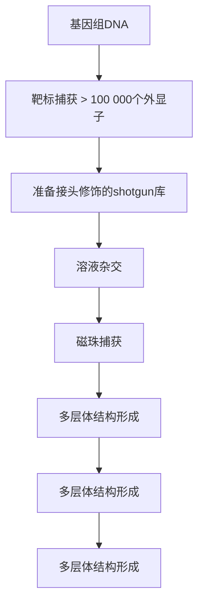
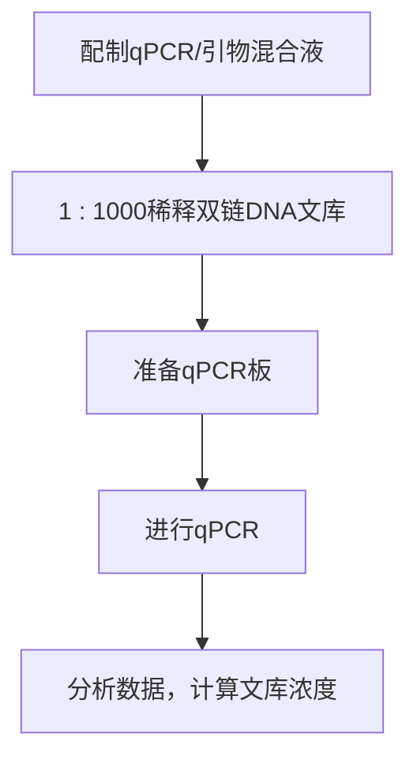
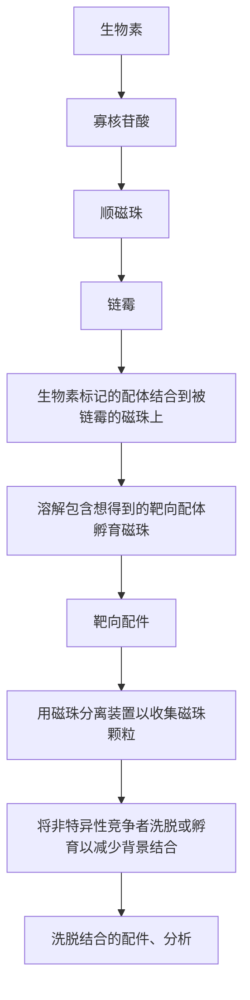

# 第11章 DNA测序

原始 PDF 第 106–239 页。

## 第 11 章 DNA 测序

## 导言 | Sanger 双脱氧法测序的历史 596

下一代测序技术 601

下一代测序仪器的概述 609

Sanger测序与下一代测序的比较:如何合理选择测序平台 617

## 方案 | 1 毛细管测序质粒亚克隆的制备 620 10 液相外显子组捕获 680

2 毛细管测序之 PCR 产物的制备 625 ● 附加方案 AMPure XP 磁珠纯化 688

3 循环测序反应 627 ● 附加方案 琼脂糖凝胶大小筛选 689

4 全基因组:手工文库制备 630 11 自动化大小筛选 690

5 全基因组:自动化的无索引文库制备 636 12 用 SYBR Green-qPCR 进行文库定量 693

\- 附加方案 自动化的文库制备 642 13 用PicoGreen荧光法进行文库DNA

6 全基因组:自动化的带索引文库制备 644 定量 696

7 用于 Illumina 测序的 3kb 末端配对文库的制备
14 文库定量:用 Qubit 系统对双链或单链 DNA 进行荧光定量
651
700

8 用于 Illumina 测序的 8kb 末端配对文库的制备 15 为 454 测序制备小片段文库 702
659 16 单链 DNA 文库的捕获及 emPCR 708

● 附加方案 AMPure 磁珠校准 671 17 Roche/454 测序:执行一个测序运行 714

9 RNA-Seq: RNA 反转录为 cDNA 18 结果有效性确认 721

及其扩增 673 19 测序数据的质量评估 723

\- 附加方案 RNAClean XP 磁珠纯化（RNA-Seq 前） 20 数据分析 724

## 信息栏 生物素 725

磁珠 726

DNA 片段化 728

10 液相外显子组捕获 680

● 附加方案 AMPure XP 磁珠纯化 688

● 附加方案 琼脂糖凝胶大小筛选 689

11 自动化大小筛选 690

12 用 SYBR Green-qPCR 进行文库定量 693

13 用 PicoGreen 荧光法进行文库 DNA 定量 696

14 文库定量:用 Qubit 系统对双链或单链 DNA 进行荧光定量 700

15 为 454 测序制备小片段文库 702

16 单链 DNA 文库的捕获及 emPCR 708

17 Roche/454 测序:执行一个测序运行 714

18 结果有效性确认 721

19 测序数据的质量评估 723

20 数据分析 724

---

## 导言

DNA 测序已成为生物学家的一个基本工具。自从本手册的上一版本发行以来，下一代测序（next-generation sequencing，NGS）给该领域带来了革命性的改变。本章第一节介绍用毛细管测序仪进行荧光法测序，该方法现在仍然很常用，但本章重点是讲述下一代测序。我们设想读者希望了解如何制备用于测序的样品，或者他们将接受特定测序仪器的培训。因此，我们适当减少仪器操作说明，重点叙述测序策略，并介绍各种类型样品及其制备方法。


## Sanger 双脱氧法测序的历史

最初的 DNA 测序采用费时费力且通量很低的化学裂解反应方法进行，通过这种测序方法完成的项目包括  $\lambda$  噬菌体基因组的黏性末端(Wu 1970; Wu et al. 1970; Wu and Taylor 1971)，这种方法测定含有几个核苷酸的序列需要数周或数月。测序技术经过大约 40 年的发展，现在短短几周内即可完成 3 亿碱基对的人类基因组测序，大型测序中心每月输出的测序数据量以万亿碱基对来计算。这种快速的发展给生物学、微生物学和人类遗传学领域带来了巨大的变革。

第一代 DNA 测序技术是指 Sanger 等发明的酶法测序技术（1977a），以及 Maxam 和 Gilbert 共同发明的化学降解法测序技术（1977）。虽然这两种测序方法在原理上完全不同，但二者都能产生长度差 1 个核苷酸的寡核苷酸片段。这些寡核苷酸都起始于同一固定核苷酸位点，而终止于不同的碱基位点。简单地讲，测序反应产生四组寡核苷酸片段，分别终止于 A、G、C 和 T 碱基，这些终止于特定碱基的寡核苷酸片段是随机产生的。上述四组寡核苷酸中的某一组（如终止于 A 碱基的一组）都是由一系列寡核苷酸组成，这些寡核苷酸的长度由该特定碱基（如 A 碱基）在模板 DNA 片段上的位置所决定，对这些寡核苷酸片段进行凝胶电泳，分离长度仅差一个核苷酸的不同 DNA 分子 (Sanger and Coulson 1978)。将四组寡核苷酸加样于测序凝胶的若干个相邻泳道上，即可从凝胶的放射自显影照片上直接读出原始 DNA 模板的核苷酸序列。

## 双脱氧法 DNA 测序

Sanger 测序技术是通过控制 DNA 的合成来产生终止于靶序列特定位置的寡核苷酸片段。这一思路源于将核苷酸类似物——双脱氧核苷三磷酸（ddNTP）引入合成反应。特定 ddNTP（如 ddATP）可以替代相应的脱氧核苷三磷酸（如 dATP）在 DNA 聚合酶催化作用下掺入新生链的相应位置，并导致 DNA 链终止延伸（Sanger et al. 1977a）。在分别进行的四种含 ddNTP 的合成反应中，可以产生终止于模板链任意位置的四组寡核苷酸片段。

每个反应包括 DNA 合成所需的全部成分（引物、模板、聚合酶、脱氧核苷三磷酸）以合成新的 DNA 链，此外，每个反应还包含一个双脱氧核苷酸。例如，A 反应体系中含有 dATP 和 ddATP，同时含有其他三个脱氧碱基的混合物（dTTP、dCTP 和 dGTP）；C 反应体系含有 dCTP 和 ddCTP，同时含有其他三个脱氧碱基的混合物（dTTP、dATP 和 dGTP）；等等（图 11-1）。测序反应过程中，终止于不同位点的寡核苷酸片段不断产生，例如，对于一些模板分子，在任何一个应插入 A 的位点，双脱氧 A 均可能取代 A 被添加到新生的 DNA 链中，从而在该位点终止 DNA 链的合成。反应完成后，理论上所有的位点均可能有掺入

---

第 11 章 DNA 测序

597

的双脱氧核苷，从而产生终止于任何一个位点的寡核苷酸片段。这四组反应中的寡核苷酸片段可以通过凝胶电泳分离形成“阶梯”，最小的条带对应的是第一个碱基，每个较大条带代表多1个核苷酸的较长片段。从四条泳道的条带顺序能推断出一段DNA的全部序列。


图 11-1 ddNTP 掺入导致 DNA 合成终止。（A）DNA 聚合酶催化普通 dNTP 与 DNA 3' 端核苷酸的酯化反应。通过连接单个核苷酸使引物得以延伸，该反应重复进行，直到模板链上的所有碱基都与新生链碱基完成配对。（B）使用缺少 3'-羟基的 ddNTP 的酯化反应，ddNTP 掺入 DNA 聚合酶延伸的新生链中，由于缺少进一步形成 5'→3' 磷酸酯键的 3'-羟基，ddNTP 起到了终止子的作用。

Sanger 测序技术有一些自身的缺陷，最大的麻烦是需要使用单链 DNA 作为测序反应模板。从凝胶电泳图上读取序列也是个问题，因为电泳产生的高温常常导致凝胶变形，以至于 DNA 条带发生移位。经过多年的实践，人们找到了一些办法来解决这些问题，从 20 世纪 80 年代初，Sanger 法已成为 DNA 常规测序的首选方法，在人类基因组 DNA 测序中发挥了重要作用(Lander et al. 2001; Venter et al. 2001)。

## 化学法 DNA 测序

双脱氧链终止法是 Sanger 在早期对蛋白质和 RNA 测序工作的基础上发展起来的，而化学法 DNA 测序则是 Walter Gilbert 实验室的偶然发现(见 Gilbert 1981)。在 20 世纪 60 年代后期和 70 年代初期，Gilbert 的工作集中于 lac 阻遏物（repressor）和 lac 操纵子的体外相互作用的研究。他分离出阻遏物保护的 DNA 片段，并将其拷贝成 RNA，然后采用 Sanger 实验室建立的 RNA 测序技术测定了该序列(Gilbert and Maxam 1973)。当苏联科学家 Andrei

---

598

分子克隆实验指南（原书第四版）

Mirzabekov 于 1975 年访问哈佛时，这一方法发生了改变。在莫斯科苏联科学院分子生物学研究所工作时，Mirzabekov 就发现组蛋白和抗生素与 DNA 的结合能阻止硫酸二甲酯对嘌呤的甲基化。他劝说 Gilbert 通过阻断操纵子 DNA 的甲基化，看能否根据阻遏物的结合找出序列中被保护的碱基。Gilbert 与 Mirzabekov、Allan Maxam 和 Jay Gralla 一道用了一顿午餐的时间探讨这一问题，他在讨论中产生的想法最终成为了化学法测序技术的基础。如果将 DNA 片段的一端用放射性磷酸基团标记，然后用碱基特异的化学反应使 DNA 部分降解，DNA 链中每一位置的碱基就可以通过测定标记末端和断裂位点的距离加以确定。到 1976 年，这一方法已能被用于确定短 DNA 序列（约 40 个核苷酸）中腺嘌呤和鸟嘌呤的位置。如果知道两种嘌呤碱基在 DNA 两条互补链的每一条链上，原则上就可以推断出全部的 DNA 序列。在随后的一年里，他们又找到了在胞嘧啶和胸腺嘧啶碱基处断裂的方法，进而可以确定两种嘧啶碱基在 DNA 序列中的位置。到 1977 年，Maxam 和 Gilbert 发表了完整的化学法 DNA 测序技术(Maxam and Gilbert 1977)。

从发表之日到现在，化学测序法经过了一系列不断的改进和完善。碱基特异性断裂反应方法不断增加、测序效率和分辨率逐步提高，一般能读出200～400个碱基。但是，这些进步不足以挽救化学测序法走向衰落的命运。化学试剂的毒性、大量使用放射性同位素、测序胶时常模糊不清，尤其是没有自动化的方法制备末端标记的模板，所有这些使化学法测序同链终止法测序相比显得黯然失色了。

双脱氧链终止法测序的演变:关键点

## 单链模板用于 DNA 测序

早期的双脱氧测序法中最困难的问题之一是要求使用单链DNA作为测序反应模板。这个缺点导致早期人们经常选择化学裂解法测序。然而，在20世纪70年代后期，慕尼黑马普研究所（Max Planck Institute）的Joachim Messing和他的同事发现单链噬菌体M13可以用于外源DNA的克隆和测序。首先，噬菌体基因组能够容纳外源序列而不影响自身的复制。其次，在噬菌体的生命周期中有双链DNA分子存在，噬菌体感染大肠杆菌后，单链基因组以双链的形式复制，然后产生单链复制子并最终以出芽的方式产生大量子代噬菌体。双链噬菌体基因组可以分离并用于克隆外源基因，而生成单链重组子可以作为双脱氧测序反应的模板。经过基因工程改造过的噬菌体载体包含了部分大肠杆菌乳糖操纵子用于筛选重组子（相关信息请见第1章的信息栏“$\alpha$ -互补”和“X-gal”）。

## 鸟枪法测序

来自英国剑桥大学MRC实验室的一个研究小组开发了使用随机克隆进行测序的工具和方案，极大地推动了测序技术的发展。最初Sanger测序方法每个反应可测几百个碱基序列，尽管进行了较大的改进，该方法还是需要利用限制性内切核酸酶将目的DNA切成小片段进行克隆再测序。剑桥大学的Bart Barrell及其同事认识到可以避开繁琐的限制性内切核酸酶图谱绘制工作，直接将目标DNA裂解为随机的、互相重叠的片段，然后将其克隆到M13噬菌体载体。这些随机片段测序后，他们利用剑桥大学Rodger Staden开发的计算机程序来完成重叠片段的拼接，无需任何限制性酶切图谱信息。鸟枪法测序标志着生物信息学开始介入DNA测序。

## λ噬菌体:第一个“基因组”序列

Sanger 测序技术最初是通过报道噬菌体  $\Phi X174$  基因组测序发表的，但在当时这项成果并没有获得太多的关注(Sanger et al. 1977)，或许是因为当时不十分了解噬菌体  $\Phi X174$  的生物学特性。接下来的几年中，测序主要集中在较小的基因、cDNA 或质粒如 pBR322(Sutcliffe 1978, 1979)。1982 年，Sanger 研究组利用鸟枪法测序和 M13 单链载体等先进技术，完成

---

第 11 章 DNA 测序

599

了一项在技术上和生物学中堪称杰作的成果，即首次完成了对于生物学研究具有重要意义的物种——λ噬菌体的全基因组测序（Sanger et al. 1982）。该工作具有双重意义:所用DNA模板要比之前的测序方案长10倍以上（λ噬菌体基因组长约50kb）；更为重要的是，这项研究成果将λ噬菌体的丰富生物学特性与其基因组序列联系起来（Sanger et al. 1982），突显了基因组序列对于了解一个物种生物学特性的重要作用。

## 荧光法测序

高精度分离 DNA 片段所使用的电压会在分离胶中产生热量，结果会导致分离的 DNA 条带变形（主要因为不均匀的热量分布）。变形的 DNA 条带需要专业人员通过人工判别来确定 DNA 条带的正确位置，这使得自动读胶变得非常困难。加州理工学院(Caltech) Lee Hood 实验室开发了基于荧光的 Sanger 测序技术弥补了上述不足（Smith et al. 1986）。

该方法使用一套（4种）荧光标记的引物，在激光照射下，每种荧光标记物发射不同波长的光。尽管这些染料的光谱有一些重叠，但还是可以进行有效区分。该方法要求4个反应（A、C、T、G）单独进行，每个反应都有一个特定的荧光标记引物和一个特定的双脱氧核苷酸（Smith et al. 1986）。由于4个反应产生的延伸产物可被荧光标记的引物进行区分，可在反应后进行混合并在一个胶孔中进行电泳分离（Smith et al. 1986）。自动读取软件通过读取一个泳道中梯状条带产生序列（图11-2），假设胶中的红色条带代表了所有被双脱氧胸腺嘧啶（ddTTP）终止的反应，如果最短的片段是红色，这个条带代表T；比其大一个碱基的片段如果是黄色，则代表被双脱氧胞嘧啶（ddCTP）终止，这个序列则为TC；依此类推。该方法不仅无需放射性物质，更为重要的是荧光测序可实现条带分离与读胶同步进行。针对同一模板的4个反应在同一个泳道中进行分离消除了条带在迁移过程中变形的影响，通过检测系统，软件可以依次检测每个条带发射的荧光颜色。这些技术给测序自动化带来革命性的进步，使人类基因组测序成为可能。


<details>
<summary>text_image</summary>

5' G
5' C
5' T
5' A
5' A
5' G
5' A
5' G
5' C
5' T
</details>

图 11-2 荧光法 DNA 测序（彩图请扫封底二维码）。

## 染料终止法测序

尽管荧光法测序具有极大潜力，但也有缺点，最主要的缺点是需要使用一套位于载体上的荧光标记引物启动测序反应，这使得测序引物的选择受到限制。利用放射性同位素测序，测序过程从鸟枪法测序开始，然后进行原始数据组装，最后进行定向测序或构建基因组完成图。进行基因组完成图的构建，需从拼接好的 contig 末端开始测序，利用特定的寡核苷酸引物向 contig 片段之间的空隙（gap）延伸以完成全部序列的测定。该方法最早被 Tom Caskey 及其同

---

600

分子克隆实验指南（原书第四版）

事大规模使用，他们采用放射性同位素方法完成了人类基因组 HGPRT 位点的测序工作（Edwards et al. 1990）。这种测序方案本来可能成为测定人类基因组的主要方法，但是，在当时的条件下利用荧光测序完成该计划仍是不可能的。因此，自动测序系统的早期使用者又回到测定限制性内切核酸酶片段（Gocayne et al. 1987）或外切酶产生的片段（Henikoff 1990），从而避免产生鸟枪法测序留下的空隙或未完成区域。ABI 公司开发的荧光标记双脱氧核苷酸使得荧光测序可以使用任何引物，由于所产生的片段被 4 种不同的荧光标记，所有 4 种测序反应可在一个管内进行，这对于人类基因组计划需要使用数以千万计的模板显得尤为重要。

## 循环测序

自从最早的基于放射性同位素标记的 Sanger 测序技术诞生以来，测序所用的 DNA 聚合酶经历了几次更新换代。每种聚合酶都有自身的特点，常混合应用或先后加入以提高其催化反应效率。然而，所有这些聚合酶的作用原理都是相同的，它们都催化与模板结合引物的延伸。聚合酶链反应（PCR）从 1989 年开始被广泛使用（Saiki et al. 1985; Mullis and Faloona 1987），多种耐热聚合酶被发现并用于 PCR 反应，其中之一被用于测序，催化多轮延伸、热变性（使新生链与模板分离）、复性、延伸循环，这种方法最初被用于同位素测序（Carothers et al. 1989; Murray 1989; Smith et al. 1990）。多轮延伸提高了测序反应的信号强度，该策略迅速被采用并将其应用于荧光染料终止法测序（McCombie et al. 1992; Craxton 1993）。循环测序策略不仅有助于同位素测序方法，更有利于荧光测序方法，因为荧光测序在起始时信号更弱。循环测序还大大降低了模板的使用量和对质量的依赖，实现了对双链模板的测序，所有这些都为今天的循环测序奠定了基础。

## 毛细管测序

20世纪70年代中期到90年代中期，Sanger测序都在大块聚丙烯酰胺胶上进行。荧光测序虽然避免了使用大块胶的弊端，如发热导致的DNA条带变形及对放射自显影的依赖，但是这些胶还是有不足之处，其中之一存在于制胶过程中。虽然越长的胶所读取的序列也越长，但是灌胶却变得更为困难且需要专门设备和软件控制电泳。另外，荧光测序需要被扫描的区域是光学透明的，由于测序胶含有高浓度尿素，要做到这点并不容易。为了保证每次运行能测更多的样品，每个泳道必须足够小，这使得灌胶更为困难。最后，胶的尺寸决定了更长的电泳时间，早期ABI公司的胶通常需要8h电泳。

毛细管测序的出现解决了以上问题并节省了时间、降低了错误率。ABI公司在20世纪90年代中期发布了两个版本的毛细管测序仪。其中之一为ABI3700，利用该设备获得了大部分人基因组序列（Lander et al. 2001; Venter et al. 2001）和小鼠基因组参考序列（Waterston et al. 2002）。下一代测序仪ABI3730XL于一年后被引入实验室，至今仍广为使用。本章所提及的Sanger测序方案也针对该设备进行了适当的优化。对于测序而言，毛细管比大块胶有优势，每个毛细管都是独立的物理个体，因此能被独立灌注，更易于自动化制备。ABI3730装有多个进行测序反应的96孔板，内部的一个马达将板放置到一个机械平台，该平台将毛细管头插入96孔板中，通过电动注射方式将样品注入毛细管介质中。毛细管的热分布属性可以分离只差一个碱基的大片段（可获得更长的序列）。自动上样和自动换胶使得一个机器可以运行多个96孔板，在 $24\mathrm{h}$ 的运行周期中无需人工参与，这些特性使得该设备更广泛地应用于各研究机构。

## 改进的序列组装工具

本章不详细阐述用于序列组装的生物信息学工具，而是简要说明其主要进展和重要意义。正如我们前面所提及的，早期最有效的大规模测序基于鸟枪法及后续填补空隙（gap）的定向测序（Edwards et al. 1990）。为了更高效地大规模测序，该方法需要软件排列鸟枪法

---

第11章 DNA测序

601

测序得到的序列，并允许人工编辑得到的大片段以解决不同模板产生的偏差。自从 Staden 开发了第一个组装工具（Staden 1979, 1996）以来，基本实现了用计算机程序来拼接序列和组装大片段，但是对于更大的片段如细菌人工染色体（BAC），这些最初的拼接工具效率非常低，对于全基因组的拼接更是困难。另外，这些软件并没有针对荧光测序所产生的偏差进行优化，因此，需要更有效的拼接软件纠正随机测序所产生的偏差来拼接人基因组序列。这一领域的两个软件值得一提:其一是由 Phil Green、David Gordon 及其同事开发的 PHRED、PHRAP 和 CONSED（Ewing and Green 1998; Ewing et al. 1998; Gordon et al. 1998），该生物信息学工具包被用于拼接人类基因组计划中的克隆片段；另外一个是由 Gene Myers 及其同事开发的 Celera 拼接软件及组合工具（Myers 1995）。目前有各种商业化或免费的软件可用于序列拼接、比对及读取荧光测序数据（见第 8 章，方案 1 和方案 2）。

## 人类基因组参考序列

已有多种出版物完整地描述了人类基因组计划（Davies 2001; Shreeve 2004; McElheny 2010），在这里我们只对人类基因组计划进行简要描述，解析其用途及缺陷。需要注意的是，人类基因组参考序列是个持续更新的数据，对其描述是基于时间的先后顺序。人类基因组参考序列经历了长时间的发展，目前已经到了第19版（HG19），这是根据递交到NCBI数据库的顺序来定义的，HG19的意思是第19版参考序列。由于递交的序列越来越精细，发布新的序列已经不太常见，且新发布的序列与之前的相比差别也变得更小。尽管如此，每次新发布的序列都较之前有所改变，新的克隆被鉴定并测序，错误也更少，更多的空隙被填充，早先测序效果较差或拼接不理想的区域被重新处理，对人类基因组的描述更趋完全。另外，值得注意的是，人类基因组参考序列不代表任何个体的基因组，大约 $74\%$ 的参考序列来自同一个人，其他部分则来自不同个体的组合（Lander et al. 2001）。不同规模的基因组计划进一步细化了人类基因组的多样性，因此，参考序列逐渐演变成一种统计学上的代表序列，意味着人类基因组在各个区域最常见的等位基因及其可能的变异，以及这些变异在特定人群中出现的频次。


## 下一代测序技术

用于构建人类基因组参考序列的Sanger双脱氧链终止测序技术直至2005年还是唯一的测序方法。其后，一系列的技术进步产生了新的测序设备和方法，统称为“下一代”测序技术。这些技术的进步为测序带来革命性的变化，直至本书写作之际，这一领域还在不断发生着巨大的变化。“下一代”测序的定义由于测序方法的持续、快速更新已不是十分严格。

本章中，我们先介绍下一代测序技术的历史、一般特征和应用，然后讨论和比较当前广泛应用的各种平台及新出现的测序系统。

## 下一代测序技术的历史

下一代测序技术的产生得益于多学科的研究进展，体现了多种技术之间绝妙的交叉融合，包括微米或纳米技术、有机化学、光学工程和蛋白质工程。这些仪器的研发基金来自美国人类基因组研究所的“$1000/100\,000$ 基因组”技术研发启动基金；事实上，最后研发成功的多项技术在它们研发的初始阶段都是由这项基金资助的。然而，要使这些技术转化为切实可行的商业产品，其所需的数千万美元主要来自风险资本和其他商业机构的投资。此外，大型基因组中心和其他有影响力的基因组实验室作为下一代测序技术的早期市场化试点也作出了很多贡献，这些试用者参与投资了这些新技术，评估了这些技术的性能（读长、错误率、GC 偏性等），并在同行评阅的论文、基因组学相关会议或者私人通信中报告了他们的发现。他们的反馈很大程度上决定了这些技术在商业阶段的成败。

---

602

分子克隆实验指南（原书第四版）

## 下一代测序技术的现状

至 2005 年，人们已经利用前述传统的、基于克隆的方法对许多生物的基因组（包括人类的基因组）构建了高精度的物理图，并完成了全基因组测序。有了这些参考基因组，生物学家就可以着手研究物种间及种内的基因组差异，研究具有各种遗传疾病表型的个体的基因组特点等。2005 年出现的首批商业化的下一代测序仪使这类实验变得更加容易且价格越来越低廉。

与基于克隆及毛细管的测序技术相比，下一代测序技术一般有几个与之不同的特点。一个特点是建库的步骤，要求将待测序 DNA 打断成相对短（100～800bp）的片段，并将其末段削平或者补平，将特定的接头（linker/adaptor）（人工设计合成的特定序列 dsDNA）结合到打断的测序 DNA 片段的两侧，就可产生一个适于测序的 DNA 模板库（这样就省去了将 DNA 片段克隆进载体并在宿主菌内扩增的复杂工作）。第二个特征是固定化 DNA 片段的扩增。这种片段扩增是以酶催化且在固体支持物（珠子或玻片，依仪器而不同）上进行，固体支持物表面通过共价键与接头相连，这些接头使单个分散的待测 DNA 分子进行扩增，在局部空间上产生大量相同 DNA 片段以便于在测序反应中产生足够的信号可被检测。因为每个扩增的分子簇来自于单个模板分子，下一代测序方法对每一个特定的序列可提供一个表征其丰度的数值。因此，每个簇代表库中一个独立来源的分子，在测序实验中该序列被读取的次数代表了它在初始库中的相对频数，在数据分析时可以用各种分析方法来了解这个特征。最终通过仪器、建库和扩增组合起来实现了下面将要叙述的下一代测序技术中的 DNA 大规模平行测序。各种下一代测序平台特性的比较，包括每轮的数据量、读长、反应离子类型、成本等，见表 11-1。

表 11-1 各种下一代测序平台特征的比较

| 平台设备 | 运行时间 | 读长/bP | 每次运行的数据量/Gb | 测序方法 | 错误类型 | 错误率/% | 每次运行的试剂成本 | 进货成本(X1000) |
| --- | --- | --- | --- | --- | --- | --- | --- | --- |
| 454 FLXTitanium | 10h | 400(avg) | 0.5 | 焦磷酸测序 | Indel | 1 | $6 000 | $500 |
| 454 GS Jr.Titanium | 10h | 400(avg) | 0.5 | 焦磷酸测序 | Indel | 1 | $3 000 | $108 |
| HiSeq 2000 v3 | 10~11 d/2Flow cells | 100×100 | >600 | 合成测序 | Substitution | &lt;0.7 | $23 500 | $690 |
| MiSeq | 19h | 150×150 | >1 | 合成测序 | Substitution | &lt;0.1 | $1 000 | $125 |
| SOLiD 5500x1 | 8~14 d/2FlowChips | 75×35PE60×60MP | 155 | 连接测序 | A-T bias insubstitution | &lt;0.01 | $13 500 | $595 |
| PGM 316 Chip | 3h | 100(avg) | 0.1 | pH感应测序 | Indel | 1 | $750 | $49.50 |
| Pacific Biosciences RS | 14 h/~8SMRTCells | 1500(avg) | 0.045 per SMRTCell | 实时荧光测序 | Insertion | 15 | $500 | $695 |

PE, paired-end reads; MP, mate-pair reads.

下一代测序技术的测序过程与传统的基于毛细管的测序方法形成鲜明的对比，在传统的基于毛细管的测序方法中，测序反应发生在微量滴定板（96孔板）独立的反应孔中，仪器则用来分离和检测反应产物的条带。下一代测序则通过一系列重复的步骤进行测序（引物延伸、检测新加入核苷酸、以化学或酶的方法清除反应底物或荧光源），同时检测每个片段群进行反应所产生的信号。这样的“大规模并行测序”可以使数十万乃至数亿个测序反应同时进行和被同步检测，因此，一轮测序的数据量相当可观，需要特定的数据分析方法。下一代测序技术的另一个标志是测序产生的读长相比毛细管测序的长度更短。下一代测序技术的短读长问题所带来的挑战及其在生物医学实验中日益普及的应用，使得面向基因组的生物信息学和算法研究又重新焕发了活力。一个例外是Pacific Biosciences平台，它可产生很长的读

---

第11章 DNA测序

603

段数（reads）。这些 reads 目前比起其他下一代测序平台有更高的错误率，故而产生了其特有的生物信息学问题。

下一代测序最后一个特征是从片段库的两端产生 DNA 序列数据（图 11-3）。这种双末端测序根据所用的库片段的长度不同可分为两种类型。测序产生的配对 reads 提供了两个相隔已知距离（该距离有一定的波动范围）的序列，一种测序类型为 “paired-end” 测序，用长 300～500bp 的短片段建库，这些短片段的 5' 端和 3' 端加入了不同序列的接头（图 11-3A）。这些片段先从一端测序，也就是从 “正向” 接头开始，然后在另一端利用反向接头的作为引物测序。另一种类型的双末端测序为 “mate-pair” 测序:先将长的库片段（1000～10 000 bp）的两端环化并在环化部位连入一段已知序列接头。一旦两个末端利用接头配对成功，即可通过一些巧妙的实验方法构建只含有接头和最初 DNA 的两侧末端的片段库（图 11-3B）。


图11-3 双末端测序。这里描述的两种方法都采用了双接头策略，结合到基因组DNA片段的接头由两套序列组成。A1和A2接头序列（adaptor sequence）与测序芯片“flow cell”表面上的寡核苷酸互补，因此DNA片段可以杂交到测序芯片表面，而SP1和SP2则与测序引物互补，用于测序反应。（A）paired-end建库。（B）mate-pair建库（彩图请扫封底二维码）。

## 利用全基因组测序寻找变异

通过下一代测序的 reads 比对来分析个体变异的前提是有一个高质量的基因组作为参考序列。为全基因组准备的标准建库流程如上所述，由 DNA 打断、接头连接和测序前扩增组成。基因组的“覆盖”倍数或者采样倍数受以下因素的影响:测序读长（长读长意味着只需要低覆盖）、高质量 reads 的比例，以及是否为 paired-end/mate-pair 数据。一般而言，所要求的覆盖倍数力求获得:①足够的 reads 测序深度以确保能够可靠地识别变异；②充分的覆盖面以确保基因组的所有部分都能达到足够的覆盖深度从而发现变异。一般而言，对于短 reads 测序技术如 Illumina 和 SOLiD，全基因组测序中业内接受的标准覆盖倍数为 30 倍左右；而对于长 reads 测序技术如 Roche/454，则只需要 12 倍，覆盖倍数“越多越好”。业内公认的标准对于发现高度可信的变异是足够了，更多的覆盖倍数可获得更高的可信度。然而，太高的覆盖数对排除假阳性率是不利的——比如，Illumina 测序数据达到 10 000 倍的覆盖时，随机的碱基判读错误可能被误认为是非随机的变异。

在从全基因组数据发现变异的过程中，要找出不同类型的变异需要用不同的算法去分

---

604

分子克隆实验指南（原书第四版）

析。正如我们下面将要详细讨论的, 所有变异的发现都依赖于将 reads 和参考基因组作比对。根据各实验室的经验和实践, 可以单独或组合应用各种算法查找分析变异位点, 例如, 单核苷酸变异 (single nucleotide variant, SNV) 是一条序列相对于参考基因组发生的碱基替换, 一个或多个碱基的插入或缺失常常被叫做 “in/del” 变异, 它要求特殊的比对算法, 允许碱基的插入或缺失, 匹配有空隙的或断掉的 reads。结构变异 (structural variant, SV) 的检测方法最具数学挑战性, 因为有几种类型, 如大于 100bp 的缺失或插入、染色体内序列倒置, 以及染色体内和染色体间的序列易位。现在的结构变异算法中, 适用于克隆测序数据的算法是由 Eichler 及其同事建立的(Tuzun et al. 2005), 而适用于下一代测序数据的算法则是由 Snyder 及其同事提出的(Korbel et al. 2007)。针对下一代测序数据的算法主要依赖于 paired-end 或 mate-pair 数据中的 reads 所处的位置和方向。例如, 如果一个 paired-end 库具有 300bp 的平均建库长度, 配对的 reads 映射 (mapping) 到参考基因组上时, 其相对距离期望值应该接近这个距离, 实际距离和理论距离之间有一定范围的偏差。如果两个 reads 映射位置间的距离明显大于或小于期望的距离范围, 并且多对 reads 都反映出这种异常映射, 那么就很有可能发生了缺失或插入事件。

对结构变异特征的进一步分析可借助局部拼接算法（有很多）来完成。在这种方法中，识别特定结构变异的 reads 作为局部拼接算法的输入数据，常可以拼接出一段序列，前提是这段序列满足两点:①真实存在；②相对不那么复杂。通过这种方法，结构变异可以精确到单个核苷酸，因此可以预测下游基因转移导致的可能的基因融合，或者识别发生过缺失突变的基因。结构变异的识别是一个非常活跃的领域，很可能在本书出版时又有了新的进展。进行此类研究的人员需要利用文献中最新的方法。

虽然从数据的产生和分析来看，全基因组测序仍然较昂贵，但它却是掌握所有变异的最全面的方法。这对于疾病很重要，比如癌症一直以来被认为含有各种类型的、广泛的结构变异，因而需要特异性的诊断、预后和治疗（Her2阳性的乳癌和慢性粒细胞白血病就是两个人们熟知的例子）。然而对于癌基因组测序来说，肿瘤标本被传统病理学分析之后常常所剩无几，而且某些类型的肿瘤（如前列腺癌和胰腺癌）具有分散的现象，这些肿瘤细胞的富集需要采用激光显微切割和捕获。由于肿瘤形成初期即含有早期基因变异信息（这些早期变异常被认为是癌变的始作俑者），研究早期的组织增生病灶是有必要的。基于各种理由，我们已经开发出了低模板投入量的肿瘤全基因组测序方法，它能够产生一个复杂度足够的模板库，并通过测序产生足够的覆盖倍数（>30×），且不需要对基因组DNA进行扩增，这样可以减少人为引入的错误。该方法基本上精简了可能导致DNA损失的步骤，并且省掉了置换缓冲液和酶的乙醇沉淀步骤。该方法对待测DNA片段库的片段大小分析实现了自动化，采用自由区带电泳（free-zone electrophoresis）装置如Caliper XT，不需要人工观察电泳条带的位置，而是利用仪器自动比较DNA片段库的电泳条带与参考条带的位置，从而得出DNA片段的平均长度。该方法利用100ng DNA就可以实现全基因组建库，主要操作程序将在本章后面叙述。

## 定向测序:概述

对基因组特定区域进行测序，过去常采用 PCR 扩增目标区域，这需要针对目标区域设计一对或多对引物以作为 DNA 聚合酶复制的起始位点。PCR 产物经纯化以去除多余的引物和核苷酸，而后直接进行测序或者亚克隆到 TA 载体并用通用引物进行测序。随着下一代测序技术的产生，每台下一代测序仪的测序能力很快超过了高度自动化的 PCR 测序流水线的产出。对特定基因而非全基因组选择性测序需求的增加，催生了称为“杂交捕获”的各种测序方法。杂交捕获的最初设想和实现均基于固体表面寡核苷酸微阵列 (Albert et al. 2007; Hodges et al. 2007; Okou et al. 2007)，利用标准的微阵列打印技术将目标序列的互补序列高密度地固化在微阵列中，然后用基因组 DNA 与这些阵列杂交，洗掉未结合的 DNA。最后洗脱被捕获的 DNA，建库并测序。几个描述这种方法的研究报告差不多同时一起发表

---

第 11 章 DNA 测序

605

出来。此外，还有一篇详细描绘了一种可以靶向很多但不是所有外显子的高度多重化的方案 (Porreca et al. 2007)。其中，有一种捕获方法还显示了个体基因组中几乎所有已注释的外显子，即外显子组（exome），都能够被捕获和测序(Hodges et al. 2007)。但是这个过程需要相当的实验技巧和从微阵列中洗脱及提取 DNA 的复杂步骤，这意味着将其规模化应用于大量样品是很困难的。幸运的是，理念的快速发展和在溶液中完成这些步骤的能力解决了这些问题。

基于溶液杂交捕获的基本前提是，人工合成的单链 DNA 或 RNA 探针（见第 13 章）(Gnirke et al. 2009; Bainbridge et al. 2010)与过量的全基因组片段库混合时，能够杂交为探针/片段复合物。第二步是选择性分离探针/片段复合物，去除剩下的基因组片段和单链探针，上述分离依赖于探针序列含有生物素，可以与携带链霉亲和素的磁珠反应，在磁场的作用下可将复合物从溶液中吸出来（见信息栏“生物素”和“磁珠”）。而后，被捕获的大量片段从探针上释放出来并用 PCR 进行扩增。图 11-4 显示了用于下一代测序的杂交捕获技术的基本流程。目前针对人和小鼠外显子组的试剂已经能够捕获基因组中绝大多数的已注释


<details>
<summary>flowchart</summary>


</details>

图 11-4 外显子组或靶区域的杂交捕获。在杂交捕获中，全基因组文库片段的末端都包含平台特异性接头，这些片段被一组含有与靶基因相对应的探针所筛选。这些探针加有生物素标记，因而可以利用磁珠将探针-基因组文库片段的杂合体挑选出来。捕获的杂合体通过磁场从溶液中分离出来。通过变性过程，将基因组的文库片段从杂合体中洗脱出来，这些片段用于后续的测序工作（彩图请扫封底二维码）。

---

606

分子克隆实验指南（原书第四版）

基因。由于不同的试剂所要捕获的基因有所不同，用户在选择这类产品时应仔细考察以确保想得到的基因确实是对应探针集所定向捕获的基因(Clark et al. 2011; Parla et al. 2011)。有些试剂中的探针长度是均一的，而另外一些长度不完全均一。如果是后者，则可以通过调整探针的长度来调整 $T_{\mathrm{m}}$ 值，这可能增加被成功捕获的基因的数量。另一个导致某个试剂没有成功捕获到特定基因的原因是该基因属于某个基因家族，要针对这样的目的基因设计特异性的探针或许是不可能的。认识到这一点很重要，因为一个探针靶向一个特定的基因，而每个探针的捕获效率并不完全一样，结果目的基因序列有可能在捕获的片段中出现得很少。大多数为定向捕获而设计的变异检测算法为找出真正的变异都要求目的片段覆盖倍数达到一个最低限值，而性能不良的探针常常使覆盖倍数达不到要求。对于复杂的哺乳动物基因组，通常 $85\% \sim 90\%$ 的已知基因都有针对大多数或所有外显子设计好的探针。这些探针中 $80\% \sim 85\%$ 会产生足够的覆盖度用于检测变异（Clark et al. 2011; Parla et al. 2011）。

然而，人们或许不希望把整个外显子组作为靶标，定制试剂可以为亚外显子组（即外显子组的一部分）靶标所设计，包括在外显子以外或外显子之间独特的序列。亚外显子组捕获的问题是，在基因组上定位到亚外显子组的总大小（碱基对）越少，由于“脱靶效应”，将导致捕获效率越低。脱靶效应得到随机捕获的片段，这些片段来自于捕获过程中的随机或局部杂交而阻抑了探针靶向序列的获得。产生这种效应的原因是基因组中非靶标序列大大多于靶标序列，导致许多被测序的片段并没有出现在基因组的靶区域。因此，尽管有针对性的捕获比全基因组测序的方法要便宜，但它的费用会超出预想，尤其是当靶区域很窄的时候。

## 有关序列覆盖率的问题

“序列覆盖率”是一个简单但又常容易混淆的概念，指的是在基因组上某一特定区域（如每个碱基）上能发生匹配的测序reads的数量，它关系到某个指定测序项目为了产生一定质量的数据而必需的序列覆盖率。覆盖率通常表示为测序长度内所有覆盖率的平均值，近来又被当做阈值。例如，平均 $10\times$ 或者10倍覆盖表示在测序区域（或基因组）内每个碱基平均被10个独立的测序reads所覆盖到。当用来表示阈值时，覆盖率值通常表示为目标区域被覆盖到的百分比。例如，$80\%$ 的目标区域达到至少 $20\times$ 的覆盖率。这表示目标区域的每1000个碱基中有800个碱基至少被20个独立测序的reads所覆盖到。

有一些因素决定了某个项目所需要的覆盖率。例如，细菌等单倍体基因组所需的覆盖率比二倍体基因组的要低，因为要想发现二倍体基因组中所有的等位基因，两条染色体都要被充分覆盖到。另一个决定样品需要更高覆盖率的因素是样品复杂度。例如宏基因组样品或者肿瘤组织和正常组织的混合样品就属此例。

理解平均覆盖率的含义也很重要。比如在人类基因组测序达到 $20 \times$ 覆盖率的情况下，我们可以推知，平均每一个碱基被 20 个独立的 reads 覆盖到。然而，请记住这个值只代表一个分布，因此，有的碱基会明显多于或少于 20 倍的覆盖率。虽然在二倍体基因组中对于每一个碱基来说 $20 \times$ 的覆盖率已经足够用于检测变异，而事实上，$20 \times$ 的覆盖率表示一部分基因组只被少数 reads 所覆盖到，因而不足以检测基因组上这些部分的变异。因此，在做二倍体生物纯 DNA 样品全基因组测序项目时，研究者通常设定短 reads 的最低平均覆盖率为 $30 \times$ 。另外一些因素，如典型的肿瘤组织样本，可能要将平均覆盖率提高到 $50 \times$ 或者更高；相反，当利用下一代测序来发现大规模的结构变异时，可以使用低得多的覆盖率，但是更高的覆盖率可以得到更好的分辨率和更加精确的分析结果。

虽然全基因组测序给出某个平均覆盖率时意味着一个相对可预测的覆盖率范围，但是存在一些与纯统计模型相关的偏差，使某一区域覆盖率过高或者过低。实验要求越多的样

---

第 11 章 DNA 测序

607

品处理过程，如靶向捕获和外显子组测序，就可能会有很大潜在的偏差。这些偏差导致外显子组的某些区域极大地高于或者低于平均覆盖率（甚至完全没有覆盖到）。因此，表述外显子组覆盖率最好的方式是用我们上面所提到的阈值。例如，我们可以说80%的目标区域（这是一个通用值）有20×或者30×的最小覆盖度。对于覆盖率的进一步探讨，见信息栏“覆盖率和多重性:由飞速发展的测序通量所带来的困境”。

认识下一代测序中质量控制的评估也很重要，下面将详细描述。

## 覆盖率和多重性（multiplexing）:由飞速发展的测序通量所带来的困境

当第一台商业化的 Solexa（后来变成 Illumina）测序仪在 2007 年出现的时候，微流体 “flow cell” 中每 8 个 lanes 可以产生 10 亿个碱基（相当于每个 lane 产生 1.25 亿个碱基）。这些努力的结果是测序技术与之前的仪器相比发展迅速，但是对人类全基因组进行测序，每个项目需要许多的 lanes 或者多个完整的 run。然而，测序产量从 2007 年初到 2011 年之间有所增长，IlluminaHiSeq 2000 目前 16 个 lanes 的测序产量是 6000 亿个碱基，即平均每个 lane 产生 375 亿个碱基。飞速增长的测序能力却产生了相反的效果，只有较大的项目才能实现低成本的运行方式。现有的仪器可以让全基因组在少数 lane 上测序（而一代高通量测序仪需要几十个完全 run），就目前的下一代测序而言，即使是人类外显子组测序这样的大项目，也不能充分地利用单个 lane 的容量。

一种解决实际覆盖率和需求不一致的方法是，在建每个测序文库的时候将 DNA 条形码（bar code）序列包含在接头序列（adaptor sequence）内。这样产生的文库可以在测序前以等比例结合；然后在测序过程中，DNA 条形码序列被看成是测序数据产出的一部分。利用 DNA 条形码的标识，那些结合上的文库以外的片段在测序数据进行分析后一起作废。从某种程度上说，这是一种易于处理的方法；然而，测序产出量的快速增长与满足更高通路测序所需的现成 bar-code 不相符。例如，对于一个 50Mb 的人类外显子文库，现有的 HiSeq 2000 一个 lane 可以产出 750 倍的覆盖率，其中只需要 100 倍的覆盖率来检测可靠的 SNP 和插入缺失。虽然这种理想化的计算没有考虑诸如在捕获靶标时的动态变化因素，但这一水平的覆盖率仍然大大高出几乎任何外显子组测序的需求。

问题由此变成，为了充分利用现有的测序能力，如何利用足够的条形码使样品能够汇集到Illumina测序仪上的单个lane。这一问题在测序容量增加或者需要测序的基因组区域降低时会变得更糟。例如，如果需要测序的只是人类基因组中的100个基因，其平均大小为50kb，Illumina HiSeq2000一个lane可以在靶基因上产生约7500倍的覆盖率。理论上，相同的lane可以从75个样本中产生100倍的覆盖率。此外，重要的是，要认识到这种理论计算从未完全与真实的实践值相符合。例如，合并样品时的移液器误差等问题可能导致一个样品多于或少于理论值，因此必须在一定程度上超量测序，以确保所有样品的最低覆盖率。然而，显而易见的是，问题是对于每一个样品如何在一个lane上集合50套基因而不是同一样品中的50个基因，这样可以大规模降低测序的费用。等到本书英文版出版之时（2012年），很可能大多数的仪器制造商会有很多解决这种问题的方法。这些解决方案会从低容量测序仪（参见信息栏“桌面基因组测序仪:下一代测序的未来？”）到多重性试剂，因此允许足够多的加条形码样品合并到一个测序lane，充分利用仪器的通量能力。

## 序列验证和质量控制

任何测序数据，无论是基于 Sanger 测序法还是下一代测序法，都是实验数据，因此会有相关误差。下一代测序产生的大量数据集，不仅需要统计学方法，还需要特殊的验证变异的方法。当对靶标正确使用、充足的覆盖率时，下一代测序仪会产生非常准确的一致序

---

608

分子克隆实验指南（原书第四版）

列。然而，虽然如此，这样的数据还是会有一些错误。例如，人类的全基因组测序中每1000万个碱基发生一次错误的错误率已经很低，但是仍然会产生大约200～300个错误。也许更真实的错误率是每300万个碱基发生一次错误，同样的数据会包含大约1000个错误。另外，有的区域会覆盖得不够好（甚至完全没有覆盖到），导致数据出现假阴性。

下一代测序有许多处理质量控制的方法，随着技术的发展会有质量评估的方法。在全基因组测序中，质量评估的一个重要途径是将测序结果与全基因组 SNP 阵列的结果进行比较（Ley et al. 2008）。这种方法通过利用与测序过程相同的基因组 DNA 进行微阵列分析来检测变异。通过将基因组序列中发现的 SNP 与微阵列实验所得的结果进行比较，可以确定由微阵列检测到同时也被测序检测到的纯合子和杂合子变异的比例。与基因组覆盖度一样，这种方法提供了质量评估的附加值（根据假阴性率），但是不能测量假阳性率；同时提供了对于样品标识的确定。

在基因组测序或者只测序如外显子或单个基因等很小的范围时，最好是进行其他类型的验证方法，如特异的关键突变和其他随机选取的突变。后者使人们认识到总体误差率固有存在于测序和发现变异的过程中。可以通过在小规模内选择一些变异型，扩增基因组上的这些区域，用毛细管测序仪（一种快速和廉价的产生正交数据的方式）直接测序这些扩增产物的方式进行验证。大量的变异型可以用定制的捕获阵列进行验证，例如，癌症基因组研究中的全基因组验证（E Mardis, pers. comm.），可能会演变为一个更快的转折，特别是近期发展的桌面下一代测序仪（见信息栏“桌面基因组测序仪:下一代测序的未来？”）。关键问题是需要某种外部的质量控制方式，最好是正交的，从而可以监测下一代测序及其所有相关步骤（可能包括捕获、远距离 PCR，或者其他一些分离基因组区域的方法），以及其他地方讨论过的变异型检测算法，都会在错误和覆盖度方面有所体现。

## 外包测序

产生数据所需的费用快速降低，这使得人类基因组测序成为人类遗传学中的一种日益可行的工具。虽然在任何一个达到指定水平的实验室进行全基因组测序在技术上是可行的，但是建设需要的基础设施有时却任务艰巨，特别是计算生物学分析。因此，许多人类遗传学家寻求基础设施齐备、并能做所需生物信息学的外部合作者，或者将项目外包给越来越多的合同测序公司。

虽然外包测序有一定的劣势，包括失去对项目某一阶段的控制权和依赖他人的时间表，但是当数量有限的全基因组需要在一个相对较短的时间内被测序完全的时候，外包确实提供了一个特别有吸引力的方案。目前，一些合约服务可以提供人类全基因组测序，如 Complete Genomics 和 Illumina，以及其他较少公开的公司。

这一过程从把基因组 DNA 样品送到合约测序公司开始；服务包括提供个人全基因组序列的服务，同时也提供一些深度的生物信息学分析。也有一些公司会分析其他来源的测序数据。这些选择对于那些不需要在很长一段时间内或者定期进行全基因组测序，而是只需要对有限数量的样品进行测序和/或分析的人特别有用。

合约服务也可以应用于全基因组测序以外的一些其他服务（如外显子组测序）。然而，由于外显子组测序需要更多前期的样品准备和处理过程，就每个碱基的成本而言，它比全基因组测序要昂贵得多。由于现在的成本差异相当倾向于全基因组测序，多个公司以廉价的全基因组测序积极竞争占领市场。在编写本书的时候（2011年），利用商业供应商测序一个全基因组可能要比一个外显子组昂贵2～3倍。然而，在一个下一代测序基础设施已经到位的实验室里，全基因组测序的成本大概是外显子组测序的10倍以上。这种合同成本与内部成本之间的差异应该予以考虑，尤其是外显子组测序或其他靶向测序项目。

---

第 11 章 DNA 测序

609

## 下一代测序对科学研究的影响

下一代测序技术（NGS）在生物学研究中仍然有着意义深远的影响。由 NGS 单独产生数据的规模是前所未有的，超过摩尔定律预测的几倍。依据产生和存储数据的直接成本总量计算，学术实验室可以在几天内花费大约 10 000 美元左右测序一个相当于整个人类基因组的序列（截止到定稿时），该价格包括所有产生和存储数据的直接费用。NGS 在研究 RNA 表达的时候可以标识一个样品中的所有表达基因，成本与一个给定目标的（defined-content）微阵列相当，但却可以同时提供多得多的表达水平的数据，并检测 RNA 水平的各种现象，如可变剪切。另外，下一代测序从根本上增加了对基因组范围内的组蛋白和转录因子结合位点进行分类的幅度与精度（见第 20 章）。

随着测序范围的扩大和测序成本的降低，下一代测序促进了新的研究领域的发展。其中一个应用是增加非编码 RNA 的分类和新的转录产物种类的发现。“宏基因组学”也随着下一代测序的进步而得到快速发展。从一个特定环境里分离收集到的所有物种 DNA，首先通过测序来描述其特征，然后与数据库中已测序过的所有数据进行比对。尽管最初在一个特定环境分离的 DNA 是先通过鸟枪法建库，然后利用毛细管测序法进行测序，但下一代测序因其在相对短的时间内便可获得足够浓度的测序数据，其低成本、高通量的优点却大大加速了这一领域的发展。受到下一代测序技术促进的不仅只有核酸测序方面。基因组 DNA 上甲基化位点的分析现已可采用 “Methyl-seq”（甲基化测序）方法在全基因组范围完成。甲基化测序方法、首先利用亚硫酸氢盐转换、免疫共沉淀等方法进行处理，然后对这些经过处理的片段进行测序（见第 12 章）。

除了单一用途以外，从前许多基于阵列的实验可转而应用下一代测序技术进行，这为多次实验间引入了可重复性。因为以杂交为基础的方法容易导致实验结果发生波动，从而缺乏这种可重复性。此外，由于所有的分析都是基于测序且产生的都是数字化的数据，在一个样本或一组样本等多种实验中使用下一代测序技术可大大增强数据间的一体化。

数据分析依然是最难、最贵、最费时的一个环节。相较于毛细管电泳测序，下一代测序数据比对和/或数据组装的主要难点在于测序长度较短、reads错误形式多样。好在生物信息学和计算生物学的兴起为解决这些棘手的问题带来了创新和活力。然而，相对于庞大的测序数据产量而言，数据分析能力呈现出严重的“瓶颈”状态。第8章广泛论述了短序列的分析方法。


## 下一代测序仪器的概述

截止到定稿时(2011年底)，常用的三个主要测序平台分别是Roche/454焦磷酸测序仪、Illumina/Solexa测序仪和Life Technologies SOLiD/5550测序仪。本节会对这些测序平台和一些新的“个人测序仪”（personal genome machines），以及桌面测序仪进行描述（不同测序平台的特性比较见表11-1）。另外，我们将首次对有可能成为新的测序趋势的单分子测序仪进行简单介绍。

## Roche/454 焦磷酸测序仪

第一款商业化的下一代测序仪是由后来被Roche收购的454公司开发的(Margulies et al.2005)。这台仪器融合了一项新的技术——油包水PCR（emPCR），即在表面上共价结合有衔接子的聚苯乙烯珠子上扩增文库片段，从而进行大规模并行焦磷酸测序。该仪器其他的大规模并行特征包括:PicoTiter板（PTP）；一个双重用途的石英玻璃耗材[①可容纳扩

---

610

分子克隆实验指南（原书第四版）

增过的珠子，以及表面带有用于产生信号的酶的更小的辅助性珠子；②含有流体管道保证测序试剂扩散到孔中]。PTP的一面是透明的，这样给珠子和获取图像的CCD相机提供了接口。由于用于454焦磷酸测序的试剂是没有荧光标记的核苷酸，它们在PTP中需要分步聚合，这就要求在每次反应后必须进行图像捕获并清除未反应试剂。

焦磷酸测序的主要步骤见图 11-5。当每次核苷酸从连有引物的文库片段上流过时，如果该核苷酸与模板上的核苷酸互补，就会发生由 DNA 聚合酶催化的聚合反应。当聚合反应发生时，产生的焦磷酸盐（PPi）将会触发下游一系列由偶联到珠子上的酶（包括硫酸化酶和萤光素酶）催化的反应，进而发光。发射的光信号会被电荷耦合（CCD）的相机检测到，荧光信号采集发生在每次核苷酸聚合后，可采集来自数十万计的 PTP 孔中珠子上的信号，产生的光强度与增加的核苷酸数目成比例（直到荧光检测最大值）。在测序文库衔接子分子上含有一段 “key” 序列，该序列以特定的顺序在每条待测 DNA 序列的起始位置提供单个 T、G、C 和 A 碱基，用来对代表单个碱基聚合的荧光值进行定量。机器每运行一次测序反应，系统利用 “key” 序列中每个碱基聚合产生的荧光值来计算每个循环所掺入的碱基数目。运行后的分析过程会使用初始 4 个 flow（即 “key” 序列）的信号翻译 PTP 上每个位置每个核苷酸 flow 的信号。最终产生的 “flowgram” 由碱基和相应的质量值构成。


图 11-5 焦磷酸测序。Roche/454 测序仪使用该法扩增单链 DNA，这些单链 DNA 来源于珠子上的片段文库。（A）文库构建准备，基因组 DNA 被打断成片段并在其末端加上衔接子。（B）DNA 片段与珠子以约 1:1 的比例混合，珠子上含有与 DNA 片段末端的衔接子互补的寡核苷酸，通过强烈的振荡将该混合物包入含有 PCR 试剂并被油包裹着的液相里，最后被移到 96 孔板进行 PCR 扩增。（C）珠子上最终生成原始单链片段的约 100 万个拷贝 DNA，这为接下来检测和记录核酸结合事件的焦磷酸测序过程提供了充足的信号强度。sstDNA，单链模板 DNA（Mardis 2008）（彩图请扫封底二维码）。

---

第 11 章 DNA 测序

611

由于每个核苷酸 flow 是按顺序依次流入，454 的碱基替换错误率是相当低的。相反，插入和缺失错误却以较高的频率发生，特别是在单碱基重复序列中。该错误的产生是由于相同类型的多个碱基（例如一串 A 碱基）同时插入会产生一个很高的信号峰，仪器的碱基读取软件无法准确地整合峰的面积，从而无法确定具体加入的碱基数目。当核苷酸合成过程中检测 CCD 达到对光信号线性响应的最高值时，该问题可能会更早出现。

在 Roche/454 测序仪上市之前，基于微量滴定板的焦磷酸测序系统已经商业化。该仪器系列称为 PyroMark，由 QIAGEN 公司提供，适用于突变的检测和/或验证，以及甲基化检测（见第 12 章）。它的一个主要的优点是，在对种群的 DNA 混合模板进行测序时，单一测序反应便可提供定量的测序数据（例如，一个患病人群样本等位基因多态性频率或 DNA 甲基化修饰位点频率的确定）。该设备与 Roche/454 有着相似的测序原理，随着每个核苷酸的依次掺入而发光，每个序列被包含在微量滴定板上不同的孔里。然而该仪器的结果分析是逐孔进行的，因为与 454 焦磷酸测序系统的 PTP 板相比，PyroMark 微量滴定板孔密度很小，因此不需要明显的分析时间，也不需要大量的计算分析，就可以向用户返回序列结果。

## Illmina/Solexa 测序仪

自 2006 年上市以来，Solexa 测序仪不管是在测序反应本身还是在每次运行可以产生的 reads 的数量上都与其他下一代测序系统不同。文库构建过程与上述的总体描述一致（见前面“下一代测序技术的现状”），但建库之后的其他过程均与 454 测序不同。它不是在珠子上进行油包水 PCR，而是在硅基玻璃片表面的 8 个微流体通道组成的“flow cell”上添加 DNA，之后 DNA 被导入一个“三明治”结构中，形成密闭的微流体结构。flow cell 上的通道介导试剂的进入和移除。在 flow cell 通道的表面被厂商预涂有与用于文库构建通用衔接子序列互补的寡核苷酸序列。当变性的文库序列通过 flow cell 上的通道时，文库序列就会与涂布在 flow cell 上的核苷酸序列杂交。紧接着文库序列会在原位进行所谓的“桥式扩增”，即与共价结合在 flow cell 上的互补衔接子序列杂交的文库序列，由 DNA 聚合酶介导进行多次等温扩增反应（循环间由 NaOH 变性），从而使每个片段扩增得到一簇大量的 DNA。一旦扩增结束，一种特殊试剂会流入 flow cell，使通道上正向反应特异性衔接子释放离开通道，其他的衔接子依旧附着在 flow cell 上。这种化学反应产生线性 DNA 模板，这种模板先被降解来提供单链模板，然后通过与释放衔接子对应的特异寡核苷酸引物结合来启动 DNA 测序反应（图 11-6），该引物提供用于 DNA 合成的游离 3'-OH，复制每一簇 DNA 中的每一条模板，掺入的核苷酸共价结合两个特殊的化学基团，其 3' 端含有阻遏基团，将合成反应限制在每次结合一个核苷酸。此外，还有一个荧光基团，当用激光扫描 flow cell 时，该基团可以发出荧光供系统识别。

当 flow cell 上部和下部的所有通道被仪器扫描后（HiSeq 2000 系统，以及更早的 Solexa/Illumina 测序仪只扫描一面），每个结合核苷酸上的阻遏基团和荧光标记基团被化学切割，使合成反应继续进行，从而允许启动下一个测序循环。这一系列的测序步骤重复运行，直至达到用户定义读长，然后启动从该序列末尾开始的第二次读取（如果需要）。在准备第二次读取时，测完序的链从它们的模板链变性移除，再运行一次简短有限的桥式扩增产生双链 DNA 簇。再次以一个化学反应来释放相反的衔接子，产生适于启动反向测序的线性分子。系统引进第二个 read 测序所用寡核苷酸引物并复性，重复前述的第一个 read

---

612

分子克隆实验指南（原书第四版）

的测序过程。第二个 read 测序结束后，系统使用 Illumina 提供的数据处理流程，对每一循环、每一簇的波长信号进行分析，重建每一簇的第一个 read 和第二个 read 序列，包括每个碱基的质量值。紧接着是一系列的用于除去低质量序列的过滤，高质量的序列将会比对到选定的参考基因组上。基于这些比对和其他运行参数，一系列运行结果参数将会产生并解析成报告（如过滤后的簇数、每个 flow cell 的碱基数、平均错误率等），这些结果和参数可以帮助用户评估每次测序反应的质量。


图 11-6 合成测序法。(A) 在含有 DNA 聚合酶的 flow cell 上, 桥式扩增产生的簇与测序引物杂交, 掺入 4 种荧光基团标记且 $3^{\prime}$-羟基端含阻遏基团的核苷酸。(B) 簇链每次延长一个核苷酸。在一次聚合反应结束后, 没有使用的核苷酸和聚合酶分子被冲洗掉, 扫描缓冲液被添加到 flow cell 上, 光学系统对 flow cell 上的每个 lane 的不同单元 (简称 tile) 分别进行图像捕获。成像结束后, 末端碱基上的荧光基团和阻遏基团被降解掉, 以利于下一轮荧光标记核苷酸的聚合 (引自 Mardis 2008) (彩图请扫封底二维码)。

---

第 11 章 DNA 测序

613

## Life Technologies SOLiD/5500 测序仪

SOLiD 利用连接测序而非依赖于 DNA 合成酶的逐个碱基测序，这种被称为“双碱基编码”的大规模平行测序利用 DNA 连接酶连接特殊设计的杂交寡核苷酸到复性的引物末端。SOLiD 测序文库(小的插入文库或 mate-pair 文库)可在直径约  $1 \mu m$  的磁珠上通过 emPCR 进行扩增，经纯化去除表面没有 DNA 的磁珠。在 FlowChip 上可以进行大量珠子的测序，因此需要很大的 emPCR 反应体系。需要三个阶段来准备所需的文库:①乳化；②大体积 emPCR 扩增；③去乳化和回收珠子。将珠子加到 FlowChip 上，第一轮测序引物结合到文库片段上，然后引入 DNA 连接酶和一系列半简并寡核苷酸。所有寡核苷酸根据 3' 端的第 1 位和第 2 位的碱基固定为 16 种可能的双核苷酸组成之一，其余位置为简并状态。每个寡核苷酸在 5' 端还含有四种荧光标签之一，每种荧光标签代表一套双核苛酸组成形式。在测序过程中，如果出现与珠子表面给定文库片段能够有 5 个碱基正确杂交的寡核苷酸，那么随后会被连接到引物上。荧光扫描可以对靠近引 5' 端的碱基进行“解码”（在寡核苷酸的位置 1）。由于前两个碱基是固定的，所以引物 5' 端的第二个核苷酸也可以被确认，因此称为“双碱基编码”（图 11-7A）。扫描完成后，利用外切酶消化简并的寡核苷酸部分，除去荧光基团，为随后的寡核苷酸链接提供新的引物 5' 端，为下一轮连接测序做准备。之后采用相似的方法进行下一轮的杂交，寡核苷酸连接和扫描确定碱基。每一轮合成反应起始于引物 5' 端的固定距离（例如，第 5 位、第 10 位、第 15 位碱基等）。当引物通过每次解码 5 个碱基而延伸到达指定的重复次数（读长）后，新合成链通过降解和水洗而移除，接下来反应起始于一个 5' 端复性到模板（n-1）位置上的引物，随后重复进行预期次数的连接测序反应。而后，程序分别利用位于模板（n-2）、（n-3）、（n-4）位置上的引物进行重复测序，使得一个连续的序列被读出来（图 11-7B）。典型的 SOLiD 读长为 50～75 个核苷酸。后处理软件可以用来整理数据，过滤低质量的 reads，获得核苷酸序列和每个碱基的质量值。

---

614

分子克隆实验指南（原书第四版）


图 11-7 SOLiD 测序。（A）双碱基编码原理。由于连接在 8-mer 上的每个荧光信号组区分一个碱基组合（每个组合包含 4 种 2bp 序列），通过单个 reads 与已知的高质量参考序列比对，可以判别碱基读取的是错误、真实的多态性还是单碱基缺失。（B）Applied Biosystems SOLiD 测序仪的连接测序。采用类似于 Roche/454 油包水 PCR 扩增的方式，SOLiD 测序的 DNA 片段先在 flow cell 上的 1μm 磁珠表面进行扩增，从而可提供足够的测序反应信号。连接测序开始于引物复略到每个扩增片段末端共有的接头序列上，随后 DNA 连接酶，以及第 4 位和第 5 位标记荧光基团的 8-mers 寡核苷酸流入，并发生连接反应。每一连接步骤后进行荧光检测，然后降解简并碱基（包括荧光基团和阻遏基团），同时准备好已延伸的引物用于另一轮连接测序（引自 Mardis 2008）（彩图请扫封底二维码）。

---

第 11 章 DNA 测序

615

## Pacific Biosciences RS

由 Pacific Biosciences 生产的 DNA 测序仪在 2010 年中期被引入 beta-test 实验室，并且在 2011 年 5 月正式上市。这种测序仪是基于一种叫做 “ZMW”（零模波导孔）的纳米结构，该结构能够聚焦检测 DNA 模板上进行合成的 DNA 聚合酶活性位点。ZMW 是一个小的针孔结构，它可以让仪器的光和检测信号特异地聚焦在聚合酶活性位点上（图 11-8A）。数以万计的 ZMW 被植入二氧化硅芯片表面，用以提供大量的检测信号。Pacific Biosciences 的文库构建和其他的下一代测序是很类似的——特定接头连接在所有的片段上。接头是部分双链部分开环的新型 “棒棒糖（lollipop）” 结构（图 11-8B）。片段和接头连接后变性产生环状 DNA 分子。每个 DNA 环特异地共价连接在 ZMW 表面的 DNA 聚合酶形成复合物，这些复合物被加入到含有 150 000 个 ZMW 的 SMARTCell 装置上，经过短暂的时间，DNA/聚合酶复合物就沉淀到 ZMW 内，加入测序试剂进行测序。在收集数据时，仪器对每个正在进行聚合反应的聚合酶活性位点实时捕获 “影像” 信号（每个 run 达到 75 000 个 ZMW），每个影像记录活性位点荧光标记核苷酸进入后停留的时间，该时间足够使荧光基团被激光激发从而被检测到。一个检测完成之后光学系统进行复位，即可开始第二个反应的检测，记录另外一组影像。不像其他已介绍的测序仪，Pacific Biosciences 仪器每个 SMARTCell 只需要单次添加反应物，每个 SMARTCell 运行时间为 105min，目前平均读长为 1500bp 左右，而大于 10 000bp 或者更长的 reads 也经常被检测到。影像立刻在仪器上转化为相当小的脉冲文件，然后转换成带有质量值的碱基信号。


图 11-8 PacBio 测序。（A）一个活化聚合酶固定在 ZMW 底部，核苷酸底物扩散到 ZMW。4 个核苷酸 A、C、G、T 被不同激发光谱的荧光染料标记，用于识别碱基。由于信号从 ZMW 的底部激发，由聚合酶结合的核苷酸在聚合前发出延伸信号来识别聚合的碱基。（B）SMARTCell 测序模板的构建，DNA 片段被连接到发夹结构的衔接子上。下侧描述的是 DNA 聚合酶结合到其中一个接头序列的通用聚合酶起始位点上（Redrawn, 经允许引自 Pacific Biosciences of California, Inc.）。

Pacific Biosciences RS 可以被用来对不同应用和不同插入长度的文库进行测序，如非常短的插入序列（250bp）、标准插入序列（1～3kb）或者更长插入片段（10kb）的文库。在测序非常短的插入序列（250bp）时，每个片段的链可以在每个 run 里被测定多次，从而产生一个高质量的一致序列（重复测环状模板）。这种技术被称为“环状共有序列测序”技术（CCS）。它被典型应用于 PCR 产物测序，从而进行检测或者鉴定突变。用非常长的插入片段（10kb）和延伸影像获取时间（75min 左右）可以使 DNA 聚合酶在每个插入里产生非常

---

616

分子克隆实验指南（原书第四版）

长的读长，这些序列可以与高覆盖的短 reads（如 Illumina 末端配对测序）结合起来，从头组装超长的基因组序列。在“标准模式”运行中，1～3kb 的片段可以用 45min 的影像捕获而获得。初级 reads 集可以用来组装细菌或者病毒的基因组。对于更大的基因组（如简单的真核生物基因组），标准长度与非常长的插入文库的结合可以用来填补标准读长的 contigs 间的 gaps，因此可以为基因组提供连续的组装。这个系统也可以在 DNA 合成时实时进行 DNA 修饰基团的检测，如 5-羟甲基-胞嘧啶甲基化。这种检测的原理在于，聚合酶遇到修饰碱基时，相比于遇到无修饰碱基的标准 IPD（脉冲间距离），观察到的结合信号时间间隔会变长（引自 Flusberg 2010）。

## Ion Torrent 个人用基因组测序仪（PGM）

Ion Torrent 测序仪所用的理念和流程都与 Roche/454 测序仪极其相似（图 11-9）。与检测核苷酸聚合后萤光素酶催化发光不同，Ion Torrent 测序仪检测核苷酸聚合后氢离子的释放所导致的 pH 变化。许多过程都与 454 测序相同，包括:①油包水 PCR 扩增连接在磁珠上的带有接头的文库片段；②打破乳液为测序做准备；③油包水 PCR 结束后，在 PGM 离子芯片上装载扩增的磁珠；④通过连续添加核苷酸的方式逐步测序。目前 Ion Torrent 的平均读长是 100 个核苷酸，完成一个完整的 run 需要大约 2h。未来 Ion Torrent 和其他“桌面”测序仪的详细内容，参见信息栏“桌面基因组测序仪:下一代测序的未来？”


图 11-9 Ion Torrent 工作流程。(改编自 Ion Torrent Systems, Inc.)

---

第 11 章 DNA 测序

617

## 桌面基因组测序仪:下一代测序的未来？

今天的超高通量下一代测序已使得实验领域越来越多样化，如分子生物学、植物基因组学和人类遗传学；然而它们也是有局限的。其中一个问题在信息栏“覆盖度和（多重性）:由飞速发展的测序通量所带来的困境”中讨论过。另外，虽然现在的设备通量很高，但运行成本也很高，购买仪器的花费和有效利用数据的生物信息学支持的花费也相当高。

因此，三个主要的仪器制造企业向市场推出了体积小、低产量、低花费的“桌面测序仪”，其中包括罗氏的454 GS Junior测序仪、Life Technologies公司的Ion Torrent PGM测序仪和Illumina公司的MiSeq测序仪。到本书定稿时，GS Junior测序仪已经被客户使用一年多了，Ion Torrent测序仪在2011年中旬推出，MiSeq在2011年夏末运送给早期授权用户。因为只有GS Junior在市场上持续推出了一段时间（见表11-1），因此我们无法对这些仪器有一个完整的描述。然而，桌面测序仪在未来的测序工作中将扮演重要角色，因此在这里是值得讨论的。另外一部分关于Ion Torrent仪器的内容在导言部分已经讲述。

所有这些“个人用”测序仪都是为产生比毛细管测序仪更多的数据量而设计的。但是它们的容量却远远低于相应的高端仪器，结果是，虽然大型测序中心可能会利用这些小型仪器开发/优化一些技术，并且进行文库的质量控制，但是这些仪器放在小型实验室里比放在大型的测序公司里更加适合。

桌面测序仪有许多潜在用途，包括:小到中型序列的测序工作，采用正交试验的方法验证检测到的变异体（例如，用 Ion Torrent 验证利用 Illumina 仪器测序整个基因组所检测到的变异体），文库的质量检测和探索新方法。Ion Torrent 和 MiSeq 都旨在让运行速度大大高于各自仪器制造商生产的高端仪器。例如，Illumina MiSeq 仅需要一天的时间即可完成从建库到测序再到与参考序列比对的全部工作；与此相比，利用 Illumina HiSeq2000 测序需要额外的 10 天时间才能获得最大的通量。然而，值得注意的是，HiSeq2000 由此将产出 6000 亿个碱基对，而 MiSeq 最早说明书中提到的 MiSeq 一个 run 只能产生 15 亿个碱基（令人惊奇的是，2007 年 MiSeq 的统计量比原始的 Solexa 仪器公布的要高）。除了这些仪器的速度和非常有用的通量以外，它们在初始购买价和运营开支方面都比高端仪器要低很多。与数千美元的高端仪器相比，最新的仪器一个 run 消耗低于 1000 美元（到本书定稿时）。此外，仪器本身的耗费只占同厂生产的高端仪器的 10%～20%。通过连续几代化学技术和硬件条件的改进，这些仪器的发展将会很有前景。对于许多生物学家来说，他们测序的主要需求将会被这些新兴仪器满足。


## Sanger 测序与下一代测序的比较:如何合理选择测序平台

Sanger 测序（毛细管测序）和下一代测序技术有明显的区别，在此进行简短的概述。Sanger 测序技术的优势在于能够从小的目标分子中产生准确度高的、较长片段的数据；而下一代测序技术能从大量的分子中获得读长较短（至少短于毛细管电泳），准确度稍低的数据。考虑到两种测序技术的差异，在何种情况下采用何种测序技术就很明确了。

在测序技术中，有时测序要求计算不同序列的分子数量，如检测 RNA 的相对表达水平、使用 ChIP-Seq 分析蛋白结合位点（参见第 20 章，方案 6），以及大规模测序项目。这些项目显然是需要下一代测序技术。在另一些时候，常常需要测定某个特定克隆的序列，或使用特异性引物扩增的目的基因片段，或通过测序检查特定基因是否发生突变，或通过

---

618

分子克隆实验指南（原书第四版）

测序验证所构建质粒的序列。对于这些项目，就应该采用双脱氧/毛细管测序。然而，应该注意的是，对于大量患者样品中单一基因的测序，下一代测序技术可能会更合适。毛细管测序所得到的人类基因组参考序列的错误率是万分之一，而实际的错误率大概几十万分之一。下一代测序技术及其所提供的高覆盖率，会使所得结果的错误率低于百万分之一，因此下一代测序技术的准确度会远超过与之比对的原始参考序列。

也许最复杂的测序是一个基因组的 de novo 测序（以前从未测序的基因组，无参考序列）。经验表明，毛细管测序数据拼接的基因组更加完整。然而，这种测序技术的成本大大超过下一代测序技术。目前，对基因组的 de novo 测序要么联合使用长 reads 下一代测序仪（454）和短 reads 下一代测序仪（Illumina 或 SOLiD），要么单独采用 454。Pacific Biosciences 测序仪的长 reads 也可能会在这里发挥很好的作用。有时毛细管测序获得的长 reads 也可用来完成拼接。一般来说，研究人员可视项目的经费情况将不同的测序方法进行组合。


## 方案介绍

我们在此提供了一系列方案，分为两个部分。第一部分涉及毛细管测序及代表性平台（Illumina 和 454）的各种样品制备方法。第二部分是对测序结果进行评估和分析处理。

毛细管测序在分子生物学领域仍然处于重要地位。对于验证一个克隆构建是否正确，或下一代测序技术发现的一个有趣的变种是否可靠，毛细管测序是一个非常灵活的工具。毛细管测序的模板一般是克隆的质粒 DNA（参见方案 1）或 PCR 产物（参见第 7 章，方案 2）。若为后者，则需设计特异性引物来扩增原始样品中的目的 DNA 序列，扩增的产物则采用定制的引物测序。用于扩增目的序列的特异性引物是用专门的软件设计的。第 8 章方案 3 中介绍的 Primer 3 是通常用于设计引物的软件，方案 3 介绍了质粒 DNA 和 PCR 产物的毛细管测序。

截至目前，Illumina 因其低成本、高通量的优势已经成为使用最广泛的下一代测序平台。下文将介绍各种 Illumina/Solexa 测序样品的制备方法，包括全基因组文库的构建方案（方案 4～8）、RNA 文库构建方案（方案 9）、外显子组和靶向捕获文库构建方案（方案 10），文库定量的各种方法在方案 12～14 中介绍。

与 Illumina 和 SOLiD 测序平台不同，454 测序平台近年来在测序成本上没有大幅下降，但是 454 测序平台在基因组学的两个主要领域仍然在使用。首先，对于一些首次测序的基因组，454 测序平台 reads 的长度在 de novo 拼接中具有优势。总体来看，454 的长读长 reads 有助于基因组的初步拼接，而方案（方案 7 和方案 8）中所介绍的 3kb 和 8kb 的 mate-pair 数据更有助于基因组序列大范围的拼接及其完成。其次，在测序过程中该平台碱基替代的错误发生率较低，能够提供准确可靠的数据，具有独特的优势。对于采用生物信息学方法筛选突变体，基于合成测序原理的 454 测序技术在提供准确有效数据方面是一个有利的工具。在 454 测序平台中，大量的 PCR 产物和杂交捕获产物可以混合在一起进行平行测序，并且碱基替代错误发生的概率比较低，所以能够快速、准确地筛选出可靠的突变体，避免假阳性结果出现。方案 15～17 分别介绍了文库的构建、emPCR 及 Roche/454 测序仪的使用。

第二部分中的方案主要介绍了测序的后处理和数据分析——测序数据的确认（方案18）、质量控制（方案19），以及生物信息学分析（方案20）。


## 致谢

在本实验室下述人员的帮助下我们完成了本章的编写工作:Mardis 实验室，Lisa Cook 和 Henry Bauer；操作方案和评阅:McCombie 实验室的 Eric Antoniou, Elena Ghiban, Melissa

---

第 11 章 DNA 测序

619

Kramer, Shane McCarthy, Stephanie Muller, Jennifer Parla, Rebecca Solomon, Maureen Bell 和 Carolann Gundersen。本章的出版获得了 Cold Spring Harbor Laboratory 出版社下述人员的大力支持:主编 Kaaren Janssen 和 Alex Gann；项目经理 Maryliz Dickerson；出版编辑 Kathleen Bubbeo。

最后，我们要感谢 Jim Watson 领导的人类基因组计划，感谢他在 CSHL 实验室近 20 年无私奉献于基因组分析、DNA 测序，以及对基因组学的毕生贡献。

## 参考文献

- Albert TJ, Molla MN, Muzny DM, Nazareth L, Wheeler D, Song X, Richmond TA, Middle CM, Rodesch MJ, Packard CJ, et al. 2007. Direct selection of human genomic loci by microarray hybridization. Nat Methods 4: 903–905.
- Bainbridge MN, Wang M, Burgess DL, Kovar C, Rodesch MJ, D'Ascenzo M, Kitzman J, Wu YQ, Newsham I, Richmond TA, et al. 2010. Whole exome capture in solution with 3 Gbp of data. Genome Biol 11: R62.
- Carothers AM, Urlaub G, Mucha J, Grunberger D, Chasin LA. 1989. Point mutation analysis in a mammalian gene: Rapid preparation of total RNA, PCR amplification of cDNA, and Taq sequencing by a novel method. BioTechniques 7: 494-6-498-9.
- Clark MJ, Chen R, Lam HY, Karczewski KJ, Chen R, Euskirchen G, Butte AJ, Snyder M. 2011. Performance comparison of exome DNA sequencing technologies. Nat Biotechnol 29: 908–914.
- Craxton M. 1993. Cosmid sequencing. Methods Mol Biol 23: 149–167.
- Davies K. 2001. Cracking the genome: Inside the race to unlock human DNA. The Free Press, New York.
- Edwards A, Voss H, Rice P, Civitello A, Stegemann J, Schwager C, Zimmermann J, Erfle H, Caskey CT, Ansorge W. 1990. Automated DNA sequencing of the human HPRT locus. Genomics 6: 593–608.
- Ewing B, Green P. 1998. Base-calling of automated sequencer traces using phred. II. Error probabilities. Genome Res 8: 186–194.
- Ewing B, Hillier L, Wendl MC, Green P. 1998. Base-calling of automated sequencer traces using phred. I. Accuracy assessment. Genome Res 8:175–185.
- Flusberg BA, Webster DR, Lee JH, Travers KJ, Olivares EC, Clark TA, Korschach J, Turner SW. 2010. Direct detection of DNA methylation during single-molecule, real-time sequencing. Nat Methods 7: 461–465.
- Gilbert W. 1981. DNA sequencing and gene structure (Nobel Lecture, December 8, 1980). Biosci Rep 1: 353–375.
- Gilbert W, Maxam A. 1973. The nucleotide sequence of the lac operator. Proc Natl Acad Sci 70: 3581–3584.
- Gnirke A, Melnikov A, Maguire J, Rogov P, LeProust EM, Brockman W, Fennell T, Giannoukos G, Fisher S, Russ C, et al. 2009. Solution hybrid selection with ultra-long oligonucleotides for massively parallel targeted sequencing. Nat Biotechnol 27: 182–189.
- Gocayne J, Robinson DA, FitzGerald MG, Chung FZ, Kerlavage AR, Lentes KU, Lai J, Wang CD, Fraser CM, Venter JC. 1987. Primary structure of rat cardiac β-adrenergic and muscarinic cholinergic receptors obtained by automated DNA sequence analysis: Further evidence for a multigene family. Proc Natl Acad Sci 84: 8296–8300.
- Gordon D, Abajian C, Green P. 1998. Consed: A graphical tool for sequence finishing. Genome Res 8: 195–202.
- Henikoff S. 1990. Ordered deletions for DNA sequencing and in vitro mutagenesis by polymerase extension and exonuclease III gapping of circular templates. Nucleic Acids Res 18: 2961–2966.
- Hodges E, Xuan Z, Balija V, Kramer M, Molla MN, Smith SW, Middle CM, Rodesch MJ, Albert TJ, Hannon GJ, et al. 2007. Genome-wide in situ exon capture for selective resequencing. Nat Genet 39: 1522–1527.
- Korbel JO, Urban AE, Affourtit JP, Godwin B, Grubert F, Simons JF, Kim PM, Palejev D, Carriero NJ, Du L, et al. 2007. Paired-end mapping reveals extensive structural variation in the human genome. Science 318: 420–426.
- Lander ES, Linton LM, Birren B, Nusbaum C, Zody MC, Baldwin J, Devon K, Dewar K, Doyle M, FitzHugh W, et al. 2001. Initial sequencing and analysis of the human genome. Nature 409: 860–921.
- Ley TJ, Mardis ER, Ding L, Fulton B, McLellan MD, Chen K, Dooling D, Dunford-Shore BH, McGrath S, Hickenbotham M, et al. 2008. DNA sequencing of a cytogenetically normal acute myeloid leukaemia genome. Nature 456: 66–72.
- Mardis ER. 2008. Next-generation DNA sequencing methods. Annu Rev Genomics Hum Genet 9: 387–402.
- Margulies M, Egholm M, Altman WE, Attiya S, Bader JS, Bemben LA, Berka J, Braverman MS, Chen YJ, Chen Z, et al. 2005. Genome sequencing in microfabricated high-density picolitre reactors. Nature 437: 376–380.
- Maxam AM, Gilbert W. 1977. A new method for sequencing DNA. Proc Natl Acad Sci 74: 560–564.
- McCombie WR, Heiner C, Kelley JM, Fitzgerald MG, Gocayne JD. 1992. Rapid and reliable fluorescent cycle sequencing of double-stranded templates. DNA Seq 2: 289–296.
- McElheney V. 2010. Drawing the map of life: Inside the Human Genome Project. Basic Books, New York.
- Mullis KB, Faloona FA. 1987. Specific synthesis of DNA in vitro via a polymerase-catalyzed chain reaction. Methods Enzymol 155: 335–350.
- Murray V. 1989. Improved double-stranded DNA sequencing using the linear polymerase chain reaction. Nucleic Acids Res 17: 8889.
- Myers EW. 1995. Toward simplifying and accurately formulating fragment assembly. J Comput Biol 2: 275–290.
- Okou DT, Steinberg KM, Middle C, Cutler DJ, Albert TJ, Zwick ME. 2007. Microarray-based genomic selection for high-throughput resequencing. Nat Methods 4: 907–909.
- Parla JS, lossifov I, Grabill I, Spector MS, Kramer M, McCombie WR. 2011. A comparative analysis of exome capture. Genome Biol 12: R97. doi: 10.1186/gb-2011-12-9-r97.
- Porreca GJ, Zhang K, Li JB, Xie B, Austin D, Vassallo SL, LeProust EM, Peck BJ, Emig CJ, Dahl F, et al. 2007. Multiplex amplification of large sets of human exons. Nat Methods 4: 931–936.
- Saiki RK, Scharf S, Faloona F, Mullis KB, Horn GT, Erlich HA, Arnheim N. 1985. Enzymatic amplification of  $\beta$ -globin genomic sequences and restriction site analysis for diagnosis of sickle cell anemia. Science 230:1350–1354.
- Sanger F, Coulson AR. 1978. The use of thin acrylamide gels for DNA sequencing. FEBS Lett 87: 107–110.
- Sanger F, Nicklen S, Coulson AR. 1977a. DNA sequencing with chain-terminating inhibitors. Proc Natl Acad Sci 74: 5463–5467.
- Sanger F, Air GM, Barrell BG, Brown NL, Coulson AR, Fiddes CA, Hutchison CA, Slocombe PM, Smith M. 1977b. Nucleotide sequence of bacteriophage φX174 DNA. Nature 265: 687–695.
- Sanger F, Coulson AR, Hong GF, Hill DF, Petersen GB. 1982. Nucleotide sequence of bacteriophage λ DNA. J Mol Biol 162: 729–773.
- Shreeve J. 2004. The genome war: How Craig Venter tried to capture the code of life and save the world. Alfred A. Knopf, New York.
- Smith LM, Sanders JZ, Kaiser RJ, Hughes P, Dodd C, Connell CR, Heiner C, Kent SB, Hood LE. 1986. Fluorescence detection in automated DNA sequence analysis. Nature 321: 674–679.
- Smith DP, Johnstone EM, Little SP, Hsiung HM. 1990. Direct DNA sequencing of cDNA inserts from plaques using the linear polymerase chain reaction. BioTechniques 9: 48, 50, 52; passim.
- Staden R. 1979. A strategy of DNA sequencing employing computer programs. Nucleic Acids Res 6: 2601–2610.
- Staden R. 1996. The Staden Sequence Analysis Package. Mol Biotechnol 5:233–241.
- Sutcliffe JG. 1978. Nucleotide sequence of the ampicillin resistance gene of Escherichia coli plasmid pBR322. Proc Natl Acad Sci 75: 3737–3741.
- Sutcliffe JG. 1979. Complete nucleotide sequence of the Escherichia coli plasmid pBR322. Cold Spring Harb Symp Quant Biol 43: 77–90.
- Tuzun E, Sharp AJ, Bailey JA, Kaul R, Morrison VA, Pertz LM, Haugen E, Hayden H, Albertson D, Pinkel D, et al. 2005. Fine-scale structural variation of the human genome. Nat Genet 37: 727–732.
- Venter JC, Adams MD, Myers EW, Li PW, Mural RJ, Sutton GG, Smith HO, Yandell M, Evans CA, Holt RA, et al. 2001. The sequence of the human genome. Science 291: 1304–1351.
- Waterston RH, Lander ES. 2002. Initial sequencing and comparative analysis of the mouse genome. Nature 420: 520–562.
- Wu R. 1970. Nucleotide sequence analysis of DNA. I. Partial sequence of the cohesive ends of bacteriophage and 186 DNA. J Mol Biol 51: 501.
- Wu R, Donelson J, Padmanabhan R. 1970. Nucleotide sequence analysis of DNA. In 8th International Congress on Biochemistry, p. 166. Staples Printers, Kent, UK.
- Wu R, Taylor E. 1971. Nucleotide sequence analysis of DNA. II. Complete nucleotide sequence of the cohesive ends of bacteriophage DNA. J Mol Biol 57: 491.

---

620

分子克隆实验指南（原书第四版）

# 方案 1 毛细管测序质粒亚克隆的制备

该方案参考少量制备的方法（参见第1章，方案1），介绍如何从细菌培养物或保存的培养物中制备质粒。所制备的质粒DNA在数量和特性方面适合用做毛细管DNA测序（方案3）的模板。另一种制备模板的方法就是方案2中介绍的目的DNA的扩增。该方案需要使用Biomek自动化液体处理系统。


## 材料

为正确使用本方案中的器材和危险试剂，必须查阅相应的材料安全数据表并咨询所在机构的环境卫生和安全办公室。

本方案的专用试剂标注&lt;R&gt;，配方在本方案末提供。常用储备溶液、缓冲液和试剂标注&lt;A&gt;，配方见附录1。储备溶液应稀释至适用浓度后使用。

本方案中提供的试剂供测序使用。溶液 P1、P2、P3 可根据配方在实验室自行配备或自 QIAGEN 公司购买。

## 试剂

琼脂糖凝胶（0.8%琼脂糖），以  $1 \times TAE$  配制&lt;A&gt;，含有  $0.1 \mu g/mL$  溴化乙锭；其他琼脂糖凝胶电泳所需的试剂和设备，见第 2 章方案 1 的描述

含有待分析质粒的大肠杆菌培养物

乙醇（70%）

甘油（40%）&lt;R&gt;

异丙醇（100%）

NaOH (10mol/L) &lt;R&gt;

P1 缓冲液&lt;R&gt;

P2 缓冲液&lt;R&gt;

P3 缓冲液&lt;R&gt;

RNase H (10mg/mL) (无 DNase) &lt;R&gt;

SDS (10%)&lt;R&gt;

乙酸钠(10mmol/L)&lt;R&gt;

Tris-Cl (10mmol/L, pH 8.0) &lt;R&gt;

## 仪器

Biomek FX 工作站（Beckman Coulter 公司）

圆孔盒（96 孔，每孔 1mL）（Beckman Coulter 公司）

Costar 检测板（96 孔）

铝箔纸带

深孔培养管（2mL）（Whatman 公司）

Jouan 离心机

裂解液澄清板（Whatman 公司）

封口膜（塑料）

涡旋仪

定量仪器（分光光度计、荧光光度计等）

---

第 11 章 DNA 测序

621

密封垫（硅胶）

摇床 - 培养箱

Skan Wash 2000 洗板机

计时器


## 方法

## 用于保存和质粒分离的克隆制备

1. 在 2mL Whatman 培养管中培养携带目的质粒的大肠杆菌 16\~24h。

确保细菌培养物在合适的温度下培养，16～24h为宜。液体培养物和空气的比例为1:1（1mL培养物在2mL的管中），用透气膜封口。摇床的转速对于细菌的最佳生长也是至关重要的。细菌典型的培养温度和转速应该是37℃、275r/min。

2. 将 2mL Whatman 培养管从摇床中移出。

3. 用 Biomek FX 工作站取 $50 \mu \mathrm{L}$ 过夜培养物加入 $50 \mu \mathrm{L} 40 \%$ 无菌甘油，然后加入到 96 孔培养板中。

4. 用铝箔纸带密封 96 孔培养板，混匀 5min。短暂离心后置于 -80℃ 保存。

5. 将 Whatman 培养管中剩余的培养物（步骤 2）置于 Jouan 离心机中，2700r/min 离心 5min。

6. 从离心机中取出试管，轻轻地弃掉上清（不要碰到沉淀）。将试管倒置于吸水纸上，将残留的培养基晾干（1min）。

检查沉淀的大小以确定是否继续后续实验:

可接受的沉淀块大小

OOO

不可接受的沉淀块大小

○ 或者更小

如果 30% 以上的沉淀属于不可接受大小的范围，就不能进行后续实验。细菌沉淀和试管必须排除任何的残留液体以使裂解充分。

▲直接进行步骤7，用铝箔纸带密封试管，置于-20℃条件下保存。

## 细菌裂解

7. 用 Biomek FX 工作站每孔加入  $200 \mu L$  的 P1 溶液，再用封口膜封住培养板。

8. 用最高转速涡旋混匀 10min。

为保证细菌沉淀充分的重悬，可较长时间混匀。充分的重悬是裂解细菌的关键因素。

9. 裂解阶段。

i. 将封口膜取下，设置计时器为 5min。

ii. 使用 Biomek FX 工作站，每孔加入  $200 \mu L$  的 P2 溶液，并迅速地用封口膜封上孔板。

iii. 开始计时，并标记第一个孔为 “1”。

iv. 呈  $45^{\circ}$  角倾斜孔板 6 次。

v. 重复步骤 9.ii\~9.iv，并编号。

细菌加入 P2 缓冲液后不能超过 5min。P2 缓冲液必须每 2 天配制一次。使用之前检查瓶子上的日期。

10. 中和反应。

i. 5min 后，向标注为 1 的孔板的每个孔中加入  $200 \mu L$  预冷的 P3 缓冲液。

ii. 用封口膜将孔板密封，轻柔地倾斜孔板6次，置于冰上。

iii. 其余的孔板重复 10.i～10.iii 步骤。

iv. 当最后一个孔板置于冰上后，开始计时 10min.

P3 缓冲液  $4^{\circ}$ C 保存。

---

622

分子克隆实验指南（原书第四版）

## 过滤操作

11. 向 96 孔、1mL 圆孔盒的每个孔中加入 240μL 100% 异丙醇。所有裂解液都需加入到圆孔盒中。

12. 在 96 孔圆孔盒的顶层放置一个裂解液澄清板，组成过滤器组件。

13. 将 96 孔圆孔盒浸入冰浴 10min，用 Biomek FX 工作站取 400μL 细菌裂解液加入到过滤器组件中。将所有 96 孔圆孔盒中的细菌裂解液转移完毕。

在转移前确保能看见每个孔里有白色沉淀物。

14. 过滤器组件在 Jouan 离心机中以转速 1000r/min 离心 3min。

15. 丢弃顶层的过滤板，用硅胶密封垫密封底部的圆孔。将96孔圆孔盒快速颠倒6次充分混匀，避免平板上各孔之间的污染。

将过滤板丢弃前确保其上无任何液体。

16. 将 96 孔圆孔盒以转速 3800r/min 离心 15min.

17. 立即将上清液倒入乙醇废弃瓶中，简单地在吸水纸上吸干液体。

18. 使用 Skan Wash 2000 洗板机向每个孔中加入 $300\mu \mathrm{L}70\%$ 的乙醇，用硅胶密封垫重新密封，反复颠倒几次以便彻底清洗各孔。

可以使用步骤 15 里的硅胶垫；为了减少孔的污染，也可以用一个新的。

19. 以转速 3800r/min 离心 5min。

20. 弃上清液至乙醇废弃瓶中。

21. 将 96 孔圆孔盒板倒置于纸巾上约 5min，除去残留液体。

22. 重复步骤 18\~21。

▲可室温过夜储存孔板，以使 DNA 沉淀干燥（第二天进行 DNA 的重悬）。也可以  $37^{\circ}$ C 旋转孵育 1h 使 DNA 沉淀干燥。

无论哪种方法，在进行后续步骤前确保孔内完全干燥。见“疑难解答”。

## DNA 的重悬和随机定量

23. 使用 Biomek FX 工作站向每孔加入约  $70 \mu L$  的 10 mmol/L Tris-Cl (pH8.0)（洗脱体积根据下游实验而定）。

24. 用密封垫密封 96 孔圆孔盒板，以最高转速涡旋 10min。

25. 轻敲 96 孔圆孔盒板，收集孔底液体。用 Biomek FX 工作站将每个孔内的液体完全转移到 96 孔 Costar 检测板中。

26. 用铝箔纸密封，储存在-20℃。

27. 从 96 孔 Costar 检测板上随机挑选三个样品进行电泳，以确定所得的质粒的质量和浓度是否符合要求。3μL 样品加 7μL 的 1× 上样染料，进行 0.8% 琼脂糖凝胶电泳，使用 1kb DNA 分子质量标准。

见“疑难解答”。

28. 如果需要将模板定量，可用分光光度计或荧光光度计及其他类似仪器。

见 “疑难解答”。


## 疑难解答

问题（步骤 27）:琼脂糖凝胶电泳中除质粒 DNA 的条带之外，出现一条额外的带。

解决方案:如果 P1 缓冲液没有加入 RNase H，那么 RNA 可能会在琼脂糖电泳中跑出

---

第11章 DNA测序

623

额外的一条带。通常在完成整个质粒提取过程后向 DNA 中加入 RNase 来解决这个问题。

问题（步骤 22 和步骤 28）: $A_{260}/A_{280}$ 的比值（分光光度计）比预期值高（>1.8～2.0）。

解决方案:可能是样品中存在乙醇。重悬和洗脱 DNA 模板之前将所有残留在 96 孔圆孔盒板中的 70% 乙醇（步骤 22）晾干至关重要。这个过程可能需要 1.5h（37℃孵育）或过夜（室温）。


## 讨论

根据克隆效率（无论克隆来自低拷贝数质粒还是高拷贝数质粒），一般用此方法制备的质粒浓度为  $100 \sim 500 ng/\mu L$ 。如上所述，洗脱体积随下游实验而定。


## 配方

为正确使用本方案中的器材和危险试剂，必须查阅相应的材料安全数据表并咨询所在机构的环境卫生和安全办公室。

## 甘油(40%) (1 L)

1. 在一个洁净的 1L 烧杯中加入:

| 无菌蒸馏水 | 600mL |
| --- | --- |
| 甘油(100%) | 400mL |

2. 搅拌溶液 $5 \mathrm{~min}$ 后, 倒入一个 $1 \mathrm{~L}$ 的瓶内高压灭菌。

## NaOH(10mol/L)

▲制备该溶液时一定要小心，否则可能导致严重烧伤。

1. 在一个干净的 $500 \mathrm{~mL}$ 烧杯中, 加入:

| NaOH 固体(戴手套) | 100g |
| --- | --- |
| 无菌蒸馏水 | 100mL 至总体积 250mL |

2. 用无菌搅拌棒搅拌，直至颗粒完全溶解。

▲注意:这是一个强放热反应。
3. 小心加入无菌蒸馏水，定容至 250mL。
4. 室温储存在玻璃瓶中。此溶液在室温下可稳定储存1年。

## P1 缓冲液（1L）

1. 在一个干净的 2L 烧瓶中，加入:

| 无菌蒸馏水 | 920mL |
| --- | --- |
| Tris-Cl (1mol/L, pH 8.0) | 50mL |
| EDTA (0.5mol/L, pH 8.0) | 20mL |
| RNase H (无 DNase)(10mg/mL) | 10mL |

2. 用无菌搅拌棒搅拌 5min。
3. 过滤后  $4^{\circ}$ C 保存，标注日期（现配现用）。

## P2 缓冲液（1L）

此缓冲液每两天制备一次。

---

624

分子克隆实验指南（原书第四版）

1. 在一个洁净的 1L 烧杯中，加入:

| 无菌蒸馏水 | 880mL |
| --- | --- |
| NaOH (10mol/L) | 20mL |
| SDS (10%) | 100mL |

2. 用无菌搅拌棒搅拌 5min。为避免 SDS 沉淀，在加入 SDS 溶液前先向水中加入 NaOH 溶液并搅拌几分钟。标注日期。
3. 为避免 SDS 沉淀，P2 缓冲液应该室温保存。如果出现沉淀，在 $37^{\circ} \mathrm{C}$ 温浴并搅拌几分钟。

## P3 缓冲液

1. 在一个洁净的 1L 烧杯中加入:

| 乙酸钾 | 294.5g |
| --- | --- |
| 无菌蒸馏水 | 500mL |

2. 搅拌至晶体完全溶解，然后加入 110mL 无水乙酸。
3. 不断搅拌并测定 $\mathrm{pH}$ 。加入无菌蒸馏水至 $900\mathrm{mL}$，$\mathrm{pH}$ 应为 $4.8 \sim 5.5$；如果 $\mathrm{pH}$ 不在此范围内，用无水乙酸滴定。最终体积定容至 $1\mathrm{L}$。
4. 过滤后  $4^{\circ}$ C 保存。

## RNase H (10 mg/mL)(无 DNase)

1. 在一个洁净的 $15 \mathrm{~mL}$ 离心管中, 加入:

| 牛胰 RNase H | 100mg |
| --- | --- |
| 乙酸钠(10mmol/L, pH4.8) | 9mL |

2. 涡旋至 RNase 晶体完全溶解。
3. 将离心管置于沸水浴中 15min。取出离心管，冷却至室温（5min）。
4. 加入 1mL 的 1mol/L Tris-Cl，涡旋 30s。
5. 可将此溶液等分为每份 5mL，于-20℃保存。

RNase H 在  $-20^{\circ}C$  可稳定保存 6 个月。

## SDS (10%)

▲制备此溶液时要特别小心。SDS 是一种潜在的神经毒素。制备时应戴口罩，在通风橱里完成。

1. 在一个洁净的 500mL 烧杯中，加入:

| SDS | $50g^{a}$ |
| --- | --- |
| 无菌蒸馏水$^{b}$ | 500mL |

a. 戴手套。
b. 小心加入。

2. 用无菌搅拌棒搅拌直至 SDS 完全溶解。
3. 过滤并室温保存，该溶液在室温下可稳定保存 6 个月。

## 乙酸钠（10mmol/L）

1. 在一个洁净的 $50 \mathrm{~mL}$ 离心管中, 加入:

| 乙酸钠(3mol/L,pH4.8) | 167μL |
| --- | --- |
| 无菌蒸馏水 | 40mL |

---

第11章 DNA测序

625

2. 涡旋 30s，加入无菌蒸馏水至 50mL。
3. 室温保存，在室温下可稳定保存 6 个月。

Tris-Cl (10mmol/L, pH 8.0)

1. 在一个洁净的 1L 的烧杯中，加入:

| 无菌蒸馏水 | 900mL |
| --- | --- |
| Tris -Cl (1mol/L, pH8.0) | 10mL |

2. 搅拌 5min，倒入 1L 的瓶子中，高压灭菌。

## 方案 2 毛细管测序之 PCR 产物的制备

该方案介绍了 Sanger 毛细管 DNA 测序（方案 3）中扩增产物的制备，如验证克隆或重组质粒。该方法基于方案 LongAmp（第 7 章，方案 5）中的 DNA 扩增方法和 BigDye 测序（方案 3）用的试剂。

向扩增后的产物中加入外切核酸酶和虾碱性磷酸酶的混合物，从而除去 PCR 产物中未结合的引物和多余的 dNTP，然后可直接进行测序。该方案需要用到 Biomek FX 工作站或者多通道移液器。


## 材料

为正确使用本方案中的器材和危险试剂，必须查阅相应的材料安全数据表并咨询所在机构的环境卫生和安全办公室。

## 试剂

琼脂糖凝胶（1.0%琼脂糖），以  $1 \times TAE$  配制&lt;A&gt;，含有  $0.1 \mu g/mL$  溴化乙锭；其他琼脂糖凝胶电泳所需的试剂和设备见第 2 章、方案 1 的描述

DNA 样品（如克隆或待验证的重组质粒）

dNTP 溶液，包含 4 种 dNTP，每一种的浓度为 10mmol/L(NEB 公司)

乙醇（100%）

外切核酸酶 I（USB 公司）

LongAmp Taq DNA 聚合酶（NEB 公司）

LongAmp Taq 反应缓冲液 (5×, 有  $Mg^{2+}$ )(NEB 公司)

NaOAc (3mol/L, pH4.8)(Sigma-Aldrich 公司)

引物（稀释到浓度为  $10 \mu mol/L$ ，最好用 Tris-HCl 稀释）

上游和下游（正向和反向）引物对于需要扩增的靶 DNA 是特异性的。

虾碱性磷酸酶（USB 公司）

水，PCR 级

## 仪器

Biomek FX 工作站或多通道移液枪（电动或手动的）

离心机

---

626

分子克隆实验指南（原书第四版）

锥形瓶（50mL）

冰盒或带盖子的托盘

PCR 反应板（96 孔）（带裙边或无裙边）

实验板和/或涡流混合器

密封垫（使用硅胶垫或热封胶带）

PCR 仪


## 方法

## 模板的扩增

1. 准备一个 96 孔 PCR 反应板。

2. 加  $4 \mu L$  DNA 样本至相应的孔里（25ng/ $\mu L$ ）。

在每个反应中用到的样本总浓度为 100ng。假如材料有限，那么应进行相应的调整使得反应的总体积为 50μL。

3. 准备如下所示的“下层混液”。下面给出的体积是一个单独的反应所需的。制备过量的下层混液，以满足实验中所有的样品和对照的用量。

| LongAmp Taq 酶反应缓冲液(5×,有 $Mg^{2+}$) | 5μL |
| --- | --- |
| 4 种 dNTP 的 dNTP 溶液,每种浓度在 10mmol/L | 1.5μL |
| PCR 级水 | 10.5μL(总体积为 17μL) |

4. 使用多道移液器加  $17 \mu L$  的 “下层混液” 至含有 DNA 样本的相应孔里。

5. 加入引物:每个相应的孔里分别加入  $2 \mu L$ 、 $10 \mu mol/L$  的上游引物和  $2 \mu L$ 、 $10 \mu mol/L$  的下游引物，注意更换吸头来避免不同孔之间的污染。

6. 密封 96 孔板，短暂离心以使所有液体聚集到孔底。在进行下一个步骤之前预热 PCR 仪（请参阅步骤 9 中的参数）。

整个循环程序大概是 1.5h。

7. 准备如下所示的 “上层混液”。下面给出的体积是一个单独的反应所需的。制备过量的上层混液，以满足实验中所有的样品和对照的用量。

| LongAmp Taq 酶反应缓冲液(5×,有 ${\mathrm{{Mg}}}^{2 + }$) | ${5\mu }\mathrm{L}$ |
| --- | --- |
| LongAmp Taq DNA 聚合酶 | ${2\mu }\mathrm{L}$ |
| PCR 级水 | 18μL (总体积为 25μL) |

8. 使用多道移液器加 $25 \mu \mathrm{L}$ 的“上层混液”至相应的孔里（非常重要的是，要将“上层混液”置于“下层混液/模板/引物”层的上面）。用一个的硅胶垫或热封胶带将板密封；接下来打开PCR仪。

9. 将反应管放置在 PCR 仪上，按下表中设置程序（这里列出了典型的循环条件）并进行扩增。

| 循环数 | 变性 | 复性及延伸 |
| --- | --- | --- |
| 1 | 94°C, 1min |  |
| 35个循环 | 94°C, 15s | 62°C, 80s |
| 末循环 |  | 62°C, 5min |

许多 PCR 仪的结束程序是扩增样品保持在  $4^{\circ}$ C 直至被取出。

复性温度应在最低平均解链温度  $5^{\circ}$ C 以下（引物信息应该由厂商提供）。注意，当使用的复性温度超过  $60^{\circ}$ C，两步法是可行的，如上所示。

聚合酶的延伸时间通常是 50s/kb。

---

第 11 章 DNA 测序

627

10. 用 $1\%$ 琼脂糖凝胶电泳对选定的样品进行质量控制（QC）检查。

见“疑难解答”。

## 用外切核酸酶/虾碱性磷酸酶处理

在进行毛细管测序前，要用外切核酸酶/虾碱性磷酸酶对 PCR 扩增产物进行处理，以消除多余的引物和 dNTP。

11. 混合下列试剂来准备 “EXO-SAP 预混液”。下面给出的体积是一个单独的反应所需的。制备过量的预混液，以满足实验中所有待处理的样品。

| 外切核酸酶I | 0.3μL |
| --- | --- |
| 虾碱性磷酸酶 | 0.15μL |
| PCR级水 | 1.55μL(总体积2μL) |

12. 加  $2 \mu L$  EXO-SAP 预混液至 96 孔 PCR 反应板的每个孔的底部。

13. 每个 PCR 产物取 $8 \mu \mathrm{L}$ 加入到相应的孔中, 使总反应体积为 $10 \mu \mathrm{L}$ 。

PCR 产物的体积可以按比例增加或下降，这取决于测序反应所需的产物的量，而这个量又是由扩增子的质量和数量决定的。

14. 用一个硅胶垫或热封胶带将板密封，然后短暂离心并将其放置在 PCR 仪上。执行下列程序:

$37^{\circ}$ C, 1h

然后  $72^{\circ}$ C，30min

此板可以储存在-20℃下或可以直接用于测序反应。


## 疑难解答

问题（步骤 10）:QC 评估表明扩增失败。

解决方案:在扩增“样本”DNA之前，用对照组DNA进行PCR测试来判断引物的质量。扩增产物通过琼脂糖凝胶纯化并查看结果。如果凝胶图像是可以接受的（即看到适当大小的单一条带），继续用“样品”的DNA来进行下一步实验。如果凝胶图像是不可接受的（多条带或引物二聚体），那么就改变（提高或降低）复性温度（进一步详情，请参阅第7章的介绍）。

## 方案 3 循环测序反应

循环测序往往被用于直接测定克隆以检测基因突变及基因结构。模板通常是由小量提取质粒得到（如方案1所述）。在测序反应中，按方案2所描述的方法制备的扩增产物可以分别用LongAmp扩增反应中的两个引物来进行测序。两条用于扩增模板的引物都是基于“目的片段”特异设计的。这种使用ABI3730xl毛细管测序的方法也可以用来验证基因型数据和检验更先进的DNA测序技术得到的结果（例如，Illumina公司或Pacific Biosciences公司；详见在这些平台的讨论简介）。

---

628

分子克隆实验指南（原书第四版）


## 材料

为正确使用本方案中的器材和危险试剂，必须查阅相应的材料安全数据表并咨询所在机构的环境卫生和安全办公室。

## 试剂

ABI BigDye V1.1 (Life Technologies 公司)

ABI 测序缓冲液（5×）（Life Technologies 公司）

琼脂糖凝胶（1.0%琼脂糖），以  $1 \times TAE$  配制&lt;A&gt;，含有  $0.1 \mu g/mL$  溴化乙锭；其他琼脂糖凝胶电泳所需的试剂和设备，见第 2 章、方案 1 的描述

dNTP 溶液，含有所有 4 种 dNTP，每种浓度为 10mmol/L（NEB 公司）

乙醇（100%和70%）

引物（稀释到浓度为  $10 \mu mol/L$ ，最好用 Tris-HCl 稀释）

上游和下游引物（正向和反向）是测序靶 DNA 中的特异序列。

模板 DNA

这里的模板可以是方案 1 中准备的质粒或方案 2 中扩增的 PCR 产物（用 Exo-SAP 处理过的）（见 “讨论” 部分）。

## 设备

ABI3730xl 毛细管测序仪

Biomek FX 液体工作站或者多道移液器

离心机

锥形管（50 mL）

冰盒或带盖子的托盘

PCR 反应板（96 孔）（带裙边或无裙边）

实验板和/或涡流混合器

密封垫（使用硅胶垫或热封胶带）

PCR 仪


## 方法

## 循环测序法

1. 准备循环测序反应混合液。下面给出的体积是一个单独的反应所需的。准备过量的混合液，以满足所有的测序样品。

| ABI BigDye version 1.1 | ${1\mu }\mathrm{L}$ |
| --- | --- |
| ABI 测序缓冲液(5×) | ${1.5\mu }\mathrm{L}$ |
| PCR 级水 | ${1.5\mu }\mathrm{L}\left( {{4\mu }\mathrm{L}\text{ 总体积 }}\right)$ |

2. 加  $4 \mu L$  的循环测序反应混合液至 96 孔 PCR 反应板的各个孔中。

3. 每个孔中加入  $1 \mu L$   $10 \mu mol/L$  引物。

从方案 2 中得到的 PCR 产物，其测序引物与扩增它们的引物是相同的。

---

第 11 章 DNA 测序

629

4. 加入适当体积的模板 DNA。由于该反应的总体积为 $10\mu \mathrm{L}$，模板 DNA 产物的体积不应超过 $5\mu \mathrm{L}$。如果小于 $5\mu \mathrm{L}$，加适量的 PCR 级水来弥补体积的差异。

在进行下一个步骤之前预热 PCR 仪（参见步骤 7 中的设置）。

5. 用一个硅胶垫或热封胶带来密封 96 孔 PCR 反应板。

6. 离心 96 孔 PCR 反应板。

7. 将 96 孔 PCR 反应板放入 PCR 仪中，按下表中设置程序，并进行测序:

| 循环数 | 变性 | 复性 | 延伸 |
| --- | --- | --- | --- |
| 1 | 96°C, 2min |  |  |
| 35 | 96°C, 10s | 50°C, 5s | 60°C, 4min |

$4^{\circ}\mathrm{C}$ 保存

## BigDye 循环测序反应的沉淀

8. 循环完成后，立即离心 96 孔 PCR 反应板。

9. 准备一份“沉淀预混液”，在 $50\mathrm{mL}$ 锥形管混合 $1\mathrm{mL}3\mathrm{mol / L}$ 乙酸钠和 $23\mathrm{mL}100\%$ 的乙醇。

10. 取  $25 \mu L$  沉淀预混液加入到循环测序板（即上述 96 孔 PCR 反应板）各孔里。

11. 快速涡旋 96 孔 PCR 反应板使液体混合, 然后离心。

12. 将 96 孔 PCR 反应板置于冰盒或带盖子的托盘中（ABI 的 BigDye 试剂是光敏感的）冰浴 30min。

要确保所有的孔都在冰面下。

13. 将 96 孔 PCR 反应板以 4000r/min 离心 30min。

14. 从96孔PCR反应板中倒出液体，并轻轻拍打，把所有剩余的液体都吸附到纸巾上，注意不要搅动沉淀。

15. 加 $200\mu \mathrm{L}$ 的 $70\%$ 乙醇到相应的孔中，用硅胶垫密封96孔PCR反应板，颠倒三次来清洗孔壁。

16. 将 96 孔 PCR 反应板以 4000 r/min 离心 15min。

17. 从 96 孔 PCR 反应板中倒出液体，并在纸巾上轻轻拍打 96 孔 PCR 反应板。

18. 重复步骤 15～17，总共用 70%乙醇洗涤两次。

19. 第二次洗涤后，再次离心 96 孔 PCR 反应板，这次将 96 孔 PCR 反应板翻扣于折叠纸巾上，以 $200 \mathrm{r} / \mathrm{min}$ 的转速除去过量的乙醇。

20. 将 96 孔 PCR 反应板放置在一个 PCR 仪上，37°C、10 min 或室温下 1 h，晾干。

▲在沉淀结块重悬之前必须确保将96孔PCR反应板的乙醇清除干净。

21. 在确定所有的孔晾干之后，加 $30\mu \mathrm{L}$ 的PCR级水至96孔PCR反应板各孔中并用胶垫密封好。

22. 用涡旋振荡器高转速（2500 r/min）涡旋96孔PCR反应板10min。

23. 为了使样品达到能在 ABI3730x1 毛细管测序仪进行分析的标准，还需用甲酰胺在 384 孔板中稀释样品，稀释方法如下:

i. 选择合适数量的孔，每孔加入  $4 \mu L$  甲酰胺。

ii. 每孔加入  $3 \mu L$  重悬的沉淀测序产品，总体积共  $7 \mu L$ ，用来上样。

用 384 孔板稀释是为了避免上样量过大，因为上样量过大会使信号强度过高，从而导致碱基判读出错。

---

630

分子克隆实验指南（原书第四版）


## 讨论

这些反应所需的扩增产物（经外切核酸酶/虾碱性磷酸酶处理纯化）的体积应通过肉眼观察扩增产物的亮度来估算和均一化。大体上来说，如果条带看上去“弱”，那么可以用5μL经EXO-SAP处理过的产物进行循环测序反应。对于一个看上去“强”的条带，用1～2μL经EXO-SAP处理过的产物就可以了。此外，如果要验证ABI3730xl毛细管测序仪上得到的结果，可以使用1/8体积的BigDye V.1.1反应体系重复上述测序反应。

## 方案 4 全基因组:手工文库制备

此方案介绍手工方法制备适用于 Illumina 测序的基因组文库。将超声破碎获得的基因组 DNA 片段连接到接头并进行 PCR 扩增；随后通过凝胶电泳分离和筛选合适片段的扩增 DNA，即可作为全基因组测序的模板。自动化的文库制备方法见方案 5 和方案 6。


## 材料

为正确使用本方案中的器材和危险试剂，必须查阅相应的材料安全数据表并咨询所在机构的环境卫生和安全办公室。

本方案的专用试剂标注&lt;R&gt;，配方在本方案末提供。常用储备溶液、缓冲液和试剂标注&lt;A&gt;，配方见附录1。储备溶液应稀释至适用浓度后使用。

## 试剂

```txt
聚丙烯酰胺凝胶，预制（Life Technologies 公司）
dATP (1mmol/L)
DNA 分子质量标记(100bp) (NEB 公司)
DNA 分子质量标记 (50bp) (TrackIt; Life Technologies 公司)
DNA 1000 reagents (Agilent 公司)
DNA Terminator End Repair Kit (Lucigen 公司)
乙醇(70% 和 100%)
FlashGel DNA 电泳槽(2.2%, 12+1 孔) (Lonza 公司)
FlashGel DNA 分子质量标记(50bp～1.5kb) (Lonza 公司)
FlashGel 上样染料 (Lonza 公司)
含溴酚蓝的凝胶上样缓冲液(10×)<A>
基因组 DNA
GlycoBlue (15mg/mL) (Ambion 公司)
Klenow 片段外切核酸酶(New England Biolabs 公司)
MinElute PCR Purification Kit (QIAGEN 公司)
NaCl (400mmol/L)
PE forked adaptor duplex (4μmol/L) (Illumina, Sigma-Aldrich 公司)
```

---

第 11 章 DNA 测序

631

PE PCR 引物 1.0 (8μmol/L) (HPLC purification, 100-nm scale; IDT):

A\*ATGATACGGCGACCACCGAGATCTACACTCTTTCCCTACACGACGCTCTTCCGATCT

PE PCR 引物 2.0 (8μmol/L) (HPLC purification, 100-nm scale; IDT):

C\*AAGCAGAAGACGGCATACGAGATCGGTCTCGGCATTCCTGCTGAACCGCTCTTCCGATCT

Phusion High-Fidelity PCR Master Mix with HF Buffer (2×) (Finnzymes 公司)

Quick Ligation Kit (NEB 公司)

SYBR Green I nucleic acid gel stain (Life Technologies 公司)

TBE 缓冲液&lt;A&gt;

TBE 凝胶(Novex 4%\~12%, 1.0mm×12 well) (Life Technologies 公司)

## 设备

DNA 1000 芯片和分析仪(Agilent 公司)

荧光光度计（例如，Qubit 公司，Life Technologies 公司）

HV DuraPore filter columns (0.4μm) (Millipore 公司)

微量离心管 (0.2mL 和 1.7mL)

microTube (6mm×16 mm), with AFA fiber and Snap-Cap (Covaris 公司)

Quant-iT dsDNA High Sensitivity Assay Kit (Life Technologies 公司)

超声破碎仪(Covaris 公司)

THQmicro microTube holder (Covaris 公司)

XCell SureLock Mini-Cell (Life Technologies 公司)


## 方法

## 文库的超声处理和片段的末端修复

1. 准备 100ng、500ng、1μg 或 3μg 基因组 DNA 样品。

2. 按下述配方在 $1.7 \mathrm{ml}$ 离心管中稀释 DNA:

| 末端修复缓冲液(5×) | 10μL |
| --- | --- |
| DNA 样品 | xμL |
| 纯水 | (40-x)μL |
| 总体积 | 50μL |

振荡混匀 1\~2s 后，离心 5s。

3. 将稀释后的 DNA 转入超声仪样品管，离心以确保溶液中无气泡。

4. 参照超声仪说明书对样品进行超声处理。

提供你要处理的目的片段的大小以决定选择合适的超声处理条件。

5. 将 DNA 进行破碎后，从（冰）水浴中取出样品管，离心收集样品于管底。

6. 往样品管加入  $2 \mu L$  末端修复酶混合液，轻轻振荡混匀，短暂离心，室温下反应 30min。

7. 在 $1.7 \mathrm{~mL}$ 离心管中混合 $50 \mu \mathrm{L}$ 反应液和 $250 \mu \mathrm{L} \mathrm{PB}$ 或 PBI 缓冲液, 振荡混匀。

8. 按下述方法用 MinElute 柱纯化 DNA:

i. 将步骤 7 的混合液加入 MinElute 柱，14 000g 离心 1min，或者放入抽真空装置中抽出液体。

ii. 若离心，弃去废液。

iii. 加  $750 \mu L$  的 PE 缓冲液，14 000g 离心 1min，或者放入抽真空装置中抽出液体。

iv. 若离心，弃去废液。

---

632

分子克隆实验指南（原书第四版）

v. 加 750uL 的 PE 缓冲液，14 000g 离心 1min，或者放入抽真空装置中抽出液体。

vi. 若离心，弃去废液；若使用抽真空装置，将柱子放入废液收集管，14 000g 离心 1min。

vii. 将管子旋转  $180^{\circ}$ ，14 000g 离心 1min。

viii. 弃去废液管。

ix. 将柱子放入 1.7mL 的离心管。

x. 往柱子里加 16μL EB 缓冲液，室温孵育 1min，14000g 离心 1min。

xi. 如果需要的话，可再在柱子里加  $16 \mu L$  的 EB 缓冲液，室温孵育 1 min，14 000 g 离心 1 min。

只有超声破碎的 DNA 量过多时（如  $3\mu g$ ）才需进行两次洗脱。

xii. 弃掉柱子，样品转至0.2mL的PCR管。

## 3' 端腺苷酰化 (加 A 尾)

9. 用步骤 8.xii 纯化的 DNA 进行加 A 尾

| 纯化的末端修复 DNA | 32μL |
| --- | --- |
| Klenow 缓冲液(10×) | 5μL |
| dATP (1.0mmol/L) | 10μL |
| Klenow 外切核酸酶(5U/μL) | 3μL |
| 总体积 | 50μL |

移液器上下摇匀，短暂离心，37℃孵育30min。

10. 在 1.7mL 离心管中，将 50μL 反应液与 250μL PB 缓冲液振荡混匀。

11. 按照步骤 8.i～8.xii 用 MinElute 柱对 DNA 进行纯化，其中 EB 洗脱液用量如下表中所示:

<table><tr><td colspan="4">起始 DNA 样品量</td></tr><tr><td>100ng</td><td>500ng</td><td>1μg</td><td>3μg</td></tr><tr><td>10μL 两次</td><td>10μL 两次</td><td>18μL 两次</td><td>18μL 两次</td></tr></table>

## 接头连接

12. 使用加 A 尾反应的纯化产物（得自步骤 11），按下表准备接头连接反应:

<table><tr><td rowspan="2"></td><td colspan="4">起始 DNA 样品量</td></tr><tr><td>100 ng</td><td>500 ng</td><td>1μg</td><td>3μg</td></tr><tr><td>纯化的带 A 尾 DNA</td><td>20μL</td><td>20μL</td><td>20μL</td><td>20μL</td></tr><tr><td>PE forked adaptor duplex</td><td>1.0μL</td><td>2.5μL</td><td>5.0μL</td><td>7.0μL</td></tr><tr><td>NEB 快连缓冲液 (2×)</td><td>25μL</td><td>25μL</td><td>25μL</td><td>25μL</td></tr><tr><td>水</td><td>1.5μL</td><td>—</td><td>—</td><td>—</td></tr><tr><td>NEB 快速连接酶 (2000U/mL)</td><td>2.5μL</td><td>2.5μL</td><td>2.5μL</td><td>2.5μL</td></tr><tr><td>总体积</td><td>50μL</td><td>50μL</td><td>52.5μL</td><td>54.5μL</td></tr></table>

i. 在离心管中混合 DNA 与接头，短暂离心。

ii. 加2×缓冲液和水，吹打混匀，短暂离心。

iii. 加连接酶，吹打混匀，短暂离心。

iv. 室温孵育 15min。

---

第11章 DNA测序

633

13. 按步骤 8.i～8.xii，用 MinElute 柱对 DNA 进行纯化，其中步骤 8.x 和步骤 8.xi EB 洗脱液用 10μL。
14. 使用 Quant-iT dsDNA HS Assay Kit (用于 100ng 起始 DNA 样品量) 或 BR Assay Kit (其他量), 用 $1 \mu \mathrm{L}$ DNA 测 DNA 浓度, 荧光光度计读取结果 (应用方案 11 或方案 12)。

纯化的、连接好的 DNA 产量应该不少于起始 DNA 样品量的 20%。例如，100ng 的初始 DNA 文库应该产生不少于 20ng 的连接好的 DNA。

若纯化的 DNA 浓度>10ng/ $\mu$ L，按下表用 EB 缓冲液稀释样品:

| 起始 DNA 样品量 | 稀释至 |
| --- | --- |
| 100ng | 1ng/μL |
| 500ng | 10ng/μL |
| 1μg | 10ng/μL |
| 3μg | 10ng/μL |

## 样品用量按下述方法计算

定量后样品的洗脱体积为  $10.5 \mu L$ 。DNA 浓度为  $21.6 ng/\mu L$ 。如果起始 DNA 样品量是 500ng 的话，要将纯化好的 DNA 稀释至  $10 ng/\mu L$ 。用下面的公式计算需要添加多少 EB 缓冲液到样品中，从而获得浓度为  $10 ng/\mu L$  的样品。

最终体积= $(10.5\mu L \times 21.6ng/\mu L)/(10ng/\mu L)=22.68\mu L$

22.68μL-10.5μL=12.18μL≈12.2μL←添加 12.2μL 的 EB 缓冲液到样品中以稀释至 10ng/μL。

## PCR 循环数优化

15. 在 $0.2 \mathrm{~mL}$ PCR 管里, 为每个文库构建反应设置扩增反应。不管有多少样品, 都要设一个阴性对照 (用 EB 缓冲液替代 DNA)。可以先配置不含 DNA 的扩增反应混合液, 分装至 $0.2 \mathrm{~mL}$ PCR 管中。然后加入 $1 \mu \mathrm{L}$ 样品或 EB 缓冲液 (阴性对照), 混匀并短暂离心。

| 从连接反应(步骤13)纯化获得的DNA样品 | 1μL |
| --- | --- |
| Phusion PCR master mix (2×) | 25μL |
| PCR PE 引物 1.0 (8μmol/L) | 1μL |
| PCR PE 引物 2.0 (8μmol/L) | 1μL |
| 水 | 22μL |
| 总体积 | 50μL |

## 16. 设置 2 个 PCR 程序

## 程序 1

| 循环数 | 变性 | 复性 | 聚合 |
| --- | --- | --- | --- |
| 1 | 98°C, 30s |  |  |
| 4或${6}^{\text{a}}$个循环 | 98°C, 10s | 65°C, 30s | 72°C, 30s |

a. 10ng PCR 进行 4 个循环，1ng PCR 进行 6 个循环。

程序结束后维持在  $4^{\circ}$ C。

---

634

分子克隆实验指南（原书第四版）

## 程序 2

| 循环数 | 变性 | 复性 | 聚合 |
| --- | --- | --- | --- |
| 2 | 98°C, 10s | 65°C, 30s | 72°C, 30s |

程序结束后维持在  $4^{\circ}$ C。

17. 标记一个 0.2mL 管作为 PCR 阴性对照。

18. 标记 6 个 0.2mL 管。

1ng PCR 标为: PCR-6, PCR-8, PCR-10, PCR-12, PCR-14, PCR-16

10ng PCR 标为: PCR-4, PCR-6, PCR-8, PCR-10, PCR-12, PCR-14

19. 使用步骤 15 配制的  $50 \mu L$  反应液，运行 PCR 程序 1，在标为 PCR-6（1ng 初始 DNA）或 PCR-4（10ng 初始 DNA）的 0.2mL 管中，取扩增产物  $5 \mu L$ 。

20. 继续运行 PCR 程序 2 来优化 PCR 反应条件，在这一组第 2 个 $0.2 \mathrm{~mL}$ 管中取出 $5 \mu \mathrm{L}$ 扩增产物。

21. 重复步骤 20，收集剩余 4 个循环收集点的扩增产物。

22. 在最后一个循环收集点收集  $5 \mu L$  阴性对照反应产物。

23. 每  $5 \mu L$  反应产物加入  $1 \mu L$  上样染料，快速振荡并离心。

24. 准备 2.2% FlashGel，13 孔内各加  $4 \mu L$  水，第 7 泳道加  $4 \mu L$  的 Flash 50～1500bp 分子质量标记物，在第 1～6 泳道和第 8～12 泳道加扩增产物，第 13 泳道加阴性对照反应产物。最后一轮扩增产物不需要两份重复。

25. 在第 1～6 泳道和第 8～12 泳道中加入  $6 \mu L$  扩增产物，第 13 泳道加阴性对照，275V 电泳 7min。

26. 凝胶照相。确定哪些循环数会过度扩增。进行大规模 PCR 时（下一部分）采用未显现过度扩增的最大循环数。

对于小片段插入文库，1.2% FlashGels 的分辨率不足以分离未使用的引物/引物二聚体、PE 接头假象和 PCR 产物抹带拖尾。没有 2.2% 的 DNA FlashGels 时才可用 1.2% 的 DNA FlashGels。

过度扩增的例子见方案8步骤83的图11-10。

## 连接片段的 PCR 扩增

27. 用从接头连接反应纯化得到的样品（步骤13）配制8份（起始文库量为 $500\mathrm{ng}$ 、$1\mu \mathrm{g}$ 或 $3\mu \mathrm{g}$ 时）或者16份（起始文库量 $100\mathrm{ng}$ 时）PCR反应。

| 接头连接反应产物 DNA(10ng/μL) | 1μL |
| --- | --- |
| Phusion PCR Master Mix (2×) | 25μL |
| PE 引物 1.0 (8μmol/L) | 1μL |
| PE 引物 2.0 (8μmol/L) | 1μL |
| 水 | 22μL |
| 总体积 | 50μL |

28. 根据前一部分优化结果设定 PCR 程序的循环数。

| 循环数 | 变性 | 复性 | 延伸 |
| --- | --- | --- | --- |
| 1 | 98°C, 30s |  |  |
| $N$个循环a | 98°C, 10s | 65°C, 30s | 72°C, 30s |
| 末循环 |  |  | 72°C, 5min |

程序结束后维持在  $10^{\circ}$ C

a. 应该使用能得到扩增产物的最优循环数（N）。

29. 在 15mL 锥底管中合并全部 PCR 扩增产物，然后加入 5 倍体积的 PBI 缓冲液。

若混合液呈紫蓝色则加入  $5 \mu L$  3mol/L 的乙酸钠（pH 5.0）。

---

第 11 章 DNA 测序

635

30. 用 MinElute 柱纯化扩增的 DNA，每 8 份 PCR 反应用一个柱子。

i. 在 MinElute 柱中加入反应液/缓冲液的混合液，若用 2 个柱子，尽可能平均分配。

ii. 14 000g 离心 1min 或者放入抽真空装置中抽出液体。

iii. 若离心，弃去废液。

iv. 重复步骤 30.i～30.iii，直至所有的反应液流出 MinElute 柱子。

v. 用  $750 \mu L$  PE 缓冲液清洗柱子两次。

vi. 若使用抽真空系统，可将柱子置于废液收集管，14 000g 离心 1min。

vii. 管旋转  $180^{\circ}$ ，14 000g 离心 1min。

viii. 弃去收集管。

ix. 将柱子放入 1.7mL 的新离心管。

x. 加  $13 \mu L$  的 EB 缓冲液，室温放置 1 min。

xi. 14 000g 离心 1min。

xii. 取 $1\mu \mathrm{L}$ 样品跑 $2.2\%$ FlashGel，取 $1\mu \mathrm{L}$ 样品用 Qubit Quant-iT dsDNA HS DNA assay 测 DNA 浓度。

扩增数不应超过12个循环。过高的循环数会导致特异性序列片段数量减少。如果纯化回收的已连接DNA太少或者需要太多的PCR循环来富集样品，那么可能需要准备新鲜的样品。在文库构建前，确认样品是否够用或者文库是否可以耐受含量比较低的特异片段。

## 大小选择

31. 用 TBE 缓冲液配置聚丙烯酰胺凝胶。

32. 向全部纯化的 DNA 样品（约  $10 \mu L$ ）中加入  $3 \mu L$   $10 \times$  凝胶上样缓冲液。

33. 按如下方案上样:

| 泳道 | 试剂 | 用量 |
| --- | --- | --- |
| 泳道1 | 凝胶上样缓冲液(10×) |  |
| 泳道2 | Lonza公司50~1500bp DNA分子质量标记 | 5μL |
| 泳道3 | TrackIt公司50bp DNA分子质量标记 | 5μL |
| 泳道4 | 空白 |  |
| 泳道5 | 样品 | 500ng(全部[起始文库量为1μg时]或一半[起始文库量为100ng时]) |
| 泳道6 | 样品 | 500ng(样品的一半[起始文库量为100ng时]) |
| 泳道7 | 空白 |  |
| 泳道8 | TrackIt公司50bp DNA分子质量标记 | 5μL |
| 泳道9 | Lonza公司50~1500bp DNA分子质量标记 | 5μL |
| 泳道10 | 凝胶上样缓冲液(10×) |  |

注意丙烯酰胺凝胶电泳不能过度上样。过量的 DNA 片段可能迁移到不正确的位置。例如，若太多 120bp PE 连接产物加入到单个泳道，很可能跑到 >120bp 的凝胶位置。

丙烯酰胺凝胶上样是个技术活儿。1:5（5×染料:DNA）稀释 PCR 可能不足以使样品沉到上样孔底部。多加点儿染料（1:1）会使样品沉入上样孔底且不影响电泳。DNA 量越多，成功上样所需的染料越少。

应该先用少量的 DNA+染料（1～2μL）上样来试验样品是否能沉入孔底。上样吸头的末端应尽量靠近孔底，并且处于中央。吸头要慢慢地从孔中移出，不能产生气泡，也不能使 DNA 与染料溢出。

34. 180V 电泳约 50min。

## 凝胶纯化

35. 用 SYBR Green（1:10 000 稀释）染胶 10min。

36. 用 TBE 缓冲液或者水脱色 3min。

37. 通过用针将其戳通，制备一个或两个用于切胶的 $0.7\mathrm{mL}$ 离心管，分别放置于 $1.7\mathrm{mL}$ 离心管中。

---

636

分子克隆实验指南（原书第四版）

38. 切下所需大小位置的凝胶块，置于 0.7mL 离心管，盖上盖子并标记。

39. 凝胶照相。

40. 将 0.7mL 离心管（放于 1.7mL 离心管中）14 000r/min 离心 5min。

41. 取下 $0.7 \mathrm{~mL}$ 离心管, 确认所有的凝胶收集到 $1.7 \mathrm{~mL}$ 离心管, 否则再离心一次。

42. 往剪平的凝胶中加入 $400\mu \mathrm{L} 400\mathrm{mmol / LNaCl}$，将离心管放于摇床至少摇 $2\mathrm{h}$（也可过夜），以便从凝胶上洗脱DNA。

43. 用大口径的 $200\mu \mathrm{L}$ 吸头，把全部胶块及溶液转移至 $0.45\mu \mathrm{m}$ HVDuraPore 过滤柱。

44. 14 000r/min 离心 5min，使液体通过滤膜。

45. 弃去柱子，将溶液转入新的 1.7mL 离心管。

46. 加入  $1 \mu L$  GlycoBlue 试剂和 1mL 乙醇， $-20^{\circ}C$  孵育 60min。

47. 14 000g 离心 30min。

48. 弃去乙醇，请注意不要把管底蓝色沉淀弃去。

49. 加 1mL 70%乙醇，14 000g 离心 5min。

50. 弃去乙醇，请注意不要把管底蓝色沉淀弃去。

51. 重复步骤 49 和步骤 50。

52. 用小吸头小心地、尽可能地吸出乙醇。必要时可进行短暂离心。

53. 用真空抽干机离心样品，每次 $1 \mathrm{~min}$，直至样品变干。

54. 用  $20 \mu L$  EB 缓冲液重悬样品，反复振荡并离心几次直至样品完全溶解。

55. 用 Agilent DNA 1000 芯片运行跑 $1\mu \mathrm{L}$ 样品，重复两次上样 1 次，记录大小和浓度以便进行稀释。

56. 用 Qubit/Quant-It dsDNA HS kit 和荧光光度计测 DNA 浓度。

57. 若 DNA 文库质量合格，用电子表格计算器（spreadsheet calculator）和 qPCR 将文库稀释至 10nmol/L。

获得大小分布严格的干净文库比过量的 DNA 更重要。新一代测序仪使用更少的泳道即可实现完整的全基因组测序。

## 方案 5 全基因组:自动化的无索引文库制备

本方案介绍使用 CyBio-SELMA 自动化移液器、Covaris E210 破碎仪和 epMotion 5075 自动化构建无索引 Illumina DNA 文库的方法。该方法通过超声，利用高频声波能量剪切 DNA 获得基因组 DNA 片段。首先将双链 DNA 暴露于自调整聚焦超声剪切能（adaptive focused acoustic shearing AFA；见信息栏 “DNA 片段化”）分裂成片段，然后将 DNA 片段连接到接头，PCR 扩增后用磁珠筛选所需大小片段，获得的产物可作为全基因组测序的模板。

常用的自动化移液系统有好几种，本书建立的自动化方案（方案 5 和方案 6）使用的是 Eppendorf 公司的 epMotion 系列机器人移液器。这些简单的机器人具有很好的适用性:可升级，并附带一个热孵设备，以及一个在本章许多制备方案中都要用到的磁分离装置。没有机器人平台但又想要自动化的用户，应该参考手工文库制备方案（方案 4）。自动化文库构建附加方案，介绍了一种构建带索引的和无索引的 Illumina DNA 文库的通用方法。

---

第 11 章 DNA 测序

637


## 材料

为正确使用本方案中的器材和危险试剂，必须查阅相应的材料安全数据表并咨询所在机构的环境卫生和安全办公室。

## 试剂

AMPure 磁珠

dATP(1mmol/L)

洗脱缓冲液（EB）(QIAGEN 公司)

EB 是一种通用缓冲液，首先由 QIAGEN 公司推出，其成分为 10mmol/L Tris (pH8.0)。水也可以作为 DNA 缓冲液，但当 DNA 浓度过高或者 DNA 溶液反复冻融时会导致 DNA 的降解。应根据实验方案选择合适的缓冲液。

末端修复缓冲液（NEB 公司）

末端修复酶（NEB 公司）

乙醇(70%)

基因组 DNA

Indexes 1\~12 (8μmol/L) (IDT)

Indexes 1\~12 (8μmol/L) (Illumina)

Klenow 缓冲液（10×）（NEB 缓冲液 2）

Klenow 外切核酸酶（5U/μL）

PE forked adapter duplex (4  $\mu$ mol/L) (Illumina)

PE PCR 引物 1.01 (8μmol/L) (IDT 公司)

PE PCR 引物 2.01 (8μmol/L) (IDT 公司)

Phusion PCR Master Mix (2×)

快速连接酶 (2000U/μL) (NEB 公司)

快速连接缓冲液(2×)(NEB 公司)

## 设备

DNA 剪切仪 (Covaris 公司, 目录号 E210)

epMotion 用的废液罐

Agencourt SPRIPlate 96R 磁铁板 (Beckman Coulter 公司)

96 孔 microTUBE 板 (Covaris 公司)

PCR 板(96 孔)

epMotion 用的移液器吸头 (50μL 和 300μL) (epT.I.P.S. Motion; Eppendorf 公司)

移液仪(CyBi-SELMA 公司)

96 孔圆底板 (Costar 公司)

透明的平板封口膜

Reservoir cold block

epMotion 用的带盖子容器 (30 mL)

PCR 仪

导热板(Eppendorf 公司)

---

638

分子克隆实验指南（原书第四版）

epMotion 用的废吸头收集盒

CyBi-SELMA 用的吸头盒


## 方法

## 文库超声

▲启动任何 epMotion 程序前，标记工作台上的所有平板及容器，务必检查所有的 PCR 平板（试剂和样品）放在正确的位置。

1. 在 2D 管托盘中稀释 $3 \mu \mathrm{g} 、 1 \mu \mathrm{g}$ 或 $500 \mathrm{ng}$ 全基因组 DNA 样品至 $38 \mu \mathrm{L}$, 冰浴备用。
2. 点击电脑桌面的 “epBlue Client” 图标打开软件，登录。

i. 选择 File。
ii. 启动 Application。
iii. 选择 96 Non-Indexed。

3. 选择应用程序 End Repair Buffer to 2D，程序将添加 $10\mu \mathrm{L}$ 末端修复缓冲液至含稀释DNA的2D管托盘中。

4. 一旦打开，点击 “Work Table” 设置实验器具摆放位置。
5. 运行程序前复核 “Deck Layout and Labware Orientation”
6. 点击软件中绿色的 Start 按钮。

i. 将出现 Available Devices 的提示框。
ii. 点击 Run。
iii. 选择 OK。

7. 出现 Minimum Volumes 提示框时，精确输入 Minimum Volume 栏显示的体积，程序开始运行。
8. 应用程序结束后，用透明的平板封口膜封住 Covaris 平板，振荡含 DNA 的 2D 管 1～2s，瞬时离心。
9. 用 CyBi-SELMA（96 孔移液仪）从 2D 管中转移 48μL 到 Covaris 的 96 孔 microTUBE 板。
10. 用铝箔密封 microTUBE 板，振荡并瞬时离心以确保孔内无气泡。

11. 将平板放入 Covaris 的 E210 剪切仪中，选择并启动程序 96 well\_plate\_prog01\_200-300bp\_20DC\_5I\_500CB\_120s。
12. 程序结束后，从剪切仪器上取下 microTube 板。
13. 吸干板底，瞬时离心。
14. 取掉平板最上层的铝箔，用一个 96 孔 PCR 盘刺穿剩余的铝箔。用 96 孔移液仪从 Covaris 板吸取 $48 \mu \mathrm{L}$ 液体到 96 孔圆底板，瞬时离心。

## 末端修复

这一步用末端修复酶把剪切导致的突出末端转化为平末端。96个样品的末端修复需要大约2h又7min。

15. 当有 96 个样品时，往 Eppendorf PCR 板的第 1 列（A～H 孔）每孔加入 30μL 末端修复酶，48 个样品则加 19μL。瞬时离心，冰上保存。
16. 在 epMotion 上选择应用程序 End Repair。
17. 复核 “Deck Layout and Labware Orientation”。

---

第 11 章 DNA 测序

639

18. 运行程序。epMotion 将执行如下步骤。

i. 往每个样品内加  $2 \mu L$  末端修复酶，混匀。

ii. 室温孵育样品 30min。

iii. 加入 1.5 倍样品体积（75μL）的磁珠运行 AMPure 磁珠清洗。

iv. 用 70%乙醇清洗样品两次，每次  $165 \mu L$ 。

70%乙醇洗后，将会有弹出框提示从磁铁上取出磁珠板抽干样品。根据所用真空抽干仪的性能，抽干需要10～15min。完全干燥后磁珠会破裂。将磁珠板放回到磁铁上，按照提示操作。

v. 用  $32 \mu L$  EB 缓冲液洗脱干燥的磁珠板，并转移到 Costar96 孔板。

## 3' 端腺苷酰化（加 A 尾）

平末端片段的 3' 端需要加一个核苷酸 A 以防止片段间的连接。接头的 3' 端含有一个与 A 对应的核苷酸 T，从而使接头与片段之间可以通过互补的黏性末端进行高效连接。96 个样品加 A 尾需要大约 2h 又 6min。

19. 制备末端加 A 尾反应混合液:

|  | 1个样品(1×) | 48个样品(56×) | 96个样品(112×) |
| --- | --- | --- | --- |
| Klenow缓冲液(10×) | 5μL | 280μL | 560μL |
| dATP (1.0 mmol/L) | 10μL | 560μL | 1120μL |
| Klenow外切核酸酶(5 U/μL) | 3μL | 168μL | 336μL |
| 总体积 | 18μL | 1008μL | 2016μL |

20. 振荡混合液并短暂离心。

21. 当有 96 个样品时，往 Eppendorf PCR 板的第 2 和第 3 列（A～H 孔）每孔加入  $117 \mu L$  加 A 尾混合液。若有 48 个样品，仅往第 2 列每孔中加  $117 \mu L$  加 A 尾混合液。冰上保存。
22. 用 $1 \mathrm{~mL}$ 移液器吹打几次重悬磁珠液。
23. 在 epMotion 上选择应用程序 A-Tail。
24. 复核 “Deck Layout and Plate Orientation”。
25. 运行程序，epMotion 将执行如下步骤。

i. 往完成末端修复的样品中加  $18 \mu L$  加 A 尾混合液 Klenow buffer、dATP 和 Klenow 外切核酸酶鸡尾液，混匀。

ii.  $37^{\circ}$ C孵育样品30min。
iii. 加入 1.5 倍样品体积（75μL）的磁珠运行 AMPure 磁珠清洗。
iv. 用 70%乙醇清洗样品两次，每次  $165 \mu L$ 。

磁珠仅结合大于 100bp 的 DNA，末端修复反应残留的 dNTP 将被洗掉。

70%乙醇洗后，将会有弹出框提示从磁铁上取出磁珠板抽干样品。根据所用真空抽干仪的性能，抽干需要10～15min。完全干燥后磁珠会破裂。将磁珠板放回到磁铁上，按照提示操作。

v. 用  $20 \mu L$  EB 缓冲液洗脱干燥的磁珠板，并转移到 Costar 的 96 孔板。

## 接头连接

本程序将接头连接到 DNA 片段末端。此反应给基因组片段每条链的 5' 端和 3' 端加上不同的序列。在本方案后续步骤中，会通过用加尾引物进行 PCR，为基因组片段添加附加序列。这些附加序列是簇形成过程中在 “flow cell” 进行文库扩增所必需的。96 个样品接头连接反应运行时间为为 1h 又 40min。

---

640

分子克隆实验指南（原书第四版）

26. 按下表之一制备接头连接反应混合液:

| 1μg和3μg起始文库量 | 1个样品(1×) | 48个样品(56×) | 96个样品(112×) |
| --- | --- | --- | --- |
| NEB快速连接缓冲液(2×) | 25μL | 1400μL | 2800μL |
| Ill PE forked adapter duplex (4μmol/L) | 5μL | 280μL | 560μL |
| NEB快速连接酶(2000U/μL) | 2.5μL | 140μL | 280μL |
| 总体积 | 32.5μL | 1820μL | 3640μL |

| 500ng起始文库量 | 1个样品(1×) | 48个样品(56×) | 96个样品(112×) |
| --- | --- | --- | --- |
| NEB快速连接缓冲液(2×) | 25μL | 1400μL | 2800μL |
| Ill PE forked adapter duplex (4μmol/L) | 2.5μL | 140μL | 280μL |
| NEB快速连接酶(2000U/μL) | 2.5μL | 140μL | 280μL |
| 总体积 | 30μL | 1680μL | 3108μL |

27. 振荡混合液并短暂离心。放入标记为接头连接混合液的 $30\mathrm{mL}$ 容器，冰上保存。将容器放入保温箱来保持接头连接混合液处于低温可以防止潮湿。
28. 用 $1 \mathrm{~mL}$ 移液器吹打几次重悬磁珠液。
29. 在 epMotion 上基于起始文库量（250ng 和 500ng，或者 $1\mu \mathrm{g}$ 和 $3\mu \mathrm{g}$）选择合适的 Ligation 应用程序。
30. 复核 “Deck Layout and Plate Orientation”。
31. 运行程序，epMotion 将执行如下步骤。

i. 往样品中加连接混合液并混匀。

ii. 室温孵育样品 15min。

iii. 加入 1.5 倍样品体积（75μL）的磁珠运行 AMPure 磁珠清洗。

iv. 用 $70\%$ 乙醇清洗样品两次，每次 $165\mu \mathrm{L}$。

70%乙醇洗后，将会有弹出框提示从磁铁上取出磁珠板抽干样品。根据所用真空抽干仪的性能，抽干需要10～15min。完全干燥后磁珠会破裂。将磁珠板放回到磁铁上，按照提示操作。

v. 用  $30 \mu L$  EB 缓冲液洗脱干燥的磁珠板，并转移到 PCR 板。

## 已连接片段的 PCR 扩增

PCR 用于选择性富集两端都连接了接头的 DNA 片段，并扩增文库 DNA 以进行精确定量。用能与接头末端复性的 2 个引物进行 PCR。96 个样品的已连接片段的 PCR 扩增需要约 38min。

32. 制备 PCR 反应混合液（每个样品将进行 4 份反应）。

|  | 1个样品(1×) | 48个样品(224×) | 96个样品(448×) |
| --- | --- | --- | --- |
| Phusion PCR Master Mix (2×) | 25μL | 5 600μL | 11 200μL |
| PE 引物 1.0 (8μmol/L) | 1μL | 224μL | 448μL |
| PE 引物 2.0 (8μmol/L) | 1μL | 224μL | 448μL |
| 水 | 18μL | 4 032μL | 8 064μL |
| 总体积 | 45μL | 10 800μL | 20 160μL |

33. 振荡混合液并短暂离心。放入标记为 PCR 反应混合液的 30mL 容器，冰上保存。
34. 在 epMotion 上，基于样品数目选择合适的 PCR Amplification 应用程序。有运行 8 个和 96 个样品的两种程序。

---

第 11 章 DNA 测序

641

35. 复核 “Deck Layout and Plate Orientation”。

36. 运行程序，epMotion 将执行如下步骤。

i. 用接头连接步骤纯化的样品设置 4 份  $5 \mu L$  PCR 反应。

ii. 往  $45 \mu L$  PCR 反应混合液中加入  $5 \mu L$  样品。

iii. 如下运行 PCR 扩增循环:

| 循环数 | 变性 | 复性 | 聚合 |
| --- | --- | --- | --- |
| 1 | 98°C, 30s |  |  |
| 8个循环 | 98°C, 10s | 65°C, 30s | 72°C, 30s |
| 末循环 |  |  | 72°C, 5min |

循环结束后维持在  $10^{\circ}$ C

37. 应用结束后，盖上 PCR 板并快速离心，冰上保存。

## PCR 产物合并

96 个样品进行 PCR 产物合并的运行时间约为 30min。

38. 在 epMotion 上选择应用程序 PCR Pooling。

39. 复核 “Deck Layout and Plate Orientation”。

40. 运行程序，epMotion 会在 Costar96 孔板上合并成对的相同 PCR 产物（合并后的体积为 $100\mu \mathrm{L}$）。

41. 程序结束时，快速离心合并的 96 孔板。

## 用双重 SPRI 磁珠进行大小筛选

从合并的文库中选择 300～500bp 的片段。96 个样品用双重 SPRI 磁珠进行大小筛选的运行时间约为 1h 又 50min。

42. 用 $1 \mathrm{~mL}$ 移液器吹打几次重悬磁珠液。

43. 在 epMotion 上选择应用程序 Dual SPRI EB。

44. 复核 “Deck Layout and Plate Orientation”。

45. 运行程序，epMotion 将执行如下步骤。

i. 首先加  $60 \mu L$  磁珠（ $0.6 \times$ ）选择较大的片段， $\geqslant 500 bp$  的片段可结合到磁珠上。
ii. 将含<500bp 片段的  $60 \mu L$  上清液加到含  $20 \mu L$ （ $0.8 \times$ ）浓缩磁珠的 Costar 板， $\leqslant 300 bp$  的片段可结合到珠子上。

iii. 洗脱含 300\~500bp 的片段。

46. 当程序结束后，快速离心洗脱样品板，置于冰上，每个样品的终体积约为 $50 \mu \mathrm{L}$ 。

## 检测样品浓度、大小分布和质量

47. 用 Varioskan Flash Multimode Reader、Agilent 或 CaliperGX 仪器测终浓度，参照相应的仪器操作手册进行浓度测量。

48. 制备每个样品的 5nmol/L 稀释液，要在管上清楚地标明文库已稀释到 5nmol/L。

关于样品稀释的技术帮助，可查询 http://www.promega.com/biomath/Calculators&AdditionalConversions/Dilution。

49. 样品现在可以用于 qPCR 和 Illumina Genome Analyzer 测序。

---

642

分子克隆实验指南（原书第四版）

## 附加方案 自动化的文库制备

本方案介绍一种通用的自动化方法，可以用于构建带索引的和无索引的 Illumina DNA 文库。


## 附加材料

为正确使用本方案中的器材和危险试剂，必须查阅相应的材料安全数据表并咨询所在机构的环境卫生和安全办公室。

## 试剂

AMPure 磁珠

EB 缓冲液

dATP (1mmol/L)

末端修复缓冲液

末端修复酶

乙醇 (70%)

Indexes 1\~12 (8μmol/L) (IDT 公司)

Indexes 1\~12 (8μmol/L) (Illumina 公司)

Klenow 缓冲液 (10×)(NEB 缓冲液 2)

Klenow 外切核酸酶 (5U/μL)

PEforked adapter duplex (4μmol/L) (Illumina 公司)

PE PCR 引物 1.01 (8μmol/L) (IDT 公司)

PE PCR 引物 2.01 (8μmol/L) (IDT 公司)

Phusion PCR Master Mix (2×)

快速连接酶(2000U/μL)(NEB 公司)

快速连接缓冲液 (2×)(NEB 公司)

## 带索引的试剂

IDT PE Indexed Adapter Oligo (4μmol/L)

Illumina Indexed PE Adapter Oligo Mix (4μmol/L)

Indexes 1\~12 (8μmol/L) (IDT 公司)

Indexes 1\~12 (8μmol/L) (Illumina 公司)

## 设备

自动化移液器

DNA 剪切仪(E210; Covaris 公司)

Agencourt SPRIPlate 96R 磁铁板(Beckman Coulter 公司)

96 孔 microTUBE 板 (Covaris 公司)

96 孔 PCR 板

自动移液器吸头

---

第 11 章 DNA 测序

643

96 孔圆底板(Costar 公司)

透明的平板封口膜


## 方法

## 文库超声

1. 用 Covaris E210 将 DNA 剪切为差不多大小（如果不太在意样品的稳定性，这一步可以提前进行），片段的平均大小约为 250bp。

## 末端修复

这一步用末端修复酶把剪切导致的突出末端转化为平末端。

2. 自动化移液器将执行如下步骤。

i. 往每个样品中加  $2 \mu L$  末端修复酶并混匀。

ii. 室温孵育 30min。

iii. 加入 1.5 倍样品体积（75μL）的磁珠运行 AMPure 磁珠清洗。

iv. 用 70%乙醇清洗样品两次，每次  $165 \mu L$ 。

v. 用  $32 \mu L$  EB 缓冲液洗脱干燥的磁珠板，并转移到 Costar96 孔板。

## 3'端的腺苷酰化（加 A 尾）

平末端片段的 3' 端需要加一个核苷酸 A 以防止片段间的连接。接头的 3' 端含有一个与 A 对应的核苷酸 T，从而使接头与片段之间可以通过互补的黏性末端进行高效连接。

3. 制备加 A 尾反应混合液。

4. 自动化移液器将执行如下步骤。

i. 往末端修复的样品中加入  $18 \mu L$  反应混合液并混匀。

ii.  $37^{\circ}$ C 孵育样品 30min。

iii. 加入 1.5 倍样品体积（75μL）的磁珠运行 AMPure 磁珠清洗。

iv. 用 70%乙醇清洗样品两次，每次  $165 \mu L$ 。

磁珠仅结合大于 100bp 的 DNA，末端修复反应残留的 dNTP 将被洗掉。

v. 用  $20 \mu L$  EB 缓冲液洗脱干燥的磁珠板，并转移到 Costar96 孔板。

## 接头连接

本程序将接头连接到 DNA 片段末端。此反应给基因组片段每条链的 5' 端和 3' 端加上不同种类的序列。在本方案后续步骤中，会通过用加尾引物进行 PCR 为基因组片段添加附加序列。这些附加序列是簇形成过程中在 “flow cell” 进行文库扩增所必需的。

5. 制备接头连接反应混合液。

6. 自动化移液器将执行如下步骤。

i. 往样品中加入连接反应混合液并混匀。

ii. 室温孵育样品 15min。

iii. 加入 1.5 倍样品体积（75μL）的磁珠运行 AMPure 磁珠清洗。

iv. 用 70%乙醇清洗样品两次，每次  $165 \mu L$ 。

v. 用  $30 \mu L$  EB 缓冲液洗脱干燥的磁珠板，并转移到 PCR 板。

---

644

分子克隆实验指南（原书第四版）

## 连接片段的 PCR 扩增

PCR 用于选择性富集两端都连接了接头的 DNA 片段，并扩增文库 DNA 以进行精确定量。用能与接头末端复性的 2 个引物进行 PCR。

7. 制备 PCR 反应混合液（每个样品进行 4 份反应）。

8. 自动化移液器将执行如下步骤。

i. 将用接头连接步骤纯化的样品设置为 4 份 5μL PCR 反应。

ii. 往  $45 \mu L$  PCR 反应混合液中加入  $5 \mu L$  样品。

9. 扩增 DNA。

## 通过添加 PCR 添加索引分子

10. 准备竖排含 IDT 或者 Illumina 索引分子的索引板。

11. 用自动化移液器往每个样品加 $1\mu \mathrm{L}$ 索引分子(IDT或Illumina索引引物，$8\mu \mathrm{mol} / \mathrm{L}$)。添加索引序列是为了在多重测序实验中区分样品。

12. 扩增 DNA。

## 合并 PCR 合并产物

13. 自动化移液器可在 Costar96 板中合并成对的相同 PCR 产物(合并后体积为  $100 \mu L$ )。

14. 程序结束后，迅速离心合并的平板。

## 用双重 SPRI 磁珠进行大小筛选

从合并的文库中选择 300～500 bp 的片段。96 个样品用双重 SPRI 磁珠进行大小筛选的运行时间约为 1h 又 50min。

15. 用 1mL 移液器吹打几次悬浮磁珠溶液。

16. 自动化移液器将执行如下步骤。

i. 首先加  $60 \mu L$  磁珠（ $0.6 \times$ ）选择较大的片段， $\geqslant 500 bp$  的片段可结合到磁珠上。

ii. 将含<500bp 片段的  $60\mu L$  上清液加到含  $20\mu L$ （ $0.8\times$ ）浓缩磁珠的 Costar 板， $\leqslant300bp$  的片段可结合到珠子上。

iii. 用  $28 \mu L$  EB 缓冲液或水洗脱  $300 \sim 500 bp$  的片段（因为 PCR 合并样品是双份的合并样品是有重复的，将合并为最终产物）。

17. 当程序结束后，振荡洗脱样品板并快速离心。

## 确定样品的浓度、大小分布以及质量

18. 继续主方案的步骤 46。

## 方案 6 全基因组:自动化的带索引文库制备

本方案介绍构建带索引 Illumina DNA 文库的自动化程序。该方法通过超声利用高频声波能量剪切 DNA 获得基因组 DNA 片段。首先将双链 DNA 暴露于自适应聚焦超声剪切

---

第 11 章 DNA 测序

645

(adaptive focused acoustic shearing, AFA; 见信息栏 “DNA 片段化”) 的能量中打断分裂成片段，然后将 DNA 片段连接到接头，PCR 扩增后用磁珠筛选所需大小片段，获得的产物可作为全基因组测序的模板。

没有机器人平台但又想要自动化的用户应该参考手工文库制备方案（方案 4）。方案 5 的附加方案——自动化的文库制备，介绍了一种构建带索引的和无索引的 Illumina DNA 文库的通用方法。


## 材料

为正确使用本方案中的器材和危险试剂，必须查阅相应的材料安全数据表并咨询所在机构的环境卫生和安全办公室。

## 试剂

AMPure 磁珠

dATP (1mmol/L)

洗脱液 (EB) (QIAGEN 公司)

EB 是一种通用缓冲液，首先由 QIAGEN 公司推出，其成分为 10mmol/L Tris (pH8.0)。水也可以作为 DNA 缓冲液，但当 DNA 浓度过高或者 DNA 溶液反复冻融时会导致 DNA 的降解。应根据实验方案选择合适的缓冲液。

末端修复缓冲液(NEB 公司)

末端修复酶

乙醇(70%)

基因组 DNA

IDT PE Indexed Adapter Oligo (4  $\mu$ mol/L)

Illumina Indexed PE Adapter Oligo Mix (4μmol/L)

Indexes 1\~12 (8μmol/L) (IDT 公司)

Indexes 1\~12 (8μmol/L) (Illumina 公司)

Klenow 缓冲液(10×)(NEB Buffer 2; New England Biolabs 公司)

Klenow 外切核酸酶 (5U/μL)

PE PCR 引物 1.01 (8μmol/L) (IDT 或 Illumina 公司)

PE PCR 引物 2.01 (8μmol/L) (IDT 或 Illumina 公司)

Phusion PCR Master Mix (2×)

快速连接酶 (2000U/ $\mu$ L) (New England Biolabs 公司)

快速连接缓冲液(2×)(New England Biolabs 公司)

## 设备

DNA 剪切仪 (Covaris 公司, 目录号 E210)

epMotion 用的废液罐

Agencourt SPRIPlate 96R 磁铁板 (Beckman Coulter 公司)

96 孔 microTUBE 板 (Covaris 公司)

PCR 板(96 孔)

epMotion 用的移液器吸头 (50μL 和 300μL) (epT.I.P.S. Motion; Eppendorf 公司)

移液器(CyBi-SELMA 公司)

96 孔圆底板 (Costar 公司)

---

646

分子克隆实验指南（原书第四版）

透明的平板封口膜

Reservoir cold block

epMotion 用的带盖子容器 (30mL)

PCR 仪

导热板(Eppendorf 公司)

epMotion 用的废吸头收集盒

CyBi-SELMA 用的吸头盒


## 方法

## 文库超声处理

▲启动任何epMotion程序前，标记工作台上的所有平板以及容器，务必检查所有的PCR平板（试剂和样品）放在正确的位置。

1. 在 2D 管盘中稀释 500ng、1μg、3μg、5μg 全基因组 DNA 样品至 38μL，冰浴备用。

2. 点击电脑桌面的 “epBlue Client” 图标打开软件，登录。选择 File，运行 application。

3. 选择应用程序 End Repair Buffer to 2D, 程序将添加 $10 \mu \mathrm{L}$ 末端修复缓冲液至含稀释 DNA 的 2D 管盘中。

4. 运行程序前复核 “Deck Layout and Labware Orientation”。

5. 点击软件上的绿色 Start 按钮开始运行。

i. 出现弹出框 Available Devices。

ii. 点击 Run。

iii. 选择 OK。

6. 出现 Minimum Volumes 提示框时，精确输入 Minimum Volume 栏显示的体积，程序开始运行。

7. 应用程序结束后，用透明的平板封口膜封住 Covaris 平板，振荡含 DNA 的 2D 管 1～2s，短暂瞬时离心。

8. 用 CyBi-SELMA (96 孔移液仪) 从 2D 管中转移 $48 \mu \mathrm{L}$ 到 Covaris 的 96 孔 microTUBE 板。

9. 用铝箔密封 microTUBE 板，振荡并短暂瞬时离心以确保孔内无气泡。

10. 将平板放入 Covaris 的 E210 剪切仪中，选择并启动程序 96 well\_plate\_prog01\_200～300bp\_20DC\_5I\_500CB\_120s。

11. 程序结束后，从剪切仪器上取出 microTube 板。

12. 吸干板的底部，短暂瞬时离心。

13. 取掉平板最上层的锡箔，用一个 96 孔 PCR 盘刺穿剩余的铝箔。用 96 孔移液仪从 Covaris 板吸取 $48 \mu \mathrm{L}$ 液体到 96 孔圆底板，短暂瞬时离心。

## 末端修复

这一步用末端修复酶把剪切导致的突出末端转化为平末端。96个样品的末端修复需要2h又7min。

14. 当有 96 个样品时，往 Eppendorf PCR 板的 Column 1（A～H 孔）每孔加入 30μL 末端修复酶。48 个样品则加 19μL。短暂离心，冰上保存。

15. 在 epMotion 上选择应用程序 End Repair。

---

第 11 章 DNA 测序

647

16. 复核 “Deck Layout and Labware Orientation”。

17. 运行程序。epMotion 将执行如下步骤。

i. 每个样品内加  $2 \mu L$  末端修复酶，混匀。

ii. 室温孵育样品 30min。

iii. 加入 1.5 倍样品体积（75μL）的磁珠运行 AMPure 磁珠清洗。

iv. 用 70%乙醇清洗样品两次，每次  $165 \mu L$ 。

70%乙醇洗后, 将会有弹出框提示从磁铁上取出磁珠板抽干样品。根据所用真空抽干仪的性能, 抽干需要 10\~15min。完全干燥后磁珠会破裂。将磁珠板放回到磁铁上。按照提示操作。

v. 用  $32 \mu L$  EB 缓冲液洗脱干燥的磁珠板，并转移到 Costar96 孔板。

## 3'腺苷酰化（加 A 尾）

平末端片段的 3'端需要加一个核苷酸 A 以防止片段间的连接。接头的 3'端含有一个与 A 对应的核苷酸 T，从而使接头与片段之间可以通过互补的黏性末端进行高效连接。96 个样品加 A 尾需要 2h 又 6min。

18. 制备加 A 尾反应混合液。

|  | 1个样品(1×) | 48个样品(56×) | 96个样品(112×) |
| --- | --- | --- | --- |
| Klenow缓冲液 (10×) | 5μL | 280μL | 560μL |
| dATP (1.0mmol/L) | 10μL | 560μL | 1120μL |
| Klenow Exo (5U/μL) | 3μL | 168μL | 336μL |
| 总体积 | 18μL | 1008μL | 2016μL |

19. 振荡混合液并短暂离心。

20. 当有 96 个样品时，往 Eppendorf PCR 板的 Column 2 和 3（A～H 孔）每孔加入 117μL 加 A 尾的混合液。若有 48 个样品，仅往 Column 2 中加 117μL 加 A 尾混合液。冰上保存。

21. 用 $1 \mathrm{~mL}$ 移液器吹打几次重悬磁珠液。
22. 在 epMotion 上选择应用程序 A-Tail。
23. 复核 “Deck Layout and Plate Orientation”。
24. 运行程序，epMotion 将执行如下步骤。

i. 往完成末端修复的样品中加  $18 \mu L$  加 A 尾混合液，混匀。
ii.  $37^{\circ}$ C 孵育样品 30min。
iii. 加入 1.5 倍样品体积（75μL）的磁珠运行 AMPure 磁珠清洗。
iv. 用 70%乙醇清洗样品两次，每次  $165 \mu L$ 。

磁珠仅结合大于 100bp 的 DNA，末端修复反应残留的 dNTP 将被洗掉。

70%乙醇洗后，将会有弹出框提示从磁铁上取出磁珠板抽干样品。根据所用真空抽干仪的性能，抽干需要10～15min。完全干燥后磁珠会破裂。将磁珠板放回到磁铁上，按照提示操作。

v. 用  $20 \mu L$  EB 缓冲液洗脱干燥的磁珠板，并转移到 Costar 96 孔板。

## 接头连接

本程序将接头连接到 DNA 片段末端。此反应给基因组片段每条链的 5'端和 3'端加上不同种类的序列。在本方案后续步骤中，会通过用加尾引物进行 PCR 为基因组片段添加附加序列。这些附加序列是簇形成过程中在 “flow cell” 进行文库扩增所必需的。96 个样品接头连接反应运行时间为 1h 又 40min。

---

648

分子克隆实验指南（原书第四版）

25. 按下表之一制备接头连接反应混合液:

| 5μg 加入量 | 1 个样品(1×) | 48 个样品(56×) | 96 个样品(112×) |
| --- | --- | --- | --- |
| NEB 快速连接缓冲液(2×) | 25μL | 1400μL | 2800μL |
| IDT PE Indexed Adapter | 10μL | 560μL | 1120μL |
| Oligo (4μmol/L)或 Illumina Indexed PE Adapter OligoMix (4μmol/L) |  |  |  |
| NEB 快速连接酶 (2000U/μL) | 5μL | 280μL | 560μL |
| 总体积 | 40μL | 2240μL | 4480μL |

| 1μg及3μg加入量 | 1个样品(1×) | 48个样品(56×) | 96个样品(112×) |
| --- | --- | --- | --- |
| NEB快速连接缓冲液(2×) | 25μL | 1400μL | 2800μL |
| IDT PE Indexed Adapter | 5μL | 280μL | 560μL |
| Oligo (4μmol/L)或Illumina Indexed PE Adapter Oligo Mix (4μmol/L) |  |  |  |
| NEB快速连接酶(2000U/μL) | 2.5μL | 140μL | 280μL |
| 总体积 | 32.5μL | 1820μL | 3640μL |

| 500ng 加入量 | 1 个样品(1×) | 48 个样品(56×) | 96 个样品(112×) |
| --- | --- | --- | --- |
| NEB 快速连接缓冲液(2×) | 25μL | 1400μL | 2800μL |
| IDT PE Indexed Adapter | 2.5μL | 140μL | 280μL |
| Oligo (4μmol/L)或 Illumina Indexed PE Adapter OligoMix (4μmol/L) |  |  |  |
| NEB 快速连接酶 (2000U/μL) | 2.5μL | 140μL | 280μL |
| 总体积 | 30μL | 1680μL | 3108μL |

26. 振荡混合液并短暂离心。放入标记为接头连接混合液的 $30 \mathrm{~mL}$ 容器，冰上保存。将容器放入保温箱来保持接头连接混合液处于低温，这样可以防止潮湿。
27. 用 $1 \mathrm{~mL}$ 移液器吹打几次重悬磁珠液。
28. 在 epMotion 上基于起始文库量（250ng 和 500ng，或者 1μg 和 3μg）选择合适的 Ligation 应用程序。
29. 复核 “Deck Layout and Plate Orientation”。
30. 运行程序，epMotion 将执行如下步骤。

i. 往样品中加连接混合液并混匀。
ii. 室温孵育样品 15min。
iii. 加入 1.5 倍样品体积（75μL）的磁珠运行 AMPure 磁珠清洗。
iv. 用 70%乙醇清洗样品两次，每次  $165 \mu L$ 。

70%乙醇洗后，将会有弹出框提示从磁铁上取出磁珠板抽干样品。根据所用真空抽干仪的性能，抽干需要10～15min不等。完全干燥后磁珠会破裂。将磁珠板放回到磁铁上。按照提示操作。

v. 用 $30 \mu \mathrm{L}$ EB 缓冲液洗脱干燥的磁珠板掉干燥磁珠，并将混合液转移到 PCR 板。

## 已连接片段的 PCR 扩增

PCR 用于选择性富集两端都连接了接头的 DNA 片段，并扩增文库 DNA 以进行精确定量。该 PCR 用能与接头末端复性的 2 个引物进行 PCR。96 个样品的已连接片段的 PCR 扩增需要 38min。

31. 制备 PCR 反应混合液（参照加下面的表格和选项），每个样品将进行 4 份反应。

---

第 11 章 DNA 测序

649

32. 振荡混合液并短暂离心。放入标记为 PCR 反应混合液（PCR Mix）的 30mL 容器，冰上保存。

下面是三个扩增选项（以及使用的是两种不同的 epMotion 程序和 PCR 反应混合液）。

## 选项 1:用一次性平板进行 PCR 扩增

用 4 个一次性平板进行 PCR 扩增。epMotion 将添加 DNA 和 Phusion 混合液添加到一个一次性平板，该平板中已经含有总体积为  $8 \mu L$  的索引分子（IDT 或 Illumina 公司）、引物 1.01、引物 2.01 和水。自动操作机器可将  $5 \mu L$  DNA 和  $37 \mu L$  Phusion 混合液，或者  $1 \mu L$  DNA 和  $41 \mu L$  Phusion 混合液加入到 4 个平板中。

## 一次性平板

每孔包含:

| PE引物 1.01 (8μmol/L) | 1μL |
| --- | --- |
| PE引物 2.01 (0.5μmol/L) | 1μL |
| IDT或Illumina Index Primer (8μmol/L) | 1μL |
| 水 | 5μL |
| 总体积 | 8μL |

选项 1 和 2 用的混合液

|  | 1个样品(1×) | 48个样品(56×4=224×) | 96个样品(112×4=448×) |
| --- | --- | --- | --- |
| Phusion PCR Master Mix (2×) | 25μL | 5600μL | 11 200μL |
| 水 | 12μL | 2688μL | 5376μL |
| 总体积 | 37μL | 8288μL | 16 576μL |

## 选项 2:用含 Index 的反应混合液进行 PCR 扩增

本程序要用到跟一次性平板程序相似的、仅含水/Phusion 的混合液，以及一个含引物 1.01、引物 2.01 和 Indexes 的反应混合液盘（带密封盖的 PCR 盘）。程序将依次添加水 /Phusion 混合液、5μL DNA 和 3μL 引物-Index 混合液（每个样品进行 4 份反应）。

## 选项 3:用 Index Addition 进行 PCR 扩增

用 4 个空 PCR 板进行 PCR 扩增。epMotion 添加 DNA，以及含有水、Phusion mix、引物 1.01、引物 2.01 的混合液。机器人自动操作机器会将 5μL DNA 和 44μL 混合液，或 1μL DNA 和 48μL 混合液添加至 4 个空板。Index 引物将由另外一个独立程序进行添加（PCR Index）。

选项 3 用的混合液

|  | 1个样品(1×) | 48个样品(56×4=224×) | 96个样品(112×4=448×) |
| --- | --- | --- | --- |
| Phusion PCR Master Mix (2×) | 25μL | 5 600μL | 11 200 μL |
| PE引物 1.01(8μmol/L) | 1μL | 224μL | 448μL |
| PE引物 2.01 (0.5μmol/L) | 1μL | 224μL | 448μL |
| 水 | 17μL | 3808μL | 7616μL |
| 总体积 | 44μL | 9856μL | 19 712μL |

33. 根据样品数选择适当的 PCR Amplification 程序。Eppendorf epMotion 网站上有可用于 8 个和 96 个样品的程序。
34. 复核 “Deck Layout and Plate Orientation”。
35. 运行程序。

---

650

分子克隆实验指南（原书第四版）

36. 若使用选项3，则继续下一步——附加PCR引物（PCR Index Addition）；否则跳到步骤40。

## 附加 PCR 引物(若不使用一次性板)

37. 准备竖排含 IDT 或者 Illumina Indexes 的索引板。例如，IDT 第一竖排为 A1～H1，含 Indexes 1～8；第二竖排为 A2～H2，含 Indexes 9～16，依此类推。Illumina 第一竖排为 A1～H1，含 Index 1；第二竖排为 A2～H2，含 Index 2；依此类推。

38. 根据样品集大小选择 PCR Index 程序。

39. 运行程序，epMotion 将添加所有引物（每个引物各 $1\mu \mathrm{L}$，即添加 IDT 或 Illumina 索引引物 $8\mu \mathrm{mol} / \mathrm{L}$）到每个样品中。往每个样品加 $1\mu \mathrm{L}$ Index（IDT 或 Illumina Index Primer, $8\mu \mathrm{mol} / \mathrm{L}$）。

依次添加索引序列是为了在多重测序实验中区分样品。

40. 程序结束后，将全部 4 个 PCR 板盖上盖子，振荡并迅速离心。最终，终体积约为 $50\mu \mathrm{L}$。

41. 使用下述 PCR 程序扩增 DNA:

| 循环数 | 变性 | 复性 | 聚合 |
| --- | --- | --- | --- |
| 1 | 98°C, 30s |  |  |
| 18个循环 | 98°C, 10s | 65°C, 30s | 72°C, 30s |
| 末循环 |  |  | 72°C, 5min |

结束后维持在  $10^{\circ}$ C。

42. 当扩增程序结束，迅速离心 4 个 PCR 板，置于冰上。

## 合并PCR产物

96 个样品进行 PCR 产物合并的运行时间约为 30min。

43. 在 epMotion 上选择应用程序 PCR Pooling。

44. 复核 “Deck Layout and Plate Orientation”。

45. 运行程序，epMotion 会在 Costar 的 96 孔板上合并成对的相似 PCR 产物（合并后的体积为 $100\mu \mathrm{L}$）。

46. 程序结束时，快速离心合并的 96 孔板。

## 用双重SPRI磁珠进行大小筛选

从合并的文库中选择 300～500 bp 的片段。96 个样品用双重 SPRI 磁珠进行大小筛选的运行时间约为 1h 又 50min。

47. 用 $1 \mathrm{~mL}$ 移液器吹打几次重悬磁珠液。

48. 在 epMotion 上选择应用程序 Dual SPRI EB。

49. 复核 “Deck Layout and Plate Orientation”。

50. 运行程序，epMotion 将执行如下步骤。

i. 首先加  $60 \mu L$  磁珠（ $0.6 \times$ ）选择较大的片段，则  $\geqslant 500 bp$  的片段可结合到磁珠上。

ii. 将含<500bp 片段的  $60 \mu L$  上清液添加到含  $20 \mu L$ （ $0.8 \times$ ）浓缩磁珠的 Costar 板内，则  $\leqslant 300bp$  的片段可结合到珠子上。

iii. 洗脱仅含 300\~500bp 片段的样品。

51. 当程序结束后，快速离心洗脱样品（eluted sample）板，置于冰上，每个样品的最终体积约为 $50\mu \mathrm{L}$。

---

第 11 章 DNA 测序

651

## 检测样品浓度、大小分布和质量

52. 用 Varioskan Flash Multimode Reader、Agilent 或 CaliperGX 仪器测终浓度，参照相应的仪器操作手册进行浓度测量。
53. 为每一个样品制备每个样品的 $5\mathrm{nmol / L}$ 稀释液，要在管上清楚地标明文库已稀释到 $5\mathrm{nmol / L}$ 。

关于样品稀释的技术帮助, 可查询 http://www.promega.com/biomath/Calculators&AdditionalConversions/Dilution。

54. 稀释后的样品现在可以用于 qPCR 和 Illumina Sequencer 测序。

# 方案 7 用于 Illumina 测序的 3kb 末端配对文库的制备

本方案介绍如何制备 3kb 末端配对文库。本方法扩增得到的 DNA 适用于在 Illumina 测序仪上进行测序（参照导言中关于配对文库的讨论）。


## 材料

为正确使用本方案中的器材和危险试剂，必须查阅相应的材料安全数据表并咨询所在机构的环境卫生和安全办公室。

本方案的专用试剂标注&lt;R&gt;，配方在本方案末提供。常用储备溶液、缓冲液和试剂标注&lt;A&gt;，配方见附录1。储备溶液应稀释至适用浓度后使用。

## 试剂

AMPure XP 磁珠 (Beckman Coulter 公司)

琼脂糖凝胶 (0.8% LE)

EB 缓冲液 (QIAGEN 公司，目录号 19086)

ERC 缓冲液 (QIAGEN 公司，目录号 1018144)

PE 缓冲液 (QIAGEN 公司，目录号 19065)

QG 缓冲液(QIAGEN 公司，目录号 19063)

DNA 分子质量标记(1kb)

DNA 聚合酶(NEB 公司，目录号 M0209)和缓冲液 2 (10×)

DNA 末端修复试剂盒(Lucigen 公司，目录号 40035-2)

dNTP (10mmol/L)

乙醇 (70%)

溴化乙锭

FlashGel (2.2%) (Lonza 公司)

胶上样缓冲液 IV &lt;A&gt;

基因组 DNA

Internal adaptors (2μmol/L) (AB 公司)

---

652

分子克隆实验指南（原书第四版）

```txt
Internal adaptor duplexes (2μmol/L= 2 pmol/μL):
    internal_adaptor-A: 5'-Phos / CGTACA(Bio-dT)CCGCCTTGGCCGT-3'
    internal_adaptor-B: 5'-Phos / GGCCAAGGCGGATGTACGGT-3'
Klenow 大片段
文库结合缓冲液 (2×) (Applied Biosystems 公司)
LMP CAP adaptors (50μmol/L) (Applied Biosystems 公司)
CAP adaptor duplexes (50μmol/L =50pmol/μL)
    LMP Cap_adaptor-A 5'-Phos / CTGCTGTAC-3'
    LMP Cap_adaptor-B 5'-ACAGCAG-3'
NaCl (3mol/L)
Paired End Sample Prep Kit (Illumina 公司, 目录号 1001809)
PCR 引物 1.0 和 2.0 (Illumina 公司)
PE forked adaptor duplex (Illumina 公司)
Phusion 混合液 (2×) (Thermo Scientific 公司)
Plasmid-Safe ATP-Dependent DNase (Epicenter 公司, 目录号 E3110K)
QIAquick PCR 纯化柱(QIAGEN 公司, 目录号 28183)
快速连接试剂盒(New England Biolabs 公司, 目录号 M2200L)
S1 核酸酶(Life Technologies 公司, 目录号 18001-016)
偶联了链亲和素的磁珠 (Dynabeads 公司, 目录号 M-270; Life Technologies 公司, 目
653-05)
分子级水
```

## 设备

DNA 剪切仪(例如, Covaris 公司生产的 S2 系统)

荧光光度计(例如，Life Technologies 公司生产的 Qubit，目录号 Q32857)

冰水浴

磁珠收集器 (MPC)

miniTUBE - Blue AFA plastic tube (Covaris 公司，目录号 520065)

Quant-iT dsDNA BR Assay Kit (Life Technologies 公司，目录号 Q32850)

Quant-iT dsDNA HS Assay Kit (Life Technologies 公司)

PCR 仪

紫外透射仪

试管旋转仪 (例如 Thermo Scientific 公司生产的 Labquake)

带盖子的锥底管 (0.2 mL、1.7 mL 和 15 mL)

真空干燥器 (如 SpeedVac)


## 方法

## DNA 片段化

1. 取  $10 \mu g$  DNA 并测其体积，然后加入 EB 缓冲液直至终体积为  $200 \mu L$ 。将该  $200 \mu L$  溶液全部转移到一个 miniTUBE（蓝底）。

---

第 11 章 DNA 测序

653

2. 使用 Covaris S2 DNA 剪切仪剪切 DNA:

i. 打开 Covaris 软件。
ii. 点击 Open 按钮选择操作条件。
iii. 选择文件 3Kb\_shearing，点击 Open。
iv. 在软件主界面，复核如下参数是否如下:

<div class="docvortex-algorithm" style="white-space: pre-wrap; font-family:monospace;">
Duty Cycle: $20\%$  
Intensity: 0.1  
Cycles per Burst: 1000  
Total Treatment Time: 600 sec
</div>

v. 把将第一步配制好的 DNA 样品（来自步骤 1）放入 miniTUBE 试管架，将试管架放入水浴。

vi. 点击 Start 按钮开始剪切程序。

vii. 剪切完成后从试管架取出 miniTUBE。

viii. 将该 DNA 样品转移到 1.7mL 微离心管。

3. 用 $1.2\%$ 凝胶（FlashGel）电泳以确保所有样品均已切割为 $3 \mathrm{~kb}$ 左右的片段。

## 末端修复

4. 在含 DNA 样品（200μL）的 1.7mL 离心管内依次加入下述试剂:

| 末端修复缓冲液(5×)(Lucigen公司) | 60μL |
| --- | --- |
| 分子级水 | 38μL |
| 末端修复酶混合液(Lucigen公司) | 2μL |
| 总体积 | 300μL |

振荡混匀，室温下孵育 30min 进行末端修复反应。

5. 用 QIAquick PCR 纯化柱纯化末端修复片段，一个纯化柱可回收 $10 \mu \mathrm{g}$ DNA。

i. 将末端修复反应液加入到  $900 \mu L$  的 ERC 缓冲液中并混匀。
ii. 将反应液/缓冲液混合物加入到 QIAquick 纯化柱，14 000g 离心 1min，或者将其放置于抽真空装置直至 ERC 混合物全部过柱。
iii. 若离心，弃去废液。
iv. 加 $750\mu \mathrm{L}$ PE缓冲液，$14000g$ 离心 $1\mathrm{min}$，或者将其放置于抽真空装置直至PE全部过柱。
v. 若离心，弃去废液。
vi. 将离心管旋转  $180^{\circ}$ ，14 000g 离心 1min。
vii. 将纯化柱放入新的 1.7mL 离心管，弃去废液管。
viii. 加入  $30 \mu L$  EB 缓冲液，室温孵育 1min，14 000g 离心纯化柱 1min。
ix. 再加入  $30 \mu L$  EB 缓冲液，室温孵育 1min，14 000g 离心纯化柱 1min。
x. 弃去纯化柱，保留含洗脱 DNA 的 1.7mL 收集管。

6. 取  $1 \mu L$  DNA 用 Quant-It dsDNA BR Assay Kit 测量纯化 DNA 的浓度，用分光光度计读取结果（可参见方案 11 或方案 12）。

---

654

分子克隆实验指南（原书第四版）

## Cap 接头连接

7. 计算需要多少皮摩尔的 LMP CAP 接头（双链）。首先根据大小计算插入片段 DNA 的皮摩尔数，公式如下:

（所用 DNA 的微克数；来自步骤 6）×0.51pmol DNA=样品中 DNA 的皮摩尔数，

（样品中 DNA 的皮摩尔数）×100 = 所需 LMP CAP 接头的皮摩尔数（片段的 100 倍），

$$
\frac {\text {所需LMP CAP接头的皮摩尔数}}{5 0 \mathrm{pmol} / \mu \mathrm{L LMP CAP接头}} = \text {所需LMP CAP接头的微升数。}
$$

例如，如果是  $12.6 \mu g$  的约 3000bp 插入片段 DNA:

$$
\frac {12.6\mu \mathrm{g} \mathrm{DNA} \left(\frac {1\mu \mathrm{g} \mathrm{DNA} \times (10^{6}\mathrm{pg/}\mu\mathrm{g}) \times 1 \mathrm{pmol/660pg}}{3000\mathrm{bp}}\right) \times 100}{50\mathrm{pmol/}\mu\mathrm{L LMP CAP接头}}
$$

$$
= 1 2. 7 3 \mu \mathrm{L} \text {LMP CAP 接头需要用于这个样品。}
$$

8. 在 $1.7 \mathrm{~mL}$ 离心管混合下述组分:

| 来自步骤6的DNA | 60μL |
| --- | --- |
| 步骤7计算出的CAP接头 | xμL |
| 快速连接酶缓冲液(2×) | 150μL |
| 分子级水 | yμL |
| 连接酶 | 7.5 μL |
| 总体积 | 300μL |

快速振荡混匀，室温孵育 15min 进行连接反应。

9. 将连接反应液加入到  $900 \mu L$  REC 缓冲液并混匀。按照步骤 5.ii～5.viii，用 QIAquick PCR 纯化柱纯化已连接片段，用 1.7mL 离心管收集洗脱下的 DNA。

## 大小筛选

10. 准备 0.8% LE 琼脂糖凝胶。进行电泳前加 20μL 溴化乙锭到凝胶缓冲液中。

11. 将 1kb DNA 分子质量标记（15μL 分子质量标记+1.5μL 凝胶上样缓冲液）上样至合适孔。

12. 往步骤 9 纯化获得的 DNA 样品中加 $3 \mu \mathrm{L} 10 \times$ 胶上样缓冲液。将全部样品上样至凝胶中, $120 \mathrm{~V}$ 电泳 $60 \mathrm{~min}$ 。

13. 从胶上切下 2\~4kb 大小的 DNA。

电泳结束后一定要彻底清洗凝胶以去除残留的溴化乙锭。

14. 称量切下的胶块并转入 15mL 锥底管。每 2g 凝胶加入 6mL QG 缓冲液。

15. 用台式摇床剧烈振荡管子直至凝胶彻底溶解。

16. 用 1 个或者多个 QIAquick 凝胶提取柱纯化 DNA。单个柱子能处理的凝胶量上限约为 $400 \mathrm{mg}$，因此要根据切下的凝胶重量来计算柱子数量（例如，上述溶解于 $6 \mathrm{~mL} \mathrm{QG}$ 缓冲液的 $2 \mathrm{~g}$ 凝胶需要分成 5 份使用 5 个柱子）。

i. 在每个 QIAquick 柱子中加入溶解了最多 400mg 凝胶的 QG 缓冲液。

ii. 14 000g 离心柱子 1min 或使用抽真空装置使 QG 混合液全部过柱。

iii. 若离心，弃去废液。

往柱子里加入更多的 QG 凝胶混合液并重复离心，直至 QG 凝胶混合液全部过柱。

iv. 按照步骤 5.iv～5.viii 纯化已连接片段。

v. 弃去柱子，保留含有洗脱 DNA 的 1.7mL 离心管，合并纯化的 DNA。

---

第 11 章 DNA 测序

655

17. 取 $1\mu \mathrm{L}$ DNA 用 Quant-It dsDNA BR Assay Kit 测量纯化 DNA 的浓度，用分光光度计读取结果（可参见方案 11 或方案 12）。

如果发现 DNA 的量 $<1\mu g$ ，推荐重新开始本方案。

## DNA 环化

18. 在 $1.7 \mathrm{~mL}$ 离心管合并和混匀下列组分。可能要设置多组重复反应。

## 环化反应

| 来自步骤17的DNA | 1μg(2~4kb) |
| --- | --- |
| 快速连接酶缓冲液(2×) | 280μL |
| Internal adaptors(2μmol/L) | 0.65μL |
| 连接酶 | 14μL |
| 无核酸酶的水 | xμL |
| 总体积 | 560μL |

计算无核酸酶的水的量（x），使反应液达到各自终体积。体积和 DNA 浓度对于有效环化很关键。

19. 振荡混匀，室温孵育 10min 进行环化反应。

20. 在 $15 \mathrm{~mL}$ 锥底管中混合各个环化反应液和 $1680 \mu \mathrm{L}$ （即3倍体积）ERC缓冲液，振荡混匀。

21. 用 QIAquick PCR 纯化柱按照步骤 5.ii～5.x 纯化环化片段。

## 质粒安全的 DNA 酶处理

22. 在 $1.7 \mathrm{~mL}$ 离心管混合下列组分:

| 来自步骤21的DNA | 60μL |
| --- | --- |
| ATP(25mmol/L) | 5μL |
| Plasmid Safe缓冲液(10×) | 10μL |
| 分子级水 | 24μL |
| Plasmid Safe DNase(10U/μL) | 1μL |
| 总体积 | 100μL |

振荡混匀，37℃孵育40min进行反应。

23. 如果前面进行了多组重复环化反应，合并所有的反应液，加入 3 倍体积 ERC 缓冲液并混匀。

24. 按照步骤 5.ii～5.x，用 QIAquick PCR 纯化柱纯化 DNA。

25. 取  $1 \mu L$  DNA 用 Quant-It dsDNA BR Assay Kit 测量纯化 DNA 的浓度，用分光光度计读取结果（可参见方案 11 或方案 12）。

## 切口平移

26. 往每 200ng 步骤 24 回收的环化 DNA 中添加如下组分，并于冰上混匀冷却。

| 来自步骤24的DNA(200ng) | xμL |
| --- | --- |
| NEB缓冲液 2 (10×) | 10μL |
| dNTP (10mmol/L) | 10μL |
| 无核酸酶的水 | yμL |
| 总体积 | 98μL |

27. 往每个反应管中加  $2 \mu L$   $10 U/\mu L$  DNA 聚合酶 I，振荡混匀，立即冰水浴（ $0^{\circ} C$ ）20min 进行反应。

---

656

分子克隆实验指南（原书第四版）

28. 加入  $300 \mu L$ （即 3 倍体积）ERC 缓冲液终止反应。

29. 用 QIAquick PCR 纯化柱子按照步骤 5.ii～5.x 纯化 DNA。

需要注意的是，由于只要 300～500bp 的片段，如果切口平移步骤产生的片段大小不在 300～500bp 的范围，那么这一步得到的文库样本可能不足以进行测序。

## S1 核酸酶消化

如果进行了多组重复切口平移反应，每个反应应该分别进行消化。

30. 用 S1 核酸酶稀释缓冲液将 S1 核酸酶稀释至  $200 \, U/\mu L$ 。

31. 在 1.7mL 离心管中加入下列组分并混匀:

| DNA(来自步骤29) | 60μL |
| --- | --- |
| S1缓冲液(10×) | 10μL |
| NaCl(3mol/L) | 10μL |
| 分子级水 | 18μL |
| S1核酸酶(200U/μL) | 2μL |
| 总体积 | 100μL |

振荡混匀，37℃温育15min进行反应。

32. 合并反应液，加入 3 倍体积的 ERC 缓冲液并振荡。

33. 按照步骤 5.ii～5.viii 用 QIAquick PCR 纯化柱纯化 DNA，用 1.7mL 离心管收集洗脱的 DNA。

## 末端修复

34. 在 $1.7 \mathrm{~mL}$ 离心管中加入下列组分并混匀:

| DNA(来自步骤33) | 30μL |
| --- | --- |
| 末端修复缓冲液(5×) | 10μL |
| 分子级水 | 8μL |
| 末端修复酶混合液 | 2μL |
| 总体积 | 50μL |

振荡混匀，室温孵育 15min 进行末端修复反应。

35. 加入 3 倍体积的 ERC 缓冲液并振荡。

36. 用 QIAquick PCR 纯化柱纯化 DNA，步骤如下:

i. 按照步骤 5.ii～5.vii 操作。

ii. 加入  $25 \mu L$  EB 缓冲液，室温孵育 1min，14000g 离心柱子 1min。

iii. 再次加入  $25 \mu L$  EB 缓冲液，室温孵育 1min，14000g 离心柱子 1min。

iv. 弃掉柱子，用 1.7mL 离心管收集洗脱的 DNA。

## 结合链亲和素磁珠

37. 取 $25\mu \mathrm{L}$ 链亲和素磁珠放入一个新离心管，使用磁珠收集器（MPC）使磁珠沉淀并弃去上清液。

38. 使用 MPC 用  $50 \mu L$   $2 \times$  文库结合缓冲液清洗磁珠两遍，每次清洗要充分振荡。

39. 用  $50 \mu L$   $2 \times$  文库结合缓冲液重悬磁珠。

40. 将 $50\mu \mathrm{L}$ 清洗过的链亲和素磁珠加入到得自步骤36的 $50\mu \mathrm{L}$ DNA中，振荡混匀，放置于离心管旋转器上室温孵育 $15\mathrm{min}$。

41. 将离心管放入 MPC 仪使磁珠沉淀，弃掉上清。

42. 使用 MPC 用  $500 \mu L$  EB 缓冲液清洗结合的文库 3 遍，每次清洗要充分振荡。

---

第 11 章 DNA 测序

657

43. 吸去残留的 EB 缓冲液，用  $32 \mu L$  EB 缓冲液重悬沉淀。

## 加 A 尾

44. 在 $1.7 \mathrm{~mL}$ 离心管中加入下列组分并混匀:

| 来自步骤43的DNA/磁珠 | 32μL |
| --- | --- |
| NEB缓冲液2(10×) | 5μL |
| dATP(1mmol/L) | 10μL |
| Klenow片段(5U/μL) | 3μL |
| 总体积 | 50μL |

振荡混匀，37℃温育30min进行反应。

45. 使用 MPC 用 $500\mu \mathrm{L}$ EB 缓冲液清洗结合的文库 3 遍，每次清洗要充分振荡。

46. 吸去残留的 EB 缓冲液，用  $15 \mu L$  EB 缓冲液重悬沉淀。

## Illumina 末端配对接头连接

47. 在 $1.7 \mathrm{~mL}$ 离心管中加入下列组分并混匀:

| 来自步骤46的DNA/磁珠 | 15μL |
| --- | --- |
| 快速连接酶缓冲液(2×) | 25μL |
| PE forked adaptor duplex | 5μL |
| 连接酶 | 5μL |
| 总体积 | 50μL |

振荡混匀，室温孵育 15min 进行反应。

48. 使用 MPC 用 $500\mu \mathrm{L}$ EB 缓冲液清洗结合的文库 3 遍，每次清洗要充分振荡。

49. 吸去残留的 EB 缓冲液，用  $15 \mu L$  EB 缓冲液重悬沉淀。

## PCR 参数优化

50. 在 $0.2 \mathrm{~mL}$ 离心管内为每个反应混合下述组分。为每个配对文库构建准备一个反应。

进行循环数优化是为了测定最佳 PCR 循环数。然后用预先测定的循环数进行后续的文库扩增。

| DNA/磁珠 | 2μL |
| --- | --- |
| Phusion 混合液(2×) | 25μL |
| PE PCR 引物 1.0 | 0.5μL |
| PE PCR 引物 2.0 | 0.5μL |
| 分子级水 | 22μL |
| 总体积 | 50μL |

51. 创建两个 PCR 程序。

程序1

| 循环数 | 变性 | 复性 | 聚合 |
| --- | --- | --- | --- |
| 1 | 98°C, 30s |  |  |
| 10个循环 | 98°C, 10s | 65°C, 30s | 72°C, 30s |

结束后保持在  $4^{\circ}$ C。

程序2

| 循环数 | 变性 | 复性 | 聚合 |
| --- | --- | --- | --- |
| 2个循环 | 98°C, 10s | 65°C, 30s | 72°C, 30s |

结束后保持在  $4^{\circ}$ C。

---

658

分子克隆实验指南（原书第四版）

52. 取 6 个 $0.2 \mathrm{~mL}$ 离心管，分别标记为:PCR-10, PCR-12, PCR-14, PCR-16, PCR-18, PCR-20。

53. 用步骤50准备的 $50\mu \mathrm{L}$ 反应液，运行PCR程序1，取出 $5\mu \mathrm{L}$ 反应液放入标记为PCR-10的 $0.2\mathrm{mL}$ 离心管。

54. 运行 PCR 程序 2 继续 PCR 优化，取出 $5\mu \mathrm{L}$ 反应液放入标记为 PCR-12 的 $0.2\mathrm{mL}$ 离心管。

55. 重复步骤 54 完成剩余的 4 个循环数优化试验（PCR-14，PCR-16，PCR-18，PCR-20）。

56. 每  $5 \mu L$  反应产物加入  $1 \mu L$  上样染料，快速振荡并离心。

57. 准备 2.2% FlashGel，13 孔内各加  $4 \mu L$  水，第 1 和第 8 泳道加  $2 \mu L$  的 Flash 50～1500bp 分子质量标记物。

58. 第 2～7 个泳道中各加入  $6 \mu L$  PCR 产物，275V 电泳 5～7min。

59. 凝胶照相。确定哪些循环数会过度扩增。进行大规模 PCR 时采用未显现过度扩增的最大循环数。例如，如果 PCR-18 和 PCR-20 显现过度扩增而其他循环数未显现，则用 16 个循环扩增文库。

## 大规模 PCR

60. 根据下述每份反应的用量和总共的 PCR 反应数，准备 PCR 反应混合液。我们推荐进行 12 份反应。

| Phusion mix (2×) | 25μL |
| --- | --- |
| PE PCR 引物 1.0 | 0.5μL |
| PE PCR 引物 2.0 | 0.5μL |
| 分子级水 | 22μL |
| 每份反应的终体积 | 48μL |

61. 根据前一部分优化的循环数设定 PCR 程序。

| 循环数 | 变性 | 复性 | 聚合 |
| --- | --- | --- | --- |
| 1 | 98°C, 30s |  |  |
| N个循环a | 98°C, 10s | 65°C, 30s | 72°C, 30s |

程序结束后维持在  $4^{\circ}$ C。

a. 能得到扩增产物的最少循环数（N）。

62. 在每个反应管中加入 $48\mu \mathrm{L}$ PCR混合液和 $2\mu \mathrm{L}$ 来自步骤49的DNA/磁珠，放入PCR仪进行DNA扩增。

63. 循环结束后，将所有样品合并到一个 $1.5\mathrm{mL}$ 锥底管中，用EB缓冲液调节样品至终体积为 $600\mu \mathrm{L}$。

64. 加入 3 倍体积的 ERC 缓冲液，振荡。

65. 用 QIAquick PCR 纯化柱进行纯化 DNA，操作如下:

i. 按照步骤 5.ii～5.vii 进行操作。

ii. 加入  $50 \mu L$  EB 缓冲液，室温孵育 1min，14 000g 离心 1min。

iii. 加入  $50 \mu L$  EB 缓冲液，室温孵育 1min，14 000g 离心 1min。

iv. 弃掉柱子，保留含  $100 \mu L$  洗脱 DNA 的 1.7 mL 离心管。

## 双重 AMPure 磁珠纯化

66. 振荡 AMPure XP 磁珠。

67. 往步骤 65 得到的 $100\mu \mathrm{L}$ 样品中加入 $60\mu \mathrm{L}$ AMPure XP 磁珠，置于离心管旋转器上 $5\mathrm{min}$ 。将此离心管标记为 1 号管。

---

第 11 章 DNA 测序

659

68. 取 $60\mu \mathrm{L}$ AMPure XP 磁珠放入一个新的 $1.5\mathrm{mL}$ 离心管中，将此离心管标记为2号管。

69. 将 2 号管放置于 MPC 上 3min，直到磁珠与上清液完全分离。

70. 弃掉上清，往“干的”磁珠中加入  $20 \mu L$  AMPure XP，振荡重悬磁珠。

71. 从选择器中取出 1 号管放入 MPC，放置 $2 \mathrm{~min}$ 直到磁珠与上清液完全分离。

72. 将 1 号管的上清液转移到 2 号管中，振荡 2 号管以重悬磁珠，将 2 号管放置于选择器上 5min。弃掉 1 号管。

73. 将 2 号管放置于 MPC 上 2min，直到磁珠与上清液完全分离。

74. 弃掉上清液。

75. 用 $500\mu \mathrm{L}70\%$ 乙醇清洗磁珠，清洗时上下颠倒离心管数次，在MPC上放置1min，弃掉上清液。

▲在整个清洗过程中将离心管放置于 MPC 上。

76. 重复步骤 75。

77. 尽可能地去掉离心管内和盖子上残留的乙醇。

78. 瞬时离心将磁珠收集至离心管底部。

79. 将盛有磁珠的离心管放置于真空干燥器上抽干 1min，检查在离心管底或者磁珠上是否有液体残留（磁珠看起来应该是“破碎的”而不是发亮的）。

80. 如有必要，重复抽干 1min。

81. 用  $20 \mu L$  EB 缓冲液从磁珠上洗脱 DNA。

尽量将所有磁珠都弄到溶液中。例如，可以轻弹离心管，用吸头将管壁的磁珠推入溶液，等等。

82. 将离心管放置于 MPC 上，小心地将上清转移到一个新离心管中。

▲保留好上清，这是最终样品。

## 最终文库定量

83. 取  $1 \mu L$  来自步骤 82 的最终样品，用 2.2% 的凝胶电泳验证 DNA 大小。

84. 取 $1\mu \mathrm{L}$ 最终样品用 Quant-It dsDNA BR Assay Kit 测量纯化 DNA 的浓度，用分光光度计读取结果（可参见方案 11 或方案 12）。

85. 将浓度值输入 Illumina 文库稀释计算器（Illumina Library Dilution Calculator）中，将末端配对文库最终样品稀释至 5nmol/L。

## 方案 8 用于 Illumina 测序的 8kb 末端配对文库的制备

本方案介绍如何制备适用于 Illumina 测序仪的 8kb 末端配对文库。这些是大片段插入文库，初始的剪切将使用多种参数和不同的仪器以获取所需大小的片段（可参考信息栏 “DNA 片段化”）。如果要了解更多的细节，可参考本章导言部分关于末端配对文库的讨论。

---

660

分子克隆实验指南（原书第四版）


## 材料

为正确使用本方案中的器材和危险试剂，必须查阅相应的材料安全数据表并咨询所在机构的环境卫生和安全办公室。

本方案的专用试剂标注&lt;R&gt;，配方在本方案末提供。常用储备溶液、缓冲液和试剂标注&lt;A&gt;，配方见附录1。储备溶液应稀释至适用浓度后使用。

## 试剂

扩增引物（100μmol/L）

AMPure XP 磁珠（Agencourt，目录号 A63880）

ATP，锂盐（100mmol/L）(Roche，目录号14470220)

Bst DNA 聚合酶，大片段（8000U/mL）（NEB，目录号 M0275L）

EB 缓冲液（10mmol/L Tris pH 7.5～8.5）

ERC 缓冲液（QIAGEN，目录号 1018144）

PBI 缓冲液（QIAGEN，目录号 19066）

PE 缓冲液（QIAGEN，目录号 19065）

QG 缓冲液（QIAGEN，目录号 19063）

DNA 载体

Circularization 接头（20μmol/L）

Cre 重组酶（NEB，目录号 M0298L）

dATP(1mmol/L)

DNA 分子质量标准（1kb）（Life Technologies，目录号 15615-024）（稀释至 100ng/ $\mu$ L）

DNA 终止末端修复试剂盒（Lucigen，目录号 40035-2）

dNTP（10mmol/L）（Roche，目录号11581295001）

DTT(1mol/L)

乙醇（70%）

外切核酸酶 I（20 000U/mL）（NEB，目录号 M0293L）

含有溴酚蓝的胶上样缓冲液（10×）＜A＞

基因组 DNA

GS FLX Titanium Paired End Adapter Kit（Roche，目录号 05 463 343 001）

PCR 引物（8μmol/L）(IDT)

PE forked adaptor duplex (4μmol/L) (Illumina, Sigma-Aldrich)

Klenow 缓冲液（10×）（NEB 缓冲液 2）（New England Biolabs）

Klenow 外切核酸酶（5U/ $\mu$ L）（NEB，目录号 M0212L）

文库接头（20μmol/L）

文库结合缓冲液（2×）&lt;R&gt;

引物

引物/寡聚核苷酸序列参见表11-2。

多重 PCR 引物 1.0（8μmol/L）(IDT)

多重 PCR 引物 2.0（0.5μmol/L）(IDT)

PCR 引物 PE 1.0(8μmol/L) (IDT)

PCR 引物 PE 2.0(8μmol/L) (IDT)

---

第11章 DNA测序

661

PE forked adaptor duplex (4μmol/L) (Illumina, Sigma-Aldrich)

Phusion HF PCR 混合物（2×）（NEB，目录号 F-531L）

Plasmid-Safe ATP 依赖型 DNase（Epicenter，目录号 E3110K）

快速连接酶试剂盒（NEB，目录号 M2200L）

SDS(20%)

SeaKem LE 琼脂糖（Lonza，目录号 50004）

乙酸钠（3mol/L, pH5.5）

链亲和素磁珠（Dynabeads，目录号 M-270；Life Technologies，目录号 653-05）

SYBR Green I 核酸凝胶染料（Life Technologies，目录号 B9004S）

TBE 缓冲液&lt;A&gt;

ThermoPol 反应缓冲液（10×）（NEB，目录号 B9004S）

Tris-HCl（10mmol/L，pH8.0）或者 EB 缓冲液（QIAGEN，目录号 19086）

## 设备

生物分析仪（Agilent2100，目录号5067-1504）

DNA 1000 试剂盒（Agilent2100，目录号 5067-1504）

DNA 剪切装置（Hydroshear; Gene Machines, 目录号 JHSH000000-1）

DNA 剪切装置（Hydroshear Large Assembly；Gene Machines，目录号 JHSH204007）

DNA 剪切仪（Covaris S2 系统）

电泳装置（Chef Mapper）

磁珠收集器（MPC）

带有盖子的离心管（0.2mL 和 1.7mL）

MinElute 柱（QIAGEN，目录号 28006）

MiniTMBE-Blue AFA 塑料管（Covaris，目录号 520065）

QIAquick 柱（QIAGEN, 目录号 28183）

Quant-iT Assay Kit

Qubit 测量管

Qubit 分光光度计和测试试剂盒

PCR 仪

试管旋转器（如 Labquake）

真空干燥器（如 SpeedVac）

表 11-2 接头和引物的序列

| 接头和引物 | 序列 |
| --- | --- |
| I11-PE 交叉接头 duplex(4μmol/L)(Sigma-Aldrich) | 5'-P-GATCGGAAGAGCGGTTCAGCAGGAATGCCGAG5'-ACACTCTTTCCCTACACGACGCTCTTCCGATCT |
| PE PCR 引物 1.0 | 5'AATGATACGGCGACCACCGAGATCTACACTCTTTCCCTACACGA CGCTCTTCCGATCT |
| PE PCR 引物 2.0 | 5'-CAAGCAGAAGACGGCATACGAGATCGGTCTCGGCATTCCTGCT GAACCGCTCTTCCGATCT |
| ILL IndexAdapter Duplex IDT | 5'-P-GATCGGAAGAGCACACGTCT(5'-磷酸化)5'-ACACTCTTTCCCTACACGACGCTCTTCCGATCT(去磷酸化) |
| 多重 PCR 引物 1.0 | 5'-AATGATACGGCGACCACCGAGATCTACACTCTTTCCCTACACG ACGCTCTTCCGATCT |
| 多重 PCR 引物 2.0 | 5'-GTGACTGGAGTTCAGACGTGTGCTCTTCCGATCT |
| PCR 引物,Index1 | CAAGCAGAAGACGGCATACGAGATCGTGATGTGACTGGAGTTC |

---

662

分子克隆实验指南（原书第四版）

续表

| 接头和引物 | 序列 |
| --- | --- |
| PCR 引物,Index2 | CAAGCAGAAGACGGCATACGAGATACATCGGTGACTGGAGTTC |
| RCR 引物,Index3 | CAAGCAGAAGACGGCATACGAGATGCCTAAGTGACTGGAGTTC |
| PCR 引物,Index4 | CAAGCAGAAGACGGCATACGAGATTGGTCAGTGACTGGAGTTC |
| PCR 引物,Index5 | CAAGCAGAAGACGGCATACGAGATCACTGTGTGACTGGAGTTC |
| PCR 引物,Index6 | CAAGCAGAAGACGGCATACGAGATATTGGCGTGACTGGAGTTC |
| PCR 引物,Index7 | CAAGCAGAAGACGGCATACGAGATGATCTGGTGACTGGAGTTC |
| PCR 引物,Index8 | CAAGCAGAAGACGGCATACGAGATTCAAGTGTGACTGGAGTTC |
| PCR 引物,Index9 | CAAGCAGAAGACGGCATACGAGATCTGATCGTGACTGGAGTTC |
| PCR 引物,Index10 | CAAGCAGAAGACGGCATACGAGATAAGCTAGTGACTGGAGTTC |
| PCR 引物,Index11 | CAAGCAGAAGACGGCATACGAGATGTAGCCGTGACTGGAGTTC |
| PCR 引物,Index12 | CAAGCAGAAGACGGCATACGAGATTACAAGGTGACTGGAGTTC |
| PCR 引物,Index13 | CAAGCAGAAGACGGCATACGAGATAAACCTGTGACTGGAGTTC |
| PCR 引物,Index14 | CAAGCAGAAGACGGCATACGAGATTTGACTGTGACTGGAGTTC |
| PCR 引物,Index15 | CAAGCAGAAGACGGCATACGAGATGGAACTGTGACTGGAGTTC |
| PCR 引物,Index16 | CAAGCAGAAGACGGCATACGAGATTGACATGTGACTGGAGTTC |
| PCR 引物,Index17 | CAAGCAGAAGACGGCATACGAGATCTATCTGTGACTGGAGTTC |
| PCR 引物,Index18 | CAAGCAGAAGACGGCATACGAGATGATGCTGTGACTGGAGTTC |
| PCR 引物,Index19 | CAAGCAGAAGACGGCATACGAGATAGCGCTGTGACTGGAGTTC |
| PCR 引物,Index20 | CAAGCAGAAGACGGCATACGAGATAGATGTGTGACTGGAGTTC |
| PCR 引物,Index21 | CAAGCAGAAGACGGCATACGAGATCTGGGTGTGACTGGAGTTC |
| PCR 引物,Index22 | CAAGCAGAAGACGGCATACGAGATGGACGGGTGACTGGAGTTC |
| PCR 引物,Index23 | CAAGCAGAAGACGGCATACGAGATTTCTCGGTGACTGGAGTTC |
| PCR 引物,Index24 | CAAGCAGAAGACGGCATACGAGATATTCCGGTGACTGGAGTTC |
| PCR 引物,Index25 | CAAGCAGAAGACGGCATACGAGATAGCTAGGTGACTGGAGTTC |
| PCR 引物,Index26 | CAAGCAGAAGACGGCATACGAGATGTATAGGTGACTGGAGTTC |
| PCR 引物,Index27 | CAAGCAGAAGACGGCATACGAGATTCTGAGGTGACTGGAGTTC |
| PCR 引物,Index28 | CAAGCAGAAGACGGCATACGAGATCAGCAGGTGACTGGAGTTC |
| PCR 引物,Index29 | CAAGCAGAAGACGGCATACGAGATCTAAGGGTGACTGGAGTTC |
| PCR 引物,Index30 | CAAGCAGAAGACGGCATACGAGATCCGGTGGTGACTGGAGTTC |
| PCR 引物,Index31 | CAAGCAGAAGACGGCATACGAGATCGATTAGTGACTGGAGTTC |
| PCR 引物,Index32 | CAAGCAGAAGACGGCATACGAGATTCCGTCGTGACTGGAGTTC |
| PCR 引物,Index33 | CAAGCAGAAGACGGCATACGAGATTATATCGTGACTGGAGTTC |
| PCR 引物,Index34 | CAAGCAGAAGACGGCATACGAGATAGCATCGTGACTGGAGTTC |
| PCR 引物,Index35 | CAAGCAGAAGACGGCATACGAGATCTCTACGTGACTGGAGTTC |
| PCR 引物,Index36 | CAAGCAGAAGACGGCATACGAGATCGCGGCGTGACTGGAGTTC |
| PCR 引物,Index37 | CAAGCAGAAGACGGCATACGAGATTGGAGCGTGACTGGAGTTC |
| PCR 引物,Index38 | CAAGCAGAAGACGGCATACGAGATTGTGCCGTGACTGGAGTTC |
| PCR 引物,Index39 | CAAGCAGAAGACGGCATACGAGATCAGGCCGTGACTGGAGTTC |
| PCR 引物,Index40 | CAAGCAGAAGACGGCATACGAGATGCGGACGTGACTGGAGTTC |
| PCR 引物,Index41 | CAAGCAGAAGACGGCATACGAGATGCTGTAGTGACTGGAGTTC |
| PCR 引物,Index42 | CAAGCAGAAGACGGCATACGAGATATTATAGTGACTGGAGTTC |
| PCR 引物,Index43 | CAAGCAGAAGACGGCATACGAGATGAATGAGTGACTGGAGTTC |
| PCR 引物,Index44 | CAAGCAGAAGACGGCATACGAGATTGCCGAGTGACTGGAGTTC |
| PCR 引物,Index45 | CAAGCAGAAGACGGCATACGAGATGGTAGAGTGACTGGAGTTC |
| PCR 引物,Index46 | CAAGCAGAAGACGGCATACGAGATCATTCAGTGACTGGAGTTC |
| PCR 引物,Index47 | CAAGCAGAAGACGGCATACGAGATGGAGAAGTGACTGGAGTTC |
| PCR 引物,Index48 | CAAGCAGAAGACGGCATACGAGATATGGCAGTGACTGGAGTTC |

---

第 11 章 DNA 测序

663


## 方法

## DNA 片段化

该方法使用大型剪切装备 Hydroshear，将速度设置为 9、循环数设置为 14 时，可以产生平均大小为 8kb 的 DNA 片段。不过每种装备产生的 DNA 片段大小范围不同，应该根据生产商推荐的参数先进行测试。

1. 往 $1.7\mathrm{mL}$ 离心管中加入至少 $15\mu \mathrm{g}$ 基因组DNA样品，然后加入EB缓冲液至终体积 $150\mu \mathrm{L}$。
2. 加入  $40 \mu L$  的  $50 \times$  Lucigen End Repair Buffer，上下翻转颠倒离心管使之混匀。
3. 打开桌面的 Hydroshear 软件。
4. 将 Hydroshear 拨到 Output。点击 OK。
5. 在 “Shearing Parameters” 界面设置参数如下:

Volume: ${200\mu }\mathrm{L}$

Number of cycles: 14

Speed Code: 9

6. 点击 Edit Wash Scheme，确认用 det1、det2 和水各清洗 4 次。点击 OK。
7. 按照电脑弹出框提示完成清洗和最后的排气。
8. 上样。
9. 除了刚完成上样的时候，都按照弹出框操作。不要按弹出框的提示拨向 Output，反而要拨向垂直位置。点击 OK。
10. 在注射器中的气泡已经排出并且机械臂停下后拨向 Output。
11. 开始剪切。
12. 完成样品剪切和回收后，执行步骤 6 和步骤 7 清洗仪器。
13. 清洗完毕后，点击 Manual Operation。

设置参数如下:

Volume: 500μL

Speed Code: 10

Valve: 0

14. 点击 Reinitialize 排空注射器两次。
15. 抽入  $500 \mu L$  水保存。

## 末端补平

16. 检查剪切样品的体积，加水至终体积为  $198 \mu L$ ，加入  $2 \mu L$  Lucigen 末端修复补平酶混合物。上下翻转颠倒或者轻弹离心管使之混匀，瞬时离心后室温孵育 30min 进行末端修复补平反应。
17. 用 QIAquick PCR 纯化柱纯化末端修复补平片段。用一个纯化柱。

i. 将末端修复补平反应液加入到  $600 \mu L$  的 ERC 缓冲液中并混匀。
ii. 将反应液/缓冲液混合物加入到 QIAquick 纯化柱，14 000g 离心 1min 或者将其放置于抽真空装置直至 ERC 混合物全部过柱。
iii. 离心结束后，弃去废液。
iv. 加  $750 \mu L$  PE 缓冲液，14 000g 离心 1min 或者将其放置于抽真空装置直至 PE 全部过柱。

---

664

分子克隆实验指南（原书第四版）

v. 离心结束后，弃去废液。

vi. 将离心管旋转  $180^{\circ}$ ，14 000g 离心 1min。

vii. 将纯化柱放入新的 1.7mL 离心管，弃去废液管。

viii. 加入 30μL EB 缓冲液，室温孵育 1min，14 000g 离心纯化柱 1min。

ix. 再加入 30μL EB 缓冲液，室温孵育 1min，14 000g 离心纯化柱 1min。

x. 弃去纯化柱，保留含洗脱 DNA 的 1.7mL 离心管。

18. 取 $1\mu \mathrm{L}$ DNA 用 Quant-It dsDNA BR Assay Kit 测量纯化 DNA 的浓度，用分光光度计读取结果（可参见方案 11 或方案 12）。

## 环化接头连接

19. 在 $1.7 \mathrm{~mL}$ 离心管中混合以下组分:

| DNA | 59μL |
| --- | --- |
| 分子级水 | 21μL |
| 环化接头(20μmol/L): | 10μL |
| 快速连接缓冲液(2×) | 100μL |
| 总体积 | 190μL |

轻弹或者翻转离心管使其混匀。

20. 加入 $10\mu \mathrm{L} 2000\mathrm{U} / \mu \mathrm{L}$ 的连接酶至反应液中，轻弹或颠倒离心管混匀，瞬时离心后室温孵育 $15\mathrm{min}$ 进行连接反应。

21. 加入  $20 \mu L$   $10 \times$  凝胶上样缓冲液和  $2 \mu L$   $20 \%$  SDS 终止反应。

22. 65℃加热反应液 10min 后冰浴冷却，准备凝胶电泳。

## 用 FIGE 进行大小筛选

23. 混合 $200 \mathrm{~mL} 0.5 \times \mathrm{TBE}$ 和 $2 \mathrm{~g} \text { LE 琼脂糖 }$, 配制 $200 \mathrm{~mL} 1 \%$ 的 LE 琼脂糖凝胶。

24. 往电场反转凝胶电泳（FIGE）槽内倒入  $2.5 \, L \, 0.5 \times TBE$ ，打开 FIGE 冷却器，设置温度为  $14^{\circ}C$ 。

25. 向  $30 \mu L$   $100 ng/\mu L$  的 1 kb DNA 分子质量标准中加入  $3 \mu L$   $10 \times$  凝胶上样缓冲液。

26. 各取  $16.5 \mu L$  DNA 分子质量标准加到 1 号和 5 号上样孔。

27. 将全部样品加入到 3cm 宽的 3 号上样孔。

将样品和分子质量标准隔开一个泳道，尽量避免 DNA 分子质量标准污染。

28. 用 Auto Algorithm 选项运行 FIGE 胶，输入下限 3K、上限 15K，点击 Enter 键设置程序的剩余选项。开始电泳，大约需要 17.5h 完成。

29. 用 SYBR Green 染胶 45min。

30. 用水脱色 15min。

31. 用蓝光源（300nm）看凝胶中的 DNA 并切取 6.5～9.5kb 大小的区段。

32. 称量切下的胶块并转入 $15 \mathrm{~mL}$ 锥底管, 加入 3 倍体积的 QG 缓冲液 (例如, $3 \mathrm{~g}$ 的胶块加入 $9 \mathrm{~mL}$ 的 QG 缓冲液)。

33. 轻轻摇动离心管直至胶块完全溶解，需要 5\~10min。

▲不能振荡！

34. 用 1 个或者多个 QIAquick 凝胶提取柱纯化 DNA。单个柱子能处理的凝胶量上限约为 $400\mathrm{mg}$，因此要根据切下的凝胶重量来计算柱子数量。

i. 在每个 QIAquick 柱子中加入溶解了 400mg 凝胶的 OG 缓冲液。

ii. 14 000g 离心柱子 1min，或使用抽真空装置使 QG 混合液全部过柱。

---

第 11 章 DNA 测序

665

iii. 离心，弃去废液。往柱子里加入更多的 QG 凝胶混合液并重复离心，直至 QG 凝胶混合液全部过柱。

iv. 按照步骤 17.iv～17.vii 纯化已连接片段。

v. 往第一个柱子加入  $20 \mu L$  、其他的柱子加入  $10 \mu L$  EB 缓冲液。

vi. 打开盖子室温孵育柱子 1min。然后盖上盖子，14000g 离心第一个柱子 1min。

vii. 弃掉第一个柱子，将第一个柱子的  $20 \mu L$  洗脱液加入第二个柱子。14 000g 离心第二个柱子 1min。

viii. 弃掉第二个柱子，将第二个柱子的  $20 \mu L$  洗脱液加入第三个柱子。14 000g 离心第三个柱子 1min。

ix. 弃掉第三个柱子，保留含有约  $40 \mu L$  洗脱 DNA 的 1.7 mL 离心管。

## 补齐反应

35. 在 $1.7 \mathrm{~mL}$ 离心管合并和混匀下列组分:

| LoxP-adaptor 连接 DNA | 38μL |
| --- | --- |
| 10×ThermoPol 缓冲液 | 5μL |
| PCR 核苷酸混合液(10mmol/L) | 4μL |
| Bst DNA 聚合酶,大片段(8U/μL) | 3μL |
| 总体积 | 50μL |

轻轻翻转混匀， $50^{\circ}$ C 温育 15min 进行补齐反应。

36. 按照说明书用 Quant-It dsDNA BR Assay Kit 测量 DNA 的量（也可参见方案 11）。

▲强烈推荐用荧光定量而不是用基于紫外吸收的定量方法。

在这一步中，DNA 的平均产量应该＞400ng，后续步骤需要至少 300ng DNA。如果获得的 DNA 量＞300ng，则将剩余的 DNA 用于环化反应；如果 DNA 产量＜300ng，则应重新合成。

37.（可选）DNA 样品可以  $4^{\circ}$ C 保存过夜。

## DNA 环化

38. 取 300ng 补齐的 DNA，加分子生物学级水至终体积为  $80 \mu L$ 。

39. 在 $0.2 \mathrm{~mL}$ 离心管内依次加入下列组分:

| Filled-in LoxP DNA(300ng)(自步骤35) | 80μL |
| --- | --- |
| 10×Cre缓冲液 | 10μL |
| Cre重组酶(1U/μL) | 10μL |
| 总体积 | 100μL |

轻轻翻转混匀。

40. 使用下述程序在 PCR 仪上进行反应:

```txt
37℃，45min  
70℃，10min  
4℃，永久
```

41. 用 $1 \mathrm{~mol} / \mathrm{L}$ DTT 储存液配制新鲜的 $100 \mathrm{mmol} / \mathrm{L}$ DTT, 振荡混匀, 放置于冰上。

DTT 100mmol/L 稀释液在当天用完就扔掉。

| 分子生物学级水 | 18μL |
| --- | --- |
| DTT(1mmol/L) | 2μL |
| 总体积 | 20μL |

42. 孵育完成后，向 Cre 酶处理的 DNA 反应液中加入 $1.1\mu \mathrm{L} 100\mathrm{mmol / L}$ DTT，上下翻转颠倒混匀，瞬时离心。

---

666

分子克隆实验指南（原书第四版）

43. 往上述样品中加入以下试剂:

| ATP(100mmol/L) | 1.1μL |
| --- | --- |
| Plasmid-Safe ATP-Dependent DNase(10U/μL) | 5.0μL |
| 外切核酸酶(20U/μL) | 3.0μL |

轻轻翻转，颠倒混匀。

44.  $37^{\circ}$ C 温育 30min 进行反应。

45. 在 PCR 仪内 $70^{\circ} \mathrm{C}$ 孵育 $30 \mathrm{~min}$ 热灭活。

46.（可选）DNA 样品  $4^{\circ}$ C 保存过夜。

## LoxP 环化 DNA 的片段化

47. 将  $110 \mu L$  DNA 样品转入 miniTUBE-Blue AFA 管，离心去除气泡。

48. 将样品放入 Covaris 水浴槽。

运行 Covaris 程序 8kb\_illumina:

Duty Cycle: 20%

Intensity: 5

Cycles/burst: 500

Time: 30 sec

49. 水浴锅中取出样品管并将溶液转移至 1.7mL 离心管中。

50. 合并被剪切的 DNA。如果只做了一份环化反应，则无需合并。

51. 往被剪切的 DNA 中加入 3 倍体积的 ERC 缓冲液，振荡。

52. 用 QIAquick PCR 纯化柱纯化。

i. 将反应液/缓冲液的混合液加入纯化柱。

ii. 14 000g 离心柱子 1min，或使用抽真空装置使 ERC 混合液全部过柱。

iii. 离心结束后，弃去废液。

iv. 加入  $750 \mu L$  PE 缓冲液。

v. 14 000g 离心柱子 1min，或使用抽真空装置使 PE 缓冲液全部过柱。

vi. 离心结束后，弃去废液。

v ii. 将离心管旋转  $180^{\circ}$ ，14 000g 离心 1min。

viii. 将纯化柱放入新的 1.7mL 离心管，弃去废液管。

ix. 加入  $20 \mu L$  EB 缓冲液，室温孵育 1 min，14 000 g 离心纯化柱 1 min。

x. 再加入  $20 \mu L$  EB 缓冲液，室温孵育 1min，14 000g 离心纯化柱 1min。

xi. 弃去纯化柱，保留含洗脱 DNA 的 1.7mL 离心管。

## 片段末端修复补平

53. 在 $1.7 \mathrm{~mL}$ 离心管内加入下述试剂:

| DNA | 38μL |
| --- | --- |
| 5×末端修复补平缓冲液 | 10μL |
| 末端修复补平酶混合液 | 2μL |
| 总体积 | 50μL |

振荡混匀，室温下孵育 30min 进行末端修复补平反应。

54. 加入 3 倍体积 ERC 缓冲液，振荡。

55. 按照步骤 52.i～52.viii 用 QIAquick PCR 纯化柱纯化末端，修复补平片段。

56. 用  $33 \mu L$  EB 缓冲液洗脱 DNA。室温孵育 1 min。

---

第 11 章 DNA 测序

667

57. 取 $1\mu \mathrm{L}$ DNA 用 Quant-It dsDNA BR Assay Kit 测量纯化 DNA 的浓度，用分光光度计读取结果（可参见方案 11 或方案 12）。

## 末端配对加 A 尾

58. 用步骤 56 的纯化产物设置加 A 反应:

| 纯化的末端修复补平 DNA | 32μL |
| --- | --- |
| 10×Klenow 缓冲液 | 5μL |
| dNTP(1.0mmol/L) | 10μL |
| Klenow Exo (5U/μL) | 3μL |
| 总体积 | 50μL |

在 PCR 仪内  $37^{\circ}$ C 温育 30min。

59. 加入 3 倍体积 ERC 缓冲液，振荡。

60. 按照步骤 52.i～52.viii 用 QIAquick PCR 纯化柱纯化 DNA。

61. 用 $16 \mu \mathrm{L}$ EB 缓冲液洗脱 DNA。室温孵育 $1 \mathrm{~min}$ 。

## 末端配对接头连接

62. 计算需要多少皮摩尔的 DNA 接头（双链）。

i. 首先根据其大小计算需要多少皮摩尔的插入片段 DNA。

插入片段 DNA 的皮摩尔数=DNA 的微克数×(1pmol/660pg)× $10^{6}$ pg/μg×1/N N 是插入片段 DNA 的平均大小；

所需 DNA 接头=（插入片段 DNA 的皮摩尔数）×50

例如，对于 30ng 平均大小为 850bp 的 DNA:

插入片段 DNA 的皮摩尔数

$$
= 0. 0 3 \mu \mathrm{g} \times (1 \mathrm{pmol}) / (6 6 0 \mathrm{pg}) \times 1 0 ^ {6} \mathrm{pg} / \mu \mathrm{g} \times 1 / 8 5 0 = 0. 0 5 3 \mathrm{pmol}
$$

所需 DNA 接头

$$
= (0. 0 5 3 \mathrm{pmol}) \times 5 0 = 2. 7 \mathrm{pmol}
$$

63. 将 PE Illumina 接头寡聚核苷酸混合液从  $4 \mu mol/L$  稀释至  $1 \mu mol/L$ 。使用  $2.7 \mu L$   $1 \mu mol/L$  DNA 接头储存液。

或者用网站 http://www.Promega.com/biomath/default.htm.上的计算器。选择 dsDNA:“micrograms to picomoles”，输入数字得到样品的皮摩尔数。

例如:以步骤 62 的例子为例，选择 “micrograms to picomoles” 回答以下问题。

- How long is your DNA(in base pairs)? 输入 850
- How many micrograms of DNA do you have? 输入 0.03

然后点击 Calculate ，会给出答案:0.053pmol DNA

将样品皮摩尔数乘以 50（50 倍）

对于带索引文库，用 “ILL Index Adaptor Duplex” 代替 “ILL\_indexAdaptor\_Duplex\_IDT”

64. 在 $1.7 \mathrm{~mL}$ 离心管混合下述组分:

| 加A尾的DNA | 15μL |
| --- | --- |
| 2×快速连接酶缓冲液 | 25μL |
| ILL PE forked adaptor duplex或者ILL index adaptor duplex | xμL |
| 水 | yμL |
| 总体积 | 45μL |

---

668

分子克隆实验指南（原书第四版）

65. 轻弹或者翻转颠倒混匀，加入  $5 \mu L$   $2000 U/\mu L$  的连接酶，室温孵育 15 min。

66. 用 AMPure XP 磁珠纯化 DNA。

i. 往 DNA 样品中加入  $75 \mu L$  校准的 AMPure 磁珠。
ii. 于离心管旋转器上室温孵育 5min。
iii. MPC 上静置 2min 以分离上清液和磁珠。
iv. 吸去上清液。
v. 用  $500 \mu L$  70%乙醇清洗磁珠两遍。
vi. 真空干燥器中抽干 2min。
vii. 加入  $50 \mu L$  EB 缓冲液，振荡，室温孵育 1 min。
viii. MPC 上静置 1min。
ix. 将上清转移到新的 1.7mL 离心管。

## 末端配对文库的固定

67. 吸取  $25 \mu L$  链亲和素磁珠到一个新离心管中，使用 MPC 聚集磁珠并吸去缓冲液。
68. 使用 MPC，加入  $50 \mu L$   $2 \times$  文库结合缓冲液清洗磁珠两遍。
每次清洗时涡旋混匀。
69. 用 $50\mu \mathrm{L}2\times$ 文库结合缓冲液重悬磁珠，加入 $50\mu \mathrm{L}$ 清洗过的链亲和素磁珠到步骤65的 $50\mu \mathrm{L}$ DNA中，涡旋混匀，置于离心管旋转器上室温孵育 $15\mathrm{min}$。
70. 用 MPC 聚集磁珠并吸去上清液。
71. 用 $500 \mu \mathrm{L}$ TE 缓冲液清洗固定化的文库三次。每次清洗要涡旋混匀。
72. 吸去全部 TE 缓冲液，用  $30 \mu L$  TE 缓冲液重悬磁珠。

## 末端配对 PCR 的优化

执行步骤 73 或者步骤 74。

## 对于 Nonindex 文库

73. 在 $0.2 \mathrm{~mL}$ 离心管中加入下述组分为一个反应体系:

| DNA/磁珠 | 2μL |
| --- | --- |
| Phusion 混合液(2×) | 25μL |
| PE PCR 引物 1.0 (8μmol/L) | 0.5μL |
| PE PCR 引物 2.0 (8μmol/L) | 0.5μL |
| 分子级水 | 22μL |
| 总体积 | 50μL |

## 对于 Index 文库

74. 从 Index 1～48 中挑选一个 Index PCR 引物。在同一个流动槽中运行不同的文库，为每个文库挑选不同的 Index PCR 引物。

| DNA/磁珠 | 2μL |
| --- | --- |
| Phusion 混合液(2×) | 25μL |
| Multiplexing 引物 1.0 (8μmol/L) | 1uL |
| Multiplexing 引物 2.0 (0.5μmol/L) | 1μL |
| Index PCR 引物 (8μmol/L) | 1μL |
| 分子级水 | 20μL |
| 总体积 | 50μL |

---

第 11 章 DNA 测序

669

## 75. 设置两个 PCR 程序。

程序1

| 循环数 | 变性 | 复性 | 聚合 |
| --- | --- | --- | --- |
| 1 | 98°C, 30s |  |  |
| 14个循环 | 98°C, 10s | 65°C, 30s | 72°C, 30s |

程序结束后维持在  $4^{\circ}$ C。

程序2

| 循环数 | 变性 | 复性 | 聚合 |
| --- | --- | --- | --- |
| 2个循环 | 98°C, 10s | 65°C, 30s | 72°C, 30s |

程序结束后维持在  $4^{\circ}$ C。

76. 取 6 个 0.2mL 离心管，分别标记为:PCR-14, PCR-16, PCR-18, PCR-20, PCR-22, PCR-24。

77. 运行 PCR 程序 1，从标记为 PCR-14 的 0.2mL 离心管中吸出 5μL 反应液。

78. 运行 PCR 程序 2 继续进行 PCR 优化，从标记为 PCR-16 的 $0.2 \mathrm{~mL}$ 离心管中取出 $5 \mu \mathrm{L}$ 反应液。

79. 重复步骤 78 完成剩余的 4 个循环数优化试验（PCR-18，PCR-20，PCR-22，PCR-24）。

80. 取  $5 \mu L$  反应产物加入  $1 \mu L$  上样染料，快速涡旋并离心。

81. 制备 2.2% FlashGel, 13 孔内各加 4μL 水, 第 1 和第 8 泳道各加 2μL Flash 50\~1500bp 分子质量标记物。

82. 第 2～7 泳道中各加  $6 \mu L$  PCR 产物，275V 电泳 5～7min。

83. 凝胶照相。确定过度扩增的循环数。进行大规模 PCR 时采用未显现过度扩增的最大循环数。例如，如果 PCR-22 和 PCR-24 显现过度扩增而其他循环数未显现，则使用 PCR-20 的条件。一个样本的 PCR 结果见图 11-10（例如，Turtle 24×泳道显现过度扩增）。


<details>
<summary>text_image</summary>

Turtle
16x 18x 20x 22x 24x 50-500-bp ladder
Macaque
16x 18x 20x 22x 24x
</details>

图 11-10 扩增循环数优化试验的凝胶电泳。

---

670

分子克隆实验指南（原书第四版）

## 大规模 PCR

84. 每个反应的用量乘以反应数，制备 PCR 反应混合液。我们推荐进行 15 个反应。

PCR 组分（用于 nonindex 文库）

| DNA/磁珠 | 2μL |
| --- | --- |
| Phusion 混合液(2×) | 25μL |
| PE PCR 引物 1.0(8μmol/L) | 0.5μL |
| PE PCR 引物 2.0(8μmol/L) | 0.5μL |
| 分子级水 | 22μL |
| 总体积 | 50μL |

PCR 组分（用于 index 文库）

| DNA/磁珠 | 2μL |
| --- | --- |
| Phusion 混合液(2×) | 25μL |
| Multiplexing 引物 1.0(8μmol/L) | 1μL |
| Multiplexing 引物 2.0(0.5μmol/L) | 1μL |
| Index PCR 引物(8μmol/L) | 1μL |
| 分子级水 | 20μL |
| 总体积 | 50μL |

引物寡聚核苷酸序列见表 11-2。

85. 根据前一部分优化结果设定 PCR 程序:

| 循环数 | 变性 | 复性 | 聚合 |
| --- | --- | --- | --- |
| 1 | 98°C, 30s |  |  |
| $N$个循环a | 98°C, 10s | 65°C, 30s | 72°C, 30s |
| 最后一轮 |  |  | 72°C 5min |

程序结束后维持在  $4^{\circ}$ C。

a. 能得到扩增产物的最少循环数（N）。

86. DNA 扩增。
87. 循环结束后，将所有样品合并到一个 $15\mathrm{mL}$ 锥形管中，用EB缓冲液调节至终体积为 $750\mu \mathrm{L}$ 。
88. 加入 3 倍体积 ERC 缓冲液，涡旋。
89. 用 QIAquick PCR 纯化柱按照步骤 52.i～52.viii 纯化 DNA。
90. 用  $50 \mu L$  EB 缓冲液洗脱 DNA。室温孵育 1min。
91. 重复步骤 90。弃掉柱子，保留含 $100 \mu \mathrm{L}$ 洗脱 DNA 的 $1.7 \mathrm{~mL}$ 离心管。

## 双重 AMPure 磁珠纯化进行片段大小选择

92. 涡旋振荡 AMPure 磁珠。

使用校准的 AMPure 磁珠非常关键。校准方法见附加方案 AMPure 磁珠校准。

93. 根据下面公式加入 $x \mu \mathrm{L}$ AMPure 磁珠。往公式中输入 AMPure 磁珠的双末端截止值（PE 截止值）（PE 截止值的测定见附加方案“AMPure 磁珠校准”）。

$$
x \mu \mathrm{L} = (\mathrm{PE} \text {截止值}) \times 1 0 0
$$

$$
x \mu \mathrm{L} = 0. 6 5 \times 1 0 0 = \text {在样品中加入} 6 5 \mu \mathrm{L} \text {AMPure} \text {磁珠}
$$

94. 涡旋混匀，室温静置 5min。
95. 使用 MPC 使磁珠聚集在离心管壁上。
96. 将上清液吸出至新的离心管中，确保上清体积等于  $100 \mu L + x \mu L$  （来自步骤 93）；

---

第 11 章 DNA 测序

671

如果不足，则加 Tris-HCl 至该体积（例如， $100\mu L + 65\mu L = 165\mu L$ ）。在上清液中加入  $75\mu L$   $10mmol/L$  Tris-HCl（pH 7.5～8.5），然后加入  $y\mu L$  AMPure 磁珠:

$$
y \mu \mathrm{L} = x (\text {来自步骤} 9 3) \mu \mathrm{L} + 2 0 \mu \mathrm{L}
$$

例如，

$$
y = 65 \mu \mathrm{L} + 20 \mu \mathrm{L} = 85 \mu \mathrm{L}
$$

97. 涡旋混匀，室温静置 5min。
98. 使用 MPC 使磁珠聚集在离心管壁上。在清洗时把离心管一直放在 MPC 上。
99. 弃掉上清液，用  $500 \mu L$  70% 乙醇清洗磁珠两遍，每次清洗孵育 30s。

100. 快速离心并弃去所有上清液。

101. 37℃放置 2min 风干 AMPure 磁珠，当看到磁珠开始出现裂缝时即可，不能过度干燥。
102. 加入  $30 \mu L$  10mmol/L Tris-HCl（pH 7.5～8.5），涡旋重悬磁珠，将双末端文库从 AMPure 磁珠上洗脱下来。

103. 使用 MPC 聚集磁珠到离心管壁上，将上清液转至新离心管，弃掉磁珠。

## 最终文库定量

104. 取  $1 \mu L$  步骤 103 的最终样品加到 Agilent 2100 Bioanalyzer DNA 1000 芯片上验证其大小范围。
105. 取 $1 \mu \mathrm{L}$ 最终样品用 Quant-It dsDNA HS Assay Kit 测量纯化 DNA 的浓度，用荧光计读取结果（可参见方案 11 或方案 12）。
106. 将上述值输入 Illumina 文库稀释计算器（Illumina Library Dilution Calculator）中，将双末端文库稀释至 5nmol/L。

## 附加方案 AMPure 磁珠校准

在本方案的文库制备过程中，AMPure 磁珠用于去除文库中过小或者过大的 DNA 片段。由于不同批次 AMPure 磁珠的分子排阻特性具有高度可变性，因此每次购买到的 AMPure 磁珠都要进行校准以测定其分子排阻特性。校准结果将决定在文库制备过程中要用到的 AMPure 磁珠与 DNA 样品比例  $(V:V)$ ，以构建适用于 GS FLX Titanium 化学原理测序的最佳大小文库。

在 AMPure 磁珠校准试验中，将 100～1500bp DNA 分子质量标记物和不同磁珠-DNA 比的 AMPure 磁珠孵育，比值范围为 0.5:1 至 1:1（V:V），每个磁珠-DNA 比将提供不同的片段大小截止值参数。通过用 Agilent Bioanalyzer DNA 7500 LabChip 分析磁珠上滞留的 DNA 来评估这些截止值，记录处于 200～500bp 范围的峰值（DNA 浓度）区间。比较校准试验结果和通过经验得到的最优数据，决定所测批次磁珠用于 DNA 文库构建的最佳比值。


## 方法

1. 标记 11 个 $1.7 \mathrm{~mL}$ 离心管用于本试验一系列磁珠-DNA 比；其范围如表 11-3 所示，从 $0.50:1$ 到 $1.00:1$ ，增量为 0.05。
2. 在一个新离心管中加入 $48\mu \mathrm{L} 100 \sim 1500\mathrm{bp}$ DNA 分子质量标记物，用 $1152\mu \mathrm{L}$ 分子生物学级水稀释。

---

672

分子克隆实验指南（原书第四版）

3. 往每个标记的离心管中精确地加入  $100 \mu L$  稀释的 DNA 分子质量标记物。

4. 剧烈振荡装有 AMPure 磁珠的管子，取出 $900 \mu \mathrm{L}$ 到新离心管用于下面的试验。

5. 用吸取 $100\mu \mathrm{L}$ 稀释的DNA分子质量标记物的同一个移液器，往每个样品中加入适量的磁珠。一定要按下述方式操作。

- 每次吸取前振荡磁珠。
- 每次吸取磁珠更换吸头。
- 慢慢吸出磁珠，确保没有吸入空气以及在吸头外面没有磁珠。
- 慢慢将磁珠推出，确保所有的磁珠都加入到样品中。

表 11-3 每种磁珠-DNA 比所用的稀释的 DNA 分子质量标记物和 AMPure 磁珠体积

| 磁珠/DNA(体积比) | 稀释的 DNA 分子质量标记物/μL | AMPure 磁珠/μL |
| --- | --- | --- |
| 0.50:1 | 100 | 50 |
| 0.55:1 | 100 | 55 |
| 0.60:1 | 100 | 60 |
| 0.65:1 | 100 | 65 |
| 0.70:1 | 100 | 70 |
| 0.75:1 | 100 | 75 |
| 0.80:1 | 100 | 80 |
| 0.85:1 | 100 | 85 |
| 0.90:1 | 100 | 90 |
| 0.95:1 | 100 | 95 |
| 1:1 | 100 | 100 |

6. 振荡所有离心管，室温孵育 5min。

7. 用 MPC 仪沉淀磁珠，由于悬液比较黏稠，可能需要几分钟。

8. 弃掉上清，用  $500 \mu L$  70% 的乙醇清洗磁珠两遍，每次清洗时孵育 30s。

随着磁珠-DNA 比的提高截止值逐步降低，更长的 DNA 片段将结合 AMPure 磁珠，在每个孵育条件中小于截止值的 DNA 分子将在下一步被洗掉。

9. 吸去每个离心管中的上清，将 AMPure 磁珠彻底风干。为了减少干燥时间，可以将 AMPure 磁珠放入  $37^{\circ}$ C 烘箱，当能看到沉淀开始破裂时即可。

10. 从 MPC 中取出离心管，每管加入  $10 \mu L$  Tris-HCl，振荡重悬磁珠。

11. 用 MPC 仪沉淀磁珠，将上清液转移至一套标记好的新离心管中。

12. 加入 $6 \mu \mathrm{L}$ 水稀释 $4 \mu \mathrm{L}$ 未处理的 DNA 分子质量标记物作为对照。

13. 从磁珠筛选的和对照 DNA 分子质量标记物中各取 $1\mu \mathrm{L}$ 用一个 Bioanalyzer DNA 7500 LabChip 进行分析。

## 磁珠校准分析

结果表明，随着磁珠-DNA 比降低，DNA 分子质量标记物样品中的小片段将逐渐被去除（即只有大片段能结合于低比值的磁珠）。用 12 通道 LabChip 监测所有样品（包括未处理的对照分子质量标记物）在 200～500bp 范围的浓度峰值来评估校准试验。900bp 处的峰应该存在于所有待测磁珠-DNA 比样品中，并用于所有通道的标准化。

- 对每个通道，用 200bp、300bp、400bp 和 500bp 处的 DNA 浓度值（ng/μL）除以该通道 900bp 处的 DNA 浓度值。
- 将 11 个样品的这 4 个值与表 11-4 中第 2 和第 3 列的数值比较。
- 将能产生与表 11-4 中第 2 列数值最相似数值的磁珠-DNA 比用作步骤 93 的截止值。
- 要确保对照通道的峰值比与表 11-4 中第 3 列数值相符。

---

第 11 章 DNA 测序

673

表 11-4 低分子质量峰与 900bp 峰 DNA 浓度的最优比值

| 峰比(DNA 浓度) | 最优 PE 截止值 | 对照 DNA 的比值 |
| --- | --- | --- |
| 200/900 | N/A | 0.7 |
| 300/900 | 0.25 | 1.1 |
| 400/900 | 0.4 | 1.4 |
| 500/900 | 1.5 | 3.4 |


## 配方

为正确使用本方案中的器材和危险试剂，必须查阅相应的材料安全数据表并咨询所在机构的环境卫生和安全办公室。

文库结合缓冲液（2×）（2mol/L NaCl/2×Tris-EDTA 缓冲液）100mL

| Sigma 水 | 58mL |
| --- | --- |
| NaCl (5mol/L) | 40mL |
| TE 缓冲液 (100×, 1:0.1 mol/L) | 2mL |

1. 在 250mL 烧杯内按上述次序加入并混合试剂。
2. 搅拌 30min，测量并记录电导率、pH 和密度。
3. 每管 $10 \mathrm{~mL}$ 分装于 $15 \mathrm{~mL}$ 锥底管。贴上标签（用绿标签以区分用途）并加入 IMP 数据库。该溶液保质期 3 个月，要在标签上写好过期日期。$-20^{\circ} \mathrm{C}$ 保存。

## 方案 9 RNA-Seq:RNA 反转录为 cDNA 及其扩增

Ovation RNA-Seq 试剂盒可快速、简便地用总 RNA 扩增得到 cDNA。该方法从转录物的 3'端起始扩增，跨越整个转录序列范围；因其读长分布于整个转录序列，故非常适合下一代测序。本方案扩增的 cDNA 将用于构建为 Illumina Genome Analyzer II 平台而优化的文库。

附加方案介绍样品反转录为 cDNA 之前如何去除已降解的小 RNA。


## 材料

为正确使用本方案中的器材和危险试剂，必须查阅相应的材料安全数据表并咨询所在机构的环境卫生和安全办公室。

本方案的专用试剂标注&lt;R&gt;，配方在本方案末提供。常用储备溶液、缓冲液和试剂标注&lt;A&gt;，配方见附录1。储备溶液应稀释至适用浓度后使用。

## 试剂

DNA 7500 试剂（Agilent，目录号 5067-1506）

乙醇（100%和70%）

Minelute PCR 纯化试剂盒（QIAGEN, 目录号 28004）

Ovation RNA-Seq 试剂盒（NuGEN, 目录号 7100-08）

Quant-iT dsDNA BR Assay 试剂盒（Life Technologies，目录号 Q32853）

---

674

分子克隆实验指南（原书第四版）

Quant-iT RNA Assay 试剂盒（Life Technologies，目录号 P11496）

RNA Nano Assay (Agilent)

RNA 6000 Pico 试剂盒（Agilent，目录号 5067-1513）

要扩增的 RNA 样品

TE 缓冲液（1×）&lt;A&gt;

## 设备

2100 生物芯片分析仪（Agilent，目录号 G2939AA）

荧光光度计（如 Qubit; Life Technologies）

Qubit 检测管或类似品牌（Life Technologies，目录号 Q32856）

SPRIPlate 96R ring magent plate (Beckman Coulter, 目录号 000219)

以前是96孔板。

带 0.2mL 离心管加热板、加热盖和 100μL 反应容量的 PCR 仪

离心管（1.7mL 和 0.7mL）

PCR 用薄壁离心管（0.2mL）


## 方法

## RNA 评估

1. 对样品中的 RNA 进行定量，必要时可稀释（参见方案 12～14）。如有必要，按照附加方案 “RNAclean XP 磁珠纯化”（RNA-Seq 前）描述的方法去除 RNA 样品中已降解的小 RNA。
2. 稀释一份 RNA 样品至试验所需浓度范围:25～500ng/μL 用于 RNA Nano Assay（Agilent）或者 50～5000pg/μL 用于 RNA 6000 Pico Assay（Agilent）。用 RNA Nano Assay 或者 RNA 6000 Pico Assay 评估 RNA 样品的质量（范例见图 11-11）。

## cDNA 第一条链的合成

3. 轻弹含有 First-Strand Enzyme Mix（蓝色盖子，来自 NuGEN Ovation RNA-Seq 试剂盒的 A3），瞬时离心，放置于冰上。

4. 室温融化含有 First-Strand Primer Mix（蓝色盖子的 A1）、First-Strand Buffer Mix（蓝色盖子的 A2）和水（绿色盖子的 D1）的离心管，振荡，瞬时离心，放置于冰上。

5. 在 0.2mL PCR 管中为每份 cDNA 文库构建混合下述组分:

| First-strand primer mix | 2μL |
| --- | --- |
| RNA(100ng) | xμL |
| 水 | (5-x) μL |

总体积为  $7 \mu L$ ，RNA 不能超过 100ng。

将 PCR 管瞬时离心，放置于冰上。

RNA 的量超过 100ng 时可能会抑制扩增，必要时可以把反应体积增加到  $8 \mu L$ 。

6. 将 PCR 管放入预热至  $65^{\circ}$ C 的 PCR 仪，孵育 5min 后冷却至  $4^{\circ}$ C，取出 PCR 管放置于冰上。
7. 在 0.7mL 离心管内为每个样品混合 2.5μL First-Strand Buffer Mix 和 0.5μL First-Strand Enzyme Mix。吹打混匀，瞬时离心，放置于冰上。

---

第 11 章 DNA 测序

675


<details>
<summary>line</summary>

| Metric | Value |
| --- | --- |
| 样品 2 综合结果 | LNCap 稀释的 RNA |
| RNA 范围 | 117.4 |
| RNA 浓度 | \(454pg/\mu L\) |
| rRNA 比率 (28s/18s) | 1.5 |
| RNA 完整性计数 (RIN) | 8.6(8.02.07) |
| 结果标记颜色 | — |
| 结果标记标签 | RIN:8.60 |
</details>

图 11-11 RNA 定量结果（彩图请扫封底二维码）。

8. 向来自步骤 5 的每个离心管加入 $3 \mu \mathrm{L}$ 稀释的酶混合液（总体积 $= 10 \mu \mathrm{L}$），吹打 $6 \sim 8$ 次混匀，瞬时离心。

9. 将离心管放入  $4^{\circ}$ C 预冷的 PCR 仪，按下述条件合成 cDNA 第一条链:

i.  $4^{\circ}$ C, 1min
ii.  $25^{\circ}$ C, 10min
iii.  $42^{\circ}$ C, 10min
iv.  $70^{\circ}$ C, 15min
v. 冷却至  $4^{\circ}$ C。

10. 取出离心管放置于冰上，立即继续 cDNA 第二条链的合成。

## cDNA 第二条链的合成

11. 将 AMPure RNA Clean 磁珠放在实验桌上，自然升温至室温。
12. 轻弹含有 Second-Strand Enzyme Mix（黄色盖子的 B2）的离心管，瞬时离心，放置于冰上。
13. 室温融化含有 Second-Strand Buffer Mix (黄色盖子的 B1) 的离心管，振荡，瞬时离心，放置于冰上。
14. 在 0.7mL 离心管内为每个样品混合 9.7μL Second-Strand Buffer Mix 和 0.3μL Second-Strand Enzyme Mix，吹打混匀，瞬时离心，放置于冰上。
15. 往来自步骤 10 的每个第一条链反应管中加入 $10 \mu \mathrm{L}$ 稀释的酶混合液（总反应体积= $20 \mu \mathrm{L}$），吹打 6～8 次混匀，放置于冰上。
16. 将离心管放入  $4^{\circ}$ C 预冷的 PCR 仪，按下述条件合成 cDNA 第二条链:

i.  $4^{\circ}$ C, 1min
ii.  $25^{\circ}$ C, 10min
iii.  $50^{\circ}$ C, 30min
iv.  $80^{\circ}$ C, 20min
v. 冷却至  $4^{\circ}$ C。

---

676

分子克隆实验指南（原书第四版）

17. 取出离心管放置于冰上，立即继续 cDNA 纯化。

## cDNA 纯化

18. 开始前先确保 RNA Clean 磁珠（来自步骤 11）已经完全达到室温。翻转离心管重悬磁珠。

▲不能振荡或者离心沉淀磁珠。

19. 在室温条件下往每个离心管中加入 $32 \mu \mathrm{L}$ 磁珠, 吹打 10 次混匀, 室温孵育 $10 \mathrm{~min}$ 。

20. 将离心管放置于 SPRI 96R 磁板上使磁珠沉淀。

21. 从每个离心管中吸去 $42 \mu \mathrm{L}$ 结合缓冲液。

22. 用 $200 \mu \mathrm{L}$ 新配置的 $70 \%$ 乙醇清洗磁珠 3 遍。尽可能地去除乙醇。

23. 放置于磁板上风干至少 15\~20min。

24. 用结合在干磁珠上的 cDNA 立即进行 SPIA 扩增。

## SPIA

25. 室温融化含 SPIA Primer Mix（红色盖子的 C1）和 SPIA Buffer Mix（红色盖子的 C2）的离心管。振荡混匀，瞬时离心后放置于冰上。

26. 冰上融化 SPIA Enzyme Mix（红色盖子的 C3），轻轻地上下颠倒 5 次使之混匀，瞬时离心后放于冰上保存。

27. 在 0.7mL 离心管按照下表配制 SPIA 反应混合液。

▲确保最后加酶。吹打混匀，瞬时离心后放置于冰上，立即使用。

| 试剂 | 每份反应 |
| --- | --- |
| SPIA Primer Mix | 10μL |
| SPIA Buffer Mix | 20μL |
| SPIA Enzyme Mix | 10μL |

28. 向每个含有干磁珠（来自步骤 23）的离心管中加入  $40 \mu L$  SPIA 反应混合液。用调至  $30 \mu L$  刻度的移液器吹打 8～10 次混匀。

29. 将离心管放入预冷至  $4^{\circ}$ C 的 PCR 仪，用下述程序进行反应:

i.  $4^{\circ}$ C, 1min
ii.  $47^{\circ}$ C, 60min
iii.  $95^{\circ}$ C, 5min
iv. 冷却至  $4^{\circ}$ C。

30. 取出离心管放置于冰上。

31. 将离心管放置于 SPRI 96R 磁板上，沉淀磁珠 5min。

## SPIA 后修饰 I

32. 将含有 $35 \mu \mathrm{L}$ 已扩增 cDNA 的上清液转移到新的 $0.2 \mathrm{~mL}$ 离心管中。弃去磁珠。

33. 室温融化 post-SPIA Primer Mix（紫色盖子的 E1），振荡混匀，瞬时离心后放置于冰上。

34. 往  $35 \mu L$  样品中加入  $5 \mu L$  引物混合物，吹打  $6 \sim 8$  次混匀，瞬时离心后放置于冰上。

35. 将离心管放入预热至  $98^{\circ}$ C 的 PCR 仪孵育 3min。冷却至  $4^{\circ}$ C。

36. 取出离心管放置于冰上，立即进行 SPIA 后修饰 II。

## SPIA 后修饰 II

37. 室温融化 post-SPIA Buffer Mix（紫色盖子:E2），振荡混匀，瞬时离心后放置于冰上。

38. 瞬时离心 post-SPIA Enzyme Mix（蓝紫色盖子:E3），放置于冰上。

---

第 11 章 DNA 测序

677

39. 在 $0.7\mathrm{mL}$ 离心管按照下表配制SPIA后修饰混合液，吹打混匀，瞬时离心后放置于冰上。

| 试剂 | 每份反应 |
| --- | --- |
| Buffer Mix | 5μL |
| Enzyme Mix | 5μL |

40. 往每 $40\mu \mathrm{L}$ 反应液（来自步骤36）中加入 $10\mu \mathrm{L}$ SPIA后修饰混合液。

41. 用调至 $40 \mu \mathrm{L}$ 刻度的移液器吹打 $6 \sim 8$ 次混匀, 瞬时离心后放置于冰上。

42. 将离心管放入预冷至 $4^{\circ} \mathrm{C}$ 的PCR仪，按下述条件进行反应:

i. $4^{\circ} \mathrm{C}, 1 \mathrm{~min}$
ii.  $30^{\circ}$ C, 10min
iii.  $42^{\circ}$ C, 15min
iv.  $75^{\circ}$ C, 10min
v. 冷却至  $4^{\circ}$ C。

43. 取出离心管，瞬时离心后放置于冰上。 $-20^{\circ} \mathrm{C}$ 保存扩增的 cDNA。

## 扩增 cDNA 的纯化

44. 按下述过程用 MinElute 柱纯化扩增 cDNA。

i. 加入 5 倍样品体积的 PB 缓冲液（250μL）。
ii. 用新配制的 80%乙醇洗两遍。
iii. 瞬时离心去掉柱子里的水分。
iv. 用  $30\mu L$   $1\times TE$  缓冲液（ $2\times15\mu L$ ）洗脱样品。
v. 孵育 2min。
vi. 离心回收 cDNA。

## 双链 cDNA 得率的定量

45. 每个双链 cDNA 样品配制一份 10 倍稀释液，用稀释样品参照方案 14 进行 Qubit 分析（dsHS）。
46. 每个样品配制一份约 $50\mathrm{ng} / \mu \mathrm{L}$ 的稀释液，用 Agilent DNA7500 仪器分析稀释样品。cDNA 大小范围应该是从 $< 100\mathrm{bp}$ 到 $1.5\mathrm{kb}$，且以 $< 1\mathrm{kb}$ 的为主（范例见图 11-12）。


<details>
<summary>line</summary>

| Peak | Value (bp) |
| --- | --- |
| 50 | 50 |
| 348 | 348 |
| 10380 | 10380 |
</details>

样品 3 的总体结果:ALS 4 枕叶皮质（1015268）

峰的数目: 1

样品 3 中峰的表格 ALS 4 枕叶皮质（1015268）

| 峰 | 大小/bp | 浓度/(ng/μL) | 体积摩尔浓度/(nmol/L) | 观测值 |
| --- | --- | --- | --- | --- |
| 1 | 50 | 8.30 | 251.5 | 低分子质量标记物 |
| 2 | 348 | 48.11 | 209.5 |  |
| 3 | 10.380 | 4.20 | 0.6 | 高分子质量标记物 |

图 11-12 cDNA 定量结果（彩图请扫封底二维码）。

---

678

分子克隆实验指南（原书第四版）

47. 进行 Illumina 文库构建（参见方案 4～8）。PE 文库构建参见下述修正版 Illumina PE 文库构建（仅用于 NuGEN cDNA）。

如果起始 RNA 被降解，cDNA 片段将变小，几乎没有大于 700bp 的片段。如果这样的话，应可以略过 cDNA 剪切直接进行 cDNA 末端修复。

Illumina 文库构建通常需要 500ng cDNA，不过 1μg 也可以。

## 修正版 Illumina PE 文库构建（只用于 NuGENcDNA）

1. 往 Covaris microTube 中加入下述组分

| 样品 | cDNA 量(1μg) | 5×Lucigen DNA Terminator End Repair Buffer | 无核酸酶水 | 终体积 |
| --- | --- | --- | --- | --- |
| 样品 cDNA | $x\mu L$ | 10μL | $y\mu L$ | 50μL |

2. 振荡后瞬时离心。
3. 用 Covaris 程序（prog2-5DC-4I-200CB-90s）进行片段化。
4. 将样品转移到 1.7mL 离心管中。

## 末端修复

5. 往每个 1.7mL 离心管中加入 2μL Lucigen DNA 终止子末端修复酶。
6. 室温孵育 30min，然后  $70^{\circ}$ C 孵育 15min 热灭活。

## AMPure XP 大小筛选

7. 往样品中加入 1.3 倍体积的 AMPure XP Cleanup 磁珠[参见附加方案 “RNAclean XP 磁珠纯化”（RNA-Seq 前）]

i. 往样品中加入 1.3 倍体积（67.6μL）的 AMPure XP 磁珠。
ii. 振荡混匀。
iii. 室温孵育 10min。
iv. 放置于 MPC 上使磁珠沉淀。
v. 弃掉上清。
vi. 用  $500 \mu L$  70% 乙醇清洗磁珠两遍。
vii. 风干。
viii. 用  $33 \mu L$  EB 缓冲液洗脱，振荡重悬，放置于 MPC 上使磁珠沉淀。
ix. 将洗脱的 DNA 转移至 0.2mL PCR 管。

8. 继续 Illumina PE 文库构建的加 A 尾反应及后续步骤。

对方案 4 来说，这是步骤 9（前 7 步代替了方案 4 的步骤 1～8）。

---

第 11 章 DNA 测序

679

# 附加方案 RNAClean XP 磁珠纯化（RNA-Seq 前）

该方法有时用于从 RNA 样品中去掉大多数已经降解的小 RNA 片段（范例见图 11-13）；其成功率达不到百分之百，不能确保用 NuGEN Ovation RNA-Seq 试剂盒一定能得到长片段 cDNA。


## 方法

1. 往新的 1.7mL 离心管中加入  $1 \mu g$  降解的 RNA 样品。

2. 用 1.6 倍体积 RNA Clean XP 磁珠（不是 AMPure XP）进行纯化。

i. 轻轻吹打或者轻弹混匀（RNA 不能振荡）。

ii. 室温孵育 10min。

iii. 放置于 MPC 上使磁珠沉淀（5min）。

iv. 吸去上清液。

v. 用  $500 \mu L$  新配制的 70% 乙醇清洗磁珠两遍，每次清洗孵育 30s 后吸去上清液。

vi. 室温放置 15\~20min 风干磁珠。

vii. 用  $13 \mu L$  无核酸酶的水洗脱样品。

3. 从每个样品取 $1 \mu \mathrm{L}$ 进行 Qubit RNA Assay。

4. 再从每个样品取 $1 \mu \mathrm{L}$ 稀释至约 $5 \mathrm{ng} / \mu \mathrm{L}$ 。

5. 取  $1 \mu L$  稀释的样品进行 Agilent RNA 6000 Pico Assay，每个样品两次重复。


图 11-13 RNA 纯化范例。（A）范例 1:RNA 纯化前。（B）范例 1:RNA 纯化后。（C）范例 2:RNA 纯化前。（D）范例 2:RNA 纯化后（彩图请扫封底二维码）。

---

680

分子克隆实验指南（原书第四版）

## 方案 10 液相外显子组捕获

本方案介绍基因组 DNA（gDNA）末端配对文库的构建，以及后续的用 NimbleGen 序列捕获探针和 Illumina TruSeq 寡核苷酸方法捕获基因组特定区段。捕获的 DNA 经过纯化和定量后适于用作 Illumina 测序模板。本方案是最常用的外显子组捕获方法。从前用的是固相方法，但是现在已经被液相方法所取代，部分原因是由于许多公司各自开发特定的试剂。有关液相捕获外显子组方法的优缺点见本章导言“定向测序:概述”部分的讨论（也可参见本章导言部分的图 10-1）

附加方案包括 “AMPure 磁珠纯化和琼脂糖凝胶大小筛选”。


## 材料

为正确使用本方案中的器材和危险试剂，必须查阅相应的材料安全数据表并咨询所在机构的环境卫生和安全办公室。

本方案的专用试剂标注&lt;R&gt;，配方在本方案末提供。常用储备溶液、缓冲液和试剂标注&lt;A&gt;，配方见附录1。储备溶液应稀释至适用浓度后使用。

## 试剂

琼脂糖（Bio-Rad，低融点）

安捷伦生物分析仪 DNA 1000 和 DNA 12000 试剂

用于 DNA 样品浓缩和纯化的 AMPure XP 磁珠（Beckman Coulter）

条形码（Bioo Scientific NEXTflex）

荧光定量级 COT 人类 DNA（1mg/mL，1mL）

洗脱缓冲液（EB）

EB 是一种通用缓冲液，首先由 QIAGEN 公司推出，其成分为 10mmol/L Tris (pH8.0)。水也可以作为 DNA 缓冲液，但当 DNA 浓度过高或者 DNA 溶液反复冻融时会导致 DNA 的降解。应根据实验方案选择合适的缓冲液。

End Repair Buffer Mix (NEXTflex)

End Repair Enzyme Mix (NEXTflex)

乙醇（100%）

外显子组文库探针（NimbleGen SeqCap EZ Choice 或者 SeqCap EZ 人类外显子组文库 V2.0 探针）

荧光光度计试剂（Qubit 或者 Quant-iT 试剂盒）

基因组 DNA 样品（gDNA）

杂交试剂盒和纯化试剂盒（NimbleGen）

无核酸酶的水

HF 缓冲液（2×）带 Phusion 高保真性酶（New England Biolabs）

QIAquick DNA 纯化试剂盒 (QIAGEN)

重悬缓冲液（Bioo Scientific）

测序试剂盒（Bioo Scientific NEXTflex）

---

第 11 章 DNA 测序

681

偶联了链亲和素的Dynabeads磁珠（Life Technologies）

TAE缓冲液（1×）&lt;A&gt;

TE(pH8.0)&lt;A&gt;

TruSeq 寡核苷酸（HPLC 纯化；Illumina）

下表是本方案要用到的 TruSeq 寡核苷酸:

| 序列名称 | 数量/μmol | 碱基数 | 序列 |
| --- | --- | --- | --- |
| TS-PCR Oligo 1 | 0.25 | 22 | AATGATACGGCGACCACCGAG*A |
| TS-PCR Oligo 2 | 0.25 | 22 | CAAGCAGAAGACGGCATACGA*G |
| TS-HE Oligo 1 | 0.25 | 58 | AATGATACGGCGACCACCGAGATCTACACTCTTTC CCTA CACGACGCTCTTCCGATC*T |
| TS-HE GENERIC Index | 0.25 | 57 | GATCGGAAGAGCACACGTCTGAACTCCAGTCAC/ideoxy1//ideoxy1//ideoxy1//ideoxy1//ideoxy1//ideoxy1/ATCTCGTATGCCGTCTTCTGCTT*G |

注:TS，TruSeq 酶；HE，杂交增强；\*，3'-磷硫酰修饰；TS-HE Index Oligos，我们用 TS-HE GENERIC Index Oligo 替代不同的特异性 TS-HE Index Oligos。这种通用引物可以在杂交实验过程中替代任意的 TS-HE 引物，从而降低材料成本和实验流程的复杂度；不过通用引物得到的实验结果质量可能不如用特异性 TS-HE 引物的好。

## 设备

Bioanalyzer 2100 (Agilent)

Bioanalyzer 利用微液流技术平台可以进行 DNA、RNA 和蛋白质的大小筛选、定量及质量控制。

平板和离心管用的离心机

超声用的 Covaris 管

烘箱（预先设定 $95^{\circ}\mathrm{C}$ 和 $47^{\circ}\mathrm{C}$ ）

荧光光度计（例如，Qubit、Wallac 1420 multilabel counter）

凝胶电泳槽和支架

Gene catcher 或手术刀

磁力架 (Ambion 或 DynaMag-2)

离心管

0.8mL、96孔MIDI板

96 孔 PCR 板

PCR 平板盖（Bio-Rad 公司）

移液器和吸头

超声破碎仪（Covaris 公司）

分光光度计（如 NanoDrop）

PCR 仪

平板和单个离心管用的振荡仪

水浴锅（预先设定为  $47^{\circ}$ C）


## 方法

## 剪切用于文库制备的基因组 DNA

1. 用 DNA 12000 Bioanalyzer 芯片检测基因组 DNA 的质量。
2. 用荧光光度计测定样品浓度。

---

682

分子克隆实验指南（原书第四版）

3. 往 1\~3μg gDNA 样品中加入洗脱缓冲液稀释至终体积 80μL。

| DNA(gDNA) | 1~3μg |
| --- | --- |
| EB缓冲液 | (80μL DNA 体积) |

用EB缓冲液或水作为洗脱缓冲液，不要用TE缓冲液，因为TE中的EDTA会影响后面的酶反应。

4. 将稀释液转移至 Covaris 管，注意避免产生气泡。

5. 将 Covaris 管放在固定支架上放入 Covaris 超声破碎仪，运行所需的 Covaris 方案。如果要得到 250bp 左右的剪切片段，使用下述参数:

Duty Cycle: 10%

Intensity: 5

Cycle Burst: 200

Time: 90 s (Treatments: 30 s, 30 s, and 30 s)

6.（可选项）DNA 1000 Bioanalyzer 芯片分析 $1 \mu \mathrm{L}$ 剪切的样品，检测样品的片段分布。

## 浓缩剪切的 DNA

按照 Bioo Scientific 公司的操作方案将 DNA 浓缩至  $40 \mu L$ 。

7. 室温融化 AMPure XP 磁珠至少 30min。

8. 振荡磁珠 1min，使其彻底混匀。

9. 取  $144 \mu L$  （ $1.8 \times 80 \mu L$ ）磁珠放入 1.5 mL 离心管或 MIDI 板的孔里。

10. 将剪切的 DNA 样品转入含有 AMPure XP 磁珠的 1.5mL 离心管或 MIDI 板孔里。

11. 吹打混匀，将 MIDI 板盖上平板盖。

12. 瞬时离心（约 1s）收集磁珠（不要沉淀磁珠）。

13. 室温条件下 2000r/min 振荡 5min 又 30s，使 DNA 结合到磁珠上。

14. 瞬时离心（约 1s）收集磁珠（不要沉淀磁珠），然后放在磁力架上静置 2min。

15. 轻轻地吸去上清液，以免搅动磁珠。

千万不要吸走珠子，宁可残留少量液体到乙醇清洗阶段去掉。

16. 用新配置的 80%乙醇清洗磁珠。

i. 现配 80%乙醇。

80%乙醇具有吸湿性，应该现用现配以取得最佳结果。

ii. 在磁力架上往每个样品中加入  $200 \mu L$  80% 乙醇，室温静置 30s。

小心不要搅动磁珠沉淀。

iii. 用移液器吸去 80%乙醇。

17. 重复步骤 16 一次。

18. 室温风干磁珠 5min 去除残留乙醇。

用  $37^{\circ}$ C 烘箱可以加快磁珠干燥，然而干磁珠容易破裂成薄片，需要额外小心，不要让磁珠飘飞。

19. 往干磁珠中加入  $42 \mu L$  无核酸酶的水，室温孵育 5min 彻底重悬磁珠。

20. 离心使磁珠沉淀。

21. 放在磁力架上静置 2min，吸取  $40\mu L$  洗脱液转移到 PCR 板里。

## 文库制备

按照 Bioo Scientific NEXTflex DNA 测序试剂盒提供的方法制备末端配对（PE）文库。

---

第 11 章 DNA 测序

683

22. 配制末端修复反应如下反应体系如下:

| 试剂 | 体积 |
| --- | --- |
| 浓缩的DNA片段(来自步骤21) | 40μL |
| NEXTflex End Repair Buffer Mix | 7μL |
| NEXTflex End Repair Enzyme Mix | 3μL |
| 总体积 | 50μL |

吹打混匀，放入 PCR 仪  $22^{\circ}$ C 孵育 30min。

23. 按照附加方案 “AMPure XP 磁珠纯化” 的步骤纯化末端修复的 DNA。使用 $x=1.8$ 倍体积（90μL AMPure 磁珠）（即 1.8×50μL）和 $y=17\mu L$ Resuspension Buffer（Bioo Scientific 公司）。

24. 配制 3'腺苷酰化反应如下:

| 试剂 | 体积 |
| --- | --- |
| 纯化的末端互补 DNA(步骤 23) | 17μL |
| Adenylation Mx(NEXTflex 公司) | 3.5μL |
| 总体积 | 20.5μL |

吹打混匀，放入 PCR 仪  $37^{\circ}$ C 孵育 30min。

## 接头连接

我们用 Bioo Scientific NEXTflex DNA Barcodes 进行连接。目前我们使用 48 个 Barcodes（每个条形码长度是 6 个碱基）。将条形码标记文库合并在一起时，一定要尽可能地平衡条形码库的碱基组成。例如，全部 4 个碱基都应该出现于条形码库中所有条形码的第 1 到第 6 位，如果做不到，至少要保证每个位置有一个 A 或 C 和一个 G 或 T。

表 11-5 用已知组合的 48 Barcodes 合并的例子阐述这个原则。

25. 配制接头连接反应如下:

| 试剂 | 体积 |
| --- | --- |
| 3'-腺苷酰化 DNA | 20.5μmol/L |
| NEXTflex Ligation Mix | 31.5μmol/L |
| NEXTflex DNA Barcode | 2.5μmol/L |
| 合计 | 54.5μmol/L |

吹打混匀，放入 PCR 仪  $22^{\circ}$ C 孵育 30min。

26. 使用下述方法之一进行连接产物的大小筛选。

凝胶筛选的效果好但是费时间，磁珠筛选更适合于高通量。根据实验需要选择哪一种方法，更多的考虑参见讨论部分。

i. 按照附加方案 “AMPure XP 磁珠纯化” 的步骤进行第一轮纯化。使用 x=0.4 倍体积（22μL AMPure 磁珠）和  $y=55\mu L$  Resuspension Buffer（Bioo Scientific 公司）洗脱 DNA。

这一步滞留 400bp 以上的 DNA 片段。

ii. 按照附加方案 “AMPure XP 磁珠纯化” 的步骤进行第二轮纯化。使用 x=1.0 倍体积（55μL AMPure 磁珠）和  $y=20\mu L$  Resuspension Buffer（Bioo Scientific 公司）洗脱 DNA。

这一步有助于去除可能的引物二聚体。

iii. 继续步骤 27。

---

684

分子克隆实验指南（原书第四版）

表 11-5 NEXTflex Barcode 组合

| Barcode 编号 | 序列 | 基于 Barcode 中前 3 个碱基 |
| --- | --- | --- |
| 1 | CGATGT | 和其他任意 Barcode 合并 |
| 2 | TGACCA | 和其他任意 Barcode 合并 |
| 3 | ACAGTG | 和其他任意 Barcode 合并 |
| 4 | GCCAAT | 和其他任意 Barcode 合并 |
| 5 | CAGATC | 不能与 33 号 Barcode 合并 |
| 6 | CTTGTA | 和其他任意 Barcode 合并 |
| 7 | ATCACG | 和其他任意 Barcode 合并 |
| 8 | TTAGGC | 和其他任意 Barcode 合并 |
| 9 | ACTTGA | 不能与 25 号 Barcode 合并 |
| 10 | GATCAG | 和其他任意 Barcode 合并 |
| 11 | TAGCTT | 和其他任意 Barcode 合并 |
| 12 | GGCTAC | 和其他任意 Barcode 合并 |
| 13 | AGTCAA | 不能与 14 号 Barcode 合并 |
| 14 | AGTTCC | 不能与 13 号 Barcode 合并 |
| 15 | ATGTCA | 不能与 26 号 Barcode 合并 |
| 16 | CCGTCC | 和其他任意 Barcode 合并 |
| 17 | GTAGAG | 和其他任意 Barcode 合并 |
| 18 | GTCCGC | 和其他任意 Barcode 合并 |
| 19 | GTGAAA | 不能与 20 号 Barcode 合并 |
| 20 | GTGGCC | 不能与 19 号 Barcode 合并 |
| 21 | GTTTCG | 和其他任意 Barcode 合并 |
| 22 | CGTACG | 和其他任意 Barcode 合并 |
| 23 | GAGTGG | 和其他任意 Barcode 合并 |
| 24 | GGTAGC | 和其他任意 Barcode 合并 |
| 25 | ACTGAT | 不能与 9 号 Barcode 合并 |
| 26 | ATGAGC | 不能与 15 号 Barcode 合并 |
| 27 | ATTCCT | 和其他任意 Barcode 合并 |
| 28 | CAAAAG | 不能与 29 号 Barcode 合并 |
| 29 | CAACTA | 不能与 28 号 Barcode 合并 |
| 30 | CACCGG | 不能与 31 和 32 号 Barcode 合并 |
| 31 | CACGAT | 不能与 30 和 32 号 Barcode 合并 |
| 32 | CACTCA | 不能与 30 和 31 号 Barcode 合并 |
| 33 | CAGGCG | 不能与 5 号 Barcode 合并 |
| 34 | CATGGC | 不能与 35 号 Barcode 合并 |
| 35 | CATTTT | 不能与 34 号 Barcode 合并 |
| 36 | CCAACA | 和其他任意 Barcode 合并 |
| 37 | CGGAAT | 和其他任意 Barcode 合并 |
| 38 | CTAGCT | 不能与 39 号 Barcode 合并 |
| 39 | CTATAC | 不能与 38 号 Barcode 合并 |
| 40 | CTCAGA | 和其他任意 Barcode 合并 |
| 41 | GACGAC | 和其他任意 Barcode 合并 |
| 42 | TAATCG | 和其他任意 Barcode 合并 |
| 43 | TACAGC | 和任意 Barcode 合并 |
| 44 | TATAAT | 和任意 Barcode 合并 |
| 45 | TCATTC | 和任意 Barcode 合并 |
| 46 | TCCCGA | 和任意 Barcode 合并 |
| 47 | TCGAAG | 不能与 48 号 Barcode 合并 |
| 48 | TCGGCA | 不能与 47 号 Barcode 合并 |

该表由 Cold Spring Harbor Laboratory McCombie 实验室的 Stephanie Muller 制作。

---

第 11 章 DNA 测序

685

## 用磁珠加凝胶电泳进行大小筛选

i. 按照附加方案 “AMPure XP 磁珠纯化” 的步骤进行第一轮纯化。使用 x=1.0 倍体积(55μL AMPure 磁珠)和  $y=55\mu L$  Resuspension Buffer（Bioo Scientific 公司）洗脱 DNA。

ii. 按照附加方案“AMPure XP 磁珠纯化”的步骤进行第二轮纯化。使用 x=1.0 倍体积(55μL AMPure 磁珠)和  $y=20\mu L$  Resuspension Buffer（Bioo Scientific 公司）洗脱 DNA。

这一步有助于去除可能的引物二聚体。

iii. 参照附加方案“琼脂糖凝胶大小筛选”的步骤进行最后一步纯化。

iv. 继续步骤 27。

## 用连接的介导 PCR 扩增捕获前样品文库

用与测序接头互补的引物扩增连接了接头的 DNA 文库, 用于和 SeqCap 探针文库杂交。

27. 配制连接介导的（LM）-PCR 反应混合液如下:

| LM-PCR 混合液 | 每份反应的量 | 终浓度 |
| --- | --- | --- |
| Phusion Master Mix HF Buffer (2×) | 50μL | 1× |
| PCR 级水 | 26μL |  |
| TS-PCR Oligo1 (100μmol/L) | 1μL | 1μmol/L |
| TS-PCR Oligo2 (100μmol/L) | 1μL | 1μmol/L |
| 总体积 | 80μL |  |

NG Tech Note 推荐使用终浓度为  $2 \mu mol/L$  的 TS-PCR 引物。我们减少这个量以降低引物二聚体峰。

28. 吸取 $80 \mu \mathrm{L}$ 混合液到 $0.2 \mathrm{~mL}$ 离心管或 96 孔 PCR 板中。

29. 往混合液中加入 $20\mu \mathrm{mol} / \mathrm{L}$ 来自步骤26的文库样品(或PCR级水作为阴性对照)，吹打混匀。

30. 放入 PCR 仪，按照下述程序进行 PCR 扩增。

| 循环数 | 变性 | 复性 | 聚合 |
| --- | --- | --- | --- |
| 1 | 98°C,30s |  |  |
| 8个循环 | 98°C,10s | 60°C,30s | 72°C,30s |
| 末循环 |  |  | 72°C,5min |

结束后维持在  $4^{\circ}$ C。

31. 纯化扩增的捕获前文库样品。

▲一定要用 PCR 级水而不要用 TE 或 EB 缓冲液洗脱扩增的文库样品。

## 使用纯化柱纯化文库

i. 将样品加入到 QIAGEN QIAquick DNA 纯化柱。

ii. 用  $50 \mu L$  PCR 级水洗脱样品。

## 使用磁珠纯化文库

按照附加方案 “AMPure XP 磁珠纯化” 的步骤进行纯化。使用 x=1.8 倍体积（180μL AMPure 磁珠）和  $y=50\mu L$  PCR 级水洗脱 DNA。

32. 用分光光度计（如 NanoDrop）或荧光光度计（如 Qubit 或荧光偏振检测仪，比如 Wallac 1420 VICTOR³）对样品进行定量。

33. 取少量纯化的文库样品用 DNA 1000 试剂盒在 Agilent 2100 Bioanalyzer 上进行分析，验证 PCR 富集片段的大小、质量和大小分布。

参见“疑难解答”。

---

686

分子克隆实验指南（原书第四版）

## 制备外显子组文库

34. 将来自步骤 31 的样品与人外显子组文库杂交。

i. 按照 NimbleGen Technical Note Supplement: Targeted Sequencing with Nimble-Gen SeqCap EZ Libraries and Illumina TruSeq DNA Sample Preparation Kits 里介绍的 “Hybridization of Amplified Sample and EZ Probe Libraries” 方法进行操作。

ii. 用 EZ Choice 或 EZ Human Exome Library v2.0 探针作为自定义探针源。

TS-HE Index Oligos:我们用 TS-HE GENERIC Index Oligo 替代不同的特异性 TS-HE Index Oligos。这种通用引物可以在杂交实验过程中替代任意的 TS-HE 引物，从而降低原料成本和实验流程的复杂度；不过通用引物得到的实验结果质量可能不如用特异性 TS-HE 引物的好。

如果杂交之前要进行多组重复扩增文库样品的合并，那么将合并样品的总量调整为  $1 \mu g$ 。比如，如果要合并 4 份样品，则每份取 250ng 进行合并可得到总共  $1 \mu g$  样品。

35. 用链亲和素 Dynabeads 磁珠回收结合在探针上的模板 DNA，洗去未结合的 DNA。按照 NimbleGen SeqCap EZ Exome Library SR 用户操作指南 2.2 版第 6 章的 “Washing and Recovery of Captured DNA” 方法进行操作。

## 捕获后样品文库的扩增

用 LM-PCR 扩增链亲和素 Dynabeads 磁珠捕获 DNA。每个样品进行两份反应，随后合并以降低 PCR 试验误差。

36. 配制 LM-PCR 混合液如下:

| LM-PCR 混合液 | 两个反应的总体积 | 终浓度 |
| --- | --- | --- |
| Phusion Master Mix HF Buffer (2×) | 100μL | 1× |
| PCR 级水 | 52μL |  |
| TS-PCR 引物 1 (100μmol/L) | 4μL | 2μmol/L |
| TS-PCR 引物 2 (100μmol/L) | 4μL | 2μmol/L |
| 总体积 | 80μL |  |

37. 吸取  $80 \mu L$  混合液到两个 0.2 mL 离心管或 96 孔 PCR 板中。

38. 往每份混合液中加入 $20\mu \mathrm{L}$ 捕获的DNA样品作为模板。吹打混匀。另外，用PCR级水代替DNA设置一个阴性对照。

39. 放入 PCR 仪，按照下述程序进行 PCR 扩增。

| 循环数 | 变性 | 复性 | 聚合 |
| --- | --- | --- | --- |
| 1 | 98°C,30s |  |  |
| 18个循环 | 98°C,10s | 60°C,30s | 72°C,30s |
| 末循环 |  |  | 72°C,5min |

结束后维持在  $4^{\circ}$ C。

## 捕获后扩增文库样品的纯化和质控

40. 合并每个样品的两份反应产物得到共  $200 \mu L$  合并的捕获后扩增文库。

参见步骤 41 的注释。

41. 纯化反应产物。

## 使用纯化柱纯化

用 QIAGEN QIAquick DNA 纯化柱纯化样品，用  $50 \mu L$  PCR 级水洗脱样品。

---

第 11 章 DNA 测序

687

## 使用磁珠纯化

按照附加方案 “AMPure XP 磁珠纯化” 的步骤进行纯化。使用 x=1.8 倍体积（360μL AMPure 磁珠）和  $y=50\mu L$  EB 洗脱 DNA。

两份反应可以分开（即每份反应用  $180 \mu L$  AMPure 磁珠）纯化，然后合并纯化产物。

## 富集片段的大小、质量和大小分布

42. 取少量样品用 DNA 1000 试剂盒在 Agilent 2100 Bioanalyzer 上进行分析，验证 PCR。参见“疑难解答”。

43. 配制至少  $10 \mu L$  文库样品的 10 nmol/L 稀释液。

▲如果捕获后要进行多份样品的合并, 确保总体积为  $10 \mu L$ 。例如, 如果是合并 4 个样品, 那么每个样品加  $2.5 \mu L$  得到总共  $10 \mu L$ 。

现在样品可以用于 Illumina 测序仪测序了。


## 疑难解答

问题（步骤 33）:回收到的捕获前文库非常少或没有。

解决方案 1:考虑提高初始 DNA 的量并重新开始文库制备。

解决方案 2:检查试剂、材料和设备，确保没有质量问题。

问题（步骤 33 和步骤 42）:回收的文库片段（捕获前和捕获后文库）不符合所需的大小范围。

解决方案:检查试剂、材料和设备，确保没有质量问题，特别是纯化阶段用到的东西。

问题（步骤 42）:捕获后文库中检测到大量的引物二聚体。

解决方案 1:在杂交反应中将文库用量提高到  $1.5 \sim 2.0 \mu g$  并加入双倍的 HE 引物。

解决方案 2:用方案 8 中的附加方案 “AMPure XP 磁珠校准” 进行磁珠校准，根据校准结果修改磁珠比。


## 讨论

用  $1 \sim 3 \mu g$  初始基因组制备文库应该得到  $1 \sim 4 \mu g$  捕获前 DNA。捕获得到的 DNA 量随着捕获探针靶向基因组不同的特定区段而有所不同。最终，捕获后 DNA 产量必须足够进行目标 DNA 的测序。

文库片段的大小筛选是样品处理过程中一个重要也是非常耗时的环节。研究者们尝试用多种方法来加快大小筛选进程，包括使用专用设备和改良的处理流程。虽然凝胶电泳传统上是一种制备高质量文库的可靠方法，但现在看来最好的解决方案是不要使用凝胶。而且仅涉及液体处理的新方案具有可以使用机器人进行全自动操作的优势（方案11）。

---

688

分子克隆实验指南（原书第四版）

# 附加方案 AMPure XP 磁珠纯化

AMPure XP 磁珠纯化方法应用于方案 13 中各种不同酶促反应步骤之后。按照这里提供的通用步骤进行操作。一定要使用适合的磁珠比（标为 $x$，通常是磁珠-试剂体积比）及适合反应的洗脱液体积（标为 $y$）。


## 附加材料

为正确使用本方案中的器材和危险试剂，必须查阅相应的材料安全数据表并咨询所在机构的环境卫生和安全办公室。

材料

AMPure XP 磁珠


## 方法

1. 室温融化一份 AMPure XP 磁珠，至少 30min。

2. 振荡 1min 充分混匀。

3. 取  $x \mu L$  （适合的磁珠比）AMPure XP 磁珠放入 1.5 mL 离心管或者 MIDI 板的孔里。

4. 将酶促反应后的 DNA 样品放入来自步骤 3 的离心管或者 MIDI 板孔里。

5. 充分混匀，室温孵育 15min 使样品结合在 AMPure XP 磁珠上。如果使用 MIDI 板，在孵育之前要盖上盖子。

6. 将离心管或者平板放在磁力架上静置 5min，直到样品澄清。

7. 轻轻地吸去上清液，注意不要吹散磁珠，宁可残留少量液体。

8. 用新配置的 80%乙醇清洗磁珠。

i. 现配 80%乙醇。

80%乙醇具有吸湿性，应该现用现配以取得最佳结果。

ii. 在磁力架上往每个样品中加入  $200 \mu L$  80% 乙醇，室温静置 30s。

小心不要搅动磁珠沉淀。

iii. 用移液器吸去 80%乙醇。

9. 重复步骤 8 一次。

10. 从磁力架上取下离心管或者平板，室温风干 5min 去除残留乙醇。

11. 用 $y \mu \mathrm{L}$ (取决于前面的酶促反应步骤) 推荐的洗脱缓冲液（EB）重悬干磁珠。轻轻吹打混匀，确保磁珠不再贴壁。

12. 室温孵育重悬的磁珠 2min。

13. 将离心管或者平板放在磁力架上静置 5min，直到样品澄清。

14. 吸取上清液至新离心管或 PCR 板。

如果需要暂停实验，可以在这一步将样品-20℃保存。下次将冻存的样品放在冰上融化继续后面的步骤。

---

第 11 章 DNA 测序

689

# 附加方案 琼脂糖凝胶大小筛选

琼脂糖凝胶电泳可以应用于纯化接头连接反应后的基因组 DNA 片段。电泳以后，切下所需 DNA 片段大小位置的凝胶块，然后从胶块中提取 DNA 并过柱纯化。


## 附加材料

为正确使用本方案中的器材和危险试剂，必须查阅相应的材料安全数据表并咨询所在机构的环境卫生和安全办公室。

## 试剂

用  $1 \times TAE < A >$  配制的含有 SYBR Gold（每 150mL 冷却的  $1 \times TAE < A >$  加入  $15 \mu L$  SYBR Gold）的琼脂糖凝胶（2% 的低熔点凝胶），其他琼脂糖凝胶电泳所需的试剂和仪器见第 2 章，方案 1

纯化柱

柱洗脱液

DNA 结合缓冲液液

DNA 清洗缓冲液液（加乙醇的，参见试剂配制）

100%乙醇，室温存放

上样缓冲液（6×）

连接了接头的全基因组 DNA（gDNA）片段

DNA 分子质量标记物（100bp）

NEXTflex PCR-Free DNA Sequencing 试剂盒所提供的试剂（Bioo Scientific 公司）

## 设备

1.5mL 无核酸酶离心管

用于切胶的干净刀片或手术刀

紫外透射仪或凝胶成像分析系统


## 方法

1. 往每份 gDNA 样品中加入  $4 \mu L$  上样缓冲液（6×），将全部样品上样到一个泳道中。
如果要处理多个样品，建议分开电泳或者样品间隔几个空泳道以免交叉污染。

2. 往一个泳道中加入 $6 \mu \mathrm{L}$ 分子质量标记物, 与样品至少隔开两个泳道。

3. 100\~120V 电泳 60\~120min。

4. 用紫外透射仪或凝胶成像分析系统观察胶。

5. 用干净刀片或手术刀切取 300\~500bp 区段的凝胶。

这个区段内的 DNA 包含 200～400bp 的 gDNA 插入片段（每个片段有约 120bp 是 NEXTflex Barcode 接头）。根据所需片段大小切取相应的凝胶区段。

6. 往胶块中加入 $400\mu \mathrm{L}$ DNA 结合缓冲液并混匀。室温孵育并不时地振荡直到凝胶彻底溶解。

7. 往每个样品中加入 $20 \mu \mathrm{L} 100 \%$ 乙醇并混匀, 然后转移到纯化柱中。

8. 14 000r/min 离心纯化柱 1min。

---

690

分子克隆实验指南（原书第四版）

9. 倒去流出液，将纯化柱放回原收集管中。

10. 往每个纯化柱中加入  $700 \mu L$  DNA 清洗缓冲液，14 000r/min 离心 1min。

11. 倒去流出液，将纯化柱放回原收集管中。

12. 重复步骤 10 和步骤 11。

13. 14 000r/min 离心 1min 去除残留乙醇。

14. 将纯化柱放入干净的 $1.5\mathrm{mL}$ 无核酸酶离心管中，往纯化柱中央加入 $25\mu \mathrm{L}$ 洗脱缓冲液，室温静置 $1\mathrm{min}$。

15. 14 000r/min 离心 1min 洗脱 DNA。

如果需要暂停实验，可以在这一步将样品-20℃保存。下次将冻存的样品放在冰上融化继续后面的步骤。

## 方案 11 自动化大小筛选

Caliper LabChip XT 是一种替代基于凝胶大小的筛选方法的自动化核酸分选仪。该仪器通过利用纵横交错的微液流管道、光学检测和电脑控制自动提取目标片段并输送到收集孔。得到的样品具有精确大小，并且溶于测序兼容的缓冲液。


## 材料

为正确使用本方案中的器材和危险试剂，必须查阅相应的材料安全数据表并咨询所在机构的环境卫生和安全办公室。

本方案的专用试剂标注&lt;R&gt;，配方在本方案末提供。常用储备溶液、缓冲液和试剂标注&lt;A&gt;，配方见附录1。储备溶液应稀释至适用浓度后使用。

## 试剂

芯片试剂盒（5个芯片）

收集缓冲液（红色瓶）

DNA 样品

染料（蓝色瓶）

DNA 分子质量标记物（黄色瓶）

用于 LabChip® XT 的试剂盒（DNA 750 Hi Res Kit）

上样缓冲液（6×）（绿色瓶）

配制缓冲液（粉色瓶）

TE&lt;A&gt;

生物学级水

## 设备

LabChip XT (Caliper Life Sciences 公司)

1mL 吸头(如 MAXYMum Recovery、Axygen Biosciences 等公司)

抽真空管

用于准备 DNA 芯片时去除样品可收集孔中多余的胶。

---

第 11 章 DNA 测序

691


## 方法

## 制备步骤准备样品和试剂

1. 将试剂盒平衡至室温，大概要 30min。

2. 配制 DNA 分子质量标记物如下:

i. 用 $8 \mu \mathrm{L}$ 水或 TE 稀释 $2 \mu \mathrm{L}$ DNA 分子质量标记物。

用与步骤 3 相同的溶液稀释。

ii. 往稀释的 DNA 分子质量标记物中加入 $2 \mu \mathrm{L} 6 \times$ 上样缓冲液（绿色瓶），振荡后，瞬时离心进行收集。

3. 准备 DNA 样品如下:

i. 如有必要，可以将 DNA 样品稀释至  $10 \mu L$ 。

ii. 往  $10 \mu L$  样品中加入  $2 \mu L$   $6 \times$  上样缓冲液（绿色瓶），振荡后，瞬时离心进行收集。

## 设置 LabChip 软件的 Run File

▲完成芯片准备前直接先打开运行软件。

4. 在 LabChip XT 主界面选择 Tools→Run File Editor。打开 “Run File Editor” 窗口。

5. 从 Fractionation Method 下拉列表中选择 XT DNA 方法。

6. 在 Run File Editor 窗口的 Setup 表格中输入每个管道要收集的片段大小范围和名称。

7. 点击 Run File Editor 窗口的 Advanced 表格，为每个管道选择要进行的操作:

Disabled, Ladder, eXtract and Stop, eXtract and Continue, eXcLuDe Region, Separation, eXtract and Pause, 或者 Skip Extraction。多重提取选择 eXtract and Pause 操作模式（图 11-14）。


<details>
<summary>text_image</summary>

Extraction
mode/
operation
Size range
Fluorescence
trigger
Peak start
Peak
maximum
Click to
collect
Smear
maximum
Exclusion
Extract and
pause
Extract and
continue
Extract and
stop
Separate
Ladder
</details>

图 11-14 实验芯片显示（彩图请扫封底二维码）。

---

692

分子克隆实验指南（原书第四版）

- Disabled。这个管道将不会使用。任何一个已经用过的管道均会自动设为 Disabled，不能再使用。
- Ladder。这个管道含 DNA 分子质量标记物，用于估算处于其他管道的样品片段大小。
- eXtract and Stop。这个管道中的样品将一直运行到提取完毕。提取后其他样品将不能再通过这个管道。
- eXtract and Continue。这个管道中的样品将一直运行到芯片末端。在 Extraction Region 中指定大小范围的片段将收集到收集管中。
- eXcLuDe Region。除了选定范围片段进入芯片的收集孔外，这个管道中的剩余样品将收集到芯片的废液孔中。从废液孔提取所需产物。

Separation。这个管道中的样品将输入到废液孔中。不收集。

8. 选择需要的提取模式: (a) Size Range; (b) Fluorescence; (c) Peak Start; (d) Peak Max; (e) Collect On Click; (f) Smear Max (图 11-14)。

9. 点击 “Sizing Table” 选项。用默认的或自选分子质量标记物。

i. 如果用默认的分子质量标记物，选择 Method Ladder。
ii. 如果用自选分子质量标记物，选择 Custom Ladder 选项，在相应位置输入各个分子质量标记物峰的大小。

10. 单击 Output 选项，确认 Data Path 并输入 File Format。点击 Save 按钮在指定文件夹创建运行文件。点击 Save 按钮创建运行文件。

11. 为每个管道选择需要的提取模式。

\- Size Range。指定大小范围片段将转移到芯片收集孔。大小范围可以在 Setup 表格设定为 Size±百分比, 或者在 Advanced 表格的 Extraction Region 文本框中输入起始和结束大小。Setup 和 Advanced 表格将被同步以确保设定相同参数。

\- Peak Start。该模式设定一个斜率阈值用于检测峰值的开始，单位为 RFU（相对荧光单位）/min。当斜率大于输入的阈值时开始收集。当 “Collection Width” 文本框中设定的碱基（bp）数被收集到时，结束收集。

\- Fluorescence。该模式设定一个 RFU 阈值，超过阈值时开始收集。当 “Collection Width” 文本框中设定的碱基（bp）数被收集到时，结束收集。

\- Peak Max。该模式以百分比形式设定一个以最大峰为中心的、要收集的 Collection Width。在最大峰到达开关点时，检波点和开关点之间的芯片空间提供转移样品到收集管的时间。当软件检测到收集范围内的最大峰时，会通过用最大峰减去 Collection Width 的一半来计算起始收集大小。如果收集宽度很大，计算的起始收集大小已经通过转换点，立即开始收集，仍然收集与收集宽度相等的大小范围。如果在指定的大小范围内没有检测到最大值，则不进行提取。如果在指定大小范围的起始处信号逐渐降低，则从指定的起始大小开始提取。实际获得的收集范围将报告于 Channel Table。

\- Collect On Click。该模式以百分比形式设定一个要收集的 Collection Width。当用户点击 LabChip XT 主窗口的 CLICK 时，会打开一个确认窗口。点击 Confirmation 窗口的 OK 开始收集。当文本框中指定的 Collection Width(%)被收集到后结束。

12. 点击 Output 并确认 Data Path。
13. 点击 Save 按钮将创建的运行文件保存于指定文件夹。

## 准备 XT DNA 芯片

14. 从锡箔袋中取出一个芯片，撕开芯片顶部密封条。
15. 轻轻取掉样品孔和收集孔梳子。

---

第 11 章 DNA 测序

693

16. 在抽真空管末端接一个吸头，吸去样品和收集孔中过量的凝胶。
17. 确保芯片上表面干燥。
18. 将芯片放在工作台上。
19. 往圆形的收集孔（图 11-15）中加  $20 \mu L$  收集缓冲液（红色瓶）。


<details>
<summary>text_image</summary>

1
2
3
4
S
W
C
Caliper
</details>

加入 Stacking buffer

图 11-15 芯片收集孔（彩图请扫封底二维码）。

20. 往方形的样品孔中加  $20 \mu L$  Stacking buffer（粉色瓶）。
21. 将芯片放入 LabChip XT，关上盖子。点击 Instrument 和 Test Chip，在继续下一步之前改正任何可能的错误。
22. 从 LabChip XT 中取出芯片。
23. 振荡染料后瞬时间离心。往 4 个废液孔中各加入 $15 \mu \mathrm{L}$ XT DNA 染料（蓝色瓶）。
24. 捏住芯片的侧面左右轻轻摇动，混匀染料和缓冲液。在继续下一步之前，肉眼观察确认染料均匀分布于整个孔。
25. 将样品和准备好的分子质量标记物加入样品孔。

▲调整移液器的位置，确保移液器的吸头轻轻接触但不要戳入孔底。用移液器非常慢地加入样品，目标是将样品注入孔底且避免样品与Stacking buffer混合。

## 运行 LabChip XT

26. 使左上角的切口与仪器上的图案对齐，将芯片放入 LabChip XT 仪器。
27. 关上盖子，点击 Instrument 和 Start Run。
28. 点击 Start Fractionation 窗口下方的 Import 键来从先前保存的运行文件中导出设置。
29. 选择所需的运行文件，点击 Open 按钮，然后点击 Start。

## 收集分选产物

30. 运行完成后，打开仪器的盖子。
31. 取出芯片放在实验桌上。
32. 从每个收集孔吸出回收的 DNA 样品，放入干净离心管用于后续实验。

## 方案 12 用 SYBR Green-qPCR 进行文库定量

为了对复杂 DNA 文库进行定量，Kapa Biosystems 公司改造得到一种专门用于基于 SYBR Green 的 qPCR 的 DNA 聚合酶，能有效扩增野生型 DNA 聚合酶难以扩增的模板，如富含 GC 的 DNA（参见第 1 章导言部分关于 SYBR Green 的讨论）。Kapa Library Quantification

---

694

分子克隆实验指南（原书第四版）

Kits 含有这种改造的聚合酶，可以确保有效扩增很宽 GC 含量范围的 DNA 长片段。

Kapa Library Quantification Kits 提供 6 个 DNA 标准品。在每一个 qPCR 板中都应该包含三份重复的这一套 DNA 标准品。除了 DNA 标准品外，每个双链 DNA 文库需要至少 12 份反应（1:1000 稀释文库的 3 份重复反应，以及可选的 1:2000、1:4000 和 1:8000 稀释各 3 份重复反应）。图 11-16 总结了对 DNA 片段文库中可扩增分子进行精确定量的必要步骤。


<details>
<summary>flowchart</summary>


</details>

图 11-16 qPCR 实验流程。


## 材料

为正确使用本方案中的器材和危险试剂，必须查阅相应的材料安全数据表并咨询所在机构的环境卫生和安全办公室。

## 试剂

洗脱缓冲液（EB）

Illumina GA DNA Standards (6×80μL) (目录号 KK4804; 试剂盒目录号 KK4852)

Illumina GA Primer Premix (10×,1×1mL) (目录号 KK4805，试剂盒目录号 KK4852)

Kapa SYBR FAST qPCR Master Mix (2×)

文库稀释缓冲液（10mmol/L Tris-HCl pH8.0, 0.05% Tween20）

文库 DNA 或 DNA 标准品（5nmol/L）

PCR 级水

## 设备

台式离心机

Kapa SYBR FAST LightCycler 480 qPCR Kit（目录号 KK4610；试剂盒目录号 KK4852）

低吸附吸头

本方案全程使用低吸附吸头。

qPCR 仪器（如 LightCycler 480）

振荡仪


## 方法

为了得到准确的结果，确保所有试剂在使用前都已经溶解且混匀。

---

第11章 DNA测序

695

## 文库样品制备

1. 每个 5nmol/L 文库样品用稀释缓冲液配制 3 份 1:1000 稀释液如下:

| 文库稀释缓冲液 | 999.0μL |
| --- | --- |
| 文库 DNA | 1μL |
| 总计 | 1000.0μL |

成功的文库定量高度取决于准确的 DNA 文库稀释，确保使用正确的移液技术。

2. 振荡 10s 充分混匀。

每份稀释液运行两次，每个文库总共会得到6份数据。

## qPCR 设置

3. 往 5mL Kapa SYBR FAST qPCR Master Mix (2×) 中加入 1mL 10×Illumina GA Primer Premix。
4. 为 6 个 DNA 标准品和每个文库稀释液（来自步骤 1）设置 3 份重复的 qPCR，每个样品上样 2 次，每个文库总共 6 份重复。往 PCR 板每个孔加入总体积 $20 \mu \mathrm{L}$ 的下述试剂:

| 含Primer Premix的Kapa SYBR- FAST qPCR Master Mix | 12.0μL |
| --- | --- |
| PCR级水 | 4.0μL |
| 稀释的文库DNA或DNA标准品(1~6) | 4.0μL |

5. 确保 qPCR 板密封好，轻轻混匀反应液，然后瞬时离心。
6. 进行 qPCR。

i. 在 qPCR 仪上设定合适的参数（如下），对文库样品和 DNA 标准品进行 qPCR。

ii. 点击桌面上的 Admin 图标，输入用户名和密码（在机器上）。

- 点击 New Experiment From Template。
- 在 Templates 中选择 Kapa\_Sybr\_Illumina\_std.curve。
- 在 Subset Templates 中什么都不选。
- 在 Sample Editor templates 中选择 Matt automation standard a19。
- 点击 check mark symbol。
- 将 PCR 板放入仪器并核对 a1 orientation。
- 点击 Start Run。
- 选择实验文件夹并命名。

## 分析

7. 按照 qPCR 仪器操作指南分析数据之前标注 DNA 标准品如下:

| 样品名 | 双链 DNA 浓度/(pmol/L) |
| --- | --- |
| Std 1 | 20 |
| Std 2 | 2 |
| Std 3 | 0.2 |
| Std 4 | 0.02 |
| Std 5 | 0.002 |
| Std 6 | 0.0002 |

每个标准品必须做 3 次重复试验，每  $20 \mu L$  反应使用  $4 \mu L$  试剂盒提供的 DNA 标准品。输入双链 DNA 的准确浓度。

8. 确认根据 DNA 标准品梯度稀释计算的反应效率介于 90%\~110% 之间。

---

696

分子克隆实验指南（原书第四版）

9.（可选）确认根据两次重复的文库 DNA 标准梯度稀释计算的反应效率介于 90%～110%之间。

10. 按照下述范例激素计算每个文库的浓度:

i. 以 DNA 标准品 1～6 的浓度为参照计算 DNA 文库 1:1000（以及可选的 1:2000、1:4000 和 1:8000）稀释液的浓度。

ii. 根据文库片段大小平均值与 DNA 标准品大小（452bp）的差异对计算结果进行修正。

iii. 通过稀释倍数（1000）和每份反应所用体积（4μL）来计算未稀释文库的浓度。

| 文库名 | qPCR仪计算的浓度(3份重复数据)/(pmol/L) | 平均浓度/(pmol/L) | 大小修正后浓度/(pmol/L) | 文库浓度/(pmol/L) |
| --- | --- | --- | --- | --- |
| 文库1:1000 | A1 A2 A3 | A | A×452=W片段平均长度 | W×1000 |

11. 采用落在DNA标准品动态范围之内稀释倍数最低的6份重复试验数据平均值计算未稀释文库的浓度。

12. 去掉 6 个数据中两两差异超过 0.5 的数据，计算平均值并换算为 nmol/L。

如果结果小于 3nmol/L 或大于 11nmol/L，用 5nmol/L 文库样品重新进行 qPCR。

如果 6 份重复试验数据中有一个异常值，那么去掉这个值进行计算。

如果 3 份重复试验数据中有不止一个异常值，则重做整个试验。

13. 如果重复实验数据复制物长在 $3\sim 11\mathrm{nmol / L}$ 范围内，根据计算得到的浓度配制文库的 $2\mathrm{nmol / L}$ 稀释液。

删除不用的 nmol/L 栏，即如果整个试验都用 2nmol/L 稀释液，那么删除或隐藏表中 1nmol/L 栏。

14. 测序前用 1nmol/L 和 2nmol/L 稀释样品进行 qPCR 验证样品质量。如果误差在 0.2nmol/L 以内，则可以进行测序；如果超出了这个范围，则要检讨文库制备过程中哪个环节可能有问题。

15. 将样品上样至微流槽进行桥式 PCR。

本方法较计算得到的未稀释文库浓度通常比非 qPCR 方法得到的高，因而用这个方法计算的每个微流槽最佳浓度通常是偏低的。

## 方案 13 用 PicoGreen 荧光法进行文库 DNA 定量

本方案介绍用 PicoGreen 和荧光光度计进行 DNA 定量来测量用于后续试验的 DNA 样品浓度（参见第 1 章导言部分关于 PicoGreen 的讨论）。因为基于染料的方法不检测降解的或小片段 DNA，所以 PicoGreen 法要求 DNA 大于 50bp，像 20bp 的短片段也可以检测但结果不那么可靠。


## 材料

为正确使用本方案中的器材和危险试剂，必须查阅相应的材料安全数据表并咨询所在机构的环境卫生和安全办公室。

本方案的专用试剂标注&lt;R&gt;，配方在本方案末提供。常用储备溶液、缓冲液和试剂标注&lt;A&gt;，配方见附录1。储备溶液应稀释至适用浓度后使用。

---

第 11 章 DNA 测序

697

## 试剂

对照 DNA: Human buffy coat (罗氏  $100 \mu g$  人全基因组 DNA) &lt;R&gt;

DNA 样品（2μL）

溶于 TE 缓冲液的 DNA 标准品（100μg/mL）

PicoGreen 双链 DNA 试剂

PicoGreen Reagent Kit (Life Technologies 公司的 Quant-iT)

TE 缓冲液（20×）&lt;A&gt;

无核酸酶的水（Sigma-Aldrich 公司）

## 设备

可以离心平板的离心机

锥底管（50mL）

荧光光度计（Thermo Scientific 公司的 Varioskan）

96 孔板（Thermo Scientific 公司的 Microfluor）


## 方法

开始实验前，将所有试剂和 DNA 样品平衡至室温。

## 配制 DNA 标准品和 DNA 对照

1. 参照下表用无核酸酶的水和 $100\mu \mathrm{g / mL}$ DNA标准品（PicoGreen Assay Kit提供）配制2份重复的梯度稀释:

| 样品(PicoGreen std) | 初始浓度/(ng/μL) | 样品/μL | 水/μL | 最终浓度/(ng/μL) |
| --- | --- | --- | --- | --- |
| 100ng/μL | 100 | 10 | 10 | 50 |
| 50ng/μL | 50 | 10 | 10 | 25 |
| 25ng/μL | 25 | 10 | 10 | 12.5 |
| 12.5ng/μL | 12.5 | 10 | 10 | 6.25 |
| 6.25ng/μL | 6.25 | 10 | 10 | 3.125 |
| 3.13ng/μL | 3.125 | 10 | 10 | 1.5625 |
| 1.56ng/μL | 1.5625 | 10 | 10 | 0.78 |

## 配制 PicoGreen 工作液

一板 DNA 标准品和对照 DNA 需要大约 5mL 的 PicoGreen 稀释液。一板 96 个样品需要大约 10mL 的 PicoGreen 稀释液。

2. 用  $20 \times$  储备溶液配制  $40 \, mL \times TE$  缓冲液。

3. 往 $50\mathrm{mL}$ 锥底管中加入 $15\mathrm{mL} 1 \times \mathrm{TE}$ 缓冲液，然后加入 $75\mu \mathrm{L}$ PicoGreen，翻转几次混匀。

▲PicoGreen 是光敏感的。每次新鲜配制，并用锡箔包住锥底管以避光。

4. 往标准品/对照 96 孔板的 A1-H1、A2-H2、A3-C3、A4-C4 孔中加入 $98\mu \mathrm{L}$ PicoGreen 稀释液。

5. 往 96 孔样品板中每孔加入  $98 \mu L$  PicoGreen 稀释液。

---

698

分子克隆实验指南（原书第四版）

## 设置标准品、对照和样品

6. 按照下表往标准品/对照板相应孔中加入 $2\mu \mathrm{L}$ 标准品或对照，留下2个只含PicoGreen的空白孔。

|  | 1 | 2 | 3 | 4 | 5 | 6 | 7 | 8 | 9 | 10 | 11 | 12 |
| --- | --- | --- | --- | --- | --- | --- | --- | --- | --- | --- | --- | --- |
| A | 50ng/μL标准品 | 50ng/μL标准品 | 70ng/μL对照 | 70ng/μL对照 |  |  |  |  |  |  |  |  |
| B | 25ng/μL标准品 | 25ng/μL标准品 | 30ng/μL对照 | 30ng/μL对照 |  |  |  |  |  |  |  |  |
| C | 12.5ng/μL标准品 | 12.5ng/μL标准品 | 空白 | 空白 |  |  |  |  |  |  |  |  |
| D | 6.25ng/μL标准品 | 6.25ng/μL标准品 |  |  |  |  |  |  |  |  |  |  |
| E | 3.125ng/μL标准品 | 3.125ng/μL标准品 |  |  |  |  |  |  |  |  |  |  |
| F | 1.5625ng/μL标准品 | 1.5625ng/μL标准品 |  |  |  |  |  |  |  |  |  |  |
| G | 0.78ng/μL标准品 | 0.78ng/μL标准品 |  |  |  |  |  |  |  |  |  |  |
| H | 0ng/μL空白 | 0ng/μL空白 |  |  |  |  |  |  |  |  |  |  |

7. 混匀后低速离心收集样品到管底。

8. 往样品板每孔加入  $2 \mu L$  各种 DNA 样品。

该反应在避光条件下能保持稳定 3h。

## 用 Varioskan 荧光光度计检测荧光

## 启动软件

9. 点击电脑桌面上的 SkanIt RE for Varioskan Flash 2.4.3 图标打开软件。使用用户名 admin(不需要密码)。

10. 用锡箔纸盖好平板。

11. 点击 Open Session 选择 Shake。

i. 点击 Open。

ii. 插入平板。

iii. 选择页面左下角的 Connect。

iv. 振荡平板 20s。

12. 孵育平板 15min。

13. 打开 96 well Varioskan。

14. 另存为 Sample Name。

15. 进入 Executing Session。

## 方案设置（只针对新项目）

16. 在左上角的 Session Structure 框选择 Protocol。

17. 在 Steps 框点击右键然后选择 Fluorometric。设置下述参数:

| Emission wavelength | 530 nm |
| --- | --- |
| Measurement time | 900 |
| Excitation | 485 |
| Excitation BW | 12 |
| Dynamic Range | Auto Range |

---

第 11 章 DNA 测序

699

## 平板布局设置（只针对新项目）

18. 在左上角的 Session 框选择 Plate Layout。

19. 在 Plate Layout 页面的顶部将该页命名为 Standards Controls。

20. 使用右上角的 Fill Wizard，填写第一个平板的标准曲线、对照和空白。

21. 点击 96 孔板图上 A1 的位置，会出现一个红点。

22. 在 Samples/Type 下拉菜单中选择 Calibrator（标准曲线样品就是 Calibrator）。使 Fill Order 箭头向下。

23. 在 Replicates 下拉菜单中选择 2. 使 Fill Order 箭头向右。

24. 在 Conoentrations 选项中输入 50（单位=ng/ $\mu$ L）。

25. 点击 Generate Series。

26. 在 Series/Operators 下拉菜单中选择 Divide, Step by 2。点击 OK。

27. 在 Samples/Type 下拉菜单中选择 Controls, Number of controls 2, and Number of replicates 2。点击 Add/Close。

28. 在 Samples/Type 下拉菜单中选择 Blank, Number of replicates 2。点击 Add/Close。

29. 在 Plate Layout 页面顶端选择 New。将该页命名为 Samples 或者取一个项目名字。

30. 选择 Fill Wizard。

31. 在 Samples/Type 下拉菜单中选择 choose Unknown, Number of unknowns 96（样品就是 Unknown）。使 Fill Order 箭头向下。

32. 在 Dilution/Unit 下面输入 ng/ $\mu$ L。点击 Add/Close。

33. 布局设置完毕后，点击 Session 和 Save As。以日期或样品板为名保存项目。

## 结果设置（只针对新项目）

只要保存了项目，可以在运行结束后设置或改变结果。

34. 在左上角 Session 框选择 Results。

35. 左下角 Results 框里的 Fluorometric 上点击右键选择 Blank Subtraction。点击右键 Blank Subtraction 选择 Quantative Curve Fit。

36. 在 Extrapolation 里核实 Enable Extrapolation 并将最大浓度改为 500。

37. 在左下角 Results 框选择 Report。

38. 在右上角选择 Parameters 表格。

39. 按住[Ctrl]键，选择 Blank Subtraction1、Curve Fit1 和 Fluorometric1。点击 Add。

40. 从 Added 列表中选择 Curve Fitl。

i. 选择 Format。

ii. 选择 List、Plate、Well 和 Calculated。

iii. 点击 OK。

41. 在窗口下面底部，务必核实 Save to File 和 Unique Name。

42. 文件应该保存在 Z:\varioskan\appropriate year\nmonth 文件夹中，文件保存格式为.xls。

## 执行项目

项目设置并保存后，进行下述步骤。

43. 点击 Varioskan 软件左下角的 Plate Out 按钮，将第一个平板（标准曲线）放入仪器的平板台。

44. 点击 Start。

45. 平板扫描完毕后，点击 Plate Out 按钮取出平板。

---

700

分子克隆实验指南（原书第四版）

46. 取出标准曲线平板，插入样品板。
47. 运行完毕后取出样品板。
48. 点击 Varioskan 软件左下角的 Run Plate 按钮使平板台归位。
49. 查看电脑 My Computer/My Documents 文件夹的.xls 格式结果文件。


## 配方

为正确使用本方案中的器材和危险试剂，必须查阅相应的材料安全数据表并咨询所在机构的环境卫生和安全办公室。

## 对照 DNA: Human buffy coat

用无核酸酶的水稀释储备溶液配制  $70ng/\mu L$  和  $30ng/\mu L$  的 Human Buffy Coat。

| 样品 | 初始浓度/(ng/μL) | 样品/μL | 水/μL | 终浓度/(ng/μL) |
| --- | --- | --- | --- | --- |
| Human buffy coat 储备溶液 | 200 | 7 | 13 | 70 |
| Human buffy coat 储备溶液 | 70 | 8.6 | 11.4 | 30 |

# 方案 14 文库定量: 用 Qubit 系统对双链或单链 DNA 进行荧光定量

Qubit 是一种基于荧光的高灵敏度精确定量系统。有几种试剂盒专门针对 Qubit 荧光光度计进行了优化，不过用其他荧光光度计也能有效地发挥功能。高灵敏度双链 DNA Qubit 试剂盒的检测范围是 0.2～100ng。单链 DNA Qubit 试剂盒的检测范围是 1～200ng。


## 材料

为正确使用本方案中的器材和危险试剂，必须查阅相应的材料安全数据表并咨询所在机构的环境卫生和安全办公室。

## 试剂

试剂盒（Life Technologies 公司的 Qubit dsDNA 或 Qubit ssDNA Assay Kit）

每个试剂盒中包含了浓缩的染料、稀释缓冲液和 DNA 标准品。

## 设备

Qubit 测试管（Life Technologies 公司）

Qubit 荧光光度计（Life Technologies 公司）

运行 Windows XP 的个人电脑

Qubit Data Logger 软件

---

第 11 章 DNA 测序

701


## 方法

## 试剂和样品配制

1. 为每个样品，以及标准品 1 和 2、对照 1 和 2 要用的测试管做好标记。

2. 配制对照 1 和 2。对照 1 是 $1 \mu \mathrm{L}$ 标准品 2（高灵敏度双链 DNA 试剂盒:$10 \mathrm{ng} / \mu \mathrm{L}$；单链 DNA 试剂盒:$20 \mathrm{ng} / \mu \mathrm{L}$）。对照 2 是 $1 \mu \mathrm{L}$ 标准品 2 的 $1: 10$ 稀释液。

3. 为每个样品混合 $1 \mu \mathrm{L}$ 浓缩的染料和 $199 \mu \mathrm{L}$ 稀释缓冲液。为每个样品、两个标准品、两个对照和两份补充测试配制足够的工作液。

4. 振荡 5s。

5. 往每个标记好的样品测试管中加入  $199 \mu L$  工作液。

6. 往每个标记好的标准品测试管中加入  $190 \mu L$  工作液。

7. 往  $190 \mu L$  工作液中加入  $10 \mu L$  标准品 1。往  $190 \mu L$  工作液中加入  $10 \mu L$  标准品 2。

8. 往 $199\mu \mathrm{L}$ 工作液中加入 $1\mu \mathrm{L}$ 对照 1（即标准品 2）。往 $199\mu \mathrm{L}$ 工作液中加入 $1\mu \mathrm{L}$ 对照 2（稀释的标准品 2）。

9. 往  $199 \mu L$  工作液中加入  $1 \mu L$  样品。

10. 每个标准品和样品振荡 5s。

握住测试管顶部而不是底部操作样品。该方法对温度敏感。

11. 室温孵育 2min。

## DNA 定量

12. 打开电脑上的 Qubit 软件（确定 Caps Lock 没有打开）。

13. 点击 Qubit Data Logger 上的 Start 打开 Qubit 仪接口。

14. 按照屏幕上的指示打开荧光光度计。

15. 选择你要进行的测试应用程序，按下 Go。

16. 选择 Run new calibration, 按下 Go。

17. 轻轻摇动标准品 1 测试管，放入 Qubit 仪并关上盖子。按下 Go，然后等待读取完毕。

18. 轻轻摇动标准品2测试管，放入Qubit仪并关上盖子。按下Go，然后等待读取完毕。

19. 在 Qubit 仪记录器里点击合适的孔，扫描样品管上的条形码。

20. 轻轻摇动样品测试管，放入 Qubit 仪并关上盖子。按下 Go，然后等待读取完毕。

握住盖子操作测试管，不要使样品在手中捂热。

21. 选择 Calculate the concentration, 按下 Go。

22. 按照提示输入所用样品的体积，按下 Go。

23. 从 Qubit 仪取出样品。

见“疑难解答”。

24. 为每个样品重复步骤 19\~23，依次保留好样品。

25. 以.csv 格式将 Qubit 记录器文件保存在桌面上。

## 清理

26. 关上 Qubit 仪盖子，关掉 Qubit 仪。按下 Home 按钮。按下箭头至 Power Off 位置，然后按下 Go。

---

702

分子克隆实验指南（原书第四版）

27. 将样品液倒入二甲基亚砜废液瓶。将测试管盖上盖子后放入危险性废物容器中。


## 疑难解答

问题（步骤 23）:样品读数超出仪器范围。

解决方案:配制 DNA 样品的 1:5 稀释液，重复步骤 8\~22。

## 方案 15 为 454 测序制备小片段文库

本方案介绍 454 测序系统的 DNA 小片段文库的制备（FLX 或者 XLR）。打断的基因组 DNA 经纯化和加接头之后固定在特定的磁珠上。小片段文库包含了一套单链的 DNA 片段，囊括了全部的目的 DNA。通过质量评价和定量后，单链的文库就可以通过 emPCR 扩增，如方案 16 中叙述。


## 材料

为正确使用本方案中的器材和危险试剂，必须查阅相应的材料安全数据表并咨询所在机构的环境卫生和安全办公室。

本方案的专用试剂标注&lt;R&gt;，配方在本方案末提供。常用储备溶液、缓冲液和试剂标注&lt;A&gt;，配方见附录1。储备溶液应稀释至适用浓度后使用。

## 试剂

接头

AMPure 磁珠（Beckman Coulter）

用于浓缩和纯化 DNA 样品。

ATP

BSA

EB 缓冲液（室温）

PBI 缓冲液（室温）

PE 缓冲液（室温）

DNA 样品（溶于 TE 缓冲液&lt;A&gt;）

dNTP 混合液

电极清洗液

酶和接头试剂盒（-20℃）

乙醇（70%）

补平聚合酶

补平聚合酶缓冲液（10×）

文库结合液（2×）

文库固定磁珠（4℃）

文库准备缓冲液（所有缓冲液保存在-20℃）（Roche）

文库洗脱液

---

第 11 章 DNA 测序

703

连接酶

连接酶缓冲液（2×）

Melt Solution

用微生物学级水准备 10mol/L NaOH。见步骤 31。

MinElute PCR 纯化试剂盒

MinElute 柱储存在  $4^{\circ}$ C。柱子在使用前室温放置约 15min。

雾化缓冲液

中和液

用 PB 缓冲液加入 20% 的乙酸配制。见步骤 33。

补平缓冲液（10×）

RNA Pico Chip Kit（室温）（Agilent）

RNA 6000 Pico Chips (Agilent)

RNA 6000 Pico Cond Solution (Agilent)

RNA 6000 Dye Concentrate (Agilent)

RNA 6000 Gel Matrix (Agilent)

RNA 6000 Pico Kit (4°C) (Agilent)

RNA 6000 Pico Ladder (Agilent) (储存在-20℃)

RNA 6000 Pico Marker (Agilent)

离心柱（4℃）

T4 DNA 聚合酶

TE 缓冲液

T4 PNK

Tris-HCl (10mmol/L)

水，分子生物学级

## 设备

Aeromist Nebulizer（雾化器）

FlashGel (1.2%) 和 FlashGel Rig (Lonza)

孵育器

磁力架（MPC）

微量离心机

微量离心管（1.7mL）

微型离心机（Bench-Top）

雾化凝集管

雾化器支架

雾化试剂盒:室温（Roche）

雾化器塞

氮气罐

合适量程的移液器

带滤芯吸头

Safe-Lock Tubes

分光光度计（如 NanoDrop）

螺旋口滤器

---

704

分子克隆实验指南（原书第四版）

注射器工具包

试管旋转器

歧管真空泵

通风雾化罩

涡旋振荡器


## 方法

本方案中所说的室温都假设为  $22^{\circ}$ C。

## DNA 片段化

1. 通过 FlashGel 来鉴定 DNA 样品的质量和浓度。

2. 用移液器加 $3 \sim 5 \mu \mathrm{g}$ 的 DNA 样品（溶于 TE）至雾化器的底部。加入 TE 缓冲液使终体积为 $100 \mu \mathrm{L}$ 。然后加 $500 \mu \mathrm{L}$ 的雾化缓冲液，充分混匀。

3. 组装雾化器，将软管接在雾化器的进气口。然后将雾化器转移至通风橱。

4. 将雾化器放到雾化器支架上，将雾化器软管的末端连接到氮气罐上。

5. 用 45psi 的氮气处理 1min 打断 DNA，然后断开氮气。

6. 等压力恢复正常，断开雾化器软管。

7. 将打断的 DNA 样品 1500r/min 离心 30s，然后小心拧松雾化器的顶部，检测雾化样品的体积。

总回收量应大于  $300 \mu l$ 。

8. 加 2.5mL 的 PBI 缓冲液到含有 DNA 样品的雾化杯中，涡旋混合。

9. 用 MinElute PCR 纯化试剂盒中的两个柱子纯化雾化后的 DNA 样品（确保柱子在使用时恢复至室温）。如果样品体积较大，每个柱子可以分两次。每个柱子用一半的 DNA 样品，具体操作方法如下:

i. 把柱子插到歧管真空连接器中。

ii. 加  $750 \mu L$  样品至 MinElute 柱，打开真空泵。再加  $750 \mu L$  样品或是直至所有样品全部抽干。

iii. 在 MinElute 柱中加入  $750 \mu L$  的 PE 缓冲液洗涤 DNA。

iv. 关掉真空管，把 MinElute 柱放回废液收集管。

v. 13 000r/min 离心 MinElute 柱 1min。

vi. 旋转离心柱，13 000r/min 再离心 30s，以去除残留的 PE 缓冲液。

vii. 将 MinElute 柱转移至 1.5mL 的干净离心管中。

viii. 加  $25 \mu L$  的 EB 缓冲液（室温）至 MinElute 柱底膜中心洗脱 DNA。

ix. 将柱子室温静置 1min，13000r/min 离心 1min。

x. 重复步骤 9.i～9.viii，用第二个柱子回收另一半样品。

xi. 将两个柱子的洗脱液收集至同一管中，总体积约为  $50 \mu L$ 。

xii. 用分光光度计（如 NanoDrop）对样品进行定量。

10. 为确保样品雾化成合适片段（300～800bp），在 FlashGel 上分析  $1 \mu L$  的样品。

11. 用移液器定量洗脱体积，用 EB 缓冲液补至终体积  $50 \mu L$ 。

12. 加  $35 \mu L$  的 AMPure 磁珠，涡旋混合，室温孵育 5min。

13. 使用磁力架（MPC）将磁珠完全吸附在离心管壁一侧。

14. 弃掉上清，用  $500 \mu L$  70% 的乙醇洗涤磁珠两次（每次静置 30s）。

15. 弃掉所有乙醇，并将 AMPure 磁珠完全晾干（可以使用  $37^{\circ}$ C 的金属浴）。

---

第 11 章 DNA 测序

705

16. 从 MPC 上移下管子，加  $24 \mu L$  的 EB 缓冲液（pH8.0），涡旋重悬磁珠。

这一步是将雾化的 DNA 从 AMPure 磁珠洗脱下来。

17. 使用 MPC 再次将磁珠吸附至管壁，然后将含有纯化 DNA 的上清转移至一个新离心管中。

18. 取  $1 \mu L$  混匀的雾化样品，用 FlashGel 鉴定样品质量。

样品 DNA 的平均大小应在 400～800bp 之间。

## 片段末端补平和加接头

19. 在一个 $0.2 \mathrm{~mL}$ 的离心管中，依次加入以下试剂（来自于酶和接头试剂盒）:

| DNA 片段(步骤 15) | 约 $23\mu L$ |
| --- | --- |
| 补平缓冲液($10\times$) | $5\mu L$ |
| BSA | $5\mu L$ |
| ATP | $5\mu L$ |
| dNTP | $2\mu L$ |
| T4 PNK | $5\mu L$ |
| T4 DNA 聚合酶 | $5\mu L$ |
| 总体积 | $50\mu L$ |

充分混合后  $12^{\circ}$ C 孵育 15min；立刻转移至  $25^{\circ}$ C 继续孵育 15min。

20. 用 MinElute PCR 纯化试剂盒的一个纯化柱来纯化已补平的片段（确保柱子在使用前恢复到室温）。

i. 把柱子插到歧管真空连接器中。
ii. 加 5 倍样品体积的 PBI 缓冲液:先加  $100 \mu L$  的 PBI 缓冲液至样品管，吹打混匀，全部转移至 MinElute 柱中，抽真空。
iii. 再加  $150 \mu L$  PBI 缓冲液至样品管，吹打混匀，转移至 MinElute 柱中。
iv. 在 MinElute 柱中加入  $750 \mu L$  的 PE 缓冲液来漂洗样品 DNA。
v. 关掉真空泵，将 MinElute 柱转移回 2mL 的收集管中。
vi. 13 000r/min 离心 MinElute 柱/管 1min。
vii. 旋转 MinElute 柱/管，13 000r/min 再离心 30s，以去除残留的 PE 缓冲液。将 MinElute 转移至一个干净的 1.5mL 的离心管中。
viii. 在 MinElute 柱底膜中心加  $16 \mu L$  的 EB 缓冲液，洗脱样品 DNA。
ix. 将柱子静置 1min，13 000r/min 离心 1min。

x. 使用分光光度计（如 NanoDrop）定量样品（1μL）。

21. 在一个 0.2mL 离心管中，依次加入以下试剂（来自于酶和接头试剂盒）:

▲试剂的添加顺序非常重要！

| Polished DNA | 约15μL |
| --- | --- |
| 连接酶缓冲液(2×) | 20μL |
| 接头 | 1μL |
| 连接酶 | 4μL |
| 总体积 | 40μL |

混合均匀，瞬时离心，25℃连接15min。

22. 利用这段时间来准备固定用的磁珠。

i. 加 50μL 的文库固定化磁珠至 1.5mL 的新离心管中。

ii. 将离心管放在 MPC 上，待磁珠聚集后弃掉缓冲液。

iii. 在 MPC 上使用  $100 \mu L$  的  $2 \times$  文库结合液洗涤磁珠两次。

---

706

分子克隆实验指南（原书第四版）

iv. 加  $25 \mu L$  的  $2 \times$  文库结合液至磁珠中，冰上放置，以备步骤 24（文库固定）使用。

23. 使用 MinElute PCR 纯化试剂盒的柱子来纯化连接产物（确保柱子在使用时恢复至室温）。

i. 把柱子插到歧管真空连接器中。

ii. 加 5 倍样品体积的 PBI 缓冲液:先加  $100 \mu L$  的 PBI 缓冲液至样品管（步骤 21），吹打混匀，全部转移至 MinElute 柱中，抽真空。

iii. 再加  $100 \mu L$  PBI 缓冲液至样品管，吹打混匀，转移至 MinElute 柱中。

iv. 在 MinElute 柱中加入  $750 \mu L$  的 PE 缓冲液来洗涤样品 DNA。

v. 关掉真空泵，将 MinElute 柱转移回 2mL 的收集管中。

vi. 13 000r/min 离心 MinElute 柱 1min。

vii. 旋转 MinElute 柱/管，13 000r/min 再离心 30s，以去除残留的 PE 缓冲液。将 MinElute 转移至一个干净的 1.5mL 的离心管中。

viii. 在 MinElute 膜的中心加  $16 \mu L$  的 EB 缓冲液，洗脱样品 DNA。

ix. 将柱子静置 1min，13000r/min 离心 1min。

x. 使用分光光度计（如 NanoDrop）定量样品（1μL）。

## 文库的固定和补平反应

24. 将洗脱的样品 DNA 加至已洗涤的文库固定磁珠中。

25. 充分混合后放置在试管旋转器上室温旋转 20min。

26. 将含有 DNA 样品和磁珠的离心管放置于 MPC 上，用 $100\mu \mathrm{L}$ 的文库洗脱液漂洗文库两次。

27. 使用一个 $1.5 \mathrm{~mL}$ 的离心管, 依次加入如下试剂 (来自于酶和接头试剂盒), 混合均匀。

▲试剂的添加顺序非常重要！

| 水,分子生物学级 | 40μL |
| --- | --- |
| Fill-in polymerase buffer (10×) | 5μL |
| dNTP | 2μL |
| Fill-in polymerase | 3μL |
| 总体积 | 50μL |

28. 将步骤 26 离心管放置在 MPC 上，从中吸去  $100 \mu L$  文库洗脱液。

29. 在步骤 28 离心管中加入步骤 27 准备的  $50 \mu L$  补平反应混合液，混合均匀，不要产生气泡， $37^{\circ} C$  孵育 20min。

30. 放置于 MPC 上，用  $100 \mu L$  的文库洗脱液洗涤结合的文库两次。

## 单链 DNA 样品（sstDNA）文库的分离

31. 在 $1.5 \mathrm{~mL}$ 的离心管中, 加入 $500 \mu \mathrm{L}$ 的 PBI 缓冲液和 $3.8 \mu \mathrm{L}$ 的 $20 \%$ 的乙酸, 混匀, 制备成中和液。

32. 将步骤 30 离心管放置于 MPC 上，弃掉  $100 \mu L$  文库洗脱液。

33. 在 9.875mL 水中加入 0.125mL 10mol/L NaOH，配制  $1 \times$  Melt Solution。

Melt Solution 只能保持 7 天，使用时先确定它配制了几天，必要时重新配制。

34. 在带有洗涤文库的磁珠中加入  $50 \mu L$  Melt Solution（步骤 30）。

35. 涡旋，放在磁力架上，使磁珠脱离  $50 \mu L$  上清液形成小球状。

36. 小心吸出上清，把它转移到新鲜配制的中和液中。

---

第 11 章 DNA 测序

707

37. 重复步骤 $34 \sim 36$，共获得 $100 \mu \mathrm{L}$ 冲洗磁珠 Melt Solution（把所有上清液加到同一管中和液中）。

38. 用 MinElute PCR Purification Kit 中的柱子纯化中和过的单链模板 DNA(sstDNA)（确保柱子在使用时已平衡至室温）。

i. 把柱子插到歧管真空连接器中。
ii. 用移液器吸取样品到柱子中，抽真空以使 DNA 结合。
iii. 加入  $750 \mu L$  PE 缓冲液冲洗 DNA。
iv. 关掉真空泵，把柱子放回到 2mL 收集管中。

v. 13 000r/min 离心 1min。

vi. 13 000r/min 再次离心 30s，移掉所有剩余的 PE 缓冲液。

vii. 把柱子转移到一个干净的 1.5mL 管中，在柱子膜中央加入 15μL TE 来洗脱 DNA。

viii. 放置 1min，13 000r/min 离心 1min。

## 单链模板 DNA 文库的质量评估及定量

使用时，把 Agilent kits 平衡至室温 30min，凝胶必须平衡至室温。注意 RNA marker 只能放在冰上。

39. 取  $1 \mu L$  文库在 RNA Pico 6000 LabChip 上运行。

40. 用分光光度计（NanoDrop 或者 Qubit）定量文库（1μL 重复 3 次），并测定文库质量。

平均片段长度应该在 400～800bp，300nt 以下的应小于 10%；总 DNA 量大于 10ng，并且没有可见的二聚体峰。

41. 根据 Pico 6000 LabChip 测定信息，用计算工具（454 Molecular Calculator）按照下面公式计算每微升分子数。

$$
\frac {\mathrm{分子数}}{\mu \mathrm{L}} = \frac {(\mathrm{样品浓度} [ \mathrm{ng/} \mu \mathrm{L} ]) \times (6 . 0 2 2 \times 1 0 ^ {2 3})}{(3 2 8 . 3 \times 1 0 ^ {9}) \times (\mathrm{平均片段长度} [ \mathrm{nt} ])}
$$

吸取  $1 \mu L$  文库，加 TE 稀释到  $1 \times 10^{8}$  个/ $\mu L$ 。

原始库于-25～-15℃保存（如果不立即使用，稀释到 $1\times10^{8}$ 倍后储存）。

42. 必要的话，用浓度为 $1 \times 10^{8}$ 的单链模板 DNA 文库进一步制备稀释液，涡旋混匀所有的稀释液。

i. 取  $1 \mu L \times 10^{8}$  储存液到  $9 \mu L$  TE 缓冲液中制备  $1 \times 10^{7}$  稀释液。
ii. 取  $1 \mu L \times 10^{7}$  储存液到  $9 \mu L$  TE 缓冲液中制备  $1 \times 10^{6}$  稀释液。
iii. 取  $1 \mu L \times 10^{6}$  储存液到  $9 \mu L$  TE 缓冲液中制备  $1 \times 10^{5}$  稀释液。

这些稀释液将会用于 emPCR 中的磁珠与 DNA 的滴度测定（方案 16）。

43. 设置 4 个单管 emPCR，加入下述体积的不同浓度的 DNA 模板库，得到每个磁珠结合的单链模板 DNA 分子数理论值如下:

- Tube 1: $1.5\mu \mathrm{L}2\times 10^{5} / \mu \mathrm{L}$ 单链模板文库（=每个磁珠结合0.5个分子数）
- Tube 2: $6.0 \mu \mathrm{L} 2 \times 10^{5} / \mu \mathrm{L}$ 单链模板文库（=每个磁珠结合 2 个分子数）
- Tube 3: $1.2\mu \mathrm{L}2 \times 10^{6} / \mu \mathrm{L}$ 单链模板文库（=每个磁珠结合4个分子数）
- Tube 4: $4.8\mu \mathrm{L}2\times 10^{6} / \mu \mathrm{L}$ 单链模板文库（=每个磁珠结合16个分子数）

44. 上述 4 管涡旋混匀 5s。

45. 按照方案 16 进行 emPCR。

---

708

分子克隆实验指南（原书第四版）

# 方案 16 单链 DNA 文库的捕获及 emPCR

这个方案描述如何扩增方案 15 中制备的单链模板 DNA 文库中的 DNA 片段。文库片段首先复性，然后捕获磁珠、乳化、PCR 扩增。收集带有扩增的单链模板的磁珠，加入测序引物混匀复性。这样得到的固化 DNA 文库即可用于 454 FLX 或 XLR Titanium 测序。


## 材料

为正确使用本方案中的器材和危险试剂，必须查阅相应的材料安全数据表并咨询所在机构的环境卫生和安全办公室。

## 试剂

扩增混合物（5×）

复性缓冲液 TW（1×）

磁珠回收试剂盒

漂白剂(10%)

捕获磁珠洗涤液（10×）

去核酸试剂

DNA 捕获磁珠

emPCR Kit (XLR Titanium) (-20°C)

乳化油

强化液 TW (1×)

富集引物

酶混合物

异丙醇（190 proof）

Melt solution (步骤 42)

Mock 扩增混合物

NaOH (10mol/L)

PPIase（肽基脯氨酰基顺反异构酶）

测序引物

已滴定 sstDNA 文库（方案 15 制备的）

水，分子生物级（MBG）（Sigma-Aldrich）

## 设备

微量离心机

移液管吸头（10.0mL）

SABA unit 的圆锥管帽（50mL）

圆锥管（50mL）

库尔特（Coulter）计数器

Custom Blue adaptor

一次性手套

富集磁珠

---

第 11 章 DNA 测序

709

Eppendorf 重复加样器

锥形瓶架

合适量程的带滤芯吸头

一次性实验服

加热器（预设到  $65^{\circ}$ C）

滚轴混匀仪（Labquake tube roller）

磁性颗粒收集器（MPC）

微型离心机

微型离心管（1.7mL）

合适量程的移液器

带边缘的平板（96孔）

半自动破碎装置（SABA）（用于打破油包水）

酒精棉球

热循环仪

组织研磨仪

组织研磨管管架

8 道移液器

SABA 管

真空管接口

吸液垫（或吸水纸）

涡旋仪

废液缸


## 方法

▲整个实验过程中需戴手套及穿一次性实验服。

## 洗涤捕获磁珠

1. 把下列试剂混合，制备捕获磁珠洗涤液:

| 水(MBG) | 9mL |
| --- | --- |
| 捕获珠清洗缓冲液 | 1mL |

2. 按如下步骤在微量离心机上富集磁珠使其呈小球状。

i. 离心磁珠 10s。

ii. 旋转管子  $180^{\circ}$ ，再次离心 10s。

iii. 小心弃掉上清液，不要碰到磁珠。

3. 吸取 $1000 \mu \mathrm{L} 1 \times$ 捕获珠清洗缓冲液到磁珠中, 涡旋 $5 \mathrm{~s}$, 重悬磁珠。

4. 按步骤 2 在微量离心机上富集磁珠成小球状。

5. 重复步骤 3 和步骤 4，第二次洗涤后不要重悬磁珠。

## 结合单链模板 DNA 文库片段

6. 获得足够数量的单链模板 DNA 文库来扩增。

每管包括 3500 万个磁珠(每个试剂盒有 2 管)

按下列公式计算加入文库的量:

每个珠子的拷贝数/文库分子质量=加入磁珠中文库的微计数

---

710

分子克隆实验指南（原书第四版）

7. 在每管捕获珠中加入在方案 15、步骤 43 中所得到的 sstDNA。

8. 涡旋 5s 混匀各组分，使用前一直放置于冰上。

## 第一次振荡乳化油

9. 打开组织研磨仪的防护罩，移去管架装置。

10. 把装有乳化油的样品杯放在组织研磨仪上。

11. 把样品杯用螺丝拧紧在合适的位置(不要拧得过紧从而使杯子破裂)，放下防护罩。

12. 设置组织研磨仪的参数为 28 cycles/s，2min，按下开始按钮开始振荡。

## 制备 Titanium XLR Live 扩增混合物

13. 将冷冻的试剂盒中试剂取出放在冰上使其完全解冻，酶放在 $-20^{\circ} \mathrm{C}$，解冻后，涡旋试剂（除了酶）5s。

14. 制备 Titanium XLR Live 扩增混合物（如下表），最多可做 4 个 LVE（1kit=2LVE），使用前一直放在冰上。注意:如果有多个文库扩增，每个文库必须制备一管 Live 扩增混合物。

| 试剂 | 1LVEs 体积 | 2 LVEs 体积 | 4 LVEs 体积 |
| --- | --- | --- | --- |
| 水(MBG) | 2700 | 5400 | 10800 |
| 扩增混合液(5×) | 780 | 1560 | 3120 |
| 扩增引物 | 230 | 460 | 920 |
| 酶 | 200 | 400 | 800 |
| PPIase | 5 | 10 | 20 |

## 准备乳化杯

15. 在 $15 \mathrm{~mL}$ 圆锥管中, 加入 $1 \mathrm{~mL} 5 \times \text {Mock}$ 扩增混合物到 $4 \mathrm{~mL}$ 水中, 把 $5 \times \text {Mock}$ 扩增混合物稀释成 $1 \times$ (用到的每一个试剂盒)。

16. 把装有乳化油的样品杯从组织研磨仪上取下。

17. 加入 5mL Mock 扩增混合物到样品杯中。

18. 把样品杯放在组织研磨仪上，用螺丝拧紧在合适的位置，放下防护罩，设置组织研磨仪参数为 28 cycles/s，5min，按下开始按钮开始振荡。

## 加 Live 扩增混合物到磁珠及乳化油中

19. 加 1mL Live 扩增混合物到 Library/DNA capture bead 管中，用移液器上下吹打混匀，吸头在下一步骤中继续使用。

20. 把 Library/DNA capture bead/Live 扩增混合物加到一个新的 15mL 圆锥管中，吸头在下一步骤中继续使用。

21. 加 1mL Live 扩增混合物到原始 Library/Capture bead 管中，快速涡旋，短暂离心，把剩余磁珠混匀，加到步骤 20 的 Library/Capture bead/Live 扩增混合物中。

22. 在步骤 20 中得到的 15mL 圆锥管中加入另外 1.75mL（共 3.75mL）Live 扩增混合物。

23. 把含有乳化油和 Mock 扩增混合物的振荡过的样品杯从组织研磨仪上取下。

24. 快速涡旋文库/捕获磁珠/Live 扩增混合物，将其倒入含有乳化油和 Mock/Live 扩增混合物的样品杯。

25. 将样品杯放回到组织研磨仪上用螺丝拧紧在合适的位置，放下防护罩，设置组织研磨仪参数为 12 cycles/s，5min，按下开始按钮开始振荡。

---

第 11 章 DNA 测序

711

## 制备用于扩增的乳化剂（控制室）

26. 将吸液垫放置在 emulsion hood 上。
27. 乳化后，把样品杯从组织研磨仪上取下，打开乳液杯。
28. 用 Eppendorf 重复加样器取出并分装  $200 \mu L$  到 96 孔 PCR 板（约 90 孔）。
29. 用板盖（盖垫或封板条）盖好平板，除去 hood。

30. 扔掉在 emulsion hood 及工作台中用过的吸液纸（将用过的吸液纸丢弃于垃圾篓），然后用以下物品清洗 emulsion hood 和工作台:

- $10\%$ 漂白液
- DNA Away
- 棉签（酒精擦拭巾）

将用过的纸巾丢入垃圾篓。

31. 打开 emulsion hood 内部的紫外灯，照射 30min。照射完毕后确保 emulsion hood 上的开关都已关闭。

## 扩增反应和珠子回收（扩增子室）

32. 将乳化扩增反应液放在热循环仪上。

33. 检查以确保热盖温度与加热板温度相差不超过  $5^{\circ}$ C。

34. 设置并开始 Titanium EMBPC 热循环程序。

35. 热循环完成后，把所有扩增反应的平板从热循环仪上取出。

戴上手套，穿上一次性实验服做此步骤。

36. 用以下物品清洗工作台和 breaking hood:

- $10\%$ 漂白液
- DNA Away
- 棉签（酒精擦拭巾）

将用过的纸巾丢入垃圾篓。

37. 在 breaking hood 和工作台上放置一排吸水纸。
38. 打开 breaking hood 中的紫外灯开关。照射 30min。
39. 记录 breaking hood 的使用量，并确保照射结束后罩子上的所有设置已关闭。
40. 在 $4 \times$ 强化缓冲液 TW 中加入 $187.5 \mathrm{~mL}$ 水，制备 $1 \times$ 强化缓冲液 TW。
41. 在  $10 \times$  复性缓冲液 TW 中加入 72mL 水制备  $1 \times$  复性缓冲液 TW。
42. 在 $40 \mathrm{~mL}$ 水中加入 $500 \mu \mathrm{L} 10 \mathrm{~mol} / \mathrm{L} \mathrm{NaOH}$ 制备 $1 \times$ Melt solution, 一周后重新制备。
43. 根据以下说明书设置半自动破碎装置（SABA）（图 11-17）。


<details>
<summary>text_image</summary>

8道移液器调节器
圆锥管(50mL)
橡胶塞
真空管
8道移液器
锥形瓶捕获
</details>

图 11-17 SABA 装置。

---

712

分子克隆实验指南（原书第四版）

i. 打开真空泵。

ii. 把 8 道移液器慢慢放入乳化液中，逐排吸取每个孔中的乳化液，当所有孔都被吸过后，倒置 8 道移液器，以促进圆锥管吸入乳液。

iii. 用  $150 \mu L$  的异丙醇再次填充各孔。上下吹打以确保乳化液和异丙醇充分混匀。

iv. 用 8 道移液器再次吸取异丙醇/乳化液，倒置 8 道移液器便于充分吸取。

v. 用 $150 \mu \mathrm{L}$ 的异丙醇再次填充各孔。上下吹打以确保乳化液和异丙醇充分混匀。

vi. 用 8 道移液器再次吸取异丙醇/乳化液，倒置 8 道移液器便于充分吸取。

vii. 一旦所有的乳化液都被吸完，慢慢吸取多通道容器中的 5mL 异丙醇到 8 道移液器中。

viii. 关闭真空泵。

44. 拿掉 50mL 圆锥瓶上的盖子，换成 50mL 圆锥瓶的原始盖子。

45. 颠倒管子数次使磁珠充分悬浮。

46. 反复倾倒两个管子直到乳化油混合液均匀分配在两管中。

47. 在管中加入异丙醇，使终体积为  $40 \, mL$ 。

48. 离心前，涡旋振荡磁珠使其悬浮。

## 离心法破乳及清洗磁珠

49. 离心含有乳化液/异丙醇混合液的 $50\mathrm{mL}$ 锥形管，$2000\mathrm{r / min}$ 离心 $5\mathrm{min}$（Allegra 6型离心机 $930\mathrm{g}$）。

50. 不要碰到沉淀，倒掉上清液，加入 35mL 异丙醇，涡旋振荡，直到沉淀完全重新悬浮。

51. 离心含有乳化液/异丙醇混合液的 50mL 圆锥管，2000r/min 离心 5min（Allegra 6型离心机的 930g）。

52. 重复步骤 50 和步骤 51。

53. 不要碰到沉淀，倒掉上清。

54. 加入 35mL 1×强化缓冲液 TW。涡旋振荡直至沉淀完全重悬。

55. 离心含有乳化液/异丙醇混合液的 50mL 圆锥管，2000r/min 离心 5min（Allegra 6型离心机的 930g）。

56. 倒掉上清液，不要碰到沉淀，留下磁珠上方 2mL 液体或者用 50mL 移液器吸弃 33mL 上清液。

57. 用 P1000 移液器转移磁珠至 1.7mL 离心管（需要两个 1.7mL 管）。

58. 用 $600 \mu \mathrm{L}$ 强化缓冲液冲洗 $50 \mathrm{~mL}$ 锥形管，并且与其余磁珠合并于一个管中。如果仍留有一些磁珠，需要重复这个步骤。此时 $1.7 \mathrm{~mL}$ 管中的磁珠需离心沉淀以减少体积。

59. 所有的磁珠被转移后，离心磁珠 10s。旋转管 180°，并再次离心 10s。

60. 弃掉上清液。加入 1mL 1×强化缓冲液 TW，涡旋。

61. 离心磁珠 10s。旋转管  $180^{\circ}$ ，并再次离心 10s。

62. 弃掉上清液。加入  $1 \, mL \times$  强化缓冲液 TW，涡旋。

63. 离心磁珠 10s。旋转管 180°，并再次离心 10s。

64. 弃掉上清液。加入 1mL 1×强化缓冲液 TW，涡旋。

## 间接富集

65. 离心磁珠 10s。旋转管 180°，并再次离心 10s。

---

第11章 DNA测序

713

66. 在每一个 $1.7 \mathrm{~mL}$ 管中加入 $1 \mathrm{~mL} 1 \times$ 溶解液, 涡旋。

▲不要让磁珠在溶解液中的时间超过10min。

67. 离心沉淀这些磁珠 10s。旋转管  $180^{\circ}$ ，并再次离心 10s。

68. 弃掉上清液。再加入  $1 \, mL \times$  溶解液，涡旋。

69. 弃掉上清液。加入  $1 \, mL \times$  复性缓冲液 TW，涡旋。

70. 离心磁珠 10s。旋转管 $180^{\circ}$，并再次离心 10s。

71. 重复步骤 69 和步骤 70，用  $1 \times$  复性缓冲液 TW 共洗涤 3 次。

72. 弃掉最后一次洗涤液后，加入 $45\mu \mathrm{L}1\times$ 复性缓冲液TW和 $25\mu \mathrm{L}$ 富集引物于每个试管中。涡旋至完全混合。

73. 把试管放在 $65^{\circ} \mathrm{C}$ 加热 $5 \mathrm{~min}$, 然后冰浴 $2 \mathrm{~min}$ 。

74. 加入  $800 \mu L$   $1 \times$  富集缓冲液 TW，涡旋。

75. 离心磁珠 10s。旋转管  $180^{\circ}$ ，并再次离心 10s。

76. 弃掉上清液，用  $1.0 \, mL \times$  强化缓冲液 TW 洗涤两次。

77. 弃掉最后一次洗涤上清液后，加入  $800 \mu L$   $1 \times$  强化缓冲液 TW。

## 富集

78. 准备富集磁珠。

i. 涡旋振荡富集磁珠 1min，使其完全重悬。

ii. 使用磁力架（MPC）使富集磁珠形成小球状。

iii. 弃掉上清液，小心不要弃掉任何富集磁珠。

iv. 从 MPC 中取出试管，在每个试管中加入 1mL 1× 强化缓冲液 TW。

v. 涡旋 3s 重悬磁珠。

vi. 使用 MPC，使富集磁珠形成小球状。

vii. 弃掉上清液，小心不要弃掉任何富集磁珠。

viii. 重复步骤 78.iv\~78.vii。

ix. 加入  $160 \mu L$   $1 \times$  强化缓冲液 TW。

79. 富集带有 DNA 的磁珠。

i. 加  $80 \mu L$  洗涤过的磁珠至各个含扩增 DNA 磁珠的 1.7 mL 管中，涡旋（按照 XLR 方案涡旋）。

ii. 在室温（15～25℃）条件下，用滚轴混匀仪旋转 5min。

iii. 把管放在 MPC 上，静置 2min，使富集磁珠形成小球状。

此时上清液呈白色。

iv. 小心移弃上清液，不要弃掉任何富集磁珠。

v. 从 MPC 上移下管子，轻轻地加入  $1 \, mL \times$  强化缓冲液，涡旋。

vi. 把管子放在 MPC 上，静置 2min，使磁珠形成小球状。

此时上清液呈白色。

vii. 弃掉上清液。

viii. 重复步骤 79.v～79.vii 直到在上清液中观察不到磁珠。这一步可能需要 6 次或 6 次以上洗涤。为了确定上清中是否仍存在磁珠，你可以将上清液收集至一个新的 1.7mL 的离心管中，短暂离心。

80. 收集富集的 DNA 磁珠。

i. 从 MPC 上取下离心管，用  $700 \mu L$  溶解液重悬磁珠。磁珠在溶解液中的时间应不超过 10min。

ii. 涡旋 5s，将离心管放回 MPC 上使磁珠成小球状。

---

714

分子克隆实验指南（原书第四版）

iii. 转移含有富集的 DNA 磁珠的上清至一个单独的 1.5mL 的离心管中。

iv. 重复步骤 80.i～iii 以更好地回收 DNA 磁珠，将两次的溶液（共  $1400 \mu L$ ）合并在一起。

v. 弃掉含富集磁珠的离心管。

vi. 依旧通过离心沉淀富集的 DNA 磁珠。

vii. 弃掉上清，用  $1 \, mL \times$  复性缓冲液洗涤富集 DNA 磁珠。弃掉上清液，不要碰到磁珠。

viii. 再用 1mL 1× 复性缓冲液重悬磁珠以完全中和溶解液，如上离心，弃掉上清液，不要碰到磁珠。

ix. 重复步骤 80.viii 2 次，共洗涤 3 次。

x. 弃掉最后一次洗涤液，加入  $200 \mu L$   $1 \times$  复性缓冲液 TW。

## 测序引物链接反应

81. 各个含磁珠的离心管中加入  $50 \mu L$  测序引物，涡旋 5s。

82. 将离心管放置在  $65^{\circ}$ C 加热块上 5min，冰上 2min。

83. 加入  $800 \mu L$   $1 \times$  复性缓冲液，按照之前的方法沉淀磁珠，弃掉上清。

84. 用 1mL 1×复性缓冲液洗涤磁珠一次，涡旋，离心，弃掉上清。

85. 重复步骤 84，洗涤 2 次。

86. 用  $950 \mu L$   $1 \times$  复性缓冲液 TW 重悬磁珠。

87. 根据说明书，用库尔特计数器计算出  $3 \mu L$  溶液所含有的磁珠数。

磁珠的数目因 emPCR 及富集的效率而不同。

88. 将带有克隆扩增的、富集的 sstDNA 文库的磁珠储存于  $4^{\circ}$ C。

89. 用干净的吸液纸擦洗试验台表面，吸液纸扔入垃圾桶。

90. 用下面物品清洗工作台:

\- $10\%$ 漂白液

\- DNA Away

\- 棉签（酒精擦拭巾）

将用过的纸巾丢入垃圾篓。

## 方案 17 Roche/454 测序:执行一个测序运行

该方案叙述:①用于 Prewash 运行的 sstDNA 文库（经过克隆扩增和富集的）的准备(见方案 16)；②测序反应中 PicoTiter Plate（PTP 板）的准备，具体的操作详见 454 Life Sciences Titanium XLR Sequencing System 说明书。注意:建库（见方案 15）和 emPCR（见方案 16）的准备工作对于 454 FLX 测序系统同样适用，二者只是循环次数和读长有区别。如果使用 FLX 测序系统有更好的预期效果，则可以参照厂家提供的针对 FLX 的操作手册进行。


## 材料

为正确使用本方案中的器材和危险试剂，必须查阅相应的材料安全数据表并咨询所在机构的环境卫生和安全办公室。

---

第 11 章 DNA 测序

715

## 试剂

漂白剂 (10%)

去核酸试剂

乙醇（50%）

454 Life Sciences Titanium XLR Sequencing 试剂盒

试剂盒 1:

腺苷三磷酸焦磷酸酶（Apyrase）

磁珠缓冲液添加剂

对照组 DNA

dATPs

DTT

酶珠

Insert w/assorted 缓冲液

聚合酶

聚合酶辅助因子

试剂盒 2:

磁珠缓冲液

Prewash 缓冲液

试剂盒 3:

吸管

试剂盒 4:

CB 缓冲液（5 瓶，4℃放置 48h 后，过滤并室温放置）

试剂盒 5:

Prewash 管

试剂盒 6:

包装珠子

试剂盒 7:

载珠片

密封垫

PicoTiter Plate (PTP 板)

SparKLEEN 实验用洗涤剂

sstDNA 磁珠，前期制作的（见方案 15 和方案 16）

Texwipes（酒精擦拭巾）

吸液垫

去离子蒸馏水

## 设备

磁珠沉淀装置

磁珠沉淀装置底座

磁珠沉淀装置平衡锤

密封垫

离心机

离心机微型板托盘

离心机吊篮

---

716

分子克隆实验指南（原书第四版）

锥型管(50mL)

各种规格的吸头

手套

无尘擦镜纸

磁力架（MPC）

纸巾

PicoTiter Plate (PTP)槽

不同规格的移液器，包括 50mL

预洗添加物

试剂槽

Zeiss 擦镜湿纸巾


## 方法

## 实验室和试剂准备

1. 使用下列物品清洁工作台:

- 10%漂白剂
- 去核酸试剂
- 酒精擦拭巾

使用过的纸巾和湿巾要放入废纸篓里，工作台要用吸液垫擦拭。

2. 将冷冻保存的 Sequencing Reagents Insert 试剂盒取出。

聚合酶及聚合酶辅助因子需在-20℃放置。

3. 打开包装袋，将试剂在室温条件下放置 2～3h 使其解冻，或者放在盛有水的水槽中进行解冻，但是要保持试剂盒的直立，并且避光放置。
4. 将瓶装的磁珠缓冲液放在冰上。
5. 按照下面的方法过滤 5 瓶 CB 缓冲液:

i. 需要一个 1L、0.22μm 孔径的 Stericup 滤器。
ii. 将滤器安装在真空泵上。
iii. 过滤 CB 缓冲液。
iv. 在过滤缓冲液时，请用去离子水清洗原瓶。
v. 将过滤后的缓冲液 CB 转移至清洗后的原瓶。
vi. 用标有刻度的吸管，将从第 5 瓶得到的 44mL 过滤后的 CB 缓冲液转移到 50mL 的 Falcon 管中，并放置于冰上冰浴。

6. 当 Sequencing Reagents Insert 完全解冻之后，将其转移至  $4^{\circ}$ C 冷藏，直到使用。

注意储存时间不要超过8h。

## 预洗涤运行

7. 将 GS FLX Sequencing 试剂盒和 GS PicoTiter Plate 试剂盒取出，-20℃保存的试剂转移至冰上，4℃保存的试剂放于常温下。但是清洗液 2 和磁珠缓冲液 1 需要 4℃保存。
8. 点击上右上角的 “X” 关闭上一次测序运行的窗口。
9. 窗口关闭后，通过双击 “SystemStop” 图标使系统停止，让它再运行，然后再停止。
10. 双击 “System Start” 图标，等待灯光颜色变成橙色并停止闪烁。
11. 打开外部门，抬起吸管架。取出 Insert cassette，旋转试管架。

---

第 11 章 DNA 测序

717

12. 将试剂槽中试剂瓶里残留的液体倒掉，并冲洗 Insert cassette。

13. 用纸巾将试剂槽的表面擦干。

14. 用 $50\%$ 乙醇对试剂槽进行清洗。

15. 更换所有吸管。

i. 移除（逆时针）所有已使用的吸管。

ii. 安装（顺时针）新的吸管（4个长的在左侧；8个短的在右侧）。当听到咔哒声时停止旋转。

iii. 旋转吸管至水平位置。

16. 准备 Prewash 试剂盒:将 Prewash cassette insert 分装至 8 个小管（右侧）及 4 个大管（左侧）中。

17. 用 Prewash 缓冲液将管子填满，放于试剂槽中，小心将吸管放低并关闭外部的门。

## 启动预洗涤运行

18. 如果 “Instrument Run” 窗口没有打开，请双击 “GS Sequencer” 图标。

19. 确保用户名是 “adminrig”，然后点击 “Sign In”。

20. 点击 “start”。

21. 当 “Instrument Procedure” 界面打开后，请进行如下操作:

$$
" \text {Prewash}" \rightarrow \text {Next}" \rightarrow \text {Start}"
$$

## PicoTiter Plate 装置的准备

22. 准备磁珠缓冲液 2: 将 $34 \mathrm{~mL}$ 的三磷酸腺苷焦磷酸酶（Apyrase）溶液加至盛有 $200 \mathrm{~mL}$ 磁珠缓冲液的瓶内，在瓶身做好标记后置于冰上。

23. 准备 PTP 板。

i. 去除 PTP 板托盘的盖子。

ii. 小心地用手指或塑料钳将 PTP 板从托盘中移出 (请勿触摸顶部的托盘)。

iii. 将 PTP 板放置在上述托盘上。

记录 PTP 板背面的 6 位数条形码供以后使用。

24. 将磁珠缓冲液 2 倒入托盘，直到 PTP 板完全被浸没。

25. 将 PTP 板在磁珠缓冲液 2 中室温下浸泡至少 10min，直到开始组装 Bead Deposition Device（BDD）（步骤 44）。

26. 从包装中取出磁珠装载垫，并用 SparKLEEN solution 进行清洗。然后用纳米级纯水进行第二次清洗，清洗完毕后放于纸巾上晾干。

## 孵育混合和 DNA 珠子的准备（样本）

27. 孵育混合和 DNA 珠子的准备:按照下表中的试剂比例进行混合，并放于 2 个 $1.7 \mathrm{~mL}$ 的离心管内，轻轻涡旋，短暂离心后收集底部的所有液体。

| 上样区大小 | PTP板规格 | 珠子缓冲液 | 聚合酶辅助因子 | DNA聚合酶 | 总体积/μL |
| --- | --- | --- | --- | --- | --- |
| 大(30mm×60mm) | 70mm×75mm | 785(×2) | 75(×2) | 150(×2) | 1010(×2) |

28. 确保得到足量 sstDNA 珠子。我们可以依据 emPCR 过程中的珠子数来确定所需体积。如果 sstDNA 库中珠子的浓度是 2000 珠子/mL，可选用下表中的体系。

这只是一个例子，你需要按照正确体系比例:

| 上样区大小 | PTP 板规格 | DNA 珠子数/区 | sstDNA 珠子(样品)/μL | 对照组 DNA 珠子数/μL |
| --- | --- | --- | --- | --- |
| 大(30mm×60mm) | 70mm×75mm | 90 0000 (×2) | 450 (×2) | 18 (×2) |

---

718

分子克隆实验指南（原书第四版）

29. 涡旋并混匀 sstDNA 库磁珠，取适量的体积转移至 2mL 的管子中。
30. 取适量对照组 DNA 珠子加入到每个 sstDNA 管中（上表中第 5 列）。
31. 于转速 10 000r/min（9300 RCF）下离心 1min，管子 180° 旋转后再离心 1min。
32. 保留 $30 \mu \mathrm{L}$ 的上清液, 其余丢弃 (DNA 珠子数量依据缓冲液的要求决定)。

下面我们以浓度为 2000 珠子/ $\mu$ L 的 sstDNA 库为例。

| 上样区大小 | PTP板规格 | 总体积/μL | 移除/μL | 剩余/μL |
| --- | --- | --- | --- | --- |
| 大(30mm×60mm) | 70mm×75mm | 233(×2) | 203(×2) | 30(×2) |

33. 移除上清液，注意不要接触磁珠。

34. 按照下表所示，吸取适当体积的 DNA bead incubation mix，加入至含 DNA 珠子的管中并涡旋。保留剩余的 DNA 磁珠以备用。

| 上样区大小 | PTP板规格 | DNA珠子/μL | DNA bead incubation mix/μL | 总体积/μL |
| --- | --- | --- | --- | --- |
| 大(30mm×60mm) | 70mm×75mm | 30(×2) | 870(×2) | 900(×2) |

35. 把样品放在转子（rotator）上，室温下孵育 30min。

## 包装珠子的准备

36. 准备包装珠子。

i. 涡旋包装珠子。
ii. 将 1mL 的磁珠缓冲液 2 加入到装有包装磁珠的管中，涡旋直至充分均匀悬浮。
iii. 10 000r/min（9300 RCF）离心 5min。
iv. 小心去除上清液，不要接触到珠子。

37. 重复步骤 36 两次清洗磁珠。
38. 清洗三次以后，加入磁珠缓冲液 2（550μL/管），涡旋直至充分悬浮。
39. 用一个移液器分别从每个管中吸取 $360\mu \mathrm{L}$ 重悬的包被珠子，分别加入 $2\mathrm{mL}$ 的管子中。再向每个管子中加入 $80\mu \mathrm{L}$ 剩余的DNA bead incubation mix（来自步骤34）。
40. 把管子放在转子中旋转 15\~20min 备用。

## 酶珠子的准备

41. 涡旋酶珠子并开始使用磁力架（Maghetic Particle Collector，MPC）收集珠子。

i. 把盛有酶珠子的管子在磁力架上放置 30s，使珠子沉降。翻转磁力架（MPC）几次，将可能残留在管帽里的珠子冲洗下来。再放置 30s 使珠子沉降。
ii. 去除上清液，小心不要让微量移液器吸头接触到珠子。
iii. 从磁力架中移除管子。

42. 清洗酶珠子三次, 具体步骤如下:

i. 向每管酶珠子中各加入 1mL 磁珠缓冲液 2，并涡旋使其混合均匀。
ii. 将管子在磁力架（MPC）上放置 30s，使珠子沉降。翻转磁力架（MPC）几次，将可能残留在管帽里的珠子冲洗下来。再放置 30s 使珠子沉降。
iii. 去除上清液，注意请不要让吸头接触到珠子。
iv. 将管子从磁力架（MPC）上移开。

43. 清洗三次后，加入起始量的磁珠缓冲液 2（1000μL/管），涡旋使沉淀重悬。放在冰上，保持酶珠子的悬浮。

---

第11章 DNA测序

719

## 珠子分解装置（Bead Deposition Device，BDD）的组装

44. 将浸泡的 PicoTiter 板（PTP）从包装中取出，用无尘纸擦拭 PicoTiter 板的背面。

45. 将 PicoTiter 板放到 BDD 基座上，确保 PicoTiter 板上的缺口角与 BDD 基座对齐。

i. 将洗净、干燥的垫圈扣紧在 BDD 基座上。

ii. 把 BDD 盖在组装好的 BDD 基座/PicoTiter 板/垫圈顶部。

iii. 将 BDD 基座的两个把手卡在 BDD 顶部的凹槽里，保证密封。

## 测序运行

## 湿润 PicoTiter 板

46. 每个加样区域应根据所使用的加样垫圈的规格加入一定体积的磁珠缓冲液 2:

| 上样区大小 | PicoTiter 板规格 | 加样体积/μL |
| --- | --- | --- |
| 大(30mm×60mm) | 70mm×75mm | 1860(×2) |

47. 将组装好的 BDD 和 BDD 平衡物放入离心机吊篮，检查并确认将吊篮对称放置在转子上。检查 microplate carriers 放置是否正确。

48. 2640r/min（1254RCF）离心 5min。

当准备好下一步之后再去掉 PicoTiter 板中的磁珠缓冲液 2。

## 分解第 1、2 层珠子（DNA 和包装珠子）

49. 取出装有 PicoTiter 板的 BDD，用吸头吸出并丢弃内部所有的磁珠缓冲液 2。

50. 加 $960 \mu \mathrm{L}$ 磁珠缓冲液 2 到 DNA mix 管子中, 涡旋 DNA beads mix 管子 20s, 将管子快速离心, 使液体从收集管中流下。

51. 反复吹吸 3 次使珠子重悬，在 BDD 板每个区域加注  $1860 \mu L$  bead mix。

52. 将 PicoTiter 板静置在 BDD 里 10min，使 DNA beads 沉降到板子上。

53. 取出 BDD 板，用吸管将每个区域内的上清液吸出，分别加入 2mL 管子中。

54. 将盛有上清液的管子于 10 000r/min（9300RCF）离心 1min。

55. 用吸管吸取 $1460\mu \mathrm{L}$ 上清，注意不要接触到磁珠，并加入到装有 $440\mu \mathrm{L}$ 包装珠子的管子中，涡旋混匀。

56. 从每个管子里吸取 $1860 \mu \mathrm{L}$ packing beads mix, 加入到 BDD 板的两面。

57. 以转速 2640r/min（1430RCF）离心 BDD 板 10min。

离心期间可以进行仪器和测序试剂的准备（见步骤70～84）。

## 分解第 3 层珠子(酶珠子)

58. 涡旋清洗过的酶珠子，确保混匀。

59. 在两个 $2\mathrm{mL}$ 的管子中，按下表所示比例混合酶珠子和Bead buffer 2，并上下吹吸珠子多次，确保混合均匀。

| Kit | 酶珠子/μL | 磁珠缓冲液 2/μL | 总体积/μL |
| --- | --- | --- | --- |
| 70×75 | 920(×2) | 980(×2) | 1900(×2) |

60. 涡旋确保混合完全，得到均匀的悬浮液。

61. 待包装珠子层离心结束后，将 BDD 板从离心机中取出，从包装珠子层吸弃上清液。

62. 取总的稀释的酶珠子上清液 $1860 \mu \mathrm{L}$ (步骤 59, 表格最后一列)。

63. 用吸管吹吸 3 次使其重悬，并将珠子上清液注入到 BDD 板中，重复操作加满 BDD 每个区域。

---

720

分子克隆实验指南（原书第四版）

64. 待所有区域都加满后，将 BDD 板 2640 r/min（1430 RCF）离心 10min，转速同上。
使用这 10min 的时间完成机器准备（见步骤 70～84）。

## 运行测序:工具准备

65. 确保预洗涤运行完成后，打开外门，将吸管架完全抬起。
66. 从机器的前方取出试剂槽。
67. 将预洗涤的管子和架子从槽中拿出，清空管子后丢掉。
68. 用纸巾擦拭试剂槽的外表面。
69. 用纸巾蘸取 $50\%$ 乙醇，擦拭板子，并使之风干。

## 测序试剂盒的准备和上样

70. 将 4 瓶 CB 缓冲液放到试剂槽里，打开瓶盖并分别加入 $1 \mathrm{~mL}$ DTT，盖上瓶盖，轻轻涡旋混匀。
71. 将 $4^{\circ} \mathrm{C}$ 保存的试剂取出, 放置于载有焦磷酸酶 (黄色标签) 管子的试剂槽上。
72. 取  $164 \mu L$  焦磷酸酶到含焦磷酸酶缓冲液的管子里，涡旋混匀。
73. 加 1.5mL dATP 到含 dATP buffer 的瓶子里（紫色标签），涡旋并使其混匀。
74. 去掉所有的盖子，把试剂槽放在仪器里，大的瓶子放在右边，小的管子放在左边。小心地降低吸管架高度，关上外门。

## 加载 PicoTiter Plate

75. 在软件中选择 “Unlock Camera Door”，残液将会被泵到废液瓶，门将自动解锁，然后手动打开门。

如果打开相机盖后 PicoTiter 板暗盒没有完全清空残液，那么盖上相机盖，等待 5s，重新打开相机盖弃去残液。重复上述步骤直到没有任何液体残留在盒子内。

76. 按压 PicoTiter 板的弹簧闸会使 PicoTiter 板抬起，取下暗盒内用过的 PicoTiter 板。按照下列步骤清洗暗盒:

i. 将密封垫从暗盒中取出并丢弃。
ii. 将 50% 的乙醇喷洒在无尘纸上，擦拭晾干。
iii. 用 10% 的 Tween 重新擦拭，并晾干。
iv. 用湿润的 Zeiss 擦镜纸再次擦拭相机面板并晾干。

## 在计算机上运行建立

77. 当准备运行（Prep Run）完成后，一个小的“Run Complete”窗口会弹出。点击OK按钮并继续。

78. 在窗口操作以下步骤:

i. 点击 Start。
ii. 选择 Custom Sequencing Run 自定义测序反应。
iii. 选择 Next。
iv. 在 PicoTiter 板 ID 框内，将 PicoTiter 板背后的六位数字（见步骤 23.iii）输入到 ID 框内，选择 Next。

79. 在出现的两个对话框中，选择 Application 1。
80. 打开登录终端，登录 Linux 系统，并输入 ssh@linus170，按[Enter]键。
81. 输入密码，并按[Enter]键。
82. 输入 454Loader，并按[Enter]键，在打开的界面内输入对应的信息。
83. 在 454 载入界面的底部，找到 “DRI Name” 按钮，输入从供给商得到的 DRI name。

---

第 11 章 DNA 测序

721

i. 点击 “Add To Filled Region List” 按钮。确认窗口显示的信息正确，再次点击按钮。
ii. 窗口会再次显示信息，确认并点击 “Click Here to Generate Run PSE ID To Copy and Paste” 按钮。
iii. 上一步会生成一个 ID 号，选择、复制并粘贴到 “Instrument Procedure” 窗口的 “454 Run Name” 框内。

84. 完成程序设置:

i. 点击 Next 选择 “LR70” 框。
ii. 点击 Next 选择 2 Region。
iii. 点击 Next 选择 100 Cycles。
iv. 点击 Next 选择合适的分析方法。
v. 点击 Next，再次点击 Next。

软件准备就绪。

## 安装 PicoTiter Plate 到机器上并开始运行

85. 待第三层珠子离心结束后（步骤64），从离心机上取下BDD。

86. 轻轻吸取并丢弃第二层珠子的上清。

87. 按照以下步骤将 PTP（Pico Titer Plate）从 BDD 中取出:

i. 向下旋转 BDD 的把手。
ii. 小心地取下 BDD 的盖子。
iii. 轻轻提起垫圈。
iv. 取下 PTP，注意只能接触边缘位置。

88. 将 PTP 安装到暗盒里。

89. 按照下列方法安装密封圈:

i. 确认方形区域的密封圈朝上，将其放入暗盒凹槽内。
ii. 如果有必要的话，戴手套轻叩密封圈，一定不要用任何东西重击密封圈。
iii. 将 PTP 卡在暗盒内。
iv. 点击窗口底部的 Finish 键退出窗口并且开始运行。

90. 清理准备区

i. 将吸液垫晾于桌面（可丢弃于垃圾筒中）。
ii. 用下列方式清洗工作台表面:

- 10%的漂白剂
- DNA Away
- 酒精棉球

iii. 将用过的纸巾和湿巾丢弃在垃圾筒内。

## 方案 18 结果有效性确认

下一代测序技术已经开启了全新的研究领域，但要清醒地认识到这些新技术产生的实验数据是存在误差的。在执行严谨而熟练的操作，以及选择适当覆盖倍数的条件下，成熟

---

722

分子克隆实验指南（原书第四版）

的下一代测序平台（454、Illumina 及 SOLiD）均仅有很低的错误率（大约 1000 万个碱基出现一个错误）。然而，受分析错误的影响，测序的错误率可能增加，这些分析错误包括测序片段被错误地匹配到参考基因组上、扩增过程中引入的碱基替换，以及未能去除 PCR 反应中产生的包含同样错误的重复片段。这些问题在大规模的实验中可能会被放大，导致在最终的 DNA 序列中存在大量的错误。对于研究人员来说，注意以下几点至关重要:①知晓这些错误；②了解错误发生的原因；③采取过滤策略，去除已知来源的错误。

验证下一代测序的结果也十分重要。有两种方法可用于下一代测序结果的验证，分别为统计验证、对特定感兴趣的结果进行确认。

## 统计验证

统计验证的意思是随机选择变异位点，使用相同的或者不同的测序方法重新进行测序（参见方案2和方案3中的毛细管测序）。或许将来重复测序试验是不必要的，但现在这似乎是当前测序领域的标准。前些年研究人员倾向于验证毛细管测序的结果，使人们对于毛细管测序存在固有误差有了清醒的认识。

毛细管测序验证为下一代测序数据提供了严格的检验，但它的成本和通量方面的原因导致这种验证往往不切实际。重点数据（如从目标捕获区域获得的数据）的统计验证可以通过测定一定数量的随机变异体来实现，同时测定一些不变区域用于验证假阴性率。这些测序结果可以使用 PCR 结合毛细管测序进行验证。更大的数据集（外显子组或整个基因组）可使用大规模 PCR 或液相捕获，然后用 Roche/454、Ion Torrent、Pacific Biosciences CCS 或 MiSeq 平台进行测序。

统计验证的另外一种重要形式是使用测序确定的多态性基因型与来源于阵列的基因型数据之间的交叉验证。正如上文所述，在全基因组和外显子捕获的测序中，最好对同一样品进行 SNP 阵列分析作为验证。阵列和测序数据之间的相关性包括:①对于假阴性现象和测序深度有很好的提示作用；②可能发现样本弄混的情况。然而，阵列结果并不能确定假阳性的情况。因此，要估计假阳性的数量，由下一代测序得出的一系列随机变异应用 PCR 和毛细管测序验证，如果存在大量变异，则应采用液相捕获技术结合适当规模的测序平台加以解决（所选方法由验证位点的数目决定，见下文）。

正如在本章的导言部分所述，测序技术正在发生变革。令人特别感兴趣的是，针对基因组小区域的新测序方法的诞生，以及新的个人基因组测序仪如 Ion Torrent 和 MiSeq 的出现。这些仪器使快速高质量评估变异成为可能，同时可以消除对毛细管测序验证方法的需求。由于这些测序技术具有互补性，因此由 HiSeq 测序仪发现的大量变异可由像 Ion Torrent 这样的小型测序仪进行验证。

另一种验证方法是对特定感兴趣的结果进行确认。对于具有生物学意义的变异进行额外验证在时间和费用上都非常值得，这样可以避免对假阳性变异结果进行大量的进一步实验。

生物学指标也可以用来帮助识别错误率。例如，当对大量个体进行测序时，在样本中出现百分比较高的变异（如 $5\%$ 或者更高），其假阳性的可能性明显比那些罕见的变异低。虽然这并不意味着罕见的变异不是真正的变异，但这些罕见变异更有可能是由于测序错误引起的，而不是存在于测试样本中的共有变异。同样，在进行家系分析时，非孟德尔事件的存在可能是由于测序错误造成，因此，至少一个区域的序列应使用不同的测序技术进行验证。

总之，下一代测序数据与新数据分析方法结合来寻找新的生物学发现导致错误产生。研究人员必须认识和了解特定系统中的错误，采用持续发展的业界标准验证下一代测序技术发现的变异。因为这些技术都很新，随着我们更好地了解不同的分析方法所产生的错误类型，测序领域的通行方法很可能将继续改进——至少在短期内会是如此。

---

第 11 章 DNA 测序

723

## 方案 19 测序数据的质量评估

下一代测序仪产生大量的测序数据，因此，每次运行测序时都进行质量监测十分关键，可确保仪器和测序试剂处于最佳性能。主流下一代测序平台上的质量评估非常相似，所有的平台都提供每个碱基的质量值，该值主要依靠信噪比进行评估。此外，在每次运行中还提供基本的测序指标，如片段长度、总数据量或测序平台特有的数据过滤。来源于标准库或者已知参考序列的对照样品的测序结果可以提供测序错误率和整体测序质量。在测序过程中，实时的测序指标往往会在屏幕上显示，提示测序过程中试剂或仪器性能可能存在的问题。每个平台的用户指南都提供了指标说明、问题解决方法和保持高测序质量的所有必要细节。通常情况下，数据质量的检验发生在测序的后处理阶段，主要是样品总体测序表现、接头污染、GC偏性、文库插入大小、重复reads、匹配质量及碱基识别的可靠性。我们这里以Illumina平台作为质量评估的具体例子。

对照样品的测序对于质量控制和故障诊断是非常有用的。最常见的对照是掺入Illumina公司的PhiX对照文库。每个lane中加入少量（一般为 $1\% \sim 3\%$ ）的PhiX库及目的测序样品。Illumina的实时分析软件（RTAv1.10）提供实时碱基识别、质量值验证及PhiX库的结果比对情况。每次测序的总结报告既可以在测序设备上直接观察，也可以在报告被传递到辅助服务器上时从报告文件中解析。对照样品的测序结果可以用于评估仪器功能与试剂质量。对于一个pair-end的100次循环测序，比对到参考基因组后PhiX库每个片段的错误率应 $< 1\%$ （片段长度较短的应产生更少的错误）。虽然read2结果文件（反向测序）的错误率普遍稍高，但如果仪器工作正常，错误率与read1（正向测序）相差不应太大。

RTA 软件和 CASAVA 软件也提供总结报告、簇密度图、信号强度图、质量值图和错误率图，这些图表提供了一系列详细的质量指标（见 CASAVA v1.8 User Guide 第 2 章“运行质量解释”）。在运行过程中，可以查看各种图形报告，该报告包含 flow cell 上的 read、循环、lane、tile 的相关信息。簇密度图可以显示样品加载量的多少，或显示簇生成失败。簇过密会导致簇匹配故障，并会导致 Illumina 的信噪比质量过滤失败；而簇稀疏则会使数据产量低。监测 flow cell 每个循环的信号强度与聚焦效果可以评估 4 种染料是否均匀掺入，并检测由于试剂流动受阻、相机或激光故障、气泡或其他表面障碍导致的信号丢失。碱基识别质量图往往可作为测序运行表现的早期指标。测序片段 3'端的碱基测序质量往往略有下降，但良好的测序结果中整条序列的碱基质量值都应该在 30 以上。同理，如果测序片段比对到参考序列上，观察不同碱基位置的错误率可以确定后处理过程中是否有必要剪切 3'端片段。Summary.htm 文件中包含对每个 lane 或每个样品运行情况的统计及详细的概述，包括簇密度、通过 Illumina 质量过滤的簇的百分比、碱基质量不低于 Q30 的百分比、比对与错误统计、信号强度，以及相位超前与相位延迟率。在非常高的簇密度下，测序片段通过过滤的比例趋于下降，但一般在推荐密度范围内的通过过滤比例应在 80% 左右。正常情况下，应获得较高百分比（约 80%）的 Q30 碱基，同时有较大比例的片段（约 80%）应以预期的方向匹配到参考序列上，并且错误率应该是很低的（注意，多态性和结构变异会影响比对和错配率）。每对片段的相位超前与延迟百分比均应低于 1%。该值过高可能表明试

---

724

分子克隆实验指南（原书第四版）

剂发生化学问题（流量问题、试剂质量等）。read1 和 read2 统计信息有明显区别可能表明发生了末端配对模块或模板再生故障。保留在运行过程中拍摄图像的“缩略图”相当有价值，如果在任何特定的 lane、tile 或循环中发现数据质量下降，通过手工检查图像往往可以定位或确认问题。CASAVA v1.8 Users Guide 提供了 QC 图和运行报告的例子，对各个参数做了说明，对每个指标能够普遍接受的标准给出了提示。

FASTQ 文件(使用的 Sanger 质量值编码方式)由 CASAVA v1.8 生成(参见 CASAVA v1.8 Users Guide 第 3 章 “BCL 转换”)。FASTQ 文件是一种普遍被接受的输入文件格式，很多下游分析工具使用这种格式进行组装、比对、寻找变异。基本 Sanger 格式的 FASTQ 文件是一种包含 4 行记录的、紧凑的文件格式。第一行为标题行，然后是测序片段序列，第三行为另一个标题行，最后是碱基的质量值（分数由质量值+33 的 ASCII 码进行编码）。仪器上的 Real Time Analysis 软件（RTA v1.10）所产生的 .bcl 文件以二进制格式包含了碱基识别的质量值信息，.bcl 文件传输到辅助服务器后转换为 FASTQ 格式。如果在每个 lane 中有多个样品的测序并使用了 Illumina 3 的测序片段索引方法（barcode 标记），那么样品测序数据可以使用 CASAVA v1.8 软件进行分离。分离过程使样品文件依照索引排序分开，同时对于每一个特定的索引提供摘要信息（每个索引的片段数、每个索引的质量值等）。

有关 Illumina 的检查运行质量的分析流程与工具的最新信息，请参阅 Illumina CASAVA v1.8 Users Guide；HiSeq 仪器请参阅 RTA v1.10/HCS v1.3 Guide；GAIIx 仪器请参阅 RTA v1.9/SCS v2.9 Guide。

## 方案20 数据分析


## 变异体发现分析

发现变异体的首要步骤是下一代测序数据与参考基因组的比对。可以从测序仪器的生产公司、SourceForge或其他开源网站，或者与同行沟通来获得大量的比对算法。目前，Burrough-Wheeler算法（bwa）较受欢迎。大多数比对算法产生一个匹配质量指标，该指标可被下游变异检测算法识别，因为测序数据错误匹配到参考序列（可由低的匹配质量提示）可以很容易地被错误地检测为变异。正如本章的导言部分中提到的，变异检测需要不同的算法，算法的数量和类型由想要发现的变异类型所决定，其中的一些方法参见第8章。


## 从头组装

下一代测序数据的另一种常用的应用方式为无需使用参考序列的基因组组装（即所谓的“无向导”组装）。短的 reads 组装可以包括一个或多个测序类型/平台的数据，并可以结合 paired-end 数据和不同插入长度的 mate-pair 数据，以期拼接出最长序列。病毒和细菌的基因组组装相对容易和完整，但大型哺乳动物的基因组太复杂，有太多的重复序列，因此无法组装完全，甚至无法部分组装成完整的染色体。

---

第 11 章 DNA 测序

725

## 信息栏


## 生物素

生物素（维生素 H，又名辅酶 R；相对分子质量 244.31）（化学结构，见图 1）是一种可以高亲和力结合亲和素（avidin）的水溶性维生素。亲和素是具有 4 亚基的糖蛋白，在卵白液中含量丰富（综述见 Green 1975）。亲和素的每个亚基可以结合一个生物素分子，所以 1mg 的亲和素可以结合约 14.8μg 的生物素。结合形成的复合物的解离常数约为 1.0 ×10$^{-15}$mol/L，对应的结合自由能为 21kcal/mol。由于结合如此紧密，解离速度非常之慢，在 pH7.0，复合物半衰期为 200 天（Green and Toms 1973）。因此从实际意义上说，亲和素与生物素的结合几乎是不可逆的。另外，亲和素-生物素复合物对离液剂（3mol/L 盐酸胍）及极端的 pH 和离子强度具有抵抗力（Green and Toms 1972）。


<details>
<summary>chemical</summary>

Chemical structure of a disaccharide with carboxylic acid and methyl groups
</details>

图 1 生物素的结构。

生物素可以连接到许多蛋白质和核酸上，这种连接通常不改变它们的性质。亲和素（或链霉亲和素、非糖基化的原核等同物质）可以连接到报告酶上，通过酶反应定位和/或定量亲和素-生物素-靶标物质复合物。例如，在酶联免疫检测中，生物素化的抗体可以结合到固定化抗原上，已经连接了亲和素-生物素的辣根过氧化物酶或碱性磷酸酶就可以检测一级抗体的量（Young et al. 1985；French et al. 1986）。在核酸杂交中，生物素标记的探针可以被亲和素标记的酶或荧光物质所检测。生物素衍生物可用于标记蛋白质、多肽及其他分子（综述及参考文献见 Wilchek and Bayer 1990），它们包括:

- 多种 N-羟基琥珀酰亚胺生物素酯，可与蛋白质或多肽中的自由氨基反应形成酰胺（N-羟基琥珀酰亚胺作为副产品得到释放）。
- 具有光反应活性的生物素（光敏生物素），可被汞蒸气灯照射（350nm）激发，通过形成一个芳香硝基中间化合物，非特异性地与蛋白质、寡糖、脂类及核酸反应。
- 吲哚生物素，可特异性地与巯基反应，产生一个稳定的硫酯键。
- 肱化生物素，可与碳水化合物中经温和氧化产生的醛基反应。
- 带长臂的生物素衍生物（如 $\varepsilon$-氨基己酰-$N$-羟基琥珀酰亚胺生物素酯），这些长臂提高了亲和素与生物素化的大分子之间的反应效率。

生物素与亲和素之间的强力反应提供了一个桥梁系统，使天然状态下没有亲和力的分子能够紧密连接在一起。

## 核酸的生物素标记

从商业途径获得的生物素化核苷酸是多种聚合酶的有效底物，它们包括大肠杆菌的DNA聚合酶、Taq酶、T4噬菌体聚合酶等DNA聚合酶，以及T3和T7噬菌体的RNA聚合酶，因此生物素标记的核酸几乎可以用于所有体外制备放射性标记探针的方法（缺口平移、PCR末端填补、随机引物标记和转录标记）。另外，生物素加合物可通过化学方

---

726

分子克隆实验指南（原书第四版）

法引入核酸和寡核苷酸，这包括 5' 氨基基团的连接。在常规氰乙基亚磷酸胺法合成寡核苷酸的最后一步接上氨基基团，带氨基的寡核苷酸可用商业来源的 N-琥珀酰亚胺-生物素酯进行标记。

如果标记核酸中生物素的量不超过一定的比例，则标记探针结合靶序列的比率与未标记探针大致相同。标记时引入过多的生物素残基不太可能增加检测的敏感性，因为结合到单个生物素残基上的一个典型的亲和素-报告分子（如亲和素-碱性磷酸酶）将覆盖50～100个核苷酸。

如果生物素基团与核酸之间的连接序列足够长，能够消除空间位阻并使生物素基团有效地深入到亲和素上的结合位点，那么用亲和素-报告分子系统检测生物素标记探针的效率将大大增加。有多家公司出售带连接序列的生物素化核苷酸，这些连接序列含有6个或更多的碳原子。

可以简单地将光敏生物素和双链 DNA 或单链 DNA 或 RNA 混合，然后用可见光照射激发（350nm），从而将生物素引入核酸（Forster et al. 1985），这种方案制备的核酸中平均每 200 个左右核苷酸带有一个生物素残基。这种适当水平的修饰当然不会影响探针与靶序列的杂交，而且足够用于从哺乳动物 DNA 的 Southern 杂交中检测出单拷贝序列（Mcinnes and Symons 1989）。生物素标记探针的优点如下:

- 可长时间保存不丧失活性。
- 不需特殊处理方法。
- 生物素标记探针的信号可通过多种亲和素-报告分子进行检测, 包括可用化学发光和荧光检测的报告分子。这意味着单个探针可用于多种不同的用途（例如，同时用于 Southern 印迹和原位杂交）。
- 生物素标记探针可以用亲和素柱或亲和素包被的磁珠亲和纯化回收。

注意，引入大量的生物素基团将导致核酸电泳移动速度下降。例如，每加入一个生物素-14-dCTP相当于给核酸增加了1.75个半胱氨酸的分子质量（Mertz et al. 1994）

## 参考文献

Forster AC, McInnes JL, Skingle DC, Symons RH. 1985. Non-radioactive hybridization probes prepared by the chemical labelling of DNA and RNA with a novel reagent, photobiotin. Nucleic Acids Res 13:745–761.

French BT, Maul HM, Maul GG. 1986. Screening cDNA expression libraries with monoclonal and polyclonal antibodies using an amplified biotin-avidin-peroxidase technique. Anal Biochem 156: 417–423.

Green NM. 1975. Avidin. Adv Protein Chem 29: 85–133.

Green NM, Toms EJ. 1972. The dissociation of avidin-biotin complexes by guanidinium chloride. Biochem J 130: 707–711.

Green NM, Toms EJ. 1973. The properties of subunits of avidin coupled to Sepharose. Biochem J 133: 687–700.

McInnes JL, Symons RH. 1989. Preparation and detection of nonradioactive nucleic acid and oligonucleotide probes. In Nucleic acid probes (ed. Symons RH), pp. 33–80. CRC Press, Boca Raton, FL.

Mertz LM, Westfall B, Rashtian A. 1994. PCR nonradioactive labeling system for synthesis of biotinylated probes. Focus 16: 49–51.

Wilchek M, Bayer AE. 1990. Biotin-containing reagents. Methods Enzymol 184: 123–138.

Young RA, Bloom BR, Grosskinsky CM, Ivanyi J, Thomas D, Davis RW. 1985. Dissection of Mycobacterium tuberculosis antigens using recombinant DNA. Proc Natl Acad Sci 82: 2583–2587.


## 磁珠

自 1989 年被引入分子克隆以来（Hultman et al. 1989），磁珠（又名微球）已被用于多种目的，这包括 PCR 产物的纯化与测序、扣除探针 cDNA 文库的构建、DNA 结合蛋白的亲和纯化、感染细胞中穿梭质粒的回收和共价连接的寡核苷酸的杂交。尽管传统的技术也可完成上述任务，但这些老方法都非常烦琐且效率低下。磁珠有许多优点，可以提高操作速度，以接近自由溶液中的动力学速率进行反应。由于磁珠的这些特性，配体的结合只需要数分钟，而磁性分离仅需数秒，大多数情况下洗涤与洗脱可在 15min 内完成。

磁珠是无孔、单分散度、由聚苯乙烯和二乙烯基苯构成的超级磁性颗粒，含有一个磁芯（$8 \pm 2$）$\times 10^{-3}$cgs单位，直径约为 $2.8\mu \mathrm{m}$。不同类型的磁珠在其表面共价结合有不同基团（OH、$\mathrm{NH}_2$、$\mathrm{OH[NH_2]}$、COOH等），用于共价连接蛋白和核酸配体（见Lund et al. 1988）。但大多数研究者喜欢购买预先共价连接有链霉亲和素的磁珠（Lea et al. 1988），它可将吸附任何生物素标记的核酸或蛋白质吸附在表面（综述见Haukanes and Kvam 1993）。注意，磁珠的大小、结构及其结合的配体大小不同，磁珠的结合量也不同。不同商

---

第 11 章 DNA 测序

727

标的磁珠上共价结合的链霉亲和素的量不同，所以来自不同制造商的磁珠的结合能力也不等同。另外，有些牌子的磁珠可以回收重复使用，而别的只能在一次性使用后丢弃。一旦连接好后，标记的配体就可用来从溶液中亲和捕获和纯化靶分子。由于表面积非常大（5～8m²/g），磁珠在包被链霉亲和素后可结合相当多的生物素（>200pmol/mg）。而且，由于链霉亲和素与生物素之间高亲和力（$K_{\mathrm{ass}} = 10^{15} \mathrm{~L} / \mathrm{mol}$；Wilchek and Bayer 1988），两者结合的速度非常快，一旦结合就对极端的pH、有机溶剂和许多变性剂具有抵抗力（Green 1975）。严紧洗脱也不会导致连接上的配体从磁珠表面脱落，通过一轮亲和捕获富集倍数就可达到100000。磁珠主要的缺点是:①昂贵的价格；②需要一个有效的磁性颗粒分离装置。最好的这类装置包括一个或多个由铵-铁-硼构成的永久性磁铁，几家生产商以多种形式提供这种装置。

图 2 展示了用连接到磁珠上的生物素标记寡核苷酸配体亲和捕捉特异性 DNA 结合蛋白的一般程序。


<details>
<summary>flowchart</summary>


</details>

图 2 利用磁珠进行亲和选择和纯化。图中以一个 DNA 结合蛋白为例，给出了捕获特异性靶标配体的常规步骤。本例中生物素标记的配体是一段可能带有靶标蛋白结合位点的寡核苷酸，其与链霉亲和素包被的磁珠结合后，在含有靶标蛋白的溶液中温育。用磁性分离装置对磁珠进行分离收集，并用含非特异性竞争物的溶液反复洗涤磁珠。最后，洗脱结合的靶标配体并进行分析。

---

728

分子克隆实验指南（原书第四版）

## 参考文献

Green NM. 1975. Avidin. Adv Protein Chem 29: 85–133.

Haukanes B-I, Kvam C. 1993. Application of magnetic beads in biosassays. BioTechnology 11: 60–63.

Hultman T, Stahl S, Hornes E, Uhlén M. 1989. Direct solid phase sequencing of genomic and plasmid DNA using magnetic beads as solid support. Nucleic Acids Res 17: 4937–4946.

Lea T, Vartdal F, Nustad K, Funderud S, Berge A, Ellingsen T, Schmid R, Stenstad P, Ugelstad J. 1988. Monosized, magnetic polymer particles:

Their use in separation of cells and subcellular components, and in the study of lymphocyte function in vitro. J Mol Recognit 1: 9–18.

Lund V, Schmid R, Rickwood D, Hornes E. 1988. Assessment of methods for covalent binding of nucleic acids to magnetic beads, Dynabeads, and the characteristics of the bound nucleic acids in hybridization reactions. Nucleic Acids Res 16: 10861–10880.

Wilchek M, Bayer AE. 1988. The avidin-biotin complex in bioanalytical applications. Anal Biochem 171: 1–32.


## DNA 片段化

大规模的全基因组测序依靠 DNA 随机打断策略，该策略的目的是构建一个重叠克隆文库，提供的克隆片段要涵盖整个基因组。通常采用机械剪切和酶切获得 DNA 片段，可精确控制操作得到想要大小的片段，这是本章描述的样品制备的标准操作。

市售适用于酶切制备样品的标准方法包括 Nextera System(Epicentre, 现在是 Illumina 公司的一部分) 和 NEBNext 双链 DNA 片段化酶 (New England Biolabs 公司)。Nextera System 依赖于 Tn5 转座酶的一个突变体，DNA 打断和加接头在一步反应中完成。NEBNext 系统由两种酶组成，共同在 DNA 双链上形成缺口；其中，一种酶在 DNA 模板的一条链上随机产生缺口；另一种酶识别缺口位点并切断在缺口处切断另一条链，产生双链断裂。

机械剪切有几种不同的方法，通常采用超声处理和雾化法。这两种方法均是在拉力的作用下首先使双链DNA分子展开，然后在双链DNA分子中心区断开磷酸二酯键骨架，从而导致DNA断裂。现在已有很多市售的、在精确控制条件下采用超声处理法自动打断DNA的设备，例如，Covaris提供一种利用高频声波能量打断DNA的设备，这种自动超声装置采用自适应聚焦超声（AFA）技术，该设备运用冲击波提供精确控制的脉冲能量打断DNA样品，获得所需大小的目的片段。

除了剪切方法以外，有时需要用限制性内切核酸酶或其他特殊切割方法打断 DNA。在其他情况下，如福尔马林固定样品、石蜡包埋组织切片、染色质免疫沉淀、年代久远的样品、降解样品中获得的 DNA，剪切是没有必要的，因为原始样品中 DNA 已经足够短。

(童贻刚 梁 龙 译, 梁 龙 童贻刚 校)
