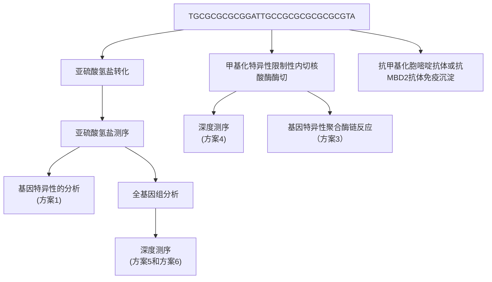
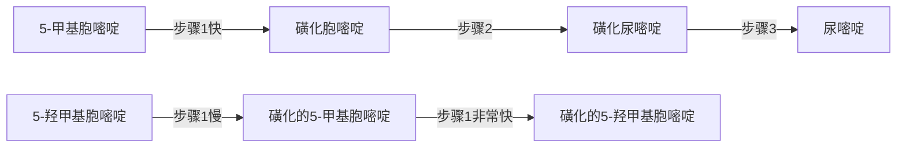
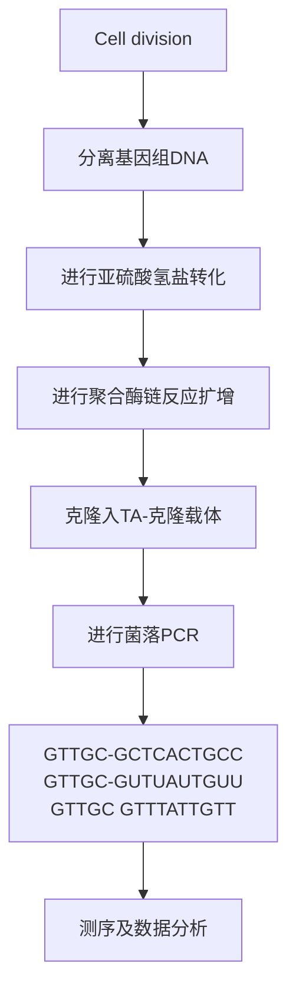
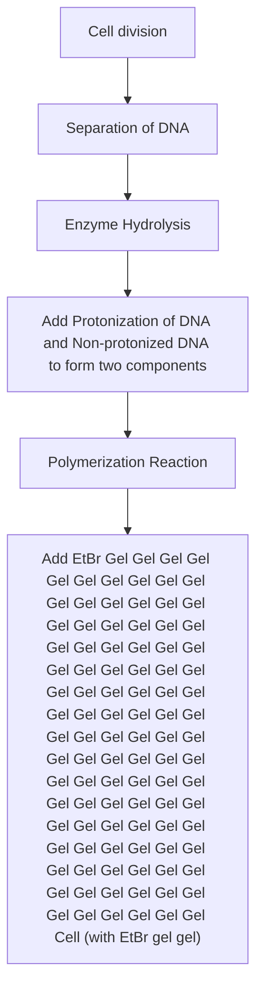
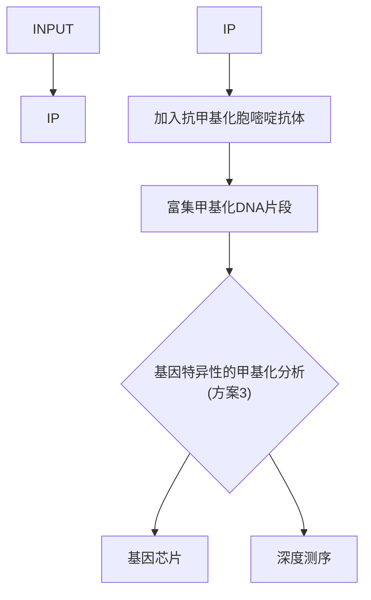
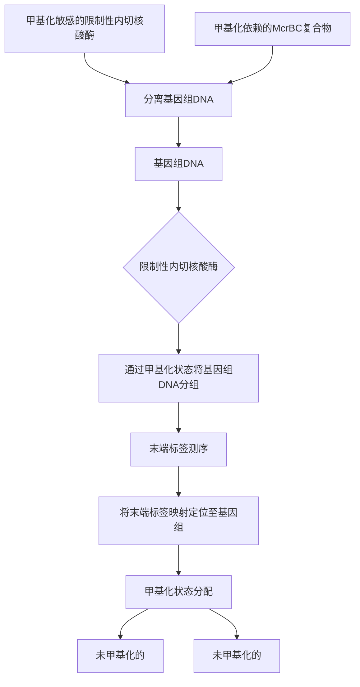
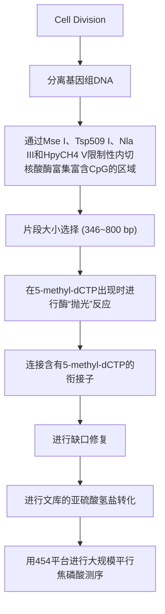
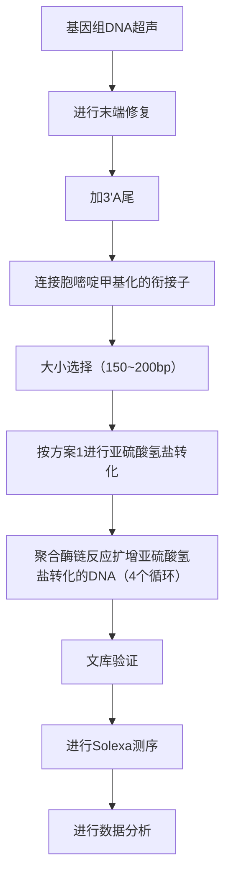

# 第12章 哺乳动物细胞中DNA甲基化分析

原始 PDF 第 240–285 页。

## 第 12 章 哺乳动物细胞中 DNA 甲基化分析

导言 | DNA 甲基化影响和揭示的生物学现象 730 各 DNA 甲基化检测方法的优点和局限性 734
DNA 甲基化检测的实验方法 732 展望 734

方案 | 1 DNA亚硫酸氢盐测序法检测单个核苷酸的甲基化 735 4 高通量深度测序法绘制哺乳动物细胞 DNA甲基化图谱 749  
2 甲基化特异性聚合酶链反应法检测特定基因的DNA甲基化 742 5 亚硫酸氢盐转化的DNA文库的Roche454克隆测序 760  
3 基于甲基化胞嘧啶免疫沉淀技术的DNA甲基化分析 745 6 亚硫酸氢盐转化的DNA文库的Illumina测序 765

信息栏 | 用于确定哺乳动物基因启动子区和编码区中 CpG 岛的公共软件 770 高通量亚硫酸氢盐深度测序数据的处理 772
亚硫酸氢盐测序和 MS-PCR 方案中用于扩增亚硫酸氢盐转化产物的引物设计 772

---

## 导言

DNA 甲基化修饰作为一种实验研究中最常检测的真核细胞表遗传改变，迄今已发表大量研究论文，并研发出了多种 DNA 甲基化检测方法。“甲基化组（methylome）”是指基因组中全部胞嘧啶的甲基化修饰情况。“甲基化组”一词在近年的文献中高频出现，反映出越来越多的科研人员正在从事相关领域的研究工作。有鉴于当前 DNA 甲基化研究中所检测到的实验样品尚局限于细胞群体中复杂表遗传修饰的一小部分，本章的部分读者可能会觉得现在使用“甲基化组”一词还为时过早。当前的 DNA 甲基化检测分析技术还有待进一步提高，本章将介绍用于研究胞嘧啶甲基化这一 DNA 化学修饰的主要方案及常规操作方法（图 12-1）。同时，也将讨论各种方法的优势和局限性。有关哺乳动物 DNA 甲基化的研究概况，可参见 Bird，以及 Klose 和 Bird 撰写的两篇综述（Bird 2002; Klose and Bird 2006）；有关 DNA 甲基化研究中的新技术新方法，可参见 Laird 的文章 (Laird 2010)。


<details>
<summary>flowchart</summary>


</details>

图 12-1 基因组 DNA 甲基化谱分析方法。


## DNA 甲基化影响和揭示的生物学现象

成年哺乳动物细胞基因组中，约 40% 的 CpG 岛二核苷酸序列的胞嘧啶 5 位碳原子 (5') 上发生甲基化共价修饰。生殖细胞发育过程中，大部分的甲基化修饰被清除；随后，受精卵中来自父本的基因组被进一步去甲基化。DNA 甲基化标志的重建发生在胚胎发育早期，而在出生时基本完成重建过程。细胞分化过程中建立不同的甲基化标志亚群，并在不同体细胞系中遗传，由此构建细胞分裂过程中的关于谱系定向（developmental commitment）的稳定“记忆”。X 染色体失活和基因印记这两种稳定的染色体特异性的基因沉默现象就是这种“记忆”最具代表性的表现。体细胞中可遗传的 DNA 甲基化修饰所介导的基因沉默

---

第 12 章 哺乳动物细胞中 DNA 甲基化分析

731

还发生在含有散在分布重复元件的基因组广泛区域中。在启动子相关的甲基化胞嘧啶富集区，也称“CpG岛（CpG island）”部位，DNA甲基化通过与PcG蛋白复合体（polycomb group protein complex）的结合而起始并稳定致密染色质状态。发生在这些位点的组蛋白修饰能够募集DNA甲基转移酶，并同时激活这些相互作用蛋白，最终使得甲基化胞嘧啶标志遍布整个CpG岛。这些化学修饰的改变影响启动子附近的DNA序列，构成在体细胞中遗传的、对体细胞重编程敏感并能调节特异染色质状态的表遗传调控机制。正常发育过程或炎症等病理过程中会发生特异位点的甲基化标志缺失。DNA甲基化调控也发生在没有进行细胞分裂的细胞中。最为著名的例子是白细胞介素2（interleukin-2，IL-2）基因的启动子-增强子区域在T淋巴细胞激活后会发生去甲基化（Bruniquel and Schwartz 2003; Murayama et al. 2006)；海马的神经元可塑性基因（neuronal plasticity gene）reelin在机体恐惧状态(contextual fear conditioning)下会发生去甲基化和基因的转录激活(Miller and Sweatt 2007)。上述现象表明，DNA甲基化修饰是高度动态、能被环境因素诱导的反应过程。

简而言之，DNA 甲基化修饰就像是机体的动态二进制记录仪，未发生甲基化修饰的碱基可看成是二进制字符串中的 “0”，而发生了甲基化修饰的碱基就是 “1”，以此来记录基因组和环境之间的相互作用。鉴于生物学反应的高度复杂性/多样性，检测分析哺乳动物细胞中的 DNA 甲基化修饰情况，有可能揭示机体发育过程中因环境因素变化而导致的改变，并以细胞和组织特异性的方式反映机体生活史。由此，检测单个碱基水平的 DNA 甲基化修饰标志能够揭示发育过程中的事件，追踪正常或异常细胞，记录突发环境损害，并衡量细胞衰老（Shibata and Tavare 2006）。然而，基因组甲基化并不是绝对恒定的。由于 DNA 半保留复制过程中 DNA 甲基化修饰标志并不能完全遗传，因此会导致在原来的 DNA 甲基化模式上增加 “噪声” 干扰。在分裂细胞中发生的偶然复制失败和随机变异共同构成了由各个细胞的 DNA 修饰状态所组成的二进制字符串记录的细胞生物钟。

## DNA 甲基化和亚硫酸氢盐反应的化学过程

最为常见的 DNA 甲基化修饰是在 CpG 岛中的胞嘧啶上加入 5'甲基基团，以 mCG 表示。在干祖细胞中还检测到其他类型的胞嘧啶甲基化修饰，如 mCHG 和 mCHH（这里的 H 代表 A、C 或者 T）（Lister et al. 2009）。此外，也有研究发现神经元细胞中存在胞嘧啶的羟甲基化（hmCG）修饰（Kriaucionis and Heintz 2009）。

检测胞嘧啶甲基化的“金标准”是以亚硫酸氢钠处理转化DNA，而后对其进行测序。该反应利用了胞嘧啶和甲基胞嘧啶脱氨基作用的动力学差异:在适当的实验条件下，胞嘧啶脱氨并转化为尿嘧啶的速度显著快于甲基胞嘧啶。当脱氨基的DNA通过聚合酶链反应（PCR）扩增时，模板DNA中新生成的尿嘧啶残基介导胸腺嘧啶的掺入。因此PCR结束时，在扩增的DNA产物中未发生甲基化修饰的胞嘧啶位置会出现胸腺嘧啶残基；而原来DNA样本中发生了甲基化修饰的胞嘧啶位置将维持不变。由于亚硫酸氢盐作用下的5-羟甲基胞嘧啶脱氨速度与5-甲基胞嘧啶的脱氨速度类似，因此该方法无法区分5-羟甲基胞嘧啶和5-甲基胞嘧啶这两种不同的碱基化学修饰。Huang等（2010）研究DNA中三种不同形式的胞嘧啶发生亚硫酸氢钠修饰的动力学特征时发现:5-甲基胞嘧啶的脱氨率约比胞嘧啶脱氨的速度慢两个数量级；同时，5-羟甲基胞嘧啶能够快速转化为不易进行脱氨反应的胞嘧啶-5-亚甲基磺酸盐（CMS），因此当5-羟甲基胞嘧啶位于CC二核苷酸序列中时，CMS加合物的形成可能引发一些特殊的问题。分析当前已获得的实验结果，在检测 $5\mathrm{hmC}$ 碱基修饰时，持续存在的CMS加合物可能由于Taq聚合酶停顿而使得PCR的扩增产量降低，因而限制了亚硫酸氢盐化学法的使用。

---

732

分子克隆实验指南（原书第四版）


## DNA 甲基化检测的实验方法

总体而言，通过 DNA 测序方法对每个碱基进行检测的方法能够对被修饰碱基进行更好的分析；但某些情况下，非测序检测方法更经济些。表 12-1 列举了常用的 DNA 甲基化检测方法。

表 12-1 DNA 甲基化检测方法一览表

<table><tr><td>甲基化依赖的处理方法</td><td>检测方法</td><td>检测类型</td><td>注释说明</td><td>消耗和时间</td><td>方案</td></tr><tr><td rowspan="5">亚硫酸氢盐转化 $^a$ </td><td>克隆的Sanger测序PCR产物Sanger测序</td><td>检测特异性位点检测特异性位点</td><td>检测单个碱基半定量评估DNA甲基化的平均水平;不很敏感</td><td>花费不多,耗时花费不多,速度快</td><td>方案1</td></tr><tr><td>甲基化特异性PCR发夹-亚硫酸氢盐测序甲基化芯片</td><td>检测特异性位点检测特异性位点检测多个位点</td><td>半定量检测双链的甲基化中到高度复杂;检测单链;有一定的杂交倾向</td><td>花费不多,速度快花费不多,速度快贵,耗时</td><td>方案2</td></tr><tr><td>直接焦磷酸测序</td><td>检测多个位点</td><td>中度复杂,高通量单个碱基分析</td><td>贵,速度快</td><td>方案5</td></tr><tr><td>靶捕获后新一代测序减少冗余后新一代测序</td><td>检测多个位点全基因组</td><td>全基因组搜索;高频位点单个碱基分析</td><td>贵,耗时贵,耗时</td><td>方案6</td></tr><tr><td>全基因组新一代测序</td><td>全基因组</td><td>全基因组测序;单个碱基分析</td><td>贵</td><td>方案6</td></tr><tr><td rowspan="3">亲和富集 $^b$ </td><td rowspan="3">质谱定量PCR芯片新一代测序胶依赖法芯片</td><td rowspan="3">检测多个位点检测特异性位点全基因组全基因组</td><td rowspan="3">高度复杂</td><td rowspan="3">花费不多,速度快花费不多,速度快贵,耗时贵,耗时</td><td rowspan="3">方案3</td></tr><tr></tr><tr></tr><tr><td>甲基化敏感的酶切 $^c$ </td><td>芯片新一代测序</td><td>多个位点或全基因组全基因组</td><td>分辨率低易受人为杂交影响</td><td>花费不多,速度快贵,耗时贵,耗时</td><td>方案4</td></tr></table>

a. 适用于单链 DNA，精确，重复性好,能检测单个碱基，可能引起样本明显降解。

b. 适用于单链 DNA（甲基化胞嘧啶免疫沉淀，MeC IP）或双链 DNA（MBD），需要大量 DNA 样本，分辨率相对较低，无法区分 5mC 和 5hmC。

c. 需要制备高质量的单链 DNA，可能因不完全酶切导致产生假阳性结果。

## DNA 亚硫酸氢盐测序法检测单核苷酸位点的 DNA 甲基化

最常用的胞嘧啶甲基化检测方法是对被亚硫酸氢钠修饰之后的 DNA 进行测序（方案 1）。该方法的优点是理论上能够监测每个候选胞嘧啶的甲基化状态；缺点是亚硫酸氢盐处理常导致 DNA 样本的片段化，使得持续可读的 DNA 链长度限制在 800 个碱基以内。

有针对性的亚硫酸氢盐测序法一般需要通过 PCR 技术对有限数量、感兴趣的基因位点进行扩增，然后用标准的 DNA 测序法检测分析这些 PCR 产物。另一个更令人感兴趣且成本更低的选择是使用 Sequenom 公司的 EpiTYPER 平台。EpiTYPER 技术将亚硫酸氢盐转化的 DNA 通过体外转录生成 RNA 分子，而后进行碱基特异性的切割和随后的对裂解片段的质谱分析。EpiTYPER 平台部分自动化，因此该平台非常适合于大量样品、中等大小 CpG 岛（48～96nt）的研究。在对人类 DNA 开展的研究中，常需要进行大量的 CpG 二核苷酸序列分析，此时 Infinium HumanMethylation 27 BeadChip 芯片（Illumina 公司）是一个很好的选择。该芯片有较高的覆盖率，价格尚可。该产品对亚硫酸盐转换的 DNA 进行检测，

---

第 12 章 哺乳动物细胞中 DNA 甲基化分析

733

能够检测到与 14 475 个人类基因转录起始位点和 110 个 miRNA 启动子相关的 27 578 个 CpG 位点的甲基化状态。

## 通过甲基化特异性 PCR 检测特定基因的 DNA 甲基化情况

甲基化特异性 PCR（MS-PCR）技术是以亚硫酸氢盐转化后的 DNA 为模板，在适当条件下用两套不同的扩增引物对模板 DNA 进行扩增。其中一对引物能够扩增甲基化的 DNA；另一对引物则扩增未甲基化的 DNA（方案 2）。该方法尽管不能提供扩增 DNA 的单个碱基的修饰情况，但操作简便、灵活，实验成本低。

## 用抗体或甲基结合蛋白2免疫沉淀甲基化DNA

该检测方法首先利用能够特异性结合含有 5mC 的 DNA 的蛋白质或抗体对含有甲基化胞嘧啶的 DNA 组分进行区分和富集（方案 3）。这类方法最适合进行单链 DNA 的分离，同时在试验中常需要较多的 DNA 样本。正如 Laird 等所述（Laird 2010），参与反应的 DNA 量及亲和试剂的比例影响富集效率，并且基因组中的 5mC 密度改变也会对富集效率产生影响。由于免疫沉淀方法获得的结果受到各种试剂化学计量学的影响，通过预实验优化实验方案显得尤为重要。进行免疫沉淀之后，可通过多种分析方法获得 DNA 甲基化数据。如今已有多种研究采用了免疫沉淀后进行 DNA 芯片分析（MeDIP）的方法。在今后的研究中将免疫沉淀技术与高通量深度测序技术相结合，有可能进一步推进相关研究的进展。

## 通过限制性内切核酸酶法进行 DNA 甲基化整体分析

限制性内切核酸酶技术在位点特异性DNA甲基化检测和全基因组DNA甲基化分析中显示出巨大作用。使用单一限制性内切核酸酶对检测序列有一定的限制，通过组合使用多个限制性内切核酸酶能够将基因组区分为甲基化富含区和未甲基化区。Irizarry等（Irizarry2008）指出，作为DNA甲基化芯片检测的替代方法，用甲基化依赖性限制性内切核酸酶McrBC联合优化的生物信息学分析法（CHARM）所获得的结果，与用相同的样品进行的Illumina Infinium HumanMethylation 27 BeadChip芯片检测结果之间具有相当高的相关性（相关系数0.76）。该研究中评估的其他技术方法还包括MeDIP、HELP（Oda and Greally2009）和McrBC（未进行CHARM数据分析）等，它们的检测结果与Infinium数据的相关系数分别为0.38、0.48和0.63。有鉴于越来越多的研究者认为测序分析是研究甲基化敏感或甲基化依赖的限制性内切核酸酶消化获得的基因组区段的首选方法，本章对芯片检测方法未进行详细描述。

本章将讲述通过酶切使得基因组分成甲基化和非甲基化组分(Edwards et al. 2010)的全基因组 DNA 甲基化分析方案（方案 4）。由于此方法没有使用亚硫酸氢盐处理 DNA，因而能获得相对较长的 DNA 片段。此方法生成的末端配对文库中的 DNA 插入片段大小分别为 0.8～1.5kb、1.5～3kb 和 3～6kb。通常情况下，可以用 Applied Biosystems 公司的软件将末端配对结构定位到基因组上。此方法的基因组覆盖范围较广，研究成本相对可接受，并且能够对人类基因组中的重复序列元件进行甲基化状态分析。因为该方法获得的 DNA 样品能够覆盖相对较长的序列区域，所以在大多情况下能够获得哺乳动物基因组印记区域中有价值的链特异性信息。

## 高通量深度测序检测部分基因组或全基因组甲基化情况

第二代和第三代高通量测序平台（参见第 11 章）因为能够多次精细读取细胞基因组中每个基因位点的 DNA 甲基化修饰情况，在检测分析亚硫酸氢盐转化的 DNA 样本时显示出

---

734

分子克隆实验指南（原书第四版）

明显的优势。深度测序能够提供丰富而详尽的信息，特别是读取长度大于150个碱基的样本时（如Roche454平台）优势更为显著。方案5描述了使用Roche454平台对亚硫酸氢盐转换的DNA进行分析的方法步骤。Zeschnigk等(2009)报道了人类血液和精子样本中6000多个CpG岛的DNA甲基化状态。这些CpG岛的甲基化谱研究发现，同一位点在不同检测分析中常显示出不同的甲基化修饰模式，提示印记特异性甲基化或等位基因特异性调节模式仍有待进一步研究阐明。

高通量深度测序法的另一个优点是能够发现发生在经典的CpG二核苷酸序列以外的胞嘧啶甲基化修饰。方案6提供了一种利用Illumina平台分析亚硫酸氢盐转化的DNA样本的方法（MethylC测序，Lister et al. 2009，Popp et al. 2010）。通过该研究方法发现，胚胎干细胞中近1/4的甲基化发生在非CG序列，这种非CG序列位点的甲基化在分化后的胚胎干细胞中消失，而在诱导多能干细胞（induced pluripotent stem cell，iPS）中重新出现。这一研究进一步凸显出该检测方法在检测全基因组DNA甲基化修饰状态时的独特优势。


## 各 DNA 甲基化检测方法的优点和局限性

DNA甲基化研究中，选用何种方法和技术平台取决于待解决的具体生物学问题、待分析样品的数量和种类、所需基因组信息的广度和精确度、研究预算等。

由于能获得的用于分析的 DNA 量的限制，有时需要通过 DNA 扩增来获得足够的检测样本。如果需要用亚硫酸氢盐对 DNA 进行修饰，则该步骤必须先于 DNA 扩增，以确保 DNA 甲基化模式的信息能够被保留下来。本章中描述的一些方法仅需 100ng 的基因组 DNA 样本，而另一些方法则需要 2～10mg 的样品。值得注意的是，一些全基因组测序方法，如利用 Illumina 平台的高通量方法所需的 DNA 样本量为 150ng（Popp et al. 2010）。

如果待检测的样品来源于癌细胞，就需要考虑可能存在的基因缺失、易位、区域扩增和重排等情况。由于这种情况下的实验结果可能因为基因拷贝数的变异而出现偏差，所以必须小心使用亲和富集研究法。而用限制性内切核酸酶的方法检测甲基化与非甲基化DNA之间的比率不易受到基因拷贝数的影响（Szpakowski et al. 2009）。

理想的基因检测覆盖范围和分辨率是实验设计及方法选择中的重点考虑因素。如果只需对几百个基因的启动子进行分析，亚硫酸氢盐测序或MS-PCR是很好的选择。前者能够检测800个碱基范围中每个核苷酸的情况，后者操作简单且成本较低。进行全基因组DNA的甲基化分析时，基因芯片会比测序方法更经济些；但测序法能提供更详尽的DNA甲基化信息。如果待分析的样品包含不同类型或不同发育阶段的细胞，则需要通过测序来获得不同克隆中同一基因位点的不同甲基化状态的信息。换句话说，克隆深度测序能够检测不同样本中各不相同的甲基化“数字化”信息。例如，通过超深测序技术能够检测到200个细胞样品中的一个细胞（或许是研究者感兴趣的祖细胞）中发生的一种罕见的甲基化修饰模式改变。


## 展望

本章写于2011年，单分子测序技术尚未完全开发。通过新技术的不断发展，在不久的将来有可能进行单分子水平的DNA甲基化数据检测，并实现数据的实时性和大规模并行分析。DNA甲基化检测将可能使用生理条件下的限制性聚合酶（physically constrained polymerases）[例如，零模波导（Eid et al. 2009)]测序平台或物理方法处理[如纳米孔（Clarke et al. 2009）]的DNA链。区分5-甲基胞嘧啶和5-羟甲基胞嘧啶也将成为可能。事实上，Flusberg等（2010）在2010年研发了一种能够不通过亚硫酸氢盐转化而直接检测DNA甲

---

第 12 章 哺乳动物细胞中 DNA 甲基化分析

735

基化的单分子实时测序（single molecule, real-time, SMRT）技术。这种方法不仅能够检测5-甲基胞嘧啶，也能对 $N^6$ -甲基腺嘌呤和5-羟甲基胞嘧啶进行检测。

## 参考文献

- Bird A. 2002. DNA methylation patterns and epigenetic memory. Genes Dev 16: 6–21.
- Bruniquel D, Schwartz RH. 2003. Selective, stable demethylation of the interleukin-2 gene enhances transcription by an active process. Nat Immunol 4: 235–240.
- Clarke J, Wu HC, Jayasinghe L, Patel A, Reid S, Bayley H. 2009. Continuous base identification for single-molecule nanopore DNA sequencing. Nat Nanotechnol 4: 265–270.
- Edwards JR, O'Donnell AH, Rollins RA, Peckham HE, Lee C, Milekic MH, Chanrion B, Fu Y, Su T, Hibshoosh H, et al. 2010. Chromatin and sequence features that define the fine and gross structure of genomic methylation patterns. Genome Res 20: 972–980.
- Eid J, Fehr A, Gray J, Luong K, Lyle J, Otto G, Peluso P, Rank D, Baybayan P, Bettman B et al. 2009. Real-time DNA sequencing from single polymerase molecules. Science 323: 133–138.
- Flusberg BA, Webster DR, Lee JH, Travers KJ, Olivares EC, Clark TA, Korlach J, Turner SW. 2010. Direct detection of DNA methylation during single-molecule, real-time sequencing. Nat Methods 7: 461–465.
- Huang Y, Pastor WA, Shen Y, Tahiliani M, Liu DR, Rao A. 2010. The behaviour of 5-hydroxymethylcytosine in bisulfite sequencing. PLoS ONE 5: e8888. doi: 10.1371/journal.pone.0008888.
- Irizarry RA, Ladd-Acosta C, Carvalho B, Wu H, Brandenburg SA, Jeddeloh JA, Wen B, Feinberg AP. 2008. Comprehensive high-throughput arrays for relative methylation (CHARM). Genome Res 18: 780–790.
- Klose RJ, Bird AP. 2006. Genomic DNA methylation: The mark and its mediators. Trends Biochem Sci 31: 89–97.
- Kriaucionis S, Heintz N. 2009. The nuclear DNA base 5-hydroxymethylcytosine is present in Purkinje neurons and the brain. Science 324: 929–930.
- Laird PW. 2010. Principles and challenges of genome-wide DNA methylation analysis. Nat Rev Genet 11: 191–203.
- Lister R, Pelizzola M, Dowen RH, Hawkins RD, Hon G, Tonti-Filippini J, Nery JR, Lee L, Ye Z, Ngo QM, et al. 2009. Human DNA methylomes at base resolution show widespread epigenomic differences. Nature 462: 315–322.
- Miller CA, Sweatt JD. 2007. Covalent modification of DNA regulates memory formation. Neuron 53: 857–869.
- Murayama A, Sakura K, Nakama M, Yasuzawa-Tanaka K, Fujita E, Tateishi Y, Wang Y, Ushijima T, Baba T, Shibuya K, et al. 2006. A specific CpG site demethylation in the human interleukin 2 gene promoter is an epigenetic memory. EMBO J 25: 1081–1092.
- Oda M, Greally JM. 2009. The HELP assay. Methods Mol Biol 507: 77–87.
- Popp C, Dean W, Feng S, Cokus SJ, Andrews S, Pellegrini M, Jacobsen SE, Reik W. 2010. Genome-wide erasure of DNA methylation in mouse primordial germ cells is affected by AID deficiency. Nature 463:1101–1105.
- Shibata D, Tavare S. 2006. Counting divisions in a human somatic cell tree: How, what and why? Cell Cycle 5: 610–614.
- Szpakowski S, Sun X, Lage JM, Dyer A, Rubinstein J, Kowalski D, Sasaki C, Costa J, Lizardi PM. 2009. Loss of epigenetic silencing in tumors preferentially affects primate-specific retroelements. Gene 448: 151–167.
- Zeschnigk M, Martin M, Betzl G, Kalbe A, Sirsch C, Buiting K, Gross S, Fritzilas E, Frey B, Rahmann S, et al. 2009. Massive parallel bisulfite sequencing of CG-rich DNA fragments reveals that methylation of many X-chromosomal CpG islands in female blood DNA is incomplete. Hum Mol Genet 18: 1439–1448.

## 方案 1 DNA 亚硫酸氢盐测序法检测 单个核苷酸的甲基化

DNA 甲基化在多种生物学过程中发挥重要的作用。因此，检测 DNA 甲基化状态变化的方法具有广泛的应用意义。目前，最常见和可靠的 DNA 甲基化状态检测方法是亚硫酸氢盐测序法（Clark et al. 1994）。以亚硫酸氢钠处理变性的 DNA 分子（即单链 DNA），将未发生甲基化的胞嘧啶（C）残基转化成尿嘧啶（U）残基，而发生了甲基化修饰的胞嘧啶保持不变（图 12-2）。而后，以基因特异性引物扩增转化后的 DNA 分子。尿嘧啶（U）将会通过 PCR 扩增生成胸腺嘧啶（T），故能够通过测序对其进行鉴定。需要注意的是，最近在胚胎干细胞和浦肯野神经元细胞中发现了一类新的胞嘧啶修饰方式——5-羟甲基胞嘧啶修饰（Kriaucionis and Heintz 2009; Tahiliani et al. 2009）。亚硫酸氢盐转化法不能对 5-甲基胞嘧啶和 5-羟甲基胞嘧啶这两种修饰方式进行区分（图 12-2）。

DNA 亚硫酸氢盐测序使用相同的一组引物对甲基化的和未甲基化的 DNA 进行扩增。引物设计需要遵循一定的标准以便对特定基因区域进行有效扩增。亚硫酸氢盐测序方案的引物设计原则将在信息栏“亚硫酸氢盐测序和 MS-PCR 方案中用于扩增亚硫酸氢钠转换产物的引物设计”中加以讨论。本方案将论述亚硫酸氢盐转化和特定基因或特定的基因组区段（genomic region）检测的详细步骤。亚硫酸氢盐转化法关键步骤的流程如图 12-3 所示。

---

736

分子克隆实验指南（原书第四版）


<details>
<summary>flowchart</summary>


</details>

图 12-2 亚硫酸氢盐测序过程中胞嘧啶、5-甲基胞嘧啶和 5-羟甲基胞嘧啶的反应过程。亚硫酸氢盐处理后，胞嘧啶快速转化成尿嘧啶，而 5-甲基胞嘧啶和 5-羟甲基胞嘧啶对这种转换有一定抗性。


<details>
<summary>flowchart</summary>


</details>

图 12-3 亚硫酸氢盐测序方案流程图。亚硫酸氢盐测序被看成当前 DNA 甲基化分析的 “金标准”。

---

第 12 章 哺乳动物细胞中 DNA 甲基化分析

737


## 材料

为正确使用本方案中的器材和危险试剂，必须查阅相应的材料安全数据表并咨询所在机构的环境卫生和安全办公室。

本方案的专用试剂标注&lt;R&gt;，配方在本方案末提供。常用储备溶液、缓冲液和试剂标注&lt;A&gt;，配方见附录1。储备溶液应稀释至适用浓度后使用。

## 试剂

乙酸

琼脂糖凝胶（请参阅第2章，方案1）

乙酸铵

5-氮杂-2'-脱氧胞苷（5Aza2dC）

细菌细胞，超敏感受态

dNTP (10mmol/L)

EDTA

乙醇（70%和100%）

溴化乙锭溶液

凝胶缓冲液（1×TBE）

基因组 DNA

体外培养细胞或外周血淋巴细胞可以用 QIAGEN 公司的 “Blood and Cell Culture DNA Midi Kit” 试剂盒制备 DNA。哺乳动物组织在液氮处理下粉碎后于 55℃ 消化过夜（10mmol/L 氯化钠，10mmol/L Tris pH8，25mmol/L EDTA pH 8，0.5% SDS，100ng/mL 蛋白酶 K），酚:氯仿抽提 DNA，乙醇沉淀，RNA 酶 A 消化，最后将 DNA 储存在 pH 8.0 的 TE 缓冲液中 -20℃ 保存。琼脂糖凝胶电泳验证高分子质量 DNA 的质量，NanoDrop2000 进行 DNA 定量。

糖原（1mg/mL）

异丙醇

LB 氨苄青霉素板 &lt;A&gt;（含 100mg/mL 氨苄青霉素）

连接酶和连接酶缓冲液

矿物油

氢氧化钠（3mol/L）

PCR 缓冲液

PCR 纯化柱试剂盒（QIAGEN 公司）

菌落 PCR 引物

如果拟将克隆构建在 pGMT 载体中，可使用下列引物:

正向引物，5'-ATGCGATATAGAGGAGACCGT-3'

反向引物，5'-TCAGAAACGTGAGATTGAT-3'

QIAquick 凝胶提取试剂盒（QIAGEN 公司）

苯二酚（1,4-二羟基苯）

亚硫酸氢钠，饱和 &lt;R&gt;

在临用前准备新鲜的饱和亚硫酸氢钠溶液（步骤3）。

TA 克隆试剂盒（Promega 公司）或 TOPO 克隆试剂盒（Life Technologies 公司）

Taq 聚合酶

X-Gal

---

738

分子克隆实验指南（原书第四版）

## 仪器

序列比对软件

PCR 仪（Thermal cycler）

## 试验对照

第一次进行亚硫酸氢盐测序时，设置对照十分重要。可以用任意人类细胞株作为阳性对照。按40%融合的密度接种细胞后，10mmol/L的5-氮杂-2'-脱氧胞苷（5Aza2dC）作用3天。制备基因组DNA，按步骤以亚硫酸氢钠处理DNA，而后以亚硫酸氢盐转化后的DNA作为阳性对照，应用于后续所有步骤。5Aza2dC是一种DNA甲基转移酶抑制剂，以DNA复制依赖的方式使细胞内DNA去甲基化。因此，如果一个细胞的倍增周期为24h，以5Aza2dC处理3天将去除细胞中近75%的基因组DNA的甲基化修饰。


## 方法

## 亚硫酸氢盐转化 DNA

1. 在基因组 DNA 中加入终浓度为 $0.3 \mathrm{~mol} / \mathrm{L}$ 的 $\mathrm{NaOH}$ 使 DNA 变性（例如，在 $18 \mu \mathrm{L}$ 稀释好的 DNA 中加入 $2 \mu \mathrm{L}$ 的 $3 \mathrm{~mol} / \mathrm{L} \mathrm{NaOH}$）。

建议取  $2 \mu g$  DNA 用于亚硫酸氢盐转化反应。当能获得的 DNA 量有限时（例如，样品源自患者组织或石蜡块），也可用较少的 DNA（<100ng）进行反应。

2. PCR 仪程序如下:第一个循环为 $37^{\circ} \mathrm{C}$ 孵育 $15 \mathrm{~min}$；而后 $95^{\circ} \mathrm{C}$ 反应 $2 \mathrm{~min}$；最后 $4^{\circ} \mathrm{C}$ 反应 $5 \mathrm{~min}$。先加入 DNA，而后运行程序，使 DNA 转变成单链形式。

要确保 PCR 仪的机盖温度高于  $100^{\circ}$ C，以避免稀释的 DNA 蒸发。

3. 配制反应液:

| 变性的 DNA | 20μL |
| --- | --- |
| 饱和亚硫酸氢钠(pH5.0) | 208μL |
| 喹啉(10mmol/L) | 10μL |
| 矿物油 | 200μL |

轻柔混匀后离心，使反应液聚集至反应管底部。55℃避光孵育4h或过夜。

注意:要使用新配制的亚硫酸氢钠溶液，避光反应以防氧化，对已发生降解的 DNA 样本（如从石蜡包埋的组织块中分离获得的 DNA），进行亚硫酸氢盐转化时不要反应过夜。

4. 用 PCR 纯化柱, 按照厂家的使用说明纯化亚硫酸盐转化后的基因组 DNA。

5. 加入终浓度为 $0.3 \mathrm{~mol} / \mathrm{L}$ 的 $\mathrm{NaOH}$ 使 DNA 变性。混合液在 $42^{\circ} \mathrm{C}$ 孵育 $20 \mathrm{~min}$ 。

6. 加入 0.25 倍体积的 5mol/L 乙酸铵（pH 8.0）以中和反应液。

乙酸铵能够使尿嘧啶磺酸盐转化为尿嘧啶。此步十分重要，因为磺化尿嘧啶衍生物会抑制 PCR 反应。

7. 加入 2 倍体积的乙醇沉淀 DNA。

如果用于亚硫酸氢盐转化反应的 DNA 量较低，可加入  $1 \mu g/mL$  的糖原提高沉淀效率。使用等体积的异丙醇而非乙醇能够增加亚硫酸盐转化的 DNA 的产量。

8. 以 10 000 r/min 的转速  $4^{\circ}$ C 离心 30min。

9. 倒出上清液, 用 $1 \mathrm{~mL}$ 的 $70 \%$ 乙醇洗涤沉淀。完全干燥沉淀 (吹干净的气流或将反

---

第 12 章 哺乳动物细胞中 DNA 甲基化分析

739

应管放在真空干燥器内 20min)。以 40μL 无菌蒸馏水溶解沉淀。亚硫酸盐转化后的 DNA 最好尽早进行后续的 PCR 反应（也可以在-20℃储存 1～2 个月）。

经过亚硫酸氢盐转化后的DNA既能够直接用于基因特异性的PCR扩增（本研究方案），也可以进行整体测序（方案5和方案6）。DNA的亚硫酸氢盐处理也可用表12-2中描述的其他市售试剂盒进行。操作中使用亚硫酸氢盐转化试剂盒较方便，但会增加实验成本。

表 12-2 商业化的亚硫酸氢盐转化 DNA 试剂盒

| 供应商 | 特点 |
| --- | --- |
| Life Technologies (MethylCode) | 将所有未甲基化的胞嘧啶转化为尿嘧啶在处理/回收过程中模板降解和DNA损失少亚硫酸氢盐转化后的DNA产量高一步完成DNA变性和亚硫酸氢盐转化不需要沉淀DNA步骤 |
| QIAGEN (EpitTect) | 将所有未甲基化的胞嘧啶转化为尿嘧啶采用了DNA保护系统增加检测敏感性能保证>1ng的DNA的转化效果通过离心柱或96孔板进行纯化和脱磺酸基反应使用QIAGEN QIAcude时可以完全自动化 |
| Applied Biosystems (methylSEQr) | PCR扩增过程中DNA降解极少所有未甲基化的胞嘧啶转化为尿嘧啶样品DNA可以保存长达2.5年 |
| Millipore (CpGenome Fast) | 所有未甲基化的胞嘧啶转化为尿嘧啶 |
| Millipore (GpGenome Universal) | 所有未甲基化的胞嘧啶转化为尿嘧啶 |
| Zymo Research (EZ DNA Methylation) | 在柱内进行脱磺酸基反应和恢复在处理/回收过程中模板降解和DNA损失少所有未甲基化的胞嘧啶转化为尿嘧啶 |
| Sigma-Aldrich (Imprint DNA Mod. Kit) | 至少需要50pg的DNA或20个细胞整个操作过程耗时不到2h大于99%的转化效率极低的降解可选用一步操作方案 |
| Human Genetic Signatures (MethylEasy) | 亚硫酸氢钠DNA丢失减少大于90%至少需要100pg的DNA不需要对DNA进行预处理未转化率低 |
| Human Genetic Signatures (MethylEasy Xceed) | 至少需要50pg的DNA操作在柱内完成可以在PCR管内用传统的烤箱或孵化器孵育一个转换步骤后可以检测多个位点整个过程耗时不足90min |
| ActiveMotif (MethylDetector) | 热变性和转换反应,不需要氢氧化钠介导针对G/C含量高的序列和未切割的DNA非甲基化的胞嘧啶残基的转化效率达99%在纯化柱内进行洗脱沉淀和脱磺酸基步骤 |
| BioChain (DNA Methylation Detection) | 保证超过99%的胞嘧啶被转化保证超过99%的CpG保护效率检测的敏感范围为2μg~500pg |

---

740

分子克隆实验指南（原书第四版）

## 扩增亚硫酸氢盐转化后的 DNA

10. 配制  $50 \mu L$  的 PCR 反应液:

| PCR缓冲液(10×)(含1.5mmol/L氯化镁) | 5μL |
| --- | --- |
| dNTP(10mmol/L) | 1μL |
| 正向引物(10pmol) | 1μL |
| 反向引物(10pmol) | 1μL |
| 亚硫酸氢盐转化的DNA(10%从步骤9获得的DNA) | 5μL |
| Taq聚合酶(5U/μL) | 1μL |
| $H_2O$ | 36μL |

扩增 DNA。

扩增条件根据经验确定。最佳条件的确定受扩增基因大小及胞嘧啶和鸟嘌呤含量等若干因素的影响。总体而言，一般情况下最常用的复性温度是48～50℃。

11. 1.5%琼脂糖凝胶分离 PCR 产物。

详见“疑难解答”。

12. 用 QIAquick 凝胶提取试剂盒（QIAquick gel extraction kit）纯化 PCR 扩增产物。
13. 用 10% 的总 DNA 或从凝胶中洗脱获得的 DNA 和克隆试剂盒按照产品说明进行连接反应，16℃ 连接过夜。
14. 用一半的连接反应产物转化感受态细胞（转化率 $=10^{8}$ ）。
15. 将细胞转移到两个已涂布了 $10 \mu \mathrm{L}$ 的 $1 \mathrm{~mol} / \mathrm{L}$ IPTG 和 $50 \mu \mathrm{L}$ 的 $50 \mathrm{mg} / \mathrm{mL}$ 的 X-Gal 的 LB-氨苄青霉素培养板。LB 板在 $37^{\circ} \mathrm{C}$ 孵育 $16 \sim 20 \mathrm{~h}$ 。
16. 挑选单个白色菌落，每个白色菌落稀释到  $15 \, mL$  水中。
17. 进行菌落 PCR 反应, $25 \mu \mathrm{L}$ 反应混合液配制如下:

| PCR缓冲液(10×)(含1.5mmol/L氯化镁) | 2.5μL |
| --- | --- |
| dNTP(10mmol/L) | 0.5μL |
| 正向引物(10pmol) | 0.5μL |
| 反向引物(10pmol) | 0.5μL |
| 稀释的菌落 | 2.0μL |
| Taq聚合酶(5U/μL) | 0.5μL |
| $H_2O$ | 18.5μL |

将反应管放入 PCR 仪，编程如下:

| 循环次数 | 变性 | 复性 | 聚合 |
| --- | --- | --- | --- |
| 35个循环 | 95°C,30s | 56°C,45s | 72°C,30s |

18. 将菌落 PCR 产物按 1:10 的比例稀释至  $1 \times \text{TE} (\text{pH} 8.0)$  缓冲液中，取  $2 \mu L$  稀释液进行 Sanger 测序。测序引物为  $2 \mu L$  的 SP6 引物（ $5 \mu mol/L$ ）。

19. 每个基因位点至少测 10 个菌落。

20. 对转换后的 DNA 数据进行配对排列（pairwise alignment）分析。此时，所有的胞嘧啶已替换成胸腺嘧啶。在 Linux 或 OS X 计算机上用 UNIX 命令&lt;sed 's/C/T/g;s/c/t/g' sequencefile&gt;进行数据转换，序列文件采用标准的 NCBI DNA 序列。使用 EBI 的比对软件（http://www.ebi.ac.uk/Tools/psa/）对数据进行配对排列比对。使用 ClustalW 或 ClustalX 程序 (Thompson et al. 1997; Chenna et al. 2003; Larkin et al. 2007)能够很方便地进行序列对应排列比对。

---

第 12 章 哺乳动物细胞中 DNA 甲基化分析

741


## 疑难解答

问题（步骤 11）:PCR 未能扩增出亚硫酸氢盐转化后的 DNA。

解决方案:蛋白酶 K 对基因组 DNA 的处理不够充分。再次用蛋白酶 K 消化 DNA，而后乙醇沉淀。

问题（步骤 11）:PCR 未能扩增出亚硫酸氢盐转化后的 DNA，且 DNA 被降解。

解决方案:减少亚硫酸氢钠反应的孵育时间。

问题（步骤 11）:PCR 未能扩增出亚硫酸氢盐转换后的 DNA，但并非前面两个原因所致。

解决方案:请尝试下列方法中的一个或多个方法:

- 增加 PCR 中的亚硫酸氢盐转化后的 DNA 的量。
- 核对以确保亚硫酸氢盐 PCR 引物设计正确性。按照所有的胞嘧啶通过亚硫酸氢盐作用都转化为尿嘧啶来设计引物。
- 尝试不同的温度梯度以优化复性温度。
- 尝试巢式 PCR。依据经验，采用巢式 PCR 和较低的复性温度（50℃）往往能够有助于解决此类问题。

问题:PCR 扩增后出现非特异条带（步骤 11）。

解决方案:这可能是由于复性温度过低引起。尝试在不同的温度梯度条件下进行 PCR 反应。如果仍无效，则需要另外设计替代引物对，以避免引物在复性时非特异配对到其他基因组位点。此外，采用巢式 PCR 常常能够解决这个问题（见第 7 章，方案 7）。


## 试剂配方

为正确使用本方案中的器材和危险试剂，必须查阅相应的材料安全数据表并咨询所在机构的环境卫生和安全办公室。

## 饱和亚硫酸氢钠（pH5.0）

制备 10mL 饱和亚硫酸氢钠:

1. 称取 4.75g 焦亚硫酸钠（di-sodium disulfite,  $Na_{2}S_{2}O_{5}$ ）加到 6.25mL 无菌双蒸水中。
2. 加入 1.75mL 的 2mol/L NaOH。
3. 加入 1.25mL 的 1mol/L 氢醌（称取 0.11g 氢醌加入 1mL 无菌双蒸水中）。
4. 避光加热到  $50^{\circ}$ C，反复翻转试管。
5. 调节 pH 至 5.0。

亚硫酸氢钠溶液应新鲜配制。整个反应避光操作以防氧化。

## 参考文献

<small><span class="docvortex-page-footnote" data-block-type="page_footnote" style="color:#6b7280">Chenna R, Sugawara H, Koike T, Lopez R, Gibson TJ, Higgins DG, Thompson JD. 2003. Multiple sequence alignment with the Clustal series of programs. Nucleic Acids Res 31: 3497–3500.</span></small>

<small><span class="docvortex-page-footnote" data-block-type="page_footnote" style="color:#6b7280">Clark SJ, Harrison J, Paul CL, Frommer M. 1994. High sensitivity mapping of methylated cytosines. Nucleic Acids Res 22: 2990–2997.</span></small>

<small><span class="docvortex-page-footnote" data-block-type="page_footnote" style="color:#6b7280">Kriaucionis S, Heintz N. 2009. The nuclear DNA base 5-hydroxymethylcytosine is present in Purkinje neurons and the brain. Science 324: 929–930.</span></small>

<small><span class="docvortex-page-footnote" data-block-type="page_footnote" style="color:#6b7280">Larkin MA, Blackshields G, Brown NP, Chenna R, McGettigan PA, McWilliam H, Valentin F, Wallace IM, Wilm A, Lopez R, et al. 2007. Clustal</span></small>

<small><span class="docvortex-page-footnote" data-block-type="page_footnote" style="color:#6b7280">W and Clustal X version 2.0. Bioinformatics 23: 2947–2948.</span></small>

<small><span class="docvortex-page-footnote" data-block-type="page_footnote" style="color:#6b7280">Tahiliani M, Koh KP, Shen Y, Pastor WA, Bandukwala H, Brudno Y, Agarwal S, Iyer LM, Liu DR, Aravind L, et al. 2009. Conversion of 5-methylcytosine to 5-hydroxymethylcytosine in mammalian DNA by MLL partner TET1. Science 324: 930–935.</span></small>

<small><span class="docvortex-page-footnote" data-block-type="page_footnote" style="color:#6b7280">Thompson JD, Gibson TJ, Plewniak F, Jeanmougin F, Higgins DG. 1997. The ClustalX windows interface: Flexible strategies for multiple sequence alignment aided by quality analysis tools. Nucleic Acids Res 25: 4876–4882.</span></small>

---

742

分子克隆实验指南（原书第四版）

## 方案 2 甲基化特异性聚合酶链反应法检测特定基因的 DNA 甲基化

Herman 等在 1996 年研发出甲基化特异性 PCR（MS-PCR）方法（Herman et al. 1996）。在最初的研究中，用这种方法分析了 4 个抑癌基因 p16、p15、E-cadherin 和 VHL 的甲基化状态。MS-PCR 法需要两组配对引物，分别用于扩增非甲基化的和甲基化的基因区段。MS-PCR 的引物设计原则将在信息栏“亚硫酸氢盐测序和 MS-PCR 方案中用于扩增亚硫酸氢钠转化产物的引物设计”中加以讨论。此方法只能获得某基因区段内的 CpG 岛甲基化密度的相对差异情况，而不能像亚硫酸氢盐测序法（方案 1）那样检测 CpG 岛中各核苷酸的甲基化修饰情况。与亚硫酸氢盐测序法相比，MS-PCR 是一个更为快速的检测 DNA 甲基化变化情况的试验方法。此外，通过引入一些自动化过程，样品制备和分析可以在 96 孔板中进行。该方法可用于定量（基于定量 PCR 技术的 MethyLight 检测法）（EADS et al. 2000）或定性（琼脂糖凝胶电泳法）检测 DNA 甲基化的变化。这两种方法都将在本方案中论述。图 12-4 显示的是 MS-PCR 方案的主要步骤。在 MS-PCR 中用到的一些商品化的试剂盒介绍见表 12-3。


<details>
<summary>flowchart</summary>


</details>

图 12-4 MS-PCR 流程图。MS-PCR 操作快捷，可用于大量样品的检测分析。


## 材料

为正确使用本方案中的器材和危险试剂，必须查阅相应的材料安全数据表并咨询所在机构的环境卫生和安全办公室。

---

第 12 章 哺乳动物细胞中 DNA 甲基化分析

743

## 试剂

琼脂糖凝胶（3%，含有1mg/mL的溴化乙锭）

乙酸铵

亚硫酸氢盐转化试剂（参见方案1）

DNA 回收试剂盒（QIAGEN 公司）

dNTP (10mmol/L)

乙醇

溴化乙锭溶液

凝胶缓冲液（1×TBE）

基因特异性的 TaqMan 探针

基因组 DNA

体外培养细胞或外周血淋巴细胞可以用 QIAGEN 公司的 “Blood and Cell Culture DNA Midi Kit” 试剂盒进行 DNA 制备。哺乳动物组织在液氮处理下粉碎后于 55℃ 消化过夜（10mmol/L 氯化钠，10mmol/L Tris pH8，25mmol/L EDTA pH8，0.5% SDS，100ng/mL 蛋白酶 K），酚:氯仿抽提 DNA，乙醇沉淀，RNase A 消化，最后将 DNA 储存在 pH8 的 TE 缓冲液中 -20℃ 保存。琼脂糖凝胶电泳验证高分子质量 DNA 的质量，NanoDrop2000 进行 DNA 定量。

糖原

异丙醇

氯化镁

矿物油

5'带荧光染料（6FAM）、3'带猝灭染料（TAMRA）的寡核苷酸探针

PCR 缓冲液（10×；1.5mmol/L 氯化镁）

引物

所选用的特异性引物取决于是做定性分析还是做定量分析。

Taq 聚合酶（5U/μL）

TaqMan 探针缓冲液 A（包含参照染料和 Taq 聚合酶）

## 仪器

PCR 仪（Thermal cycler）

定量 PCR 仪

## 试验对照

与亚硫酸氢盐测序的对照设置类似，用 5Aza2dC 处理后细胞所制备的基因组 DNA 作为对照进行 MS-PCR 检测分析。详见方案 1 中的“试验对照”。

---

744

分子克隆实验指南（原书第四版）

表 12-3 商业化的 MS-PCR 检测试剂盒

| 供应商 | 特点 |
| --- | --- |
| QIAGEN (EpitTect) | ·结果假阳性低·引物设计的灵活性·操作简便·使用“Master mix”反应液,以简化反应MSP能够对精确到对一个CpG位点进行检测分析·能够检测CpG甲基化的发生概率·将甲基化模式的变化与转录调控相关联 |
| Millipore (CpGenome and CpG WIZ MSP) | ·适用于任何感兴趣基因的研究·Southern杂交不需要使用限制性酶切·可以用于检测$\geqslant 1ng$的DNA |


## 方法

## 亚硫酸氢盐转化 DNA

1. 按照方案 1 中的步骤 1\~9 进行亚硫酸氢盐转化。
2. 进行定性甲基化分析时，按下文中的方法 A 操作。进行 DNA 甲基化定量分析时，使用方法 B。

## 方法 A:通过琼脂糖凝胶电泳对甲基化特异性 PCR 产物进行检测

i. 设置两个 PCR 反应，一个用于检测非甲基化的 DNA，另一个用于检测甲基化的 DNA。25μL 的 PCR 反应体系包含:

| PCR缓冲液(10×)(含1.5mmol/L$MgCl_{2}$) | 2.5μL |
| --- | --- |
| dNTP(10mmol/L) | 0.5μL |
| 正向引物(10pmol) | 0.5μL |
| 反向引物(10pmol) | 0.5μL |
| 亚硫酸氢盐转化的DNA(5%的亚硫酸氢盐转化DNA) | 2.5μL |
| Taq聚合酶(5U/μL) | 0.5μL |
| $H_{2}O$ | 18.0μL$^{\text{1}}$ |

ii. 将反应管置于 PCR 仪中进行 DNA 扩增。最佳扩增条件通过试验摸索。
iii. PCR 产物在含溴化乙锭的 3% 琼脂糖凝胶中电泳分离。其中一个泳道加入分子质量为 100～300bp 的电泳分子标志物。紫外灯下观察结果。

每 50mL 的琼脂糖凝胶中加入  $5\mu L$  的 10mg/mL 溴化乙锭。

参见“疑难解答”。\*

## 方法 B:通过Methylight 进行DNA 甲基化的定量检测分析

亚硫酸氢盐转化后的 DNA 产物可以通过位点特异性的 PCR 引物进行荧光定量 PCR 反应，从而定量检测 DNA 的甲基化情况。该方法被命名为 MethylLight 技术，其灵敏度能够达到在 10 000 倍过量的未甲基化的 DNA 样本中检测到甲基化 DNA 的存在（Eads et al. 2000）。在最初的报道中，研究者通过此方法能够检测出 MLH1 基因是单等位基因还是双等位基因都发生了甲基化修饰（Eads et al. 2000）。需要注意的是，对序列的鉴别既可以在 PCR 扩增过程中进行，也可以通过荧光探针杂交进行。这两种基因鉴别方法都是依赖于完全匹配的寡核苷酸的复性温度与不匹配的寡核苷酸复性温度之间存在差异。如果在 PCR 扩增过程中进行序列鉴别，设计的引物（或者引物和探针）要与潜在的 CpG 二核苷酸序列重叠。通过设计位

<small><span class="docvortex-page-footnote" data-block-type="page_footnote" style="color:#6b7280">① 原文中此处为  $36 \mu L$ ，译者依据总体积  $25 \mu L$  将其更改为  $18 \mu L$ 。</span></small>

---

第 12 章 哺乳动物细胞中 DNA 甲基化分析

745

于甲基化或非甲基化区域的引物进行序列鉴别是基于定量 PCR 技术的 MS-PCR 检测方法的核心。通过 MethyLight 定量检测样本 DNA 甲基化修饰水平差异的方法步骤如下。

i. 用侧翼带寡核苷酸探针的位点特异性 PCR 引物扩增亚硫酸盐转化后的基因组 DNA。5'寡核苷酸探针标荧光报告染料（6FAM），3'寡核苷酸探针标猝灭染料（TAMRA）。25μL 的 PCR 反应体系包括:

| 每个引物 | 600nmol/L |
| --- | --- |
| 探针 | 200nmol/L |
| dATP、dCTP、dGTP | 200μmol/L |
| dUTP | 400μmol/L |
| MgCl2 | 3.5mmol/L |

TaqMan 探针缓冲液 A

含染料和 Taq DNA 聚合酶（1×）

亚硫酸氢盐转化的 DNA

或未转化的 DNA

对照样品进行系列稀释（如 5Aza2dC 处理的对照样本），绘制标准曲线。

ii. 将反应管放入 PCR 仪。PCR 循环参数如下:

$50^{\circ}\mathrm{C}, 2 \mathrm{~min}$

$95^{\circ}\mathrm{C},\quad10\mathrm{min}$

40个循环: $95^{\circ}\mathrm{C}$ ，15s；然后 $60^{\circ}\mathrm{C}$ ，1min

iii. 使用现有的定量 PCR 数据分析方法进行数据分析，例如，第 9 章 Yuan 等报道的方法（Yuan et al. 2006）。


## 疑难解答

在亚硫酸氢盐测序法中遇到的各种技术问题也都可能影响 MS-PCR 的检测结果。请参阅方案 1 中的 “疑难解答” 部分。

## 参考文献

Eads CA, Danenberg KD, Kawakami K, Saltz LB, Blake C, Shibata D, Danenberg PV, Laird PW. 2000. Methylight: A high-throughput assay to measure DNA methylation. Nucleic Acids Res 28: e32. doi: 10.1093/nar/28.8.e32.

Herman JG, Graff JR, Myohanen S, Nelkin BD, Baylin SB. 1996. Methylation-specific PCR: A novel PCR assay for methylation status of

CpG islands. Proc Natl Acad Sci 93: 9821–9826.
Yuan JS, Reed A, Chen F, Stewart CN Jr. 2006. Statistical analysis of real-time PCR data. BMC Bioinformatics 7: 85. doi: 10.1186/1471-2105-7-85.

## 方案 3 基于甲基化胞嘧啶免疫沉淀技术的 DNA 甲基化分析

哺乳动物细胞中 DNA 的甲基化修饰通常发生在 CpG 二核苷酸序列中的胞嘧啶 5'位置，但某些情况（如人类胚胎干细胞中）也存在非 CpG 序列的胞嘧啶的甲基化修饰（Lister et al. 2009）。发生了甲基化修饰的 DNA 分子能够选择性地募集那些具有 5-甲基胞嘧啶（5mC）

---

746

分子克隆实验指南（原书第四版）

结合活性的蛋白质分子。现已利用这些蛋白质（或抗体）对 5mC 的识别特性建立了多种能够富集含有甲基化的 5mC 的 DNA 或能够富集 5mC 识别蛋白的亲和纯化方案。本研究方法利用特异性的识别 5mC 的抗体来免疫沉淀甲基化 DNA。其他还有一些 5mC 免疫沉淀法是通过甲基结合蛋白来分析 DNA 的甲基化模式（Rauch and Pfeifer 2005, 2009）。2010 年，Huang 等（2010）发现，靶向 5mC 的抗体可以区分 5-甲基胞嘧啶（5mC）和 5-羟甲基胞嘧啶（5hmC），并由此推测将来还有可能研发出特异性识别 5hmC 的抗体。除此之外，本方案中描述的方法也可以扩大应用于全基因组 DNA 甲基化的研究分析，主要步骤流程如图 12-5 所示。免疫沉淀操作过程相对简单，且不需要事先对基因组 DNA 进行任何修饰。表 12-4 中列举的是一些已经商品化的基于免疫沉淀技术的 DNA 甲基化检测试剂盒。


<details>
<summary>flowchart</summary>


</details>

图 12-5 甲基化胞嘧啶免疫沉淀（meDIP）方案流程图。meDIP 是基于免疫沉淀技术的研究方法，不需要事先对基因组 DNA 进行任何修饰。

表 12-4 商业化的基于免疫沉淀技术的 DNA 甲基化检测试剂盒

| 供应商 | 特点 |
| --- | --- |
| Epigentek (EpiQuik) | 直接免疫沉淀裂解液中的甲基化 DNA富集>95%的甲基化 DNA手动或高通量的孔板条带操作兼容所有 DNA 扩增为基础的研究方法 |
| Diagenode (MeDIP) | 提供自动化试剂盒,9h 完成操作手动检测 3 天完成检测含提取、剪切、IP 和 qPCR 的所有试剂IP 材料和甲基化状态直接关联所有操作在同一个检测管中进行含作为内参的甲基化和非甲基化的 BAC 克隆 |
| Zymo Research (Methylated DNA IP Kit) | 含过操作过程监控所需的对照 DNA 和引物甲基化 DNA 相对于非 DNA 甲基化的 DNA 的富集系数大于 100 倍能在几个小时内完成甲基化 DNA 的分离 |

---

第 12 章 哺乳动物细胞中 DNA 甲基化分析

747

续表

| 供应商 | 特点 |
| --- | --- |
| Active Motif (MethylCollector Ultra) | 基于磁珠的方法3h内完成操作能够检测1ng~1μg的DNA片段的CpG甲基化含对照DNA和PCR引物使用MBD2b/MBD3L1复合物,比单用MBD2b对甲基化DNA的亲和力更高使用GST-MBD融合蛋白和谷胱甘肽磁珠捕获甲基化的DNA |
| RiboMed (MethylMagnet) | 可以用来分离1ng~1μg的mCpG DNA兼容所有DNA片段化方法和限制性内切核酸酶法获得的DNA碎片灵敏度比抗体为基础的方法大4倍 |
| Life Technologies (MethylMiner) | 用MBD2蛋白捕获双链DNA,并促进双链衔接子的连接盐洗脱,无需蛋白酶K处理或酚:氯仿抽提整个操作过程不到4h |


## 材料

为正确使用本方案中的器材和危险试剂，必须查阅相应的材料安全数据表并咨询所在机构的环境卫生和安全办公室。

本方案的专用试剂标注&lt;R&gt;，配方在本方案末提供。常用储备溶液、缓冲液和试剂标注&lt;A&gt;，配方见附录1。储备溶液应稀释至适用浓度后使用。

## 试剂

琼脂糖凝胶（2%）

DNA 分子质量标记物（1kb DNA ladder）

乙醇（100%）

蛋白酶 K 处理的基因组 DNA（由细胞系、组织或临床样品制备获得）

IP 缓冲液（10×，1.4mol/L NaCl 和 0.5% 的 Triton X-100）

M-280 羊抗鼠 IgG Dynal 磁珠（Life Technologies 公司）

甲基化胞嘧啶抗体（Methyl-C 抗体）

NaCl (500mmol/L)

PBS（1×），含0.1%牛血清白蛋白&lt;A&gt;

酚:氯仿:异戊醇溶液&lt;A&gt;

位点特异性的实时定量 PCR 引物

蛋白酶 K（储备溶液，20mg/mL）

蛋白酶 K 消化缓冲液&lt;R&gt;

## 仪器

收集 Dynal 磁珠的磁架

微量离心管，预装 Phase-Lock（5 PRIME 公司）

实时定量PCR仪

超声

水浴锅（可煮沸）

---

748

分子克隆实验指南（原书第四版）

## 试验对照

将源自 5Aza2dC 处理细胞（见方案 1）和未处理细胞的基因组 DNA 以不同比例混合（例如，将 1 份甲基化 DNA 与 1/1000 的未甲基化 DNA 混合），超声处理后用作甲基胞嘧啶抗体免疫沉淀操作的阳性对照。当研究某个位点的甲基化修饰情况时，一定要确保该位点在未经 5Aza2dC 处理的细胞中是高甲基化状态。


## 方法

## 富集高甲基化的 DNA

1. 超声 $100\mu \mathrm{g}$ 蛋白酶K处理过的基因组DNA（DNA总体积为 $200\mu \mathrm{L}$，$1\times$ TE缓冲液pH8.0），获得大小为 $300\sim 500\mathrm{bp}$ 的DNA片段。

对照设置见“试验对照”栏。

2. 取 200ng 超声处理后的 DNA 进行 2% 琼脂糖凝胶电泳以确定超声后的 DNA 片段大小。以 1kb DNA ladder 作为分子质量标记物。

3. 每组样品取 $2 \mu \mathrm{g}$ 的超声处理后的 DNA, 用 $\mathrm{H}_{2} \mathrm{O}$ 稀释至终体积为 $450 \mu \mathrm{L}$, 煮沸 $10 \mathrm{~min}$ 。

4. 迅速冰上冷却。加入  $50 \mu L$   $10 \times IP$  缓冲液和  $10 \mu g$  的甲基化胞嘧啶（methyl-C）抗体。保留少量超声处理的 DNA 供后续分析。

5. 将含有 DNA 和 methyl-C 抗体的样品在  $4^{\circ}$ C 孵育过夜。

6. 对于每份样品，取  $50 \mu L$  的 M-280 羊抗小鼠 IgG（Dynal 公司）磁珠，用含 0.1% BSA 的 PBS 洗 3 次，用 IP 缓冲液洗 1 次，吸净上清液（用磁架收集 Dynal 磁珠效果优于离心收集）。

7. 将洗好的Dynal磁珠加入含有DNA-抗体复合物的反应管（步骤5中获得）中，室温下翻转混匀 $2\mathrm{h}$。

8. 用磁架收集固定的 Dynal 磁珠。吸出上清液（作为未结合样本，已经去除甲基化修饰的 DNA 分子）。

9. 用  $500 \mu L$  的 IP 缓冲液洗磁珠 3 次。

10. 将磁珠重悬于 $500\mu \mathrm{L}$ 的蛋白酶K消化缓冲液中，缓冲液内按 $5\mu \mathrm{L} / \mathrm{mL}$ 的比例加入蛋白酶K储备溶液（储备溶液浓度为 $20\mathrm{mg / mL}$）。$50^{\circ}\mathrm{C}$ 孵育 $2\mathrm{h}$。

11. 酚:氯仿提取 DNA（用 Phase-Lock 微离心管）。

12. 用 500mmol/L 的 NaCl 和 2 倍体积的 100% 乙醇沉淀 DNA。

13. 用位点特异性 PCR 引物进行定量 PCR 检测，分析样品的 DNA 甲基化模式。

参见“疑难解答”。


## 疑难解答

问题（步骤 13）:背景高。

解决方案:请尝试下列一个或多个方法。

- 将抗体孵育时间从过夜减少至室温反应 2h。
- 减少 Dynal 磁珠的量。
- 增加 Dynal 公司磁珠-二抗复合体与 DNA 抗体复合物结合后的洗涤次数。
- 用源自 5Aza2dC 处理细胞的基因组 DNA 对免疫沉淀条件进行优化。

问题（步骤 13）:定量 PCR 没有信号和/或 DNA 免疫沉淀产量低。

---

第 12 章 哺乳动物细胞中 DNA 甲基化分析

749

解决方案:请尝试下列一个或多个方法。

- 增加用于免疫沉淀的 DNA 量。
- 增加 PCR 循环数。
- 以基因组 DNA 为模板进行标准 PCR，而后琼脂糖电泳观察扩增产物，以确保 PCR 引物的扩增能力。


## 配方

为正确使用本方案中的器材和危险试剂，必须查阅相应的材料安全数据表并咨询所在机构的环境卫生和安全办公室。蛋白酶 K 消化缓冲液

| Tris (pH 8.0) | 50mmol/L |
| --- | --- |
| EDTA | 10mmol/L |
| SDS | 0.5% |

## 方案 4 高通量深度测序法绘制哺乳动物细胞 DNA 甲基化图谱

在哺乳动物细胞 DNA 甲基化全基因组研究中，首要的问题是如何平衡降低成本与尽可能覆盖所有相关 CpG 二核苷酸序列之间的关系。另一个问题是如何获得哺乳动物细胞基因组中大量存在的重复 DNA 元件的甲基化信息。哺乳动物细胞中，重复 DNA 元件的甲基化状态不仅影响细胞表型，也与衰老、基因组不稳定性及细胞老化等疾病状态相关联（综述，Belancio et al. 2009）。本方案所讲述的“配对末端测序甲基化作图分析法（methylation mapping analysis by paired-end sequencing, methyl-MAPA）”能够解决上述问题（Edwards et al. 2010）。这里的“配对末端（paired-end）”不仅指建库方法，也表示测序时采用了“配对末端测序”技术（参见第 11 章）。除序列信息外，配对末端测序还能提供所读取的两端序列之间的物理距离信息。通常情况下，methyl-MAPA 能检测到基因组中 80% 的 CpG 二核苷酸序列，以及含有重复元件的基因位点的甲基化状态。通过酶切将基因组区分为发生甲基化修饰的和未发生甲基化修饰的组分。由于本方案中没有用到亚硫酸氢盐转化法，因此能检测到各 DNA 片段的实际大小，进而获得插入 DNA 片段大小分别为 0.8～1.5kb、1.5～3kb 及 3～6kb 的配对末端库（配对末端库）。通常情况下，配对末端所读取的序列将覆盖大多数含重复元件的序列，而后通过配对末端构型（paired-end configuration）特异性地将其对应至基因组特定位点。

methyl-MAPA 方案能够鉴别所检测区域整体主要处于甲基化状态还是非甲基化状态，但无法确定某个碱基的 DNA 甲基化模式。Irizarry 等在验证此研究方案的可行性时将该方法的检测结果与亚硫酸氢盐结合 Illumina Infinium HumanMethylation27 BeadChip 芯片的检测结果相比较，结果发现 methyl-MAPA 法和 Infinium 亚硫酸氢盐分析法的 Pearson 相关系数范围为 0.84～0.87，显著优于芯片检测技术之间的相关系数（Irizarry et al. 2008）。下面

---

750

分子克隆实验指南（原书第四版）

描述的 methyl-MAPA 研究方案主要从 2010 年 Edwards 等的方案改进而来（Edwards et al. 2010），其主要步骤的流程见图 12-6。


<details>
<summary>flowchart</summary>


</details>

图12-6 methyl-MAPA方案流程图。通过限制性内切核酸酶构建CpG富含区的配对末端库，而后用ABI大规模配对测序平台进行测序（授权改编自Edwards et al. 2010）。


## 材料

为正确使用本方案中的器材和危险试剂，必须查阅相应的材料安全数据表并咨询所在机构的环境卫生和安全办公室。

本方案的专用试剂标注&lt;R&gt;，配方在本方案末提供。常用储备溶液、缓冲液和试剂标注&lt;A&gt;，配方见附录1。储备溶液应稀释至适用浓度后使用。

## 试剂

琼脂糖（常规琼脂糖和低熔点琼脂糖）

含聚蔗糖（Ficoll）的琼脂糖凝胶混合物（GenScript公司，目录号D0084）

ATP (10mmol/L)

BBW 缓冲 (1×) &lt;R&gt;

生物素化的内部衔接子 T30B 和 T30（Applied Biosystems 公司）:

T30B 序列:5'-phos-CGTACA/iBiodT/CCGCCTTGGCCGT

T30 序列:5'-phos-GGCCAAGGCGGATGTACGGT

牛血清白蛋白（BSA，1mg/mL）

McrBC BSA 缓冲液（100×）（New England Biolabs 公司）

---

第 12 章 哺乳动物细胞中 DNA 甲基化分析

751

BW 缓冲液 (1 ×) &lt;R&gt;

含 EcoP15I 位点的 CAP 衔接子（CAP adaptor）（Applied Biosystems 公司）

CAP 序列:5'-phos-ACAGCAG-3'和 5'-phos-CTGCTGTAC-3'（等摩尔量，以生成双链DNA）

dATP (1mmol/L)

dATP、dGTP 和 dTTP 混合物（10mmol/L）

DNA ladder (25bp) (Life Technologies 公司, 目录号 10597-011)

DNA 聚合酶 I

DNA 阻滞 PAGE 凝胶（6%）

使用置于  $0.5 \times TBE$  缓冲液中的 NOVEX 6% 聚丙烯酰胺预制胶（Life Technologies 公司）。

dNTP 混合液（2.5nmol/L 的 dATP、dGTP、dTTP 和 dCTP）

限制性内切核酸酶 EcoP15I

限制性内切核酸酶 McrBC

限制性内切核酸酶 HpaII、HpyCH4IV、AciI、HhaI 和 BstUI

乙醇（70%和100%）

溴化乙锭

基因组 DNA（按方案 1 所述方法分离）

GLASSMILK spin column kit (GENECLEAN 公司)

糖原（1mg/mL）

用于 McrBC 反应的 GTP（100×）（100mmol/L GTP）

Klenow DNA 聚合酶

LPCR-P1 和 LPCR-P2 引物（Applied Biosystems 公司）:

LPCR P1: 5'-CCACTACGCCTCCGCTTTCCTCTCTATG-3'

LPCR P2: 5'-CTGCCCCGGGTTCCTCATTCT-3'

Microcon 100 超滤柱（Amicon 公司）

MinElute Reaction Cleanup Kit (QIAGEN 公司)

NEBuffers 1、2、3（10×）（New England Biolabs 公司）

SOLiD DNA chemistry 寡核苷酸

PAGE 洗脱缓冲液（按 1:5 混合 7.5mol/L 的乙酸铵和 1×TE）

P1ds 和 P2ds 接头（Applied Biosystems 公司）

酚:氯仿:异戊醇 &lt;A&gt;

Plasmid-safe DNase (62.5μmol/L ATP, 0.0625U/mL ATP 依赖的 DNA 酶) (Epicentre 公司)

Platinum PCR Supermix (Life Technologies 公司)

PNK 缓冲液（10×）（New England Biolabs 公司）

QIAquick 胶纯化试剂盒（QIAGEN 公司）

快速连接酶试剂盒（New England Biolabs 公司，目录号 M2200S）

S-腺苷甲硫氨酸（SAM）（32mmol/L）（New England Biolabs 公司，目录号 B9003）

葡聚糖 G50 柱

西奈芬净（Enzo Life Sciences 公司，目录号 ALX-380-070-M001）

乙酸钠（3mol/L，pH5.3）

链抗生物素珠，M280（Life Technologies 公司）

SYBR Gold 或 SYBR Green solution (Life Technologies 公司)

T4 DNA 聚合酶

T4 多核苷酸激酶

---

752

分子克隆实验指南（原书第四版）

TAE 缓冲液（50×）&lt;A&gt;

TBE 缓冲液 (5 ×) &lt;A&gt;

TE (pH 8.0) &lt;A&gt;

含少量乙二胺四乙酸（EDTA）的 TE（10mmol/L Tris 和 0.01mmol/L 的 EDTA，pH 8.0）

未甲基化的 cl857 Sam7 λDNA（Promega 公司）

## 仪器

DNA 1000 芯片生物分析仪（Bioanalyzer DNA 1000 LabChip，Agilent 公司）

高通量测序系统（如美国 Applied Biosystems 公司的 SOLiD3 或 SOLiD4 测序系统）

序列分析软件

分光光度计（如 NanoDrop 1000 或 NanoDrop 2000，Thermo Scientific 公司）

水浴（或加热块，分别设定在  $37^{\circ}C$ 、 $60^{\circ}C$ 、 $65^{\circ}C$  和  $70^{\circ}C$ ）


## 方法

## 酶切法将不同甲基化状态的基因组 DNA 片段化

取 10～15μg 的 DNA，用限制性内切核酸酶 McrBC 进行酶切，得到未甲基化 DNA 组分。同等量的 DNA 经 5 个 “四核苷酸甲基化敏感的限制性内切核酸酶”（HpaII、HpyCH4IV、AciI、HhaI、BstUI，下面简称为 “RE”）处理得到甲基化 DNA 组分。

## 制备非甲基化 DNA

1. 准备 $300 \mu \mathrm{L}$ 的非甲基化 DNA 酶切反应体系, 具体如下:

| 基因组 DNA(0.5μg/μL) | 30μL(共计15μg) |
| --- | --- |
| NEBuffer 2(10×) | 30μL |
| GTP(100×) | 3μL |
| BSA(100×) | 3μL |
| 水 | 219μL |
| McrBC 酶(10 000 U/mL) | 15μL |

$37^{\circ}\mathrm{C}$ 酶切 $4\sim 6\mathrm{h}$ 。

2. 酚:氯仿:异戊醇（25:24:1）（pH 8）抽提 DNA。

3. 在 DNA 溶液中加入 0.01 倍体积的 1mg/mL 糖原、0.1 倍体积的 3mol/L 乙酸钠（pH5.3）和 2 倍体积的乙醇。-20℃ 孵育 15min 沉淀 DNA。

4. 20 800g, 4℃离心15min沉淀DNA。

5. 弃上清液, $600 \mu \mathrm{L}$ 的 $70 \%$ 预冷乙醇洗涤沉淀, $20800 \mathrm{~g}, 4 ^ {\circ} \mathrm{C}$ 离心 $15 \mathrm{~min}$ 沉淀 DNA。

6. 弃清洗上清液。空气中干燥后用  $1 \times \text{TE} (\text{pH8.0})$  重悬 DNA。

7. 按操作说明用 Sephadex G50 柱纯化去除过量 GTP。NanoDrop 分光光度计测量 DNA 浓度，适当分组，每组含  $10 \mu g$  的 DNA。加入 0.1 倍体积的 3 mol/L 乙酸钠（pH5.3）和 2 倍体积的乙醇。-20℃ 孵育 15 min 沉淀 DNA。保存一部分干燥的 DNA 用于后续的配对末端文库制备。

## 制备甲基化 DNA

8. 在 $15\mu \mathrm{g}$ 的基因组DNA中按每微克DNA加入10U HpaII和HpyCH4IV限制性内切核酸酶的比例加入限制性内切核酸酶，同时加入的还有 $1\times$ NEBuffer 1。$37^{\circ}\mathrm{C}$ 孵育 $4\sim 6\mathrm{h}$。

---

第 12 章 哺乳动物细胞中 DNA 甲基化分析

753

9. 用酚:氯仿:异戊醇（25:24:1）（pH 8）抽提 DNA。重复步骤 3～6，但将 DNA 重悬于 30μL 的含少量 EDTA 的 TE 缓冲液中。37℃ 孵育 4～6h。
10. 按每微克 DNA 加入 10U ACiI 和 HhaI 的比例加入限制性内切核酸酶，同时加入  $1 \times NEBuffer 3$  和  $1 \times BSA$ 。
11. 用酚:氯仿:异戊醇（pH 8）抽提 DNA。重复步骤 3～6，将 DNA 重悬于 30μL 的含少量 EDTA 的 TE 缓冲液中。
12. 每微克 DNA 中加入 10U 的 BstUI 限制性内切核酸酶，同时加入 $1 \times$ NEBuffer 2。$60^{\circ}\mathrm{C}$ 孵育 $2 \sim 3\mathrm{h}$。
13. 酚:氯仿:异戊醇（25:24:1）（pH 8）抽提 DNA。重复步骤 3～6，但将 DNA 重悬于 30μL 的含少量 EDTA 的 TE 缓冲液中。依据操作说明用 Sephadex G50 柱纯化 DNA。用 NanoDrop 分光光度计测量 DNA 浓度。加入 0.1 倍体积的 3mol/L 乙酸钠（pH 为 5.3）和 2 倍体积的乙醇，-20℃ 孵育 15min 沉淀 DNA。保存部分干燥的 DNA 用于后续的配对末端文库制备。

## 配对末端文库制备

下面的操作过程，是对 Applied Biosystems 公司的配对末端文库构建指南 “SOLiD System Mate-Paired Library Preparation Guide（Part Number 4407413B）” 改进之后的版本。欲了解更多有关配对末端测序的信息，请参见第 11 章。

## 内源 EcoP15I 位点的甲基化

14. 每份DNA样品进行独立但操作相同的反应。用T4 DNA聚合酶和T4多核苷酸激酶对酶切后的DNA片段末端进行修复。 $100\mu \mathrm{L}$ 反应体系中各组分最终浓度如下:

| DNA | 12μg |
| --- | --- |
| PNK缓冲液(1×) | 10μL 10×PNK缓冲液 |
| BSA(0.1mg/mL) | 10μL 1 mg/mL BSA |
| ATP(0.4mmol/L) | 4μL 10 mmol/L ATP |
| dNTP(0.4mmol/L) | 4μL 10 mmol/L dNTP |
| 酶 | 50U |
| 双蒸水 | 至终体积为100μL |

反应管在  $12^{\circ}$ C 孵育 15min，而后在  $25^{\circ}$ C 孵育 15min。

15. 葡聚糖 G50 柱去除多余的未掺入 dNTP，而后酚:氯仿:异戊醇抽提。
16. 内源 EcoP15I 位点的甲基化。每组反应体积为 $125 \mu \mathrm{L}$, 加入 $12 \mu \mathrm{g}$ 的末端修复后的 DNA (步骤 14 获得), 具体组分构成如下:

| 10 U EcoP15I 每微克 DNA | 12μL 10U/μL 的 EcoP15I 酶 |
| --- | --- |
| NEBuffer 3 (1×) | 12.5μL 10 × NEBuffer 3 |
| BSA (0.1mg/mL) | 12.5μL 1mg/mL BSA |
| SAM (360μmol/L) | 1.25μL 36mmol/L SAM |
| 双蒸水 | 至终体积为 125μL |

甲基化反应在  $37^{\circ}$ C 孵育 2h 或反应过夜，同时设置对照反应组（见步骤 18）。

17. 依照操作说明，用 QIAquick 凝胶提取试剂盒纯化 DNA。也可如下操作:

i. 在甲基化的 DNA 样品中加入 3 倍体积的 QG 缓冲液和 1 倍体积的异丙醇。该混合物的正确颜色是黄色。如果混合物的颜色为橙色或紫色，加入  $10 \mu L$  的 3 mol/L 乙酸钠（pH 为 5.5），混匀。

DNA 能够被膜高效吸附的 pH≤7.5。

---

754

分子克隆实验指南（原书第四版）

ii. 将溶解在  $750 \mu L$  的 QG 缓冲液中的甲基化 DNA 过柱。每个 QIAquick 柱可加入的最高 DNA 量是  $10 \mu g$ 。如必要，可使用多个提取柱。

iii. 室温下静置 2 min。≥10 000g（13 000r/min）离心 1min，弃流出液。

iv. 重复步骤 17.ii 和步骤 17.iii，直到加完所有样品。

v. 将 QIAquick 柱放回收集管，加入  $750 \mu L$  的 PE 缓冲液洗柱。 $\geqslant 10\ 000g$ （13 000 r/min）离心 2 min，弃流出液。重复离心去除残留的洗涤缓冲液。

vi. QIAquick 柱风干 2min 以蒸发残留乙醇。

vii. 将 QIAquick 柱转移到干净的 1.5mL LoBind 管中。加 30μL 的 EB 缓冲液洗脱 DNA，放置 2min 后，≥10 000g（13 000r/min）离心 1min。

viii. 重复 EB 缓冲液洗脱步骤，混合两次洗脱 DNA 样品获得共  $60 \mu L$  样品。

ix. 取  $2 \mu L$  纯化的 DNA 用 NanoDrop 1000 分光光度计进行定量。

18. 通过测量 EcoP15I 位点甲基化的对照组样品与建库样品对 EcoP15I 的酶切抗性来确认 EcoP15I 位点甲基化是否成功。

## 引入衔接分子并将 DNA 按分子质量大小分离

19. 将 100 倍摩尔比过量的双链 CAP 衔接子（CAP adaptor，含 EcoP15I 位点）连接到进行过末端加工且 EcoP15I 位点被甲基化修饰的 DNA 片段上。一个 300μL 的反应体系配制如下:

| 洗脱获得的DNA(从前述QIAquick纯化获得,溶解于EB缓冲液) | 58μL |
| --- | --- |
| EcoP15I adaptors(双链,50pg/μL) | 20μL |
| Quick ligase buffer (2×) | 150μL |
| Quick ligase | 7.5μL |
| 双蒸水 | 64.5μL |

室温（20～25℃）孵育10min。

20. 等体积的酚:氯仿:异戊醇抽提 DNA。
21. 样品在 1% TAE 低熔点琼脂糖凝胶中电泳，45V 电泳 2.5h。
22. 去除小于 800bp 的降解 DNA 和未连接上的 GAP 衔接子，按分子质量大小分别收集不同分子质量的 DNA 片段（McrBC 组:0.8～2kb，2～5kb，>5kb；RE 组:0.8～1.5kb，1.5～3kb，3～6kb，>6kb）。
23. 用 GLASSMILK spin column kit 提取不同大小的 DNA。取 $1\mu \mathrm{L}$ 纯化的 DNA 用 NanoDrop 1000 分光光度计进行定量。

## 制备环状 DNA 分子

24. DNA 样品按分子质量大小分组分离后，每组取  $2 \sim 3 \mu g$  的 DNA，与 3 mol/L 过量的双链 T30B 生物素化的内部衔接子（internal adaptor）共孵育，使 DNA 环化。总体积为  $730 \mu L$  的反应系统中包含以下成分:

| DNA (2 μg) | 60μL |
| --- | --- |
| Quick ligase buffer (2 ×)(含 2mmol/L ATP) | 365μL |
| Internal adaptor(双链,50pg/μL)(2mmol/L 复性的 T30B 和 T30 寡核苷酸储备溶液,各 2mmol/L) | 3μL |
| Quick ligase | 18μL |
| 双蒸水 | 284μL |

在  $20^{\circ}$ C 连接 12min 能够使各长度范围内的 DNA 分子的环化效率达到 95%。

欲了解更多详细信息，请参阅 ABI（美国应用生物系统公司）文件 No. 4407413B 第 92 页。

---

第 12 章 哺乳动物细胞中 DNA 甲基化分析

755

25. 用 Plasmid-Safe DNase 降解未环化的 DNA 分子。取 $1 \mu \mathrm{g}$ 的环化 DNA 在 $100 \mu \mathrm{L}$ 的反应体系中进行反应:

| DNA (1μg) | 60μL |
| --- | --- |
| ATP (10mmol/L) | 6.25μL |
| Plasmid-Safe buffer (10×) | 10μL |
| Plasmid-Safe DNase (10U/μL) | 3μL |
| 双蒸水 | 20.8μL |

反应混合物在  $37^{\circ}$ C 下孵育 40 min。

26.  $70^{\circ}$ C 下 20min 热灭活 DNA 酶。

27. 酚:氯仿:异戊醇抽提 DNA 以去除杂质。

28. 按 $< 2\mathrm{kb}$ 和 $>2\mathrm{kb}$ 两组混合4种限制性内切核酸酶酶切后组分。用G50葡聚糖凝胶柱去除过量的核苷酸。

## 加入 PCR 引物

29. 用 EcoP15I 酶切环化后的 DNA。反应体系为 $60 \mu \mathrm{L}$:

| EcoP15I | 10U/100ng 环化的 DNA |
| --- | --- |
| NEBuffer 3 | $1 \times$ |
| BSA | $1 \times$ |
| ATP | 2mmol/L |
| 西奈芬净(Sinefungin) | 0.1mmol/L |

37℃孵育过夜。

30. 次日早上，于终止反应前 $1\mathrm{h}$ 在反应体系中添加新配制的ATP、BSA和西奈芬净。西奈芬净能抑制DNA和RNA中碱基（如5-甲基胞嘧啶或 $\mathbf{N}^6$ -甲基腺嘌呤）的甲基化。

31. 加入 5U 的 Klenow DNA 聚合酶和 25μmol/L dNTP 室温孵育 30min 以补平酶切后的 DNA 末端。

32.  $65^{\circ}$ C加热20min使酶失活。

33. 将 $60\mathrm{mol}$ 过量的带PCR引物序列的P1ds和P2ds接头（linker）连接到DNA分子末端，$200\mu \mathrm{L}$ 反应体系:

| 1μg 环化 DNA(平均大小 1.5kb) | 70μL |
| --- | --- |
| ds P1 linker (10μmol/L) | 6μL |
| ds P2 linker (10μmol/L) | 6μL |
| Quick ligase buffer (2×)(含 2mmol/L ATP) | 100μL |
| Quick ligase | 5μL |
| 双蒸水 | 13μL |

室温（20～25℃）孵育10min。

## M280 链抗生物素蛋白磁珠结合 DNA

34. 依次用  $1 \times$  BBW 缓冲液、 $1 \times$  BSA 和  $1 \times$  BW 缓冲液冲洗 M280 链抗生物素蛋白磁珠。
35. 将步骤 33 中得到的 DNA 与 15μL 预洗好的 M280 链抗生物素蛋白磁珠混合，在 1×BW 缓冲液中室温孵育 15min。DNA 分子将通过内部衔接子上的生物素标记结合到 M280 链抗生物素蛋白磁珠上。
36. 用 $500\mu \mathrm{L}$ 的 $1\times$ BBW缓冲液冲洗磁珠1次，而后用 $1\times$ BW缓冲液冲洗2次，最后以 $1\times$ NEBuffer2冲洗磁珠1次。每次冲洗时先涡旋15s，而后将反应管放置在Dynal磁珠收集磁架上 $1.5\mathrm{min}$，待磁珠被磁架吸附后吸弃上清液。

---

756

分子克隆实验指南（原书第四版）

37. 将磁珠重悬在 $100\mu \mathrm{L}$ 含有 $500\mu \mathrm{mol} / \mathrm{L}$ dNTP和15U DNA聚合酶I的 $1\times$ NEBuffer2中，$16^{\circ}\mathrm{C}$ 孵育 $30\mathrm{min}$。

## PCR 扩增 DNA

38. 检测 PCR 反应: 取 $1 \mu \mathrm{L}$ 的 DNA（或取 $1 \%$ 的磁珠悬浮液中的 DNA），PCR 检测是否获得了预计大小的（$154 \sim 156 \mathrm{bp}$）DNA 产物。此 PCR 产物序列特征为:“配对” DNA 序列覆盖约 100 个碱基大小的基因组 DNA 序列，而其两侧是 P1（或 P2）接头序列和 CAP 接头序列。$154 \sim 156 \mathrm{bp}$ 的 PCR 产物是 100bp 的基因组 DNA 和 PCR 引物序列相加的结果。调节 PCR 循环次数直至获得的产物能够在 $4 \%$ 琼脂糖凝胶电泳时出现清晰的染色带。

39. 建立 $50 \mu \mathrm{L}$ PCR 反应体系, 扩增所有结合到磁珠上的 DNA 序列:

| 磁珠模板 | 1μL |
| --- | --- |
| LPCR-P1 引物(50μmol/L) | 1μL |
| LPCR-P2 引物(50μmol/L) | 1μL |
| Platinum PCR Supermix | 47μL |

PCR 反应参数如下:

| 循环次数 | 变性 | 复性 | 聚合 |
| --- | --- | --- | --- |
| 1个循环 | 95°C, 15min |  |  |
| 18~22个循环 | 95°C, 15s | 62°C, 15s | 70°C, 1min |
| 末循环 |  |  | 70°C, 5min |

40. 合并所有相同的反应管, 乙醇沉淀 DNA。此外, PCR 反应液也可以常期 $4^{\circ} \mathrm{C}$ 保存。DNA 的分离纯化

41. 准备 $6\%$ 非变性聚丙烯酰胺 DNA 阻滞凝胶。115V 预电泳 $5 \mathrm{~min}$ 。

42. 将聚蔗糖上样染液加入待检测样品和 25bp 梯度分子质量标准物（每 $50\mu \mathrm{L}$ PCR 反应产物中加 $6\mu \mathrm{L}$ 的上样缓冲液）。$1\times$ TBE 缓冲液，115V 电泳 45min。当使用的是 1.0mm 厚的凝胶时，五孔梳每孔最多可容纳 $60\mu \mathrm{L}$ 的样品。

为避免 DNA 变性，样品在加样前不能煮沸。

43. 观察电泳条带。按 $1:6000$ 将 $10\mathrm{mg / mL}$ 的溴化乙锭稀释到 $1\times \mathrm{TBE}$ 缓冲液中，凝胶染色 $5\mathrm{min}$，而后水中脱色2次。

44. 从凝胶中切出 $156\mathrm{bp}$ 的DNA库条带，切碎后，置于微量离心管中，以 $13000\mathrm{r / min}$ 的转速离心 $3\mathrm{min}$ 。

45. 将切碎的凝胶放入 $200\mu \mathrm{L}$ 的PAGE洗脱缓冲液，室温孵育 $20\mathrm{min}$ 提取DNA。$13000\mathrm{r / min}$ 离心 $1\mathrm{min}$，留取上清液。而后，再加入 $200\mu \mathrm{L}$ 的PAGE洗脱缓冲液进行第二次洗脱，$37^{\circ}C$ 孵育 $40\mathrm{min}$，再次 $13000\mathrm{r / min}$ 离心 $1\mathrm{min}$，留取上清液。混合两次离心获得的上清液，共获得 $400\mu \mathrm{L}$ 的洗脱液。

46. 去除残留的凝胶微粒:将洗脱液离心通过 $0.45\mu \mathrm{m}$ 的过滤离心柱。加入0.1倍体积的 $3\mathrm{mol} / \mathrm{L}$ 乙酸钠（$\mathrm{pH}$ 为5.3）和2倍体积的乙醇，$-20^{\circ}\mathrm{C}$ 孵育，离心回收DNA沉淀。$150\mu \mathrm{L}$ 的TE（$\mathrm{pH8.0}$）重悬DNA。

47. 用 MinElute Reaction Cleanup Kit 纯化重悬的 DNA 样品，操作依照说明书进行。用 $20 \mu \mathrm{L}$ 的 $10 \mathrm{mmol} / \mathrm{L}$ Tris 缓冲液（$\mathrm{pH} 8.0$）洗脱 DNA。用 $20 \mu \mathrm{L}$ 的 $10 \mathrm{mmol} / \mathrm{L}$ Tris 缓冲液（$\mathrm{pH} 8.0$）重复洗脱 DNA。混合 2 次洗脱液，最终获得 $40 \mu \mathrm{L}$ 洗脱 DNA。

48. NanoDrop 2000 型分光光度计测定 DNA 浓度，并通过 Bioanalyzer DNA 1000 LabChip 或者常规的 $0.5 \times$ TBE 缓冲液进行非变性 $6\%$ 聚丙烯酰胺凝胶电泳法来检测所获 DNA 的数量和质量。

---

第 12 章 哺乳动物细胞中 DNA 甲基化分析

757

## DNA 测序

49. 依据 SOLiD 乳液 PCR（emulsion PCR）标准操作方案，通过乳液 PCR 对  $1 \mu m$  微珠上的 DNA 文库进行扩增。

50. 用 SOLiD 3、SOLiD 4 或者 SOLiD 5500 DNA 测序进行配对末端测序。

从配对末端文库中获得的基因组序列是读取 25 个碱基还是读取 50 个碱基，取决于测序所使用的仪器和化学试剂。

## 数据分析:标签映射定位、数据过滤和 CpG 分析

用 SOLiD 数据分析软件包进行数据的标签映射定位。通过颜色编码对配对标签分别进行映射定位，每 25 个碱基的标签最多允许与 “参照基因组（reference genome）” 数据之间有两个错配。参照基因组数据源自 UCSC Genome Browser （http://genome.ucsc.edu）。如果一对标签能够特异性地与 “参照” 序列在顺序、方向和距离（0～15kb）上一一对应，则完成映射定位。

华盛顿大学John Edwards 博士研发的客户 Perl 脚本(custom Perl scripts)，能够分析 SOLiD 系统的输出数据，过滤掉那些末端没有 McrBC 和/或 RE 限制性内切核酸酶位点的序列（Dr. John Edwards, Washington University, St. Louis, MO 63130; jedwards@dom.wustl.edu）。CpG 岛、RepeatMasker、RefSeq gene data，以及其他的基因组注释信息可直接从网上下载（UCSC Genome Browser website）。其他的相关数据分析细节可参考 2010 年 Edwards 等的文章（Edwards et al. 2010）。Perl 脚本假定数据首先映射定位到参考基因组，从 Applied Biosystems 公司的 mate-pair mapping 工具生成的 F3\_R3.mates 文件开始。最新版本的 Perl 脚本见 http://epigenomics.wustl.edu。更多有关 SOLiD 系统颜色映射定位工具（Color Space Mapping Tool）的信息可查阅 http://solidsoft waretools.com（cms\_058717.pdf 文件）。F3\_R3.mates 文件中包含 SOLiD 配对标签的数据信息和类别信息，每个配对标签数据包括如下内容（单行显示）:

```txt
TAG_ID F3_SEQUENCE R3_SEQUENCE F3_MISMATCHES
R3_MISMATCHES TOTAL_MISMATCHES F3_CHROMOSOME
R3_CHROMOSOMEF3_POSITION R3_POSITION CATEGORY
```

.mates file 输出数据的示例如下:

| 1279_39_68 | T0022313110133320100000110 | G2212303021113232121302011 | 0 | 0 | 0 | 20 | 20 | 30495426 | 30494696 | AAA |
| --- | --- | --- | --- | --- | --- | --- | --- | --- | --- | --- |
| 1279_39_443 | T0202111310221123002222231 | G0022032122031213220301320 | 0 | 0 | 0 | 11 | 11 | -119924797 | -119925140 | AAA |
| 1279_39_491 | T0103221133021130320012311 | G3112001002203010233300330 | 2 | 1 | 3 | 24 | 24 | 57590725 | 57579600 | AAA |
| 1279_39_524 | T2123021000202200202022100 | G2100121130200121111031220 | 0 | 1 | 1 | 1 | 1 | -76034016 | -76034838 | AAA |

其他 Perl scripts 运行的要求包括:

1. 安装 nibFrag 工具作为 BLAT suite 的一部分（Jim Kent at UCSC）。

2. 每个染色体的.nib 格式文件。

3. 用于 AB 绘图软件的 CMAP 文件。

4. CpG 位置文件。用 Tab-分隔文件，其中第一列是染色体（chr1 等），第二列是每个 CpG 位点在染色体上的坐标。

数据过滤和 CpG 叠加步骤（步骤 3～5）可以在整个基因组水平进行，但建议对每个染色体的数据单独处理，全部工作也可以分割由多个 CPU 或计算集群完成。

\- 步骤 1:解析 mates 文件（同时运行 McrBC 和 RE 两个.mates 文件）。

使用:parseMates.pl&lt;cmapFile&gt;&lt;inFile&gt;&lt;outDir&gt;&lt;libDescriptor[M, R]&gt;

---

758

分子克隆实验指南（原书第四版）

这一操作能够用 AB mate-pair mapping software 软件转化.mates 文件，并创建 BED 文件（按每个染色体进行）。

```txt
<cmapFile> = cmap file used for tag mapping
<inFile> = .mates file from tag mapping
<outDir> = location for bedFiles
```

```txt
<libDescriptor> = M for McrBC, R for RE
```

下面是一个完整的用 BED ((Browser Extensible Data) 文件（http://genome.ucsc.edu/goldenPath/help/customTrack.html #BED）进行注释追踪的例子。步骤 1 的输出结果为:

```txt
track name = "chr20 M" description = "paired data M" RGB color = 0,0,255,
```

| Chr 20 | 30494696 | 30495451 | 1279_39_68 | 1 | + | 30494696 | 30495451 | 0,0,255 |
| --- | --- | --- | --- | --- | --- | --- | --- | --- |
| Chr 20 | 46956060 | 46957272 | 1279_39_1695 | 1 | + | 46956060 | 46957272 | 0,0,255 |
| Chr 20 | 47756101 | 47756710 | 1279_40_77 | 1 | - | 47756101 | 47756710 | 0,0,255 |
| Chr 20 | 61157032 | 61157498 | 1279_40_592 | 1 | - | 61157032 | 61157498 | 0,0,255 |
| Chr 20 | 45670721 | 45672414 | 1279_41_341 | 1 | - | 45670721 | 45672414 | 0,0,255 |

\- 步骤2:筛选McrBC片段，选择那些至少有一个McrBC识别位点的序列。

使用:filterMcrBC.pl &lt;bedFile&gt;&lt;outFile&gt;

BED 文件来自步骤 1 中的 McrBC 数据。可以整合，也可以对每个染色体文件数据单独处理。

```txt
<bedFile> = bedFile or concatenated bedFile from Step 1
<outFile> = filtered output file
```

\- 步骤 3:筛选 RE 片段，选择那些至少有一个 RE 识别位点的序列。

使用:filterMcrBC.pl &lt;bedFile&gt;&lt;outFile&gt;

BED 文件来自步骤 1 中的 RE 数据。可以整合，也可以对每个染色体文件数据单独处理。

```txt
<bedFile> = bedFile or concatenated bedFile from Step 1
<outFile> = filtered output file
```

\- 步骤 4:对 McrBC 和 RE 片段进行规范化。此步骤不能完全自动化完成。为找到 McrBC 和 RE 片段之间的正确比率，某些染色体需要选用不同的比例。此外，还需要用步骤 5 和步骤 6 中的 scripts 来计算整体覆盖值。

\- 步骤 5: CpG 位点的片段重叠。

使用:overlapCpGsites.pl &lt;CpGfile&gt;&lt;McrBCfile&gt;&lt;REfile&gt;&lt;outFile&gt;

这一步将 McrBC 和 RE 片段与基因组的 CpG 位点重叠。输出的是一个描述与各 CpG 位点重叠的 McrBC 和 RE 片段的数量的文本文件。

```txt
<CpGfile> = CpG position file. First column is chromosome, second is coordinate
<McrBCfile> = Filtered McrBC fragment bed file from step 2.
<REfile> = Filtered RE fragment bed file from step 3.
<outfile> = output file
```

输出文件格式:

第 1 栏:染色体

第 2 栏: CpG 位置

第 3 栏:CpG 位于内部（受到保护不发生甲基化）的 McrBC 片段数

第 4 栏:CpG 恰好位于片段内（可能的 McrBC 识别位点）的 McrBC 片段重叠数。其与边缘的距离被设为参数，默认是 50bp。

第 5 栏:与第 4 栏类似，但 CpG 刚好位于 McrBC 片段末端的外部。

---

第 12 章 哺乳动物细胞中 DNA 甲基化分析

759

第 6 栏:CpG 位于内部（受到保护不发生甲基化）的 RE 片段数。

第 7 栏:CpG 位于 RE 片段末端且部分位于 RE 切割位点（非甲基化）的 RE 片段数量。

步骤 5 的输出文件示例如下:

| Chr20 | 8179 | 0 | 0 | 0 | 0 | 39 |
| --- | --- | --- | --- | --- | --- | --- |
| Chr20 | 8551 | 0 | 0 | 0 | 41 | 0 |
| Chr20 | 8578 | 0 | 0 | 0 | 41 | 0 |
| Chr20 | 8807 | 0 | 0 | 0 | 28 | 26 |
| Chr20 | 8963 | 0 | 0 | 0 | 40 | 1 |
| Chr20 | 9070 | 0 | 0 | 1 | 40 | 0 |
| Chr20 | 9182 | 1 | 1 | 0 | 36 | 4 |
| Chr20 | 9237 | 2 | 0 | 0 | 35 | 0 |

\- 步骤 6: 计算甲基化分数。使用步骤 5 中的数据计算每一个 CpG 位点的甲基化分数。非 McrBC/非 RE 位点的分数是有效统计分数。建议该分数仅用于 McrBC 和 RE 位点，而对其他位点的评分要格外小心。

使用:calculateMethylationScores.pl &lt;cpgFile&gt;&lt;outFile&gt;

&lt;cpgFile&gt;= output file from step 5

&lt;outFile&gt; = output file

outFile 格式

第 1 栏: 染色体

第 2 栏: CpG 位置

第 3 栏:甲基化得分。0 = 完全非甲基化，1 = 完全甲基化

第 4 栏:非甲基化得分。1 = 完全非甲基化，0 = 完全甲基化

第 5 栏:覆盖性，覆盖任何给定的 CpG 位点的 McrBC 和 RE 片段数目

在 http://solidsoftwaretools.com/gf/可以找到用于协助分析 Applied Biosystems 公司 SOLiD 4 系统所产生的原始数据的开放工具软件。最常用的包括以下几种:

- SOLiD Accuracy Enhancement Tool (SAET) (http://solidsoftwaretools.com/gf/project/saet/): 此工具能够读取 SOLiD 系统产生的原始数据，在映射定位前或重叠群组装时纠正错读。
- SOLiD BaseQV Tool (http://solidsoftwaretools.com/gf/project/sam/): 此工具能够将 SOLiD 输出文件转换为碱基序列数据和相关的质量值。
- SOLiD System Alignment Browser (SAB) (http://solidsoftwaretools.com/gf/project/sab/): 此工具是一个基于 Apollo 基因组注释策展工具的基因组注释查看器和编辑器，能够在 Windows、Linux 和 Mac OS 运行。
- SOLiD System Color Space Mapping Tool (mapreads) (http://solidsoftwaretools.com/gf/project/mapreads/): 此工具能够将 SOLiD 颜色数据映射定位到整个人类基因组的序列数据。
- SOLiD System Analysis Pipeline Tool (Corona Lite) http://solidsoftwaretools.com/gf/project/corona/:此工具可以用来读取 SOLiD 颜色数据，将其映射定位至或大或小的基因组序列数据，并对读取的配对数据进行注释，分析单核苷酸多态性。

Methyl-Analyzer (Xin et al. 2011) 是一个能分析 methyl-MAPS 配对测序得到的全基因组 DNA 甲基化数据的 Python 包，需要输入已经与参考基因组映射定位的配对末端读取数据。它是本章前面提到的由 John Edwards 博士开发的 Perl scripts 的一种替代方法。

---

760

分子克隆实验指南（原书第四版）

Methyl-Analyzer 能够从 https://github.com/epigenomics/methylmaps 下载。


## 配方

为正确使用本方案中的器材和危险试剂，必须查阅相应的材料安全数据表并咨询所在机构的环境卫生和安全办公室。

BBW 缓冲液（1×）

| 试剂 | 终浓度 |
| --- | --- |
| Tween 20 | 2% |
| Triton X-100 | 2% |
| EDTA | 10mmol/L |

BW缓冲液（1×）

| 试剂 | 终浓度 |
| --- | --- |
| Tris-HCl (pH7.8) | 10mmol/L |
| 氯化钠 | 1mol/L |
| EDTA | 1mmol/L |

## 参考文献

Belancio VP, Deininger PL, Roy-Engel AM. 2009. LINE dancing in the human genome: Transposable elements and disease. Genome Med 1:97. doi: 10.1186/gm97.

Edwards JR, O'Donnell AH, Rollins RA, Peckham HE, Lee C, Milekic MH, Chanrion B, Fu Y, Su T, Hibshoosh H, et al. 2010. Chromatin and sequence features that define the fine and gross structure of genomic

methylation patterns. Genome Res 20: 972–980.
Irizarry RA, Ladd-Acosta C, Carvalho B, Wu H, Brandenburg SA, Jeddeloh JA, Wen B, Feinberg AP. 2008. Comprehensive high-throughput arrays for relative methylation (CHARM). Genome Res 18: 780–790.
Xin Y, Ge Y, Haghighi FG. 2011. Methyl-Analyzer—Whole genome DNA methylation profiling. Bioinformatics 27: 2296–2297.

## 网络资源

Methyl-Analyzer https://github.com/epigenomics/methylmaps

Open source tools for analyzing SOLiD 4 data http://solidsoftwaretools.com/gf/

Perl scripts to parse the output files from the SOLiD system http://epigenomics.wustl.edu

SOLiD-Related Information concerning the SOLiD System Color Space Mapping Tool http://solidsoftwaretools.com

UCSC Genome Browser http://genome.ucsc.edu

## 方案 5 亚硫酸氢盐转化的 DNA 文库的 Roche 454 克隆测序

Roche 公司的 454 测序技术先通过乳化 PCR（emulsion PCR）对克隆化的结合在 28μm 微珠上的单个 DNA 分子进行扩增，而后将其置入微微升（picoliter）数量级的孔内进行焦磷酸测序（详细内容参见第 11 章，方案 15～17）。测序循环过程中，每个与模板链互补的核苷酸的掺入都能激活一个化学发光反应，光信号能够被 FLX 基因组测序仪的 CCD 捕获，由此一一对应，快速、准确地读取待测模板的碱基序列。该测序平台的优点是读取的长度长，通常能达到 300～800bp。然而相较于其他测序平台，此平台测序结果在同聚体区（homopolymer region）的错误率较高，且测序成本较高。Roche 454 平台的 DNA 测序结果可用于检测 CpG 岛全长的 DNA 甲基化状态，通常能检测到较长区域内含有等位基因特异性信息的甲基化变化模式。为实现几乎全基因组的覆盖率，可通过对已完全测序的哺乳动

---

第 12 章 哺乳动物细胞中 DNA 甲基化分析

761

物基因组的生物信息学分析来选择最合适的限制性内切核酸酶构建简并文库（reduce representation library）。

在下面的操作中，对 Zeschnigk 等（2009）的方法进行了改进，用 Roche 454 平台进行 CpG 岛全基因组测序。Zeschnigk 等对不同组合的限制性内切核酸酶进行评估后发现，当采用组合酶消化人类基因组时，能够产生富含 CpG 岛的一系列 DNA 片段。用亚硫酸氢盐处理按不同大小分组的酶切后的 DNA 片段，而后通过 Roche 454 GS FLX 平台建库。获得的 DNA 甲基化信息包含多个读取序列并有较长的读长。本方案的关键步骤如图 12-7 所示。


<details>
<summary>flowchart</summary>


</details>

图 12-7 亚硫酸氢盐转化 DNA 文库的 Roche 454 克隆测序流程图。此方法先用限制性内切核酸酶富集 CpG 富含区域，继而进行文库的亚硫酸氢盐转化。最后对转化好的文库进行大规模并行焦磷酸测序。


## 材料

为正确使用本方案中的器材和危险试剂，必须查阅相应的材料安全数据表并咨询所在机构的环境卫生和安全办公室。

本方案的专用试剂标注&lt;R&gt;，配方在本方案末提供。常用储备溶液、缓冲液和试剂标注&lt;A&gt;，配方见附录1。储备溶液应稀释至适用浓度后使用。

## 试剂

琼脂糖

Agarose loading gel mixture with Ficoll (GenScript 公司)

ATP (10mmol/L)

亚硫酸氢盐转化试剂（见方案1）

---

762

分子克隆实验指南（原书第四版）

Bst DNA 聚合酶（Epicentre Biotechnologies 公司）

dATP、dGTP、dTTP 混合物（10mmol/L）

DNA 梯度的分子质量标准物（100bp）（Life Technologies 公司，目录号 15628-019）

dNTP mix (2.5mmol/L 的 dATP、dGTP 和 dTTP，不含 dCTP)

限制性内切核酸酶 MseI、Tsp509I、NlaIII、HpyCH4V（New England Biolabs 公司）

乙醇（70%和100%）

基因组 DNA

GoTaq Green Master Mix（Promega 公司）

Klenow DNA 聚合酶

5 - 甲基-dCTP（Jena Bioscience GmbH 公司）

MethylEasy Xceed 试剂盒（Human Genetic Signatures 公司）

MinElute 或 QIAquick PCR 纯化试剂盒（QIAGEN 公司）

MinElute 或 QIAquick PCR 的凝胶纯化试剂盒（QIAGEN 公司）

Microcon100 超滤装置（Amicon 公司）

NEBuffer 2 (10 ×)

Roche 454 DNA 检测用到的寡核苷酸[衔接子（adaptors）A 和 B，引物 GSFLXA 和 GSFLXB]

序列源自 Margulies et al. (2005)。

为了能够在亚硫酸氢钠修饰过程中保证序列不变，44 bp 的衔接子 A 和 B 中为 5-甲基胞嘧啶而非胞嘧啶核苷酸。

44bp 的衔接子 A，CCATCTCATCCCTGCGTGTCCCATCTGTTCCCTCCCTGTCTCAG

44bp 的衔接子 B，5BioTEG/CCTATCCCCTGTGTGCCTTGCCTATCCCCTGTTGCGTGTCTCAG

引物 GSFLXA，20bp，与 44bp 的衔接子 A 的 5'端互补

引物 GSFLXB，20bp，与 44bp 的衔接子 B 的 5'端互补

酚:氯仿:异戊醇 &lt;A&gt;

Phusion 热启动高保真 DNA 聚合酶（New England Biolabs 公司）

QIAGEN 血液和细胞培养 DNA Midi 试剂盒（QIAGEN，目录号:13343）

快速连接酶试剂盒（New England Biolabs 公司，M2200S）

乙酸钠（3mol/L，pH5.3）

SYBR Green solution (Life Technologies 公司)

TAE 缓冲液（50×）&lt;A&gt;

T4 DNA 连接酶和 1 × 连接缓冲液

T4 DNA 聚合酶

TE (pH8.0) &lt;A&gt;

T4 多核苷酸激酶

未甲基化 cl857 Sam7 λ DNA（Promega 公司）

Wizard SV 凝胶和 PCR 纯化系统（Promega 公司）

## 仪器

2100 生物分析仪（Agilent 公司）

454 GS FLX 仪（Roche 公司）

RNA 6000 微型芯片实验室（Agilent Technologies 公司）

NanoDrop 1000 或 2000 分光光度计（Thermo Scientific 公司）

---

第 12 章 哺乳动物细胞中 DNA 甲基化分析

763

PCR 仪

水浴（或加热块）


## 方法

## DNA 提取

1. 蛋白酶 K 处理分离组织 DNA。

本步骤可采用商品化的蛋白酶 K 组织 DNA 分离试剂盒（如 QIAamp DNA Mini kit）。体外培养细胞或外周血淋巴细胞可以用 QIAGEN Blood and Cell Culture DNA Midi Kit 制备基因组 DNA。

## DNA 酶消化和按分子质量大小分离

2. 顺序使用限制性内切核酸酶 MseI 和 Tsp509I 对 $40 \mu \mathrm{g}$ 的基因组 DNA 进行酶切, 操作按照说明书进行。每种酶加 40U 孵育 2h, 然后再加 40U 的酶, 继续孵育 2h。

3. 第二次孵育 Tsp509I 结束后，用酚:氯仿:异戊醇抽提纯化 DNA，乙醇沉淀。

4. 重悬 DNA，然后用限制性内切核酸酶 NlaIII，接着是 HpyCH4V 顺序酶切（操作参照步骤 2）。

5. 酚:氯仿:异戊醇抽提纯化 DNA，然后用 Microcon 100 device 超滤浓缩 DNA，500g 离心 5min。

6. 在 1.8% 的琼脂糖凝胶中分离酶切后的 DNA, 每道上  $1.2 \mu g$  DNA。100bp 的 DNA ladder 用作分子质量对照。电泳凝胶直到蓝色染料标记迁移超过凝胶的 2/3。

7. SYBR Green 染胶（见第 2 章，方案 2），手术刀切取 350\~800bp 大小的 DNA。

8. 用 Wizard SV 凝胶和 PCR 纯化系统纯化胶内 DNA。

9. Microcon 100 device 超滤获取 DNA, 500g 离心 5min。

## DNA 文库制备

10. 按照罗氏公司的操作说明 “GS FLX Titanium General Library Preparation Method Manual (Roche Diagnostics GmbH, April 2009a)” 和 “GS FLX Titanium General Library Preparation Quick Guide (Roche Diagnostics GmbH, April 2009b)” 所描述的步骤进行 DNA 文库制备，具体修改如下:

i. 酶切平/抛光（polishing）反应（Roche 手册 3.4 节）。在含 5-甲基-dCTP 而非 dCTP 的 dNTP 中进行“抛光”反应。

ii. 衔接子（adaptor）连接（Roche 手册 3.5 节）。衔接子 A 和 B 均包括双链寡核苷酸，将其连接到已“抛光”的 DNA 片段末端。为在后续的亚硫酸氢盐修饰过程中保留 DNA 的序列特性，衔接子 A 和 B 的序列中用 5-甲基胞嘧啶代替了胞嘧啶。衔接子 B 上碱基的生物素修饰保持不变。

iii. “填写”（fill-in）反应（Roche 手册 3.8 节）。在此步骤中，链置换 DNA 聚合酶通过其链置换活性修复 DNA 分子上的缺口（nicks）。为保持衔接子序列中甲基化胞嘧啶的存在，在含 5-甲基-dCTP 而非 dCTP 的 dNTP 中进行反应。

## DNA 文库的亚硫酸氢盐修饰

11. 按方案 1 中所述进行单链 DNA 片段的亚硫酸氢盐修饰。

12. 10μL 灭菌双蒸水重悬亚硫酸氢钠处理的 DNA。

---

764

分子克隆实验指南（原书第四版）

## Roche 454 GS FLX 系统大规模平行预测序

13. 取  $2 \mu L$  的亚硫酸盐转化后的 DNA 文库进行 PCR 反应，使用 GoTaq Green Master Mix 反应预混液，引物 GSFLXA 和 GSFLXB 各 200nmol/L，总体积为  $25 \mu L$ 。

引物 GSFLXA 和 GSFLXB 均为 20 个核苷酸长短，分别结合在衔接子 A 和 B 的 5'部位。

14. PCR 扩增条件如下:

| 循环次数 | 变性 | 复性 | 聚合 |
| --- | --- | --- | --- |
| 1 | 95°C,2min |  |  |
| 20个循环 | 95°C,30s | 62°C,30s | 72°C,1min |
| 末循环 |  |  | 72°C,5min |

15. 为除去非特异反应产物，按步骤 $6\sim 9$ 所述在 $1.8\%$ 琼脂糖凝胶中电泳PCR产物，回收 $440\sim 900\mathrm{bp}$ 大小的DNA片段。

16. 用 RNA 6000 Pico LabChip 在 Agilent 2100 生物分析仪上对 DNA 进行质量检测。

17. 依据 Roche 基因组测序仪 FLX, GS emPCR Kit 试剂盒的用户使用手册 “shotgun protocol” 进行微珠制备和序列分析。

18. 依照手册操作对扩增产物进行大规模并行焦磷酸测序（见第 11 章，方案 17）。

## 数据分析

用 Marcel Martin 开发的软件模块 “cutadapt”（http://code.google.com/p/cutadapt/）进行简单的序列比对，查找 454 测序结果中是否有与衔接子序列重叠的序列。如果发现衔接子序列，则将它从结果中删除，然后用 Marcel Martin 研发的另一个 VerJInxer 软件将测序结果映射到基因组中（Zeschnigk et al. 2009）。VerJInxer 是一个可从 http://verjinxer.googlecode.com 下载的公开可用软件（source code under the Artistic License/GPL）。为映射从 CGI 富集片段读取的数据，从每个 CGI 序列两端包含有额外的 200 个核苷酸序列的 RepeatMasked 人类基因组参考序列中提取 UCSC 浏览器所定义的 CGI 序列，建立 CGI 参考序列。

为进一步读取亚硫酸氢盐测序结果的基因组映射定位，VerJInxer 软件创建了一个 CGI-RefSeq 的亚硫酸氢盐 q-gram 索引（这里的 q-gram 代表长度为 q 的序列子串）。索引是模拟亚硫酸氢盐处理过的序列，而非原本序列。模拟了每个在靶序列中发现的 q-gram 的所有可能的甲基化模式。所有得到的 q-gram 被记录在该位置的索引中。例如，对于 q = 5，设参考序列某个位置上的序列是 CGACA。因为第一位的胞嘧啶可能发生甲基化也可能不发生甲基化，因此该位点的亚硫酸氢盐转化后的序列既可能是 CGATA 也可能是 TGATA。索引中则会包含有这两种 q-gram。VerJInxer 软件索引中还包括非亚硫酸氢盐处理的 q-gram，以便检测完全未修饰或部分未修饰的数据。考虑到亚硫酸氢钠处理的 DNA 经 PCR 扩增后，与未甲基化的 C 对应的 G 被替换成 A（相对于 RefSeq 序列），该索引中还模拟了所有 DNA 甲基化修饰中可能产生的 A 代替 G 的 q-gram；对于每个读取序列都会计算它的反向互补碱基并分别映射到参考序列中。模拟产生的 q-gram 的数目很大。平均每个 CGI-RefSeq 的亚硫酸氢钠 q-gram 索引（q = 10）序列位置上含有 4.36 个 q-gram。匹配结果以 BED 格式输出。一个 BED 格式输出的读取数包括基因组坐标、链信息、html 颜色轨道说明（最后一栏）等。示例如下:

---

第 12 章 哺乳动物细胞中 DNA 甲基化分析

765

| chr12 | 50687522 | 50687614 | Read no.9 | 0 | - | 50687522 | 50687614 | 0,255,0 |
| --- | --- | --- | --- | --- | --- | --- | --- | --- |
| chr19 | 2311464 | 2311570 | Read no. 53 | 0 | + | 2311464 | 2311570 | 0,255,0 |
| chr19 | 2311464 | 2311570 | Read no. 83 | 0 | + | 2311464 | 2311570 | 0,255,0 |

有关序列数据分析的更多详细信息,请参阅 Zeschnigk 等的文章(Zeschnigk et al. 2009)。

## 参考文献

- Margulies M, Egholm M, Altman WE, Attiya S, Bader JS, Bemben LA, Berka J, Braverman MS, Chen YJ, Chen Z, et al. 2005. Genome sequencing in microfabricated high-density picolitre reactors. Nature 437: 376–380.
- Roche Diagnostics GmbH. 2009a. GS FLX Titanium General Library Preparation Method Manual: April 2009. http://dna.uga.edu/docs/GS-FLX-Titanium-General-Library-Preparation-Method-Manual%20 (Roche).pdf. Roche Applied Science, Mannheim, Germany.
- Roche Diagnostics GmbH, 2009b. GS FLX Titanium General Library Preparation Quick Guide (April 2009). ftp://ftp.genome.ou.edu/pub/for\_

broe/titanium/GS%20FLX%20Titanium%20General%20Library%20
Preparation%20Quick%20Guide%20(April%202009).pdf. Roche Applied Science, Mannheim, Germany.
Zeschnigk M, Martin M, Betzl G, Kalbe A, Sirsch C, Buiting K, Gross S, Fritzilas E, Frey B, Rahmann S, et al. 2009. Massive parallel bisulfite sequencing of CG-rich DNA fragments reveals that methylation of many X-chromosomal CpG islands in female blood DNA is incomplete. Hum Mol Genet 18: 1439–1448.

## 网络资源

cutadapt tool http://code.google.com/p/cutadapt/

VerJInxer software http://verjinxer.googlecode.com

## 方案 6 亚硫酸氢盐转化的 DNA 文库的 Illumina 测序

Illumina 公司的 Solexa 测序技术通过集群 PCR（cluster PCR）进行克隆序列的扩增。每个测序循环中，改良后的 DNA 聚合酶能够催化一个碱基的延伸。反应混合液中的 4 种核苷酸原料各自标有不同的荧光标记，并含一个可以被切割的终止结构区。每个循环完成（延伸了一个碱基）后都通过 4 个通道进行成像，由此读出该循环中延伸的是哪种核苷酸；而后进行荧光标记的化学切割并终止该轮反应，进入下一轮循环。Solexa 测序的读长通常为 36bp，但也可用于检测长达 100bp 的序列。此外，该技术也可用于 DNA 的配对末端测序（详细讨论参见第 11 章，方案 4～10）。

此技术平台的成本相对较低，因此是哺乳动物细胞全基因组甲基化测序的理想平台。该技术最早应用于亚硫酸氢钠简并文库测序（reduced representation bisulfite sequencing）（Meissner et al. 2008），将 MspI 消化的 40～220bp 的小鼠基因组 DNA 进行亚硫酸氢盐转化，而后测序。两个研究小组分别使用 MethylC-seq（Lister et al. 2009）和 BS-seq（Popp et al. 2010）的方法对哺乳动物细胞的 DNA 甲基化组（DNA methylomes）进行了精确到核苷酸水平的映射定位。这两种方法之间的主要区别是使用的衔接子（adaptor）不同。在 MethylC-seq 方案中，用甲基化的衔接子构建测序文库；而 BS-seq 方案中使用的是两个不同的非甲基化衔接子。

本章中我们介绍通过 Illumina 的 Genome Analyzer II 平台进行的 “单读（single-read）” 测序。这是一个标准的 MethylC-seq 方案（Lister et al. 2009）。该方案将甲基化的测序衔接子连接到超声处理后的基因组 DNA 上，而后进行凝胶纯化、亚硫酸氢钠转化、PCR 扩增，最后测序。本方案的关键步骤参见图 12-8。

---

766

分子克隆实验指南（原书第四版）


<details>
<summary>flowchart</summary>


</details>

图 12-8 MethylC-seq 流程图。MethylC-seq 使用亚硫酸氢盐转化 DNA，而后用 Illumina 平台进行深度测序。


## 材料

为正确使用本方案中的器材和危险试剂，必须查阅相应的材料安全数据表并咨询所在机构的环境卫生和安全办公室。

本方案的专用试剂标注&lt;R&gt;，配方在本方案末提供。常用储备溶液、缓冲液和试剂标注&lt;A&gt;，配方见附录1。储备溶液应稀释至适用浓度后使用。

## 试剂

琼脂糖(low-range ultra)

亚硫酸氢盐转化试剂（见方案1）

胞嘧啶甲基化的衔接子寡核苷酸混合物（Illumina 公司）

dATP、dGTP、dTTP（100mmol/L）（Promega 公司）

DNA 分子质量标记物（50bp）（New England Biolabs 公司）

DNA 上样缓冲液（6×）（New England Biolabs 公司）

EB 缓冲（来自 QIAGEN 公司的 MinElute Purification Kit）

DNA 末端修复试剂盒（Epicentre Technologies 公司）

---

第 12 章 哺乳动物细胞中 DNA 甲基化分析

767

细胞系或组织中分离获得的基因组 DNA

Klenow 酶（3'→5'Exo⁻）片段 DNA 聚合酶

MinElute 凝胶纯化试剂盒（QIAGEN 公司）

MinElute PCR 纯化试剂盒（QIAGEN 公司）

NEBuffer 2 (10×)

PCR 引物 PE 1.1 （25μmol/L）（Illumina 公司）

PCR 引物 PE 2.1 （25μmol/L）（Illumina 公司）

PfuTurbo Cx 热启动 DNA 聚合酶（Stratagene 公司）

快速连接酶试剂盒（New England Biolabs 公司，M2200S）

SYBR Gold solution (Life Technologies 公司)

TAE 缓冲液（50×）&lt;A&gt;

未甲基化的 cl857 Sam7 λ DNA（Promega 公司）

## 仪器

Bioruptor 非接触式全自动超声破碎仪（Diagenode 公司）

Dark Reader 荧光透射仪（BioExpress 公司）

基因分析仪 Genome Analyzer II（Illumina 公司）

PCR 仪

水浴（或加热块）


## 方法

## 基因组 DNA 片段化

1. 在 $0.5 \mathrm{~mL}$ 反应管中加入 $5 \mu \mathrm{g}$ 基因组 DNA 和 $25 \mathrm{ng}$ 非甲基化的 cl857 Sam7 λ DNA。加入 TE 使 DNA 样品的总体积为 $100 \mu \mathrm{L}$ 。

用 DNeasy Mini Kit 试剂盒提取细胞或组织的基因组 DNA。非甲基化的  $\lambda$  DNA 作为未转化率和测序错误频率的系统误差估算对照。

2. Bioruptor 非接触式全自动超声破碎仪设定超声 30s 后停 30s。

3. 输出选择切换到“高”。

4. 冰预冷的水装至低于最大装填线 0.5cm。

5. 添加约 0.5cm 的冰。

6. 将 DNA 样本放入 Bioruptor。

7. 在所有空位置上填满装有  $100 \mu L$  水的 0.5 mL 反应管。

8. 将计时器设定为超声 DNA 样品 15min。

9. 第一次运行后，将 DNA 样本放入冰内，泵出温水，然后重复步骤 4～8。

DNA 样本经过步骤 2～9 的操作后应剪切成大小为 50～500bp 的片段。对于不同的样本，需要进行超声条件的优化以获得合适的 DNA 片段。

10. 按照操作说明，用 MinElute PCR 纯化试剂盒纯化 DNA。用 $34\mu \mathrm{L}$ 的 EB 缓冲液进行洗脱。

---

768

分子克隆实验指南（原书第四版）

## 基因组 DNA 末端修复

11. 准备  $50 \mu L$  的末端修复（即末端补平）反应体系:

| 柱纯化的基因组 DNA | 34μL |
| --- | --- |
| 末端修复缓冲液(10×)(末端 DNA 修复试剂盒) | 5μL |
| dATP、dGTP 和 dTTP 混合物(2.5mmol/L) | 5μL |
| ATP(10mmol/L) | 5μL |
| End-It enzyme mix (T4 DNA 聚合酶和 T4 PNK) | 1μL |

室温孵育 45min。

12. 按操作说明，用 MinElute PCR 纯化试剂盒纯化 DNA。用 $32\mu \mathrm{L}$ 的 EB 缓冲液洗脱纯化柱。

## 3'端加-A

13. 准备以下  $50 \mu L$  加尾反应体系:

| 末端修复的DNA | 32μL |
| --- | --- |
| NEBuffer 2(10×) | 5μL |
| dATP(1mmol/L) | 10μL |
| Klenow片段(5U/μL) | 3μL |

在  $37^{\circ}$ C 反应 30min。

14. 按说明用 MinElute PCR 纯化试剂盒纯化 DNA。纯化柱以 $10 \mu \mathrm{L}$ 的 EB 缓冲液洗脱。

## 胞嘧啶甲基化衔接子的连接

15. 准备以下  $50 \mu L$  连接反应:

| 柱纯化的 DNA | 10 μL |
| --- | --- |
| 快速连接缓冲液(2×) | 25 μL |
| 胞嘧啶甲基化的衔接子寡核苷酸混合液 | 10 μL |
| 快速 T4 DNA 连接酶(1U/μL) | 5 μL |

在室温下孵育 15min。

此过程使用的衔接子与基因组 DNA 的摩尔比为 10:1（基于超声前定量的  $5 \mu g$  的 DNA 进行计算）。如果开始时的 DNA 用量不同，则衔接子的体积需要作相应调整。

16. 按照说明，用 MinElute PCR 纯化试剂盒纯化 DNA。纯化柱以 $40\mu \mathrm{L}$ 的 EB 缓冲液洗脱。

17. 用  $1 \times$  TAE 配制 50mL 的 2% 琼脂糖凝胶（low-range ultra agarose）。

18. 在连接了衔接子的基因组 DNA 中加入 $8 \mu \mathrm{L}$ 的 $6 \times$ DNA 上样染料。

19. 在凝胶上样孔中加入  $10 \mu L$  的 50bp 的 DNA 分子质量标记物。

20. 在凝胶的另一泳道的上样孔中加入全部的基因组 DNA 样本，样品和分子质量标记物之间至少要隔一个空泳道。

21. 120V 电泳，直至染料前沿迁移超过凝胶的 2/3。

22. 将  $10 \mu L$  的  $10\,000 \times SYBR$  Gold solution 加入  $100 \, mL$  的  $1 \times TAE$  缓冲液配制成染液，用于凝胶染色。用铝箔纸覆盖染色皿，室温轻柔摇动  $15 \sim 20 \, min$ 。

23. Dark Reader transilluminator 检测凝胶。用干净的手术刀切除大小在 150～200bp 的条带。

参见“疑难解答”。

---

第 12 章 哺乳动物细胞中 DNA 甲基化分析

769

24. 用DNA MinElute Gel Extraction Kit试剂盒纯化DNA，操作按照使用说明进行。纯化柱以 $30\mu \mathrm{L}$ 的EB缓冲液洗脱。

## 亚硫酸氢盐转化

25. 按照方案 1 中的步骤进行 DNA 的亚硫酸氢盐转化。

## 亚硫酸氢盐转化 DNA 的 PCR 扩增

26. 将亚硫酸氢盐转化后的 DNA 均分成三份样品，分别加入 $15\mu \mathrm{L}$ 的 EB 缓冲液中。加入下列试剂，设立三个独立的扩增反应:

| PfuTurbo 反应缓冲液(10×) | 5μL |
| --- | --- |
| dNTP (2.5mmol/L) | 4μL |
| PCR 引物 PE 1.1 | 1μL |
| PCR 引物 PE 2.1 | 1μL |
| 蒸馏水 | 23μL |
| PfuTurbo CX 热启动 DNA 聚合酶(2.5 U/μL) | 1μL |

各占 1/3 的亚硫酸氢盐转换后的 DNA 样品被用来创建一个放大的文库；即步骤 25 中转化获得的 DNA 制备出三个库。此步骤中，扩增循环数较低，能够降低 PCR 放大导致的克隆读取错误率。

27. PCR 反应循环程序如下:

| 循环次数 | 变性 | 复性 | 聚合 |
| --- | --- | --- | --- |
| 1 | 95°C,2min |  |  |
| 2 | 98°C,45s | 60°C,30s | 72°C,4min |
| 3、4、5 | 98°C,15s | 60°C,30s | 72°C,4min |
| 末循环 |  |  | 72°C,10min |
| 保持在4°C |  |  |  |

28. 当隔热盖温度升到 $95^{\circ} \mathrm{C}$ 时, 将三个反应管 (步骤 26) 放置到 PCR 仪中开始运行。

29. 按照使用说明，用 MinElute PCR 纯化试剂盒纯化每个扩增得到的 DNA 样本。纯化柱以 $40\mu \mathrm{L}$ 的 EB 缓冲液洗脱 DNA。

30. 按步骤 17\~24 中所描述的，用凝胶纯化 PCR 产物。

参见“疑难解答”。

## 文库验证

31. 确定凝胶纯化的 DNA 在 $260\mathrm{nm}$ 和 $280\mathrm{nm}$ 处的吸光值。理想情况下，$\mathrm{OD}_{260} / \mathrm{OD}_{280}$ 的比值应该是 1.8 左右。

32. 通过 $2 \%$ 琼脂糖凝胶电泳再次确认纯化 DNA 样品的分子质量大小和浓度。

## Solexa 测序和数据分析

33. 用 Illumina Genome Analyzer II 进行文库测序，操作按照操作手册进行。“单读”（Single-read）测序分析可以进行多达 87 次循环，获得较长序列，能够进行更准确的人基因组序列映射。

34. 对Illumina标准通道的读取数据进行预处理，去除低质量的碱基和衔接子，并用胸腺嘧啶替代所有的胞嘧啶。

35. 将所的读取序列数据与两个计算转换的参考基因组序列进行比对。其中之一的胞嘧啶被胸腺嘧啶取代；另一个是腺嘌呤取代了鸟嘌呤。

36. 将被胸腺嘧啶取代的胞嘧啶重新加入对比后的读取数据中以确定发生甲基化的胞嘧啶。

---

770

分子克隆实验指南（原书第四版）


## 疑难解答

问题（步骤 23）:超声后的 DNA 分子太大。

解决方案:延长超声时间。

问题（步骤 30）:PCR 扩增后没有 PCR 产物（由于超声过程过热导致 DNA 降解）。

解决方案:任何时候都要保持样品冷却。

问题（步骤 30）:PCR 扩增后没有 PCR 产物（DNA 由于亚硫酸氢钠处理而降解）。

解决方案:减少亚硫酸氢盐转化的反应时间。

问题（步骤 30）:PCR 扩增后没有 PCR 产物（衔接子连接不成功）。

解决方案:调整衔接子与基因组 DNA 的比例，以获得最佳的连接反应，并延长连接反应时间。

问题（步骤 30）:PCR 扩增后没有 PCR 产物（末端修复和加 3'-A 的效率低）。

解决方案:延长反应时间。

## 参考文献

Lister R, Pelizzola M, Dowen RH, Hawkins RD, Hon G, Tonti-Filippini J, Nery JR, Lee I, Ye Z, Ngo QM, et al. 2009. Human DNA methylomes at base resolution show widespread epigenomic differences. Nature 462: 315–322.
Meissner A, Mikkelsen TS, Gu H, Wernig M, Hanna J, Sivachenko A, Zhang X, Bernstein BE, Nusbaum C, Jaffe DB, et al. 2008. Genomescale DNA methylation maps of pluripotent and differentiated cells. Nature 454: 766–770.

Popp C, Dean W, Feng S, Cokus SJ, Andrews S, Pellegrini M, Jacobsen SE, Reik W. 2010. Genome-wide erasure of DNA methylation in mouse primordial germ cells is affected by AID deficiency. Nature 463:1101–1105.

## 信息栏


## 用于确定哺乳动物基因启动子区和编码区中 CpG 岛的公共软件

互联网上提供的一些免费程序能够使我们更方便地识别基因组中的 CpG 岛。表 1 列出了其中的部分程序。这里，我们简单地描述了两种较为常用的预测 CpG 岛（CGIS）的计算方法。

“CpG 簇（CpGcluster）”的 CpG 岛预测

源代码（perl）见 http://www.biomedcentral.com/content/supplementary/1471-2105-7-446-S7.zip。

“CpG簇（CpGcluster）”是一个快速有效的算法，只使用整数算法预测那些统计学显著的CpG二核苷酸簇。该算法所预测的CGI的开始和结束序列都是CpG二核苷酸，这与其基于CpG二核苷酸的基因组功能相对应。CpGcluster程序唯一需要的搜索参数是连续两个CpG之间的距离；而不需要 $\mathrm{G + C}$ 的丰度、CpG分数、长度阈值等在其他搜索程序中常常用到的CpG岛统计学特征参数。这些参数可能会使CpGcluster预测结果具有较高的特异性，并降低与散在Alu元件间的重叠（Hackenberg et al. 2006, 2010）。

---

第 12 章 哺乳动物细胞中 DNA 甲基化分析

771

表 1 CpG 岛的鉴定程序

| 组织 | 网址 | 可用性 | 操作系统的兼容性 | 浏览器兼容性 |
| --- | --- | --- | --- | --- |
| European Bioinformatics InstituteEMBOSS CpG Plot/Report/Isochore | http://www.ebi.ac.uk/Tools/emboss/cpgplot/index.html | 免费(在线) |  |  |
| University of Southern CaliforniaCpG Island Searcher | http://cpgislands.usc.edu/ | 免费(在线) | Mac 或 Windows | IE |
| University of LyonCpGProD | http://pbil.univ-lyon1.fr/software/cpgprod_query.html | 免费(在线) | Mac 或 Windows |  |
| Iowa State UniversityFinding CpG Islands | http://deepc2.psi.iastate.edu/aat/mavg/cg.html | 免费(在线或下载) | Mac 或 Windows |  |
| Hong Kong UniversityCpG Island Explorer | http://bioinfo.hku.hk/cpgieintro.html | 免费(下载) | Mac, Windows,Linux, UNIX |  |
| UHN Microarray Centrea$^{a}$Human CpG Island Database | http://data.microarrays.ca/cpg/index.htm | 免费(在线) |  |  |
| BioinformaticsSequence Manipulation Suite | http://www.bioinformatics.org/sms/ | 免费(在线) | Mac 或 Windows | Firefox, Safari,Netscape, IE |
| NCBIQUMA | http://quma.cdb.riken.jp/ | 免费(在线) | Mac 或 Windows | Firefox, Safari,Netscape, IE |
| Gregor Mendel InstituteCyMATE | http://www.gmi.oeaw.ac.at/en/cymate-index/ | 免费(在线) | Mac 或 Windows |  |
| $CpG\ PatternFinderb^b$$CpG\ Analyzerb^b$ |  |  | WindowsWindows |  |

a. 能找到此软件的网站，但该程序不允许访问。

b. 尽管有文章引用这两个程序，但未找到相应的程序。

## 基于 HMM 模型的 CpG 岛预测

该软件的网址为 http://rafalab.jhsph.edu/CGI/index.html。Irizarry 实验室开发的 CpG 岛的预测软件（make-CGI）以隐马尔可夫模型（HMM）为基础，建立了 30 个物种的基因组 HMM 模型。其相关结果可查阅加州圣塔克鲁兹大学（University of California Santa Cruz）的基因组浏览器(http://genome.ucsc.edu/goldenPath/customTracks/cust-Tracks.html#Multi)。他们的研究结果支持一个新观点:DNA 甲基化在物种多样性和进化中发挥作用。CpG 岛和非 CpG 岛中“观察到的 CpG 残基”与“预期 CpG 残基”的比例（observed to expected ratio, O/E）沿着进化线分离，在更复杂的动物群体中二者都表现为显著丢失；但在 CpG 岛和非 CpG 导之间保持近乎恒定的 O/E 比例差异。一些物种的 CGI 列表可在 http://www.rafalab.org（Irizarry et al. 2009; Wu et al. 2010）中查到。

## 参考文献

| Hackenberg M, Previti C, Luque-Escamilla PL, Carpena P, Martínez-Aroza J, Oliver JL. 2006. CpGcluster: A distance-based algorithm for CpG-island detection. BMC Bioinformatics 7: 446. doi: 10.1186/1471-2105-7-446. |
| --- |
| Hackenberg M, Barturen G, Carpena P, Luque-Escamilla PL, Previti C, Oliver JL. 2010. Prediction of CpG-island function: CpG clustering |

| vs. sliding-window methods. BMC Genomics 11: 327. doi: 10.1186/1471-2164-11-327. |
| --- |
| Irizarry RA, Wu H, Feinberg AP. 2009. A species-generalized probabilistic model-based definition of CpG islands. Mamm Genome 20: 674–680. |
| Wu H, Caffo B, Jaffee HA, Irizarry RA, Feinberg AP. 2010. Redefining CpG islands using hidden Markov models. Biostatistics 11: 499–514. |

## 网络资源

CpGcluster CpG island prediction http://www.biomedcentral.com/content/supplementary/1471-2105-7-446-S7.zip

HMM Model-Based CpG island prediction http://rafalab.jhsph.edu/CGI/index.html:
Rafael Irizarry research page http://www.rafalab.org

---

772

分子克隆实验指南（原书第四版）


## 亚硫酸氢盐测序和 MS-PCR 方案中用于扩增亚硫酸氢盐转化产物的引物设计

无论是亚硫酸氢盐测序法（方案1）还是MS-PCR法（方案2），都需要PCR引物对亚硫酸氢钠处理过的基因组DNA进行扩增。亚硫酸氢盐测序法使用一对引物同时扩增甲基化和非甲基化位点。MS-PCR法则使用两个不同的引物对，分别对未甲基化或甲基化区域进行选择性地扩增。我们强烈建议用巢式PCR进行亚硫酸氢盐测序，以提高扩增的成功率并增加对被分析的基因组区域的特异性。通常情况下，如果只分析几个位点，可以使用下列的引物设计步骤；如果需要设计多个基因位点的引物，则选用表2列举的程序。

1. 将感兴趣的核苷酸序列剪切并粘贴到 Word 文档中。
2. 标记核苷酸序列中的 CpG 岛。
3. 将所有的胞嘧啶（C）更换为胸腺嘧啶（T）。
4. 对于亚硫酸氢盐测序，设计两套长度至少为 20 个核苷酸的巢式引物。所设计的引物不能与 CpG 二核苷酸序列重叠，否则这些引物无法正确地与亚硫酸氢盐转化后的 DNA 复性。

表 2 多个基因位点的引物的设计方案

| 组织 | 网址 | 可用性 | MSP或BSP |
| --- | --- | --- | --- |
| Institute of Enzymology BiSearch | http://bisearch.enzim.hu/ | 免费(在线) | Both |
| Urogene MethPrimer | http://www.urogene.org/methprimer/index1.html | 免费(在线) | Both |
| Sequenom EpiDesigner Beta | http://www.epidesigner.com/ | 免费(在线) | BSP |
| Ghent University methBLAST | http://medgen.ugent.be/methBLAST/ | 免费(在线) | Both |
| Ghent University MethPrimerDB | http://medgen.ugent.be/methprimerdb/index.php | 免费(在线) | Both |
| Murdoch Children's Research Institute PerlPrimer | http://perlprimer.sourceforge.net/ | 免费(在线) | BSP |
| Applied Biosytems Methyl Primer Express 1.0 | https://products.appliedbiosystems.com/ab/en/US/adirect/ab?cmd=catNavigate2&amp;catID=602121&amp;tab=Overview | 免费(在线) | Both |
| University of Helsinki FastPCR | http://www.biocenter.helsinki.fi/bi/Programs/fastpcr.htm | 免费(在线) | BSP |
| Chang Bioscience Primo MSP 3.4 | http://www.changbioscience.com/primo/primom.html | 免费(在线) | MSP |


## 高通量亚硫酸氢盐深度测序数据的处理

高通量深度测序生成亿万字节的序列数据。深度测序技术是快速、可靠并相对经济的全基因组信息检测平台。如果分辨率足够高，甚至能够提供单个核苷酸的信息。但该技术的数据重复性还有待提高，数据分析费用也十分昂贵。因此，如果研究项目仅需要小规模、低解析度的序列信息，就无需使用高通量深度测序法。此外，由于缺乏有效的数据管理通用软件，对其获得的亿万数据的加工分析极其困难。表3介绍了一些常用的用于深度测序数据分析、比对、组合和可视化的软件程序。

---

第 12 章 哺乳动物细胞中 DNA 甲基化分析

773

迄今为止，尚没有对深度测序法得到的高通量全基因组数据进行分析的标准方法；因此开发一个统一的数据分析和管理流程及应用系统非常重要。标准化数据分析系统的建立对于重复分析源于不同实验室的全基因组 DNA 甲基化数据十分必要。为满足高通量深度测序技术提出的挑战，美国国家生物技术信息中心（National Center for Biotechnology Information, NCBI）已启动了这方面的工作，创建了一个称为序列数据存档（Sequence Read Archive, SRA）的门户网站。SRA 提供了一个短读测序数据的中央存储库，并提供链接到其他参考序列或使用这些数据的资源。它还能够进行基于辅助信息和序列比较的检索。此外，还建立了用户交互提交和检索平台。

表 3 不同的全基因组高通量深度测序 DNA 甲基化研究中使用的数据和统计分析方法汇总

<table><tr><td>测序平台</td><td>研究目标</td><td>测序数据分析和统计分析方法</td><td>参考文献</td></tr><tr><td rowspan="2">Roche/454</td><td>乳腺癌患者组织和血清中的全基因组DNA 甲基化分析</td><td>本研究通过MethylMapper对测序数据和亚硫酸氢盐诱变的效率进行了分析。该研究还对数据集进行了检测,以确保每次扩增和每个患者的结果的代表性。进行t检验和判别分析以判断癌症样本与非癌症样本扩增产物之间是否存在显著改变。所有的统计分析使用SAS(SAS Institute)和R(R Foundation for Statistical Computing)软件</td><td>Bormann et al. 2010</td></tr><tr><td>精子和女性白细胞的全基因组CpG岛的甲基化分析</td><td>首先通过数据预处理去除所有序列中的衔接子序列,然后使用VerJInxer软件(可在http://verjinxer.googlecoe.com获得)对其余序列进行映射。为进行CpG岛富含片段的映射,通过UCSC浏览器从Repeat Masked human genome reference sequence提取CpG岛序列并对其进行定义,从而获得CpG岛参考序列</td><td>Zeschnigk et al. 2009</td></tr><tr><td rowspan="2">ABI SOLiD</td><td>评估SOLiD在对大且复杂的基因组进行亚硫酸氢盐测序时的效用</td><td>首先,创建两个参考基因组:未经亚硫酸氢盐转化的参考基因组和用T取代DH10B基因组DNA链中所有的C的亚硫酸氢盐转化参考基因组。然后使用SOLiD系统的分析工具SOLiD System Analysis Pipeline Tool(http://solidsoftwaretools.com/gf/project/corona/)将测序获得的读取序列分别与亚硫酸盐转换的参考基因组和正常DH10B基因组进行比对,每次读取中最多允许有5个错配</td><td>Lister et al. 2008</td></tr><tr><td>发现Methyl-MAPS方法,能够检测全基因组的非重复DNA序列和重复DNA序列的甲基化状态</td><td>使用SOLiD系统的分析工具(http://solidsoftwaretools.com/gf/project/corona/)进行初始标签序列的映射。配对末端标签则各自映射到相应的颜色相同的区段,每25bp最多允许出现2个不匹配,作为参考序列的人hg18序列从UCSC基因组浏览器获得。一个自定义的Perl脚本被用于进一步确定序列中的甲基化与非甲基化区域。CpG岛,RepeatMasker,RefSeq基因数据都从UCSC基因组浏览器下载。每个CpG岛根据它的基因组位置进行注释。距基因转录起始位点1kb以内的被定义为启动子岛</td><td>Edwards et al. 2010</td></tr><tr><td rowspan="3">Illumina / Solexa</td><td>多能干细胞和分化的细胞的全基因组DNA 甲基化分析</td><td>用标准Illumina base-calling software和客户计算系统对亚硫酸盐转化文库测序的结果进行分析</td><td>Meissner et al. 2008</td></tr><tr><td>拟南芥(Arabidopsis)单碱基分辨率的DNA 甲基化谱</td><td>通过Illumina Firecrest和Bustard应用程序从图像文件提取序列信息,而后用Illumina ELAND算法将其映射定位到拟南芥(COL-0)的参考基因组序列(TAIR 7)中。读取的数据分别映射定位到亚硫酸氢盐转化后的基因组序列和未转化的基因组序列。能被对齐到三个基因组中的多个位置的读取数据通过cross_match算法与未转换的基因组对齐。要确定是否存在甲基化胞嘧啶,需要综合二项分布(binomial distribution)、测序深度(read depth)和预先计算获得的亚硫酸氢盐转换失败及测序错误造成的错误概率来确定每个碱基位点的显著性阈值。甲基胞嘧啶数据一旦低于某位点的甲基化所需的最低阈值,则判为未甲基化。这种方法能够保证不超过5%的甲基胞嘧啶假阳性。研究人员还开发了一个称为Anno-J的基于网络的基因组数据可视化开源应用程序</td><td>Ruike et al. 2010</td></tr><tr><td>人类DNA 甲基化的单碱基分析</td><td>MethylC序列测序数据通过Illumina的分析系统进行加工,FastQ格式的读取数据通过Bowtie alignment algorithm46对齐到人参考基因组(hg18)。每条链上的每个参考位置的基础数据用来确定甲基化胞嘧啶的存在,其错误发现率为1%</td><td>Lister et al. 2009</td></tr></table>

转载得到了 Gupta 等的许可（Gupta et al. 2010）

---

774

分子克隆实验指南（原书第四版）

## 参考文献

- Bormann Chung CA, Boyd VL, McKernan KJ, Fu Y, Monighetti C, Peckham HE, Barker M. 2010. Whole methylome analysis by ultra-deep sequencing using two-base encoding. PLoS ONE 5: e9320. doi:10.1371/journal.pone.0009320.
- Edwards JR, O'Donnell AH, Rollins RA, Peckham HE, Lee C, Milekic MH, Chanrion B, Fu Y, Su T, Hibshoosh H, et al. 2010. Chromatin and sequence features that define the fine and gross structure of genomic methylation patterns. Genome Res 20: 972–980.
- Gupta R, Nagarajan A, Wajapeyee N. 2010. Advances in genome-wide DNA methylation analysis. BioTechniques 49: iii–xii.
- Lister R, O'Malley RC, Tonti-Filippini J, Gregory BD, Berry CC, Millar AH, Ecker JR. 2008. Highly integrated single-base resolution maps of the epigenome in Arabidopsis. Cell 133: 523–536.
- Lister R, Pelizzola M, Dowen RH, Hawkins RD, Hon G, Tonti-Filippini J, Nery JR, Lee L, Ye Z, Ngo QM, et al. 2009. Human DNA methylomes
- at base resolution show widespread epigenomic differences. Nature 462: 315–322.
- Meissner A, Mikkelsen TS, Gu H, Wernig M, Hanna J, Sivachenko A, Zhang X, Bernstein BE, Nusbaum C, Jaffe DB, et al. 2008. Genome-scale DNA methylation maps of pluripotent and differentiated cells. Nature 454: 766–770.
- Ruike Y, Imanaka Y, Sato F, Shimizu K, Tsujimoto G. 2010. Genome-wide analysis of aberrant methylation in human breast cancer cells using methyl-DNA immunoprecipitation combined with high-throughput sequencing. BMC Genomics 11: 137. doi: 10.1186/1471-2164-11-137.
- Zeschnigk M, Martin M, Betzl G, Kalbe A, Sirsch C, Buiting K, Gross S, Fritzilas E, Frey B, Rahmann S, et al. 2009. Massive parallel bisulfite sequencing of CG-rich DNA fragments reveals that methylation of many X-chromosomal CpG islands in female blood DNA is incomplete. Hum Mol Genet 18: 1439–1448.

## 网络资源

SOLiD System Analysis Pipeline Tool http://solidsoftwaretools.com/gf/project/corona/

VerJInxer software http://verjinxer.googlecode.com

(宋 宜 译，赵志虎 校)
