# 第14章 体外诱变方法

原始 PDF 第 382–447 页。

## 第 14 章 体外诱变方法

<table><tr><td rowspan="3">导言</td><td>历史背景</td><td>873</td><td>研究目的</td><td>877</td></tr><tr><td>诱变术语</td><td>873</td><td>商品化试剂盒</td><td>877</td></tr><tr><td>诱变方法</td><td>876</td><td></td><td></td></tr></table>

<table><tr><td rowspan="6">方案</td><td>1 用易错 DNA 聚合酶进行随机诱变</td><td>879</td><td>6 利用密码子盒插入进行饱和诱变</td><td>915</td></tr><tr><td>2 重叠延伸 PCR 产生插入或缺失诱变</td><td>890</td><td>7 随机扫描诱变</td><td>922</td></tr><tr><td>3 以双链 DNA 为模板的体外诱变:</td><td></td><td>8 多位点定向诱变</td><td>926</td></tr><tr><td>用 Dpn I 选择突变体</td><td>897</td><td>9 基于 PCR 的大引物诱变</td><td>930</td></tr><tr><td>4 突变型β-内酰胺酶选择法定点诱变</td><td>904</td><td></td><td></td></tr><tr><td>5 通过单一限制性位点消除进行寡核苷酸指导的诱变(USE 诱变)</td><td>910</td><td></td><td></td></tr></table>

<table><tr><td rowspan="2">信息栏</td><td>区域诱变</td><td>933</td><td> $N^{6}$ -甲基化腺嘌呤、DAM 甲基化</td><td></td></tr><tr><td>质粒 DNA 高通量定点诱变</td><td>934</td><td>酶和甲基化敏感限制酶</td><td>934</td></tr></table>

---

## 导言

原核细胞和真核细胞经常受到外在因素和内在因素的刺激而发生 DNA 损伤，如果这种损伤不能被修复就会导致突变（Lombard et al. 2005；Boesch et al. 2011）。为了能在这种持续的基因毒性环境下继续存活并正确地复制基因组，原核细胞和真核细胞自身有一种特殊的专用 DNA 修复机制，以修复 DNA 损伤，放慢遗传突变在细胞内的积累（Lombard et al. 2005；Boesch et al. 2011）。然而，并不是所有的突变都对蛋白质的生物学功能产生影响。一旦生物体中出现基因突变，我们需要了解该突变的功能特性，探究该突变是否会对某一特定蛋白质或某一非编码 RNA 的功能产生影响。

有几种不同的诱导基因突变的方法可以在哺乳类动物基因的预定位点或区域引入突变。这些体外诱变的方法，可以帮助了解蛋白质、转录调控元件和非编码RNA的功能，是目前分子生物学研究不可或缺的一部分。本章中，介绍了几种最常用的诱导基因突变的实验方法，提供了这些常用诱变方法的详细实验方案（表14-1）。表中描述的这9种不同的诱变方法研究者可根据研究需要引入突变。下面将介绍3种主要的诱变方法及其主要用途。

表 14-1 不同诱变方案的比较

| 方案 | 模板 | 突变体富集方法 | 特点/优点 | 缺点 |
| --- | --- | --- | --- | --- |
| 1 | 双链DNA | 选择性PCR扩增突变DNA | 可引入广谱突变 | 无法实现特定位置突变 |
| 2 | 双链DNA | 重叠延伸 | i. 可用于在某特定目标DNA序列的定点突变、插入或缺失ii. 不需要限制性内切核酸酶 | 研究者需要预先知道拟进行的特定突变 |
| 3 | 双链DNA | 用DpnI选择突变体 | i. 可以精确地在目的基因中实现突变ii. 转化后80%的克隆含有携带预定突变的质粒 | 质粒大小超过7kb时,突变效率低 |
| 4 | 双链DNA | 突变体载体β-内酰胺酶活性改变 | 与其他定点突变方法一样,需要在DNA序列中预先确定突变的位置 | 质粒需含有抗生素筛选标记 |
| 5 | 双链DNA | 限制性酶切位点的缺失(USE诱变) | 可以精确地在目的基因中进行定点突变 | 突变回收率低 |
| 6 | 双链DNA | 基于SapI的消化 | 可用于在一个目的基因的特定DNA序列中引入定点突变体文库 | 需要存在SapI酶切位点 |
| 7 | 单链DNA | 选择尿嘧啶替换的DNA | 在目标位置引入广谱的氨基酸改变 | 在体外DNA合成的过程中发生诱变,产生的质粒文库中目标区域突变氨基酸分布具有偏向性 |
| 8 | 双链DNA | 用DpnI选择突变体 | 通过一次克隆步骤即可引入多个独立的突变 | i. 此方法需要的PCR轮数较多,一般有几个突变位点就需几轮PCR反应ii. 当有3个以上突变位点时,用一些商品化化的试剂盒更省时 |
| 9 | 双链DNA | 大引物 | i. 可以精确地在目的基因中进行突变;ii. 可以在同一个反应管中利用两轮PCR反应连续完成突变过程 | 突变体的产出率只有82%左右 |

---

第 14 章 体外诱变方法

873


## 历史背景

现代体外诱变方法的发展过程以诺贝尔奖为铺路基石，目前已经从以生物整体为靶点的水平发展到以 DNA 分子特定位点为靶点的水平。1926 年，当得克萨斯大学的 Hermann J. Muller（1890～1967 年）阐述了 X 射线导致果蝇的基因突变以及染色体发生变化的证据时，震惊了整个科学界。1926 年，他在一次学术会议上宣布了自己的实验成果，随后在《科学》杂志上发表了论文 Artificial Transmutation of the Gene（Muller 1927）。X 射线照射产生突变这一方法在 1941 年 George Beadle 和 Edward Tatum 报道的关于脉孢菌（Neurospora）实验中发挥了重要作用。在文章中，他们根据实验结果提出“一个基因一个蛋白质”的假设（Beadle and Tatum 1941）。

1938～1940 年，Muller 和 Charlotte Auerbach（1899～1994 年）在爱丁堡大学对可以产生突变的物质进行研究。在 20 世纪 40 年代早期，Auerbach 和 J.M.Robson 利用芥子气使果蝇产生突变（Auerbach and Robson 1947; Stevens et al. 1950）。在后来的报道中，Auerbach 提到:

“在我看来，可能有很多种方法可以使基因的化学性质和染色体的物理完整性发生变化:与蛋白质或者核苷酸发生直接的化学反应、染色体周围的能量释放、与染色体代谢相关的酶失活，以及用竞争性类似物干扰基因的复制等”（Auerbach 1951）。

Auerbach 提出来的这些问题在 1953 年 James D. Watson 和 Francis H.C. Crick 发现 DNA 分子结构后变成了可能, 这一发现也改变了诱变研究的性质。Michael Smith(1932\~2000 年) 关于寡核苷酸的合成和他在 Fred Sanger 实验室对大肠杆菌噬菌体的 1975 个测序, 使得诱变技术具有很强的特异性。Smith 意识到诱变方法应该靶向特定的碱基。他发现小的寡核苷酸可以在低温下形成稳定二聚体, 而 Clyde A. Hutchison III 和 Marshall H. Edgell 进行的研究显示“在转染之前利用野生型 DNA 互补片段对 $\phi$X174 突变体进行复性反应可以恢复点突变”。他们以 $\phi$X174 DNA 作为模板, 以一个含有单核苷错配的 120 个核苷酸的寡聚体为引物, 利用大肠杆菌 DNA 聚合酶, 制备了一个在一条链中整合有这段寡核苷酸的闭合环状双链 DNA (Hutchison et al. 1978)。大概在同一时期, 第一个限制酶的发现使得分离特异性 DNA 片段成为可能 (Smith and Wilcox 1970)。

1983 年，Kary Mullis 发明了聚合酶链反应（PCR）（Saiki et al. 1985; Mullis et al. 1986），随之 PCR 很快成为体外定点诱变技术中不可缺少的部分。这也是体外突变最后一个关键要素。

关于诺贝尔奖获奖情况，1946年Muller获生理学或医学奖，1993年Smith和Mullis共同获得化学奖，1958年Beadle和Tatum获生理学或医学奖，1962年Watson和Crick获生理学或医学奖。


## 诱变术语

诱变术语有很多，有一些虽为同一种实验方法但名称不同，容易使人混淆。下列清单为众多诱变方法定义了术语。

## 5' 添加诱变

一种基于 PCR 的方法，用于在 PCR 产物 5' 端添加一段新的序列或者化学基团。

---

874

分子克隆实验指南（原书第四版）

## 丙氨酸扫描诱变

该方法用于确定一个特定蛋白质的结构-功能关系。选择丙氨酸作为残基进行替代的原因是其消除了远端β-碳的侧链，然而不改变主链的构象，也不会产生极端静电或空间的效应（见“扫描诱变”）。

## 盒式诱变

用来高效率地插入突变寡聚核苷酸盒，这种方法可以对靶氨基酸密码子进行多种突变的饱和突变。

## 化学诱变

探究化学诱变剂的性质，如羟胺和 N-乙基-N-亚硝基脲，在靶 DNA 序列中引入随机突变。

## 环状诱变

利用突变引物在环状 DNA 目标分子中引入定点突变。

## 密码子盒式诱变

使用通用的突变盒，在双链 DNA 的特定位点中插入单一密码子。

## 缺失诱变

用来在较大的 DNA 区域内产生随机位点和定向位点缺失，从而构建缺失突变体。

## 定向进化

用于蛋白质工程领域，利用自然选择的力量获得在自然界未发现的、具有某种期望特性的蛋白质或 RNA。

## 定向诱变

见“定点诱变”。

## 区域诱变

用于在克隆 DNA 的一个特定区域引入多个突变。

## 插入诱变

用于在 DNA 模板上插入一个或者多个碱基。这种插入可以自然产生，如通过转座子；也可以人为地用实验室的装置产生。

## 接头扫描诱变

在接头扫描诱变中，首先需要建立一个 $5^{\prime}$ 端和 $3^{\prime}$ 端的缺失体集合，末端连接到一个寡核苷酸接头上。依赖于每个缺失突变体上的DNA序列，所产生的配对组合将被选择而产生一个新的DNA片段。在新的DNA片段中，接头准确地替换了一段原始序列，而不改变周围核苷酸的空间位置。

## 基于 PCR 的大引物诱变

要突变一个 DNA 序列，需要设计 2 个外侧寡核苷酸引物和 1 个内部突变引物，并通过两轮 PCR 反应实现。第一轮 PCR 用一个外侧引物和包含目的突变的突变引物，从而产生一个 PCR 中间产物，并以此作为第二轮反应的“大引物”，与另外一个外侧引物一起，进行第二轮 PCR。最后一轮 PCR 产物被克隆到合适的载体中，进行下一步的应用。

---

第14章 体外诱变方法

875

## 错掺诱变

利用反转录酶作为易错聚合酶产生突变。

## 错配诱变

产生特定的 DNA 碱基错配。

## 多位点定向诱变

每个位点只需要一个单独的寡核苷酸引物，就能同时在多个位点实现诱变。

## 寡核苷酸指导的诱变

利用一个突变的寡核苷酸引物在 DNA 链中引入突变。此方法可以使用 PCR，也可以不用 PCR。

## PCR 诱变

统指使用 PCR 在一个特定的 DNA 序列中产生突变的诱变方法。

## PCR 定点诱变

利用突变的寡核苷酸引物而引入预定的突变。

## 随机诱变

在一个特定 DNA 序列中产生随机突变，如紫外线辐射。

## 随机扫描诱变

一种基于寡核苷酸的方法，可以在一种蛋白质的某个氨基酸位点产生19种可能的替换。

## 反转录病毒插入诱变

利用反转录病毒颗粒产生插入诱变。

## 饱和诱变

定点诱变的一种形式，该方法可尝试在一个基因的特定位点或者很小的区域内产生所有可能的突变。

## 扫描诱变

通过对蛋白质每一个氨基酸位点进行丙氨酸或者半胱氨酸残基替换，构建突变体库研究蛋白质结构和功能的关系（见“丙氨酸扫描诱变”）。

## 序列饱和诱变

此方法应用于在一段目标序列每个单核苷酸位点产生突变。

## 信号标签诱变（STM）

一种用来研究基因功能的遗传技术，STM 可通过观察突变在表型上的影响来推断特定基因的功能。STM 最初和最常见的应用是发现某种病原体在宿主体内与其毒力相关的基因，从而可以设计更好的医治方案。

---

876

分子克隆实验指南（原书第四版）

## 定点诱变

也称为“位点专一诱变”或“寡核苷酸指导的诱变”，是一种在DNA分子上特定位点产生预定突变的技术。

## 位点专一诱变

见“定点诱变”。

## 转座子诱变

也称为“转座诱变”，是一种将基因转入宿主染色体中阻断或修饰原有基因功能的生物过程。


## 诱变方法

## 寡核苷酸指导的诱变

寡核苷酸指导的诱变可用于检测蛋白质特定氨基酸残基对结构、催化活性和配体结合能力的作用。在缺乏三维结构（3D）的情况下，蛋白质工程依赖于对蛋白质结构，以及单个氨基酸残基在蛋白质稳定性和功能中作用的信息预测。关键问题是要鉴别影响局部结构的突变和对蛋白质的整体折叠或稳定性造成极大破坏性的突变。典型的实验是在编码一种酶的基因的不同位点上产生一定数量的点突变。当对这些突变体活性进行分析时，发现一些突变导致催化功能降低，另一些则没有改变。在缺乏其他数据的情况下，不可能只根据以上结果得出关于该酶结构的确切结论，无法确认用一个氨基酸替换另一个氨基酸的结果仅仅是影响该酶活性位点的功能还是有更多对整体功能的影响。即使知道野生型酶的三维结构仍无法回答这些问题，因为至今还没有一种算法能精确预测氨基酸残基的替换、添加或缺失等原因所引起的蛋白质结构变化，但通过对目的蛋白的折叠性进行独立分析有助于解决这些困难，这些分析方法通常包括分析蛋白质与特异性针对空间或线性表位的单克隆或多克隆抗体结合能力、分析蛋白质在细胞内正确转运和翻译后修饰、催化活性或者配基结合能力，以及分析突变体蛋白对蛋白酶消化的敏感性或抵抗力等。

如果有能够确定突变蛋白正确折叠的可靠分析方法，寡核苷酸指导的诱变就将成为具有精确特异性和应用非常广泛的分析技术。现在已经能够做到把一个在自然条件下从未被发现的突变精确地引入靶基因的特定位置，能够把蛋白质功能定位在特异结构区域内，能够消除酶的非必需活性从而提高所需的催化活性和物理特性。简言之，寡核苷酸指导的诱变已成为遗传工程的法宝。

## 饱和诱变

利用饱和诱变可在特定编码序列的多个位点上产生突变。尽可能以无偏好性的方式引入突变，而忽略关于单个氨基酸在野生型序列中功能的固有概念。目的是收集关于整个“序列空间”的信息，即氨基酸序列与蛋白质三维结构之间的关系。饱和诱变通常适用于编码单结构域的小片段DNA。该方法最大的好处在于，它能提供对目标结构域结构和功能无损害作用的氨基酸或氨基酸组合。例如，对 $\lambda$ 噬菌体阻抑物研究显示，大量氨基酸组合就能满足该分子疏水核及 $\alpha$ 螺旋的结构和功能需求（Reidhaar-Olson and Sauer 1988; Lim and Sauer 1989）。

---

第 14 章 体外诱变方法

877

## 扫描诱变

丙氨酸扫描诱变用于分析蛋白质表面上特定氨基酸残基的功能。蛋白质表面带电荷残基通常不是蛋白质整体结构所必需的，但一般参与配基结合、寡聚作用或催化作用。用丙氨酸残基系统地替换带电荷氨基酸残基，可消除β碳外的侧链，破坏氨基酸之间功能性相互作用，但不改变蛋白质主链构象。因此，丙氨酸扫描是研究蛋白质表面特定区域功能的一种非常有用的方法（Cunningham and Wells 1989）。半胱氨酸扫描诱变是丙氨酸扫描诱变方法的延伸，即用非配对半胱氨酸残基替代蛋白质特定位置上的单个氨基酸残基。非配对的半胱氨酸残基是中等大小、不带电荷的疏水性氨基酸。由于它们可有效地与N-甲基顺丁烯二酰亚胺等修饰试剂相作用，通过扫描诱变引入的半胱氨酸可作为一种生化标签验证跨膜蛋白的拓扑结构，也可测定水相或脂相中残基与修饰试剂的可及性（例如，见Akabas et al. 1992; Dunten et al. 1993; Kurz et al. 1995; Frillingos and Kaback 1996; He et al. 1996; Frillingos et al. 1997a, b, 1998）。


## 研究目的

体外诱变常用于改变一段 DNA 片段的碱基序列。这些改变可以是局部的或整体的，随机的或靶向性的。整体的、非特异性的诱变方法更适合用于分析基因的调控区，如利用易错 DNA 聚合酶进行的随机诱变（方案 1）；而精确的诱变常用于推断单个氨基酸或一组氨基酸对靶蛋白质结构和功能的影响，如重叠延伸 PCR、定点诱变或者基于 PCR 的大引物诱变方法（分别见方案 2、方案 3、方案 7）。随机诱变和靶向诱变这两种方法，都具有在体外产生突变体而不需进行表型筛选的优点。

在过去几十年里，根据不同需要，已经发展了若干种不同类型的突变方法。尽管这些方法有时可能有重叠的部分，但是根据研究的最终目的，可将这些技术进行分类。例如，如果研究者想分析蛋白质表面一些特定氨基酸残基的功能，最好的选择是扫描诱变方法。该方法的延伸被称为随机扫描诱变，这种方法可使研究者对靶位点测试更多种类氨基酸改变。关于该方法更详细的介绍，见方案7。

如果研究者的目的是收集关于整个“序列空间”的信息（例如，关于蛋白质氨基酸序列和三维结构之间的关系），则应该利用“饱和诱变”的方法，关于该技术的详情，参考方案6。

如果研究的目的是检测某特定残基对蛋白质结构、催化活性或者配基结合能力的作用，则应选择“寡核苷酸指导的诱变”的方法。关于该方法的完整描述详见方案3和方案6。方案8和方案9分别介绍多位点定向诱变和基于PCR的大引物诱变。


## 商品化试剂盒

表 14-2 是可用于本章所描述诱变方案的商品化试剂盒。这些试剂盒使诱变方法的每一步骤和整个过程简化。而且试剂盒价格合理，在大多数情况下，能够提供优化的方案，保证诱变实验及时完成。

---

878

分子克隆实验指南（原书第四版）

表 14-2 应用于诱变方案的商品化试剂盒

<table><tr><td>诱变方法</td><td>供应商</td><td>试剂盒名称</td><td>试剂盒突出的特点</td></tr><tr><td rowspan="2">随机诱变</td><td>Clontech</td><td>Diversify PCR Random 诱变试剂盒</td><td>在高浓度 $Mg^{2+}$ 条件下,用Taq聚合酶进行诱变;诱变速率可控;扩增的PCR片段可以大至4kb;能产生范围较广的多样化的突变</td></tr><tr><td>Agilent</td><td>GeneMorph II Random 诱变试剂盒</td><td>采用两种酶的混合物(一种易错DNA聚合酶和一种突变的Taq DNA聚合酶),用来减少突变偏差;用该试剂盒可以只用一种缓冲液条件而实现每1kb DNA片段中引入1~16个突变;通过调节反应体系中靶DNA的数量或者调节扩增循环数可以很容易地控制诱变速率</td></tr><tr><td rowspan="3">插入和缺失诱变</td><td>Affymetrix</td><td>Change-IT Multiple Mutation Site Directed 诱变试剂盒</td><td>可产生插入或缺失突变;缺失片段可达到300bp;只需一天即可完成</td></tr><tr><td>Finnzyme</td><td>Mutation Generation System 试剂盒</td><td>一个试剂盒可以产生成千上万个插入克隆;在绘制相关突变体谱方面具有灵活性;可以在所有3个阅读框中产生5个氨基酸的插入</td></tr><tr><td>Epicentre Biotechnologies</td><td>EZ-Tn5 In-Frame Linker Insertion 试剂盒</td><td>可以在所有3个阅读框里产生可阅读的随机57bp的插入</td></tr><tr><td rowspan="5">定点诱变</td><td>Agilent</td><td>QuickChange Site-Directed 诱变试剂盒</td><td>使用基于DpnI消化的方案(类似于本章讲述的方案3)</td></tr><tr><td>Affymetrix</td><td>Change-IT Multiple Mutation Site Directed 诱变试剂盒</td><td>可产生插入或缺失;缺失片段可达到300bp;仅需一天即可完成</td></tr><tr><td>New England Biolabs</td><td>Phusion Site-Directed 诱变试剂盒</td><td>方案只需简单的3个步骤;需要对引物进行5&#x27;端磷酸化</td></tr><tr><td>Life Technologies</td><td>GeneArt Site-Directed 诱变试剂盒</td><td>在一个反应中将DNA甲基化和扩增步骤结合起来;免除了突变后消化和纯化步骤</td></tr><tr><td>Clontech</td><td>Transformer Site-Directed 诱变试剂盒</td><td>诱变效率高;可用任何双链质粒;无需亚克隆</td></tr><tr><td rowspan="2">多位点定向诱变试剂盒</td><td>Affymetrix</td><td>Change-IT Multiple Mutation Site Directed 诱变试剂盒</td><td>利用基于DpnI酶消化的方法可在质粒中产生单个或者多个突变(方案3)</td></tr><tr><td>Agilent</td><td>QuickChange Lightning Multisite-Directed 诱变试剂盒</td><td>较其他多位点定向诱变试剂盒更快(4h内就能完成诱变,转化过夜)</td></tr><tr><td>区域诱变</td><td>Agilent</td><td>GeneMorph II EZClone 区域诱变试剂盒</td><td>应用一种特殊的易错DNA聚合酶来实现一种均匀的突变谱;可以消除在诱变过程中对限制性酶切位点和亚克隆的需求</td></tr></table>

---

第 14 章 体外诱变方法

879

## 参考文献

- Akabas MH, Stauffer DA, Xu M, Karlin A. 1992. Acetylcholine receptor channel structure probed in cysteine-substitution mutants. Science 258: 307–310.
- Auerbach C. 1951. Problems in chemical mutagenesis. Cold Spring Harb Symp Quant Biol 16: 199–213.
- Auerbach C, Robson JM. 1947. Tests of chemical substances for mutagenic action. Proc R Soc Edinb Biol 62: 284–291.
- Beadle GW, Tatum EL. 1941. Genetic control of biochemical reactions in Neurospora. Proc Natl Acad Sci 27: 499–506.
- Boesch P, Weber-Lotfi F, Ibrahim N, Tarasenko V, Cosset A, Paulus F, Lightowlers RN, Dietrich A. 2011. DNA repair in organelles: Pathways, organization, regulation, relevance in disease and aging. Biochim Biophys Acta 1813: 186–200.
- Cunningham BC, Wells JA. 1989. High-resolution epitope mapping of hGH-receptor interactions by alanine-scanning mutagenesis. Science 244: 1081–1085.
- Dunten RL, Sahin-Toth M, Kaback HR. 1993. Cysteine scanning mutagenesis of putative helix XI in the lactose permease of Escherichia coli. Biochemistry 32: 12644–12650.
- Frillingos S, Kaback HR. 1996. Probing the conformation of the lactose permease of Escherichia coli by in situ site-directed sulfhydryl modification. Biochemistry 35: 3950–3956.
- Frillingos S, Gonzalez A, Kaback HR. 1997a. Cysteine-scanning mutagenesis of helix IV and the adjoining loops in the lactose permease of Escherichia coli: Glu126 and Arg144 are essential. Biochemistry 36:14284–14290.
- Frillingos S, Ujwal ML, Sun J, Kaback HR. 1997b. The role of helix VIII in the lactose permease of Escherichia coli: I. Cys-scanning mutagenesis. Protein Sci 6: 431–437.
- Frillingos S, Sahin-Toth M, Wu J, Kaback HR. 1998. Cys-scanning mutagenesis: A novel approach to structure function relationships in polytopic membrane proteins. FASEB J 12: 1281–1299.
- He MM, Sun J, Kaback HR. 1996. Cysteine-scanning mutagenesis of transmembrane domain XII and the flanking periplasmic loop in the lactose permease of Escherichia coli. Biochemistry 35: 12909–12914.
- Hutchison CA III, Phillips S, Edgell MH, Gillam S, Jahnke P, Smith M. 1978. Mutagenesis at a specific position in a DNA sequence. J Biol Chem 253: 6551–6560.
- Kurz LL, Zuhlke RD, Zhang HJ, Joho RH. 1995. Side-chain accessibilities in the pore of a K$^{+}$ channel probed by sulfhydryl-specific reagents after cysteine-scanning mutagenesis. Biophys J 68: 900–905.
- Lombard DB, Chua KF, Mostoslavsky R, Franco S, Gostissa M, Alt FW. 2005. DNA repair, genome stability, and aging. Cell 120: 497–512.
- Muller HJ. 1927. Artificial transmutation of the gene. Science 46: 84–87.
  Mullis K, Faloona F, Scharf S, Saiki R, Horn G, Erlich H. 1986. Specific enzymatic amplification of DNA in vitro: The polymerase chain reaction. Cold Spring Harb Symp Quant Biol 51: 263–273.
- Saiki RK, Scharf S, Faloona F, Mullis KB, Horn GT, Erlich HA, Arnheim N. 1985. Enzymatic amplification of β-globin genomic sequences and restriction site analysis for diagnosis of sickle cell anemia. Science 230: 1350–1354.
- Smith HO, Wilcox KW, 1970. A restriction enzyme from Hemophilus influenzae. I. Purification and general properties. J Mol Biol 51: 379–391.
- Stevens CM, Mylorie A, Auerbach C, Moser H, Kirk I, Jensen KA, Westergaard M. 1950. Biological action of 'mustard gas' compounds. Nature 166: 1019–1021.

## 方案 1 用易错 DNA 聚合酶进行随机诱变

随机诱变是指允许研究者针对某一特定 DNA 序列构建大容量突变体文库的技术。一旦构建完成，这些文库有多种用途，包括结构-功能分析和定向进化研究。随机诱变与其他诱变技术的不同在于它无需研究者预先了解关于目标 DNA 序列的任何结构特征，因此可以无偏向性地发现全新的或者有益的突变。正因如此，随机诱变在蛋白质进化研究中尤其有用。

该方案是根据 Mondon 等（2010）的技术方案改编的，该技术主要依赖于 DNA 聚合酶 X 和 Y 家族的超突变倾向特性。关于该方案中 DNA 聚合酶的内容见讨论部分。尽管还存在随机诱变的其他方法，如盒式诱变或化学诱变，但它们无法达到与该技术相同的突变谱或突变范围。

该方案描述了如何利用低保真 DNA 聚合酶进行诱变，并进一步对新生成的突变序列进行选择性 PCR 扩增来实现体外诱变的复制。最初的诱变 DNA 复制步骤是对模板 DNA 进行热变性和引物复性，复性引物包含 50 个与模板非互补的延长序列。使用非互补延长序列的目的是便于随后只对突变链模板进行选择。然后，在低保真 DNA 聚合酶（如聚合酶β、聚合酶η或聚合酶ι，或这三者的任意组合）作用下进行 DNA 复制。在模板引入突变后，利用 PCR 对诱变链进行选择性扩增。对突变链的选择性扩增是通过 PCR 步骤完成的，首先在第一轮循环中采用低杂交温度，然后在随后的选择性循环中采用高杂交温度，以确保未突变的原始模板不被扩增。图 14-1 列出了这一方案的主要步骤。

这一方法曾被Mondon等（2007）（人DNA聚合酶）和Emond等（2008）（人淀粉蔗糖酶）使用。

---

880

分子克隆实验指南（原书第四版）


<details>
<summary>flowchart</summary>

```mermaid
graph TD
  Start["Start Process"] --> Step1["变形模板\n杂交延长引物"]
  Step1 --> Step2["易错DNA聚合酶\n复制DNA"]
  Step2 --> Step3["选择性PCR扩增\n突变产物"]
  
  subgraph Cycle1 [非选择性第一轮循环\n(用50℃低杂交温度)]
    direction TB
  PathA["Path A: Initial Loop"] --> PathB["Path B: Intermediate Loop"]
  PathB --> PathC["Path C: Final Loop"]
  end
  
  subgraph Cycle2 [选择性循环\n(用72℃高杂交温度)]
    direction TB
  PathD["Path D: Initial Loop"] --> PathE["Path E: Intermediate Loop"]
  PathE --> PathF["Path F: Final Loop"]
  end
  
  Step3 --> EndNode["End Process"]
  EndNode --> LoopCheck{"延长引物不杂交"}
  LoopCheck --> EndNode
```
</details>

图 14-1 用易错 DNA 聚合酶进行随机诱变。易错 DNA 聚合酶致随机诱变的主要步骤。该方案包括一个单一的突变复制步骤，随后对复制产物进行选择性 PCR 扩增。引物设计中引入一段不与模板互补的延长序列（绿色）。在模板变性后，引物与模板杂交后在低保真 DNA 聚合酶作用下进行复制。突变的 DNA 拷贝（黑色）然后在 PCR 步骤下被选择性扩增，第一轮循环是在较低的杂交温度下进行，随后在一个高杂交温度下进行选择性扩增循环（一直到 25），此时原始模板不扩增。（红色循环）随机诱变位点（经 Springer Scienceb Business Media 许可，改编于 Mondon et al. 2010），（彩图请扫封底二维码）。


## 材料

为正确使用本方案中的器材和危险试剂，必须查阅相应的材料安全数据表并咨询所在机构的环境卫生和安全办公室。

本方案专用的试剂标注&lt;R&gt;，配方在本方案末提供。常用储备溶液、缓冲液和试剂标注&lt;A&gt;，配方见附录1。储备溶液应稀释至适用浓度后使用。

## 试剂

因为试剂较多，根据所采用的各试验方案对其进行了细分以方便使用。

## 人 DNA 聚合酶的克隆

氨苄青霉素（American BioAnalytical 公司）

人聚合酶（Pol）β、聚合酶η和聚合酶ι的 cDNA（步骤1）

大肠杆菌 TOP10 菌株，化学感受态（Life Technologies 公司）

小量制备试剂盒（如 QIAprep Spin 小量制备试剂盒；QIAGEN 公司）

---

第14章 体外诱变方法

881

限制性内切核酸酶和缓冲液（New England Biolabs 公司）

载体 pMG20A 和 pMG20B

2×YT 培养基&lt;A&gt;

## 易错聚合酶表达与纯化

Bradford 蛋白质含量测定（Bio-Rad 公司）

考马斯亮蓝

透析缓冲液&lt;R&gt;

大肠杆菌 BL21（DE3）菌株，化学感受态（Stratagene 公司）

洗脱缓冲液&lt;R&gt;

甘油（EUROMEDEX 公司）

异丙基硫代- $\beta$ -D-半乳糖苷（IPTG）（1mol/L 储备溶液，储存于-20℃）

裂解缓冲液&lt;R&gt;

蛋白酶抑制剂混合物（如 Roche 公司）

SDS-聚丙烯酰胺凝胶电泳（SDS-PAGE）胶 [40%丙烯酰胺/双丙烯酰胺 29:1 溶液（Bio-Rad 公司），TEMED（EUROMEDEX 公司），10%过硫酰胺（Sigma-Aldrich 公司），20%SDS（EUROMEDEX 公司）]

洗脱缓冲液&lt;R&gt;

2×YT琼脂培养基&lt;R&gt;

2×YT琼脂培养基（氨苄青霉素/1%葡萄糖平板）

2×YT 琼脂培养基，含  $100 \mu g/mL$  氨苄青霉素和 1% 葡萄糖。抗生素和葡萄糖需在高压灭菌后当 2×YT 琼脂培养基温度冷却至  $50^{\circ}C$  以下添加。

## DNA 模板制备

大肠杆菌 TOP10 菌株，化学感受态（Life Technologies 公司）

LB 培养基&lt;R&gt;

高压灭菌法灭菌

含氨苄青霉素的 LB 培养基&lt;R&gt;

含氨苄青霉素的 LB 琼脂平板&lt;R&gt;

待突变含 X 基因的质粒载体，pUC18-X（克隆所用的限制性内切核酸酶位点为 BamH I 和 EcoR I）

## 易错聚合酶下的 DNA 复制实验

dNTP [每种脱氧腺苷三磷酸(dATP)、脱氧胸苷三磷酸(dTTP)、脱氧胞苷三磷酸(dCTP)和脱氧鸟苷三磷酸(dGTP)均为2.5mmol/L]

二硫苏糖醇（DTT）

乙醇（100%无水和70%乙醇，V/V）（Prolabo公司）

正向引物 MutpUC18\_S1 和反向引物 MutpUC18\_R1（图 14-2）

10%甘油

人 DNA 聚合酶β、聚合酶η和聚合酶ι（从“易错 DNA 聚合酶表达与纯化”部分中通过纯化获得）

人 DNA 聚合酶β复制缓冲液&lt;R&gt;

人 DNA 聚合酶η和聚合酶ι复制缓冲液&lt;R&gt;

酚:氯仿（Sigma-Aldrich 公司）

质粒 DNA 模板（pUC18-X）

---

882

分子克隆实验指南（原书第四版）

乙酸盐（3mol/L, pH 5.2）

蒸馏水


<details>
<summary>text_image</summary>

T7 启动子
6XHis tag
多位点人工接头
pBR322 Ori
Ampr
pMG20
</details>

质粒 pMG20 的多克隆位点

BamH I

Xho I

Kpn I

EcoR I

Hind III

5' GGGATCCGAGCTCGAGATCTGCAGCTGGTACCATTATGGGAATTCGAAGCTTCGATCCGGC 3'
B

图 14-2 随机诱变。A. pMG20A 载体；B. 质粒 pMG20 的多克隆位点(MCS)(经 Springer Science + Business Media 许可，改编于 Mondon et al. 2010)。

## 复制产物的选择性扩增

dNTP [每种脱氧腺苷三磷酸（dATP）、脱氧胸苷三磷酸（dTTP）、脱氧胞苷三磷酸（dCTP）和脱氧鸟苷三磷酸（dGTP）均为 2.5mmol/L]

$MgCl_{2}$ （50mmol/L）（Life Technologies 公司）

Milli-Q 无菌水

Platinum Taq DNA 聚合酶（Life Technologies 公司）

10×Platinum Taq DNA 聚合酶缓冲液（含 500mmol/L KCl 和 200mmol/L Tris-HCl, pH 8.4）（Life Technologies 公司）

引物

正向引物 MutpUC18\_S1 和反向引物 MutpUC18\_R1（步骤 29）

## 突变体文库克隆

琼脂糖凝胶（1%）（1% [m/V] 琼脂糖溶于  $1 \times$  TAE 缓冲液）

BamH I 和 EcoR I 限制性内切核酸酶，NEB 2 缓冲液，100×BSA 溶液（New England Biolabs 公司）

大肠杆菌 XL1-Blue 电击感受态细胞（Stratagene 公司）

SOC 培养基&lt;R&gt;

T4 DNA 连接酶和连接缓冲液（New England Biolabs 公司）

$50 \times$ TAE 缓冲液&lt;R&gt;

蒸馏水

2×YT琼脂培养基&lt;R&gt;

2×YT 培养板/氨苄青霉素/1%葡萄糖

2×YT 培养基/氨苄青霉素/1%葡萄糖/15%甘油

1L 蒸馏水含 6g 细菌用胰蛋白胨、10g 酵母抽提物和 5g NaCl。高压蒸馏灭菌。抗生素、葡萄糖和甘油需在高压灭菌后当 2×YT 琼脂培养基溶液温度冷却至 50℃以下添加。

## 文库分析

含  $100 \mu g/mL$  氨苄青霉素的 LB 培养基

---

第 14 章 体外诱变方法

883

引物 M13（-21）和引物 M13R（-29）

M13 (-21): 5'-TGTAAAACGACGGCCAG-3'

M13 (-29): 5'-CAGGAAACAGCTATGACC-3'

## 设备

离心过滤装置，Microcon PCR（Millipore 公司）

50mL 圆锥形的离心管（Falcon 公司）

冷水浴器

透析膜（Visking）

电转仪 2510（Eppendorf）和 0.2cm 电击杯（Cell Projects UK）

无菌玻璃锥形瓶（1L），（Pyrex）

超声波破碎仪（Bandelin SONOPULS HD2200，探针 TT13 平尖）

冷藏旋转式培养摇床（Sartorius）

Microcon PCR 离心柱装置（Millipore 公司）

MilleGen 高通量测序仪（步骤 46）

Montage 质粒小量制备 HTS 96 试剂盒

MutAnalyse 软件

Ni - NTA 树脂（QIAGEN 公司）

PCR 热循环仪（Thermo Cycler PT100 MJ Research）

质粒小量制备试剂盒（QIAGEN 公司）

Poly-Prep 层析柱，无填充物（Bio-Rad 公司）

QIAprep 离心式中量质粒提取试剂盒（QIAGEN 公司）

分光光度计

高速真空系统（ISS110，Thermo Savant 公司）

注射器（50mL）（Terumo 公司）

注射器式滤器（0.45μm）（Luer-Lok 公司）

Tecan Genesis RSP200 平台（或类似的机器人系统）

超净胶回收 DNA 提取试剂盒（MO BIO Laboratories）


## 方法

## 人 DNA 聚合酶的克隆

1. 通过一个来源可靠的途径如从 Open Biosystems 中获取人聚合酶β的 cDNA（Pubmed 基因 ID:5434）、人聚合酶η的 cDNA（Pubmed 基因 ID:5429）和人聚合酶ι的 cDNA（Pubmed 基因 ID:11201）。
2. 将聚合酶β的 cDNA 亚克隆到 pMG20B 载体中以便表达；而聚合酶η和ι的 cDNA 则应亚克隆到 pMG20A 载体中（图 14-2）。
3. 将含有聚合酶β、聚合酶η和聚合酶t DNA 基因的质粒通过 3 次独立的转化，分别导入大肠杆菌 TOP10 化学感受态细胞中。各转化子在 5mL 含 100μg/mL 氨苄青霉素的 2×YT 培养基中小规模过夜培养。
4. 用小规模 “小量制备” 方法（如 QIAprep Spin 小量制备试剂盒）从小规模培养物中分离质粒 DNA（步骤 3）。
5. 建议在使用前对纯化的、含各自人 DNA 聚合酶基因的重组质粒载体进行双链 DNA 测序。

---

884

分子克隆实验指南（原书第四版）

## 人易错聚合酶的表达与纯化

6. 将各携带人易错 DNA 聚合酶 cDNA 的载体分别转化大肠杆菌菌株 BL21（DE3）。转化细胞涂布于含 100mg/mL 氨苄青霉素的 2×YT 琼脂平板上。37℃过夜孵育平板。

7. 将 10mL 含 100mg/mL 氨苄青霉素的 2×YT 培养液转移到一系列的 50mL Falcon 试管中。每个平板挑取几个独立的转化子分别接种于这些试管中，在细菌摇床培养箱中 37℃ 振荡培养过夜。

8. 分光光度计测量每种过夜培养物的  $OD_{600nm}$  值。准备 3 个锥形瓶/摇瓶，每个瓶中加入 300mL 2×YT 和 100mg/mL 氨苄青霉素。在每个大规模培养基中接种足量上述过夜培养物，使起始培养物最初的  $OD_{600nm}$  达到 0.1。以 230r/min 于 37℃ 振荡培养，监测  $OD_{600nm}$  值。

9. 当培养物 $\mathrm{OD}_{600\mathrm{nm}}$ 达到 0.8 时，将培养物转移至 $15^{\circ}\mathrm{C}$ 冷水浴中。每个摇瓶中加入 $0.2\mathrm{mmol/L}$ IPTG 诱导人聚合酶表达，以 $230\mathrm{r/min}$ 速度于 $15^{\circ}\mathrm{C}$ 振荡培养 $5\mathrm{h}$ 。然后，将培养物以 $3000\mathrm{g}$ 离心 $15\mathrm{min}$ 。将离心后细胞沉淀物保存于 $-20^{\circ}\mathrm{C}$ 以备纯化。

10. 将每种表达培养物的细胞沉淀物均匀地重悬于 $20\mathrm{mL}$ 含蛋白酶抑制剂的裂解缓冲液中（根据厂商说明书）。

11. 超声波破碎仪器裂解浸入冷冰水烧杯内的细胞。若使用 Bandelin SONOPULS HD 2200（推荐），设定功率为 $25\%$，2min 内释放 4 次脉冲，每次脉冲设定降温间隔。

12. 裂解液于  $4^{\circ}$ C 16 200g 离心 30min。

13. 上清液用 $50\mathrm{mL}$ 注射器通过 $0.45\mu \mathrm{m}$ 滤膜过滤。将每种上清液用裂解缓冲液预先平衡的 $1\mathrm{mL}$ Ni-NTA树脂柱（$50\%$，$V / V$）过柱。

14. 上清液过柱后，用至少 25mL 洗涤缓冲液冲洗树脂。

15. 每次用 $500 \mathrm{~mL}$ 洗脱缓冲液分 5 份分步洗脱蛋白。分别用 Bradford 测定法（第 19 章，方案 10）和 SDS-PAGE（第 2 章，方案 3～方案 5）结合考马斯亮蓝染色评价每份样品中蛋白质的数量和质量。优先选择蛋白质大小正确、最高浓度的易错 DNA 聚合酶洗脱部分/组分。

见“疑难解答”。

16. 利用步骤 15 的结果，分别集中 3 种 DNA 聚合酶对应的优先组分，并将其分别在大体积的冰冷透析缓冲液中，过夜透析。

17. 加入终浓度为 $50\% (V / V)$ 的甘油至透析后的蛋白质组分中。用Bradford蛋白质含量测定法测量最终蛋白质浓度。将收集的蛋白质组分保存于 $-80^{\circ}\mathrm{C}$ 。

## DNA 模板制备

18. 将基因 $X$ 通过 BamHI 和 EcoRI 位点克隆到 pUC18-X 载体中以便进行随机诱变（图 14-3）。

基因 X 可以是一个编码某个基因或某个长达 3kb 基因片段的 cDNA。另外，如果基因 X 是通过 BamHI 和 EcoRI 之外的酶切位点克隆的，则需要重新设计引入正确限制性酶切位点的引物 MutpUC18\_S1 和 MutpUC18\_R1。

19. 将含 $X$ 基因的 pUC18-X 载体转化到大肠杆菌 TOP10 感受态细胞中，并将其划线接种于 LB/氨苄青霉素琼脂平板上，$37^{\circ}\mathrm{C}$ 培养过夜。

20. 将一个含 BamHI 和 EcoRI 位点（译者认为应为:含 pUC18-X 载体）的大肠杆菌 TOP10 单克隆菌接种入 5mL 含 100μg/mL 氨苄青霉素的 LB 培养物中。200r/min 37℃ 振荡培养 16h。

21. 培养后，根据厂商说明书，用 QIAprep Spin Midiprep 试剂盒提取质粒 DNA。纯化后的 pUC18-X 载体保存于 -20°C。

---

第 14 章 体外诱变方法

885


<details>
<summary>flowchart</summary>

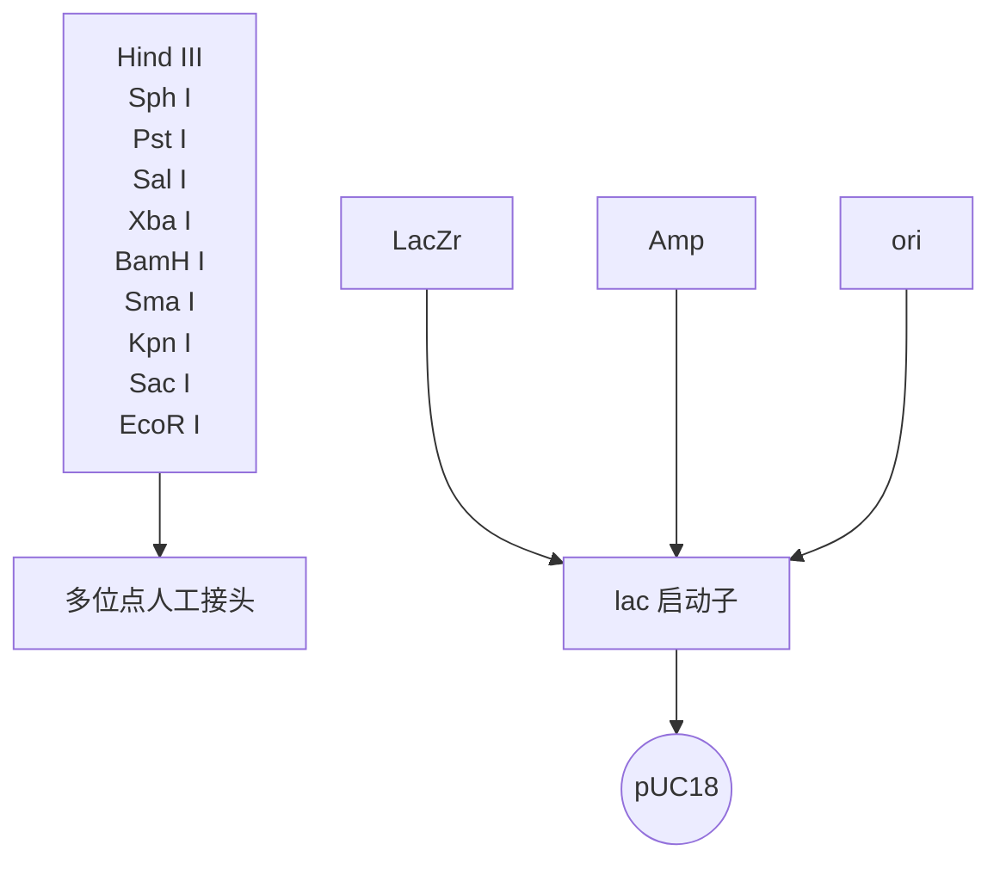
</details>

图 14-3 pUC18 质粒结构（引自 Griffiths et al. 2000）。

## 易错聚合酶进行 DNA 复制实验

22. 下表列出了在 3 种 DNA 聚合酶类催化下，体外 DNA 合成反应中预期产生的突变频率。该频率（以每合成 1000 个碱基 DNA 的突变数表示）受反应混合物中 dATP 和 $\mathrm{Mn}^{2+}$ 浓度的影响。

|  | 聚合酶β | 聚合酶η | 聚合酶ι |
| --- | --- | --- | --- |
| 条件A | 2~4 | ND | ND |
| 条件B | 15~20 | ND | ND |
| 条件E | 6~10 | ND | ND |
| 条件N | ND | 7~9 | 10~12 |

注:ND，未测定。

某一特定 DNA 链上所需要的突变频率范围决定了所用人聚合酶类型（Pol β、Pol η 或 Pol η-ι）和反应条件（步骤 23）。每种 DNA 聚合酶有其自己的突变特性，产生独特的突变谱。为了获得最大多样性的突变文库，最好将这 3 种 DNA 聚合酶产生的文库进行混合。

23. 将 $1 \mu \mathrm{g} \mathrm{pUC} 18 - \mathrm{X}$ DNA 质粒、$200 \mathrm{nmol} / \mathrm{L}$ 引物（MutpUC18\_和 MutpUC18\_R1）和 $2 \mu \mathrm{L} 10 \times$ 复制缓冲液混合于一个微量离心管中，加入需要量的 dNTP 和 $\mathrm{Mn}^{2+}$，以获得预期的突变频率（下表）。加入适量水，将反应终体积调至 $20 \mu \mathrm{L}$。这将是 DNA 复制混合物。

|  | dATP/(μmol/L) | dNTP/(μmol/L) | dNTP/(μmol/L) | dNTP/(μmol/L) | $Mn^{2+}/(mmol/L)$ |
| --- | --- | --- | --- | --- | --- |
| 条件A | 50 | 50 | 100 | 100 | N/A |
| 条件B | 20 | 100 | 100 | 100 | 0.5 |
| 条件E | 20 | 100 | 100 | 100 | 0.25 |
| 条件N | 100 | 100 | 100 | 100 | N/A |

注:N/A，不适用。

24. DNA 复制混合物在水浴箱中  $95^{\circ}$ C 孵育 5min 进行模板 DNA 变性。立即将微量离心管转移至冰浴箱中。
25. 在 $10\mu \mathrm{L}$ 的DNA复制缓冲液中分别加入4U DNA聚合酶β、聚合酶η或聚合酶ι，并将其加入每管DNA复制混合物中。

在  $37^{\circ}$ C 条件下，1h 内，将 1nmol 的 dNTP（全核苷酸）掺入酸性不溶物的酶量定义为 1 个单位（U）。

26. DNA 复制混合物于  $37^{\circ}$ C 孵育 1h。
27. 酚:氯仿抽提纯化反应混合物中的诱变 DNA（第 1 章）。

---

886

分子克隆实验指南（原书第四版）

28. 加入 0.1 倍体积的 3mol/L 乙酸钠和 2.5 倍体积的无水乙醇沉淀 DNA。-20℃ 放置至少 2h，4℃，13 000g 离心 20min。以 500μL 的 70% 乙醇洗涤沉淀 2 次，将沉淀在 Speed Vacrotary 蒸发器中干燥 3min，将干燥后沉淀溶解于 20μL 无菌 Milli-Q 水。分光光度计对 DNA 进行定量。

## 诱变 DNA 产物的选择性扩增

29. 诱变产物的选择性 PCR 扩增。PCR 反应总体积为 $30\mu \mathrm{L}$，含 $5\mathrm{ng}$ 来自步骤 28 的纯化诱变复制产物、$3\mu \mathrm{L}10\times$ Platinum Taq 聚合酶缓冲液、$200\mathrm{mmol / L}$ dNTP、$0.2\mu \mathrm{mol / L}$ 引物 MutpUC18\_S1 和 MutpUC18\_R1，以及 1U 的 Platinum Taq 聚合酶。关于选择性 PCR 循环的原则如下表:

| 循环数 | 变性 | 复性 | 聚合反应 |
| --- | --- | --- | --- |
| 1(变性) | 94°C,2min | N/A | N/A |
| 2(低严紧度) | 94°C,2min | 58°C,10s | 72°C,2min |
| 3~28(高严紧度) | 94°C,20s | 72°C,90s | 延续复性步骤 |

选择性 PCR 程序是基于两种不同复性温度。第一轮循环的复性温度（58℃）允许引物杂交。在第 3～第 28 轮中执行高严紧度循环，复性温度为 72℃。

设计的引物 MutpUC18\_S1 和 MutpUC18\_R1 分别复性到 pUC18 载体 BamHI 位点上游的 5' 端（27 个核苷酸）和 EcoRI 位点下游 3' 端。

引物 MutpUC18\_S1 和 MutpUC18\_R1 序列如下表:

| 引物 | 序列 | 限制性酶切位点 |
| --- | --- | --- |
| MutpUC18_S1 | 5'-TCTGACGAGTACTAGCTGCTACATGCAGGTCGACTCTAGAGGATCC-3' | BamH I |
| MutpUC18_R1 | 5'-ACAGCTACGTGATACGACTCACACTATGACCATGATTACGAATTCC-3' | EcoR I |
| M13(-21) | 5'-TGTAAAACGACGGCCAG-3' | N/A |
| M13R(-29) | 5'-CAGGAAACAGCTATGACC-3' | N/A |

30. 根据厂商说明书用 Microcon 过滤器纯化 PCR 产物。分光光度计进行 DNA 定量。见“疑难解答”。

## 突变体文库

31. 在各个反应中，分别用 60U BamHI 和 60U EcoRI 消化全部 PCR 纯化产物和 $2\mu \mathrm{g}$ pUC18 载体。
32.  $37^{\circ}$ C孵育反应6h。
33. 1%琼脂糖凝胶电泳纯化酶切的 DNA（PCR 产物和 pUC18）（第 2 章，方案 1 和方案 2）。用超纯凝胶回收 DNA 提取试剂盒回收 DNA。纯化的 DNA 混悬于  $10 \mu L$  水中。用已知大小和浓度的 DNA 分子质量标准，通过 1%琼脂糖凝胶分析  $1 \mu L$  DNA 溶液来测量 DNA 的浓度。
34. 用 T4 DNA 连接酶和物质的量比为 $1:3$ 的载体和插入 DNA 进行连接反应。
35.  $16^{\circ}$ C孵育反应过夜。
36. 根据厂商说明书用 Microcon 过滤器纯化连接反应产物。
37. 取 $2\mu \mathrm{L}$ 纯化后连接产物加入 $50\mu \mathrm{L}$ XL1-Blue电击感受态细胞中，将混合物转移至$0.2\mathrm{cm}$ 间隙的电穿孔比色杯中（电击杯中）。
38. 以 $1.8 \mathrm{kV} 、 25 \mathrm{mF}$ 和 $200 \mathrm{~W}$ 的参数电穿孔细胞。
39. 加  $450 \mu L$  SOC 培养基至电转化细胞中， $37^{\circ}C$ ，轻摇微量离心管，孵育 1h。
40. 收集转化子并将其涂布于 1 或 2 块含 $100\mu \mathrm{g} / \mathrm{mL}$ 氨苄青霉素和 $1\%$ 葡萄糖的 $2 \times \mathrm{YT}$

---

第 14 章 体外诱变方法

887

培养平板上。在含同样培养基的培养平板上，用梯度稀释涂布转化子来测定文库大小。

41. 37℃孵育培养平板过夜。

42. 计算梯度稀释涂布于平板上的菌落后，刮掉平板上的菌落并转移至含 $15\%$ 甘油 $(V / V)$ 的 $2\times \mathrm{YT}$ 培养基中（含氨苄和 $1\%$ 葡萄糖），$-80^{\circ}\mathrm{C}$ 保存菌种。

## 文库分析

43. 从稀释平板上随机挑取 $4 \times 96$ 个克隆, 接种到含有 $100 \mu \mathrm{g} / \mathrm{mL}$ 氨苄青霉素的 LB 液体培养基的 4 块 96 孔深孔板中 (来自 Montage 质粒小量制备 HTS 96 试剂盒)。

44. 96 孔深孔板在摇床中  $37^{\circ}$ C 振荡（800r/min）培养过夜。

45. 在一个集成机器人的 Tecan Genesis RSP200 平台上，用质粒小量制备 HTS 96 试剂盒分离提取质粒 DNA。

QIAGEN 公司和其他厂商也可提供这种类似的质粒小量制备机器人系统。

46. 采用 MilleGen 高通量测序仪，用引物 M13（-21）和 M13R（-29）对 DNA 突变部分序列进行测序（引物设计见步骤 29 和表 14-3）。

47. 用 MutAnalyse 软件分析序列，确定突变频率、文库质量（缺失、插入和置换出现频率）、野生序列出现频率、每种突变体的突变数量和整个诱变 DNA 序列上碱基置换的分布状态。

见“疑难解答”。

表 14-3 用于克隆 DNA 聚合酶β、聚合酶η和聚合酶ι的 cDNA 和构建随机诱变文库的引物

| 引物 | 序列 | 限制性酶切位点 |
| --- | --- | --- |
| ETAS1 | 5'-AATAGGATCCATGGCTACTGGACAGGATCG-3' | BamR I |
| ETAR1 | 5'-AATAGAATTCCTAATGTGTTAATGGCTTAAAAAATGATTCC-3' | EcoR I |
| BetaS1 | 5'-TAGATCATATGAGCAAACGGAAGGCGCCG-3' | Nde I |
| BetaR1 | 5'-GACTAAGCTTAGGCCTCATTCGCTCCGGTC-3' | Hind III |
| IOTAS1 | 5'-ATATGGATCCATGGAACTGGCGGACGTGGG-3' | BamH I |
| IOTAR1 | 5'-TAATAAGCTTTTATTTATGTCCAATGTGGAAATCTGATCC-3' | Hind III |
| MutpUC18_S1 | 5'-TCTGACGAGTACTAGCTGCTACATGCAGGTCGACTCTAGAGGATCC-3' | BamH I |
| MutpUC18_R1 | 5'-ACAGCTACGTGATACGACTCACACTATGACCATGATTACGAATTCC-3' | EcoR I |
| M13 (-21) | 5'-TGTAAAACGACGGCCAG-3' | N/A |
| M13R (-29) | 5'-CAGGAAACAGCTATGACC-3' | N/A |

注:经 Springer Science+Business Media 许可，再版于 Mondon et al. 2010。


## 疑难解答

问题（步骤 15）:除了目标蛋白聚合酶外，洗脱液中还有其他的蛋白质。

解决方案:上样前用某一蛋白如 BSA 封闭树脂。洗脱前充分地洗涤树脂柱。

问题（步骤 15）:考马斯亮蓝分析仅仅检测到低浓度的聚合酶蛋白。

解决方案:一个可能的原因是聚合酶蛋白在纯化过程中被降解了。尝试加入更多蛋白酶抑制剂。也有可能是在步骤 9 中大肠杆菌细胞未处于 IPTG 有效诱导蛋白质表达的正确对数生长阶段。

问题（步骤 30）:选择性扩增诱变 PCR 产物后，PCR 产物量少或检测不到 PCR 产物。

解决方案:首先检查引物 MutpUC18\_S1 和 MutpUC18\_R1 是否能有效地启动 PCR 扩增。假如能够，通过调整 MutpUC18\_S1 和 MutpUC18\_R 引物的复性温度，进行梯度 PCR。

问题（步骤 47）:突变分析没有检测到诱变或诱变量少。

---

888

分子克隆实验指南（原书第四版）

解决方案:在步骤23中，尝试其他复制条件。另外，在最初的诱变步骤中用一种不同的聚合酶或尝试不同的聚合酶组合。


## 讨论

大体上，DNA 聚合酶根据结构相似性分为 7 个不同的结构家族（A、B、C、D、X、Y 和 RT）（Rattray and Strathern 2003）。核苷酸掺入保真度随各 DNA 聚合酶家族的不同而变化。其他几个因素，如  $3'\rightarrow5'$  外切核酸酶结构域的存在也决定着保真度。例如，A、B 和 C 家族的复制 DNA 聚合酶具有较高保真度，核苷酸掺入错误率约为  $10^{-6}$ （即每掺入 100 万个核苷酸有一个错误）。

另外，对核苷酸掺入的低保真度使 DNA 聚合酶 X 和 Y 结构家族最适合应用于随机诱变。例如，DNA 聚合酶β是 DNA 聚合酶 X 家族中一个代表性成员，其错误率范围为  $10^{-3} \sim 10^{-4}$  （Kunkel 1985）。聚合酶 Y 家族，也称为跨损伤修复（translesion synthesis，TLS）聚合酶，以分配的方式复制 DNA，并且缺乏外切核酸酶的校正活性。因此，它们在 DNA 聚合酶中显示出最高的错误率（ $10^{-1} \sim 10^{-3}$ ）（Yang 2005）也就不足为奇了。人类 3 个已知的聚合酶 Y 家族成员是聚合酶η、聚合酶ι和聚合酶 κ。


## 配方

为正确使用本方案中的器材和危险试剂，必须查阅相应的材料安全数据表并咨询所在机构的环境卫生和安全办公室。

透析缓冲液

| 试剂 | 终浓度 |
| --- | --- |
| Tris-HCl (pH 8.0) | 40mmol/L |
| DTT | 2mmol/L |
| EDTA | 0.2mmol/L |
| NaCl | 200mmol/L |

洗脱缓冲液

| 试剂 | 终浓度 |
| --- | --- |
| $NaH_2PO_4/Na_2HPO_4$ (pH 8.0) | 50mmol/L |
| NaCl | 300mmol/L |
| 咪唑 | 250mmol/L |

人 DNA 聚合酶β复制缓冲液

| 试剂 | 终浓度 |
| --- | --- |
| Tris-HCl (pH 8.8) | 50mmol/L |
| MgCl2 | 10mmol/L |
| KCl | 100mmol/L |
| DTT | 1mmol/L |
| 甘油 | 10% |

人 DNA 聚合酶η和ι复制缓冲液

| 试剂 | 终浓度 |
| --- | --- |
| Tris-HCl (pH 7.2) | 50mmol/L |
| DTT | 1mmol/L |
| MgCl2 | 5mmol/L |
| 甘油 | 2.5% (V/V) |

---

第 14 章 体外诱变方法

889

LB 培养基

| 试剂 | 量(1L) |
| --- | --- |
| 细菌用胰蛋白胨 | 10g |
| 酵母提取物 | 5g |
| NaCl | 5g |

溶入 1L 的蒸馏水中，高压灭菌。

## LB/氨苄培养基

配制含  $100 \mu g/mL$  氨苄青霉素（50mg/mL 储备于蒸馏水中）的 LB 培养基。

## LB/氨苄培养板

配制含 1.5%（m/V）琼脂和 100μg/mL 氨苄青霉素（50mg/mL 储备于蒸馏水中）的 LB 培养基。

按上述配方配制液体 LB 培养基，当高压灭菌的 LB-琼脂溶液冷却至  $50^{\circ}$ C 以下时加入抗生素。

裂解缓冲液

| 试剂 | 终浓度 |
| --- | --- |
| $NaH_2PO_4$ (pH 8.0) | 50mmol/L |
| NaCl | 300mmol/L |
| 咪唑 | 10mmol/L |
| Triton X-100 | 0.05% |
| EDTA | 1mmol/L |
| DTT | 1mmol/L |
| 溶菌酶 | 1mg/mL |

SOC 培养基

| 试剂 | 终浓度 |
| --- | --- |
| 胰蛋白胨 | 2% |
| 酵母抽提物 | 0.5% |
| NaCl | 10mmol/L |
| KCl | 2.5mmol/L |
| MgCl2 | 10mmol/L |
| MgSO4 | 10mmol/L |
| 葡萄糖 | 20mmol/L |

TAE 缓冲液(50×)

| 试剂 | 量(1L) |
| --- | --- |
| Tris (hydroxymethyl) aminomethane | 242g |
| 乙酸 | 57.1mL |
| $Na_{2}EDTA$ | 7.43g |

溶入蒸馏水中，定容至1L。

洗涤缓冲液

| 试剂 | 终浓度 |
| --- | --- |
| $NaH_2PO_4/Na_2HPO_4$ (pH 8.0) | 50mmol/L |
| NaCl | 300mmol/L |
| 咪唑 | 20mmol/L |
| Triton X-100 | 0.05% |
| EDTA | 1mmol/L |
| DTT | 1mmol/L |

---

890

分子克隆实验指南（原书第四版）

YT 琼脂培养基(2×)

| 试剂 | 量(1L) |
| --- | --- |
| 琼脂 | 15g |
| 细菌用胰蛋白胨 | 16g |
| 酵母提取物 | 10g |
| NaCl | 5g |

溶入 1L 的蒸馏水中，高压灭菌。

## 参考文献

- Emond S, Mondon P, Pizzut-Serin S, Douchy L, Crozet F, Bouayadi K, Kharrat H, Potocki-Veronese G, Monsan P, Remaud-Simeon M. 2008. A novel random mutagenesis approach using human mutagenic DNA polymerases to generate enzyme variant libraries. Protein Eng Des Sel 21: 267–274.
- Griffiths AJF, Miller JH, Suzuki DT, Lewontin RC, Gelbart WM. 2000. An introduction to genetic analysis, 7th ed. WH Freeman, New York.
- Kegler-Ebo DM, Docktor CM, DiMaio D. 1994. Codon cassette mutagenesis: A general method to insert or replace individual codons by using universal mutagenic cassettes. Nucleic Acids Res 22: 1593–1599.
- Kunkel TA. 1985. The mutational specificity of DNA polymerase- $\beta$ during in vitro DNA synthesis. Production of frameshift, base substitution,
- and deletion mutations. J Biol Chem 260: 5787–5796.
- Mondon P, Souyris N, Douchy L, Crozet F, Bouayadi K, Kharrat H. 2007. Method for generation of human hyperdiversified antibody fragment library. Biotechnol J 2: 76–82.
- Mondon P, Grand D, Souyris N, Emond S, Bouayadi K, Kharrat H. 2010. Mutagen: A random mutagenesis method providing a complementary diversity generated by human error-prone DNA polymerases. Methods Mol Biol 634: 373–386.
- Rattray AJ, Strathern JN. 2003. Error-prone DNA polymerases: When making a mistake is the only way to get ahead. Annu Rev Genet 37: 31–66.
- Yang W. 2005. Portraits of a Y-family DNA polymerase. FEBS Lett 579:868–872.

## 方案 2 重叠延伸 PCR 产生插入或缺失诱变

重叠延伸 PCR 可以在一段特定目标 DNA 序列中产生特定的点突变、插入或缺失突变。与其他诱变方法相比，重叠延伸 PCR 诱变方法无需事先准备，并且不需要使用限制酶。该方法的通用性使其应用越来越广泛。与随机诱变方法不同，使用重叠延伸 PCR 诱变引入插入和缺失突变需要事先考虑好将要进行的特定突变。

传统的重叠延伸 PCR 方法在一些关键步骤上还保留一些局限性，尤其是需要产生插入诱变和缺失时。例如，传统方法需要将所有序列变化含在引物中，但这样会使多于 30 个核苷酸片段插入突变很难实现。

该方案描述的重叠延伸 PCR 诱变方法比之前的方法更通用。该方法可以在所给的 DNA 序列的任何位点插入或缺失任何大小的片段。为产生插入突变，首先要利用第一步 PCR 制备拟插入的片段和两个两侧的片段，然后利用第二步 PCR 使插入的片段与从原始模板衍生来的两个两侧片段发生重组。该方法中的引物之所以称为“嵌合引物”，是因为它们是由一个来自原始模板的 18 个核苷酸序列和来自插入片段的 9 个核苷酸的序列连接而成。而位于嵌合引物 5' 端的 9 个核苷酸片段非常关键，因为它使插入片段与两侧的 DNA 片段进行杂交。图 14-4A 是产生插入突变实验步骤总示意图。该方法也可以用来产生缺失突变，将在此方案的后面部分对其进行讨论（图 14-4B）。该方案摘自 Lee 等（2004，2010）的文献。

---

第 14 章 体外诱变方法

891

A

实施插入突变的方法


<details>
<summary>flowchart</summary>

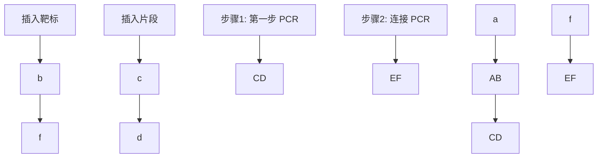
</details>

B


<details>
<summary>flowchart</summary>

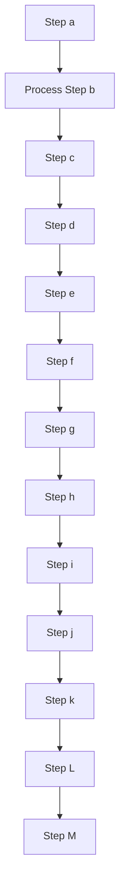
</details>

图 14-4 如何使用重叠延伸 PCR 产生插入和缺失。（A）重叠延伸 PCR 指导的插入诱变。

六边形表示插入的片段（空心或实心）、圆圈表示两侧序列（空心或实心）。27个核苷酸大小的嵌合引物（如图中b和e）由来自模板（圆圈）的18个核苷酸片段和来自插入序列（六边形）的9个核苷酸片段组成。每个六边形或者圆圈代表3个核苷酸。箭头表示引物的 $3^{\prime}$ 端。插入片段插入的位置被两个相邻的不同底纹的圆圈隔开（空心或实心）。在第一步PCR反应中，用适当的引物首先将3种PCR产物（图中AB、CD和EF）分别制备出来。例如，DNA片段AB是由引物a和b产生的PCR产物等。产物片段包含18个核苷酸重叠区域（括弧）在一端（AB和EF）或者两端（CD）。在另一个反应中，用前面PCR反应产生的3种产物作为此次PCR反应的模板，用最外侧的引物（a和f）进行第二次PCR反应。由于重叠区域中末端的互补性，这些产物会发生复性反应并在第二步PCR反应的第1个循环中进行延伸。在第二步PCR反应中，第一次PCR反应生成的产物将连接在一起。（B）分别用一个非嵌合和一个嵌合引物，即a和b或c和d制备拟缺失序列的两侧区域，获得两种PCR产物。在第二步PCR中，以来自第一步PCR的两种产物（AB和CD）为模板，以最外侧的引物对a和d进行连接PCR反应。灰色，拟缺失序列（圆圈、实心或空心）两侧区域（经BioTechniques许可，改编于Lee et al. 2004，经Springer Scienceb Business Media许可，改编于Lee et al. 2010）

---

892

分子克隆实验指南（原书第四版）


## 材料

为正确使用本方案中的器材和危险试剂，必须查阅相应的材料安全数据表并咨询所在机构的环境卫生和安全办公室。

本方案的专用试剂标注&lt;R&gt;，配方在本方案末提供。常用储备溶液、缓冲液和试剂标注&lt;A&gt;，配方见附录1。储备溶液应稀释至适用浓度后使用。

## 试剂

含  $0.5 \mu g/mL$  溴化乙锭的 1% 琼脂糖凝胶

模板 DNA

用 PEG 沉淀方法或者商品化化试剂盒（如 QIAGEN 公司的 QIAprep Spin Miniprep kit）准备模板 DNA。纯化后将质粒 DNA 溶解在 1×Tris-EDTA 缓冲液中&lt;R&gt;

dNTP 溶液（包含 4 种 dNTP 的混合溶液，每种 dNTP 的浓度为 2.5mmol/L）

PCR 缓冲液（10×）&lt;R&gt;

PCR 聚合酶（2.5 U/μL）

要谨慎选择 Taq DNA 聚合酶。推荐选用 Pfu 聚合酶（Agilent）或其他高保真 Taq DNA 聚合酶。

无菌水

合成引物（设计引物说明，见方案）

将合成引物溶解在水中，浓度为  $10 \, pmol/\mu L$ 。

## 设备

凝胶电泳设备或 QIAquick 凝胶回收试剂盒（QIAGEN 公司）

微量离心管（0.5mL；PCR 扩增反应用薄壁离心管）

微量加样器

Nano Drop 机器（NanoDrop machine）

灭菌刀片（用于凝胶纯化）

热循环仪

紫外灯


## 方法

## 插入的产生

首先，利用合适的引物对进行 PCR 反应，制备插入片段和两条侧翼片段。两条侧翼片段在 5' 端均含有重叠区域。待插入片段在两端都含有重叠区域。在第二步 PCR 反应中，将插入片段和两侧片段混合在一起，进行变性、复性和延伸反应，从而生成最终产物。在随后的 PCR 循环中，用最外侧引物对扩增可产生最终的延长产物（图 14-4A）。

## 引物设计

1. 该方案共需要 6 条引物。其中 4 条为嵌合引物（引物 b、c、d 和 e），用于第一步 PCR。另 2 条引物（引物 a 和 f）是非嵌合引物，用于第二步 PCR。
2. 4 条嵌合引物的序列（引物 b、c、d 和 e）一部分来自拟插入的 DNA 序列，一部分来自原始的 DNA 模板序列（因此命名为嵌合引物）。为制备两侧的 PCR 片段（图中 AB 和 EF），需要设计 1 个 27 个核苷酸的嵌合引物（引物 b 和 e），其中 18 个核苷酸来自模板，9 个核苷酸来自插入序列（图 14-4A）。在嵌合引物设计时要考虑正确的方向，即 18 个核苷

---

第 14 章 体外诱变方法

893

酸序列应该位于  $3'$  端，而 9 个核苷酸序列应该位于  $5'$  端。

3. 同样，为了产生插入片段（如 CD），应设计另外两个 27 个核苷酸嵌合引物（如引物 b 和 c），其中 18 个核苷酸来自插入序列，9 个核苷酸来自模板序列。利用这对引物在插入片段两侧引入与两侧 PCR 片段（图 14-4 中 AB 和 EF）互补的 9 个核苷酸序列，并以此作为第二步 PCR 的杂交模板。

4. 两条最外侧的引物（图中a和f）也是在第二步PCR反应中需要的。两侧的引物末端应该包括限制性酶切位点，以便于将PCR产物克隆到载体中。

## 第一步 PCR

在第一步 PCR 中，通过 3 个独立的 PCR 反应制备 AB、EF 和 CD 3 个 PCR 片段，进而在第二步 PCR 中通过将 3 个片段混合以产生延伸产物（图 14-4A）。第一步 PCR 反应的两个 PCR 产物对应的是掺入位点两侧区（图 14-4 中 AB 和 EF），第 3 个 PCR 产物对应的是插入片段区（图 14-4 中 CD）。分别用一个非嵌合引物和一个嵌合引物（a 和 b 或 e 和 f）制备两侧片段，并由此在两侧片段 AB 和 EF 中均各自引入插入序列区一端的 9 个核苷酸。由两个嵌合引物（图 14-4 中引物 c 和 d）制备插入序列（图 14-4 中 CD），在其两个末端引入与两侧 PCR 片段的重叠区。

5. 3 个 PCR 片段（AB，CD 和 EF）的 PCR 反应体系均为  $50 \mu L$ ，其中包含 10～20ng 待修饰的 PCR 模板 DNA 或拟插入片段，具体的反应体系如下:

| PCR 模板 DNA | 10~20ng |
| --- | --- |
| PCR 缓冲液(10×) | 5μL |
| dNTP 混合液 | 4μL |
| 引物 1(10μmol/L) | 2μL |
| 引物 2(10μmol/L) | 2μL |
| Taq DNA 聚合酶(2.5U/μL) | 0.5μL |
| 无菌水 | 加至总体积为 50μL |

不同 PCR 片段用不同的模板和引物扩增。

扩增AB片段:

将原始模板 DNA 与 a、b 引物混合。

扩增 CD 片段:

将拟插入片段的 DNA 与 c、d 引物混合。

扩增 EF 片段:

将原始模板 DNA 与 e、f 引物混合。

6. 按如下程序在热循环仪中进行 PCR 反应。

| 循环数 | 变性 | 复性 | 聚合反应 |
| --- | --- | --- | --- |
| 1 | 98°C,2min |  |  |
| 2~26 | 98°C,10s | 55°C,15s | 72°C,1min |

最后一轮反应结束后，将样品置于  $72^{\circ}$ C 继续孵育 10min，保证延伸反应完全。

见“疑难解答”。

7. 为了纯化 PCR 产物，以便进行第二步 PCR 反应，将全部 PCR 产物上样到含有 $0.5\mathrm{mg/mL}$ 溴化乙锭的 $1\%$ 琼脂糖凝胶中，进行琼脂糖凝胶电泳（第2章）。电泳完毕，将琼脂糖凝胶置于紫外灯下观察 PCR 产物条带，以检查扩增效率。采用商品化试剂盒（如 QIAquick 胶回收试剂盒）回收 PCR 产物。在进行下一步骤前，用 NanoDrop 机器（NanoDrop machine）对纯化的 DNA 进行质量分析。

---

894

分子克隆实验指南（原书第四版）

## 第二步 PCR

第二步 PCR 反应的目的是将在第一步 PCR 反应中获得的 3 个 PCR 片段连接在一起形成最终的产物。首先，将第一步 PCR 反应产生的片段（AB、CD 和 EF）混合，因末端核苷酸序列互补而发生复性反应。然后，杂交 DNA 分子在热稳定 DNA 聚合酶和最外侧引物（如 a 和 f）作用下进行延伸和扩增。

8. 在微量离心管中制备 $50\mu \mathrm{L}$ 如下PCR反应体系，其中包含3个来自第一轮PCR反应的产物片段各 $10\sim 20\mathrm{ng}$。

| 凝胶纯化的第一轮PCR反应产物(AB、CD和EF片段) | 10~20ng |
| --- | --- |
| PCR缓冲液(10×) | 10μL |
| dNTP混合液 | 4μL |
| 引物a(10μmol/L) | 2μL |
| 引物f(10μmol/L) | 2μL |
| 热稳定DNA聚合酶(2.5U/μL) | 0.5μL |
| 无菌水 | 至总体积为50μL |

9. 按如下程序在热循环仪中进行 PCR 反应。

| 循环数 | 变性 | 复性 | 聚合反应 |
| --- | --- | --- | --- |
| 1 | 98°C, 2min |  |  |
| 2~26 | 98°C, 10s | 55°C, 15s | 72°C, 1min |

最后一轮反应结束后，样品置于  $72^{\circ}$ C 继续孵育 10min，保证延伸反应完全。

见“疑难解答”。

10. 如上所述纯化 PCR 产物，将最终的 PCR 产物克隆到合适的载体，进一步进行测序从而确定产生了所需的诱变。

## 缺失的产生

产生缺失突变的方法和前面讲述的产生插入突变的方法类似，但是在该方法中，第一步 PCR 反应中产生的 PCR 片段是 2 个，而不是前面所述的 3 个（图 14-4B）。为实现缺失突变，首先要利用 PCR 反应制备拟缺失序列两侧的片段，并在两个片段中引入来自缺失序列对侧模板的末端序列。这两个末端序列可以使该两侧的片段进行杂交，从而在第二步 PCR 反应中延伸产生变短了的最终产物。换言之，缺失即是两侧序列的连接或重组。

## 引物设计

11. 制备缺失突变共需要 4 条引物:两条嵌合引物（引物 b 和 c）和两条非嵌合引物（引物 a 和 d）。
12. 两条嵌合引物（如引物 b 和 c）由来自紧邻缺失片段两侧的 18 个核苷酸和来自对侧紧邻缺失片段的 9 个核苷酸组成（图 14-4B）。设计时要确保引物正确的方向性。
13. 最外侧的两个引物（引物 a 和 d）是用来对最终的缺失后产物进行 PCR 扩增的。两侧引物末端应该包含限制性酶切位点，以便后续对最终的 PCR 产物进行克隆。

---

第 14 章 体外诱变方法

895

## 第一步 PCR

在第一步 PCR 反应中，通过两个独立的 PCR 过程分别扩增片段 AB 和 CD，以便将两片段在第二步 PCR 反应中进行杂交（图 14-4B）。第一步 PCR 产生的两个 PCR 产物分别来自被缺失片段的两侧，每个片段分别用一条嵌合引物和一条非嵌合引物扩增而来。

14. 用 $10 \sim 20 \mathrm{ng}$ 模板 DNA, 对 AB 和 CD 片段进行 PCR 反应, $50 \mu \mathrm{L}$ 反应体系如下。

| 原始 DNA 模板 | 10~20ng |
| --- | --- |
| PCR 缓冲液(10×) | 5μL |
| dNTP 混合液 | 4μL |
| 引物 1(10μmol/L) | 2μL |
| 引物 2(10μmol/L) | 2μL |
| 热稳定 DNA 聚合酶(2.5U/μL) | 0.5μL |
| 灭菌水 | 加至总体积为 50μL |

扩增 AB 片段时:

用引物 a 和 b。

扩增 CD 片段时:

用引物 c 和 d。

15. 按如下程序在热循环仪中进行 PCR 反应。

| 循环数 | 变性 | 复性 | 聚合反应 |
| --- | --- | --- | --- |
| 1 | 98°C,2min |  |  |
| 2~26 | 98°C,10s | 55°C,15s | 72°C,1min |

最后一轮反应结束后，样品置于 $72^{\circ} \mathrm{C}$ 继续孵育 $10 \mathrm{~min}$，保证延伸反应完全。

见“疑难解答”。

16. 为了纯化 PCR 产物，以便进行第二步 PCR 反应，将全部 PCR 产物上样到含有 $0.5\mathrm{mg/mL}$ 溴化乙锭的 $1\%$ 琼脂糖凝胶中，进行琼脂糖凝胶电泳（第2章）。电泳完毕，将琼脂糖凝胶置于紫外灯下观察 PCR 产物条带，以检查扩增效率。采用商品化试剂盒（如 QIAquick 胶回收试剂盒）回收 PCR 产物。在进行下一步骤前，用 NanoDrop 机器对纯化的 DNA 进行质量分析。

## 第二步 PCR

第二步 PCR 反应的目的是扩增第一步 PCR 反应的两种产物，从而得到缺失突变体。在第二步 PCR 反应中，PCR 产物 AB 和 CD 混合后并利用末端的互补区段发生复性。杂交的 DNA 分子在热稳定 DNA 聚合酶作用下进行延伸和扩增，从而生成缺失突变的目标产物。

17. 在微量离心管中制备  $50 \mu L$  如下 PCR 反应体系，其中包含两个来自第一轮 PCR 反应产物片段各  $10 \sim 20 ng$ 。

| 凝胶纯化的第一轮PCR反应产物(AB和CD片段) | 10~20ng |
| --- | --- |
| PCR缓冲液(10×) | 10μL |
| dNTP混合液 | 4μL |
| 引物a(10μmol/L) | 2μL |
| 引物d(10μmol/L) | 2μL |
| 热稳定DNA聚合酶(2.5U/μL) | 0.5μL |
| 无菌水 | 加至总体积为50μL |

---

896

分子克隆实验指南（原书第四版）

18. 用如下程序在热循环仪中进行 PCR 反应。

| 循环数 | 变性 | 复性 | 聚合反应 |
| --- | --- | --- | --- |
| 1 | 98°C,2min |  |  |
| 2~26 | 98°C,10s | 55°C,15s | 72°C,1min |

最后一轮反应结束后，样品再在  $72^{\circ}$ C 继续孵育 10 min，保证延伸反应完全。

见“疑难解答”。

19. 利用凝胶电泳纯化缺失突变产物（第 2 章），并将其克隆入选定的载体中，通过 DNA 序列测定确证缺失突变产物。


## 疑难解答

问题（步骤 6、步骤 9、步骤 15 和步骤 18）:PCR 产物出现错误。

解决方案:为减少错误，需控制拟扩增 PCR 产物长度小于 2.0kb。

问题（步骤 6、步骤 9、步骤 15 和步骤 18）:产物中出现一处或者多处突变。

解决方案:使用从未用 PCR 扩增过的质粒 DNA。

问题（步骤6、步骤9、步骤15和步骤18）:产生不需要的副产物。

解决方案:在进行 PCR 之前有几点需要注意。首先，控制 PCR 程序循环数不超过 25 个（加上开始的变性循环数）。其次，根据引物预计的解链温度来调整复性温度，这点非常重要。


## 配方

为正确使用该方案中的器材和危险试剂，必须查阅相应的材料安全数据表并咨询所在机构的环境卫生和安全办公室。

10×PCR 缓冲液

| 试剂 | 终浓度 |
| --- | --- |
| Tris-HCl (pH 8.3) | 100mmol/L |
| KCl | 500mmol/L |
| $MgCl_2$ | 15mmol/L |
| 明胶 | 0.1% |

1×Tris-EDTA 缓冲液

| 试剂 | 终浓度 |
| --- | --- |
| Tris-HCl (pH 8.3) | 10mmol/L |
| EDTA | 1mmol/L |

## 参考文献

<small><span class="docvortex-page-footnote" data-block-type="page_footnote" style="color:#6b7280">Lee J, Lee HJ, Shin MK, Ryu WS. 2004. Versatile PCR-mediated insertion or deletion mutagenesis. BioTechniques 36: 398–400.</span></small>

<small><span class="docvortex-page-footnote" data-block-type="page_footnote" style="color:#6b7280">Lee J, Shin MK, Ryu DK, Kim S, Ryu WS. 2010. Insertion and deletion mutagenesis by overlap extension PCR. Methods Mol Biol 634: 137–146.</span></small>

---

第 14 章 体外诱变方法

897

# 方案 3 以双链 DNA 为模板的体外诱变: 用 Dpn I 选择突变体

在该方案与方案 5 中，以变性质粒 DNA 为模板，在高保真聚合酶作用下，使用两条寡核苷酸链引导 DNA 合成。两条寡核苷酸链中均含有预定突变位点，并且两者在质粒 DNA 上的结合序列彼此反向互补。在该方案中，经多轮热循环，双链质粒 DNA 的全长均以线性形式扩增，最终产生一种 DNA 双链上带交错缺口的突变质粒 DNA（图 14-5）(Hemsley et al. 1989)。


<details>
<summary>flowchart</summary>

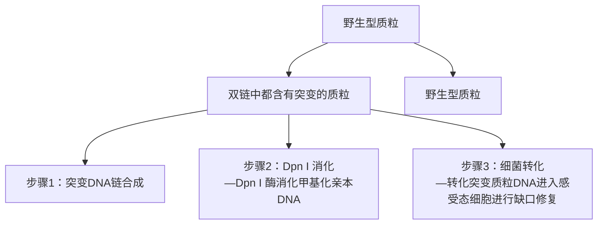
</details>

图 14-5 用 Dpn I 和 PCR 进行定点诱变。在本方案中，一个含有目标基因片段的双链 DNA（dsDNA）载体和两个包含所需突变位点的寡核苷酸引物（见方案 1，图 14-1）混合在一起。两个寡核苷酸引物在 PCR 中向相反方向进行扩增。形成的寡核苷酸引物生成一个含有交错缺口的诱变质粒。PCR 扩增后，扩增产物用 Dpn I 处理。Dpn I 限制性内切核酸酶主要消化甲基化和半甲基化的 DNA，而亲本 DNA 模板是甲基化的，因此可以利用 Dpn I 的剪切能力消化去除模板 DNA，从而使带有突变位点的 PCR 产物得到富集。黑色圆圈表示突变插入位点。

因为扩增反应中使用了一定数量的模板 DNA，野生型质粒 DNA 的转化子背景将非常高，因此需要增加富集突变体 DNA 的步骤。该方案通过采用可以特异性消化完全甲基化序列（GMe6ATC 序列，Vovis and Lacks 1977）的限制酶 Dpn I 处理线性扩增产物来实现这一目标。Dpn I 酶可以消化扩增反应体系中大肠杆菌产生的模板 DNA，而不能消化体外合

---

898

分子克隆实验指南（原书第四版）

成的 DNA（信息栏“ $N^{6}$ -甲基化腺嘌呤、DAM 甲基化酶和甲基化敏感限制酶”）。不能被 Dpn I 消化的诱变体分子可通过转化并筛选带有抗生素抗性的大肠杆菌而获得。根据诱变体的复杂性和 DNA 模板长度不同，最终将有 15%～80% 的转化子含有所需突变的质粒（Weiner et al. 1994）。该方法可成功应用于中等大小（<7kb）的质粒，将诱变体直接引入到全长 cDNA 中，免去了额外的亚克隆操作。

该方法（通常被称为环状诱变）成功的关键在于引物的设计和选择恰当的热稳定 DNA 聚合酶，这在该方案的讨论部分会有进一步的论述。环状诱变所使用的商品化试剂为 QuickChange 试剂盒（Agilent 公司），该试剂盒中含有一个质粒 DNA 模板和诱变引物，可作为阳性对照。这个试剂盒尤其适合首次进行环状诱变试验的研究人员使用。


## 材料

为正确使用该方案中的器材和危险试剂，必须查阅相应的材料安全数据表并咨询所在机构的环境卫生和安全办公室。

该方案的专用试剂标注&lt;R&gt;，配方在该方案末提供。常用储备溶液、缓冲液和试剂标注&lt;A&gt;，配方见附录1。储备溶液应稀释至适用浓度后使用。

## 试剂

琼脂糖凝胶（1%），含  $0.5 \mu g/mL$  溴化乙锭（步骤 8）

ATP (10mmol/L)

噬菌体 T4 DNA 连接酶（可选）

噬菌体 T4 多核苷酸激酶和缓冲液（可选；步骤 10）

hsdR17 基因型的大肠杆菌感受态菌株（如 XL1-Blue、XL2-Blue、MRF' 或 DH5α）

DNA 分子质量标准（1kb）

dNTP 溶液（含有 4 种 dNTP，每种 5mmol/L）

Dpn I 限制性内切核酸酶和缓冲液

乙醇（70%），冰上预冷

溴化乙锭（5μg/mL）

长 PCR 缓冲液（10×）（当使用 DNA 聚合酶混合物时）&lt;R&gt;

矿物油或石蜡（可选；步骤5）

诱变缓冲液（10×）（当使用 DNA 聚合酶如 Pfu 时）&lt;R&gt;

NaOH（1mol/L）/EDTA（1mmol/L）（可选）

寡聚核苷酸引物

关于设计的寡核苷酸引物，请参见本方案的导言部分。要想得到更好的实验结果，最好用快速高效液相层析（FPLC）或PAGE来纯化寡核苷酸引物，以便减少盐离子的干扰。将引物用蒸馏水配制成20mmol/L。

酚:氯仿（可选；步骤9）

质粒 DNA

用于诱变的模板 DNA 是一个含有目标基因或 cDNA 的环形互补质粒。一般来说，质粒越短越有利于目标 DNA 的扩增。质粒总长度 <7kb 效果最好。然而，也有质粒模板长达 11.5kb 的成功案例（Gatlin et al. 1995）。质粒 DNA 应该用含有低浓度 EDTA（<0.1mmol/L；1×Tris EDTA 缓冲液 &lt;R&gt;）的 1mmol/L Tris-HCl（pH 7.6）缓冲液溶解至 1μg/mL。

乙酸钠（3mol/L, pH 4.8）（可选）

该溶液是用作中和剂，因此 pH 略低于用于分子克隆的乙酸钠溶液。

---

第 14 章 体外诱变方法

899

TE 缓冲液（pH 8.0） &lt;R&gt;

热稳定的 DNA 聚合酶（如 Pfu DNA 聚合酶）

该方案描述的条件是针对 PfuTurbo DNA 聚合酶进行优化获得的。但也适用于其他热稳定的聚合酶或聚合酶的混合物。Agilent 公司提供 3 种形式的 Pfu:一种是天然酶；另外一种是从 Pfu 基因克隆体中表达的重组酶；还有一种是复合型的 PfuTurbo 制剂。PfuTurbo 由两个成分组成，一种是重组的 Pfu DNA 聚合酶，一种是新的热稳定因子，目前对这种因子的特性还不是很清楚，但是该因子可以增强扩增产物的扩增效率，且不会改变 DNA 复制的保真度。制造商声称，PfuTurbo DNA 聚合酶能够扩增 15kb 的 DNA 片段。然而目前我们认为，当扩增的 DNA 片段超过 7～8kb 时，扩增效率就会降低。

## 设备

适用于自动微量加样器的带滤芯吸头

DNA 测序仪

凝胶电泳设备

微量离心管（0.5mL 的薄壁管，用来扩增反应）或微量滴定板

正排量移液器

设定好程序的热循环仪

如果热循环仪没有配备加热盖，使用矿物油或石蜡以防止反应混合物在 PCR 过程中蒸发。

## 附加材料

转化（步骤 14；见第 3 章）、杂交（步骤 15；见第 2 章）和测序（步骤 16；见第 11 章）所用的试剂和设备。


## 方法

## 用诱变引物扩增目标 DNA

步骤 1 和 2 可选（步骤 3 后的标注）。

1. 将  $1 \sim 10 \mu g$  质粒 DNA 溶于含有  $10 \mu L$  1mol/L NaOH/1mmol/L EDTA 的  $40 \mu L$  的水中， $37^{\circ} C$  孵育 15min，使质粒 DNA 模板变性。
2. 加入  $5 \mu L$   $3 \, mol/L$  的乙酸钠（pH 4.8）中和反应液。用  $150 \mu L$  预冷的乙醇沉淀 DNA。
3. 在 $4^{\circ} \mathrm{C}$ 离心 $10 \mathrm{~min}$ 以收集变性的质粒 DNA。小心倒出乙醇上清液，再用 $150 \mu \mathrm{L}$ 的 $70 \%$ 乙醇洗涤沉淀。离心 $2 \mathrm{~min}$，弃去上清液，并在室温晾干至乙醇完全蒸发。最后将 DNA 溶解于 $20 \mu \mathrm{L}$ 水中。

理论上，在质粒 DNA 用作 PCR 模板前不需要使其变性。如果省略碱变性步骤，超螺旋的天然双链 DNA 也可以在 PCR 过程的第一个循环被加热至  $94^{\circ}$ C 而变性。之所以选择步骤 1 和步骤 2，是由于质粒 DNA 在碱溶液中持续变性后会形成特定的状态。在暴露于 0.2mol/L NaOH 期间，质粒 DNA 会折叠成一个致密的、不可逆转的变性线团状物，这种形式的质粒 DNA 可以作为 PCR 反应的模板，但没有明显转化细菌的能力。因此，包含非变异的野生型 DNA 克隆的背景将明显减少（Du et al. 1995; Dorrell et al. 1996）。相应地，在聚合酶链反应的第一循环中短时间将模板 DNA 暴露于  $95^{\circ}$ C 可打乱碱基配对，但并不会破坏质粒分子转化的能力。因此，转化后的克隆含有比例较高的非变异的亲本质粒分子。在实验最后阶段，当需要从克隆中筛选出含有突变的 DNA 的时候，碱性变性的优势便会体现出来。

如果诱变效率低且所选的 Dpn I 无效，含有野生型分子的克隆比例可能会异常高。

---

900

分子克隆实验指南（原书第四版）

4. 在无菌薄壁 $0.5\mathrm{mL}$ 离心管，加入一系列含有不同量（如 $5\mathrm{ng}$ 、 $10\mathrm{ng}$ 、 $25\mathrm{ng}$ 和 $50\mathrm{ng}$）质粒DNA和一定量两个寡核苷酸引物的反应混合物。

| 诱变缓冲液(10×) | 5μL |
| --- | --- |
| 模板质粒 DNA | 5~50ng |
| 寡核苷酸引物 1(20mmol/L) | 2.5μL |
| 寡核苷酸引物 2(20mmol/L) | 2.5μL |
| dNTP 混合物 | 2.5μL |
| ${\mathrm{H}}_{2}\mathrm{O}$ | 加至总体积 50μL |

在反应混合物中加入 2.5U 的 PfuTurbo DNA 聚合酶。

为了减少 PfuTurbo 3'→5' 外核酸酶活性降解引物的概率，按照上述顺序添加试剂是非常有必要的。

5. 如果热循环仪未装有热盖，用1滴（约 $50\mu \mathrm{L}$ ）轻矿物油或石蜡覆盖反应混合物以防止反应混合液在重复循环的加热和冷却过程中发生蒸发。将管子放在热循环仪中。

6. 扩增核酸使用的变性、复性和聚合反应时间和温度条件如下表所示。

| 循环数 | 变性 | 复性 | 聚合反应 |
| --- | --- | --- | --- |
| 1 | 95°C, 1min |  |  |
| 2~18$^{a}$ | 95°C, 30s | 55°C, 1min | 68°C进行反应2min/1000个碱基 |
| 最后一个循环 | 94°C, 1min | 55°C, 1min | 72°C, 10min |

这些时间适用于 $0.5\mathrm{mL}$ 管中的 $50\mu \mathrm{L}$ 反应体系，一般在以下型号的热循环仪中进行，如PerkinElmer9600或9700、Mastercycler（Eppendorf公司）和PTC100（MJ Research公司）等。对于不同的设备和反应体积，时间和温度可能需要加以调整。

a. 对于单碱基替换，使用12个循环的线性扩增；对于一个氨基酸的替换（通常要进行两个或三个连续碱基的替换），使用16个循环；对于含有插入和（或）缺失的反应，使用18个循环。

使用 $Pfu$ 进行扩增反应的扩增速率比使用 $Taq$ 酶进行扩增反应要慢 $1.5 \sim 2.0$ 倍。

使用大量的初始模板和较少循环数反应可用于减少质粒DNA和基因或cDNA扩增过程中的非特异突变。

7. DNA 扩增完成后，将反应混合液放置在冰上。

8. 取 $100 \mu \mathrm{L}$ 反应产物在含有 $0.5 \mu \mathrm{g} / \mathrm{mL}$ 溴化乙锭的 $1 \%$ 琼脂糖凝胶中进行电泳, 以确定是否扩增获得目标 DNA。同时在近旁的凝胶跑道中上样 $50 \mathrm{ng}$ 未扩增的线性质粒 DNA 和 $1 \mathrm{kb} \mathrm{DNA}$ 分子质量标准作为对照。

如果扩增效率很低，可设置一系列反应来优化扩增反应体系和循环参数。

## 扩增产物的连接与转化

步骤 9～步骤 12 均为可选，一般仅在诱变效率很低时使用（如构建插入和缺失突变时）。

9. 用酚:氯仿抽提两次扩增的 DNA，并用乙醇沉淀。

10. 用以下试剂重悬 DNA 沉淀:

| 噬菌体T4多核苷酸激酶缓冲液(10×) | 5μL |
| --- | --- |
| ATP(10mmol/L) | 5μL |
| 噬菌体T4多核苷酸激酶 | 5U |
| $H_2O$ | 加至总体积50μL |

在 $37^{\circ}\mathrm{C}$ 孵育反应 $1\mathrm{h}$ 。在 $68^{\circ}\mathrm{C}$ 加热 $10\mathrm{min}$ 灭活激酶活性。用酚:氯仿提取磷酸化DNA两次，并用乙醇沉淀法收集DNA。

---

第 14 章 体外诱变方法

901

11. 重悬磷酸化的 DNA 沉淀（每个样品约 $0.9\mu \mathrm{g}$）于 $90\mu \mathrm{L}$ 的 TE 缓冲液。设置一系列浓度范围从 $0.1 \sim 1\mu \mathrm{g} / \mathrm{mL}$ 的磷酸化 DNA 进行连接反应。

| 磷酸化 DNA | (10~100ng) |
| --- | --- |
| 噬菌体 T4 DNA 连接酶缓冲液(10×) | 10μL |
| ATP (10mmol/L) | 10μL |
| 噬菌体 T4 DNA 连接酶 | 4U |
| ${\mathrm{H}}_{2}\mathrm{O}$ | 加至总体积 100μL |

在  $16^{\circ}$ C 孵育反应  $12 \sim 16$ h。

如果使用由制造商提供的 $10 \times$ 噬菌体T4连接酶缓冲液，其中包含ATP，则省略上述连接反应中的ATP。

连接反应形成环状单体的原理和条件等理论已经很成熟（Collins and Weissman 1984），但是在实践中很难实现。DNA末端分子的物质的量浓度必须很低以易于形成内分子环状结构。但是，利用逆向PCR扩增获得的DNA分子很难计算其适当的浓度，因为末端完好的全长产物的比例是未知的。

12. 用酚:氯仿提取两次连接后的 DNA 产物，并由乙醇沉淀 DNA。用 $45\mu \mathrm{L}$ 水重悬每个沉淀物。在每个管中添加 $5\mu \mathrm{L} 10 \times Dpn$ I 缓冲液。
13. 通过直接向剩余的扩增反应液（步骤7）或磷酸化并连接的DNA（步骤12）中添加10U的DpnI来消化扩增后的DNA产物。混合后吹打溶液几次，微型离心机离心5s，然后在 $37^{\circ}\mathrm{C}$ 下孵育1h。

如果温度循环在矿物油或石蜡中运行，重要的是要确保 Dpn I 添加到反应混合物的水溶液部分。使用带滤芯的微量吸管，并且一定要插入到矿物油或石蜡覆盖面以下。

14. 用 $1 \mu \mathrm{L} 、 2 \mu \mathrm{L}$ 和 $5 \mu \mathrm{L}$ 消化后的 DNA 分别转化大肠杆菌感受态细胞（第 3 章）。

请确保没有矿物油从消化混合物转移到感受态细胞。

使用具有较强转化能力的 XL2-Blue MRF'大肠杆菌细胞（Agilent 公司）和改进后的转化步骤以利于诱变产物的回收（Dorrell et al. 1996）。然而，自制的高转化能力大肠杆菌亦可适用于大多数的环状诱变产物。

15. 从至少 12 个独立转化克隆中提取质粒 DNA。用 DNA 测序方法筛选 DNA 突变体，或者用寡核苷酸杂交的方法（第 2 章）进行鉴定，如果引入的突变形成或破坏了一个限制酶识别位点，或模板中引入了插入或缺失突变，此时可以使用限制酶消化少量粗提质粒 DNA 的方法来鉴定。

见“疑难解答”。

16. 测定一整段序列来验证目标 DNA 中所需的突变是否存在，同时在扩增过程中没有非预期突变生成（第 11 章）。

见“疑难解答”。


## 疑难解答

问题（步骤 15）:没有携带所需突变的质粒。

解决方案:用寡核苷酸杂交法筛选整个转化体群来找出所需的突变克隆。

问题（步骤 16）:扩增反应可以进行，但产量很低。

解决方案:Dpn I 可能是问题的关键所在。设置一系列反应来检查这种酶是否能够在  $1 \times Pfu$  反应缓冲液中完全消化 50ng 亲本质粒。如果有必要，调整 Dpn I 使用量和消化时间。如果 Dpn I 消化反应效率高，请考虑使用两步扩增反应（Wang and Malcolm 1999）。在第一阶段，进行两个单独的不对称扩增反应，每个反应使用两个寡核苷酸引物中的一个。

---

902

分子克隆实验指南（原书第四版）

反应产物均是单链 DNA 分子，可以作为第二阶段线性扩增的模板，用这两个寡核苷酸作为引物进行扩增反应。第一阶段反应的目的是产生不与野生型的双链竞争且能与诱变引物完全结合的模板。


## 讨论

## 引物设计

两个寡核苷酸引物:

- 必须能与同一目标序列的互补链复性。
- 长度必须相等（在25和45个碱基对之间）；计算出的解链温度为 $78^{\circ}\mathrm{C}$ 或更高。$T_{\mathrm{m}}$ 应足够高以防止错配，并且足够低以便允许引物-引物二聚体在扩增反应的变性步骤解开。

\- 应终止在一个 G 或 C 残基。

\- 不需要磷酸化。这是因为热稳定 DNA 聚合酶 $Pfu$ 最常用于催化扩增反应，无论寡核苷酸是否磷酸化，$Pfu$ 都无法取代寡核苷酸与目标序列杂交。

\- 通常未经纯化便可使用。然而，如果使用快速液相色谱法（FPLC）或聚丙烯酰胺凝胶电泳（PAGE）纯化获得的引物进行突变，尤其是产生插入和缺失突变时，效率会更高。

当引入点突变时，一个引物带有野生型序列，而另一条引物含有所需的突变，并且在突变位置的两侧都至少有12个碱基的正确序列。如果产生缺失突变，两个引物都含有野生型序列，但它们的间距在模板上的距离与缺失片段的长度相关。产生插入突变的话，需要一个引物包含野生型序列而另一个引物的5'端需含有插入片段的序列。

## 热稳定 DNA 聚合酶

用于对变性质粒模板进行诱变的热稳定性 DNA 聚合酶有 3 个必需的属性:

- 校对活性高；
- 碱基错配率低；
- 缺乏非模板末端转移酶活性。

Taq 不能满足这些条件，因此完全不适合定点诱变（Stemmer and Morris 1992；Watkins et al. 1993）。然而，160:1 的 Klentaq（AB Peptides 公司）和 Pfu 聚合酶（Agilent 公司）也有了可用的试剂盒。一个典型的试剂盒中 1.2μL 总体积中分别含有 0.187U 的 Pfu 和 33.7U 的 Klentaq。Agilent 公司的 TaqPlus 和 Boehringer-Mannheim 公司的高保真 PCR 扩增系统均为可选的商品化试剂盒。

单一的热稳定性 DNA 聚合酶已成功地用于环状 PCR 反应，包括 Pwo DNA 聚合酶（Hidajat and McNicol 1997）、rTth DNA 聚合酶 XL（Du et al. 1995; Gatlin et al. 1995）、Vent $_{R}$  DNA 聚合酶（Hughes and Andrews 1996）和 Pfu DNA 聚合酶（见下文）。这些聚合酶有一个主要的缺点——对寡核苷酸引物浓度的要求相对较高，目的是:①抵消 3'→5' 外切酶活性；②确保引物的物质的量浓度大于模板 DNA 浓度（50～100 倍）（第 7 章，表 7-1）。然而，这种高浓度有利于两个互补的寡核苷酸引物杂交，因此也降低了扩增效率。因为引物有效浓度不确定，一些研究人员利用预实验来优化扩增反应的组成体系。通常使用琼脂糖凝胶电泳来检测包含一定量 DNA 模板（通常为 50ng）和一系列不

---

第 14 章 体外诱变方法

903

同浓度引物的扩增产物中线性全长 DNA 的量（如 Parikh and Guengerich 1998）。然而，在该方案中，引物浓度的优化不是必要的，除非突变非常复杂（3 个以上单碱基改变；或者超过 2 个核苷酸的缺失或插入突变）。

当使用单个热稳定 DNA 聚合酶时，可能需要采取其他步骤进一步降低非必要突变体在扩增期间积累的机会。

- dNTP 混合物和  $Mg^{2+}$  在反应混合物中的初始浓度分别不能超过  $250\mu mol/L$  和 1.5mmol/L。
- 因为热稳定性 DNA 聚合酶如 $Pfu$ 和 $Pwo$, 比 $Taq$ 需要更多的碱性缓冲液, 故 Tris 缓冲液反应混合物的 pH 应为 8.9 (25°C 测量)。
- 线性扩增循环数必须保持到最低（本方案步骤6），即使在扩增反应中要求使用相对较大量的DNA模板。


## 配方

为正确使用本方案中的器材和危险试剂，必须查阅相应的材料安全数据表并咨询所在机构的环境卫生和安全办公室。

长 PCR 缓冲液（10×）

将此缓冲液与 DNA 聚合酶的混合物一同使用

| 试剂 | 终浓度 |
| --- | --- |
| Tris-Cl(pH 9.0,室温) | 500mmol/L |
| 硫酸铵 | 160mmol/L |
| MgCl2 | 25mmol/L |
| 牛血清白蛋白 | 1.5mg/mL |

由制造商提供的缓冲液和适合的热稳定 DNA 聚合酶可以代替上述缓冲液。

诱变缓冲液（10×）

应用 DNA 聚合酶如 Pfu 时使用此配方

| 试剂 | 终浓度 |
| --- | --- |
| KCl | 100mmol/L |
| 硫酸铵 | 100mmol/L |
| Tris(pH 8.9,室温) | 200mmol/L |
| MgSO4 | 20mmol/L |
| Triton X-100 | 1% |
| 牛血清白蛋白(无核酸酶) | 1mg/mL |

Tris-EDTA（TE）缓冲液（1×）

| 试剂 | 终浓度 |
| --- | --- |
| Tris-HCl (pH 8.0) | 10mmol/L |
| EDTA | 1mmol/L |

---

904

分子克隆实验指南（原书第四版）

## 参考文献

- Collins FS, Weissman SM. 1984. Directional cloning of DNA fragments at a large distance from an initial probe: A circularization method. Proc Natl Acad Sci 81: 6812–6816.
- Dorrell N, Gyselman VG, Foynes S, Li SR, Wren BW. 1996. Improved efficiency of inverse PCR mutagenesis. BioTechniques 21: 604–608.
- Du Z, Regier DA, Desrosiers RC. 1995. Improved recombinant PCR mutagenesis procedure that uses alkaline-denatured plasmid template. Bio-Techniques 18: 376–378.
- Gatlin J, Campbell LH, Schmidt MG, Arrigo SJ. 1995. Direct-rapid (DR) mutagenesis of large plasmids using PCR. BioTechniques 19: 559–564.
- Hemsley A, Arnheim N, Toney MD, Cortopassi G, Galas DJ. 1989. A simple method for site-directed mutagenesis using the polymerase chain reaction. Nucleic Acids Res 17: 6545–6551.
- Hidajat R, McNicol P. 1997. Primer-directed mutagenesis of an intact plasmid by using Pwo DNA polymerase in long distance inverse PCR. Bio-Techniques 22: 32–34.
- Hughes MJ, Andrews DW. 1996. Creation of deletion, insertion and substitution mutations using a single pair of primers and PCR.

Bio Techniques 20: 188–196.

Parikh A, Guengerich FP. 1998. Random mutagenesis by whole-plasmid PCR amplification. BioTechniques 24: 428–431.

Stemmer WP, Morris SK. 1992. Enzymatic inverse PCR: A restriction site independent, single-fragment method for high-efficiency, site-directed mutagenesis. BioTechniques 13: 214–220.

Vovis GF, Lacks S. 1977. Complementary action of restriction enzymes endo R-DpnI and endo R-DpnII on bacteriophage f1 DNA. J Mol Biol 115: 525–538.

Wang W, Malcolm BA. 1999. Two-stage PCR protocol allowing introduction of multiple mutations, deletions and insertions using QuikChange Site-Directed Mutagenesis. BioTechniques 26: 680–682.

Watkins BA, Davis AE, Cocchi F, Reitz MSJ. 1993. A rapid method for site-specific mutagenesis using larger plasmids as templates. BioTechniques 15: 700–704.

Weiner MP, Costa GL, Schoettlin W, Cline J, Mathur E, Bauer JC. 1994. Site-directed mutagenesis of double-stranded DNA by the polymerase chain reaction. Gene 151: 119–123.

## 方案 4 突变型β-内酰胺酶选择法定点诱变

有许多方法可以进行定点突变，本方案介绍一种最常用的定点突变方法，即突变型β-内酰胺酶选择法。β-内酰胺酶是一种氨苄青霉素切割酶，对细菌无作用。β-内酰胺酶特定活性位点的突变可以改变其酶切的底物特异性，使其对于头孢菌素类抗生素家族的水解活性增强，而野生型的β-内酰胺酶则不具有这种活性（Cantu et al. 1996）。与野生型大肠杆菌相比，带有β-内酰胺酶3个点突变（G238S:E240:R241G）的大肠杆菌表现出对头孢噻肟（cefotaxime）和头孢曲松（ceftriaxone）这两种头孢菌素类抗生素具有增强抗性。本方案利用这一特性来筛选含有定点突变的质粒。

具体来说，首先将含有一个待突变目的基因（基因 $X$）和一个 $\beta$-内酰胺酶基因的双链质粒DNA模板进行碱变性，然后将两个寡核苷酸引物同时与其进行复性反应。其中一个寡核苷酸引物（抗生素选择寡核苷酸）——编码了氨基酸残基改变的 $\beta$-内酰胺酶基因，使其对头孢菌素类抗生素具有增强的抗性。另一个寡核苷酸（诱变寡核苷酸），一是复性结合到 $X$ 基因上；二是编码的突变序列要掺入 $X$ 基因。诱变用寡核苷酸杂交到抗生素筛选用寡核苷酸的相同序列上，利用DNA聚合酶延伸两个寡核苷酸，可以得到一个异源双链体，其将改良的 $\beta$-内酰胺酶基因和突变的基因 $X$ 串联在一起。之后将这个双链DNA转化到BMH71-18 mutS突变的修复缺失型大肠杆菌中。这个细菌株可以用来在细胞中预先去除未发生所需突变的质粒。由BMH71-18 mutS中提取得到的质粒随即转化JM109细菌细胞株。最后，转入质粒的JM109感受态细胞涂布到含有头孢菌素混合物的LB平板上，从而筛选和纯化获得带有突变基因并串联有改良 $\beta$-内酰胺酶的质粒。图14-6描述了本方案的主要步骤。该方案改编自Andrews和Lesley（2002）的方法。

---

第 14 章 体外诱变方法

905


<details>
<summary>flowchart</summary>

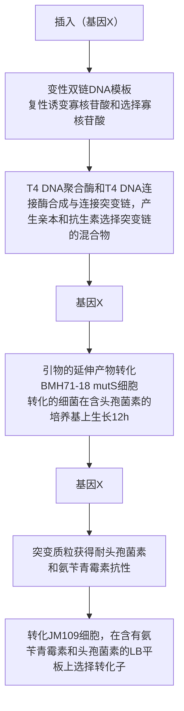
</details>

图 14-6 突变型β-内酰胺酶选择法定点诱变。双链质粒 DNA（dsDNA）模板第一次碱变性。两个寡核苷酸引物同时复性结合到模板中。第一个寡核苷酸编码的核苷酸改变β-内酰胺酶基因，赋予其增强的头孢菌素抗性。第二个寡核苷酸带有对基因 X 设计的突变，与作为抗生素筛选用的寡核苷酸都杂交到质粒 DNA 的同一条链。这两个寡核苷酸通过 DNA 聚合酶延伸，可产生一个异源双链体，将抗性基因与突变基因相连。此时质粒 DNA 转化到修复缺陷型大肠杆菌（如 BMH71-18 mutS）中，随后在修复完全型大肠杆菌中实现克隆分离（经 Oxford University Press 许可，改编于 Lewis and Thompson 1990）。

---

906

分子克隆实验指南（原书第四版）


## 材料

为正确使用本方案中的器材和危险试剂，必须查阅相应的材料安全数据表并咨询所在机构的环境卫生和安全办公室。

本方案的专用试剂标注&lt;R&gt;，配方在本方案末提供。常用储备溶液、缓冲液和试剂标注&lt;A&gt;，配方见附录1。储备溶液应稀释至适用浓度后使用。

## 试剂

▲ BMH71-18 mutS 和 JM109 大肠杆菌感受态细胞储存于 -70°C，使用时取出融化。其他感受态使用前冻存于 -20°C。筛选用抗生素冻融不得超过 5 次。

琼脂糖凝胶（1%）（第2章）

乙酸铵（2mol/L，pH 4.6）

氨苄青霉素溶液（100mg/mL；过滤除菌）

复性缓冲液（10×）&lt;R&gt;

抗生素的选择混合物 [5mg/mL 氨苄青霉素，25μg/mL 头孢噻肟，25mg/mL 头孢曲松（Sigma-Aldrich 公司），100mmol/L 磷酸钾（pH 6.0）]

氯仿:异戊醇（24:1）＜A＞

dsDNA 模板质粒

待诱变的候选基因（基因 X）应克隆至 pGEM-11Z（+）质粒（Promega 公司）。

大肠杆菌 BMH71-18 mutS 株

其他几个大肠杆菌菌株都能与BMH81-18 mutS共存，包括BJ5183、JM107、SK1590、DH1、JM108、SK2287、DH5a、JM109、TB1、JM103、MC1061、TG1、JM105、MM294、XL1-blue、JM106、Q358和Y1088。选择BMH71-18 mutS是因为它可以抑制体内错配修复。

大肠杆菌 JM109 菌株

乙醇（70%和100%）

LB 培养基 &lt;R&gt;

含氨苄青霉素的 LB 培养基 &lt;R&gt;

NaOH (2mol/L) /EDTA (2mmol/L)

pGEM-11Zf (+) (Promega 公司)

常规微量质粒小提试剂盒（QIAprep Spin Miniprep Kit）

引物:

筛选用抗生素寡核苷酸引物序列是

GATAAATCTGGAGCCTCCAAGGGTGGGTCTCGCGGT；加粗和下划线可替换。

诱变寡核苷酸引物（磷酸化的）合成信息，请参阅步骤 2。

合成缓冲液（10×）&lt;R&gt;

T4 DNA 连接酶（5U/μL）（NEB 公司）

T4 DNA 聚合酶（10U/μL）（NEB 公司）

TE 缓冲液 &lt;R&gt;

## 设备

琼脂糖凝胶电泳设备

细胞培养板

加热块

---

第 14 章 体外诱变方法

907

培养摇床

聚丙烯管（17mm×100mm），无菌

真空干燥机

水浴锅（42℃）


## 方法

# 双链 DNA 质粒模板制备

1. 将待诱变基因 $X$ 克隆到质粒 pGEM-11Zf（+）中（Promega 公司），该质粒中包含一个 TEM-1 $\beta$-内酰胺酶基因。转入该质粒的大肠杆菌具有氨苄青霉素抗性。

## 诱变和抗生素选择寡核苷酸制备

2. 合成包含有所需突变的诱变寡核苷酸引物。

寡核苷酸和其互补 DNA 链之间形成的杂合双链的稳定性取决于许多因素，其中包括寡核苷酸引物的长度和 G+C 含量，以及复性条件。更多详细信息，见第 13 章。一般来说，要将诱变寡核苷酸的不匹配碱基设计在寡核苷酸中间 17～20 碱基的位置（详见本章其他方案的详细描述）。如果要构建含有两个或更多位点的突变，则寡核苷酸长度需要 25 个或更多碱基数，以便在错配位置的两端均有 12～15 个完全匹配的序列。

然后合成抗生素筛选的寡核苷酸引物序列（序列 GATAAATCTGGAGCCTCCAAGGGT-GGGTCTCGCGGT；粗体和下划线部分为可替换的野生型β-内酰胺酶基因序列）。

为了能用抗生素筛选出含双重突变的突变体，诱变寡核苷酸和抗生素筛选用寡核酸序列必须与质粒 DNA 的同一碱基链互补。

## 双链 DNA 模板的变性

3. 将 $2\mu \mathrm{g}$ 带有 $X$ 基因的双链 DNA 质粒进行碱变性。这个反应将产生足够可用于 10 个诱变反应的变性 DNA。将反应混合物在室温孵育 $5\mathrm{min}$ 。

| dsDNA 模板 | 0.5pmol (2μg) |
| --- | --- |
| NaOH(2mol/L), EDTA(2mmol/L) | 2μL |
| 无菌的去离子水 | 加至总体积 20μL |

注:通常，ng 级 dsDNA=pmol 的 dsDNA×0.66×N，N 表示 dsDNA 的碱基长度。

4. 向反应混合物中添加 $2\mu \mathrm{L}$ 的 $2\mathrm{mol} / \mathrm{L}$ 乙酸铵（$\mathrm{pH}4.6$）和 $75\mu \mathrm{L}$ 的 $100\%$ 乙醇（$4^{\circ}\mathrm{C}$）沉淀 DNA。

5. 将以上混合物在  $-70^{\circ}C$  放置 30min。

6. 最高转速（约 13 000 r/min），4°C 离心 15min 收集 DNA。

7. 用 $200\mu \mathrm{L}$ 乙醇（$4^{\circ} \mathrm{C}$）浸洗 DNA 沉淀，用步骤 6 条件再次离心，并真空抽干 DNA 沉淀。

8. 用  $100 \mu L$  的 TE 缓冲液（pH 8.0）重悬 DNA。

---

908

分子克隆实验指南（原书第四版）

## 诱变引物的复性

9. 按下述体系制备引物复性反应混合物:

| 变性的模板 DNA(从步骤8获得) | 10μL(0.05pmol) |
| --- | --- |
| 选择寡核苷酸(2.9ng/μL),按步骤1方法磷酸化 | 1μL(0.25pmol) |
| 诱变寡核苷酸,按步骤1方法磷酸化 | 1.25pmol |
| 复性缓冲液(10×) | 2μL |
| 无菌去离子水 | 加至总体积20μL |

加热复性反应混合物到  $75^{\circ}$ C 复性 5min，然后缓慢地自然冷却到  $37^{\circ}$ C。缓慢的冷却过程有助于使这两种诱变和筛选抗生素的引物非特异性复性最小化。建议冷却速率约  $1.5^{\circ}$ C/min。

最佳复性温度和时间可能取决于使用的诱变寡核苷酸组成。有必要尝试几个复性温度，以优化寡核苷酸的诱变效率。

见“疑难解答”。

## 突变链的合成与连接

10. 当复性反应混合物冷却到 $37^{\circ}\mathrm{C}$ 之后，短暂离心反应混合物将成分收集到离心管底部，之后按照以下体系配置反应混合物，以进行突变体的合成和连接反应。

| 无菌去离子水 | 5μL |
| --- | --- |
| 合成缓冲液(10×) | 3μL |
| T4 DNA 聚合酶(5~10U) | 1μL |
| T4 DNA 连接酶(1~3U) | 1μL |
| 终体积 | 30μL |

在这个反应中使用了 T4 DNA 聚合酶，因为它是一种高保真 DNA 聚合酶，不会引起杂合寡核苷酸的错配。因此，可以通过在一个插入 DNA 的多个不同位点与诱变寡核苷酸复性结合，来实现在同一个反应体系中对多个位点进行定点突变。

11. 在 $37^{\circ}\mathrm{C}$ 孵育反应体系 $90\mathrm{min}$，以合成突变链，并完成连接反应。此时突变 DNA 可以用来转化 BMH71-18 mutS 突变株感受态。

采用 BMH71-18 mutS 是因为它可以抑制体内的错配修复。

## BMH71-18 mutS 菌株感受态细胞的转化

12. 将  $17mm \times 100mm$  聚丙烯管在冰上预冷。

13. 解冻 $100 \mu \mathrm{L}$ 的 BMH71-18 mutS 感受态大肠杆菌细胞, 放入无菌聚丙烯管中, 并将其置于冰上。添加 $1.5 \mu \mathrm{L}$ 步骤 11 中获得的诱变反应混合物到感受态细胞中。轻轻混匀。

14. 将感受态细胞与 DNA 的混合物在冰上孵育 10min。

15. 在  $42^{\circ}$ C 水浴中热激感受态细胞  $45 \sim 50$ s。

16. 将热激后的细胞放回冰上静置 2min。

17. 向步骤 13～步骤 16 处理的 BMH71-18 mutS 细胞中加入 900μL 室温的 LB 培养基（不添加抗生素），并在 37°C 振荡 60min。

18. 准备过夜培养物。向步骤 17 中的细胞加入 $4 \mathrm{~mL}$ LB 培养基, 然后向培养基中添加 $100 \mathrm{mg} / \mathrm{mL}$ 的氨苄青霉素 $100 \mu \mathrm{L}$ 。

19. 37℃剧烈振荡孵育过夜。

见“疑难解答”。

20. 提取少量质粒 DNA。依照常规方案（第 1 章）提取和纯化质粒 DNA。

---

第 14 章 体外诱变方法

909

## 转化 JM109 细胞和克隆分离

21. 在转化前, 将含有 $7.5 \mathrm{~mL} / \mathrm{L}$ 筛选用抗生素混合物 (含头孢菌素) 和熔化的 LB 培养基倒入培养板中, 且每 1L 培养基中含有 $1 \mathrm{~mL} 100 \mathrm{mg} / \mathrm{mL}$ 的氨苄青霉素溶液。

22. 将  $17mm \times 100mm$  聚丙烯管在冰上预冷。

23. 将 $100 \mu \mathrm{L}$ 的JM109感受态细胞置于冰上，然后加入 $1.5 \mu \mathrm{L}$ 从步骤20的BMH71-18 mutS突变感受态细胞中纯化获得的质粒DNA到JM109感受态细胞中。轻轻混匀。

24. 将感受态细胞与 DNA 的混合物在冰上孵育 10min。

25. 在  $42^{\circ}$ C 水浴中热激感受态细胞  $45 \sim 50$ s。

26. 将热激后的细胞放回冰上静置 2min。

27. 向转化后的 JM109 感受态细胞中加入  $900 \mu L$  室温的 LB 培养基（不添加抗生素），并在  $37^{\circ} C$  振荡 60min。

28. 从步骤 27 中取出  $100 \mu L$  转化产物涂布到含筛选抗生素混合物和氨苄青霉素的 LB 琼脂平板上（步骤 21 准备的）。同时涂布无抗生素的 LB 琼脂平板作为对照。将平板在  $37^{\circ} C$  孵育  $12 \sim 14 h$ 。

29. 经过培养后，鉴定平板上的白色克隆。挑取至少 5 个克隆直接测序进行鉴定。


## 疑难解答

问题（步骤 9）:模板降解。

解决方案:聚合酶过量同时 dNTP 混合物不足可能影响聚合酶的外切酶活性，因此需要严格按照建议的体系配置反应混合物。

问题（步骤 19）:BMH mutS 过夜培养，平板中未长出克隆。

解决方案:减少培养基中的抗生素含量，同时仅使用高效率的感受态细胞。


## 配方

为正确使用本方案中的器材和危险试剂，必须查阅相应的材料安全数据表并咨询所在机构的环境卫生和安全办公室。

复性缓冲液（10×）

| 试剂 | 终浓度 |
| --- | --- |
| Tris-HCl (pH 7.5) | 200mmol/L |
| MgCl2 | 100mmol/L |
| NaCl | 500mmol/L |

LB 培养基

| 试剂 | 含量 |
| --- | --- |
| 蛋白胨 | 10g/L |
| 细菌用酵母提取物 | 5g/L |
| NaCl | 10g/L |

用 1L 蒸馏水溶解，用 5 mol/L NaOH 调节 pH 至 7.5，高压灭菌。

## 含有氨苄青霉素的LB平板

按前述方法配置 LB 培养基，在灭菌前加入 15g/L 的细菌蛋白胨，灭菌后在铺板前每毫升培养基中加入 125μg 的氨苄青霉素。

---

910

分子克隆实验指南（原书第四版）

合成缓冲液（10×）

| 试剂 | 终浓度 |
| --- | --- |
| Tris-HCl (pH 7.5) | 100mmol/L |
| dNTP | 5mmol/L |
| ATP | 10mmol/L |
| DTT | 20mmol/L |

Tris-EDTA（TE）缓冲液（1×）

| 试剂 | 终浓度 |
| --- | --- |
| Tris-HCl (pH 8.0) | 10mmol/L |
| EDTA | 1mmol/L |

## 参考文献

Andrews CA, Lesley SA. 2002. Site-directed mutagenesis using altered β-lactamase specificity. Methods Mol Biol 182: 7–17.
Cantu C III, Huang W, Palzkill T. 1996. Selection and characterization of amino acid substitutions at residues 237–240 of TEM-1 β-lactamase

with altered substrate specificity for aztreonam and ceftazidime. J Biol Chem 271: 22538–22545.
Lewis MK, Thompson DV. 1990. Efficient site directed in vitro mutagenesis using ampicillin selection. Nucleic Acids Res 18: 3439–3443.

## 方案 5 通过单一限制性位点消除进行寡核苷酸指导的诱变（USE 诱变）

本方案中，两条寡核苷酸引物杂交到变性重组质粒 DNA 双链的同一条链上。一条引物（诱变引物）携带一个拟引入 DNA 序列的突变，第二条引物携带一个能破坏质粒单一限制酶位点的突变（称为单一限制性位点消除，unique site elimination，USE）（图 14-7）。两条引物的延伸反应由噬菌体 T4 或 T7 DNA 聚合酶催化。新合成 DNA 链上的缺口由噬菌体 T4 DNA 连接酶封口。该方法的第一阶段产生了由野生型亲本 DNA 链和携带预定突变且不含单一限制性位点的全长新 DNA 链组成的异源双链质粒。因此，反应后获得的质粒群体包括:①野生型质粒，在反应中它们从未被用作两条寡核苷酸引物的模板；②丢失了单一限制性位点并获得预定突变的异源双链质粒。

本方法的第二阶段，将混合质粒与切割单一位点的限制酶一起孵育。野生型分子被线性化，突变质粒则不被限制酶消化。用环形异源双链DNA和线性野生型DNA的混合物转化碱基错配修复功能缺陷的大肠杆菌菌株。因为线性DNA转化效率要比环型DNA低$10\sim 1000$ 倍（Conley and Saunders 1984），许多野生型分子不能重新进入大肠杆菌。而环形异源双链分子开始在大肠杆菌中复制。因为错配碱基不能被修复，第一轮复制产生了携带原始限制酶位点的野生型质粒和不带原始限制酶位点的突变质粒。收集从第一组转化子获得的DNA，用同一种限制酶再次消化，使野生型分子线性化，再转化至标准的实验用大肠杆菌菌株中。该种生物化学方法具有足够强大的选择能力，保证绝大部分转化子携带预定的突变（Deng and Nickoloff 1992；Zhu 1996）。

---

第 14 章 体外诱变方法

911


<details>
<summary>flowchart</summary>

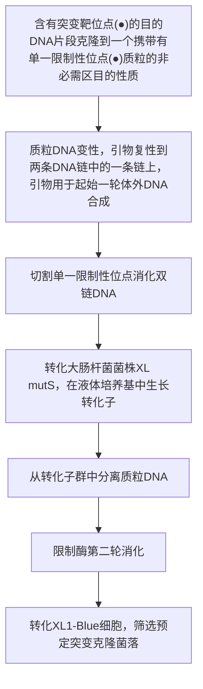
</details>

图 14-7 通过单一限制性位点消除进行寡核苷酸指导的诱变（USE 诱变）。用选择引物和诱变引物扩增目的质粒。如图所示，PCR 产物用于转化。本方案产生的定点突变效率约 90%（摘自 Braman et al. 2000）。

---

912

分子克隆实验指南（原书第四版）

## 单一限制性位点消除（USE）

理论上，采用本方案描述的单一限制性位点消除（USE）标准方案形成突变体的最大产率是50%。然而，大多数实验室获得的突变频率为5%\~30%，这取决于突变的复杂性和限制酶切割效率。如果需要，结合USE和Kunkel对含尿嘧啶模板DNA选择方法（Markvardsen et al. 1995），或将突变引物的浓度增加到10:1使反应有利于诱变引物，可使突变体回收率大大增加。

原则上，含单一限制酶位点和选择标记（如抗生素抗性基因）的双链环状载体上携带的基因都可以用 USE 方法进行诱变。几家公司销售 USE 诱变所需要的选择引物和含有 USE 诱变所需试剂的试剂盒（如 Clontech 公司销售的转换基因定点诱变试剂盒）。这些试剂盒能够成功地应用于多种广泛使用的载体。存在的问题见本节后面的“疑难解答”。


## 材料

为正确使用本方案中的器材和危险试剂，必须查阅相应的材料安全数据表并咨询所在机构的环境卫生和安全办公室。

本方案的专用试剂标注&lt;R&gt;，配方在本方案末提供。常用储备溶液、缓冲液和试剂标注&lt;A&gt;，配方见附录1。储备溶液应稀释至适用浓度后使用。

## 试剂

1%的琼脂糖凝胶（含0.5μg/mL溴化乙锭）

复性缓冲液(10×)&lt;R&gt;

噬菌体 T4 DNA 连接酶

噬菌体 T4 DNA 聚合酶或测序酶

噬菌体 T4 编码的天然 DNA 聚合酶不能从模板 DNA 上置换寡核苷酸引物（Nossal 1974；Kunkel 1985；Bebenek and Kunkel 1989；Schena 1989）。

带 mutS 基因型（如 BMH71-18）的大肠杆菌，制备成感受态用于转化

带 $mut^{+}$ 基因型的大肠杆菌，制备成感受态用于转化（步骤14）

LB琼脂平板&lt;R&gt;

含合适抗生素的LB培养基&lt;R&gt;

质粒 DNA

通过商品化销售的树脂柱层析或碱裂解法纯化闭合环状质粒 DNA（第 1 章，方案 1 或方案 2）。

引物（诱变引物和选择引物）

诱变引物和选择引物一定要能复性到靶 DNA 的同一条链上，每条引物的 5' 端一定要磷酸化。突变应位于引物的中间，突变位点两侧带有 10～15 个能与模板 DNA 完全配对的碱基。寡核苷酸引物在使用前用快速高效液相层析法（FPLC）或聚丙烯酰胺凝胶电泳（PAGE）纯化（第 2 章方案 3）。

单一位点的限制性内切核酸酶

10×合成缓冲液 &lt;R&gt;

## 附加材料

用于转化大肠杆菌的试剂和设备（步骤7和步骤14；第3章）

用于小量制备质粒 DNA 的试剂和设备（步骤 10 和步骤 16；第 1 章，方案 1 和方案 2）

---

第 14 章 体外诱变方法

913

## 设备

细胞培养箱

凝胶电泳仪

水浴箱（煮沸、预调至  $70^{\circ}$ C 或限制性内切核酸酶消化的合适温度）


## 方法

## 突变 DNA 链的合成

1. 在微量离心管中混合以下成分:

| 10×复性缓冲液 | 2μL |
| --- | --- |
| 质粒 DNA | 0.025~0.25pmol |
| 选择引物 | 25pmol |
| 突变引物 | 25pmol |
| 加水至 | 20μL |

离心管在沸水中孵育 5min。

本方案允许引物和质粒 DNA 浓度在一个较宽的范围内。必要时以经验为主优化各试剂的量。

2. 将离心管立即置于冰上冷却 $5\mathrm{min}$ 。微型离心机上离心 $5\mathrm{s}$，使液体沉积到离心管底层。

3. 将以下成分加入到含复性引物和质粒 DNA 的离心管中:

| 10×合成缓冲液 | 3μL |
| --- | --- |
| 噬菌体T4 DNA聚合酶(2~4U/μL) | 1μL |
| 噬菌体T4 DNA连接酶(4~6U/μL) | 1μL |
| $H_2O$ | 5μL |

用移液器轻轻地上下吹打几次将试剂混匀。微型离心机上离心 5s，使液体沉积到离心管底层。37℃孵育反应 1～2h。

4. $37^{\circ}\mathrm{C}$ 加热离心管至少 $5\mathrm{min}$，灭活酶并终止反应。将离心管放置在实验台上冷却至室温。

## 通过限制性内切核酸酶消化进行初筛

5. 将 NaCl 的浓度调节到适合单一限制酶反应的浓度。使用  $10 \times$  复性缓冲液、NaCl 储存液或限制酶提供的  $10 \times$  缓冲液。

在总体积为  $30 \mu L$  的合成或连接混合物中，NaCl 浓度为 37.5 mmol/L。如果限制消化反应不需要 NaCl 或需要低于上述浓度的 NaCl，可用乙醇沉淀合成连接缓冲液中的 DNA 混合物，或将 DNA 混合物通过一个离心柱，重悬在合适限制酶缓冲液中。

6. 将 20U 应用于选择性筛选的限制性内切核酸酶加入到反应混合物中。在合适的温度下消化至少 1h。

▲反应中酶体积（包括聚合酶和连接酶）不应超过总反应体积的10%。应按照以上比例相应地调节反应体积。

## 突变质粒的第一轮转化与富集

7. 按照第 3 章描述的转化方案之一，用消化混合物中包含的质粒 DNA 转化 mutS 大肠杆菌菌株（如 BMH71-18）。

---

914

分子克隆实验指南（原书第四版）

8. 分别用 $10\mu \mathrm{L}$ 、 $50\mu \mathrm{L}$ 和 $250\mu \mathrm{L}$ 转化混合物涂布含抗生素的LB琼脂平板。 $37^{\circ}C$ 过夜孵育平板。在平板孵育期间进行步骤9。

这些培养皿用于测定第一轮转化子的数量。每 $50\mu \mathrm{L}$ 转化混合物涂布的平板上应产生 $100\sim 300$ 个克隆。

9. 加入 3mL 含适当抗生素的 LB 培养液至剩余的转化混合物中以扩增质粒。37℃振荡培养过夜。

10. 第 2 天从大约 $2.5 \mathrm{~mL}$ 的过夜培养物中制备质粒 DNA（第 1 章）。

11. 用选择性筛选的限制酶消化步骤 10 制备的质粒 DNA。如下:

| 质粒 DNA | 500ng |
| --- | --- |
| 10×限制酶缓冲液 | 2μL |
| 单一位点的限制性内切核酸酶 | 20U |
| 加水至 | 20μL |

在适当温度中孵育反应 2h。

12. 再加入 10U 的限制酶，继续孵育至少 1h。

13. 取 5～10μL 质粒 DNA 经 1% 的琼脂糖凝胶（含 0.5μg/mL 溴化乙锭）电泳来评估 DNA 消化程度（第 3 章，方案 1 和方案 2）。

线性化质粒 DNA 经电泳分离应为一条带。未消化的（环状）DNA 经电泳分离为两条带，它们分别对应松弛的环状形式或超螺旋结构形式 DNA。然而，由于亲本质粒占总质粒 DNA 的绝大多数，未被消化的突变体质粒的条带与被消化的亲本质粒 DNA 条带相比可能相当微弱。

## 最后一步转化

14. 取 2～4μL 经消化的质粒 DNA（50～100ng），转化化学感受态大肠杆菌 $mutS^{+}$ 菌，或用灭菌水 5 倍稀释质粒 DNA（约 5ng），电击法转化大肠杆菌 $mutS^{+}$ 菌株（第 3 章，方案 4）。

15. 分别取 $10\mu \mathrm{L}$ 、 $50\mu \mathrm{L}$ 和 $250\mu \mathrm{L}$ 转化混合物涂布含抗生素的LB琼脂平板。 $37^{\circ}C$ 孵育培养皿过夜。

16. 第 2 天，至少挑取 12 个单克隆进行小量质粒 DNA 制备，用限制性内切核酸酶消化，琼脂糖凝胶电泳鉴定不被限制性内切核酸酶消化的质粒。

17. 通过 DNA 序列测定确定含预定突变的质粒。


## 疑难解答

问题:突变体回收率低。

解决方案:尝试一种或多种下面的方法:

\- 结合 USE 和 Kunkel 对含尿嘧啶模板 DNA 选择的方法（Markvardsen et al. 1995）。

\- 增加诱变引物浓度，使两种引物的物质的量比达到 10:1，使反应有利于诱变引物（Hutchinson and Allen 1997）。

\- T4 DNA 聚合酶催化的延伸反应温度由 37°C 改为 42°C（Pharmacia Instruction Booklet）。

问题:据报道，用 pBluescript 家族载体产生非常低的突变率，可能是因为它们二级结构含有一个结节(knotty)区域，它妨碍了 DNA 聚合酶在体外引物延伸反应中的向前移动。

解决方案:使用 pBluescript 家族载体以外的质粒载体，或使用热稳定 DNA 聚合酶和 DNA 连接酶在高温下孵育延伸反应可完全避免这一问题（Wong and Komaromy 1995）。

---

第14章 体外诱变方法

915


## 配方

为正确使用本方案中的器材和危险试剂，必须查阅相应的材料安全数据表并咨询所在机构的环境卫生和安全办公室。

10×复性缓冲液

| 试剂 | 终浓度 |
| --- | --- |
| Tris-HCl (pH 7.5) | 200mmol/L |
| MgCl2 | 100mmol/L |
| NaCl | 500mmol/L |

LB 培养基

| 试剂 | 质量(1L) |
| --- | --- |
| 细菌用胰蛋白胨 | 10g/L |
| 酵母提取物 | 5g/L |
| NaCl | 5g/L |

溶入 1L 的蒸馏水中。用 5mol/L NaOH 调 pH 至 7.5。高压灭菌。

## 含氨苄青霉素的 LB 平板

按上述配方配制液体 LB 培养基，高压灭菌前加入终浓度 15g/L 的琼脂。高压灭菌后倒平板前加入终浓度 125μg/mL 的氨苄青霉素。

10×合成缓冲液

| 试剂 | 终浓度 |
| --- | --- |
| Tris-HCl (pH 7.5) | 100mmol/L |
| dNTP(dTTP, dATP, dCTP 和 dGTP) | 各 5mmol/L |
| ATP | 10mmol/L |
| DTT | 20mmol/L |

## 参考文献

Bebenek K, Kunkel TA. 1989. The use of native T7 DNA polymerase for site-directed mutagenesis. Nucleic Acids Res 17: 5408.

Braman J, Papworth C, Greener A. 2000. Site-directed mutagenesis using double-stranded DNA templates. In The nucleic acid protocols handbook (ed Rapley R), pp. 835–844. Humana, Totowa, NJ.

Conley EC, Saunders JR. 1984. Recombination-dependent recircularization of linearized pBR322 plasmid DNA following transformation of Escherichia coli. Mol Gen Genet 194: 211–218.

Deng WP, Nickoloff JA. 1992. Site-directed mutagenesis of virtually any plasmid by eliminating a unique site. Anal Biochem 200: 81–88.

Hutchinson MJ, Allen JM. 1997. Improved efficiency of two-primer mutagenesis. Elsevier Trends Journals Technical Tips Online (#40072).

Kunkel TA. 1985. Rapid and efficient site-specific mutagenesis without phenotypic selection. Proc Natl Acad Sci 82: 488–492.

Markvardsen P, Lassen SF, Borchert V, Clausen IG. 1995. Uracil-USE, an improved method for site-directed mutagenesis on double-stranded plasmid DNA. BioTechniques 18: 370–372.

Nossal NG. 1974. DNA synthesis on a double-stranded DNA template by the T4 bacteriophage DNA polymerase and the T4 gene 32 DNA unwinding protein. J Biol Chem 249: 5668–5676.

Schena M. 1989. High efficiency oligonucleotide-directed mutagenesis using Sequenase. Comments (US Biochemical Corp) 15: 23.

Wong F, Komaromy M. 1995. Site-directed mutagenesis using thermostable enzymes. BioTechniques 18: 1034–1038.

Zhu L. 1996. In vitro site-directed mutagenesis using the unique restriction site elimination (USE) method. Methods Mol Biol 57: 13–29.

## 方案 6 利用密码子盒插入进行饱和诱变

通过盒式插入的饱和诱变向靶基因中引入一个文库，这个文库中基因的特定位点突变成某个特定的 DNA 序列，这一策略在研究一个蛋白质的某个特定氨基酸残基在整个蛋白质结构中的功能时十分有效。一般来说，盒式插入诱变的含义是将目标区域用限制性内切

---

916

分子克隆实验指南（原书第四版）

核酸酶从两侧切除，并插入一个合成特定突变序列的寡核苷酸。当将某一特定位点替换时，这个策略十分有效；但是，当需要插入的突变文库在某些特定位点需要包含所有可能的氨基酸种类时，这一策略则捉襟见肘，因为合成所有种类突变的寡核苷酸序列十分昂贵。

本方案则可以克服这些问题并能达到这一目的（图 14-8）。这里将一套包含 11 种通用寡核苷酸盒用于构建突变体。这一方法的主要优点是，一套诱变密码子盒可以将所有可能种类的氨基酸插入一个基因中所有预先确定的位点。这 11 个寡核苷酸盒中的每一个都含有 2 个 Sap I 识别位点，可以用酶将密码子盒从两侧切下（图 14-9）。这两个 Sap I 的识别序列互为反向，由中心密码子隔开。在每个盒结构的末端，紧挨着 Sap I 位点，是一段 3 个碱基对的直接重复序列，即 Sap I 可以从这个序列中间切开。Sap I 酶切将导致在盒结构的两端生成 3 个碱基的单链黏末端。这 3 个碱基的单链黏末端可以自行连接成环，从而缺失盒式结构。而这 3 个重复的碱基最终将掺入模板。将图 14-9 中所示的所有盒结构中均存在的  $(5' - \mathrm{CAG} \cdots \mathrm{CAG}-3')$  3 碱基重复序列替换为其他序列，则可完成对所有可能氨基酸的置换。表 14-4 列出了该研究中建立的所有用于置换的全套 11 个通用寡核苷酸盒结构。


<details>
<summary>flowchart</summary>

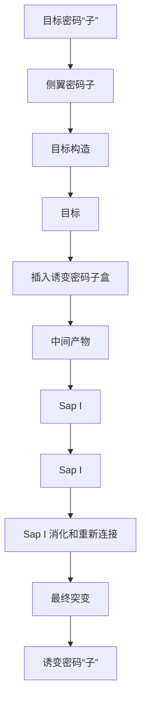
</details>

图14-8 通过盒式法插入饱和突变。黑框表示用于突变的目标密码子；空白框表示邻近目标密码子的“侧翼密码子”；水平箭头表示SapI切割位点（经Science+Business Media许可，改编于Kegler-Ebo et al.1996）。

---

第 14 章 体外诱变方法

917

整个步骤需要构建的密码子置换盒如图 14-8 所示。图 14-9 中所示的平末端诱变盒则是通过在平末端位点连接插入目标分子中，构建一个中间产物，这个“中间产物”之后被 Sap I 消化。最后 Sap I 酶切消化后的双链尾巴连接到一起生成了诱变分子。这样可以将 1 个拷贝的含 3 碱基重复从盒结构中转移到目标分子中，从而产生最终的诱变产物。这个方案来自 Kegler-Ebo 等（1994，1996）的方法。


<details>
<summary>flowchart</summary>

This diagram illustrates the genetic sequence and regulatory interactions between a central region containing genes such as CAG-A, GAAGAGC, GCTCTTC, and A-CAG, along with their respective regulatory elements like Sap I position and密码子重复.
</details>

图 14-9 通用密码子盒的结构。方框表示 Sap I 识别序列；水平箭头表示 Sap I 酶切位点；垂直箭头表示 Sap I 切割位置。两端重复序列和中间区之间的区域为 2 个 Sap I 识别序列。盒结构表示插入编码 CAG（谷氨酰胺）和 CUG（亮氨酸）的密码子（经 Science+Business Media 许可，改编自 Kegler-Ebo et al. 1996）。

表 14-4 通用密码子盒设计

| 诱变盒a | 插入氨基酸b |
| --- | --- |
| ATG···ATGTAC···TAC | 甲硫氨酸组氨酸 |
| TGG···TGGACC···ACC | 色氨酸脯氨酸 |
| CAG···CAGGTC···GTC | 谷氨酰胺亮氨酸 |
| GAC···GACCTG···CTG | 天冬氨酸缬氨酸 |
| AAC···AACTTG···TTG | 天冬酰胺缬氨酸 |
| TAT···TATAA···ATA | 酪氨酸异亮氨酸 |
| GGC···GGCCCG···CCG | 甘氨酸丙氨酸 |
| AAA···AAATTT···TTT | 赖氨酸苯丙氨酸 |
| TTC···TTCAAG···AAG | 苯丙氨酸谷氨酸 |
| AGA···AGATCT···TCT | 精氨酸丝氨酸 |
| ACA···ACATGT···TGT | 苏氨酸半胱氨酸 |

由 Oxford University Press 授权，重印自 Kegler-Ebo 等 1994。

a. 表示通用密码子盒及其末端重复序列。第一行显示  $5' \rightarrow 3'$  方向，第二行显示  $3' \rightarrow 5'$  方向。

b. 第一列密码子盒所对应的氨基酸。对于每一个密码子盒，第一行表示按照第一列第一行方向插入时翻译的氨基酸，第二行表示按照第一列第二行方向插入时翻译的氨基酸。

---

918

分子克隆实验指南（原书第四版）


## 材料

为正确使用本方案中的器材和危险试剂，必须查阅相应的材料安全数据表并咨询所在机构的环境卫生和安全办公室。

本方案的专用试剂标注&lt;R&gt;，配方在本方案末提供。常用储备溶液、缓冲液和试剂标注&lt;A&gt;，配方见附录1。储备溶液应稀释至适用浓度后使用。

## 试剂

乙酸铵（3.75mol/L，pH 5.0）

用于 Klenow 反应的 dNTP 混合液（10×）

在 TE 缓冲液中，4 种 NTP 均为 500mmol/L；保存于 -20℃。

大肠杆菌 DH5α

乙醇（100% 和 70%）

保存于-20℃。

DNA 聚合酶 I 的 Klenow 片段（5U/mL）

Klenow 反应缓冲液（10×）&lt;R&gt;

连接酶反应缓液（10×）&lt;R&gt;

酚:氯仿:异戊醇（PCA 溶液，为 25:24:1 TE 溶解的饱和苯酚、氯仿和异戊醇的混合物）

保存于  $4^{\circ}$ C。

来源于牛胰脏的核糖核酸酶 A（RNase A）

Sap I 反应缓冲液（10×） &lt;R&gt;

Sap I 限制性内切核酸酶（IU/μL）

乙酸钠（3mol/L，pH 5.2）

氢氧化钠（NaOH，1mol/L）

目标 DNA 分子

请参阅下面构建平末端靶 DNA 分子的方法。

T4 DNA 连接酶（400U/μL）TE 缓冲液 &lt;R&gt;

tRNA（10mg/mL 酵母 tRNA；Sigma-Aldrich）

保存于 $-20^{\circ}C$ 。

通用密码子盒

从 New England Biolabs 公司获得，并用 TE 缓冲液稀释至 10ng/mL &lt;R&gt;。

## 设备

凝胶电泳设备

QIAGEN 质粒小提试剂盒

分光光度计

热循环仪

涡旋振荡器

---

第 14 章 体外诱变方法

919


## 方法

## 构建平末端目标 DNA 分子

若要进行密码子盒式诱变，必须构造一个符合以下要求的目标 DNA 分子:①不包含任何内源性 Sap I 限制酶切割位点；②在待突变位点通过双链断裂，能生成线性的平末端。若要获得目标 DNA 分子，必须考虑以下原则和注意事项。

- 待突变目标 DNA 必须包含限制酶切割位点，以便在正确的位点获得平末端并将密码子替换或插入。
- 待突变目标 DNA 必须不含有任何内源性 Sap I 限制酶切割位点。

在密码子盒诱变构建之前，必须去除目标 DNA 上的所有 Sap I 限制酶切割位点。虽然 Sap I 识别序列只有 7 个碱基对，且在 DNA 序列中很少出现，但仍要仔细检查是否有此位点的出现，并用替换技术或者标准诱变技术（重叠诱变技术）将其进行修正。

设计待突变目标 DNA 时，在正确的位点设计一个可以产生平末端的策略十分重要，构建待突变目标 DNA 的一般策略包括在预替换的密码子区域设置 Sap I 位点，以及用 Klenow 片段填充单链末端，最终在适当位置获得平末端。这一步骤可以用于任意氨基酸序列，因为 Sap I 位点已经去除，并且位于突变两侧的野生型密码子均已重新生成。

1. 将 $2 \mu \mathrm{L} 10 \times \text {Sap I 反应缓冲液、} 5 \mu \mathrm{L} (5 \mu \mathrm{g})$ 的待突变目标 DNA、$5 \mu \mathrm{L} \text {Sap I 混合}$, 加水至总体积 $20 \mu \mathrm{L}$, 在 $37^{\circ} \mathrm{C}$ 孵育 $4 \mathrm{~h}$。
2. 在反应体系中加入 $3 \mu \mathrm{L}$ TE缓冲液, 之后加入 $50 \mu \mathrm{L}$ 酚: 氯仿: 异戊醇 (PCA) 抽提液, 涡旋振荡混匀, 在微型离心机中短暂离心。将含有 DNA 的上层溶液转移到一个新 Eppendorf 管中, 向管中加入 $5 \mu \mathrm{L}$ 乙酸钠溶液, 涡旋振荡, 加入 $100 \mu \mathrm{L}$ 乙醇, 涡旋振荡, 然后将离心管在 $-20^{\circ} \mathrm{C}$ 储存 $2 \mathrm{~h}$ 或在干冰上放置 $15 \mathrm{~min}$ 。然后, 离心法收集沉淀的 DNA, 用 $70 \%$ 乙醇洗涤, 风干 $5 \mathrm{~min}$, 用 $20 \mu \mathrm{L}$ 的 TE 缓冲液溶解 DNA 沉淀。用分光光度计测定 $260 \mathrm{~nm}$ 处吸光度, 以确定 DNA 含量。
3. 在 $7 \mu \mathrm{L}$ 沉淀后的 Sap I 酶切产物中, 添加 $1 \mu \mathrm{L} 10 \times$ Klenow 反应缓冲液、$1 \mu \mathrm{L} 10 \times$ dNTP 混合液, 并加入 $1 \mu \mathrm{L}$ Klenow 合成酶。混匀后, 在 $22^{\circ} \mathrm{C}$ 孵育 $15 \mathrm{~min}$ 。
4. 按照步骤 2 纯化 DNA，并用  $20 \mu L$  的 TE 缓冲液溶解 DNA 沉淀。

## 插入密码子盒生成中间分子

5. 在获得带有平末端的目标 DNA 后，即可进行 11 个密码子盒的连接反应。在每个反应中，平末端目标 DNA 与密码子盒的物质的量比约为 $1:25$ 。按照下面的配方配制反应混合液，并过夜反应 $16\mathrm{h}$ 。

| 连接酶反应缓冲液(10×) | 1μL |
| --- | --- |
| 平末端目标DNA分子 | 1μL |
| 双链密码子盒 | 2.5μL |
| ${\mathrm{H}}_{2}\mathrm{O}$ | 4.5μL |
| T4 DNA 连接酶 | 1μL |

6. 在每个反应中加入 $40\mu \mathrm{L}$ TE缓冲液和 $2\mu \mathrm{L}$ 酵母tRNA载体，按照步骤2的方法再次抽提一遍，乙醇沉淀DNA，离心，并将产物DNA沉淀溶解于 $10\mu \mathrm{L}$ TE缓冲液中。

---

920

分子克隆实验指南（原书第四版）

7. 将 11 种反应的混合物（步骤 6）各取 2.5μL 分别转化感受态 DH5α大肠杆菌（第 3 章），涂布到含有适当抗生素的 LB 琼脂平板上。

8. 使用商品化试剂盒从各个单克隆菌落中提取微量 DNA。将 DNA 溶解于含有  $100 \mu g/mL$  RNase A 的  $20 \mu L$  TE 缓冲液中（pH 8.0），储存于  $-20^{\circ}C$ 。

## 测序确认密码子的插入

9. 在（步骤 8 中获得的）16μL 微量 DNA 中加入 4μL 1mol/L NaOH 溶液，室温孵育 10min 使其变性。

10. 加入  $2.5 \mu L$  乙酸铵并涡旋振荡混匀。加入  $100 \mu L$  乙醇使 DNA 沉淀，并将 DNA 置于  $-70^{\circ} C$  20min 或  $-20^{\circ} C$  2h 将其制冷。

11. 用微型离心机离心 DNA 使其沉淀，用冷的 $70\%$ 乙醇洗涤一次，弃去乙醇后晾干 DNA 沉淀。

12. 用 $7\mu \mathrm{L}$ 纯水溶解沉淀，按照Sequenase Version 2.0使用手册（United States Biochemical [1994] Step-by-Step Protocols for DNA Sequencing with Sequenase Version 2.0 T7 DNA Polymerase, 8th ed.)的方法进行引物复性并测序。

## 消化中间分子获得终产物

13. 为获得最终的突变产物，每一个分子都要经过一个独立的酶切反应。在每个试管中混合以下成分，并在 $37^{\circ}\mathrm{C}$ 孵育至少 $4\mathrm{h}$ 。

| Sap I 反应缓冲液(10×) | 2μL |
| --- | --- |
| 制备微量的 DNA 中间产物(来自步骤 6) | 5μL |
| $H_2O$ | 11μL |
| Sap I | 2μL |

14. 利用凝胶电泳鉴定每个样品是否消化完全。

15. 按以下配方配制反应体系，将酶切获得的中间分子环化。

| T4 DNA 连接酶缓冲液(10×) | 5μL |
| --- | --- |
| Sap I 消化的中间 DNA(来自步骤 13) | 10μL |
| $H_2O$ | 34μL |
| T4 DNA 连接酶 | 1μL |

室温孵育至少 1h。

16. 使用酚:氯仿:异戊醇溶液抽提上述溶液，乙醇沉淀 DNA，用  $10 \mu L$  的 TE 缓冲液溶解 DNA 沉淀。这个溶液即含有最后的突变产物。

17. 将每个反应产生的 DNA 溶液各取 2～4μL 分别转化活化 DH5α 大肠杆菌，并涂布到含有适当抗生素 LB 琼脂平板上，培养过夜。第二天挑取克隆至液体培养基中，小量提取 DNA，Sap I 酶切鉴定是否已插入所需突变盒，并且不含有线性化 DNA。

见“疑难解答”。

18. 为检测缺少盒式插入突变的克隆，可通过克隆杂交实验进行筛选。有关详细信息请参阅 Kegler-Ebo（1994）的克隆杂交方法。或者，也可以使用 Sap I 消化筛选克隆（已插入突变盒的质粒不能被 Sap I 所消化）。

---

第14章 体外诱变方法

921


## 疑难解答

问题（步骤 17）:涂板后未长出阳性克隆。

解决方案:延长步骤 13 中 Sap I 消化时间，以确保酶切完全。

问题（步骤 17）:Sap I 消化线性质粒。

解决方案:如果步骤 13 中使用 Sap I 消化密码子盒成功，则获得的质粒应该不能被该酶消化，如果插入的不是所需密码子盒，那么需确认密码子盒是否构建正确以及步骤 5 中的连接反应是否成功。


## 配方

为正确使用本方案中的器材和危险试剂，必须查阅相应的材料安全数据表并咨询所在机构的环境卫生和安全办公室。

Klenow 反应缓冲液（10×）

| 试剂 | 终浓度 |
| --- | --- |
| Tris-HCl (pH 7.5) | 100mmol/L |
| MgCl2 | 50mmol/L |
| 二硫苏糖醇 | 75mmol/L |

连接酶反应缓冲液（10×）

| 试剂 | 终浓度 |
| --- | --- |
| Tris-HCl (pH 7.8) | 500mmol/L |
| MgCl2 | 100mmol/L |
| 二硫苏糖醇 | 100mmol/L |
| ATP | 10mmol/L |
| 牛血清白蛋白 | 250μg/mL |

Sap I 反应缓冲液（10×）

| 试剂 | 终浓度 |
| --- | --- |
| 乙酸钾 | 500mmol/L |
| Tris 乙酸 | 200mmol/L |
| 乙酸镁 | 100mmol/L |
| 二硫苏糖醇 | 10mmol/L |

调 pH 至 7.9。

TE缓冲液

| 试剂 | 终浓度 |
| --- | --- |
| Tris-HCl (pH 8.0) | 10mmol/L |
| EDTA | 1mmol/L |

## 参考文献

Kegler-Ebo DM, Docktor CM, DiMaio D. 1994. Codon cassette mutagenesis: A general method to insert or replace individual codons by using universal mutagenic cassettes. Nucleic Acids Res 22: 1593–1599.

Kegler-Ebo DM, Polack GW, DiMaio D. 1996. Use of codon cassette mutagenesis for saturation mutagenesis. Methods Mol Biol 57: 297–310.

---

922

分子克隆实验指南（原书第四版）

## 方案7 随机扫描诱变

体外寡核苷酸诱变和基于PCR的诱变技术的主要用途是通过改变基因的核苷酸序列研究其功能的重要性及其编码产物（Hutchison et al. 1978；Botstein and Shortle 1985；Kunkel 1985；Higuchi et al. 1988）。针对该问题的解决办法是系统地依次将该蛋白质上每一个氨基酸残基替换为丙氨酸（丙氨酸扫描诱变）或替换为一定数量的其他替代氨基酸（Cunningham and Wells 1989）。虽然这些策略可以提供有用信息，然而有时人们亟须检测目标位置上更广泛的氨基酸改变。近期，Smith及其同事发展了一种被称为随机扫描诱变的方案，用来检测某个氨基酸残基在人类免疫缺陷病毒（HIV）反转录酶保守结构域中的功能重要性，本方案即来自该方法（Smith et al. 2004，2006）。这一策略是一种基于寡核苷酸在蛋白质某一特定氨基酸位点生成所有19种可能替代氨基酸的方法（图14-10）。


<details>
<summary>flowchart</summary>

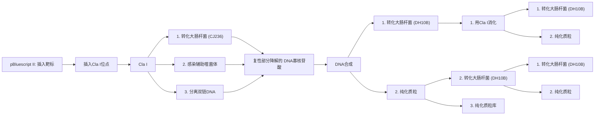
</details>

图 14-10 随机扫描诱变方案。在此示例中，在靶区域中引入了一个 Cla I 限制酶切割位点。突变后的质粒作为模板合成含有尿嘧啶的单链 DNA。之后采用寡核苷酸引物库进行体外 DNA 合成，将质粒转染 dUTPase $^{+}$ UNG $^{+}$ 大肠杆菌感受态细胞，筛选出不含尿嘧啶的模板 DNA。为进一步富集突变体库、质粒用 Cla I 消化后再次转化大肠杆菌，由此产生的质粒文库极大地富集了在靶位点含有氨基酸替换突变的质粒。星号表示突变位点（经 Springer Science + Business Media 许可，改编自 Smith 2010）。


## 材料

为正确使用本方案中的器材和危险试剂，必须查阅相应的材料安全数据表并咨询所在机构的环境卫生和安全办公室。

本方案的专用试剂标注&lt;R&gt;，配方在本方案末提供。常用储备溶液、缓冲液和试剂标注&lt;A&gt;，配方见附录1。储备溶液应稀释至适用浓度后使用。

---

第 14 章 体外诱变方法

923

## 试剂

氨苄青霉素（100mg/mL）

复性缓冲液（10×）&lt;R&gt;

氯霉素（15μg/mL）

大肠杆菌株 DH10B（Life Technologies 公司）及 CJ236（Takara Bio Inc 公司）

乙醇（100%）

基因片段或待研究的可读框（ORF）

卡那霉素（70μg/mL）

LB-氨苄青霉素（100μg/mL）琼脂平板

LB-氨苄青霉素-氯霉素琼脂平板

LB 培养基 &lt;R&gt;

pBluescript II KS（-）载体（Agilent 公司）

PEG/NaOAc 溶液[20%（m/V）聚乙二醇 8000 溶于 2.5mol/L 乙酸钠]

酚:氯仿:异戊醇（25:24:1）

质粒 DNA 纯化试剂盒

RNase A (25mg/mL), 无 DNA 酶

SOC 培养基 &lt;A&gt;

合成缓冲液（10×）&lt;R&gt;

T4 DNA 连接酶（New England Biolabs 公司）

T7 DNA 聚合酶（New England Biolabs 公司）

VCSM13 耐干扰辅助噬菌体（Agilent 公司）

酵母蛋白胨肉汤（YT broth）（2×）&lt;R&gt;

## 设备

离心机

DNA 测序仪

培养箱

培养皿

分光光度计

热循环仪

水浴箱或加热板


## 方法

1. 通过寡核苷酸指导的诱变（方案 5）或者通过基于 PCR 的策略（方案 2），向目标 DNA 片段中引入单一的限制性内切核酸酶位点。

切记应通过扰乱聚合酶的可阅读框避免目标蛋白的表达。

---

924

分子克隆实验指南（原书第四版）

# 制备含有尿嘧啶的 ssDNA

2. 将修饰后的质粒转化到脱氧尿苷三磷酸酶（dUTPase）和尿嘧啶DNA糖苷酶（UDG）活性缺陷的（第3章）化学感受态大肠杆菌宿主CJ236S。从而将尿嘧啶掺入质粒DNA。

## 诱变引物设计

诱变寡核苷酸应该足够长，以保证当与 ssDNA 模板发生复性时，该引物可以与两端 20～25 个碱基相配对。此外，最重要的是需确认寡核苷酸携带了 5' 磷酸基团。这可以通过化学合成引物时引入该诱变寡核苷酸，或者将寡核苷酸与 T4 多聚核苷酸激酶（T4 polynucleotide kinase）共同孵育获得该诱变寡核苷酸（第 13 章）。

## 其他重要因素

- 由于本方案需要获得单链 DNA (ssDNA)，质粒中必须含有 f1 复制起始位点。例如，pBluescript II KS (-)、pGEM-3Zf 和 pTZ18U 等质粒，均可生产足够数量 ssDNA 用于辅助噬菌体感染。
- 如果对象是一个单一的密码子，引入的限制性酶切位点需要位于目标密码子处；相反，如果是随机的多个密码子，限制性酶切位点应该在目标区域的中间部位。
- 通过体外 DNA 合成进行诱变而产生的质粒文库会出现替代氨基酸在目标区域的不均匀分布，这是因为文库中的寡核苷酸引物存在遗传密码不对称性和复性能力不同。要克服这个问题，再合成寡核苷酸时应将稀有氨基酸分开，并以特定比例将它们混合后再在文库中进行反应。孵育感染噬菌体的培养物不要超过 12h，否则，在最终的 ssDNA 产物中将会污染大量大肠杆菌基因组 DNA 和 RNA。

3. 将转化后的细菌接种在 SOC 培养基中，37℃孵育 1h 进行活化。
4. 将细菌涂布于 LB-氨苄青霉素-氯霉素平板，37℃孵育过夜。
5. 从平板中挑取一个克隆，接种于 2mL 含氨苄青霉素（50～100μg/mL）和氯霉素（15μg/mL）的 2×YT 培养基中，37℃孵育 12h。
6. 将 2mL 混合物转移到三角烧瓶中含有氨苄青霉素（50～100μg/mL）和氯霉素（15μg/mL）的 300mL 2×YT 培养基，并加入 VCSM13 辅助噬菌体至终浓度为  $2 \times 10^{8}$ pfu/mL。
7. 将三角烧瓶在  $37^{\circ}$ C 培养 2h，然后加入卡那霉素（70mg/mL），继续培养 12h。
8. 培养产物于 $7000 \mathrm{~g} 4^{\circ} \mathrm{C}$ 离心 $15 \mathrm{~min}$ 。小心移出含有噬菌体颗粒的上清液，放入一个新离心管中。
9. 将上清液转移到新离心管后，重复上述离心步骤。
10. 将 80% 的上清液转移到新离心管后，每管加入 1/4 体积的 PEG/NaOAc 溶液，混合以上液体并在冰上放置 1h 或者 4℃ 放置过夜。噬菌体颗粒在此过程中发生沉淀。
11. 将上述溶液于  $9000 \, g \, 4^{\circ}C$  离心 25min。
12. 弃上清，用 2mL TE 缓冲液（pH 8）重悬包含有噬菌体颗粒的沉淀物。
13. 将噬菌体悬液分成两管（每个 1mL），每管加入 2μL 无 DNA 酶的 RNase A (25mg/mL)。37℃孵育 1h。
14. 将上述产物于 $15000\mathrm{g}$ 离心 $5\mathrm{min}$，这一步是为了消除细胞或细胞碎片。将上清液转移到新离心管中，并向每管添加 $250\mu \mathrm{L}$ PEG/NaOAc，并将离心管在冰上静置 $15\mathrm{min}$ 重新沉淀噬菌体颗粒，然后在 $14000\mathrm{r / min} 4^{\circ}\mathrm{C}$ 离心 $5\mathrm{min}$。
15. 弃上清，用  $300 \mu L$  的 TE 缓冲液（pH 8）重悬噬菌体颗粒。

---

第 14 章 体外诱变方法

925

16. 先用酚:氯仿（1:1）溶液，再用酚:氯仿:异戊醇（25:24:1）溶液抽提 ssDNA。

17. 添加 1/10 体积 3mol/L NaOAc（pH 5）和 2 倍体积的 100%乙醇沉淀 ssDNA，冰上孵育 30min，之后于 14 000r/min 离心 15min。

18. 弃上清，晾干 DNA 沉淀，用  $500 \mu L$  TE 缓冲液（pH 8）重悬，使用分光光度计测定 DNA 浓度，DNA 的  $OD_{260}/OD_{280}$  值应在 1.8 左右为宜。

## 诱变反应

19. 后述步骤均应在冰上进行，并同时设立一个阴性对照（无引物）。每管加入 0.6pmol ssDNA 模板，然后加入 6.6pmol 寡核苷酸随机引物库，用双蒸水将体积调至  $9 \mu L$ 。

20. 每管加入  $1 \mu L$   $10 \times$  复性缓冲液。通过复性过程使引物结合到 ssDNA 上，在水浴锅中先将反应物温度升至  $80^{\circ}C$ ，并自然冷却到  $30^{\circ}C$ ，之后将离心管至于冰上冷却即可。

21. 每管加入 $1 \mu \mathrm{L} 10 \times$ 合成缓冲液、6个 Weiss 单位的 T4 DNA 连接酶和 T7 DNA 合成酶。吹打混匀后，在 $37^{\circ} \mathrm{C}$ 孵育 $2 \mathrm{~h}$ 。

22. 将 $1 \mu \mathrm{L}$ 反应液接种到大肠杆菌中, 宿主菌株必须同时含有脱氧尿苷三磷酸 (dUTPase) 和尿嘧啶 DNA 糖苷酶 (UDG) 活性, 用来筛选具有尿嘧啶抗性的质粒。

23. 复苏细胞，将细胞接种在 SOC 培养基中，37℃孵育 1h 进行活化。然后将 100μL 细胞涂布在 LB-氨苄青霉素琼脂平板上，37℃孵育过夜。同时，转移 200μL 细胞到一个三角瓶中含有氨苄青霉素（50～100mg/mL）的 100mL LB 培养基，37℃培养过夜。

24. 将步骤 23 中收获的细菌培养物于 6000g 4℃ 条件下离心 15min。

25. 对步骤 23 中氨苄青霉素平板上的菌落数量进行统计。如果诱变反应所得产物在平板上的菌落数量是阴性对照组平板上菌落数量的 3 倍以上，则说明诱变成功。从步骤 24 获得细菌沉淀中纯化质粒 DNA（第 1 章方案，或使用商品化提取试剂盒）。将纯化后的 DNA 储存于 -20℃。

## 限制酶消化

26. 用可以识别限制酶切割序列的酶消化 DNA 文库。

27. 转化一整份的酶切产物到大肠杆菌菌株中（第3章），然后操作步骤23。

28. 使用 DNA 测序方法鉴定质粒文库中的每一个单克隆，并将其用于后续功能分析。


## 配方

为正确使用本方案中的器材和危险试剂，必须查阅相应的材料安全数据表并咨询所在机构的环境卫生和安全办公室。

复性缓冲液（10×）

| 试剂 | 终浓度 |
| --- | --- |
| Tris-HCl (pH 7.4) | 200mmol/L |
| MgCl2 | 20nmol/L |
| NaCl | 500mmol/L |

高压灭菌并保存于 $-20^{\circ}C$ 。

LB 培养基

| 试剂 | 质量(1L) |
| --- | --- |
| 细菌用胰蛋白胨 | 10g |
| 细菌用酵母提取物 | 5g |
| NaCl | 10g |

溶于 1L 蒸馏水中。用 5 mol/L NaOH 调 pH 至 7.5。高压蒸汽灭菌。

---

926

分子克隆实验指南（原书第四版）

合成缓冲液（10×）

| 试剂 | 终浓度 |
| --- | --- |
| Tris-HCl (pH 7.4) | 100mmol/L |
| dNTP 混合物(dTTP、dATP、dCTP 和 dGTP) | 各 5mmol/L |
| ATP | 10mmol/L |
| $MgCl_2$ | 50mmol/L |
| DTT | 20mmol/L |

分装并保存于-80℃。

酵母胰蛋白胨（YT）液体培养基（2×）

| 试剂 | 质量(1L) |
| --- | --- |
| 细菌用胰蛋白胨 | 16g |
| 细菌用酵母提取物 | 10g |
| NaCl | 5g |

溶于 1L 蒸馏水中。用 5 mol/L NaOH 调节 pH 至 7.0。高压蒸汽灭菌。

## 参考文献

- Botstein D, Shortle D. 1985. Strategies and applications of in vitro mutagenesis. Science 229: 1193–1201.
- Cunningham BC, Wells JA. 1989. High-resolution epitope mapping of hGH-receptor interactions by alanine-scanning mutagenesis. Science 244: 1081–1085.
- Higuchi R, Krummel B, Saiki RK. 1988. A general method of in vitro preparation and specific mutagenesis of DNA fragments: Study of protein and DNA interactions. Nucleic Acids Res 16: 7351–7367.
- Hutchison CA III, Phillips S, Edgell MH, Gillam S, Jahnke P, Smith M. 1978. Mutagenesis at a specific position in a DNA sequence. J Biol Chem 253: 6551–6560.
- Kunkel TA. 1985. The mutational specificity of DNA polymerase- $\beta$ during in vitro DNA synthesis. Production of frameshift, base substitution, and deletion mutations. J Biol Chem 260: 5787–5796.
- Smith RA. 2010. Random-scanning mutagenesis. Methods Mol Biol 634:387–397.
- Smith RA, Anderson DJ, Preston BD. 2004. Purifying selection masks the mutational flexibility of HIV-1 reverse transcriptase. J Biol Chem 279:26726–26734.
- Smith RA, Anderson DJ, Preston BD. 2006. Hypersusceptibility to substrate analogs conferred by mutations in human immunodeficiency virus type 1 reverse transcriptase. J Virol 80: 7169–7178.

## 方案 8 多位点定向诱变

目前使用的绝大多数以 PCR 为基础的诱变方法是热稳定酶引入 PCR 后不久，直接从 20 世纪 80 年代后期描述的技术基础上衍生而来的（Higuchi et al. 1988；Ho et al. 1989；Vallette et al. 1989）。PCR 介导的定点诱变（SDM）方法已广泛地应用于分子生物学选择性地改变基因序列，探究它们的功能。早期方案允许一次仅引入一个或两个点突变（方案 2），但最近，已发展的几个诱变方案能够高效率地产生多个独立突变（Mikaelian and Sergeant 1992；Ishii et al. 1998；Kim and Maas 2000），并且现在已有几个商品化试剂盒可供使用。它们大多数不适合普通的多位点定向和靠近位点的诱变。一些方法要求引物 5' 端进行磷酸化，其他的则要求比引入突变数更多轮次的 PCR 反应。

最近，Tian 等（2010）发展了一个有效的方法，仅通过一次克隆步骤就可引入多个独立突变，此处描述的方案摘自 Tian 等（2010）。该方法适合一般的多位点定向突变和靠近位点的诱变，是一个组合了 PCR、Dpn I 消化和重叠延伸的简单快速方案。该方法的关键点是使用重叠延伸形成一个环状 DNA 质粒，不需要引物磷酸化和连接反应。原则上，第一轮 PCR 中，新合成的 DNA 链中 3' 端与第一对引物 5' 端之间有缺口（图 14-11）。在随后轮次的 PCR 中，一对新的突变寡核苷酸产生的两条 DNA 片段通过两条引物内的重叠序列复性在一起。这个新的突变分子也含有与第一轮 PCR 中形成的位置不同的缺口，但它们通

---

第 14 章 体外诱变方法

927

过重叠延伸已被 “修复”。通过这种方法能够成功地引入突变。最后，环状 DNA 转化到大肠杆菌细胞中，缺口被连接形成环状质粒。一个重要的必要条件是含有靶基因的亲本质粒需要被 Dam 甲基化酶甲基化，或从 Dam $^{+}$ 大肠杆菌（DH5α）中提取该质粒。


<details>
<summary>flowchart</summary>

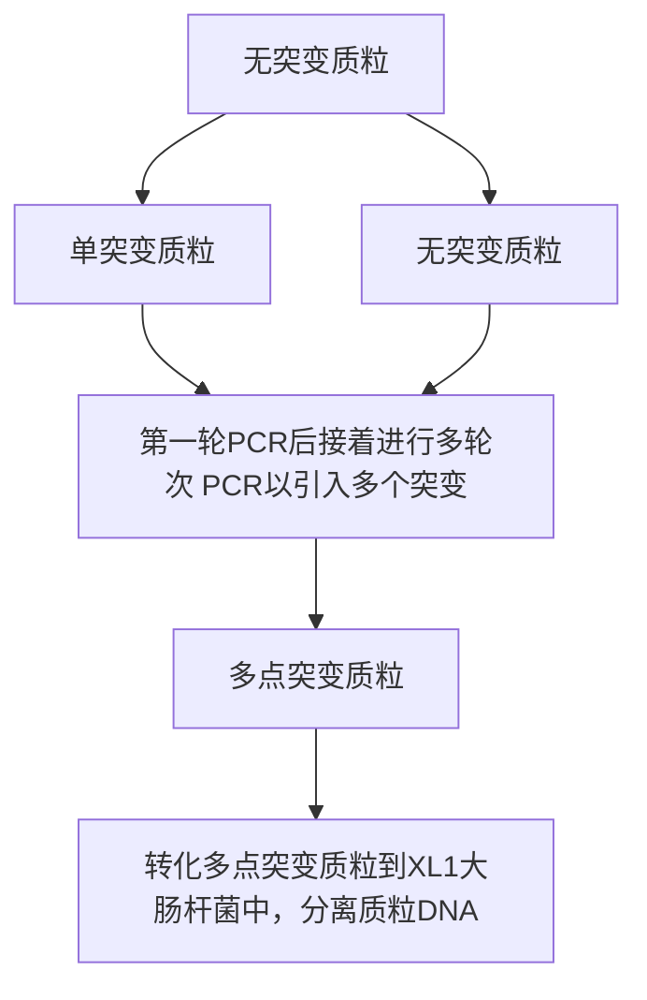
</details>

图14-11 多位点定向诱变。含目标突变点和重叠序列的引物产生第一轮环状DNA分子。用DpnI酶消化亲本模板DNA富集突变DNA，用不同突变引物进行随后轮次的PCR。最后，含预定突变的DNA转化到感受态细菌中，分离和测序鉴定。黑色的圆圈表示突变（经Elsevier许可，摘自Tian et al.2010）。

---

928

分子克隆实验指南（原书第四版）

## 优缺点

本方法的主要优点:

- 目标突变点之间能够相近或分开很远。
- 本方法仅仅需要一次克隆步骤。
- 本方法总成本低于商品化试剂盒。
- 不需要对引物磷酸化或 DNA 连接。

本方法的主要缺点:

- 在一个 4kb 质粒上完成的 3 个点突变效率约为 36.4%，低于商品化试剂盒的效率（大于 50% 效率的 QuikChange 多位点定向诱变试剂盒，Agilent 公司）（Tian et al. 2010）。
- 本方法需要进行目标突变点数一样多轮次的 PCR。
- 产生3个以上点突变需要的时间多于商品化试剂盒的时间。


## 材料

为正确使用本方案中的器材和危险试剂，必须查阅相应的材料安全数据表并咨询所在机构的环境卫生和安全办公室。本方案的专用试剂标注&lt;R&gt;，配方在本方案末提供。常用储备溶液、缓冲液和试剂标注&lt;A&gt;，配方见附录1。储备溶液应稀释至适用浓度后使用。

## 试剂

琼脂糖凝胶电泳试剂

与菌株相配的抗生素

含拟突变克隆基因的 DNA 模板

dNTP 混合物

Dpn I (10U/μL)

大肠杆菌 XL-Blue 感受态细胞

LB 琼脂平板 &lt;R&gt;

LB 培养基 &lt;R&gt;

PCR 缓冲液（依照所使用的 DNA 聚合酶）

正向和反向突变引物

两条突变引物必须含预定突变，能够复性到质粒相对链的相同序列上。它们可以根据需要设计成含一个点的突变、插入或缺失。引物长度为25～45个碱基，在突变部位上应该至少有10～15个碱基互补。当多碱基错配出现时，这一点是特别重要的。

热稳定 DNA 聚合酶

## 设备

离心机

凝胶电泳仪

培养箱

培养皿

质粒 DNA 纯化试剂盒

热循环仪

水浴箱或加热板

---

第 14 章 体外诱变方法

929


## 方法

1. 使用下面试剂进行 PCR 反应（同时见第 7 章）:

| 正向和反向突变引物 | 终浓度 0.4μmol/L |
| --- | --- |
| dNTP 混合物 | 每种终浓度 0.2mmol/L |
| DNA 模板 | 100ng |

按下面的条件进行热循环 PCR:

| 循环数 | 变性 | 复性 | 聚合反应 |
| --- | --- | --- | --- |
| 1 | 94°C,5min |  |  |
| 30~40 | 94°C,30s | 55~62°C,30s | 68°C,2min |
| 1 |  |  | 68°C,5min |

2. 直接加  $1 \mu L$  Dpn I（ $10 U/\mu L$ ）限制酶到各自扩增反应中。

3. 通过来回地吸液几次轻轻充分混合各自反应混合液。微量离心机上离心反应混合液，然后立即 $37^{\circ} \mathrm{C}$ 孵育各自反应 $1 \mathrm{~h}$ 以消化亲代 DNA。

4. 使用第一轮 PCR 产物和另一对拟引入不同突变点的突变引物进行另一轮 PCR。程序同步骤 1。

5. 引入所有的预定突变点后，用 $10 \mu \mathrm{L}$ 最终PCR产物转化 $50 \sim 100 \mu \mathrm{L}$ 的大肠杆菌XL-Blue1感受态细胞（第3章）。冰上孵育细胞 $15 \sim 30 \mathrm{~min}$，然后 $42^{\circ} \mathrm{C}$ 热激90s。使细菌在 $1 \mathrm{~mL}$ LB培养基里 $37^{\circ} \mathrm{C}$ 培养恢复 $1 \mathrm{~h}$ 。将转化大肠杆菌细胞涂布含适当抗生素的琼脂平板，平板 $37^{\circ} \mathrm{C}$ 孵育过夜。

6. 随机挑取 12 个克隆，在含适当抗生素的 2\~3mL LB 培养基中孵育过夜。

7. 用商品化试剂盒提取和纯化质粒 DNA。通过序列测定筛选含全部预定突变的质粒。


## 配方

为正确使用本方案中的器材和危险试剂，必须查阅相应的材料安全数据表并咨询所在机构的环境卫生和安全办公室。

## LB 琼脂平板

按上述配方配制液体 LB 培养基，高压灭菌前加入终浓度 15g/L 的琼脂。高压灭菌后，倒平板前加入终浓度 125μg/mL 的氨苄青霉素。

LB 培养基

| 试剂 | 质量(1L) |
| --- | --- |
| 细菌用胰蛋白胨 | 10g |
| 酵母提取物 | 5g |
| NaCl | 5g |

溶入 1L 蒸馏水中。用 5mol/L NaOH 调 pH 至 7.5。高压灭菌。

## 参考文献

<small><span class="docvortex-page-footnote" data-block-type="page_footnote" style="color:#6b7280">Higuchi R, Krummel B, Saiki RK. 1988. A general method of in vitro preparation and specific mutagenesis of DNA fragments: Study of protein and DNA interactions. Nucleic Acids Res 16: 7351–7367.</span></small>

<small><span class="docvortex-page-footnote" data-block-type="page_footnote" style="color:#6b7280">Ho SN, Hunt HD, Horton RM, Pullen JK, Pease LR. 1989. Site-directed mutagenesis by overlap extension using the polymerase chain reaction. Gene 77: 51–59.</span></small>

<small><span class="docvortex-page-footnote" data-block-type="page_footnote" style="color:#6b7280">Ishii TM, Zerr P, Xia XM, Bond CT, Maylie J, Adelman JP. 1998. Site-directed mutagenesis. Methods Enzymol 293: 53–71.</span></small>

<small><span class="docvortex-page-footnote" data-block-type="page_footnote" style="color:#6b7280">Kim YG, Maas S. 2000. Multiple site mutagenesis with high targeting efficiency in one cloning step. BioTechniques 28: 196–198.</span></small>

<small><span class="docvortex-page-footnote" data-block-type="page_footnote" style="color:#6b7280">Mikaelian I, Sergeant A. 1992. A general and fast method to generate multiple site directed mutations. Nucleic Acids Res 20: 376.</span></small>

<small><span class="docvortex-page-footnote" data-block-type="page_footnote" style="color:#6b7280">Tian J, Liu Q, Dong S, Qiao X, Ni J. 2010. A new method for multi-site-directed mutagenesis. Anal Biochem 406: 83–85.</span></small>

<small><span class="docvortex-page-footnote" data-block-type="page_footnote" style="color:#6b7280">Vallette F, Mege E, Reiss A, Adesnik M. 1989. Construction of mutant and chimeric genes using the polymerase chain reaction. Nucleic Acids Res 17: 723–733.</span></small>

---

930

分子克隆实验指南（原书第四版）

## 方案 9 基于 PCR 的大引物诱变

大引物诱变是一种简单通用的方法，能够用于在特定靶区域内产生单一突变，也能够产生定点插入、缺失和基因融合（图 14-12）。该方法使用 3 条寡核苷酸引物、两轮 PCR 和一个含有预定突变基因的 DNA 模板。如图 14-12 所示，A 和 B 是两条侧翼引物，M 是一条携带预定突变的引物，含一个拟引进 DNA 序列的突变；在第一轮 PCR 中用一条侧翼引物（如 A）和突变引物（M）扩增出一条含有突变的 DNA 片段。第二轮 PCR 采用这个扩增片段（大引物）与另一条侧翼引物（如 B）扩增出一条较长的 DNA 模板片段。最后的产物经纯化后克隆至适当的载体中。通过设计含有与选择载体一致的通用限制酶位点序列的侧翼引物，仅改变突变引物就可以产生不同的突变克隆。最近建立了改良的大引物方法，主要是使用具有显著不同解链温度的正向和反向侧翼引物。这种方案可以使研究人员在同一试管中执行两轮 PCR（Ke and Madison 1997）。本方案描述的方案摘自 Brons-Poulsen 等（1998，2002）的方案。该方案已成功地应用于低或高 G+C 含量的模板扩增出 71～800 个碱基对长的大引物，最后的产物大小为 400～2500 个碱基对。此外，研究人员能够引入单碱基对突变，也能够进行长 24 个碱基对序列的缺失和替换。


<details>
<summary>flowchart</summary>

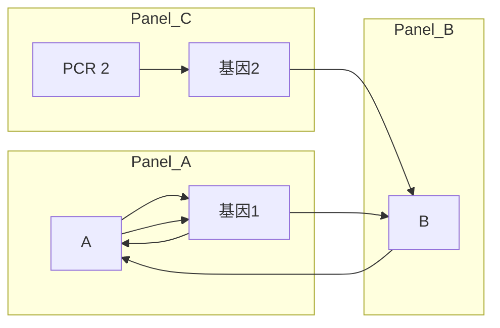
</details>

含突变的基因嵌合体

图14-12 使用大引物方法产生插入、缺失和基因融合的步骤。（A）表示插入（A，上）和缺失（A，下）诱变的第一轮PCR；随后如上面描述的一样，使用第一轮PCR产生的大引物、引物B和第一轮的DNA模板进行第二轮PCR扩增产生突变DNA片段。（B）表示基因融合，使用两个不同基因（分别为灰色和黑色线）进行第一轮和第二轮PCR。在第一轮PCR（PCR1）中的M引物必须有一段与第二个基因互补的序列，以允许大引物在第二轮PCR（PCR2）中能够复性到该DNA模板上。M引物上的蓝点表示拟引入到嵌合基因中的预定突变（经Springer Science + Business Media许可，摘自Barik 1997）。（彩图请扫书后二维码）。

---

第 14 章 体外诱变方法

931


## 材料

为正确使用本方案中的器材和危险试剂，必须查阅相应的材料安全数据表并咨询所在机构的环境卫生和安全办公室。

本方案的专用试剂标注&lt;R&gt;，配方在本方案末提供。常用储备溶液、缓冲液和试剂标注&lt;A&gt;，配方见附录1。储备溶液应稀释至适用浓度后使用。

## 试剂

琼脂糖凝胶

含拟突变克隆基因的 DNA 模板

dNTP 混合物

寡核苷酸引物 A、B 和 M（关于引物设计见下面说明）

PCR 缓冲液（含酶）

模板和 PCR 产物纯化试剂

几个商品化试剂盒可用，但标准的酚:氯仿抽提也可行

热稳定 DNA 聚合酶

## 设备

PCR 产物的琼脂糖凝胶电泳设备（第 2 章，方案 1 和方案 2）

凝胶提取试剂盒

长波 UV 透射仪

热循环仪

## 引物设计

设计引物时，首先注意的是，由第二轮 PCR 产生的 PCR 产物长度必须与大引物不同。这确保凝胶电泳能够适当地分离两个片段。其次，M 引物的突变应该位于引物的中心。接近突变 5' 端的突变能够削弱第二轮突变反应效率。突变位于 3' 端能够抑制大引物的得率。突变位于引物中间影响解链温度。因此，为了确保有效的复性，引物长度需要调整。最后，A 和 B 引物应该包含特定限制性位点，以便最后的产物能够克隆至所选择的载体中。

当设计插入、缺失和基因融合的引物时，这些因素也适用。此外，通过在 M 引物中加入预定突变，基因融合能够与诱变相结合。


## 方法

## 大引物合成

1. 在无菌 0.5mL 微量离心管中混合以下成分进行第一轮 PCR:

| 10×扩增缓冲液 | 10μL |
| --- | --- |
| 质粒模板 DNA | 50~200ng |
| dNTP 混合物 | 200μmol/L(每一种 dNTP) |
| 突变/侧翼引物 | 100pmol(每种引物) |
| 热稳定 DNA 聚合酶 | 2.5U |
| 加水至 | 100μL |

---

932

分子克隆实验指南（原书第四版）

循环程序:

| 循环数 | 变性 | 复性 | 聚合反应 |
| --- | --- | --- | --- |
| 1 | 94°C, 2min |  |  |
| 10~25 | 94°C, 20~45s | 50~60°C, 30~120s | 72°C, 30~90s |
| 1 |  |  | 72°C, 10min |

2. 取 PCR 反应产物进行琼脂糖凝胶电泳分离纯化（第 2 章，方案 1 和方案 2）。

3. 切取含大引物的条带, 使用琼脂糖凝胶提取试剂盒纯化该 DNA。

## 大引物第二轮 PCR

加第一轮 PCR 产生的大引物和引物 B 到 DNA 模板中进行第二轮 PCR。该步骤的关键点是引物的浓度。虽然这种现象具体的原因仍然不清楚，推测很可能与相当大的单链 DNA 到达临界浓度时形成的二级和三级结构有关。有些研究人员发现大引物浓度高于 0.01mmol/L 抑制反应。相反，其他的研究则显示，与 0.01mmol/L 及更低浓度的大引物相比，大引物浓度在 0.02～0.04mmol/L 是有利的。对于某一个大引物，可能会发生完全抑制反应。在这种情况下，引物的浓度应该降到一个绝对极小值。注意两条引物的浓度应该是相等的，以避免不对称扩增形成单链 DNA 产物。

4. 在无菌 $0.5 \mathrm{~mL}$ 微量离心管中混合以下成分进行最后一轮 PCR:

| 10×扩增缓冲液 | 10μL |
| --- | --- |
| 质粒模板 DNA | 50~200ng |
| dNTP 混合物 | 200μmol/L(每一种 dNTP) |
| 突变/侧翼引物 | 100pmol(每种引物) |
| 热稳定 DNA 聚合酶 | 2.5U |
| 加水至 | 100μL |

使用下面的 PCR 条件进行最后突变产物的合成:

| 循环数 | 变性 | 复性 | 聚合反应 |
| --- | --- | --- | --- |
| 1 | 94°C, 2min |  |  |
| 10~25 | 94°C, 20~45s | 50~60°C, 120s | 72°C, 30~90s |
| 1 |  |  | 72°C, 10min |

5. 琼脂糖凝胶电泳分析 PCR 产物，回收较大分子质量的 DNA 带。

6. 使用琼脂糖凝胶提取试剂盒纯化该 DNA 片段，并克隆至选择的载体中（第 3 章）。如果得率低，使用引物 A 和 B 以及标准的 PCR 方法对突变产物进行再次扩增。

## 参考文献

Barik S. 1997. Mutagenesis and gene fusion by megaprimer PCR. Methods Mol Biol 67: 173–182.

Brons-Poulsen J, Petersen NE, Horder M, Kristiansen K. 1998. An improved PCR-based method for site directed mutagenesis using megaprimers. Mol Cell Probes 12: 345–348.

Brons-Poulsen J, Nohr J, Larsen LK. 2002. Megaprimer method for polymerase chain reaction-mediated generation of specific mutations in DNA. Methods Mol Biol 182: 71–76.

Ke SH, Madison EL. 1997. Rapid and efficient site-directed mutagenesis by single-tube 'megaprimer' PCR method. Nucleic Acids Res 25: 3371–3372.

---

第 14 章 体外诱变方法

933

## 信息栏


## 区域诱变

区域诱变用于在克隆 DNA 的确定区域中引入多个突变。易错 PCR 方法（本章方案 1）是用于在蛋白质结构域和启动子元件中引入随机突变最有效的工具之一。GeneMorph II EZClone 区域诱变试剂盒（Agilent 公司）提供一个简单快速系统，用于在蛋白质结构域上进行定向随机诱变。该试剂盒需要一个含突变基因区域的双链 DNA 载体，诱变反应中产生的大引物，以及一个限制酶 Dpn I 消除未突变亲本质粒 DNA 的消化步骤。最后，突变文库转化到感受态大肠杆菌细胞中。与其他易错 PCR 酶相比，试剂盒中提供的 Mutazyme II DNA 聚合酶能引起更加一致的突变谱，产生最小限度的突变偏性，以便在碱基 A 和 T 以及 G 和 C 上产生的突变发生频率相同（图 1）。


<details>
<summary>flowchart</summary>

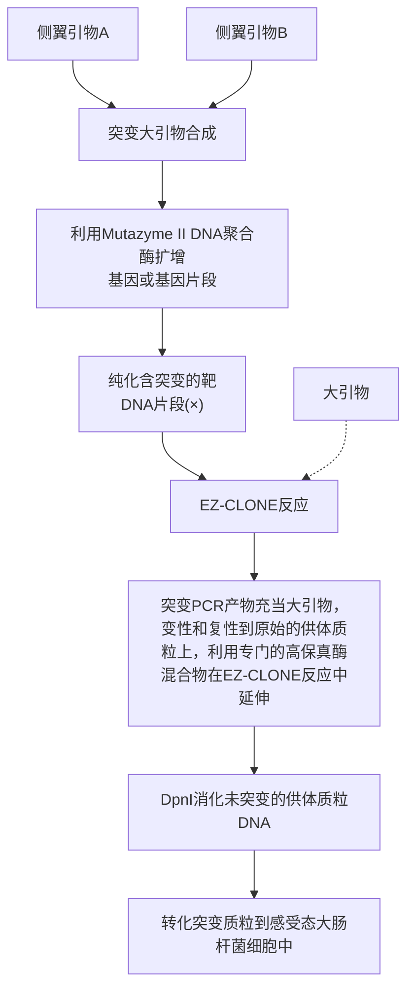
</details>

图 1 区域诱变。利用靶区域外部的引物对和易错 Mutazyme II DNA 聚合酶进行第一轮 PCR（突变大引物合成）。纯化的突变 PCR 产物充当第二轮 PCR（EZ-CLONE 反应）的大引物。该步骤采用第一轮 PCR 的同一模板，但使用高保真 DNA 聚合酶。最后，通过 Dpn I 消化除去亲本模板并转化大肠杆菌细胞以便富集突变载体。中间蓝色长方形示靶区域。黑色十字叉示突变碱基对[来自 GeneMorph II EZ-CLONE 区域诱变试剂盒说明书(Agilent Technologies, Stratagene Products Division)方案 1 中图 14-1，并进行修改。© Agilent Technologies, Inc. 经 Agilent Technologies, Inc. 许可复制]。

---

934

分子克隆实验指南（原书第四版）


## 质粒 DNA 高通量定点诱变

本信息栏简要介绍一个有效应用于体外高通量定点诱变的方法。本方案能够用于从任何来源 DNA 制备高达 21 个核苷酸长的插入、缺失和置换。不像其他许多方法，本方案不需要专门的载体、宿主菌株或限制性位点。仅需一对诱变寡核苷酸引物就能够产生需要的突变。Life Technologies 公司提供能够完成这种诱变的一个商品化试剂盒（GeneTailor 定点诱变系统）。

本方法是一个简单的三步方案，能够很容易地放大到在一个特定 DNA 序列上产生 96 个突变。首先，设计长度至少 30 个核苷酸的正向和反向引物，诱变引物上不能含有突变点。正向和反向引物在 5' 端应该有 15～20 个核苷酸长的重叠区域，以便有效地进行末端连接诱变产物。突变位点应该仅仅位于其中的一条引物上，长达 21 个碱基。设计引物之后，甲基化处理模板质粒。为了完成模板质粒甲基化，在甲基化反应缓冲液将模板质粒和 DNA 甲基化酶 37℃ 孵育 1h。DNA 甲基化酶对双链 DNA 中各处特定序列内的胞嘧啶残基进行甲基化。因此，正如 Bandaru 等（1995）和 Wyszynski 等（1994）描述的，甲基化 DNA 易受大肠杆菌中的 Mcr 和 Mrr 限制系统影响。

然后，甲基化质粒用于进行诱变反应，加入突变引物和互补引物，并加入热稳定酶、dNTP、 $MgSO_{4}$  和 PCR 缓冲液。反应混合物执行 20 轮次的热循环反应。PCR 产物是含有目标突变的线性双链 DNA。最后，诱变混合物转化野生型大肠杆菌细胞。宿主细胞对线性突变 DNA 进行环化，内源宿主 McrBC 内切核酸酶消化除去原始甲基化模板，仅仅留住未甲基化的突变产物。然后，通过常规方法从大肠杆菌细胞中纯化突变质粒。

## 参考文献

Bandaru B, Wyszynski M, Bhagwat AS. 1995. HpaII methyltransferase is mutagenic in Escherichia coli. J Bacteriol 177: 2950–2952.

Wyszynski M, Gabbara S, Bhagwat AS. 1994. Cytosine deaminations catalyzed by DNA cytosine methyltransferases are unlikely to be the major cause of mutational hot spots at sites of cytosine methylation in Escherichia coli. Proc Natl Acad Sci 91: 1574–1578.


## $N^{6}$ -甲基化腺嘌呤、DAM 甲基化酶和甲基化敏感限制酶

Dam 甲基化酶对腺嘌呤残基的甲基化作用

在大肠杆菌细胞的  $5^{\prime\cdots}$ GATC…3' DNA 序列中，腺嘌呤的  $N^{6}$  原子上携带一个甲基基团（Hattman et al. 1978）。在双链 DNA 的回文识别序列中，99%以上这种修饰的腺嘌呤是由 DNA 腺嘌呤甲基化酶（Dam）作用形成的。该酶是一种单亚基非核苷酸依赖型（II型）甲基转移酶，它将 S-腺苷甲硫氨酸的甲基基团转移到识别序列中的腺嘌呤残基上（Geier and Modrich 1979；综述见 Marinus 1987；Palmer and Marinus 1994）。

几种限制酶的识别位点（包括 Pvu I、BamH I、Bcl I、Bgl II、Xho II、Mbo I 和 Sau3A I）含有 5'…GATC…3' 序列，有一部分位点是能够被某些限制酶所识别，如 Cla I（约 1/4）、Xba I（1/16）、Mbo II（1/16）、Taq I（1/16）和 Hph I（1/16）。甲基基团转移到腺嘌呤 N$^{6}$ 原子时能够在 B 型 DNA 的大沟中置入一个大的烷基取代基，可完全阻止一些限制酶的

---

第 14 章 体外诱变方法

935

体外裂解（如 Mbo I）（Dreiseikelmann et al. 1979）。其他限制酶最多也只是裂解它们识别位点的一个亚型，如 Cla I 识别 5'ATCGAT 3' 序列。如果该序列前面是 G 后面是 C，或两者都是，其中一个或两个腺嘌呤（A）残基将被甲基化，该位点则免遭切割。但是，甲基化并非绝对使 GATC 序列免于被所有限制酶切割。例如，限制酶 Sau3AI（Mbo I 的同裂酶）无论腺嘌呤是否甲基化都能够切割…GATC…，而 Dpn I 酶可完全切割甲基化的…G $^{me6}$ ATC…序列（Lacks and Greenberg 1975，1977；Geier and Modrich 1979）。Dam 甲基化酶体外修饰的 DNA 仍保持对大肠杆菌 Mcr 和 Mrr 系统限制作用的敏感性。哺乳类动物 DNA 不在腺嘌呤 N $^{6}$ 位置上发生甲基化，因而能被对原核 DNA 的 Dam 甲基化敏感的限制酶完全切割。

Kessler 和 Manta（1990）以及 McClelland 和 Nelson （1988）汇编了切割模式受 Dam 甲基化影响的限制酶表。进一步的信息可在大多数酶供应商的手册及限制和修饰酶数据库中查到。限制和修饰酶数据库（REBASE）的数据库网址为 http://rebase.neb.com/rebase/rebase.html。

当必须用 Dam 甲基化敏感的限制酶切割原核 DNA 的每一个可能位点时，DNA 必须从大肠杆菌 Dam⁻菌株中分离（Marinus 1973；Backman 1980；Roberts et al. 1980；McClelland and Nelson 1988）。这些菌株（如 GM2163 可从 New England Biolabs 获取，JM110 从 ATCC 得到）显示一种奇异的表型，包括自发突变率和重组率提高、对紫外线的敏感性增加、重组效率提高，以及溶原性噬菌体的诱导效率增加（讨论见 Marinus 1987；Palmer and Marinus 1994）。因为 Dam 缺陷损害了错配修复系统，而不能纠正新生子链中的错误，所以 Dam⁻菌株通常不如野生型 K-12 菌株生长得好（Lu et al. 1983；Pukkila et al. 1983；综述见 Modrich 1989；Palmer and Marinus 1994）。Dam 甲基化作用的缺乏导致自发突变率增加。Dam⁻菌株还显示一类基因的异常调控和 DNA 复制起始效率的下降。由于这些问题，Dam⁻菌株不应长期连续培养或在平板上保存或长期穿刺培养，而应分装成小份保存于 -70℃。一些大肠杆菌通过在氯霉素或卡那霉素存在下生长，保持其 dam 突变性状得以增强。这些菌株，dam 基因是通过插入编码氯霉素抗性的转座子 Tn9 而灭活的（Marinus et al. 1983），或用携带卡那霉素抗性标记的 DNA 片段替换 dam 基因中的部分片段而灭活 dam 基因（Parker and Marinus 1988）。Palmer 和 Marinus（1994）已列出常用的 Dam⁻菌株目录。

## GATC 中未甲基化和半甲基化腺嘌呤

在一些大肠杆菌菌株中，估计 18 000 个 5'…GATC…3' 序列中的一小部分（约 0.2% 或更少）没有被甲基化（Ringquist and Smith 1992）。这些非修饰位点更趋向位于复制起始区附近或由体内 DNA 结合蛋白（如 cAMP 受体蛋白）保护而免受 Dam 甲基化修饰作用的基因组 DNA 区域（Ringquist and Smith 1992；Wang and Church 1992；Hale et al. 1994）。

大肠杆菌染色体唯一复制起始点（oriC）富含 GATC 序列。DNA 合成的起始时间受一些因子控制，包括这些序列的甲基化状态（综述见 Crooke 1995）。准时和及时的复制起始需要 oriC 近端的 GATC 序列完全被 Dam 核酸酶甲基化。半保留复制产生半甲基化 GATC 序列，该序列结合在细胞膜上而不再受 Dam 甲基化酶影响。在下一轮 DNA 合成起始前，oriC 区从膜上释放出来，此位置的 GATC 位点再一次被完全甲基化。这些过程是如何协调的还完全不清楚。

---

936

分子克隆实验指南（原书第四版）

## 参考文献

- Backman K. 1980. A cautionary note on the use of certain restriction endonucleases with methylated substrates. Gene 11: 169–171.
- Crooke E. 1995. Regulation of chromosomal replication in E. coli: Sequestration and beyond. Cell 82: 877–880.
- Dreiseikelmann B, Eichenlaub R, Wackernagel W. 1979. The effect of differential methylation by Escherichia coli of plasmid DNA and phage T7 and λ DNA on the cleavage by restriction endonuclease MboI from Moraxella bovis. Biochim Biophys Acta 562: 418–428.
- Geier GE, Modrich P. 1979. Recognition sequence of the dam methylase of Escherichia coli K12 and mode of cleavage of Dpn I endonuclease. J Biol Chem 254: 1408–1413.
- Hale WB, van der Woude MW, Low DA. 1994. Analysis of nonmethylated GATC sites in the Escherichia coli chromosome and identification of sites that are differentially methylated in response to environmental stimuli. J Bacteriol 176: 3438–3441.
- Hattman S, van Ormondt H, de Waard A. 1978. Sequence specificity of the wild-type (dam $^{+}$ ) and mutant (dam $^{h}$ ) forms of bacteriophage T2 DNA adenine methylase. J Mol Biol 119: 361–376.
- Kessler C, Manta V. 1990. Specificity of restriction endonucleases and DNA modification methyltransferases (review, edition 3). Gene 92: 1–248.
- Lacks S, Greenberg B. 1975. A deoxyribonuclease of Diplococcus pneumoniae specific for methylated DNA. J Biol Chem 250: 4060–4066.
- Lacks S, Greenberg B. 1977. Complementary specificity of restriction endonucleases of Diplococcus pneumoniae with respect to DNA methylation. J Mol Biol 114: 153–168.
- Lu AL, Clark S, Modrich P. 1983. Methyl-directed repair of DNA base-pair mismatches in vitro. Proc Natl Acad Sci 80: 4639–4643.
- Marinus MG. 1973. Location of DNA methylation genes on the Escherichia coli K-12 genetic map. Mol Gen Genet 127: 47–55.
- Marinus MG. 1987. Methylation of DNA. In Escherichia coli and Salmonella typhimurium: Cellular and molecular biology (ed Neidhardt FC, et al.), Vol. 1, pp. 697–702. American Society for Microbiology, Washington, DC.
- Marinus MG, Carraway M, Frey AZ, Brown L, Arraj JA. 1983. Insertion mutations in the dam gene of Escherichia coli K-12. Mol Gen Genet 192: 288–289.
- McClelland M, Nelson M. 1988. The effect of site-specific DNA methylation on restriction endonucleases and DNA modification methyltransferases—A review. Gene 74: 291–304.
- Modrich P. 1989. Methyl-directed DNA mismatch correction. J Biol Chem 264: 6597–6600.
- Palmer BR, Marinus MG. 1994. The dam and dcm strains of Escherichia coli—A review. Gene 143: 1–12.
- Parker B, Marinus MG. 1988. A simple and rapid method to obtain substitution mutations in Escherichia coli: Isolation of a dam deletion/insertion mutation. Gene 73: 531–535.
- Pukkila PJ, Peterson J, Herman G, Modrich P, Meselson M. 1983. Effects of high levels of DNA adenine methylation on methyl-directed mismatch repair in Escherichia coli. Genetics 104: 571–582.
- Ringquist S, Smith CL. 1992. The Escherichia coli chromosome contains specific, unmethylated dam and dcm sites. Proc Natl Acad Sci 89:4539–3543.
- Roberts TM, Swanberg SL, Poteete A, Riedel G, Backman K. 1980. A plasmid cloning vehicle allowing a positive selection for inserted fragments. Gene 12: 123–127.
- Wang MX, Church GM. 1992. A whole genome approach to in vivo DNA–protein interactions in E. coli. Nature 360: 606–610.

(余云舟 仇玮祎 译，陈忠斌 校)
