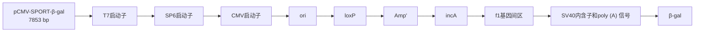
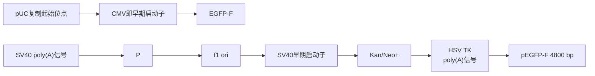

# 第15章 向培养的哺乳动物细胞中导入基因

原始 PDF 第 448–508 页。

## 第 15 章 向培养的哺乳动物细胞中导入基因

<table><tr><td rowspan="3">导言</td><td>瞬时转染与稳定转染</td><td>938</td><td>优化和特殊注意事项</td><td>940</td></tr><tr><td>转染方法</td><td>939</td><td>评价转染细胞系的细胞活力</td><td>941</td></tr><tr><td>转染的对照</td><td>940</td><td></td><td></td></tr></table>

<table><tr><td rowspan="7">方案</td><td>1 阳离子脂质试剂介导的 DNA 转染</td><td>942</td><td>● 替代方案 磷酸钙介导的悬浮生长细胞的转染</td><td>963</td></tr><tr><td>● 替代方案 采用 DOTMA 和 DOGS进行转染</td><td>948</td><td>4 DEAE-葡聚糖介导的转染:高效率的转染方法</td><td>964</td></tr><tr><td>● 附加方案 单层细胞组织化学染色检测β-半乳糖苷酶</td><td>950</td><td>● 替代方案 DEAE-葡聚糖介导的转染:提高细胞活力的方案</td><td>966</td></tr><tr><td>2 磷酸钙介导的质粒 DNA 转染真核细胞</td><td>952</td><td>5 电穿孔转染 DNA</td><td>968</td></tr><tr><td>● 替代方案 磷酸钙介导的质粒 DNA高效转染真核细胞</td><td>956</td><td>6 通过 alamarBlue 法分析细胞活力</td><td>972</td></tr><tr><td>3 磷酸钙介导的高分子质量基因组 DNA转染细胞</td><td>959</td><td>7 通过乳酸脱氢酶法分析细胞活力</td><td>974</td></tr><tr><td>● 替代方案 磷酸钙介导的贴壁细胞的转染</td><td>962</td><td>8 通过 MTT 法分析细胞活力</td><td>977</td></tr></table>

<table><tr><td rowspan="5">信息栏</td><td>光学转染</td><td>980</td><td>用磷酸钙-DNA共沉淀转染哺乳动物</td><td></td></tr><tr><td>共转化</td><td>981</td><td>细胞</td><td>988</td></tr><tr><td>用于稳定转化的筛选试剂</td><td>982</td><td>二磷酸氯喹</td><td>989</td></tr><tr><td>脂质体转染</td><td>985</td><td>DEAE-葡聚糖转染</td><td>990</td></tr><tr><td>转染前的质粒线性化</td><td>987</td><td>电穿孔</td><td>992</td></tr></table>

---

## 导言

将基因导入真核细胞的方法可分为三类:生化方法转染、物理方法转染、病毒介导的转导。本章介绍前两类，病毒介导的转导将在第16章详述。

转染方法的选择取决于下列几个实验要素:

- 最终目的是基因表达还是蛋白质生产
- 采用的细胞类型（贴壁细胞或悬浮细胞，适应培养的细胞或原代细胞）
- 细胞系抵抗转染压力的能力
- 采用的筛选方法的类型
- 培养条件
- 转染的核酸种类（DNA、RNA、siRNA 或寡核苷酸）
- 系统所要求的效率
- 通量要求，低、中或高

商业化的转染试剂通常都针对多种细胞类型、不同的核酸和各种特定的用途进行了检验。在开始实验之前，建议查询转染试剂生产厂商网站上提供的选择指南，如果时间和条件允许，还可以对不同转染试剂的效率进行比较。

生化方法转染包括磷酸钙介导的转染和二乙氨乙基（DEAE）-葡聚糖介导的转染，此类方法应用于将核酸导入培养的细胞已有超过45年的历史。Graham和van der Eb（1973）在磷酸钙存在下用病毒DNA转化哺乳动物细胞，这一工作为用克隆的DNA对遗传标记的小鼠细胞进行生化转化（Maitland and McDougall 1977; Wigler et al. 1977），为克隆的基因在多种哺乳动物细胞中进行瞬时表达（如见Gorman et al. 1983b），以及为细胞癌基因、抑癌基因及其他单拷贝哺乳动物基因进行分离和鉴定（如见Wigler et al. 1978; Perucho and Wigler 1981; Weinberg 1985; Friend et al. 1988）奠定了基础。近年来，阳性/中性脂质（脂质体）试剂最为常用，因为其可将基因高效地导入多种细胞类型。在这种情况下，化学试剂与DNA形成复合物，中和或掩盖DNA分子上的负电荷（有时甚至呈现正电荷），从而使该复合物可与带负电荷的细胞质膜相互作用，便于被细胞内吞。

除了生化方法，一种物理转染方法——电穿孔法也被广泛采用。电穿孔是使用短暂的电脉冲在细胞膜上产生能够使核酸进入细胞质的瞬时小孔。核转染（nucleofection）是由Amaxa公司开发的一种改进的电穿孔技术，通过优化电转参数、结合细胞类型特异性的转染试剂，可将核酸直接导入细胞核内。最后，光学转染利用的是光线可在哺乳动物细胞质膜上产生瞬时小孔的能力（见信息栏“光学转染”）。

## 瞬时转染与稳定转染

将 DNA 导入真核细胞有两种不同的方法:瞬时转染与稳定转染。在瞬时转染中，重组 DNA 导入易感的细胞系，目的基因产生短暂但高水平的表达，转染的 DNA 不一定整合进入宿主染色体。当需要在短时间内分析大量的样品时，瞬时转染是优先选择的方式。通常情况下，在转染后 1～4 天收获细胞，得到的细胞裂解物用于检测目的基因表达。

稳定或永久的转染用于建立克隆细胞系，此时转染的目的基因整合进入染色体 DNA 并指导目的蛋白的合成，表达量通常为中等。一般而言（取决于细胞类型），形成稳定转染细胞的效率比瞬时转染要低 1～2 个数量级。采用可选择的遗传标记有利于从大量未转染的

---

第 15 章 向培养的哺乳动物细胞中导入基因

939

细胞中分离出少数的稳定转染体。该标记基因可存在于携带目的基因的重组质粒上，也可以在另一个单独的载体上，通过共转染与重组质粒一起导入到所需细胞系中（说明详见信息栏“共转化”和“用于稳定转化的筛选试剂”）。一般情况下，下面介绍的方法对于分析瞬时转染和获得稳定转染体均适用。

## 转染方法

在过去，克隆的 DNA 主要通过借助磷酸钙或 DEAE-葡聚糖的生化方法导入培养的真核细胞中。现在，脂质成为首选的试剂，因其可获得很高的转染效率，且这类试剂能够介导所有类型的核酸转染进入各种类型的细胞。此外，脂质试剂的优点还包括易于使用、重复性好、低毒性和能够高效转染悬浮培养体系。其他方法无法转染的细胞系可以考虑选择物理方法，如电穿孔和核转染。表 15-1 对各种转染方法给出了简单的总结。

表 15-1 转染方法

<table><tr><td rowspan="2">方法</td><td colspan="2">表达</td><td rowspan="2">细胞毒性</td><td rowspan="2">细胞类型</td><td rowspan="2">注释</td><td rowspan="2">优势</td><td rowspan="2">劣势</td></tr><tr><td>瞬时</td><td>稳定</td></tr><tr><td>脂质体介导方案1</td><td>可</td><td>可</td><td>可变</td><td>贴壁细胞,原代细胞系,悬浮培养体系</td><td>阳离子脂质与带负电荷的DNA结合,有的形成人工膜囊泡(脂质体)。产生的稳定阳离子复合物吸附并融合于带负电荷的细胞膜(Felgner et al. 1987, 1994)</td><td>免疫原性和细胞毒性低;可使用大质粒;安全风险低,操作程序简单、快速;对所有核酸(DNA、mRNA、siRNA等)操作方案相同;相对低成本,适用于高通量系统</td><td>在原代和悬浮细胞中效率低且易变</td></tr><tr><td>磷酸钙介导方案2和方案3</td><td>可</td><td>可</td><td>无</td><td>贴壁细胞(CHO、293);悬浮培养体系</td><td>磷酸钙与DNA形成不可溶的共沉淀并吸附于细胞表面,通过内吞作用或吞噬作用被吸收(Graham and van der Eb 1973)</td><td>细胞毒性低,可使用大质粒,安全风险低,操作程序简单,非常廉价</td><td>试剂的一致性是获得高转染效率的关键;pH(±0.1)的微小变化即可对转染效率造成巨大影响;沉淀物的大小和质量至关重要;有时表现出免疫原性;对于不同的核酸需要调整方案,可能导致效率各异,贴壁细胞和悬浮细胞效率不同;对原代细胞无效;因细胞培养基中含有高浓度磷酸盐,所以不能在培养基中制备转染复合物</td></tr><tr><td>DEAE-葡聚糖介导方案4</td><td>可</td><td>否</td><td>有</td><td>BSC-1、CV-1和COS</td><td>带正电荷的DEAE-葡聚糖与DNA上带负电荷的磷酸基团结合,形成的聚合物结合带负电荷的质膜,可能通过内吞作用进入细胞,渗透性休克可增强内吞作用(Vaheri and Pagano 1965)</td><td>可使用大质粒,安全风险低,操作程序简单,廉价</td><td>具有免疫原性和细胞毒性;只能用于瞬时转染;对不同核酸可能需要调整方案,造成效率变化非常大,贴壁细胞和悬浮细胞效率不同;对原代细胞无效</td></tr><tr><td>电穿孔方案5</td><td>可</td><td>可</td><td>有</td><td>多种;包括脂质体转染很难的细胞</td><td>应用短暂的高压电脉冲在多种哺乳动物和植物细胞质膜上形成纳米级微孔(Neumann et al. 1982;Zimmermann 1982)。DNA直接通过这些微孔或者因微孔闭合伴随的细胞膜组分重分布而进入胞浆</td><td>可使用大质粒;安全风险低;操作程序较简单、快速;对所有核酸(DNA、mRNA、siRNA等)操作方案相同;非化学方法,不改变细胞的生物结构或功能</td><td>对悬浮细胞和原代细胞毒性强、效率低;花费中等,需要专门的设备;根据使用的细胞类型要进行不同的实验设置</td></tr><tr><td>核转染在方案5中讨论</td><td>可</td><td>可</td><td>可变</td><td>多种;包括脂质体转染很难的细胞</td><td>核转染建立在电穿孔的物理方法基础上,将称为核转染仪(Nucleofector)的设备产生的电参数与细胞类型特异性试剂相结合,直接将核酸转移至细胞核和细胞质内(Greiner et al. 2004;Johnson et al. 2005)</td><td>对许多细胞类型毒性较低;可使用大质粒;安全风险低;对贴壁、悬浮和原代细胞均具有较好效率;操作程序较简单、快速;对所有核酸(DNA、mRNA、siRNA等)操作方案相同</td><td>花费中等,需要专门的设备,且需要同一生产商提供的专用缓冲液;根据使用的细胞类型要进行不同的实验设置</td></tr></table>

---

940

分子克隆实验指南（原书第四版）

## 转染的对照

所有的转染实验均应包括对照，以检验各个试剂和制备的质粒 DNA，以及检测将要引入的基因或构建体的毒性。

## 瞬时表达的对照

## 阴性对照

在瞬时转染实验中，需要用载体 DNA 和/或用于稀释待测质粒或基因的缓冲液转染一两个培养皿的细胞。通常采用鲑鱼精 DNA 或用于构建重组体的空载体等其他惰性载体代替待测基因转染贴壁细胞。转染后，培养的细胞不应从培养皿上脱落，外观上也不应变圆、变透明。

## 阳性对照

用编码一种易于检测的基因产物的质粒转染一两个培养皿的细胞，如氯霉素乙酰基转移酶、萤光素酶（第17章，方案2和方案3）、大肠杆菌β-半乳糖苷酶（第17章，方案1）或荧光蛋白如绿色荧光蛋白（GFP）及其衍生物（第17章，方案4），这些基因的表达由通用启动子驱动，如人巨细胞病毒即早期基因区启动子及相应增强子。这种示踪质粒可从出售含有用于检测编码蛋白的酶和试剂的试剂盒的供应商处获得。由于这些报道基因的内源活性通常很低，酶活性或荧光强度的增加可直接反映转染效率及实验所用试剂的质量情况。在比较不同批次转染实验的结果时，阳性对照尤其重要。将报道基因质粒与待测质粒或基因组DNA共转染，还可以为转染全程非特异性毒性提供对照。关于这些报道系统的更多信息，见第17章及其信息栏。

## 稳定表达的对照

## 阴性对照

用鲑鱼精 DNA 等惰性核酸代替选择性标记基因转染一两个培养皿的细胞。在适宜的筛选试剂（如 G418、潮霉素、霉酚酸）存在下培养 2～3 周后，应无细胞集落出现。

## 阳性对照

用编码选择性标记的空质粒转染一两个培养皿的细胞。筛选2～3周后存活的克隆数目可衡量转染/筛选过程的效率。在同时导入选择性标记和待测质粒或基因的细胞培养皿中应出现数量接近的克隆。如果待测培养皿克隆数目与阳性对照培养皿出现明显差异，则可能提示基因产物有毒性（极少情况下，基因产物可能增强转染细胞的存活力）。如果证明一种cDNA或基因对受体细胞有毒性，那么可以考虑采用调控型启动子，如金属硫蛋白启动子（一种应答于 $Zn^{2+}$ 或 $Cd^{2+}$ 的DNA）、小鼠乳腺瘤病毒长末端重复启动子（一种应答于糖皮质激素的DNA），或者四环素调控启动子（第17章，方案5）（Gossen and Bujard 1992; Gossen et al. 1995; Shockett et al. 1995）。

## 优化和特殊注意事项

无论采用何种方法将 DNA 导入细胞，瞬时转染或稳定转染的效率很大程度上取决于采用的细胞类型（见表 15-1）。不同系的培养细胞摄取和表达外源 DNA 的能力可相差几个数量级。此外，对一种类型的培养细胞效果很好的方法可能对另一种细胞行不通。本章所

---

第 15 章 向培养的哺乳动物细胞中导入基因

941

介绍的许多方案已采用标准的培养细胞系进行优化。当采用其他细胞系时，应注意比较几种不同方法的转染效率。方案1～5介绍了常用的转染技术，以及用标准技术难以转染的细胞系中获得成功的方法。商业化试剂盒可提供多种转染方法所需的成套试剂（表15-2）。

表 15-2 用于转染的商品化试剂盒和试剂

<table><tr><td>厂家</td><td>网址</td><td>方法或试剂</td><td>试剂盒/产品</td></tr><tr><td>Bio-Rad</td><td>www.bio-rad.com</td><td>非脂质体型阳离子脂质</td><td>Transfectin</td></tr><tr><td>Clontech</td><td>www.clontech.com</td><td>非脂质体型聚合物</td><td>Xfect</td></tr><tr><td>GE Healthcare Life Sciences</td><td>www.gelifesciences.com</td><td>DEAE-葡聚糖</td><td>CellPhect Transfection Kit</td></tr><tr><td rowspan="3">Life Technologies</td><td rowspan="3">www.invitrogen.com</td><td>磷酸钙</td><td>Calcium phosphate transfection kit</td></tr><tr><td>脂质体型阳离子脂质</td><td>Lipofectamine 2000</td></tr><tr><td>脂质体型阳离子脂质</td><td>Lipofectamine LTX</td></tr><tr><td rowspan="2">Mirus Bio</td><td rowspan="2">www.mirusbio.com</td><td>非脂质体型阳离子脂质</td><td>TransIT-2020</td></tr><tr><td>非脂质体型阳离子脂质</td><td>TransIT-LT1</td></tr><tr><td>Polyplus Transfection</td><td>www.polyplus-transfection.com</td><td>非脂质</td><td>jetPRIME, jetPEI</td></tr><tr><td rowspan="4">Promega</td><td rowspan="4">www.promega.com</td><td>磷酸钙</td><td>ProFection Mammalian Transfection System</td></tr><tr><td>非脂质体型阳离子脂质</td><td>FuGENE HD Transfection System</td></tr><tr><td>非脂质体型阳离子脂质</td><td>TransFast Transfection Reagent</td></tr><tr><td>非脂质体型阳离子脂质</td><td>FuGENE 6 Transfection Reagent</td></tr><tr><td rowspan="4">QIAGEN</td><td rowspan="4">www.qiangen.com</td><td>非脂质体型阳离子脂质</td><td>Effectene Transfection Reagent</td></tr><tr><td>非脂质体型阳离子脂质</td><td>Attractene Transfection Reagent</td></tr><tr><td>活化的树状聚合物</td><td>SuperFect Transfection Reagent</td></tr><tr><td>活化的树状聚合物</td><td>PolyFect Transfection Reagent</td></tr><tr><td rowspan="4">Roche Applied Science Sigma-Aldrich</td><td>www.roche-applied-science.com</td><td>脂质体型阳离子脂质</td><td>DOTAP Transfection Reagent</td></tr><tr><td rowspan="3">www.sigmaaldrich.com</td><td>磷酸钙</td><td>Calcium phosphate transfection</td></tr><tr><td>DEAE-葡聚糖</td><td>DEAE-dextran transfection kit</td></tr><tr><td>非脂质体型阳离子脂质</td><td>Escort, DOTAP, DOPE</td></tr></table>

## 评价转染细胞系的细胞活力

在确定针对某一特定细胞系的最佳转染方法时，有必要评价转染对细胞活力的影响。对细胞状态的评价需要在一段时间内进行准确的定量和定性检测。可通过实验检测多种不同的标记物，这些标记物可反映死细胞数量（细胞毒性检测）、活细胞数量（细胞活力检测）、总细胞数量或细胞的死亡机制（如凋亡还是坏死）。DNA 含量、细胞内酶活性存在与否、细胞内 ATP 的数量、细胞膜完整性及代谢活性均是细胞完整性的指标。能够迅速获得可检测信号的方法（如 ATP 定量或 LDH 释放测定）与需要孵育几小时才能获得信号的方法 [MTT 或刃天青（resazurin）] 相比具有速度方面的优势。后者在对需经过几小时或数天才能作出反应的不同步、非均一性的细胞群体进行检测时非常有用。

---

942

分子克隆实验指南（原书第四版）

检测灵敏度在评价药物毒性时是一个具有重要意义的参数，但在优化转染试剂时受到的关注有限，因为此时需要检测的是一个细胞群体的活力变化。此外，检测大量样品需要采用简单、稳定、非放射性且与自动化操作兼容的试剂的高通量方法。该方法还必须相对廉价、省力，且能够测定多种类型细胞的细胞生长动力学而不影响细胞的基本功能。正是基于以上原因，当处理大量样品时，经典的用于估算死细胞数目的台盼蓝拒染法不适宜应用，可采用其他易于操作、能够准确定量和定性指示细胞活力的检测方法。

方案 6～8 详述了三种试剂的使用:alamarBlue、乳酸脱氢酶（LDH）和 MTT [3-(4,5-二甲基噻唑-2)-2,5-二苯基四氮唑溴盐，一种黄色四唑盐]。alamarBlue 法和 MTT 法直接检测细胞活力，而 LDH 法检测细胞死亡，因而是一种细胞毒性检测方法。此外，尽管所有三种检测方法均能够对细胞死亡机制（即凋亡或坏死）进行时间相关性的定量，但只有 LDH 法能够在单一时间点的检测中区分出两种机制。LDH 法检测细胞质中一种酶的释放，该过程只在细胞坏死导致细胞膜完整性丧失之时发生。由于所有三种方法均适于高通量检测，所以它们已很大程度上代替旧有的放射性方法，如  $[^{3}H]$  胸苷整合入细胞 DNA。

## 致谢

感谢 Bio-Rad 公司的 Michelle Collins Life Technologies 公司的 Kevin Smoker 和 Lonza Cologne AG 公司的 Daniela Bruell 在技术和编辑方面的帮助。

## 参考文献

- Felgner PL, Gadek TR, Holm M, Roman R, Chan HW, Wenz M, Northrop JP, Ringold GM, Danielsen M. 1987. Lipofection: A highly efficient, lipid-mediated DNA-transfection procedure. Proc Natl Acad Sci 84:7413–7417.
- Felgner JH, Kumar R, Sridhar CN, Wheeler CJ, Tsai YJ, Border R, Ramsey P, Martin M, Felgner PL. 1994. Enhanced gene delivery and mechanism studies with a novel series of cationic lipid formulations. J Biol Chem 269: 2550–2561.
- Friend SH, Dryja TP, Weinberg RA. 1988. Oncogenes and tumor-suppressing genes. N Engl J Med 318: 618–622.
- Gorman C, Padmanabhan R, Howard BH. 1983. High efficiency DNA-mediated transformation of primate cells. Science 221: 551–553.
- Gossen M, Bujard H. 1992. Tight control of gene expression in mammalian cells by tetracycline-responsive promoters. Proc Natl Acad Sci 89:5547–5551.
- Gossen M, Freundlieb S, Bender G, Müller G, Hillen W, Bujard H. 1995. Transcriptional activation by tetracyclines in mammalian cells. Science 268: 1766–1769.
- Graham FL, van der Eb AJ. 1973. A new technique for the assay of infectivity of human adenovirus 5 DNA. Virology 52: 456–467.
- Greiner J, Wiehe J, Wiesneth M, Zwaka TP, Prill T, Schwarz K, Bienek-Ziolkowski M, Schmitt M, Döhner H, Hombach V, et al. 2004. Transient genetic labeling of human CD34 positive hematopoietic stem cells using nucleofection. Transfus Med Hemother 31: 136–141.
- Johnson BD, Gershan JA, Natalia N, Zujewski H, Weber JJ, Yan X, Orentas RJ. 2005. Neuroblastoma cells transiently transfected to simultaneously

express the co-stimulatory molecules CD54, CD80, CD86, and CD137L generate antitumor immunity in mice. J Immunother 28:449–460.

Maitland NJ, McDougall JK. 1977. Biochemical transformation of mouse cells by fragments of herpes simplex DNA. Cell 11: 233–241.

Neumann E, Schaefer-Ridder M, Wang Y, Hofschneider PH. 1982. Gene transfer into mouse lyoma cells by electroporation in high electric fields. EMBO J 1: 841–845.

Perucho M, Wigler M. 1981. Linkage and expression of foreign DNA in cultured animal cells. Cold Spring Harb Symp Quant Biol 45: 829–838.

Shockett P, Difilippantonio M, Hellman N, Schatz D. 1995. A modified tetracycline-regulated system provides autoregulatory, inducible gene expression in cultured cells and transgenic mice. Proc Natl Acad Sci 92: 6522–6526.

Vaheri A, Pagano JS. 1965. Infectious poliovirus RNA: A sensitive method of assay. Virology 27: 434–436.

Weinberg RA. 1985. Oncogenes and the molecular basis of cancer. Harvey Lect 80: 29–136.

Wigler M, Pellicer A, Silverstein S, Axel R. 1978. Biochemical transfer of single-copy eukaryotic genes using total cellular DNA as a donor. Cell 14: 725–731.

Wigler M, Silverstein S, Lee LS, Pellicer A, Cheng VC, Axel R. 1977. Transfer of purified herpes virus thymidine kinase gene to cultured mouse cells. Cell 11: 223–232.

Zimmermann U. 1982. Electric field-mediated fusion and related electrical phenomena. Biochim Biophys Acta 694: 227–277.

## 方案 1 阳离子脂质试剂介导的 DNA 转染

不同的脂质体转染试剂在高效转染细胞系的能力方面存在差异，有些是通用型的，而有些对特定细胞类型效果最佳。非脂质体型 FuGENE 6 和阳离子脂质体 Lipofectamine 2000

---

第 15 章 向培养的哺乳动物细胞中导入基因

943

能够成功转染大多数贴壁和悬浮细胞类型（包括几种原代细胞和难以转染的细胞类型），毒性极低，操作步骤少，是转染试剂的典型。很重要的一点是，两种试剂均能够于血清存在的条件下转染细胞，减少了转染过程的操作步骤。下面的主要方案中使用了这两个试剂，该方案已经过厂家（Roche Applied Science 公司和 Life Technologies 公司）许可，在原有形式上进行了修改。这里还给出了采用阳离子脂质试剂 Lipofectin 和 Transfectam 的替代方案。

由于多种可变因素影响脂质体转染的效率，建议以下面方案中列举的条件作为对转染系统进行系统性优化的起始条件（说明详见信息栏“脂质体转染”）。携带标准报道基因的质粒获得阳性信号后，可对信息栏“脂质体转染”中讨论的每个参数进行系统性的改变，以期达到最高信号背景比及减少重复试验间的变异。根据以上结果，即可形成检测目的基因表达的最优方案。

## 材料

为正确使用本方案中的器材和危险试剂，必须查阅相应的材料安全数据表并咨询所在机构的环境卫生和安全办公室。

## 试剂

细胞生长培养基（完全培养基、无血清培养基和选择性培养基[可选]）

指数生长期的哺乳动物细胞

FuGENE $6^{1}$ (Promega 公司)

Giemsa 染液（10%）

Giemsa 染液须在使用前用磷酸盐缓冲液或水新鲜配制，通过 Whatman 1 号滤纸过滤。

Lipofectamine 2000 $^{2}$ （Life Technologies 公司）

脂质体转染试剂

甲醇，预冷

质粒 DNA

如果是首次进行脂质体转染操作或使用一种不熟悉的细胞系，需要一个编码大肠杆菌β-半乳糖苷酶或绿色荧光蛋白的表达质粒（见第17章信息栏“β-半乳糖苷酶”和“荧光蛋白”），可从Addgene（一个非盈利性质粒库）或几个生产商处购买（例如，Life Technologies公司的pCMV-SPORT-β-gal，或Clontech公司的pEGFP-F，见图15-1和图15-2）。

用能够有效去除细菌内毒素的转染级质粒DNA制备试剂盒（如QIAGEN公司的EndoFree Plasmid MaxiKit）纯化闭合环状质粒DNA。此外，还可以通过柱层析或溴化乙锭-CsCl梯度离心纯化DNA。用无菌Tris-EDTA缓冲液或无菌水以 $0.2\sim 2\mu \mathrm{g} / \mu \mathrm{L}$ 的浓度溶解DNA，用 $260\mathrm{nm} / 280\mathrm{nm}$ 比值检测DNA纯度，该比值应为1.8。

一般情况下，尤其目的是获得稳定转染体时，更倾向于使用线性DNA，即用限制酶进行DNA线性化（见信息栏“转染前的质粒线性化”）。

<small>1. https://www.promega.com/de-de/aboutus/press-releases/2011/20110202-fugene6/.</small>

<small>2. http://www.invitrogen.com/site/us/en/home/Global/trademark-information/life-technologies-trademarks-list.html.</small>

---

944

分子克隆实验指南（原书第四版）

flowchart

图 15-1 pCMV-SPORT- $\beta$ -gal。pCMV-SPORT- $\beta$ -gal 是一个可用于监测转染效率的报道载体。该载体携带 CMV（巨细胞病毒）即早期启动子驱动的大肠杆菌 $\beta$ -半乳糖苷酶基因，CMV 启动子可在哺乳动物细胞中驱动高水平的转录。 $\beta$ -半乳糖苷酶序列下游的 SV40 多腺苷酸化信号在真核细胞中指导 mRNA 3' 端的正确加工（此图经 Life Technologies 公司许可复制）。

flowchart

图 15-2 pEGFP-F。pEGFP-F 是一个可用于监测转染效率和作为共转染标记的报道载体。该载体编码经改良的绿色荧光蛋白，即法尼基化的增强型 GFP（EGFP-F），EGFP-F 仍可与活细胞或固定细胞的质膜结合。该质粒携带使质粒能够在原核细胞（pUC ori）和真核细胞（SV40 ori）中复制的序列及便于质粒在原核细胞（卡那霉素）和真核细胞（新霉素）中进行筛选的标记基因。可借助荧光显微镜检测 EGFP-F 的存在（此图经 Clontech 公司许可改动）。

---

第 15 章 向培养的哺乳动物细胞中导入基因

945

## 设备

微量离心管，聚丙烯（无菌）

多孔组织培养板（6 孔）或培养皿（35mm）

本方案为生长于 6 孔组织培养板或 35mm 培养皿的细胞而设计。如果采用其他直径大小的多孔板或培养皿，则可根据表 15-3 按比例调整细胞密度和接种体积。相应的转染试剂的起始体积和 DNA 用量根据生产商的说明书按比例调整。

表 15-3 用于细胞培养的平板直径

| 平板大小 | 生长面积/cm2 | 相对面积a | 建议体积 |
| --- | --- | --- | --- |
| 96孔 | 0.32 | 0.04× | 200μL |
| 24孔 | 1.88 | 0.25× | 500μL |
| 12孔 | 3.83 | 0.5× | 1.0mL |
| 6孔 | 9.4 | 1.2× | 2.0mL |
| 35mm | 8.0 | 1.0× | 2.0mL |
| 60mm | 21 | 2.6× | 5.0mL |
| 10cm | 55 | 7.0× | 10.0mL |
| 培养瓶 | 25 | 3.0× | 5.0mL |
| 培养瓶 | 75 | 9.0× | 12.0mL |

a. 相对面积表述为相当于 35mm 培养皿生长面积的倍数。

## 方法

## 用于转染的生长细胞的准备

1. 脂质体转染前 24h，通过胰酶消化收集指数生长期的哺乳动物细胞，并将其按转染试剂所需的密度重新接种于 6 孔板或 35mm 培养皿（见下表）。加入 2mL 生长培养基，于含 5%～7% CO₂ 的 37℃ 湿润温箱中培养 20～24h。

如果转染前培养时间少于 12h，细胞不能很好地贴附于基质，可能会在接触脂质过程中脱落。

对于悬浮细胞，使用下表所示的适当密度的新鲜传代细胞（35mm 培养皿或 6 孔板使用 2mL）。

| 转染试剂 | 贴壁细胞密度/(细胞/孔) | 悬浮细胞密度/(细胞/mL) | 转染时汇合度 |
| --- | --- | --- | --- |
| FuGENE 6 | $1 \times 10^{5} \sim 3 \times 10^{5}$ | $5 \times 10^{4} \sim 1 \times 10^{6}$ | 50%~80% |
| Lipofectamine 2000 | $2 \times 10^{5} \sim 8 \times 10^{5}$ | $2 \times 10^{5} \sim 3 \times 10^{6}$ | 90%~95% |
| DOTMA | $1 \times 10^{5} \sim 3 \times 10^{5}$ | $5 \times 10^{4} \sim 1 \times 10^{6}$ | 75% |
| DOGS | $1 \times 10^{5} \sim 3 \times 10^{5}$ | $5 \times 10^{4} \sim 1 \times 10^{6}$ | 75% |

## FuGENE 6-DNA 复合物的制备

优化起始条件时，转染试剂（ $\mu L$ ）与 DNA（ $\mu g$ ）用量比例采用 3:1、3:2 和 6:1。这种比例对于常用的贴壁和悬浮细胞可达到良好的转染效率。

2. 将 FuGENE 6 试剂置于室温并于使用前通过漩涡振荡 1s 或翻转容器使其混匀。用不含抗生素或杀菌剂的无血清培养基稀释转染试剂，将 3 个小无菌管分别标记上 “3:1”、“3:2” 和 “6:1”。向前两个管中各加入 97μL 无血清培养基，后一个加入 94μL。将 FuGENE 6 直接加入到培养基中，前两管各加入 3μL，标记 “6:1” 的管加入 6μL，加液时注意不要接触管壁。漩涡振荡 1s 或轻弹管体混匀，室温孵育 5min。

---

946

分子克隆实验指南（原书第四版）

▲转染试剂-DNA 复合物必须用无血清培养基制备，而细胞转染可以在血清存在下进行。构成转染复合物的组分的加入顺序和方式是至关重要的。必须首先加入无血清培养基，未经稀释的 FuGENE 6 不能直接接触除吸头外的任何塑料表面（如盛有无血清培养基的管壁）。

3. 向步骤 2 稀释的转染试剂中加入 $50 \mu \mathrm{L}$ DNA。标记 “3:1” 和 “6:1” 的管中各加入 $1 \mu \mathrm{g}$ 质粒 DNA，标记 “3:2” 的管中加入 $2 \mu \mathrm{g}$ DNA（总体积同样为 $50 \mu \mathrm{L}$）。
4. 轻弹管壁或漩涡振荡 1s 以混匀内容物，室温孵育 15～45min。
5. 继续进行步骤 10。

## Lipofectamine 2000-DNA 复合物的制备

优化起始条件时，用于制备复合物的 Lipofectamine 2000（μL）与 DNA（μg）用量比例为 2:1～3:1。

6. 温和混匀 Lipofectamine 2000，取出 $10\mu \mathrm{L}$ 用 $250\mu \mathrm{L}$ 无血清培养基稀释，室温孵育 $5\mathrm{min}$。

▲在 25min 内进行步骤 8。

7. 用 $250 \mu \mathrm{L}$ 无血清培养基稀释 $4 \mu \mathrm{g} \mathrm{DNA}$, 温和混匀。

8. 将稀释的 Lipofectamine 2000 与稀释的 DNA 混合（总体积为 $500\mu \mathrm{L}$），温和混匀，室温孵育 $20\mathrm{min}$（溶液可能呈混浊状）。

复合物在室温下 6h 内稳定。

9. 继续进行步骤 10。

## 细胞的转染

10. 向 6 孔板或 35mm 培养皿中培养于生长培养基的细胞（来自步骤 1）逐滴加入上述复合物，晃动培养板或培养皿以保证分布至整个表面。将细胞放回含 5%\~7% CO₂ 的 37℃ 湿润保温箱。

不必更换新鲜的生长培养基。但是，如果 Lipofectamine 2000 可能带来毒性，可在 4～6h 后更换生长培养基。

11. 转染后 6～24h 可用台盼蓝拒染法（见第 17 章）分析细胞活力，或采用借助 alamarBlue、乳酸脱氢酶或 MTT 的细胞毒性检测定量细胞活力（分别见方案 6～8）。

见“疑难解答”。

12. 如果目的是获得稳定转化的细胞株，进行步骤 13。若分析瞬时转染，脂质体转染后 24～96 h 用下述方法之一对细胞进行检测:

i. 如果使用表达大肠杆菌β-半乳糖苷酶的质粒 DNA，按照第 17 章，方案 1 所述步骤检测细胞裂解物中的酶活性；或者依照附加方案“单层细胞组织化学染色检测β-半乳糖苷酶”中所述进行组织化学染色检测。
ii. 如果使用荧光蛋白表达载体，使用荧光显微镜在适宜的激发条件下观察细胞（绿色荧光蛋白表达可在 450～490nm 下观察到）。或者，可取出少量细胞用流式细胞仪进行分析，以估计转染效率和细胞活力，该方法在第 17 章信息栏“荧光蛋白”中介绍。
iii. 对于其他基因产物，可以通过体内代谢标记进行放射性免疫测定、免疫印迹、免疫沉淀，或者通过检测细胞抽提物的酶活性分析新合成的蛋白质。

为尽可能地减小各培养皿间转染效率的差异，最好:①每个构建体转染数个培养皿；②在培养24h后再用胰酶消化细胞；③将细胞汇集起来；④将它们重新接种于数个培养皿。

见“疑难解答”。

13. 分离稳定转染体。

i. 将细胞在完全培养基中孵育 48～72h，以使导入的基因有表达的时间。

---

第 15 章 向培养的哺乳动物细胞中导入基因

947

ii. 胰酶消化细胞，将其接种至合适的选择性培养基中。
iii. 每 2\~4 天更换培养基，持续 2\~3 周，以除去死细胞碎片，促进抗性细胞生长。
iv. 克隆、扩增独立的细胞集落以用于分析（方法见 Jakoby and Pastan 1979, Spector et al. 1998）。
v. 将余下的细胞用预冷甲醇固定 15min，然后室温下用 10% Giemsa 染液染色 15min，流水冲洗，这样可以获得细胞克隆数目的永久记录。

## 疑难解答

问题（步骤 11）:细胞状态不佳。

解决方案:原因在于所使用的抗生素。建议使用以下办法:

- 转染 24～48h 后再加入筛选抗生素。
- 使用较低浓度（或一个浓度范围）的筛选抗生素。

问题（步骤 11）:细胞状态不佳。

解决方案:表达的蛋白质具有细胞毒性，或者表达水平过高。建议使用以下办法:

- 通过下列实验对照分析细胞毒性:未转染细胞、只用 DNA 处理而不加入转染试剂的细胞，以及只用转染试剂处理的细胞。将实验构建体转染的细胞与这些实验对照细胞进行比较。
- 建议用分泌型报道基因检测，如分泌型碱性磷酸酶（SEAP）或人生长激素（hGH）重复该实验。分泌型报道基因的细胞应表现极低的或完全没有细胞毒性。

问题（步骤 11）:细胞状态不佳。

解决方案:培养体系被支原体污染。建议使用以下办法:

- 采用商业化支原体检测试剂盒来确定是否被污染。
- 用 BM-Cyclin（Roche Applied Sciences 公司）之类的抗生素处理细胞以去除支原体，或者用全新的、干净的培养物重新开始。

问题（步骤 11）:细胞状态不佳。

解决方案:如果上述对策均无效，那么建议采用以下办法:

- 含高水平内毒素的 DNA 可能对某些敏感细胞系如 Huh-7 和原代细胞系等造成细胞毒性。使用内毒素清除试剂盒，或用有去除内毒素步骤的质粒制备试剂盒重新开始。
- 在极少情况下，转染试剂可能对所用的细胞系有毒性。可尝试改变条件重复实验，如在有胎牛血清存在下，减少转染试剂的接触时间，采用更高的细胞密度，以及改变脂质/DNA的比例。

问题（步骤 12）:转染效率低。

解决方案:可能是核酸质量不好或数量不足。建议使用以下办法:

- 只采用高质量制备的质粒并使用推荐的浓度。
- 用含有 GFP 等标记基因的商业化转染级质粒进行对照转染实验。
- 含高水平内毒素的 DNA 可能对某些敏感细胞系如 Huh-7 和原代细胞系等造成细胞毒性。使用内毒素清除试剂盒，或用有去除内毒素步骤的质粒制备试剂盒重新开始。

问题（步骤 12）:转染效率低。

解决方案:转染试剂没有按要求存储。建议使用以下办法:

\- 在厂家提供的初始容器中保存试剂，不要分装。

---

948

分子克隆实验指南（原书第四版）

\- 不要冷冻脂质转染试剂。

问题（步骤 12）:转染效率低。

解决方案:脂质/DNA 比例不够理想。有必要通过实验确定脂质转染试剂与用于转染的 DNA 的比例，该操作可在多孔板中进行，然后进行相应的放大。

问题（步骤 12）:转染效率低。

解决方案:如果上述对策均无效，那么建议采用以下办法:

- 有些脂质体转染试剂对接触塑料制品是高度敏感的，尤其是 FuGENE 6。应确保将试剂直接加入到培养基中。
- 在某些情况下，培养基中的血清和其他添加物能够抑制复合物形成。应在不含添加物（如血清、抗生素、促生长因子）的培养基中制备复合物。

## 替代方案 采用 DOTMA 和 DOGS 进行转染

下文详述了采用 DOTMA（Lipofectin $^{1}$ ）和 DOGS（Transfectam $^{2}$ ）在 60mm 组织培养皿中转染细胞的方案，与以上方案的主要差别在于，该转染需要在血清存在下进行（见信息栏 “DOTMA 和 DOGS”）。

## 附加材料

为正确使用本方案中的器材和危险试剂，必须查阅相应的材料安全数据表并咨询所在机构的环境卫生和安全办公室。

## 试剂

脂质体转染试剂

Lipofectin（Life Technology 公司）

Transfectam（Promega 公司）

氯化钠（300mmol/L）

用作 DOGS 的稀释液。

柠檬酸钠（20mmol/L，pH 5.5），含150mmol/L氯化钠

当使用 DOGS 脂质体转染试剂时，用来取代无菌水作为质粒 DNA 的稀释液。

## 设备

试管，聚乙烯或聚苯乙烯

见步骤 2 的说明。

组织培养皿（60mm）

## 方法

1. 按照方案 1 的步骤 1 所述在 $60 \mathrm{~mm}$ 培养皿中培养细胞。

<small>1. http://www.invitrogen.com/site/us/en/home/Global/trademark-information/life-technologies-trademarks-list.html. 2. http://www.promega.com/aboutus/corporate/trademarks/.</small>

---

第 15 章 向培养的哺乳动物细胞中导入基因

949

2. 对于每个 $60\mathrm{mm}$ 培养皿的待转染细胞，用 $100\mu \mathrm{L}$ 无菌去离子水（用Lipofectin时）或含 $150\mathrm{mmol / L}$ 氯化钠的 $20\mathrm{mmol / L}$ 柠檬酸钠（$\mathrm{pH}5.5$）（用Transfectam时）在聚乙烯或聚苯乙烯试管中稀释 $1\sim 10\mu \mathrm{g}$ 质粒DNA。在另一个试管中用无菌去离子水或 $300\mathrm{mmol / L}$ 氯化钠将 $2\sim 50\mu \mathrm{L}$ 脂质稀释至终体积 $100\mu \mathrm{L}$ 。将这些试管置室温孵育 $10\mathrm{min}$ 。

▲当用 Lipofectin 进行转染时，使用聚苯乙烯试管，因为阳离子脂质 DOTMA 会与聚丙烯发生非特异性结合。

3. 将脂质溶液加入到 DNA 中，反复吹打几次使溶液混匀。将混合物于室温孵育 $10\mathrm{min}$ 。

4. 在孵育 DNA-脂质溶液的同时，将待转染细胞用无血清培养基洗涤三次。第三次冲洗后，向每个 60mm 培养皿中加入 0.5mL 无血清培养基，然后将细胞放回至含 5%\~7% CO₂ 的 37℃ 湿润温箱中。

▲在加入脂质-DNA 脂质体之前用无血清培养基冲洗细胞。在某些情况下，血清是转染过程强有力的抑制剂（Felgner and Holm 1989）。类似地，细胞外基质组分如硫酸蛋白聚糖也能够抑制脂质体转染，推测是通过结合 DNA-脂质复合物并阻断其与受体细胞质膜的相互作用。

5. 向每管中加入 $900\mu \mathrm{L}$ 无血清培养基，反复吹打几次使溶液混匀。再次室温孵育 $10\mathrm{min}$ 。

6. 将每管中的 DNA-脂质-培养基溶液转移至 60mm 培养皿的细胞中。在含 5%\~7% CO₂ 的 37℃ 湿润温箱中孵育细胞 1\~24h。

7. 在细胞与 DNA 接触达到适当时间后，用无血清培养基洗涤 3 次。向细胞加入完全培养基，放回至温箱中。分析细胞活力和转染效率，并/或按照方案 1 步骤 11～13 所述继续获得稳定转染体。

## DOTMA 和 DOGS

尽管现在普遍采用由专利脂质混合物组成的商业化转染试剂，但也可以借助脂质制备自己的转染试剂；这里列举两个可能用到的脂质。

- Lipofectin（氯化三甲基-2,3-二油酰丙基铵，DOTMA，图1）。购买的该单价阳离子脂质通常与一种辅助脂质混合，浓度为 $1\mathrm{mg / mL}$ 。DOTMA还可以在有机化学研究人员的帮助下进行合成（Felgner et al. 1987）。如果是自己合成的，在聚苯乙烯管中（不能使用聚丙烯管）将干粉DOTMA和辅助脂质二油酰基磷脂酰乙醇胺（DOPE，可从Sigma-Aldrich购买）各 $10\mathrm{mg}$ 分别溶于 $2\mathrm{mL}$ 无菌去离子水。超声处理该混浊液以形成脂质体，然后稀释至终浓度 $1\mathrm{mg / mL}$ 。溶液储存于 $4^{\circ}\mathrm{C}$ 。
- Transfectam（精胺-5-羧基-双十八烷基甘氨酰胺，DOGS，图1）。依下述方法制备阳离子脂质 DOGS 的储备溶液:用 40μL 96%（V/V）乙醇溶解 1mg 该聚胺，室温频繁振荡 5min 溶解。加入 360μL 无菌水，溶液储存于 4℃。使用前振荡该溶液。聚胺类，如 DOGS，无需使用聚苯乙烯管，这些试剂使用聚丙烯管（即标准微量离心管）也是安全的。

尽管自制这两种脂质试剂可能确实节约成本（Loeffler and Behr 1993），但其缺点在于细胞毒性较高、只能转染少数细胞类型和转染过程中需要大量操作，因为血清的存在严重影响转染效率。

---

950

分子克隆实验指南（原书第四版）

chemical

Chemical structures of DOTMA and DOGS polymers showing repeating units with labeled functional groups

图 1 脂质体转染中使用的脂质的结构。

## 附加方案 单层细胞组织化学染色检测β-半乳糖苷酶

有几种用于分析瞬时转染成功与否的方法。如果使用表达大肠杆菌β-半乳糖苷酶的质粒，那么组织化学染色程序易于操作、结果可靠。下面的方法是为生长于60mm培养皿中的细胞而设计的，是对Sanes等（1986）建立的方法的改进。含有免疫组织化学检测β-半乳糖苷酶所有必需试剂的试剂盒可从几个厂商购买到。

## 附加材料

为正确使用本方案中的器材和危险试剂，必须查阅相应的材料安全数据表并咨询所在机构的环境卫生和安全办公室。本方案的专用试剂标注&lt;R&gt;，配方在本方案未提供。常用储备溶液、缓冲液和试剂标注&lt;A&gt;，配方见附录1。储备溶液应稀释至适用浓度后使用。

## 试剂

细胞固定剂 &lt;R&gt;

组织化学染色液 &lt;R&gt;

磷酸盐缓冲液 &lt;A&gt;

---

第 15 章 向培养的哺乳动物细胞中导入基因

951

## 方法

1. 室温下用 2\~3mL 磷酸盐缓冲液洗涤细胞两次。

2. 向细胞中加入 5mL 细胞固定剂。

3. 用磷酸盐缓冲液洗涤细胞一次。

4. 向细胞中加入 3\~5mL 组织化学染色液。

5.  $37^{\circ}$ C 孵育细胞 14～24h。

6. 用磷酸盐缓冲液洗涤单层细胞几次。

7. 用少量磷酸盐缓冲液覆盖单层细胞，然后在光学显微镜下观察。

表达了β-半乳糖苷酶表达载体的细胞应呈亮蓝色。可通过计数染色和未染色细胞的相对数目来估计成功转染的比例。

## 配方

为正确使用本方案中的器材和危险试剂，必须查阅相应的材料安全数据表并咨询所在机构的环境卫生和安全办公室。

细胞固定剂

| 试剂 | 终浓度 |
| --- | --- |
| 甲醛 | 2% (V/V) |
| 戊二醛 | 0.2% (V/V) |
| 磷酸盐缓冲液 | 1× |

细胞固定剂需在化学通风橱中配置，储存于室温。

组织化学染色液

| 试剂 | 终浓度 |
| --- | --- |
| 铁氰化钾($K_3Fe[CN]_6$) | 5mmol/L |
| 亚铁氰化钾($K_4Fe[CN]_6$) | 5mmol/L |
| $MgCl_2$ | 2mmol/L |
| 磷酸盐缓冲液 | 1× |
| X-Gal(5-溴-4-氯-3-吲哚-β-半乳糖苷) | 1mg/mL |

## 参考文献

- Felgner PL, Holm M. 1989. Cationic liposome-mediated transfection. Focus 11: 21–25.
- Felgner PL, Gadek TR, Holm M, Roman R, Chan HW, Wenz M, Northrop JP, Ringold GM, Danielsen M. 1987. Lipofection: A highly efficient, lipid-mediated DNA-transfection procedure. Proc Natl Acad Sci 84:7413–7417.
- Jakoby WB, Pastan IH., eds. 1979. Cell culture. Methods in Enzymology, Vol. 58. Academic, New York.
- Kichler A, Zauner W, Ogris M, Wagner E. 1998. Influence of the DNA complexation medium on the transfection efficiency of lipospermine/
- DNA particles. Gene Ther 5: 855–860.
- Loeffler J-P, Behr J-P. 1993. Gene transfer into primary and established mammalian cell lines with lipopolyamine-coated DNA. Methods Enzymol 217: 599–618.
- Sanes J, Rubinstein JL, Nicolas JF. 1986. Use of recombinant retroviruses to study post-implantation cell lineages in mouse embryos. EMBO J 5:3133–3142.
- Spector DL, Goldman RD, Leinwand LA. 1998. Cells: A laboratory manual, Vol. 2: Light microscopy and cell structure. Cold Spring Harbor Laboratory Press, Cold Spring Harbor, NY.

---

952

分子克隆实验指南（原书第四版）

## 方案 2 磷酸钙介导的质粒 DNA 转染真核细胞

本方案介绍磷酸钙介导的质粒 DNA 转染贴壁细胞的方法是对 Jordan 等（1996）建立的方法的改进。Jordan 等大大优化了适用于中国仓鼠卵巢细胞和人胚肾 293 细胞的磷酸钙介导的转染方法。在本方案之后列举了一些在基本方法上的变化。

- 高效获得稳定转染体的方法见本方案后面的替代方案。
- 采用高分子质量基因组 DNA 见方案 3；采用胰酶消化从基质上脱离的贴壁细胞见方案 3 后面的替代方案。
- 采用非贴壁细胞见方案3后面的替代方案。

## 增加转染效率

当核酸以与磷酸钙和 DNA 共沉淀的形式转染培养细胞时，细胞对 DNA 的摄取明显增加。Graham 和 van der Eb（1973）首次阐述了该方法，他们的工作为将 DNA 导入哺乳动物细胞奠定了基础，并建立了用于细胞稳定转化和克隆 DNA 瞬时表达的可靠方法。关于这一过程的说明详见信息栏“用磷酸钙-DNA 共沉淀转染哺乳动物细胞”。

自该方法首次发表以来，通过结合运用甘油休克（Parker and Stark 1979）和/或氯喹处理（Luthman and Magnusson 1983）等辅助步骤，增加了转染效率。已证明丁酸钠处理能够促进猿类和人类细胞内含有SV40早期启动子/增强子的质粒的表达（Gorman et al. 1983a,b）。许多公司提供包含了对原始方案作出上述或其他改进的转染试剂盒（见导言中的表15-2）。

## 材料

为正确使用本方案中的器材和危险试剂，必须查阅相应的材料安全数据表并咨询所在机构的环境卫生和安全办公室。本方案的专用试剂标注&lt;R&gt;，配方在本方案未提供。常用储备溶液、缓冲液和试剂标注&lt;A&gt;，配方见附录1。储备溶液应稀释至适用浓度后使用。

## 试剂

氯化钙（CaCl₂）（2.5mol/L）&lt;A&gt;

细胞生长培养基（完全培养基和选择性培养基[可选]）

二磷酸氯喹（100mmol/L）（可选）&lt;R&gt;

Giemsa 染液（10%）

Giemsa 染液须在使用前用磷酸盐缓冲液或水新鲜配制，用 Whatman 1 号滤纸过滤。

甘油（15%，V/V），溶于  $1 \times$  HEPES 盐缓冲液（可选）

HEPES 盐缓冲液过滤除菌，使用前向其中加入 15%（V/V）的高压灭菌的甘油。见步骤 5。

HEPES 盐缓冲液 (2×) &lt;A&gt;

指数生长的哺乳动物细胞

甲醇，冰冷的

磷酸盐缓冲液 &lt;A&gt;

溶液应在使用前过滤除菌，室温保存。

---

第 15 章 向培养的哺乳动物细胞中导入基因

953

## 质粒 DNA

用 $0.1 \times \mathrm{TE}$ （pH7.6）溶解DNA至浓度为 $25\mu \mathrm{g} / \mathrm{mL}$，每毫升培养基需要 $50\mu \mathrm{L}$ 质粒溶液。DNA溶液的 $\mathrm{A}_{260} / \mathrm{A}_{280}$ 比值大于或等于1.8比较理想。待转染的质粒DNA应无蛋白质、RNA、化学和内毒素污染，可使用任何标准的DNA纯化试剂盒进行纯化。或者，DNA还可用柱层析或溴化乙锭-CsCl梯度离心进行纯化。如果质粒DNA的起始量有限，则加入运载DNA以调整终浓度至 $25\mu \mathrm{g} / \mathrm{mL}$ 。实验室制备的真核运载DNA一般比商业化DNA（如小牛胸腺或鲑鱼精DNA）的转染效率要高。使用前通过乙醇沉淀或氯仿抽提对运载DNA进行除菌。

丁酸钠（500mmol/L）（可选）&lt;R&gt;

TE (0.1×, pH 7.6) &lt;A&gt;

## 设备

组织培养皿（60mm）或组织培养板（12孔）

## 方法

本方法为生长于 60mm 培养皿或 12 孔培养板中的细胞而设计。如果使用其他多孔板、细胞瓶或不同直径的培养皿，需要按相应比例调整细胞密度和试剂体积（见方案 1 中的表 15-3）。

1. 转染前 24h，通过胰酶消化收集指数生长的细胞，将其重新接种以使转染当天细胞达到 30%～60% 汇合度。一般来说，在适宜的完全培养基中，60mm 组织培养皿或 12 孔培养板细胞密度保持在  $1 \times 10^{5} \sim 4 \times 10^{5}$  细胞/cm²。细胞在含 5%～7% CO₂ 的 37℃ 湿润保温箱中培养 20～24h，在转染前 1～3h 更换培养基。

为获得最佳转染效率，应使用指数生长的细胞。用于转染的细胞系汇合度不能超过80%。

2. 按照下列方法制备磷酸钙-DNA 共沉淀:

i. 于 5mL 无菌塑料管中混合  $100\mu L$   $2.5mol/L CaCl_{2}$  和  $25\mu g$  质粒 DNA。如有必要，用  $0.1\times TE$ （pH 7.6）将终体积补足至 1mL。
ii. 室温下将以上  $2 \times CaCl_{2}/DNA$  混合物用移液管逐滴加入到等体积的  $2 \times HEPES$  盐缓冲液，加入过程中温和混匀。DNA 添加完毕后，因细小的磷酸钙-DNA 共沉淀的形成，溶液应呈现轻微不透明状。
iii. 溶液于室温孵育 30min。

如果需要转染更多的细胞，可将沉淀反应混合物体积扩大至2倍或4倍。通常，培养皿、孔或细胞瓶中每1mL培养基需加入0.1mL磷酸钙-DNA共沉淀。但是，由于在较小体积的反应混合物中DNA共沉淀效率较高，因此转染较大培养皿时建议DNA浓度采用0.2～1mg/mL。

3. 立即将磷酸钙-DNA 悬液加入到上述单层细胞的培养基中。每孔或 60 mm 培养皿中 1 mL 培养基加入 0.1 mL 悬液，温和摇动平板以混匀培养基，培养基将变为混浊的橙黄色。一旦形成 DNA 沉淀，转染效率会迅速降低，因此此步骤应尽可能地迅速完成。如果细胞需要用氯喹、甘油和/或丁酸钠进行处理，直接进行步骤 5。

在某些情况下，先除去培养基再向细胞中直接加入磷酸钙-DNA 悬液可以获得更高的转染效率。然后，室温下孵育细胞 15min，再加入培养基。

4. 如果转染的细胞不用转染促进剂进行处理，则将其置于含 $5\% \sim 7\%$ $\mathrm{CO}_{2}$ 的 $37^{\circ} \mathrm{C}$ 湿润保温箱中孵育。$2 \sim 6 \mathrm{~h}$ 后，吸出培养基及DNA沉淀物。加入 $5 \mathrm{~mL} 37^{\circ} \mathrm{C}$ 预热的完全生长培养基，将细胞放回保温箱培养 $1 \sim 6$ 天。如分析转染DNA的瞬时表达，则进行步骤6；如目的是细胞的稳定转化，则进行步骤7。
5. 将细胞在磷酸钙-DNA 沉淀存在下用氯喹处理，或者除去沉淀物后用甘油和丁酸钠处理，均能够促进细胞吸收 DNA。

---

954

分子克隆实验指南（原书第四版）

## 用氯喹处理细胞

氯喹是一种弱碱，据推测通过抑制细胞内溶酶体水解酶对 DNA 的降解而发挥作用（Luthman and Magnusson 1983）。细胞对氯喹毒性的敏感性限制了生长培养基中加入氯喹的浓度和处理时间。需要通过实验确定所用细胞类型的最佳氯喹浓度（见信息栏“二磷酸氯喹”）。

i. 在向细胞中加入磷酸钙-DNA 共沉淀之前或之后，按 1:1000 将 100mmol/L 二磷酸氯喹直接加入到培养基中。

ii. 细胞在含 5%\~7% CO₂ 的 37℃ 湿润保温箱中孵育 3\~5h。

在氯喹存在下 3～5h 多数细胞能够存活。氯喹处理过程中细胞多出现小泡样的外观。

iii. 细胞经 DNA 和氯喹处理后，除去培养基，用磷酸盐缓冲液洗涤细胞，加入 5mL 预热的完全生长培养基。将细胞放回到温箱中培养 1～6 天。如分析转染 DNA 的瞬时表达，则进行步骤 6；如目的是细胞的稳定转化，则进行步骤 7。

## 用甘油处理细胞

本操作可用在氯喹处理之后。由于各种细胞对甘油毒性的敏感性不同，每种类型的细胞必须预先确定最佳处理时间（30s 至 3 min）。

i. 细胞在生长培养基（±氯喹）中经磷酸钙-DNA 处理 2～6h 之后，吸出培养基，单层细胞用磷酸盐缓冲液洗涤一次。

ii. 每培养皿细胞加入 1.5mL 15%甘油-1×HEPES 盐缓冲液，根据预先确定的最佳时间于 37℃孵育细胞。

iii. 吸出甘油，单层细胞用磷酸盐缓冲液洗涤一次。

iv. 细胞中加入 5mL 预热的完全生长培养基，培养 1～6 天。如分析转染 DNA 的瞬时表达，则进行步骤 6；如目的是细胞的稳定转化，则进行步骤 7。

## 用丁酸钠处理细胞

丁酸钠的作用机制尚不确定，但该化合物是组蛋白去乙酰化作用的抑制剂（Lea and Randolph 1998），推测丁酸钠处理可能导致组蛋白过乙酰化和使导入的质粒 DNA 形成易于转录的染色质结构（Workman and Kingston 1998）。

i. 在甘油休克处理之后，直接向生长培养基（用甘油处理细胞，步骤 5 iv）中加入 500mmol/L 丁酸钠。不同类型的细胞使用的丁酸钠浓度不同，例如:

| CV-1 | 10mmol/L |
| --- | --- |
| NIH-3T3 | 7mmol/L |
| HeLa | 5mmol/L |
| CHO | 2mmol/L |

其他转染细胞系的正确用量依实验而定。

ii. 细胞培养 1～6 天。如分析转染 DNA 的瞬时表达，则进行步骤 6；如目的是细胞的稳定转化，则进行步骤 7。

6. 为分析转染细胞中导入 DNA 的瞬时表达情况，在转染后 1～6 天收获细胞。通过杂交分析 RNA 或 DNA；通过体内代谢标记进行放射性免疫测定、免疫印迹、免疫沉淀，或者通过检测细胞抽提物的酶活性分析新合成的蛋白质。

为尽可能地减小各培养皿间转染效率的差异，最好:①每个构建体转染数个培养皿；②在培养24h后再胰酶消化细胞；③将细胞汇集起来；④将它们重新接种于数个培养皿。

见“疑难解答”。

---

第 15 章 向培养的哺乳动物细胞中导入基因

955

7. 为分离稳定转染体，按如下操作。

i. 在非选择性培养基中培养细胞 24～48h，以使转入的基因有时间表达。
ii. 胰酶消化细胞然后重新接种于适宜的选择性培养基，或者直接将选择性培养基加到细胞中而无需进一步操作。
iii. 每 2～4 天更换选择性培养基，持续 2～3 周，以除去死细胞碎片，促进抗性细胞生长。
iv. 克隆、扩增独立的细胞集落以用于分析（方法见 Jakoby and Pastan 1979 或 Spector et al. 1998）。
v. 将余下的细胞用预冷甲醇固定 $15\mathrm{min}$，然后室温下用 $10\%$ Giemsa 染液染色 $15\mathrm{min}$，流水冲洗，这样可以获得细胞克隆数目的永久记录。

为得到独立的克隆，根据稳定转化的效率来确定转染细胞的稀释度，转染效率可能相差几个数量级（如见Spandidos and Wilkie 1984）。转染效率取决于受体细胞类型[即使同一细胞系的不同克隆或不同传代数之间也观察到显著的差异（Corsaro and Pearson 1981; Van Pel et al. 1985）]、导入基因的特性和相关转录控制信号的功效，以及转染中DNA的用量。

## 疑难解答

问题（步骤6）:转染效率低，或者完全没有转染。

解决方案:可能因  $2 \times HBS$  溶液不再处于合适的 pH 导致沉淀物质量差。磷酸钙转染的最佳 pH 范围极窄（在 pH7.05～7.12）（Graham and van der Eb 1973）。溶液在储存过程中 pH 可能改变，旧的  $2 \times HBS$  溶液效果可能不好。检查 pH，并使用新鲜配制的合适 pH 的  $2 \times HBS$ 。

问题（步骤6）:转染效率低，或者完全没有转染。

解决方案:可能因 $2.5\mathrm{mol} / \mathrm{L}$ $\mathrm{CaCl}_2$ 随时间变质而使得沉淀物质量差。制备新鲜溶液或使用新的冷冻分装的储备溶液。

问题（步骤6）:转染效率低，或者完全没有转染。

解决方案:可能因复合物形成不是在室温下进行的而使得沉淀物质量差。应在室温（22～25℃）下混合  $CaCl_{2}-DNA$  和  $2 \times HBS$  溶液。

问题（步骤6）:转染效率低，或者完全没有转染。

解决方案:可能因没有严格遵循制备复合物的步骤导致沉淀物质量差。$\mathrm{CaCl}_2$-DNA 必须逐滴加入到 $2 \times$ HBS 溶液中，并且要持续混合；沉淀物必须逐滴加入到含培养基的细胞中并使其迅速分布至整个培养皿；添加完毕后应彻底混匀培养基以使沉淀物均匀分布，避免细胞局部酸化。

问题（步骤6）:转染效率低，或者完全没有转染。

解决方案:可能因关键步骤操作过程耗时过长导致沉淀物质量差。 $CaCl_{2}-DNA$  逐滴加入到  $2 \times HBS$  溶液中应在 1min 内完成，之后的孵育时间不能超过 30min，延长孵育时间可能导致形成数量少但直径大的沉淀而降低转染效率。

问题（步骤6）:转染效率低，或者完全没有转染。

解决方案:如果转染过程中培养基的 pH 变酸，将形成非常大的沉淀物，培养基将变为橙色。应按照方案中所述注意维持 7.2～7.4 的 pH 和保温箱中的  $CO_{2}$  浓度。适用于常规培养细胞的保温箱和培养基条件可能不能满足磷酸钙转染。

问题（步骤6）:转染效率低，或者完全没有转染。

解决方案:可能是核酸质量不好或数量不足。建议以下办法:

\- 只采用高质量制备的质粒并使用推荐的浓度。

---

956

分子克隆实验指南（原书第四版）

- 用含有 GFP 等标记基因的商业化转染级质粒进行对照转染实验。
- 含高水平内毒素的 DNA 可能对某些敏感细胞系如 Huh-7 和原代细胞系等造成细胞毒性。使用内毒素清除试剂盒，或用有去除内毒素步骤的质粒制备试剂盒重新开始。
- 如果 DNA 量少（小于 $1\mu \mathrm{g}$），可用剪切的鲑鱼精 DNA 或鲱鱼精 DNA 等运载 DNA 来补足，但对转染效率的影响可能各异。

问题（步骤 6）:转染效率低，或者完全没有转染。

解决方案:转染时的细胞密度可能过高或过低。转染当天细胞密度在 30%～60% 汇合度是十分关键的。

问题（步骤6）:细胞状态不佳。

解决方案:原因是用于筛选的抗生素。建议以下办法:

- 转染 24～48h 后再加入筛选抗生素。
- 使用较低浓度（或一个浓度范围）的筛选抗生素。

问题（步骤6）:细胞状态不佳。

解决方案:表达的蛋白质具有细胞毒性，或者表达水平过高。建议以下办法:

- 通过下列实验对照分析细胞毒性:未转染细胞、只用 DNA 处理而不加入转染试剂的细胞，以及只用转染试剂处理的细胞。将实验构建体转染的细胞与这些实验对照细胞进行比较。
- 建议用分泌型报道基因检测，如分泌型碱性磷酸酶（SEAP）或人生长激素（hGH）重复该实验。分泌型报道基因的细胞应表现极低的或完全没有细胞毒性。

问题（步骤6）:细胞状态不佳。

解决方案:培养体系被支原体污染。建议以下办法:

- 采用商业化支原体检测试剂盒来确定是否被污染。
- 用 BM-Cyclin（Roche Applied Sciences 公司）之类的抗生素处理细胞以去除支原体，或者用全新的、干净的培养物重新开始。

问题（步骤6）:细胞状态不佳。

解决方案:如果上述对策均无效，那么建议采用以下办法:

\- 含高水平内毒素的 DNA 可能对某些敏感细胞系如 Huh-7 和原代细胞系等造成细胞毒性, 使用内毒素清除试剂盒, 或用有去除内毒素步骤的质粒制备试剂盒重新开始。

## 替代方案 磷酸钙介导的质粒 DNA 高效转染真核细胞

Hiroto Okayama 及其同事对传统的磷酸钙转染方法进行改进，大大提高了转染效率（Chen and Okayama 1987, 1988）。他们的方法在分离超螺旋质粒 DNA 的稳定转染体时尤其有效。与传统方法的不同之处在于，磷酸钙-DNA 共沉淀是在特定的 pH（6.96）和较低的  $CO_{2}$  浓度（2%～4%）条件下，经过较长的孵育时间（15～24h）在培养基中形成的（见信息栏“影响转染效率的变量”）。

根据 Chen 与 Okayama（1987）的报道，该方法可用于对基因表达进行瞬时分析，而同时导入两个或更多的质粒会降低总体转染效率，但同其他磷酸钙方法相比，总体效率还

---

第 15 章 向培养的哺乳动物细胞中导入基因

957

是高得多。当与选择性标记一起共转染时，通常有必要用含不同比例选择性标记质粒和目的基因质粒的混合物（如 $1:2$ 、 $1:5$ 和 $1:10$ ）来对系统进行优化。

## 影响转染效率的变量

影响转染的变量包括:DNA 的纯度、形式和量；2×BES 缓冲液的 pH；温箱中  $CO_{2}$  的浓度。

细菌污染物的抑制效应使得不纯的质粒 DNA 转染效率极低。因此，使用商业化 DNA 纯化试剂盒获得的 DNA 可获得很好的结果。最好使用通过专门的层析树脂或两轮 CsCl 离心纯化获得的完全干净的质粒 DNA。若有必要，可在 1%（m/V）SDS 存在下用酚:氯仿抽提进一步纯化质粒。

- 线性 DNA 的转化效率非常低, 可能是因为磷酸钙-DNA 共沉淀形成慢, 使得 DNA 与胞内核酸酶接触时间过长。
- 沉淀的性质受到 DNA 用量的影响。在最适的 DNA 浓度（通常为 2～3μg/mL 生长培养基）下，会发生粗糙沉淀向精细沉淀的转变（显微镜下可见）。DNA 最佳浓度范围较窄，需要针对每个细胞系进行实验来确定。
- 磷酸钙-DNA 共沉淀形成较慢，需要在弱酸性 pH 和含低浓度  $CO_{2}$  的气体环境下孵育。pH 曲线很陡，6.96 为明确的最适值，而  $CO_{2}$  浓度在 2%\~4% 最佳。
- CaCl₂-DNA 和 2×HBS 溶液应在室温（22～25℃）下混合。沉淀形成的温度过高或过低均会导致转染效率降低。

## 附加材料

为正确使用本方案中的器材和危险试剂，必须查阅相应的材料安全数据表并咨询所在机构的环境卫生和安全办公室。

本方案的专用试剂标注&lt;R&gt;，配方在本方案未提供。常用储备溶液、缓冲液和试剂标注&lt;A&gt;，配方见附录1。储备溶液应稀释至合适浓度后使用。

## 试剂

BES 盐缓冲液（BBS）（2×）&lt;R&gt;

$\mathrm{CaCl}_{2}\ (0.25\mathrm{mol/L})$

将  $1.1 \, g CaCl_{2} \cdot 6H_{2}O$  溶于 20 mL 蒸馏水，溶液通过  $0.22 \, \mu m$  滤器过滤除菌，分装成 1 mL 小份后  $-20^{\circ}C$  保存。超螺旋质粒（ $1 \, \mu g/\mu L$ ，溶于  $0.1 \times TE$ ，pH 7.6）

## 设备

组织培养皿（90mm）

## 方法

本方法为生长于 90mm 培养皿的细胞而设计。如果使用其他多孔板、细胞瓶或不同直径的培养皿，需要按相应比例调整细胞密度和试剂体积（见方案 1 中的表 15-3）。

1. 转染前 24h，通过胰酶消化收集指数生长的细胞，将 $5 \times 10^{5}$ 个细胞重新接种于 90mm 组织培养皿。加入 10mL 完全培养基，置于含 $5\% \sim 7\%$ CO₂ 的 37℃ 湿润保温箱中培养过夜。
2. 将  $20 \sim 30 \mu g$  超螺旋质粒 DNA 与 0.5 mL 0.25 mol/L  $CaCl_{2}$  混合，加入 0.5 mL  $2 \times BES$  盐缓冲液（BBS），将上述混合物于室温孵育 10～20 min。

此期间不会出现可见的沉淀。

---

958

分子克隆实验指南（原书第四版）

3. 将上述 $\mathrm{CaCl}_2$-DNA-BBS 溶液逐滴加入到细胞培养皿中，温和摇动混匀。将细胞在含 $2\% \sim 4\% \mathrm{CO}_2$ 的 $37^{\circ} \mathrm{C}$ 湿润温箱中培养 $15 \sim 24 \mathrm{~h}$。

4. 吸出培养基，用培养基洗涤细胞两次。加入 10mL 非选择性培养基（non-selection medium），于含 5% CO₂ 的 37℃ 湿润保温箱中培养细胞 18～24h。

5. 在非选择性培养基中培养 18～24h 后，为使转入的基因表达，胰酶消化细胞然后重新接种于适宜的选择性培养基。每 2～4 天更换选择性培养基，持续 2～3 周，以除去死细胞碎片，促进抗性细胞生长。

为得到独立的克隆，根据稳定转化的效率来确定转染细胞的稀释度，转染效率可能相差几个数量级（如见Spandidos and Wikie 1984）。转染效率决定于受体细胞类型[即使同一细胞系的不同克隆或不同传代数之间也观察到显著的差异（Corsaro and Pearson 1981; Van Pel et al. 1985）]、导入基因的特性和相关转录控制信号的功效，以及转染中DNA的用量。

6. 克隆、扩增独立的细胞集落以用于分析（方法见 Jakoby and Pastan 1979; Spector et al. 1998）。

将余下的细胞用预冷甲醇固定 15min，然后室温下用 10% Giemsa 染液染色 15min，流水冲洗，这样可以获得细胞克隆数目的永久记录。Giemsa 染液应在使用前用磷酸盐缓冲液或水新鲜配制，用 Whatman 1 号滤纸过滤。

见“疑难解答”。

## 疑难解答

问题（步骤6）:转染效率低，或者完全没有转染。

解决方案:使用 $2 \times \mathrm{BBS}$ 的转染高度依赖于沉淀形成过程中 BBS 的 $\mathrm{pH}$ 和保温箱中 $\mathrm{CO}_{2}$ 的比例。建议以下办法:

- 用不同 pH 的  $2 \times$  BBS 缓冲液进行预实验以获得 pH 曲线。最佳 pH 在一个很窄的范围内（pH 6.95～6.98）。找到最佳缓冲液后即将其作为制备储备缓冲液的参考。
- 确保 $2 \times \mathrm{BBS}$ 和 $2.5\mathrm{mol} / \mathrm{L}$ $\mathrm{CaCl}_2$ 在加入至 DNA 之前已充分混合。加入氯化钙后形成晶体表明氯化钙浓度不正确，那么必须重做转染。
- 第一次过夜培养的理想 $\mathrm{CO}_{2}$ 浓度是 $3\%$, 但 $1\%$ 的变化是可以接受的。过夜培养之后, 培养基应为碱性 (pH 7.6)。培养细胞前用 Fyrite 设备检测保温箱中的 $\mathrm{CO}_{2}$ 水平。

问题（步骤 6）:转染效率低，或者完全没有转染。

解决方案:DNA 的形式和用量可能不正确。使用  $2 \times$  BBS 的方案只有超螺旋质粒 DNA 能够获得高转染效率。

## 配方

为正确使用本方案中的器材和危险试剂，必须查阅相应的材料安全数据表并咨询所在机构的环境卫生和安全办公室。

BES 盐缓冲液（BBS）（2×）

| 试剂 | 用量(每100mL) | 终浓度 |
| --- | --- | --- |
| BES [N,N-双(2-羟乙基)-2-氨基乙磺酸] | 1.07g | 50mmol/L |
| NaCl | 1.6g | 280mmol/L |
| Na2HPO4·2H2O | 0.027g | 1.5mmol/L |

将上述试剂溶于 90mL 蒸馏水，室温下用 HCl 调整溶液的 pH 至 6.96，然后用蒸馏水补足体积至 100mL。溶液通过 0.22μm 滤器过滤除菌，分装成小份后 -20℃ 冷冻保存。

---

第 15 章 向培养的哺乳动物细胞中导入基因

959

二磷酸氯喹（100mmol/L）

| 二磷酸氯喹 | 52mg |
| --- | --- |
| 去离子水 | 1mL |

将 52mg 二磷酸氯喹溶于 1mL 去离子水。溶液通过 0.22μm 滤器过滤除菌，然后盛入锡箔包裹的试管，-20℃冷冻保存。见步骤 5。

## 丁酸钠（500mmol/L）

在化学通风橱中，用 10mol/L NaOH 将一份丁酸储备溶液调整 pH 至 7.0。溶液通过 0.22μm 滤器过滤除菌，分装成 1mL 小份后 -20℃ 冷冻保存。见步骤 5。

## 参考文献

- Chen C, Okayama H. 1987. High-efficiency transformation of mammalian cells by plasmid DNA. Mol Cell Biol 7: 2745–2752.
- Chen C, Okayama H. 1988. Calcium phosphate-mediated gene transfer: A highly efficient transfection system for stably transforming cells with plasmid DNA. BioTechniques 6: 632–638.
- Corsaro CM, Pearson ML. 1981. Enhancing the efficiency of DNA-mediated gene transfer in mammalian cells. Somat Cell Mol Genet 7: 603–616.
- Gorman CM, Howard BH, Reeves R. 1983a. Expression of recombinant plasmids in mammalian cells is enhanced by sodium butyrate. Nucleic Acids Res 11: 7631–7648.
- Gorman C, Padmanabhan R, Howard BH. 1983b. High efficiency DNA-mediated transformation of primate cells. Science 221: 551–553.
- Graham FL, van der Eb AJ. 1973. A new technique for the assay of infectivity of human adenovirus 5 DNA. Virology 52: 456–467.
- Jakoby WB, Pastan IH, eds. 1979. Cell culture. Methods in Enzymology, Vol. 58. Academic, New York.
- Jordan M, Schallhorn A, Wurm FW. 1996. Transfecting mammalian cells: Optimization of critical parameters affecting calcium-phosphate precipitate formation. Nucleic Acids Res 24: 596–601.
- Lea MA, Randolph VM. 1998. Induction of reporter gene expression by inhibitors of histone deacetylase. Anticancer Res 18: 2717–2722.
- Luthman H, Magnusson G. 1983. High efficiency polyoma DNA transfection of chloroquine treated cells. Nucleic Acids Res 11: 1295–1308.
- Parker BA, Stark GR. 1979. Regulation of simian virus 40 transcription: Sensitive analysis of the RNA species present early in infections by virus or viral DNA. J Virol 31: 360–369.
- Spandidos DA, Wilkie NM. 1984. Expression of exogenous DNA in mammalian cells. In Transcription and translation: A practical approach (ed Hames BD, Higgins SJ), pp. 1–48. IRL, Oxford.
- Spector DL, Goldman RD, Leinwand LA. 1998. Cells: A laboratory manual, Vol. 2: Light microscopy and cell structure. Cold Spring Harbor Laboratory Press, Cold Spring Harbor, NY.
- Van Pel A, De Plaen E, Boon T. 1985. Selection of highly transfectable variant from mouse mastocytoma P815. Somat Cell Mol Genet 11:467–475.
- Workman JL, Kingston RE. 1998. Alteration of nucleosome structure as a mechanism of transcriptional regulation. Annu Rev Biochem 67: 545–579.

## 方案 3 磷酸钙介导的高分子质量基因组 DNA 转染细胞

通过用基因组 DNA 转染培养的哺乳动物细胞、筛选目的基因，已经成功分离了多个哺乳动物基因，其中包括显性细胞癌基因、编码细胞表面分子的基因，由于筛选/鉴定策略和技术的改进，还分离了编码细胞内蛋白的基因。借助种属特异性的重复 DNA 元件或通过与共转染质粒相连接，将靶基因从稳定转染细胞的染色体 DNA 中分离出来。

下述方法是对 Graham 和 van der Eb（1973）提出的磷酸钙方法的改进，用高分子质量基因组 DNA 代替了质粒 DNA。该方法在获得转染了修复宿主染色体基因突变的基因的稳定细胞系方面尤其有效（Sege et al. 1984; Kingsley et al. 1986）。

本方案由 P. Reddy（Amgen 公司）和 M. Krieger（麻省理工学院）提供。

## 材料

为正确使用本方案中的器材和危险试剂，必须查阅相应的材料安全数据表并咨询所在机构的环境卫生和安全办公室。

本方案的专用试剂标记为&lt;R&gt;，配方在本方案后面提供。常用储备溶液、缓冲液和试剂标记为&lt;A&gt;，配方见附录1。将储备溶液稀释至适当浓度。

---

960

分子克隆实验指南（原书第四版）

## 试剂

$$
\mathrm{CaCl} _ {2} (2 \mathrm{mol/L}) <   \mathrm{A} >
$$

过滤除菌，分装成 5mL 小份后冷冻保存。

细胞生长培养基（完全培养基和选择性培养基）

指数生长的哺乳动物细胞

基因组 DNA

按照第1章中方案12和方案13所述从适当的细胞中制备高分子质量DNA，用TE（pH7.6）稀释至 $100\mu \mathrm{g / mL}$ 。转染每个 $90\mathrm{mm}$ 培养皿的培养细胞需要 $20\sim 25\mu \mathrm{g}$ 基因组DNA。转染细胞前，基因组DNA必须剪切为 $45\sim 60\mathrm{kb}$ 大小（见步骤2和步骤3）。剪切基因组DNA的适宜条件最好通过如下预实验来确定:用规格为22#G的针头剪切多份 $2\mathrm{mL}$ 高分子质量DNA，剪切不同次数（如3次、4次、5次或6次）。$0.6\%$ （$m / V$）琼脂糖凝胶电泳、溴化乙锭或SYBR Gold染色检测DNA，以单体或二聚体的线性噬菌体 $\lambda$ DNA为标准。为优化其余步骤，需要将剪切为合适大小的DNA用无细胞的培养皿进行本方案的步骤9。

Giemsa 染液（10%）

Giemsa 染液须在使用前用磷酸盐缓冲液或水新鲜配制，用 Whatman 1 号滤纸过滤。

甘油（15%，V/V），溶于  $1 \times$  HEPES 盐缓冲液

HEPES 盐缓冲液过滤除菌，使用前向其中加入 15%（V/V）的高压灭菌的甘油。

HEPES 盐缓冲液 &lt;A&gt;

异丙醇

甲醇，预冷

NaCl (3mol/L)

过滤除菌，室温保存。

带有选择性标记的质粒（可选；见步骤3和步骤12的说明）

## 设备

聚乙烯试管（12mL）

Shepherd's Crook（弯头吸管）

硅化的、末端带钩的巴氏吸管。

组织培养皿（90mm）

## 方法

1. 实验第一天，每个 $90\mathrm{mm}$ 培养皿接种指数生长的细胞（如CHO细胞）$5\times 10^{5}$ 个，培养于合适的含血清培养基，置于含 $5\% \mathrm{CO}_{2}$ 的 $37^{\circ}C$ 湿润保温箱中培养约16h。

2. 第二天, 按预实验确定的次数, 使适量的高分子质量 DNA 通过规格为 $22 \# \mathrm{G}$ 的针头, 将其剪切为 $45 \sim 60 \mathrm{~kb}$ 大小的片段 (见上述 “材料” 部分 “基因组 DNA” 条目的说明)

每个 90mm 培养皿的细胞需要转染 20～25μg 基因组 DNA。

3. 加入 0.1 倍体积的 3mol/L NaCl 和 1 倍体积的异丙醇来沉淀剪切的 DNA，用弯头吸管收集 DNA。将沉淀在管壁上短暂干燥，然后转移到另一个盛有 HEPES 盐缓冲液（每 12～15μg DNA 加 1mL）的试管内。37℃ 温和旋转 2h 以重新溶解 DNA。继续下一步实验前确保所有的 DNA 已溶解。

当与选择性标记共转染时(见步骤12的说明)，向基因组DNA中加入适当质粒的无菌溶液至终浓度为0.5μg/mL。

---

第 15 章 向培养的哺乳动物细胞中导入基因

961

4. 移取每等份 $3\mathrm{mL}$ 的剪切基因组DNA至 $12\mathrm{mL}$ 聚乙烯试管中（每等份DNA用于转染2个培养皿）。

不同细胞系所需转染的培养皿数目和可获得的转染体数量均不同，还受到筛选方法效率的影响。一般来说，要获得3～10个稳定转染体，必须转染15～20个培养皿的CHO细胞。

5. 温和振荡各等份的剪切基因组 DNA，然后逐滴加入  $120 \mu L$  2mol/L  $CaCl_{2}$ ，以形成磷酸钙-DNA 共沉淀。将试管于室温孵育 15～20min。

溶液应呈雾状，但不应形成可见的沉淀团块。

6. 从两个培养皿细胞（来自步骤 1）中吸出培养基，然后向每个培养皿中温和加入 $1.5 \mathrm{~mL}$ 磷酸钙-DNA 共沉淀物，小心旋转培养皿使沉淀物覆盖单层细胞。细胞于室温孵育 $20 \mathrm{~min}$，期间旋转培养皿一次。

7. 向每个培养皿中温和加入 10mL 预热（37℃）的生长培养基，然后置于含 5% CO₂ 的 37℃ 湿润保温箱中孵育 6h。

8. 重复步骤 5\~7，直至所有培养皿的细胞中均含有磷酸钙-DNA 沉淀。

9. 孵育 6h 后，在光学显微镜下观察每个培养皿，可见 “胡椒状” 沉淀附于细胞上。沉淀剂不是粉末状的，也不是团块状的。

在显微镜下靠经验判断什么是“胡椒状”沉淀。如果此步骤看到粉末状或团块状沉淀，则终止实验。如果本步骤不能形成“胡椒状”沉淀或步骤5没有得到雾状溶液，原因可能在于使用的HEPES盐缓冲液pH不正确、步骤5孵育时间过长，或者是 $CaCl_{2}$ 或DNA浓度不合适。

10. 多数情况下，在这一步用甘油处理能够增加转染效率。用甘油使细胞休克:

i. 吸出含有磷酸钙-DNA 共沉淀的培养基。

ii. 向每个培养皿的细胞中加入 3mL 预热至  $37^{\circ}$ C、溶于  $1 \times$  HEPES 盐缓冲液的 15% 甘油，室温下孵育不超过 3min。

应注意甘油-HEPES 盐缓冲液不能与细胞接触时间过长。最佳时间范围通常很窄，并随不同细胞系和不同实验室而变化。因此，一次只处理几个培养皿，并考虑吸出甘油-HEPES 盐缓冲液的时间。不要超过最适孵育时间，哪怕几秒也不行！

iii. 吸出甘油-HEPES 盐缓冲液，用 10mL 预热的生长培养基快速洗涤细胞两次。

iv. 加入 10mL 预热的生长培养基，置于含 5% CO₂ 的 37℃ 湿润温箱中培养 12～15h。

11. 更换 $10 \mathrm{~mL}$ 新鲜的生长培养基, 于含 $5 \% \mathrm{CO}_{2}$ 的 $37^{\circ} \mathrm{C}$ 湿润温箱中继续培养过夜。

12. 此时（第 4 天）显微镜下观察细胞应呈现正常的形态，可用胰酶消化细胞，然后重新接种至选择性培养基中。继续培养 2～3 周以形成互补和/或抗性克隆。每 2～3 天更换培养基。

筛选时间的长度、重新接种的细胞密度及筛选条件均取决于互补的突变或筛选基因。此步重新接种的最适细胞密度通常为每个90mm培养皿 $2.5\times10^{5}\sim1\times10^{6}$ 个细胞。通过接种不同数量的未转染细胞，然后进行筛选程序。通过实验确定该参数。出于统筹方面的原因，使用能够确保高效细胞杀伤的最高细胞密度。

共转染（如用赋予宿主 G418 抗性的质粒）能够用于区分转染体和回复突变体。由于某些突变细胞系的回复频率可高达  $10^{-6}$ （即每百万接种细胞发生 1 次），假阳性成为一个难题。转染频率通常为  $2 \times 10^{-7}$ ，共转染频率约为  $10^{-8}$ 。将选择性标记（如 G418 抗性）与突变/基因的选择相结合应该能够消除假阳性。说明详见信息栏“共转化”。

13. 克隆、扩增独立的细胞集落以用于分析（方法见 Jakoby and Pastan 1979 或 Spector et al. 1998）。

14. 将余下的细胞用预冷甲醇固定 15min，然后室温下用 10% Giemsa 染液染色 15min，流水冲洗，这样可以获得细胞克隆数目的永久记录。

---

962

分子克隆实验指南（原书第四版）

# 替代方案 磷酸钙介导的贴壁细胞的转染

本方案可用于所有类型的贴壁细胞，但尤其适用于极性上皮细胞，此类细胞的顶端质膜不能有效地通过内吞作用吸收物质。为提高转染效率，胰酶消化贴壁细胞，离心收集，将细胞重悬于磷酸钙-DNA共沉淀中，然后再次接种于组织培养皿。

## 附加材料

为正确使用本方案中的器材和危险试剂，必须查阅相应的材料安全数据表并咨询所在机构的环境卫生和安全办公室。

本方案的专用试剂标注&lt;R&gt;，配方在本方案未提供。常用储备溶液、缓冲液和试剂标注&lt;A&gt;，配方见附录1。储备溶液应稀释至合适浓度后使用。

试剂

磷酸盐缓冲液（PBS）&lt;A&gt;

设备

Sorvall H1000B 转子或同等设备

## 方法

1. 通过胰酶消化收集指数生长的细胞，将细胞重悬于含血清生长培养基，然后分成约 $10^{6}$ 细胞的等份，于 $4^{\circ}\mathrm{C}$ 、800g（Sorvall H1000B转子用2000r/min）离心5min，弃上清。
2. 制备磷酸钙-DNA共沉淀，如果使用质粒DNA进行转染则按方案2步骤2所述，如果使用基因组DNA则按方案3步骤5所述。

注意制备含质粒 DNA 的共沉淀仅需约 5min，而制备含基因组 DNA 的共沉淀则需 25min 左右。进行本方案的前两个步骤时应使细胞和共沉淀物同时准备好。

3. 将每个等份的 $10^{6}$ 细胞重悬于 $0.5 \mathrm{~mL}$ 磷酸钙-DNA, 室温孵育 $15 \mathrm{~min}$ 。

将本方案简单修改即可用于大量细胞。例如，Chu 和 Sharp（1981）将 2mL 含 25μg DNA 的磷酸钙-DNA 悬液用于 $10^{8}$ 细胞。这种情况下，孵育 15min 后，用 40mL 含 0.05×HEPES 盐缓冲液和 6.25 mmol/L $\mathrm{CaCl}_{2}$ 的完全生长培养基稀释上述混合物，然后按每个 150mm 培养皿 $5 \times 10^{7}$ 细胞的密度接种细胞。

4. 向每等份细胞中加入 4.5mL 预热的生长培养基（氯喹可加可不加，见方案 2 步骤 5），然后将全部悬液（约 5mL）接种至一个 90mm 组织培养皿。于含 5%～7% CO₂ 的 37℃ 湿润保温箱中培养细胞 24h。

5. 某些类型的细胞可能需要进一步用甘油和丁酸钠处理以促进转染，见方案 2 步骤 5 操作。

6. 然后，分析细胞的瞬时表达或将细胞置于适当的选择性培养基中来分离稳定转染体（见方案2步骤6和步骤7）。

---

第 15 章 向培养的哺乳动物细胞中导入基因

963

# 替代方案 磷酸钙介导的悬浮生长细胞的转染

本方案中介绍的改进的磷酸钙转染方法可用于转染几种悬浮生长的细胞系（如 HeLa 细胞 $^{*}$ ）。但是，大多数悬浮生长的细胞不能用磷酸钙转染，这些细胞系最好用电穿孔法（方案 5）或脂质体转染法（方案 1）转染。

## 附加材料

为正确使用本方案中的器材和危险试剂，必须查阅相应的材料安全数据表并咨询所在机构的环境卫生和安全办公室。

## 设备

Sorvall H1000B 转子或同等设备

## 方法

1. 4℃、800g（Sorvall H1000B 转子用 2000r/min）离心 5min 收集指数生长的悬浮细胞。弃上清，将细胞沉淀重悬于 20 倍体积的预冷 PBS 中，将悬液分成含 $1 \times 10^{7}$ 细胞的等份。再离心，弃上清。
2. 制备磷酸钙-DNA 共沉淀, 如果使用质粒 DNA 进行转染则按方案 2, 步骤 2 所述, 如果使用基因组 DNA 则按方案 3, 步骤 5 所述。

注意制备含质粒 DNA 的共沉淀仅需约 5min，而制备含基因组 DNA 的共沉淀则需 25min 左右。进行本方案的前两个步骤时应使细胞和共沉淀物同时准备好。

3. 用 $1\mathrm{mL}$ 磷酸钙-DNA悬液（含约 $20\mu \mathrm{g}$ DNA）轻柔重悬上述 $1\times 10^{7}$ 细胞，将悬液室温放置 $20\mathrm{min}$。

4. 向每管细胞中加入 $10 \mathrm{~mL}$ 完全生长培养基（氯喹可加可不加，见方案 2，步骤 5），然后将全部悬液接种至一个 $90 \mathrm{~mm}$ 组织培养皿。于含 $5 \% \sim 7 \% \mathrm{CO}_{2}$ 的 $37^{\circ} \mathrm{C}$ 湿润温箱中培养细胞 $6 \sim 24 \mathrm{~h}$ 。

5. （可选，适用于经甘油休克可以存活的细胞）在步骤 4 开始 4～6h 后，按如下操作（否则，直接进行步骤 6):

i. 室温下 800g（Sorvall H1000B 转子用 2000r/min）离心 5min 收集细胞，PBS 洗涤一次。

ii. 用 $1\mathrm{mL}15\%$ 甘油/1×HEPES盐缓冲液重悬细胞，$37^{\circ}\mathrm{C}$ 孵育细胞30s至3min。见方案3步骤10ii.中的说明。

iii. 用 $10 \mathrm{~mL}$ PBS 稀释上述悬液, 按步骤 5 i. 中所述离心收集细胞, PBS 洗涤一次。

iv. 细胞用 10mL 完全生长培养基重悬，接种于 90mm 组织培养皿。于含 5%\~7% CO₂ 的 37℃ 湿润保温箱中培养细胞 48h。

6. 室温下 $800\mathrm{g}$ （Sorvall H1000B转子用 $2000\mathrm{r / min}$ ）离心 $5\mathrm{min}$ 收集细胞，PBS洗涤一次。

7. 细胞重悬于 10mL 预热至  $37^{\circ}$ C 的完全生长培养基，放回温箱中继续培养 48h，然后检测细胞的瞬时表达（见方案 2，步骤 6），或将细胞重新接种于选择性培养基中来分离稳定转染体（见方案 2，步骤 7）。

<small>\* HeLa 细胞贴壁生长，但原文如此——译者注。</small>

---

964

分子克隆实验指南（原书第四版）

## 参考文献

- Chu G, Sharp PA. 1981. SV40 DNA transfection of cells in suspension: Analysis of efficiency of transcription and translation of T-antigen. Gene 13: 197–202.
- Graham FL, van der Eb AJ. 1973. A new technique for the assay of infectivity of human adenovirus 5 DNA. Virology 52: 456–467.
- Jakoby WB, Pastan IH, eds. 1979. Cell culture. Methods in Enzymology, Vol. 58. Academic, New York.
- Kingsley DM, Sege RD, Kozarsky KF, Krieger M. 1986. DNA-mediated transfer of a human gene required for low-density lipoprotein receptor
- expression and for multiple Golgi processing pathways. Mol Cell Biol 6:2734–2737.
- Sege RD, Kozarsky K, Nelson DL, Krieger M. 1984. Expression and regulation of human low-density lipoprotein receptors in Chinese hamster ovary cells. Nature 307: 742–745.
- Spector DL, Goldman RD, Leinwand LA. 1998. Cells: A laboratory manual, Vol. 2: Light microscopy and cell structure. Cold Spring Harbor Laboratory Press, Cold Spring Harbor, NY.

## 方案 4 DEAE-葡聚糖介导的转染: 高效率的转染方法

DEAE-葡聚糖介导的转染与磷酸钙共沉淀介导的转染在三个方面有重要的不同。第一，该方法用于克隆基因的瞬时表达，而不是细胞的稳定转化（Gluzman 1981）。第二，该方法对 BSC-1、CV-1 和 COS 等细胞系非常有效，但对许多其他类型的细胞转染效果不理想。第三，DEAE-葡聚糖转染的 DNA 用量比磷酸钙共沉淀转染少。采用 0.1～1.0μg 超螺旋质粒 DNA 转染  $10^{5}$  个猿猴细胞可达到最高的转染效率，更大量的 DNA（大于 2～3μg）可能会有抑制效应。磷酸钙介导的转染需要高浓度的 DNA 以促进共沉淀的形成，与此相反，DEAE-葡聚糖转染方法很少用到运载 DNA。关于本方法的更多细节，见信息栏“DEAE-葡聚糖转染”。

在此，将介绍经典DEAE-葡聚糖转染方法的两种变化形式。第一种方法中细胞经高浓度的DEAE-葡聚糖短暂处理，转染效率较高但细胞毒性较大。第二种（见替代方案“DEAE-葡聚糖介导的转染:提高细胞活力的方案”）方法中细胞经较低浓度的DEAE-葡聚糖处理较长时间，转染效率较低但细胞存活增加。

## COS 细胞的转染

DEAE-葡聚糖方法常用于转染猿猴 COS 细胞。该细胞表达 SV40 大 T 抗原，是由 Yasha Gluzman（1981）获得的（关于 COS 细胞起源的报道，见 Witkowski et al. 2008）。引入 SV40 复制起点，尤其是采用 SV40 早期区域启动子-增强子/复制起点来表达基因或目的 cDNA，使得含有复制起点的质粒能够扩增至很高的拷贝数（Gluzman 1981）。这种扩增相应地导致转染的 cDNA 或基因产生高水平的表达，但是会严重干扰摄入质粒的细胞，最终导致细胞死亡。因此 COS 细胞常用作瞬时表达的宿主，在转染后 48～72h 进行分析。

DEAE-葡聚糖介导的 COS 细胞转染效率非常高，在培养皿的细胞中可达到 50%。因此，COS 常用在表达克隆中。高转染效率还使同时向细胞中导入多个质粒成为可能。例如，通过导入编码相应代谢通路中各种酶的表达质粒，可在 COS 细胞中重建整个中间物代谢通路（Zuber et al. 1988）。

---

第 15 章 向培养的哺乳动物细胞中导入基因

965

## 材料

为正确使用本方案中的器材和危险试剂，必须查阅相应的材料安全数据表并咨询所在机构的环境卫生和安全办公室。

本方案的专用试剂标记为&lt;R&gt;，配方在本方案后面提供。常用储备溶液、缓冲液和试剂标记为&lt;A&gt;，配方见附录1。将储备溶液稀释至适当浓度。

## 试剂

细胞生长培养基（完全培养基和无血清培养基）

二磷酸氯喹（100mmol/L）&lt;R&gt;

DEAE-葡聚糖（50mg/mL）&lt;R&gt;

DEAE-葡聚糖转染试剂盒

几家厂商销售的试剂盒提供本方案中列举的所有材料（如 Promega 公司的 ProFection Mammalian Transfection System）。这些试剂盒虽然有些昂贵，但在第一次 DEAE-葡聚糖转染实验时可提供有用的对照试剂。

指数生长的哺乳动物细胞

磷酸盐缓冲液（PBS）&lt;A&gt;

使用前过滤除菌，保存于室温。

质粒 DNA

采用能够很好地清除细菌内毒素的转染级质粒制备试剂盒来纯化闭合环状质粒 DNA（如 QIAGEN 公司的 EndoFree Plasmid Maxi Kit）。或者，DNA 还可以通过柱层析或溴化乙锭-CsCl 梯度离心进行纯化。将 DNA 按 0.2～2μg/μL 溶于无菌 Tris-EDTA 缓冲液或无菌水中。通过 260nm/280nm 比值测定 DNA 纯度，该比值应为 1.8。

含葡萄糖的 Tris 盐缓冲液（TBS-D）&lt;R&gt;

## 设备

组织培养皿（60mm 或 35mm）

## 方法

本方法为生长于 60mm 或 35mm 培养皿的细胞而设计。如果使用其他多孔板、细胞瓶或不同直径的培养皿，需要按相应比例调整细胞密度和试剂体积（见方案 1 中的表 15-3）。

1. 转染前 24h，通过胰酶消化收集指数生长的细胞，按 $10^{5}$ 细胞/培养皿的密度接种于 60mm 组织培养皿（或 $5 \times 10^{4}$ 细胞/35mm 培养皿）。加入 5mL（35mm 培养皿为 3mL）完全生长培养基，于含 $5\% \sim 7\%$ CO₂ 的 $37^{\circ}\mathrm{C}$ 湿润保温箱中培养 20～24h。

转染时细胞应达到约 75% 汇合。如果转染前培养时间少于 12h，细胞不能很好地贴附于基质，可能会在接触 DEAE-葡聚糖过程中脱落。

2. 将 $0.1 \sim 4 \mu \mathrm{g}$ 超螺旋或环状质粒 DNA 与 $1 \mathrm{mg} / \mathrm{mL}$ 溶于 TBS-D 的 DEAE-葡聚糖混合, 制备 DNA/DEAE-葡聚糖/TBS-D 溶液。

每个 60mm 培养皿需要 0.25mL 上述溶液，每个 35mm 培养皿需要 0.15mL 上述溶液。

达到最高瞬时表达水平的 DNA 用量取决于构建体的性质，应通过预实验来确定。如果构建体携带可在转染细胞中发挥作用的复制子（如 SV40 早期区域启动子/复制起点），每  $10^{5}$  个细胞用 100～200ng DNA 即可；如果没有复制子，则需要更多的 DNA（高达  $1\mu g/10^{5}$  个细胞）。

---

966

分子克隆实验指南（原书第四版）

3. 吸出细胞培养皿中的培养基，用预热（37℃）PBS 洗涤细胞两次、预热 TBS-D 洗涤一次。

4. 加入 DNA/DEAE-葡聚糖/TBS-D 溶液（250μL/60 mm 培养皿，150μL/35mm 培养皿）。轻摇培养皿使溶液均匀铺满单层细胞。将细胞放回保温箱培养 30～90min（培养时间取决于各批次细胞对 DNA/DEAE-葡聚糖/TBS-D 溶液的敏感程度），每隔 15～20min，从温箱中取出培养皿，轻轻晃动，在显微镜下检测细胞形态。如果细胞仍然牢固贴附于基质，则继续培养。当细胞开始皱缩变圆时，停止孵育。

5. 吸出 DNA/DEAE-葡聚糖/TBS-D 溶液，用预热的 TBS-D 温和洗涤细胞一次，再用预热的 PBS 洗涤一次，注意不要吸走转染的细胞。

6. 加入 5mL（每 60mm 培养皿）或 3mL（每 35mm 培养皿）预热的、含血清和氯喹（终浓度 100μmol/L）的培养基，将细胞置于含 5%～7% CO₂ 的 37℃ 湿润保温箱中培养 3～5h。

经氯喹处理后转染效率可增加数倍，氯喹可能通过抑制溶酶体水解酶降解 DNA 而发挥作用（Luthman and Magnusson 1983）。但需要注意，DEAE-葡聚糖与氯喹联用的细胞毒性效应可能很强。因此必须进行预实验，以确定细胞经 DEAE-葡聚糖处理后可与氯喹接触的最长时间（说明详见信息栏“二磷酸氯喹”）。

7. 吸出培养基，用无血清培养基洗涤细胞 3 次。向细胞中加入 5mL（每 60mm 培养皿）或 3mL（每 35mm 培养皿）含血清培养基，置于含 5%～7% CO₂ 的 37℃ 湿润保温箱中培养 36～60h，然后分析转染 DNA 的瞬时表达。

孵育时间需要针对所研究的特定细胞系和构建体进行优化。

8. 为分析转染细胞中导入 DNA 的瞬时表达情况，在转染后 36～60h 收获细胞。通过杂交分析 RNA 或 DNA；通过体内代谢标记进行放射性免疫测定、免疫印迹、免疫沉淀，或者通过检测细胞抽提物的酶活性分析新合成的蛋白质。

为尽可能地减小各培养皿间转染效率的差异，最好:①每个构建体转染数个培养皿；②在培养24h后再用胰酶消化细胞；③将细胞汇集起来；④将它们重新接种于数个培养皿。

## 替代方案 DEAE-葡聚糖介导的转染: 提高细胞活力的方案

与方案 4 中介绍的 DEAE-葡聚糖方法相反, 此替代方案采用较低浓度的 DEAE-葡聚糖 (250μg/mL), 与细胞作用的时间较长 (达 8h)。尽管不如使用高浓度 DEAE-葡聚糖的转染效率高, 但低水平的 DEAE-葡聚糖细胞毒性小。

## 附加材料

为正确使用本方案中的器材和危险试剂，必须查阅相应的材料安全数据表并咨询所在机构的环境卫生和安全办公室。

## 试剂

DMEM 培养基

用  $NaHCO_{3}$  缓冲、含血清的标准 DMEM 培养基。

HEPES 缓冲的 DMEM 培养基

无  $NaHCO_{3}$  、含 10 mmol/L HEPES（pH 7.15）的 DMEM 培养基，不添加血清。

---

第 15 章 向培养的哺乳动物细胞中导入基因

967

## 方法

1. 转染前 24h，通过胰酶消化收集指数生长的细胞，按 $10^{5}$ 个细胞/培养皿的密度接种于 60mm 组织培养皿（或 $5 \times 10^{4}$ 个细胞/35mm 培养皿）。加入 5mL（35mm 培养皿为 3mL）完全培养基，于含 $5\% \sim 7\%$ CO₂ 的 37℃ 湿润保温箱中培养 20～24h。

转染时细胞应达到约 $75\%$ 汇合。如果转染前培养时间少于 $12\mathrm{h}$，细胞不能很好地贴附于基质，可能会在接触DEAE-葡聚糖过程中脱落。

2. 于 $1 \mathrm{~mL}$ HEPES 缓冲的 DMEM 中混合 $0.1 \sim 1 \mu \mathrm{g}$ 超螺旋或环状质粒 DNA 和 $250 \mu \mathrm{g}$ DEAE-葡聚糖。得到的溶液每 $60 \mathrm{~mm}$ 培养皿用量为 $500 \mu \mathrm{L}$，每 $35 \mathrm{~mm}$ 培养皿用量为 $250 \mu \mathrm{L}$。

达到最高瞬时表达水平的 DNA 用量取决于构建体的性质，应通过预实验来确定。如果构建体携带可在转染细胞中发挥作用的复制子（例如，SV40 早期区域启动子/复制起点），每  $10^{5}$  个细胞用 100～200ng DNA 即可；如果没有复制子，则需要更多的 DNA（高达  $1\mu g / 10^{5}$  个细胞）。

3. 吸出细胞培养皿中的培养基，用预热（$37^{\circ}\mathrm{C}$）的 HEPES 缓冲的 DMEM 洗涤细胞两次。
4. 加入 DNA/DEAE-葡聚糖/DMEM 溶液（500μL/60mm 培养皿，250μL/35mm 培养皿），将细胞放回保温箱培养 8h。每 2h 轻摇培养皿，以保证细胞均匀接触 DNA/DEAE-葡聚糖/DMEM 溶液。

同时用二磷酸氯喹处理细胞可使转染效率增加数倍。如果使用氯喹，则应先将其加入 DNA/DEAE-葡聚糖溶液中（终浓度  $100 \mu mol/L$ ），然后再将溶液加入细胞中。氯喹对细胞有毒性，此时孵育时间应限制在 3～5h。

据报道，对该步骤做一简单变动可使 COS 细胞的转染效率加倍（Gonzales and Joly 1995）:在实验开始时用带螺旋盖的小细胞瓶培养细胞，在步骤 4 中加入 DNA/DEAE-葡聚糖/DMEM 溶液后旋紧瓶盖。继续培养 8h，此期间由于细胞瓶中残留的少量  $CO_{2}$  被代谢掉，培养基缓慢变碱。培养基中酚红指示剂的颜色明显地从绯红逐渐加深至紫红色，这种变化可能会促进转染，与减少保温箱内  $CO_{2}$  浓度的效果类似（见方案 2 中的替代方案“磷酸钙介导的质粒 DNA 高效转染真核细胞”）。

5. 吸出 DNA/DEAE-葡聚糖/DMEM 溶液，用预热（37℃）的、HEPES 缓冲的 DMEM 温和洗涤细胞两次。注意不要吸出转染细胞。
6. 用预热的含血清 DMEM（$\mathrm{NaHCO_3}$ 缓冲，无 HEPES）洗涤细胞一次。向细胞中加入 $5 \mathrm{~mL}$ （每 $60 \mathrm{~mm}$ 培养皿）或 $3 \mathrm{~mL}$ （每 $35 \mathrm{~mm}$ 培养皿）完全培养基，置于含 $5 \% \sim 7 \%$ $\mathrm{CO_2}$ 的 $37^{\circ} \mathrm{C}$ 湿润保温箱中培养 $36 \sim 60 \mathrm{~h}$，然后分析转染 DNA 的瞬时表达。
7. 为分析转染细胞中导入 DNA 的瞬时表达情况，在转染后 36～60h 收获细胞。通过杂交分析 RNA 或 DNA；通过体内代谢标记进行放射性免疫测定、免疫印迹、免疫沉淀，或者通过检测细胞抽提物的酶活性分析新合成的蛋白质。

为尽可能地减小各培养皿间转染效率的差异，最好:①每个构建体转染数个培养皿；②在培养24h后再用胰酶消化细胞；③将细胞汇集起来；④将它们重新接种于数个培养皿。

## 配方

为正确使用本方案中的器材和危险试剂，必须查阅相应的材料安全数据表并咨询所在机构的环境卫生和安全办公室。

本方案的专用试剂标注&lt;R&gt;，配方在本方案未提供。常用储备溶液、缓冲液和试剂标注&lt;A&gt;，配方见附录1。储备溶液应稀释至适合浓度后使用。

二磷酸氯喹（100mmol/L）

| 二磷酸氯喹 | 60mg |
| --- | --- |
| 去离子水 | 1mL |

---

968

分子克隆实验指南（原书第四版）

将 60mg 二磷酸氯喹溶于 1mL 去离子水，溶液通过 0.22μm 滤器过滤除菌，然后盛入锡箔包裹的试管并储存于 -20℃。见信息栏“二磷酸氯喹”。

DEAE-葡聚糖（50mg/mL）

| DEAE-葡聚糖(相对分子质量500 000) | 100mg |
| --- | --- |
| 蒸馏水 | 2mL |

将 100mg DEAE-葡聚糖（相对分子质量 500 000）溶于 2mL 蒸馏水，15psi（1.05kg/cm²）高压灭菌 20min。高压灭菌有助于多聚物的溶解。

最初用于转染的DEAE-葡聚糖的相对分子质量大于 $2\times 10^{6}$ （McCutchan and Pagano 1968）。尽管市场上已不再有该材料，但有时仍能够在化学试剂库房中找到。较老批次的高分子质量DEAE-葡聚糖比现在买到的低分子质量多聚物的转染效率更高。

## 含葡萄糖的 Tris 盐缓冲液（TBS-D）

使用前向 TBS 溶液中加入 20%（m/V）葡萄糖（溶于水，高压或过滤除菌），葡萄糖终浓度为 0.1%（V/V）。

## 参考文献

Gluzman Y. 1981. SV40-transformed simian cells support the replication of early SV40 mutants. Cell 23: 175–182.

Gonzales AL, Joly E. 1995. A simple procedure to increase efficiency of DEAE-dextran transfection of COS cells. Trends Genet 11: 216–217.

Luthman H, Magnusson G. 1983. High efficiency polyoma DNA transfection of chloroquine treated cells. Nucleic Acids Res 11: 1295–1308.

McCutchan JH, Pagano JS. 1968. Enhancement of the infectivity of simian virus 40 deoxyribonucleic acid with diethyl aminoethyl-dextran. J Natl

Cancer Inst 41: 351–357.

Witkowski JA, Gann A, Sambrook JA, eds. 2008. Life illuminated: Selected papers from Cold Spring Harbor, Vol. 2, 1972–1994, pp. 125–128. Cold Spring Harbor Laboratory Press, Cold Spring Harbor, NY.

Zuber MX, Mason JI, Simpson ER, Waterman MR. 1988. Simultaneous transfection of COS-1 cells with mitochondrial and microsomal steroid hydroxylases: Incorporation of a steroidogenic pathway into non-steroidogenic cells. Proc Natl Acad Sci 85: 699–703.

## 方案 5 电穿孔转染 DNA

电穿孔方法通过脉冲电场可将 DNA 导入到多种动物细胞（Neumann et al. 1982; Wong and Neumann 1982; Potter et al. 1984; Sugden et al. 1985; Toneguzzo et al. 1986; Tur-Kaspa et al. 1986）、植物细胞（Fromm et al. 1985, 1986; Ecker and Davis 1986）和细菌中。对于脂质体转染和磷酸钙-DNA 共沉淀等其他转化技术难以转染的细胞系，电穿孔可获得很好的转染效果。但是，正如其他转染方法一样，向未用过的细胞系中通过电穿孔转染 DNA 的最佳条件还需通过实验来确定。

市场上有几种不同的电穿孔设备，厂家提供应用于某些特定细胞类型的详细方案和针对其他类型细胞进行优化的指导。下面的方法介绍了采用 Gene Pulser Xcell $^{1}$  Electroporation System（Bio-Rad 公司）电穿孔转染哺乳动物细胞的条件。当采用新的实验系统时，应从优化程序入手，通过逐级递增电压来确定最佳电穿孔转染条件（见信息栏“电穿孔效率”）。借助可处理多孔电穿孔培养板的电穿孔仪，可极大地方便优化过程。关于电穿孔方法的历史、机制和优化方面更多的信息见本章末信息栏“电穿孔”。关于直接将 DNA 导入细胞核内的电穿孔技术的介绍见信息栏“通过核转染转染 DNA”。

<small>1. http://www.bio-rad.com/evportal/evolutionPortal.portal?\_nfpb=true&\_pageLabel=trademarks\_page&country=Us&lang=en&javascriptDisabled=true.</small>

---

第 15 章 向培养的哺乳动物细胞中导入基因

969

## 电穿孔效率

电穿孔效率受以下几种因素的影响:

- 外加电场的强度。电压过低，培养细胞质膜的改变不足以允许 DNA 通过；电压过高，细胞会受到不可逆的损伤。对于大多数哺乳动物细胞系，电压 250～500V/cm 时可达到最高瞬时表达水平。通常经过电穿孔，20%～50% 的细胞能够存活（根据台盼蓝拒染法的检测结果）（Patterson 1979; Baum et al. 1994）。
- 电脉冲时间的长短。通常对细胞进行单次电脉冲。电脉冲的持续时间、电场形状和强度由电源容量及电穿孔杯尺寸决定。多数电穿孔装置允许研究者控制脉冲参数。电穿孔仪有指数衰减波和方形波两种电脉冲形状可供选择（关于脉冲波的特性，见本章末信息栏“电穿孔”）。
- 温度。有些研究者报道，电穿孔过程中将细胞维持在室温时瞬时表达水平最高（Chu et al. 1987）；而有的将细胞保持在 $0^{\circ}\mathrm{C}$ 获得了更好的结果（Reiss et al. 1986）。造成以上差异的原因可能是细胞类型不同或电穿孔过程中产热量不同，较高电压（大于1000 V/cm）、较长时间电脉冲（大于100ms）的情况容易产生较多的热量。电脉冲处理后再将细胞于电穿孔室内孵育 $1\sim 2\mathrm{min}$ 可提高瞬时表达效率（Rabussay et al. 1987）。
- DNA 的构象与浓度。虽然线性和环状 DNA 均能够通过电穿孔进行转染，但采用线性 DNA 进行瞬时表达和稳定转化的水平均更高些（Neumann et al. 1982; Potter et al. 1984; Toneguzzo et al. 1986）。采用 1～40μg/mL 浓度的 DNA 可获得高效的转染。质粒纯度也是影响电穿孔效率的重要因素。对于大多数研究目的，使用多种商业化试剂盒（主要是包含除去细菌内毒素步骤的试剂盒）纯化的质粒 DNA 能够获得满意的结果。
- 培养基的离子成分。用缓冲盐溶液（如 HEPES 盐缓冲液）悬浮细胞，转染效率比用含甘露糖或蔗糖等非离子物质的缓冲液高数倍（Rabussay et al. 1987）。一些公司还销售适用于任何电穿孔仪、任何核酸和任何哺乳动物细胞系的专有缓冲液，如 Gene Pulser Electroporation Buffer（Bio-Rad 公司）或 Ingenio Electroporation Solution（Mirus Bio 公司）。
- 细胞的生理状态。生长活跃、状态健康、无污染、最好低代次的细胞可获得最佳转染效果。

## 通过核转染转染 DNA

“核转染” $^{1}$ 是电穿孔的一种特殊形式，将核酸递送穿过核膜直接进入细胞核。由于DNA或RNA是直接导入细胞核内，所以核酸整合进入细胞无需细胞分裂。因此，对于神经元等不分裂的原代细胞及难以转染的细胞系，核转染可进行相对高效的转染。与其他常用的转染方法不同的是，针对任何核酸的核转染条件是相同的；然而，转染不同细胞类型的电参数和缓冲液是特异性的。

专用电子条件已预存于核转染设备中，只需要专用的细胞特异性溶液。正如其他转染技术一样，细胞情况（汇合度、代次等）、DNA的数量和质量，以及处理细胞的方式都影响到转染效率。核转染仪器和试剂的生产商提供已针对500多种类型细胞进行优化的程序（见http://www.lonzabio.com/resources/products-instructions/protocols/）。此外，还有可用于依照个人实验设置进行转染标准化的细胞系优化试剂盒和原代细胞优化试剂盒。

<small>1. http://www.lonzabio.com/meta/legal/.</small>

---

970

分子克隆实验指南（原书第四版）

## 材料

为正确使用本方案中的器材和危险试剂，必须查阅相应的材料安全数据表并咨询所在机构的环境卫生和安全办公室。本方案的专用试剂标注&lt;R&gt;，配方在本方案未提供。常用储备溶液、缓冲液和试剂标注&lt;A&gt;，配方见附录1。储备溶液应稀释至适合浓度后使用。

## 试剂

运载 DNA（10mg/mL；例如，超声处理的鲑鱼精子 DNA；可选）

细胞生长培养基 [完全培养基和选择性培养基（可选）]

电穿孔缓冲液

电穿孔缓冲液需要根据细胞类型或生产商的建议进行优化。下列缓冲液均可使用:磷酸盐缓冲液 &lt;A&gt;；HEPES 盐缓冲液（HBS）&lt;A&gt;；蔗糖-磷酸盐缓冲液；蔗糖-HEPES 盐缓冲液。对于 Gene Pulser Xcell System 中所有预设的程序，生厂商建议采用 Opti-MEM 或无血清生长培养基作为电穿孔缓冲液。

指数生长的培养细胞

为得到最佳结果，细胞在电穿孔前1～2天传代，电穿孔当天收集60%～80%汇合度的细胞。

线性化或环状质粒 DNA（1～5μg/μL，溶于无菌去离子水）

磷酸盐缓冲液（PBS）&lt;A&gt;

胰岛素

## 设备

电穿孔杯

电穿孔仪器

本方案假定使用的是配置有真核细胞用 ShockPod $^{1}$ 电击槽的 Gene Pulser Xcell System（Bio-Rad 公司；货号 165-2661；操作电压 100～240 V）。

血细胞计数器

组织培养皿或多孔培养板

组织培养瓶（75cm²）

## 方法

1. 准备电穿孔用细胞。

## 对于贴壁细胞

i. 电穿孔前一天，通过胰酶消化释放贴壁细胞，将细胞转移到含新鲜生长培养基的 $75\mathrm{cm}^2$ 细胞瓶中，接种密度应保证电穿孔当天细胞能够达到 $50\% \sim 70\%$ 的汇合度（多数细胞系为每次电穿孔 $1\times 10^{5}\sim 10\times 10^{5}$ 细胞）。
ii. 实验当天，吸出生长培养基，PBS 洗涤细胞，胰酶消化释放贴壁细胞。取胰酶消化的细胞悬液，用血细胞计数板计数细胞密度。细胞悬液于室温下 500g 离心 5min。
iii. 用适当的电穿孔缓冲液按 $1 \times 10^{6} \sim 5 \times 10^{6}$ 细胞/mL 的密度重悬细胞沉淀。轻轻吹打细胞获得均一悬液。

<small>1. http://www.bio-rad.com/evportal/evolutionPortal.portal?\_nfpb=true&\_pageLabel=trademarks\_page&country=US&lang=en&javascriptDisabled=true.</small>

---

第 15 章 向培养的哺乳动物细胞中导入基因

971

## 对于悬浮细胞

i. 电穿孔前一天，于 $75\mathrm{cm}^2$ 细胞瓶中用新鲜生长培养基稀释细胞，以保证电穿孔当天细胞能够达到指数生长中期的汇合度（$0.5 \times 10^{6} \sim 4 \times 10^{6}$ 个细胞/mL）。计数细胞并按上述离心收集细胞。
ii. 用适当的电穿孔缓冲液按 $1 \times 10^{6} \sim 5 \times 10^{6}$ 个细胞/mL 的密度重悬细胞沉淀。轻轻吹打细胞获得均一悬液。

## 电穿孔

2. 在电穿孔仪器上设置参数。根据细胞类型选择预设程序或优化程序。对于指数程序（即指数衰减脉冲），通常电容为 $1050\mu \mathrm{F}$，电压在 $200\sim 350\mathrm{V}$ 。一般 $260\mathrm{V}$ 起始电压、以 $50\mathrm{V}$ 递增对大多数细胞有效。内部阻抗设为无限大。
3. 向电穿孔杯中加入 $10 \sim 50 \mu \mathrm{g}$ 质粒 DNA。如有必要, 可加入运载 DNA (如鲑鱼精 DNA) 使 DNA 总量达到 $120 \mu \mathrm{g}$ 。
4. 向电穿孔杯中加入细胞，轻轻反复吹打使细胞和 DNA 混匀。关于细胞密度和体积的建议，见表 15-4。

▲混匀过程不要在悬液中产生气泡。

表 15-4 采用 Bio-Rad ShockPod 进行电穿孔的推荐条件

| 电穿孔杯/cm | 细胞密度/(细胞/mL) | 细胞体积/μL | 电穿孔后的生长条件 |
| --- | --- | --- | --- |
| $0.2^a$ | $1 \times 10^6$ | 100 | 含0.5mL生长培养基的48孔板 |
| 0.2 | $5 \times 10^6$ | 200 | 含2mL生长培养基的6孔板 |
| 0.4 | $2.5 \times 10^6$ | 400 | 含2mL生长培养基的6孔板 |

复制自 Bio-Rad Laboratories, Inc.

a. 不推荐用于真核细胞。

5. 将电穿孔杯放进电穿孔仪，盖上盖子，进行一次电脉冲。

记录每个电穿孔杯的实际脉冲时间和时间常数以便于各次实验间的比较。

6. 立即向电穿孔杯中加入 0.5mL 生长培养基，然后将电击后的细胞转移到合适大小的组织培养皿或多孔板中。如有必要，用生长培养基漂洗 0.2cm 或 0.4cm 电穿孔杯，然后将漂洗液加到培养皿或培养板内的细胞中。
7. 对每个样品和每个电压增量均重复步骤 5 和步骤 6。记录每个电穿孔杯的实际脉冲时间和时间常数以便于各次实验间的比较。对于哺乳动物细胞，最适条件是场强为 400～900V/cm、脉冲时间或时间常数为 10～40ms。轻轻晃动平板以使细胞均匀分布于整个孔或培养皿。

8. 将培养皿或培养板放到含 5%\~7% CO₂ 的 37℃ 湿润保温箱中培养细胞 6\~24h。
9. 用方案6\~8中所列的任何一种方法检测细胞活力。
10. 如要分离稳定转染体，按方案1中步骤13操作。
11. 对于瞬时表达，于电穿孔后 24～96h 用方案 1 步骤 12 中介绍的一种方法对细胞进行检测。

---

972

分子克隆实验指南（原书第四版）

## 参考文献

- Baum C, Forster P, Hegewisch-Becker S, Harbers K. 1994. An optimized electroporation protocol applicable to a wide range of cell lines. Bio-Techniques 17: 1058–1062.
- Chu G, Hayakawa H, Berg P. 1987. Electroporation for the efficient transfection of mammalian cells with DNA. Nucleic Acids Res 15: 1311–1326.
- Ecker JR, Davis RW. 1986. Inhibition of gene expression in plant cells by expression of antisense RNA. Proc Natl Acad Sci 83: 5372–5376.
- Fromm M, Taylor LP, Walbot V. 1985. Expression of genes transferred into monocot and dicot plant cells by electroporation. Proc Natl Acad Sci 82: 5824–5828.
- Fromm M, Taylor LP, Walbot V. 1986. Stable transformation of maize after gene transfer by electroporation. Nature 319: 791–793.
- Neumann E, Schaefer-Ridder M, Wang Y, Hofschneider PH. 1982. Gene transfer into mouse lyoma cells by electroporation in high electric fields. EMBO J 1: 841–845.
- Patterson MK Jr. 1979. Measurement of growth and viability of cells in culture. Methods Enzymol 58: 141–152.
- Potter H, Weir L, Leder P. 1984. Enhancer-dependent expression of human
- κ immunoglobulin genes introduced into mouse pre-B lymphocytes by electroporation. Proc Natl Acad Sci 81: 7161–7165.
- Rabussay D, Uher L, Bates G, Piastuch W. 1987. Electroporation of mammalian and plant cells. Focus 9: 1–3.
- Reiss M, Jastreboff MM, Bertino JR, Narayanan R. 1986. DNA-mediated gene transfer into epidermal cells using electroporation. Biochem Biophys Res Commun 137: 244–249.
- Sugden B, Marsh K, Yates J. 1985. A vector that replicates as a plasmid and can be efficiently selected in B-lymphoblasts transformed by Epstein-Barr virus. Mol Cell Biol 5: 410–413.
- Toneguzzo F, Hayday AC, Keating A. 1986. Electric field-mediated DNA transfer: Transient and stable gene expression in human and mouse lymphoid cells. Mol Cell Biol 6: 703–706.
- Tur-Kaspa R, Teicher L, Levine BJ, Skoultchi AI, Shafritz DA. 1986. Use of electroporation to introduce biologically active foreign genes into primary rat hepatocytes. Mol Cell Biol 6: 716–718.
- Wong T-K, Neumann E. 1982. Electric field mediated gene transfer. Biochem Biophys Res Commun 107: 584–587.

## 方案 6 通过 alamarBlue 法分析细胞活力

水溶性染料 alamarBlue（化学试剂刃天青的注册商品名，见信息栏“刃天青”）已用于体外定量多种类型细胞的活力（Fields and Lancaster 1993; Ahmed et al. 1994）。该试剂极其稳定且无毒，因此可用于长时间连续监测细胞（Ahmed et al. 1994）。基于上述原因，alamarBlue 法被认为优于 MTT 检测等经典的细胞活力检测方法（方案 8）。在一个比较实验中，用 117 种不同的毒性分子分别处理细胞，对于大多数化合物，alamarBlue 法比 MTT 法略为灵敏（Hamid et al. 2004）。

下列方案介绍了对培养于 96 孔组织培养板的细胞进行活力检测。该检测方法可做改动以适应更大的培养板；但是对于初步分析转染试剂和转染方案参数对细胞活力的影响，96 孔板形式是最节约成本的。

## 刃天青（resazurin）

刃天青可透过细胞，几乎没有荧光。进入细胞后，刃天青通过接受来自 NADPH、FADH₂、NADH 和细胞色素的电子（O'Brien et al. 2000）被胞内氧化还原酶类（Gonzales and Tarloff 2001）还原为试卤灵（resorufin）（图 2）。该氧化还原反应伴随着从靛蓝色到红色荧光的颜色转变，明亮的红色荧光从细胞中扩散至培养基中，很容易用比色计或荧光计在 590nm 处进行检测。活细胞持续将刃天青转化为试卤灵，从而达到对细胞活力的定量检测。

chemical

Chemical reaction diagram showing the formation of tryptophan (red fluorescent) from a quinolinone derivative, with reagents labeled.

图 2 刃天青在活细胞中通过氧化还原反应转化为试卤灵。

---

第 15 章 向培养的哺乳动物细胞中导入基因

973

## 材料

为正确使用本方案中的器材和危险试剂，必须查阅相应的材料安全数据表并咨询所在机构的环境卫生和安全办公室。

本方案的专用试剂标注&lt;R&gt;，配方在本方案未提供。常用储备溶液、缓冲液和试剂标注&lt;A&gt;，配方见附录1。储备溶液应稀释至适合浓度后使用。

## 试剂

alamarBlue（Life Technologies 公司）

市面上供应的 alamarBlue 是 10×无菌溶液。alamarBlue 试剂中的刃天青染料和产生的试卤灵均对光敏感，应避免长时间光照。

已转染的哺乳动物细胞

SDS（3%，可选；见步骤5）

## 设备

具读板功能的荧光计

反应读数测量的是还原型试卤灵，其最大激发/发射波长在 $570\mathrm{nm} / 590\mathrm{nm}$，可通过吸光度或荧光强度来测量。测量荧光强度比测量吸光度更为敏感，因此是首选的检测方法。

96 孔板，标准平底

96 孔板，经组织培养处理

## 方法

1. 在 96 孔板中每孔接种 50\~50 000 细胞。每组条件做 3 个重复。

做一个未处理细胞和一个无细胞的对照孔。此外，如需要，可做含转染试剂但无细胞的孔和细胞毒性的阳性对照孔。

通常在经历基因毒性刺激后进行细胞活力检测。根据实验需要，毒性试剂可在检测过程中保留在细胞培养基内或在检测前除去。会干扰线粒体功能的毒性试剂可能产生误导性的结果，因为许多刃天青还原反应发生在线粒体内。

2. 测量孔内培养基的体积，加入 0.1 倍体积的 alamarBlue。

细胞培养基中存在 pH 指示剂酚红不会干扰检测。

3. 在  $37^{\circ}$ C 组织培养孵箱中培养 1～4h。

因细胞系的代谢能力和与染料的孵育时间长度不同，不同类型的细胞将刃天青还原为试卤灵的能力有差异。对多数应用来说1～4h的孵育已足够。尽管5000～50000个细胞孵育1h即可，但较少的50～5000个细胞可能需要24h的长时间孵育。对于筛选试验的优化，需通过实验来确定每孔细胞数和孵育时间长度。

4. 将 $100 \mu \mathrm{L}$ 细胞培养上清转移至平底 96 孔板, 继续进行步骤 5 或步骤 6。

5. 如果不马上进行读数，每  $100 \mu L$  初始培养体积中加入  $50 \mu L$  3% SDS 来终止和稳定反应。如将培养板避光并加盖防止蒸发，可在室温下保存达 24h 再继续下一步。

6. 在 560nm 激发波长、590nm 发射波长下读板。如果使用固定波长的读板仪，可用的激发波长范围是 540～570nm，发射波长范围是 580～610nm。

如果读数超过荧光仪的检测限度，用细胞培养基或 PBS 将悬液稀释 10～100 倍，然后重复测量。

alamarBlue 检测还可用分光光度计测量 570nm 的吸光度，以 600nm 读数作为参比。然而，荧光检测比吸光度检测灵敏得多。

7. 从每个读数中减去空白值（即无细胞孔），用校正值作图。读数与代谢活性和细胞活力成正比。

---

974

分子克隆实验指南（原书第四版）

## 参考文献

Ahmed SA, Gogal RM Jr, Walsh JE. 1994. A new rapid and simple non-radioactive assay to monitor and determine the proliferation of lymphocytes: An alternative to  $[^{3}H]$ thymidine incorporation assay. J Immunol Methods 170: 211–224.

Fields RD, Lancaster MV. 1993. Dual-attribute continuous monitoring of cell proliferation/cytotoxicity. Am Biotechnol Lab 11: 48–50.

Gonzalez RJ, Tarloff JB. 2001. Evaluation of hepatic subcellular fractions for Alamar blue and MTT reductase activity. Toxicol In Vitro 15: 257–259.

Hamid R, Rotshteyn Y, Rabadi L, Parikh R, Bullock P. 2004. Comparison of alamar blue and MTT assays for high through-put screening. Toxicol In Vitro 18: 703–710.

O'Brien J, Wilson I, Orton T, Pognan F. 2000. Investigation of the Alamar Blue (resazurin) fluorescent dye for the assessment of mammalian cell cytotoxicity. Eur J Biochem 267: 5421–5426.

## 方案 7 通过乳酸脱氢酶法分析细胞活力

常用的细胞毒性测定方法的基础是测量受损细胞释放的胞浆酶的活性。乳酸脱氢酶（LDH）是一种所有细胞中均存在的稳定的胞浆酶。在不同类型的组织中存在5种不同的乳酸脱氢酶异构体，它们在数量、特异性和酶作用动力学方面存在差异。但所有不同的酶异构体均催化相同的丙酮酸和乳酸相互转化，伴随着NADH氧化为 $NAD^{+}$ 的反应（图15-3）。

当质膜受损时，LDH 被迅速释放进入细胞培养上清中，这是细胞发生凋亡、坏死和其他形式损伤的一个重要特征。利用乳酸转化为丙酮酸过程中产生的 NADH，使一个偶联反应中的另一种化合物还原为易于定量的产物，由此可简单地定量 LDH 活性。本方案通过测量 492nm 的吸光度来反映黄色四唑盐 INT 被 NADH 还原为红色水溶性的甲贛类（formazan-class）染料的情况。甲贛的数量与培养体系中 LDH 的数量成正比，相应地，LDH 的数量与死细胞或受损细胞的数目成正比。有几家公司销售以 INT [2-(对碘苯基)-3-(对硝基苯基)-5-苯基四唑氯化物] 作为底物的试剂盒。Promega 公司销售的一种试剂盒以刃天青作为 LDH 法的偶联底物，可按照方案 6 中介绍的方法进行检测。

## 材料

为正确使用本方案中的器材和危险试剂，必须查阅相应的材料安全数据表并咨询所在机构的环境卫生和安全办公室。

本方案的专用试剂标注&lt;R&gt;，配方在本方案未提供。常用储备溶液、缓冲液和试剂标注&lt;A&gt;，配方见附录1。储备溶液应稀释至适合浓度后使用。

## 试剂

已转染的哺乳动物细胞

本方法必须做三个重复。对于 LDH 法，需要留出一组不经毒性试剂处理的细胞孔以用于估计 LDH 的总量。

LDH 检测底物溶液 &lt;R&gt;

LDH 标准（可选；见步骤 8）

市场上供应纯化的 LDH。将 LDH 溶于细胞培养基中制备标准溶液，并稀释至所需浓度 0.2～2.0U/mL。

裂解液 [9%（V/V）Triton X-100，用于测量细胞总 LDH]

终止液 [含 50%二甲基甲酰胺（DMF）和 20% SDS，pH 4.7]

可用 1mol/L 盐酸来终止反应，但当用于含酚红的培养基时 DMF/SDS 溶液效果更好，因其能够中和背景吸附。

---

第 15 章 向培养的哺乳动物细胞中导入基因

975

## 设备

微量滴定板分光光度计

96 孔板，标准平底

96 孔板，V 形底或圆底

组织培养皿（90mm）

chemical

Chemical reaction diagram showing conversion of acetic acid to aldehyde via NADH and LDH under acidic conditions

图 15-3 乳酸脱氢酶催化的可逆反应。

## 重要因素

细胞培养基中存在两种影响 LDH 法背景的因素——酚红和血清。用培养基对照的吸光度值来校正其他样品的测量值。也可采用无酚红的培养基消除来自酚红的背景吸光度。血清含有明显的 LDH 活性。人 AB 型血清的 LDH 活性低，而小牛血清 LDH 活性相对较高。总之，将血清浓度降至 5% 可显著降低背景而不影响细胞活力。某些去垢剂（如 SDS 和溴棕三甲胺）能够抑制 LDH 活性。

当进行细胞毒性检测时，还需要额外接种一些细胞孔来做下面的对照。

1. 自发 LDH 释放组。该对照用来校正细胞内 LDH 的自发释放。孔中接种未转染的细胞。
2. 培养基背景组。该对照用于校正来自于培养基中的血清和酚红的 LDH 活性。孔中只加入培养基。
3. 最大 LDH 释放组。该对照获得的是在检测条件下如果孔中所有细胞被杀死可能释放的最大 LDH 活性。为此，用裂解液裂解未处理的靶细胞孔，然后按照步骤 1\~8 所述进行检测。

## 方法

## 靶细胞数目的优化（总 LDH 释放测定）

不同类型的靶细胞（YAC-1、K562、Daudi等）含有LDH的量不同，因此，需要采用实验所需类型的细胞进行预实验，以测定确保足够信噪比所需的最适靶细胞数目。

1. 制备靶细胞的稀释液（0 细胞/100μL、5000 细胞/100μL、10 000 细胞/100μL 和 20 000 细胞/100μL），向 V 形底或圆底 96 板的每个孔加入 100μL。做三个重复。
2. 向每孔加入  $15 \mu L$  裂解液，将培养板 250g 离心 4min。
3. 转移  $50 \mu L$  上清至 96 孔平底酶联板。

---

976

分子克隆实验指南（原书第四版）

4. 向培养基中加入 $50\mu \mathrm{L}$ LDH 检测底物。将板子用锡箔覆盖或装入不透明小盒以避光，$37^{\circ}C$ 孵育 $15\sim 30\mathrm{min}$。

如需制备标准曲线，见步骤8。

5. 加入  $100 \mu L$  终止液。

6. 确保孔中无气泡。在加入终止液 $1\mathrm{h}$ 之内测量 $490\mathrm{nm}$ 处的吸光度。于 $690\mathrm{nm}$ 处测定背景吸光度，从主波长测量值（$490\mathrm{nm}$）中减去该值。

7. 对于吸光度值至少是培养基对照的背景吸光度两倍的细胞，测定其细胞密度。

8.（可选）向 $50\mu \mathrm{L}$ 不同的LDH标准中加入 $50\mu \mathrm{L}$ 检测底物。孵育 $15\mathrm{min}$，然后同上测量吸光度。用得到的值制备标准曲线，用于比较待测样品的酶活性。

## 细胞毒性检测

9. 转移 $50\mu \mathrm{L}$ 细胞培养上清至96孔板中。如果是悬浮培养的细胞，则先将细胞 $250g$ 离心 $4\mathrm{min}$，然后移取 $50\mu \mathrm{L}$ 上清。

10. 向培养基中加入 $50\mu \mathrm{L}$ LDH检测底物。将板子用锡箔覆盖或装入不透明小盒以避光，$37^{\circ}C$ 孵育 $15\sim 30\mathrm{min}$。

11. 加入  $100 \mu L$  终止液。

12. 确保孔中无气泡。在加入终止液 $1\mathrm{h}$ 之内测量 $490\mathrm{nm}$ 的吸光度。于 $690\mathrm{nm}$ 测定背景吸光度，从主波长测量值（$490\mathrm{nm}$）中减去该值。

13. 用下列等式计算测定细胞死亡百分比（细胞毒性百分比）:

$$
\text{细胞毒性} (\%)
$$

14. （可选）向 $50\mu \mathrm{L}$ 不同的LDH标准中加入 $50\mu \mathrm{L}$ 检测底物。孵育 $15\mathrm{min}$，然后同上测量吸光度。用得到的值制备标准曲线，用于比较待测样品的酶活性。

## 讨论

总 LDH 释放测定测量了存在于完整细胞细胞质中的乳酸脱氢酶活性。因此，裂解细胞释放内部 LDH 可定量细胞数目。此时，细胞数量与代表的总 LDH 活性的 490nm 处吸光度值成正比。获得的数据可以 490nm 处吸光度值为纵坐标、以细胞数为横坐标作图。

## 配方

为正确使用本方案中的器材和危险试剂，必须查阅相应的材料安全数据表并咨询所在机构的环境卫生和安全办公室。

## INT 溶液

将 2-(对碘苯基)-3-(对硝基苯基)-5-苯基四唑氯化物（INT）溶于 PBS，终浓度为 100mmol/L。

LDH 检测底物溶液

| L-(+)-乳酸 | 0.054mol/L |
| --- | --- |
| $\beta-NAD^{+}$ | 1.3mmol/L |
| 2-(对碘苯基)-3-(对硝基苯基)-5-苯基四唑氯化物(INT) | 0.66mmol/L |
| 1-甲基吩嗪甲硫酸盐(MPMS) | 0.28mmol/L |
| Tris-HCl缓冲液(pH 8.2) | 0.2mol/L |

将各成分溶于 0.2mol/L Tris-HCl 缓冲液（pH 8.2）中。20 个反应需要 1mL 检测底物。

NADH 的磷酸盐溶液内会随着时间而形成 LDH 的竞争性抑制剂。每次须用储备溶液新鲜制备 LDH 检测底物溶液。

---

第 15 章 向培养的哺乳动物细胞中导入基因

977

## MPMS 溶液

将 1-甲基吩嗪甲硫酸盐（MPMS）溶于 PBS，浓度为 100mmol/L。4°C 可储存 1 个月。

## 方案 8 通过 MTT 法分析细胞活力

在众多依赖于活细胞将底物转化为生色产物的活力检测方法中，由Mossman（1983）建立的MTT法仍是最通用、最流行的方法之一。在MTT法中，水溶性的黄色染料MTT[3-(4,5-二甲基噻唑-2)-2,5-二苯基四唑溴盐]在线粒体还原酶作用下转化为不溶性的紫色甲贛（图15-4）。随后甲贛被溶解，其浓度通过 $570\mathrm{nm}$ 下的OD值被测定。检测结果很灵敏，直至每孔约 $10^{6}$ 个细胞仍有良好线性。与alamarBlue法一样，代谢活性方面的微小变化能够在MTT中产生很大的变化，使得能够检测无直接细胞死亡的毒性试剂处理所致的细胞应力。该方法已针对生长于多孔板中的贴壁或非贴壁细胞进行了标准化。本方案使用标准96孔板，但可进行放大以适应不同规格的培养板。在96孔板每孔中接种 $500\sim 10000$ 个细胞。该方法直至 $10^{6}$ 个细胞仍有很好的线性。

chemical

Chemical reaction showing conversion of MTT to MTT甲腈 using electronic disorder

图 15-4 MTT 还原为 MTT 甲臜。

## 材料

为正确使用本方案中的器材和危险试剂，必须查阅相应的材料安全数据表并咨询所在机构的环境卫生和安全办公室。

本方案的专用试剂标注&lt;R&gt;，配方在本方案未提供。常用储备溶液、缓冲液和试剂标注&lt;A&gt;，配方见附录1。储备溶液应稀释至适合浓度后使用。

## 试剂

## 转染的哺乳动物细胞

多数类型的哺乳动物细胞在较低细胞数时即能够充分还原四唑盐以进行 MTT 法。然而，当使用血液细胞时，可能需要将细胞数增加到  $1 \times 10^{5} \sim 5 \times 10^{5}/mL$  以获得有意义的 570 nm 处吸光度读数（Chen et al. 1990）。也可采用不同细胞数、每种重复 3 孔进行检测，通过实验确定用于该方法的最适细胞数。

## DMSO

MTT 储备溶液 &lt;R&gt;

SDS-HCl 溶液（10%）&lt;R&gt;

组织培养基

---

978

分子克隆实验指南（原书第四版）

## 设备

96 孔板，标准平底

96 孔板，V 形底或圆底

能够读取多孔组织培养板的分光光度计

## 方法

## 标记细胞

1. 对于贴壁细胞，除去培养基，更换为 $100\mu \mathrm{L}$ 新鲜培养基。对于非贴壁细胞，离心微孔板使细胞沉淀，小心地尽可能除去培养基，更换为 $100\mu \mathrm{L}$ 新鲜培养基。

细胞培养基中的酚红指示剂会干扰 MTT 反应。可能需要在无指示剂的培养基中培养细胞，或者在加入 MTT 试剂之前更换为无指示剂的培养基。

2. 向每孔加入 $10\mu \mathrm{L} 12\mathrm{mmol} / \mathrm{L}$ MTT 储备溶液。再做一个单独的 $100\mu \mathrm{L}$ 培养基中加入 $10\mu \mathrm{L}$ MTT 储备溶液的阴性对照。

3. 将培养板于 $37^{\circ} \mathrm{C}$ 孵育 $4 \mathrm{~h}$ 。细胞密度较高时（每孔大于 100000 细胞），孵育时间可缩短至 $2 \mathrm{~h}$ 。用 SDS-HCl 或 DMSO 溶解产生的甲臜。

几家公司销售原始形式的 MTT 法试剂盒。某些试剂盒（如 Promega 公司的 Cell Titer 96 Aqueous）用 MTS 代替 MTT 作为底物。MTS 四唑盐与 MTT 四唑盐类似，其优势在于 MTS 还原产生的甲贖可溶于细胞培养基，检测操作中无需溶解步骤。

## 用 SDS-HCl 溶解甲腈

4. 向每孔加入  $100 \mu L$  SDS-HCl 溶液，用吸管彻底混匀，产生的甲腈被溶解。

5. 将微孔板于  $37^{\circ}$ C 湿润温箱中孵育 4～18h，时间的长短取决于形成的甲贖产物的多少。孵育时间过长会降低检测的灵敏度。

6. 用吸管再次混匀每个样品，于 570nm 处读取吸光度。

## 用 DMSO 溶解甲腈

DMSO 是一种比 SDS-HCl 更迅速、更常用的溶解试剂。

7. 从孔中吸出培养基，仅余  $25 \mu L$ 。

对于非贴壁细胞，可能需要首先离心培养板以沉淀细胞。

8. 向每孔加入  $50 \mu L$  DMSO，用吸管彻底混匀。

9. 将培养板于  $37^{\circ}$ C 孵育 10min。

10. 再次混匀每个样品，于 540nm 处读取吸光度。

## 讨论

为计算死亡细胞的百分比，用 100% 裂解的细胞作为阳性对照。加入 MTT 前通过冻融和吹打裂解细胞。用阳性对照（100% 裂解的细胞）吸光度的平均值作为空白值，从所有其他吸光度值中减去该空白值，得到校正的吸光度值。将校正的 570nm 吸光度值（纵轴）与细胞毒性试剂浓度（横轴，对数刻度）如图 15-5 作图，通过定位对应最大吸

---

第 15 章 向培养的哺乳动物细胞中导入基因

979

光度值一半的横轴数值来测定  $IC_{50}$  （ $IC_{50}$  是杀死群体中一半细胞所需细胞毒性试剂的抑制浓度）。

line

| 毒性试剂 (ng/mL) | 经校正的吸光度 (570nm) |
| --- | --- |
| 0 | ~0.55 |
| 0.003 | ~0.48 |
| 0.012 | ~0.42 |
| 0.048 | ~0.36 |
| 0.195 | ~0.32 |
| 0.78 | ~0.19 |
| 1.95 | ~0.11 |
| 3.12 | ~0.06 |
| 4.28 | ~0.03 |
| 5.44 | ~0.01 |
| 6.6 | ~0.01 |
| 7.8 | ~0.01 |

图 15-5 用于测定毒性试剂 IC $_{50}$ 的样图（基于 TNF-$\alpha$ 对 L929 细胞效应的检测，经 Promega 公司许可改动）。

## 配方

为正确使用本方案中的器材和危险试剂，必须查阅相应的材料安全数据表并咨询所在机构的环境卫生和安全办公室。

MTT 储备溶液（12mmol/L）

| MTT | 5mg |
| --- | --- |
| PBS | 1mL |

将 5mg MTT 溶于 1mL PBS 来制备 12mmol/L 储备溶液。该储备溶液足够用于 100 个反应（10μL/反应）。制备的 MTT 溶液可于 4℃ 避光保存 4 周。

SDS-HCl 溶液（10%）

| SDS | 1g |
| --- | --- |
| HCl (0.01 mol/L) | 10mL |

该溶液用于溶解反应最后形成的不溶性甲贡产物，通过将1g SDS溶于10mL 0.01mol/L HCl来制备。将溶液进行漩涡振荡直至SDS完全溶解。1mL足够用于100个反应(10μL/反应)。或者，该甲贡产物还可溶于二甲基亚砜(DMSO)。

## 参考文献

<small>Chen C-H, Campbell PA, Newman LS. 1990. MTT colorimetric assay detects mitogen responses of spleen but not blood lymphocytes. Int Arch Allergy Appl Immunol 93: 249–255.</small>

<small>Mossman T. 1983. Rapid colorimetric assay for cellular growth and survivals: Application to proliferation and cytotoxicity assays. J Immunol Methods 65: 55–63.</small>

---

980

分子克隆实验指南（原书第四版）

## 信息栏

## 光学转染

聚焦激光形式的光线能够在哺乳动物细胞的质膜上产生瞬时小孔，质粒 DNA 和其他大分子能够通过该小孔进入（Tsukakoshi et al. 1984）。在这一现象的基础上，已建立了多种采用不同形式的光线向培养细胞内导入大分子的方法。这些方法被称为光学转染、光穿孔、光注射和激光转染；但通常用“光学转染”一词来指代所有这些技术（综述见 Yao et al. 2008）。尽管已根据激光光源的性质或大分子进入的方式对光学转染进行了分类，但更为人们普遍接受的分类是:①单独用激光进行转染；②化学试剂和激光联合转染。

最早的光学转染方法用激光作为光源。在 Tsukakoshi 等（1984）的第一篇报道中，355nm 的毫微秒脉冲激光器聚焦于正常的大鼠肾脏细胞质膜上一个直径 0.5μm 的点，而细胞悬浮于含质粒 DNA 的溶液，发现只有该区域内的细胞摄入了质粒 DNA。Tao 等（1987）采用的是 355nm、具有 23～67J 光脉冲能量的钇铝石榴石激光器（将光线聚焦于一个直径约 2μm 的点，转染效率可比磷酸钙转染高 100 倍）。毫微秒激光器大部分已被具有 800nm 发射光、50～225mW 激光功率的飞秒激光器所取代（Tirlapur and Konig 2002; Zeira et al. 2003; Stevenson et al. 2010）。这些激光器具有 800nm 或 1064 nm 的近红外波长发射光和飞秒脉冲，能够降低转染相关的细胞毒性（Brown et al. 2008; Yao et al. 2008）。

据推测，光学转染过程中大分子进入细胞的机制可能是通过激光束与细胞膜相互作用在细胞膜上形成的瞬时小孔，或者通过产生冲击波间接进入，在后一种情况下，聚焦的激光束与吸收介质（通常为聚酰亚胺）而不是与细胞相互作用。然后，吸收介质迅速升温，导致产生机械性应力波。该冲击波与邻近细胞相互作用，在质膜上产生瞬时改变。冲击波使细胞膜短暂通透化的确切本质还不清楚。但是，该方法可高效应用于贴壁细胞。

另一个命名为“光化学内化”（photochemical internalization，PCI）的光学转染方法，采用激光激活定位于内吞小泡膜上的光敏性化学试剂，在所需的大分子通过内吞作用被摄取后，立刻施加激光以激活光敏剂、诱导活性氧形成并引起内涵体膜破裂，小泡中内容物释放（Berg et al. 1999; Niemz 2003）。对该方法的一个改进是将细胞与吸光颗粒（如金纳米颗粒）相结合，然后将培养于含质粒DNA的培养基中的细胞照射激光（Pistillides et al. 2003）。

光学转染获得的最高转染效率与其他转染方法相当。然而，应用这些基于光学的方法的主要障碍是所需仪器设备价格昂贵且不能同时转染大量细胞。光学转染最大的潜力在于其能够靶向单个细胞，这是其他转染手段所没有的用途。目前可用于操作单个细胞的技术包括将病毒颗粒或纳米颗粒胶囊在光学显微镜下借助镊子显微注射进入细胞（Ashkin and Dziedzic 1987; Sun and Chiu 2004）。光学转染为这些方法提供了更为简单的替代选择。关于单个细胞的光学转染的综述，见 Stevenson 等（2010）。

目前正在探索将光学转染应用于在单细胞水平上解决各种生物学问题。例如，借助光学转染方法的研究表明，将 mRNA 注射进入神经元树突的结果不同于注射进入神经元细胞体的结果（Barrett et al. 2006）。应用光学转染方法，Sul 等（2009）研究表明，来自一种类型细胞的整个转录组能转移到另一种类型的细胞内，导致受体细胞的重编程。光学转染在克服设备的难题方面取得了重要进展，使得该技术能够更好地用于回答某些生物学上长久存在的问题。随着工作台缩小为微芯片大小，研究在单细胞水平开展，光学转染可能成为一种重要的工具。

---

第 15 章 向培养的哺乳动物细胞中导入基因

981

## 参考文献

- Ashkin A, Dziedzic JM. 1987. Optical trapping and manipulation of viruses and bacteria. Science 235: 1517–1520.
- Barrett LE, Sul JY, Takano H, Van Bockstaele EJ, Haydon PG, Eberwine JH. 2006. Region-directed phototransfection reveals the functional significance of a dendritically synthesized transcription factor. Nat Methods 3: 455–460.
- Berg K, Weyergang A, Prasmickaite L, Bonsted A, Høgset A, Strand MT, Wagner E, Selbo PK. 1999. Photochemical internalization: A novel technology for delivery of macromolecules into cytosol. Cancer Res 59: 1180–1183.
- Brown CT, Stevenson DJ, Tsampoula X, McDougall C, Lagatsky AA, Sibbett W, Gunn-Moore FJ, Dholakia K. 2008. Enhanced operation of femtosecond lasers and applications in cell transfection. J Biophotonics 1: 183–199.
- Niemz MH. 2003. Laser-tissue interactions: Fundamentals and applications Springer-Verlag, Berlin.
- Pitsillides CM, Joe EK, Wei X, Anderson RR, Lin CP. 2003. Selective cell targeting with light-absorbing microparticles and nanoparticles. Biophys J 84: 4023–4032.
- Stevenson DJ, Gunn-Moore FJ, Campbell P, Dholakia K. 2010. Single cell optical transfection. J R Soc Interface 7: 863–871.
- Sul JY, Wu CW, Zeng F, Jochems J, Lee MT, Kim TK, Peritz T, Buckley P, Cappelleri DJ, Maronski M, et al. 2009. Transcriptome transfer produces a predictable cellular phenotype. Proc Natl Acad Sci 106: 7624–7629.
- Sun B, Chiu DT. 2004. Synthesis, loading, and application of individual nano-capsules for probing single-cell signaling. Langmuir 20: 4614–4620.
- Tao W, Wilkinson J, Stanbridge EJ, Berns MW. 1987. Direct gene transfer into human cultured cells facilitated by laser micropuncture of the cell membrane. Proc Natl Acad Sci 84: 4180–4184.
- Tirlapur UK, Konig K. 2002. Femtosecond near-infrared laser pulses as a versatile non-invasive tool for intra-tissue nanoprocessing in plants without compromising viability. Plant J 31: 365–374.
- Tsukakoshi M, Kurata S, Nomiya Y, Ikawa Y, Kasuya T. 1984. A novel method of DNA transfection by laser microbeam cell surgery. Appl Phys B 35: 135–140.
- Yao CP, Zhang ZX, Rahmanzadeh R, Huettmann G. 2008. Laser-based gene transfection and gene therapy. IEEE Trans Nanobioscience 7: 111–119.
- Zeira E, Manevitch A, Khatchatouriants A, Pappo O, Hyam E, Darash-Yahana M, Tavor E, Honigman A, Lewis A, Galun E. 2003. Femtosecond infrared laser—An efficient and safe in vivo gene delivery system for prolonged expression. Mol Ther 8: 342–350.

## 共转化

分析转染基因的功能和表达可能需要转染的 DNA 稳定整合进宿主染色体。进入细胞后，有些转染的核酸能够在细胞分裂过程中从细胞质进入细胞核。根据细胞类型，细胞群体中高达 80% 的细胞将会以瞬时的方式表达转染的基因。有时在转染后的最初几小时内，外来 DNA 通过一系列的非同源性分子间重组和连接反应形成大的串联结构，最终整合进入细胞染色体。每个转化的细胞通常只含有一个这种大小超过 2Mb 的结构（Perucho et al. 1980）。然后，可以对携带整合的 DNA 的稳定细胞系进行分离。不同类型的细胞之间转化率有很大差异。最好的情况下，约  $10^{3}$  个初始转染细胞中有 1 个细胞稳定表达外源 DNA 所携带的基因。

由于 DNA 的摄取、整合和表达是小概率事件，通常通过筛选获得新表型的细胞来分离稳定转染体。一般情况下，这种新表型是由转染混合物中编码抗生素抗性的基因所赋予的。经过转化表达一个 DNA 分子上的遗传标记的细胞，经常也表达另一 DNA 分子携带的遗传标记。因此，稳定表达选择性标记（如抗生素抗性）的细胞可能也整合了载体 DNA 上的其他 DNA 序列。物理上没有关联的基因装配成一个整合序列并在同一转化细胞内表达的这种现象叫做共转化。

第一个广泛用于哺乳动物细胞中筛选的基因是编码胸苷激酶（TK）的病毒基因（单纯疱疹病毒，Wigler et al. 1977）。许多哺乳动物细胞系均表达胸苷激酶，但通过5-溴脱氧尿苷（5-BrdU）的筛选，得到了几株 $\mathrm{TK}^{-}$ 细胞系。如果病毒 $tk$ 基因被转染并稳定整合到缺失胸苷激酶的细胞系的宿主基因组内，则可赋予细胞 $\mathrm{TK}^{+}$ 表型，使细胞能够在氨基蝶呤存在下生长（关于筛选原理的讨论，见信息栏“用于稳定转化的筛选试剂”）。此后，该策略被用于通过共转染编码 $tk$ 基因的质粒向哺乳动物细胞中导入外源基因（Perucho et al. 1980; Robins et al. 1981）。获得 $tk^{-}$ 突变体需花费额外精力且比较困难，促使人们寻找其他筛选方案，研究了在共转化中进行筛选的其他可行策略，开发了可表达赋予哺乳动物细胞系药物抗性的细菌蛋白的载体。例如，这些选择性标记包括氨基糖苷磷酸转移酶（对G418或新霉素有抗性）、潮霉素B磷酸转移酶（对潮霉素B有抗性）、黄嘌呤-鸟嘌呤磷酸核糖转移酶（对霉酚酸和氨基蝶呤有抗性）、嘌呤霉素-N-乙酰转移酶（对嘌呤霉素有抗性）和杀稻瘟菌素脱氨基酶（对杀稻瘟菌素S有抗性）。所有这些方法均已在建立稳定转化的哺乳动物细胞系中获得了很大的成功。

---

982

分子克隆实验指南（原书第四版）

筛选除了提供一种将外源基因稳定导入哺乳动物细胞的方法外，还经常需要提高筛选条件的严格性以获得转染基因的高水平表达。可通过增加靶基因和抗性基因的拷贝数或将二者共扩增来提高表达水平。与一个特殊的标记基因共转染（并整合在其附近）的靶基因在筛选压力下与标记基因共同扩增的概率很高。例如，通过逐渐提高氨甲蝶呤水平来扩增二氢叶酸还原酶基因（dhfr）已被成功用于过表达共转染的外源基因（Schimke 1984）。同样，可通过逐步升高2'-脱氧助间型霉素（dCF）浓度扩增编码腺苷脱氨酶（ADA）的基因（Kaufman et al. 1986；关于基因扩增的说明详见 Stark and Wahl 1984）。关于筛选原理以及上述这些系统所需筛选条件的说明详见信息栏“用于稳定转化的筛选试剂”。

## 优化稳定转染体的筛选

获得稳定表达目的基因的哺乳动物细胞系所需的选择性标记可以位于基因表达质粒上，或者位于单独的质粒上，与基因表达质粒共转染。如果存在于同一质粒上，则获得具药物抗性且表达目的基因的稳定转染体的概率更大。但共转染也是一种有效的方法。当采用共转染时，建议采用基因表达质粒和选择性标记质粒含量为5～10:1的质粒混合物进行转染。这样的比例有助于保证稳定转染的细胞，同时表达目的基因和选择性标记。

## 参考文献

Kaufman RJ, Murtha P, Ingolia DE, Yeung CY, Kellems RE. 1986. Selection and amplification of heterologous genes encoding adenosine deaminase in mammalian cells. Proc Natl Acad Sci 83: 3136–3140.
Perucho M, Hanahan D, Wigler M. 1980. Genetic and physical linkage of exogenous sequences in transformed cells. Cell 22: 309–317.
Robins DM, Ripley S, Henderson AS, Axel R. 1981. Transforming DNA integrates into the host cell chromosome. Cell 23: 29–39.

Schimke RT. 1984. Gene amplification in cultured animal cells. Cell 37:705–713.
Stark G, Wahl G. 1984. Gene amplification. Annu Rev Biochem 53: 447–491.
Wigler M, Silverstein S, Lee LS, Pellicer A, Cheng VC, Axel R. 1977. Transfer of purified herpes virus thymidine kinase gene to cultured mouse cells. Cell 11: 223–232.

## 用于稳定转化的筛选试剂

抗生素抗性可以有效地筛选共转化体，有时也可驱动基因扩增。

## 氨基蝶呤

## 作用模式

胸苷激酶催化由胸苷合成 dTTP 的旁路途径中的一个反应。该酶在正常生长条件下不是必需的，因为细胞通常由 dCDP 合成 dTTP。然而，在氨基蝶呤（二氢叶酸类似物）存在时，细胞不能通过正常途径合成 dTTP，因此需要胸苷激酶以利用旁路途径。

## 筛选条件

采用缺乏内源胸苷激酶活性的细胞系，培养于补加了100μmol/L次黄嘌呤、0.4μmol/L氨基蝶呤、16μmol/L胸苷和3μmol/L甘氨酸的培养基（HAT培养基）中。

## G418

## 作用模式

这种氨基糖苷类抗生素结构类似于新霉素、庆大霉素和卡那霉素，是稳定转染实验中最常用的筛选试剂。G418及其类似物通过干扰核糖体功能来阻断蛋白合成。细菌转座子序列Tn5携带的的氨基糖苷磷酸转移酶将G418转变为无毒性形式。

---

第 15 章 向培养的哺乳动物细胞中导入基因

983

## 筛选条件

由于每种真核细胞系对该抗生素的敏感度不同（某些细胞系能够完全抵抗该抗生素），针对每种用于稳定转染的新细胞系或株，杀死未转染细胞所需的最适浓度必须通过实验来确定。最适浓度通过建立细胞杀伤曲线来确定。在该实验中，携带 G418 抗性的质粒（如 pSV2neo 或 pSV3neo）（Southern and Berg 1982）被转染进入细胞，用不同浓度的 G418 处理细胞。经过 2～3 周的筛选后，通过肉眼观察，或用 Giemsa 染液或龙胆紫染色后进行克隆计数更佳，以确定获得存活克隆数目最多的 G418 浓度。

商业化制备的 G418 中活性抗生素浓度不同，一般纯度约为 50%。因此，在用于组织培养之前应对每个批次的 G418 进行浓度测定。尽管存在这样的差异，对于特性清楚的细胞系，可获得最佳转染克隆数的 G418 用量是稳定的。表 1 列举了几种常用细胞系使用的最适 G418 浓度范围。

表 1 G418 的筛选浓度

| 细胞系或微生物 | G418浓度/(μg/mL) |
| --- | --- |
| 中国仓鼠卵巢(CHO)细胞 | 700~800 |
| Madin-Darby犬肾细胞(MDCK)细胞 | 500 |
| 人表皮A431细胞 | 400 |
| 猴CV-1细胞 | 500 |
| 盘基网柄菌属(Dictyostelium) | 10~35 |
| 植物 | 10 |
| 酵母 | 125~500 |

## 潮霉素 B

## 作用模式

潮霉素 B 是由吸水链霉菌（Streptomyces hygroscopicus）产生的氨基环醇类抗生素（Pittenger et al. 1953）。潮霉素 B 通过干扰转位（Cabañas et al. 1978; González et al. 1978）和在体内外引起错误翻译而抑制真核细胞与原核细胞内的蛋白质合成（Singh et al. 1979）。

位于细菌质粒上、编码 341 个氨基酸、可使该抗生素失活的潮霉素 B 磷酸转移酶（Rao et al. 1983）基因已经被鉴定和测序（Gritz and Davies 1983）。该基因已用作大肠杆菌的选择性标记，与适当启动子构建成的嵌合基因在酿酒酵母（Gritz and Davies 1983; Kaster et al. 1984）、哺乳动物细胞（Santerre et al. 1984; Sugden et al. 1985）和植物（van den Elzen 1985; Waldron et al. 1985）中作为显性选择性标记。

## 筛选条件

抑制各种生物所需的抗生素浓度见表 2。

表 2 潮霉素 B 的筛选浓度

| 细胞系或微生物 | 潮霉素B抑制浓度 | 参考文献 |
| --- | --- | --- |
| 大肠杆菌 | 200μg/mL | Gritz and Davies 1983 |
| 酿酒酵母 | 200μg/mL | Gritz and Davies 1983 |
| 哺乳动物细胞系 | 12~400μg/mL(依细胞系而定) | Sugen et al. 1985; Palmer et al. 1987 |

---

984

分子克隆实验指南（原书第四版）

# 氨甲蝶呤（MTX）

## 作用模式

氨甲蝶呤是二氢叶酸类似物，能够强烈抑制嘌呤生物合成所需的二氢叶酸还原酶（DHFR）。提高 MTX 水平能够引起编码 DHFR 的基因扩增并伴随其表达水平升高，因而此系统对扩增共转染基因非常有效（Simonsen and Levinson 1983）。

## 筛选条件

培养基通常补加 0.01～300μmol/L 氨甲蝶呤。

## 霉酚酸

## 作用模式

霉酚酸是一种具有抗生素特性的弱二元酸，可特异性地抑制在哺乳动物细胞内将肌苷酸（IMP）转化为黄嘌呤单磷酸（XMP）的肌苷酸脱氢酶。这种对鸟苷单磷酸（GMP）生物合成途径的阻断可通过给细胞补充黄嘌呤和大肠杆菌 gpt 功能基因而解除，gpt 基因编码黄嘌呤-鸟嘌呤磷酸核糖转移酶，可将黄嘌呤转化为 XMP。因此，大肠杆菌 gpt 基因可在霉酚酸存在下作为共转化任何类型哺乳动物细胞的显性选择性标记（Mulligan and Berg 1981a, b）。加入可阻断内源嘌呤生物合成途径的氨基蝶呤，筛选效率会更高（说明详见 Gorman et al. 1983）。

## 筛选条件

抑制哺乳动物细胞生长的抗生素浓度约为  $25 \mu g/mL$ 。

## 嘌呤霉素

## 作用模式

嘌呤霉素是氨酰-tRNA 的类似物，通过引起提前链终止而抑制蛋白合成。在嘌呤霉素-N-乙酰转移酶作用下，嘌呤霉素被乙酰化而失活（de la Luna et al. 1988）。

## 筛选条件

抑制哺乳动物细胞系生长的抗生素浓度范围为0.5～10μg/mL；对于许多转化细胞系，2μg/mL的浓度可有效发挥作用。

## 杀稻瘟菌素 S

## 作用模式

杀稻瘟菌素 S 是一种肽核苷类抗生素，通过阻断氨酰-tRNA 形成后肽段从核糖体的释放而抑制肽键形成，从而抑制原核细胞和真核细胞中蛋白质的合成（Izumi et al. 1991; Kimura et al. 1994）。杀稻瘟菌素 S 用于筛选携带来自蜡样芽胞杆菌（Bacillus cereus）的 bsr 抗性基因或来自土曲霉（Aspergillus terreus）的 BSD 抗性基因的转染细胞，这种抗性基因编码杀稻瘟菌素脱氨基酶。细菌与哺乳动物物种间 CpG 二核苷酸表征的差异有时会通过 DNA 甲基化引起 bsr 基因表达沉默。为避免这种情况，真核表达载体中采用有功能的、CpG 减少（由 14 个减少到 4 个）的 bsr 基因，该基因还经过了密码子优化，使用哺乳动物细胞偏好的密码子以确保高水平表达。

---

第 15 章 向培养的哺乳动物细胞中导入基因

985

## 筛选条件

杀稻瘟菌素 S 用于哺乳动物细胞系的工作浓度为 3～50μg/mL，必须针对每个细胞系测定其最佳浓度。加入该抗生素后，细胞迅速死亡，在转染后 7 天即可筛选出经转染的细胞。表 3 列举了筛选某些常用哺乳动物细胞的工作浓度。

表 3 杀稻瘟菌素 S 的筛选浓度

| 细胞系 | 浓度/(μg/mL) | 参考文献 |
| --- | --- | --- |
| HeLa(人宫颈癌) | 10~20 | Kanada et al. 2008; Cheng et al. 2008 |
| HEK293(人胚肾) | 5~10 | Oka et al. 2008; Jiang et al. 2008 |
| HepG2(人肝细胞癌) | 5 | Maxson et al. 2009 |
| MCF-7(人乳腺癌) | 5 | Denger et al. 2008 |
| A549(肺癌) | 10 | Huang et al. 2008 |

## 参考文献

- Cabañas MJ, Vázquez D, Modolell J. 1978. Dual interference of hygromycin B with ribosomal translocation and with aminoacyl-tRNA recognition. Eur J Biochem 87: 21–27.
- Cheng N, He R, Tian J, Ye PP, Ye RD. 2008. Cutting edge: TLR2 is a functional receptor for acute-phase serum amyloid A. J Immunol 181:22–26.
- de la Luna S, Soria I, Pulido D, Ortin J, Jiminez A. 1988. Efficient transformation of mammalian cells with constructs containing puromycin-resistance marker. Gene 62: 121–126.
- Denger S, Bähr-Ivacevic T, Brand H, Reid G, Blake J, Seifert M, Lin CY, May K, Benes V, Liu ET, Gannon F. 2008. Transcriptome profiling of estrogen-regulated genes in human primary osteoblasts reveals an osteoblast-specific regulation of the insulin-like growth factor binding protein 4 gene. Mol Endocrinol 22: 361–379.
- González A, Jiménez A, Vázquez D, Davies JE, Schindler D. 1978. Studies on the mode of action of hygromycin B, an inhibitor of translocation in eukaryotes. Biochim Biophys Acta 521: 459–469.
- Gorman C, Padmanabhan R, Howard BH. 1983. High efficiency DNA-mediated transformation of primate cells. Science 221: 551–553.
- Gritz L, Davies J. 1983. Plasmid-encoded hygromycin-B resistance: The sequence of hygromycin-B-phosphotransferase and its expression in E. coli and S. cerevisiae. Gene 25: 179–188.
- Huang G, Eisenberg R, Yan M, Monti S, Lawrence E, Fu P, Walbroehl J, Löwenberg E, Golub T, Merchan J, et al., 2008. 15-Hydroxyprostaglandin dehydrogenase is a target of hepatocyte nuclear factor 3β and a tumor suppressor in lung cancer. Cancer Res 68: 5040–5048.

## 脂质体转染

脂质体转染是用于将外源 DNA 导入培养的哺乳动物细胞中一系列技术的统称。在基本方法的基础上已发展了多种不同方法，但这些方法仍遵循相同的基本原则:待转染的 DNA 为脂质所包裹，而脂质与细胞质膜直接相互作用（Bangham 1992）或通过非受体介导的内吞作用被摄入细胞（Zhou and Huang 1994; Zabner et al. 1995），推测这可能是在内吞小体内进行膜融合的前奏（Pinnaduwage et al. 1989; Leventis and Silvius 1990; Rose et al. 1991）。然而，与其他转染技术一样，只有很小比例的脂质体将其运载的 DNA 递送进入细胞核（Tseng et al. 1997）。显微镜观察显示，大部分 DNA 仍与细胞的膜结构结合，不能被运送至细胞质并进入细胞核，而这一过程对于克隆基因的转录和表达是必需的（Zabner et al. 1995）。然而，当处于最佳情况时，脂质体转染比磷酸钙等聚阳离子沉淀方法递送 DNA 的效率更高，比电穿孔方法成本更低。

与其他转染技术一样，脂质体转染并不能处处适用，无论外源基因是瞬时表达还是稳定转染，不同的细胞系之间差别很大。不同类型的细胞可能对同一脂质体转染方案呈现多种反应。不同脂质体转染方案用于同一细胞系的结果可能相去甚远。然而，在很多标准转染方法效率极低的情况下，脂质体转染方法效果很好。例如，转染原代细胞或分化细胞（如见 Thompson et al. 1999），或向标准细胞系中导入高分子质量 DNA（如见 Strauss 1996）。因此，脂质体转染是在体外向分化细胞中导入基因以及旧的转染方法无效时的首选方法。

---

986

分子克隆实验指南（原书第四版）

## 脂质体转染的化学过程

脂质体转染试剂有两大类:阴离子试剂与阳离子试剂。20世纪70年代末，阴离子脂质体首次用于将DNA和RNA以生物活性形式递送进入细胞，要求将DNA包裹在大的人工薄片状脂质体内部的水相空间内（关于早期工作的综述，见Fraley and Papahadjopoulos 1981, 1982; Fraley et al. 1981; Straubinger and Papahadjopoulos 1983）。但是，该技术的基本形式未得到广泛应用，可能是因其比较耗时，且不熟悉脂质化学的研究者也存在实验重复性的问题。

目前常用的脂质体转染技术基于 Peter Felgner 的独创性发现，阳离子脂质可自发地与 DNA 发生反应形成可与细胞膜融合的单层外壳（Felgner et al. 1987; Felgner and Ringold 1989）。DNA-脂质复合物的形成是由于带强正电荷的脂质头部基团与 DNA 上带负电荷的磷酸基团之间的离子相互作用，伴随着电荷的中和（见方案 1 替代方案“采用 DOTMA 和 DOGS 进行转染”中的图 1）。

第一代阳离子脂质是单阳离子双链两性分子，有带正电荷的四氨基头部基团（Duzgunes et al. 1989），通过醚键或酯键与脂质骨架相连。这种单阳离子脂质存在两个方面的主要问题:它们对多种类型的哺乳动物细胞和昆虫细胞具有毒性；其促进转染的能力仅限于少数细胞系（Felgner et al. 1987; Felgner and Ringold 1989）。新一代的阳离子脂质为聚阳离子，其适用范围非常广，且比之前的脂质毒性小得多（综述见 Gao and Huang 1993）。多数情况下，用于转染的阳离子脂质制剂是合成的阳离子脂质与助融合脂质（磷脂酰乙醇胺或 DOPE）的混合物。根据脂质混合物的组成，待转染的 DNA 被包裹进脂双层与水合 DNA 交替形成的多层结构中，或以蜂巢结构排列的六角柱中（Labat-Moleur et al. 1996; Koltover et al. 1998）。蜂巢中的每个柱形或管状结构由水合 DNA 分子作为中心核，周围是脂质单层组成的六角外壳。模式系统的实验表明，蜂巢形式的排列可比多层结构更有效地递送 DNA 穿透脂双层。

## 脂染体的过量

脂质易于与 DNA 形成转染结构的这一特性同时也带来了负面效应。其中主要的问题是普遍存在的毒性，表现为细胞变圆并从培养皿脱落。此外，脂质体转染容易受到血清中脂肪和脂蛋白、细胞外基质中硫酸软骨素等带电荷成分的干扰（Flegner and Holm 1989）。阳离子脂质和中性脂质现已被系统性修饰以克服这些缺陷（如见 Behr et al. 1989; Felgner et al. 1994），获得了多种高效脂质体转染试剂。这些试剂中大部分可购买到，但对于不同类型的细胞效率相差悬殊。尽管很少有关于转染效率的直接比较，但生产脂质体转染试剂的公司都提供其特定产品可有效转染的细胞系的详细列表。这些复合物的毒性因细胞系不同而变化，阳离子脂质与 DNA 的最佳比例以及对于给定细胞数的阳离子脂质用量亦是如此（如见 Felgner et al. 1987; Ho et al. 1991; Ponder et al. 1991; Farhood et al. 1992; Harrison et al. 1995）。

## 脂质体转染的优化

除了性质及化学组成外，还有其他若干变量影响阳离子脂质和中性脂质的脂质体转染效率，其中包括:

\- 培养体系的细胞生理状态和起始密度。待转染的培养细胞处于汇合状态不应超过24h。因实验室中培养的细胞会随时间而有所变化，而细胞行为的变化可能会影响转染效率。从冻存库中重新开始培养有助于恢复转染活性。转染过程中，单层细胞应处于对数中期，汇合度应为40%～75%。

---

第 15 章 向培养的哺乳动物细胞中导入基因

987

- 培养细胞所用的培养基和血清。阳离子脂质试剂引起细胞通透性增加，使得进入细胞的抗生素浓度升高，导致细胞毒性增加和转染效率降低。因此，转染培养基中不建议使用抗生素。只要 DNA-阳离子脂质试剂复合物是在无血清存在下形成的即可，转染过程中可以存在血清。某些血清蛋白会干扰复合物形成。
- DNA 的纯度。DNA 的 260nm : 280nm 比率应为 1.8。某些脂质可能建议用水溶解 DNA 而不是含 EDTA 的缓冲液。用于脂质体转染的 DNA 应无细菌脂多糖污染，最好采用阴离子交换树脂层析或 CsCl-溴化乙锭密度梯度离心进行纯化。
- DNA 的加入量。根据目的序列的浓度，可能需要 50ng 至 40 $\mu$ g DNA 以获得最强的报道基因信号。
- 阳离子脂质-DNA 复合物处理细胞的时间。从 0.1～24h 不等。

所有这些因素都应进行优化以实现对目标细胞系的最大转染效率。

## 参考文献

- Bangham AD. 1992. Lipsomes: Realizing their promise. Hosp Pract 27: 51–62.
- Behr J-P, Demeneix B, Loeffler J-P, Perez-Mutul J. 1989. Efficient gene transfer into mammalian primary endocrine cells with lipopolyamine-coated DNA. Proc Natl Acad Sci 86: 6982–6986.
- Duzgunes N, Goldstein JA, Friend DS, Felgner PL. 1989. Fusion of liposomes containing a novel cationic lipid, N-[2,3-(dioleyloxy)propyl]-N,N,N-trimethylammonium: Induction by multivalent anions and asymmetric fusion with acidic phospholipid vesicles. Biochemistry 28: 9179–9184.
- Farhood H, Bottega R, Epand RM, Huang L. 1992. Effect of cationic cholesterol derivatives on gene transfer and protein kinase C activity. Biochim Biophys Acta 1111: 239–246.
- Felgner PL, Holm M. 1989. Cationic liposome-mediated transfection. Focus 11: 21–25.
- Felgner PL, Ringold G. 1989. Cationic liposome-mediated transfection. Nature 337: 387–388.
- Felgner PL, Gadek TR, Holm M, Roman R, Chan HW, Wenz M, Northrop JP, Ringold GM, Danielsen M. 1987. Lipofection: A highly efficient, lipid-mediated DNA-transfection procedure. Proc Natl Acad Sci 84:7413–7417.
- Felgner JH, Kumar R, Sridhar CN, Wheeler CJ, Tsai YJ, Border R, Ramsey P, Martin M, Felgner PL. 1994. Enhanced gene delivery and mechanism studies with a novel series of cationic lipid formulations. J Biol Chem 269: 2550–2561.
- Fraley R, Papahadjopoulos D. 1981. New generation liposomes: The engineering of an efficient vehicle for intracellular delivery of nucleic acids. Trends Biochem Sci 6: 77–80.
- Fraley R, Papahadjopoulos D. 1982. Liposomes: The development of a new carrier system for introducing nucleic acid into plant and animal cells. Curr Top Microbiol 96: 171–191.
- Fraley R, Straubinger RM, Rule G, Springer EL, Papahadjopoulos D. 1981. Liposome-mediated delivery of deoxyribonucleic acid to cells: Enhanced efficiency of delivery related to lipid composition and incubation conditions. Biochemistry 20: 6978–6987.
- Gao X, Huang L. 1993. Cationic liposomes and polymers for gene transfer. Liposome Res 3: 17–30.
- Harrison GS, Wang Y, Tomczak J, Hogan C, Shpall EJ, Curiel TJ, Felgner PL. 1995. Optimization of gene transfer using cationic lipids in cell lines and primary human CD4 $^{+}$ and CD34 $^{+}$ hematopoietic cells. Bio-Techniques 19: 816–823.
- Ho W-Z, Gonczol E, Srinivasan A, Douglas SD, Plotkin SA. 1991. Minitransfection: A simple, fast technique for transfections. J Virol Methods 32: 79–88.
- Koltover I, Salditt T, Radler JO, Safinya CR. 1998. An inverted hexagonal phase of cationic liposome-DNA complexes related to DNA release and delivery. Science 281: 78–81.
- Labat-Moleur F, Steffan A-M, Brisson C, Perron H, Feugeas O, Furstenberger P, Oberling F, Brambilla E, Behr J-P. 1996. An electron microscopy study into the mechanism of gene transfer with lipopolyamines. Gene Ther 3: 1010–1017.
- Leventis R, Silvius JR. 1990. Interactions of mammalian cells with lipid dispersions containing novel metabolizable cationic amphiphiles. Biochim Biophys Acta 1023: 124–132.
- Pinnaduwage P, Schmitt L, Huang L. 1989. Use of a quaternary ammonium detergent in liposome mediated DNA transfection of mouse L-cells. Biochim Biophys Acta 985: 33–37.
- Ponder KP, Dunbar RP, Wilson DR, Darlington GJ, Woo SLC. 1991. Evaluation of relative promoter strength in primary hepatocytes using optimized lipofection. Hum Gene Ther 2: 41–52.
- Rose JK, Buonocore L, Whitt MA. 1991. A new cationic liposome reagent mediating nearly quantitative transfection of animal cells. BioTechniques 10: 520–525.
- Straubinger RM, Papahadjopoulos D. 1983. Liposomes as carriers for intracellular delivery of nucleic acids. Methods Enzymol 101:512–527.
- Strauss WM. 1996. Transfection of mammalian cells by lipofection. Methods Mol Biol 54: 307–327.
- Thompson CD, Frazier-Jessen MR, Rawat R, Nordan RP, Brown RT. 1999. Evaluation of methods for transient transfection of a murine macrophage cell line, RAW 264.7. BioTechniques 27: 824–832.
- Tseng W-C, Haselton FR, Giorgio TD. 1997. Transfection by cationic liposomes using simultaneous single cell measurements of plasmid delivery and transgene expression. J Biol Chem 272: 25641–25647.
- Zabner J, Fasbender AJ, Moninger T, Poellinger KA, Welsh MJ. 1995. Cellular and molecular barriers to gene transfer by a cationic lipid. J Biol Chem 270: 18997–19007.
- Zhou X, Huang L. 1994. DNA transfection mediated by cationic liposomes containing lipopolylysine: Characterization and mechanism of action. Biochim Biophys Acta 1189: 195–203.

## 转染前的质粒线性化

如果转染的质粒通过非同源重组整合进入细胞染色体，则产生稳定细胞系。重组位点是随机的，可能位于质粒内部的的任何区域，包括目的基因或选择性标记的表达盒子。在这些关键区域内的任何一处发生整合都是不利的。为增加在非必需区域的重组频率，可以用针对细菌复制子或细菌标记基因等非必需区域的限制酶将质粒线性化。线性化产生的DNA末端在内部位点发生重组的频率升高，从而促进在非必需质粒区域的整合。

---

988

分子克隆实验指南（原书第四版）

## 用磷酸钙-DNA 共沉淀转染哺乳动物细胞

DNA 能够以与磷酸钙共沉淀的形式引入许多培养的哺乳动物细胞系中。有些共沉淀物在通过内吞作用进入细胞后，能够从内吞小体或溶酶体中逃脱而进入细胞质，然后再转移至细胞核内。该方法在高度转化且贴壁生长的细胞系中效果最好，如 HeLa、NIH-3T3、CV-1、293T 和 CHO，在这些细胞系中，瞬时转染效率根据细胞系不同可达到 50%～100%。整合有外源 DNA 的转化细胞系也可被筛选出来，只是发生转化的频率要低得多。不同细胞系之间的转化效率相差很多。在最好情况下， $10^{3}$  个细胞中约有 1 个细胞稳定表达转染的 DNA 携带的选择性标记。

Frank Graham 和 Alex van der Eb（1973）首次采用磷酸钙介导的 DNA 转染将腺病毒和 SV40 DNA 导入贴壁培养的细胞。Graham 和 van der Eb 研究出磷酸钙-DNA 共沉淀形成及其作用于细胞的最佳条件。他们的工作为用克隆 DNA 通过生物化学方法转化遗传标记的小鼠细胞奠定了基础（Maitland and McDougall 1977; Wigler et al. 1977）；为克隆基因在多种哺乳动物细胞中的瞬时表达奠定了基础（如见 Gorman 1985）；为细胞癌基因、抑癌基因和其他单拷贝哺乳动物基因的分离和鉴定奠定了基础（如见 Wigler et al. 1978; Perucho and Wigler 1981; Weinberg 1985; Friend et al. 1988）。但是，Graham 和 van der Eb 从未因他们的发现而得到任何经济利益。Wigler、Axel 和他们的同事于 1983 年因用磷酸钙方法共转化不关联的 DNA 片段而获得了利润可观的专利（见信息栏“共转化”）。

文献中磷酸钙-DNA 共沉淀的制备方式各不相同。例如，有些方法除了轻轻搅动外反对任何其他做法，并建议用电动移液器温和产生气泡以混匀 DNA 与磷酸钙缓冲液。其他方法则提倡 DNA 溶液加入过程中应缓慢混合，然后温和振荡。无论选择何种技术，目的均是避免产生会被细胞内吞然后加工而失效的大颗粒沉淀。除了混匀的速度，下列因素也影响转染效率:

- DNA 的大小和浓度。共沉淀中包含高分子质量基因组 DNA 能够提高小分子 DNA（例如质粒）的转染效率（如见 Chen and Okayama 1987）。转染后，小分子 DNA 迅速整合到运载 DNA 上，通常形成头尾串联的排列，然后再整合进入被转染细胞的染色体中（Perucho and Wigler 1981）。
- 缓冲液的确切 pH，以及钙离子和磷酸根离子的浓度（Jordan et al. 1996）。有些研究人员制备几批 pH 范围为 6.90～7.15 的 HEPES 盐缓冲液，测试每批用来制备磷酸钙-DNA 沉淀的质量和转染的效率。
- 转染促进剂的使用。用甘油（Parker and Stark 1979）、氯喹（Luthman and Magnusson 1983）、可购买到的“转染增强剂”（如见 Zhang and Kain 1996）或某些半胱氨酸蛋白酶抑制剂（Coonrod et al. 1997）处理细胞能够增加瞬时表达和稳定转化的效率。一般来说，这些试剂对细胞有毒性，并且它们对细胞活力和转染效率的影响因细胞系不同而变化。例如，氯喹是一种阻断内吞小体和溶酶体酸化并抑制溶酶体蛋白酶组织蛋白酶 B 的胺类（Wibo and Poole 1974），可提高某些类型细胞的转染效率，但降低另外一些类型细胞的转染效率（Chang 1994）。因此，应针对每种细胞系通过实验确定转染促进剂处理的最佳时机、时长及强度。

---

第 15 章 向培养的哺乳动物细胞中导入基因

989

瞬时表达的水平主要是由启动子及与其相关联的顺式作用控制元件的转录强度决定的。在某些特定情况下，用激素、重金属或其他可激活适当细胞转录因子的物质处理待转染细胞可能能够增加表达水平。此外，用丁酸钠处理待转染的猿猴和人细胞能够提高含SV40增强子的质粒所携带的基因的表达（Gorman et al. 1983a, b）。许多公司（见导言中的表15-2）提供适用于对原始方案进行以上这些或其他方面改进的试剂盒。

以磷酸钙共沉淀形式或用DEAE-葡聚糖作为转染促进剂转染的DNA在所有考察的哺乳动物细胞中均发生高频率（每个基因约 $1\%$ ）的突变（Calos et al. 1983; Lebkowski et al. 1984）。这种突变仅限于被转染的序列，不影响宿主细胞的染色体DNA（Razzaque et al. 1983）。这些突变主要是碱基替换和缺失，可能在转染的DNA进入核内不久发生（Lebkowski et al. 1984）。但是外来DNA不一定要进行复制才会发生突变。由于几乎所有的碱基替换发生在G:C碱基对，那么突变前的主要事件可能是脱氧鸟苷残基糖基糖苷键的水解及胞嘧啶残基的去氨基化。这两个反应均易于发生在酸性 $\mathsf{pH}$，当外来DNA穿过 $\mathsf{pH}$ 保持在5左右的内吞小体时（de Duve et al. 1974），线性DNA尤其易于发生缺失（Razzaque et al. 1983; Miller et al. 1984），推测因其是外切核酸酶喜好的底物。尽管这些突变发生频率很高，但它们几乎不会影响转染基因的瞬时表达，除非目的基因很大且/或 $\mathrm{G + C}$ 含量很高。大多数关于突变率的研究应用的是LacI，它由750bp的DNA片段编码。长度为 $10\mathrm{kb}$ 的基因，根据其 $\mathrm{G + C}$ 含量不同，预计突变率会达到 $12\%$ 或更高。

## 参考文献

- Calos M, Lebkowski JS, Botchan MR. 1983. High mutation frequency in DNA transfected into mammalian cells. Proc Natl Acad Sci 80:3015–3019.
- Chang PL. 1994. Calcium phosphate-mediated DNA transfection. In Gene therapeutics: Methods and applications of direct gene transfer (ed Wolfe JA, Crow JF), pp. 157–179. Birkhäuser, Boston.
- Chen C, Okayama H. 1987. High-efficiency transformation of mammalian cells by plasmid DNA. Mol Cell Biol 7: 2745–2752.
- Coonrod A, Li F-Q, Horwitz M. 1997. On the mechanism of DNA transfection: Efficient gene transfer without viruses. Gene Ther 4: 1313–1321.
- de Duve C, de Barsy T, Poole B, Tronet A, Tulkens P, Van Hoof E. 1974. Lysosomotropic agents. Biochem Pharmacol 23: 2495–2531.
- Friend SH, Dryja TP, Weinberg RA. 1988. Oncogenes and tumor-suppressing genes. N Engl J Med 318: 618–622.
- Gorman C. 1985. High efficiency gene transfer into mammalian cells. In DNA cloning: A practical approach (ed Glover D), Vol. 2, pp. 143–190. IRL, Oxford.
- Gorman CM, Howard BH, Reeves R. 1983a. Expression of recombinant plasmids in mammalian cells is enhanced by sodium butyrate. Nucleic Acids Res 11: 7631–7648.
- Gorman C, Padmanabhan R, Howard BH. 1983b. High efficiency DNA-mediated transformation of primate cells. Science 221: 551–553.
- Graham FL, van der Eb AJ. 1973. A new technique for the assay of infectivity of human adenovirus 5 DNA. Virology 52: 456–467.
- Jordan M, Schallhorn A, Wurm FW. 1996. Transfecting mammalian cells: Optimization of critical parameters affecting calcium-phosphate precipitate formation. Nucleic Acids Res 24: 596–601.
- Lebkowski JS, DuBridge RB, Antell EA, Greisen KS, Calos MP. 1984. Transfected DNA is mutated in monkey, mouse, and human cells. Mol Cell Biol 4: 1951–1960.
- Luthman H, Magnusson G. 1983. High efficiency polyoma DNA transfection of chloroquine treated cells. Nucleic Acids Res 11: 1295–1308.
- Maitland NJ, McDougall JK. 1977. Biochemical transformation of mouse cells by fragments of herpes simplex DNA. Cell 11: 233–241.
- Miller JH, Lebkowski JS, Greisen KS, Calos MP. 1984. Specificity of mutations induced in transfected DNA by mammalian cells. EMBO J 3:3117–3121.
- Parker BA, Stark GR. 1979. Regulation of simian virus 40 transcription: Sensitive analysis of the RNA species present early in infections by virus or viral DNA. J Virol 31: 360–369.
- Perucho M, Wigler M. 1981. Linkage and expression of foreign DNA in cultured animal cells. Cold Spring Harb Symp Quant Biol 45: 829–838.
- Razzaque A, Mizusawa H, Seidman MM. 1983. Rearrangement and mutagenesis of a shuttle vector plasmid after passage in mammalian cells. Proc Natl Acad Sci 80: 3010–3014.
- Weinberg RA. 1985. Oncogenes and the molecular basis of cancer. Harvey Lect 80: 29–136.
- Wibo M, Poole B. 1974. Protein degradation in cultured cells. II. The uptake of chloroquine by rat fibroblasts and the inhibition of cellular protein degradation and cathepsin B1. J Cell Biol 63: 430–440.
- Wigler M, Pellicer A, Silverstein S, Axel R. 1978. Biochemical transfer of single-copy eukaryotic genes using total cellular DNA as a donor. Cell 14: 725–731.
- Wigler M, Silverstein S, Lee LS, Pellicer A, Cheng VC, Axel R. 1977. Transfer of purified herpes virus thymidine kinase gene to cultured mouse cells. Cell 11: 223–232.
- Zhang G, Kain SR. 1996. Transfection maximizer increases the efficiency of calcium phosphate transfections with mammalian cells. BioTechniques 21: 940–945.

## 二磷酸氯喹

氯喹（F.W.=519.5）是一种阻断内吞小体和溶酶体酸化并抑制溶酶体蛋白酶组织蛋白酶B的胺类（Wibo and Poole 1974），可提高某些类型细胞的转染效率，但降低另外一些类型细胞的转染效率（Chang 1994）。通过抑制溶酶体酸化，氯喹能够阻断或减慢溶酶体水解酶降解转染的DNA（Luthman and Magnusson 1983）。遗憾的是，氯喹的优点有限，并且不适用于所有细胞系。由于氯喹的优点和缺点的平衡点在各细胞系中差异很大，几乎无法预测在特定环境下氯喹是否会增加转染效率。但是，如果转染效率过低，当然值

---

990

分子克隆实验指南（原书第四版）

得尝试氯喹是否有效。针对每个细胞系，必须通过实验确定氯喹处理的最佳时机、时长和强度。但通常情况下，在用磷酸钙-DNA共沉淀处理细胞之前、处理中或处理之后，或在用DNA与DEAE-葡聚糖混合物处理细胞过程中，采用终浓度为100μmol/L的二磷酸氯喹处理细胞3～5h。在氯喹存在下，细胞呈现小泡状表型。处理后，用磷酸盐缓冲液和培养基洗涤细胞，继续孵育24～60h，然后分析转染DNA的表达。二磷酸氯喹制备成100mmol/L储备溶液（52mg/mL，溶于水），过滤除菌，盛入锡箔包裹的试管，-20℃保存。

## 参考文献

Chang PL. 1994. Calcium phosphate-mediated DNA transfection. In Gene therapeutics: Methods and applications of direct gene transfer (ed Wolfe JA, Crow JF), pp. 157–179. Birkhäuser, Boston.

Luthman H, Magnusson G. 1983. High efficiency polyoma DNA transfection of chloroquine treated cells. Nucleic Acids Res 11: 1295–1308.

Wibo M, Poole B. 1974. Protein degradation in cultured cells. II. The uptake of chloroquine by rat fibroblasts and the inhibition of cellular protein degradation and cathepsin B1. J Cell Biol 63: 430–440.

## DEAE-葡聚糖转染

20 世纪 50 年代末开发的最早的转染方法采用高渗透压且聚阳离子的蛋白质来促进 DNA 进入细胞（综述见 Felgner 1990）。得到的结果很不稳定，且转染效率在最佳情况下也是非常低的。到 20 世纪 60 年代中叶，情况得到了巨大改善，DEAE-葡聚糖（二乙基氨基乙基-葡聚糖）被用于将脊髓灰质炎病毒 RNA（Pagano and Vaheri 1965），以及 SV40 和多瘤病毒 DNA（McCutchan and Pagano 1968; Warden and Thorne 1968）导入细胞中。该方案经过微小改动后，现在仍然广泛应用于病毒基因组和重组质粒转染培养细胞。DEAE-葡聚糖的作用机制还不完全了解，可能是高分子质量、带正电荷的聚合物在带负电荷的核酸与带负电荷的细胞表面之间起桥梁作用（Lieber et al. 1987; Holter et al. 1989）。在 DEAE-葡聚糖/DNA 复合物经内吞作用被内化后（Ryser 1967; Yang and Yang 1997），DNA 以某种方式从逐渐酸化的内吞小体中脱离并通过未知的机制穿过细胞质进入细胞核。

由于 DEAE-葡聚糖转染方法建立于 20 多年前，现已报道了许多变化的形式。在多数情况下，用预先制备的 DNA 和高分子质量 DEAE-葡聚糖（相对分子质量大于 500 000）的混合物处理细胞。但有一种改进的方案，先用 DEAE-葡聚糖，然后用 DNA 处理细胞（al-Moslih and Dubes 1973; Holter et al. 1989）。所有这些方法的目的都在于尽可能增加 DNA 的摄入和减少 DEAE-葡聚糖的细胞毒性效应。以下是影响转染效率的变量。

- DEAE-葡聚糖的使用浓度和处理细胞的时长。采用相对高浓度的 DEAE-葡聚糖（1mg/mL）处理较短时间（30 min～1.5h），或者较低浓度（250μg/mL）处理较长时间（长达8h）均是可能的。第一种方案效率更高，但在用 DNA/DEAE-葡聚糖混合物处理过程中需要监控细胞不适的早期迹象。第二种技术要求不高且更为可靠，但是效率稍低，不过与休克处理（见下文）联合应用能够将转染效率提高至很高水平。
- DMSO、氯喹或甘油等转染促进剂的使用。如果用可干扰渗透作用并增加内吞效率的 DMSO、甘油、聚乙烯亚胺或 Starburst 树状聚合物等其他物质处理细胞，则可使通过 DEAE 转染导入的基因的瞬时表达效率增加约 50 倍（Lopata et al. 1984; Sussman and Milman 1984; Kukowska-Latello et al. 1996; Zauner et al. 1996; Godbey et al. 1999）。用可阻断内吞小体酸化并促进 DNA 及早释放进入胞浆的氯喹处理转染的细胞也可使某些培养细胞系转染效率增加（Luthman and Magnusson 1983）。在最好的情况下，DEAE-葡聚糖和转染促进剂联合使用时，转染群体中会有 80% 的细胞能够表达外源基因（如见 Kluxen and Lübbert 1993）。但是，采用 DEAE-葡聚糖联合转染促进剂进行 DNA 转染的效率在不同细胞系间差别很大。对于一个细胞系是最佳的条件可能对另一细胞系完全无效。对一个特定的细胞系，为获得稳定的高转染效率，需对以下因素进行标准化:

---

第 15 章 向培养的哺乳动物细胞中导入基因

991

- 细胞密度及其生长状态
- 转染 DNA 的用量
- DEAE-葡聚糖的浓度和分子质量
- DNA 处理细胞的时长
- DEAE-葡聚糖与DNA同时加入还是依次加入到细胞中(al-Moslih and Dubes 1973; Holter et al. 1989)
- 转染后促进剂处理的时长和温度，以及促进剂的浓度
- 细胞是在固相支持物上生长时进行转染，还是首先从固相支持物上移除，再以悬浮状态转染（Golub et al. 1989）

关于以上部分或全部条件对转染效率的影响的分析的报道见 Holter 等（1989）、Fregeau 和 Bleackley（1991）、Kluxen 和 Lübbert（1993），以及 Luo 和 Saltzman（1999）。

DEAE-葡聚糖除了用作主要的转染试剂之外，还可作为增加电穿孔效率的佐剂。尽管其在不同细胞系中的效果可能不同，但在某些情况下电穿孔和 DEAE-葡聚糖联合使用可使转染效率提高 10～100 倍（Gauss and Leiber 1992）。

通过 DEAE-葡聚糖方法转染进入细胞的 DNA 容易发生突变。对于克隆至可在转染的哺乳动物细胞中进行复制的载体中的序列，尤其如此。例如，如果将大肠杆菌 lacI 基因克隆至含有 SV40 复制起点的质粒中，将其导入 COS-7 细胞并复制几代后，再次返回到大肠杆菌中，发生突变的频率在 1 至数个百分点（Calos et al. 1983）。在哺乳动物细胞内复制的过程中诱导产生的突变形式多种多样，包括缺失、插入和碱基替换（Razzaque et al. 1983; Lebkowski et al. 1984; Ashman and Davidson 1985）。一般认为是溶酶体中降解性酶类和低 pH 的作用，也可能是转染的 DNA 进入细胞核后染色质结构不完整引起的损伤导致产生了这样的突变（Miller et al. 1984; Reeves et al. 1985）。

## 参考文献

- al-Moslih MI, Dubes GR. 1973. The kinetics of DEAE-dextran induced cell sensitization to transfection. J Gen Virol 18: 189–193.
- Ashman CR, Davidson RL. 1985. High spontaneous mutation frequency of BPV shuttle vector. Somat Cell Mol Genet 11: 499–504.
- Calos M, Lebkowski JS, Botchan MR. 1983. High mutation frequency in DNA transfected into mammalian cells. Proc Natl Acad Sci 80:3015–3019.
- Felgner PL. 1990. Particulate systems and polymers for in vitro and in vivo delivery of polynucleotides. Adv Drug Delivery Rev 5: 163–187.
- Fregeau CJ, Bleackley RC. 1991. Factors influencing transient expression in cytotoxic T cells following DEAE dextran-mediated gene transfer. Somat Cell Mol Genet 17: 239–257.
- Gauss GH, Lieber MR. 1992. DEAE-dextran enhances electroporation of mammalian cells. Nucleic Acids Res 20: 6739–6740.
- Godbey W, Wu K, Hirasaki G, Mikos A. 1999. Improved packing of poly(ethyleneimine)/DNA complexes increases transfection efficiency. Gene Ther 6: 1380–1388.
- Golub EI, Kim H, Volsky DJ. 1989. Transfection of DNA into adherent cells by DEAE-dextran/DMSO method increases dramatically if the cells are removed from surface and treated in suspension. Nucleic Acid Res 17: 4902.
- Holter W, Fordis CM, Howard BH. 1989. Efficient gene transfer by sequential treatment of mammalian cells with DEAE-dextran and deoxyribonucleic acid. Exp Cell Res 184: 546–551.
- Kluxen FW, Lübbert H. 1993. Maximal expression of recombinant cDNAs in COS cells for use in expression cloning. Anal Biochem 208: 352–356.
- Kukowska-Latello JF, Bielinska AU, Johnson J, Spindler R, Tomalia DA, Baker JR Jr. 1996. Efficient transfer of genetic material into mammalian cells using Starburst polyamidoamine dendrimers. Proc Natl Acad Sci 3: p4897–4902.
- Lebkowski JS, DuBridge RB, Antell EA, Greisen KS, Calos MP. 1984. Transfected DNA is mutated in monkey, mouse, and human cells. Mol Cell Biol 4: 1951–1960.
- Lieber MR, Hesse JE, Mizuuchi K, Gellert M. 1987. Developmental stage specificity of the lymphoid V(D)J recombination activity. Genes Dev 1: 751–761.
- Lopata MA, Cleveland DW, Sollner-Webb B. 1984. High level expression of a chloramphenicol acetyl transferase gene by DEAE-dextran mediated DNA transfection coupled with a dimethyl sulfoxide or glycerol shock treatment. Nucleic Acids Res 12: 5707–5717.
- Luo DL, Saltzman WM. 1999. Synthetic DNA delivery systems. Nat Biotechnol 18: 33–37.
- Luthman H, Magnusson G. 1983. High efficiency polyoma DNA transfection of chloroquine treated cells. Nucleic Acids Res 11; 1295–1308.
- McCutchan JH, Pagano JS. 1968. Enhancement of the infectivity of simian virus 40 deoxyribonucleic acid with diethyl aminoethyl-dextran. J Natl Cancer Inst 41: 351–357.
- Miller JH, Lebkowski JS, Greisen KS, Calos MP. 1984. Specificity of mutations induced in transfected DNA by mammalian cells. EMBO J 3:3117–3121.
- Pagano JS, Vaheri A. 1965. Enhancement of infectivity of poliovirus RNA with diethyl-aminoethyl-dextran (DEAE-D). Arch Gesamte Virusforsch 17: 456–464.
- Razzaque A, Mizusawa H, Seidman MM. 1983. Rearrangement and mutagenesis of a shuttle vector plasmid after passage in mammalian cells. Proc Natl Acad Sci 80: 3010–3014.
- Reeves R, Gorman CM, Howard BH. 1985. Minichromosome assembly of non-integrated plasmid DNA transfected into mammalian cells. Nucleic Acids Res 13: 3599–3615.
- Ryser HJ-P. 1967. A membrane effect of basic polymers dependent on molecular size. Nature 215: 934–936.
- Sussman DJ, Milman G. 1984. Short-term, high efficiency expression of transfected DNA. Mol Cell Biol 4: 1641–1643.
- Warden D, Thorne HV. 1968. The infectivity of polyoma virus DNA for mouse embryo cells in the presence of diethylaminoethyl-dextran. J Gen Virol 3: 371–377.
- Yang YW, Yang JC. 1997. Studies of DEAE-dextran-mediated gene transfer. Biotechnol Appl Biochem 25: 47–51.
- Zauner W, Kichler A, Schmidt W, Sinski A, Wagner E. 1996. Glycerol enhancement of ligand-polylysine/DNA transfection. BioTechniques 20: 905–913.

---

992

分子克隆实验指南（原书第四版）

## 电穿孔

核酸不能自主进入细胞，需要协助才能够穿透细胞边界上的物理屏障并到达使其能够进行表达和/或复制细胞内位点。瞬间电能处理能使多种类型细胞的细胞膜稳定性受到可逆性的破坏并瞬时诱导形成水性通道或膜孔（Neumann and Rosenheck 1972; Neumann et al. 1982; Wong and Neumann 1982; 综述见 Zimmermann 1982; Andreason and Evans 1988; Tsong 1991; Weaver 1993），从而促进 DNA 分子进入胞内（Neumann et al. 1982）。该方法被称为电穿孔，已发展成为一种快速、简单、高效的技术，可将 DNA 导入多种细胞中，包括细菌、酵母、植物细胞和许多培养的哺乳动物细胞系。电穿孔在应用方面的主要优势在于其适用细胞种类多，原核细胞和真核细胞均可，并且操作极其简单。

## 电穿孔的机制

由于电穿孔所伴随的细胞膜细胞结构的变化不能通过显微镜实时观察到，对于电穿孔机制的了解都是基于一些零星的间接证据。下面的模型（Weaver 1993）已使用多年，对跨膜电压从约 0.1V 的生理值增加至 0.5～1.0V 所引发的一系列事件的顺序提供了似乎合理的估计。图 3 显示了如下的事件顺序:

- 电穿孔攻击引起细胞膜凹陷, 然后形成直径从最小 $2 \mathrm{~nm}$ 到最大数纳米波动的瞬时疏水小孔。
- 某些较大的疏水小孔转变为亲水小孔，这是由于随着跨膜电压的增加，形成水性小孔所需的能量降低，且维持较大的亲水性小孔所需的能量显著低于维持较大的疏水性小孔。因此，亲水性小孔的半衰期延长，且可能会因附着于下面的细胞骨架成分而更稳定。这种长时间亚稳定状态的小孔使得小离子和分子在跨膜电压恢复至低水平后很长时间仍可出入细胞（Rosenheck et al. 1975; Zimmermann et al. 1976; Lindner et al. 1977）。分子穿过亲水小孔的具体机制未知，可能包含电泳（Chermodnick et al. 1990）、电渗、扩散和细胞内吞作用（Weaver and Barnett 1992）。小孔重新闭合的过程似乎是随机的，将细胞保持在 $0^{\circ}\mathrm{C}$ 能够延迟该过程。小孔处于开放状态时，多达0.5pg的DNA可进入细胞（Bertling et al. 1987）。DNA的大小似乎不成为障碍，因为高达150kb的DNA分子可通过这种孔（Knutson and Yee 1987）。由于DNA直接进入细胞质，因此不会接触到内吞小体和溶酶体中的酸性环境。这种路径可能导致了通过电穿孔导入到细胞中的DNA（Drinkwater and Kleindienst 1986; Bertling et al. 1987）比磷酸钙共沉淀方法转染的DNA（如见Calos et al. 1983）突变率明显要低。尽管已经进行了深入研究，但还是没有观察到或获得关于这些小孔的其他证据。该技术的另一个命名“电通透作用”（electropermeabilization）指的是可能引起细胞膜可逆性通透的变化，不涉及“孔洞”，已用于解释DNA被摄入细胞的机制。

电通透作用可能由下列原因所致:

\- 电场与跨膜电势差联合作用下产生的电压力。这些电压力将脂双层拉近，近距离使它们无法保持互相平行，破坏了组成质膜的脂类的有序堆积。

---

第 15 章 向培养的哺乳动物细胞中导入基因

993

- 脂类极性头部方向的改变，通过 $^{31}\mathrm{P}$ 磁共振的变化可检测到（Lopez et al. 1988）。
- 脂类上述的两种结构变化导致的水在脂质层中渗透（膜的水合作用）。这种机制似乎比较合理，它是采用经验证的分子动力学程序（Tieleman et al. 2003; Tarek 2005; Vernier and Ziegler 2007），对高跨膜电势差处理的细胞膜进行模拟而得到的，采用上述程序还揭示了脂类组成对细胞膜稳定性和电通透作用的影响。
- 跨膜蛋白结构可能发生的变化（Teissie et al. 2005）。

A

B

C

natural_image

Diagram showing a vertical line with horizontal dashed lines and a series of five vertical bars (no text or symbols)

D

E

F

图 3 电穿孔导致的细胞膜瞬时与亚稳定状态假定结构图。(A) Fredd 体积波动；(B)

水性突出或凹陷；（C, D）疏水小孔，通常认为是供离子和分子通过的“原始小孔”；（E）带有插入到亲水小孔中的“踏进门内”的荷电大分子的复合型小孔。瞬时水性小孔模型假定当 $U$ 增大时，随着增加的频率发生了从 $\mathrm{A} \rightarrow \mathrm{B} \rightarrow \mathrm{C}$ 或 $\mathrm{D}$ 的转变。链状大分子进入小孔时可能出现F型，此时跨膜电压显著升高，且在 $U$ 通过小孔传导已衰减至很小值时仍然持续。需要强调的是，这些假定的结构不是直接观察到的，而是通过对电学、光学、机械和分子转运行为等许多实验的解释推导的（经John Wiley & Sons, Inc.许可，根据Weaver 1993重新绘制）。

在 Teissie 等（2005）的综述中有很好的关于细胞膜电穿孔和电通透作用机制的讨论。

对大肠杆菌而言，电穿孔是目前转染质粒最有效的方法。通过这种方法，超过80%的培养细胞可被转化具有氨苄青霉素抗性，据报道，转化效率可接近每分子质粒DNA一个转化体的理论最大值（Smith et al. 1990）。但是，所得转化体的数目与标记物相关。当携带两种抗生素（氨苄青霉素和四环素）抗性基因的pBR322通过电穿孔导入大肠杆菌时，四环素抗性转染体的数目比氨苄青霉素转染体的数目少约100倍（Steele et al. 1994）。当用氯化钙方法导入质粒时不会出现这种现象。一种可能原因是电穿孔破坏或改变了细菌质膜，使之不能有效地与四环素抗性蛋白发生作用。

一般情况下，经高强度电场作用后，50%～70%的细胞会被杀死。这种致死效应的强度会因细胞类型不同而变化，与发热或电解无关，也不依赖于电流强度和能量输入。相反，细胞死亡与电场强度和整体作用时间有关（Sale and Hamilton 1967）。导致细胞死亡最可能的原因是细胞膜的结构和屏障功能无法恢复，进而导致细胞膜破裂、离子平衡迅速打破及细胞内成分大量流失。但是，该过程仍被称为“可逆电穿孔”，而不应与细胞最终注定死亡的“不可逆电穿孔”相混淆。不可逆电穿孔用于采用非热电学方法进行房式心脏消融（Lavee et al. 2007）或肿瘤消融等医学方面（Edd et al. 2006; Al-Sakere et al. 2007）。

---

994

分子克隆实验指南（原书第四版）

## 电穿孔所需的电学条件

当跨膜电压  $\Delta U(t)$  提高到 0.5～1.0V 并持续几毫秒至微秒的时间时，几乎所有哺乳动物细胞均会被诱导电穿孔。换算成电场强度为 7.5～15.0kV/cm。由于这一数值是恒定的且与细胞膜的生化性质无关，因此细胞系之间电穿孔效率的差异可能是由脉冲结束后细胞膜恢复的速度和效率不同导致的。

电场所诱导的跨膜电压  $\Delta U(t)$  与转染靶细胞的直径成正比（Knutson and Yee 1987）。例如，哺乳动物细胞（小于 10kV/cm）电穿孔比酵母或细菌（12.5～16.5kV/cm）电穿孔所需的电场强度要低。大多数电穿孔设备的供应商会提供关于使用其仪器转染特定类型细胞所需的大致电压值的文献资料。

脉冲的三个重要特性影响电穿孔效率:脉冲的长度、电场强度及其形状。大多数商用的电穿孔仪器采用电容性放电来产生可控脉冲，脉冲长度主要由介质的电容器的电容值及介质的导电性决定。这样，就可以根据厂家的说明书调节电容器或改变介质的离子强度，从而改变脉冲的时间常数。当来自电容的电荷指向位于两个电极之间的样品时，两电极间的电压迅速增加至峰值 $(V_{0})$ ，并按照下列公式随时间 $(t)$ 而下降:

$$
V _ {t} = V _ {0} [ e ^ {- F (t, T)} ]
$$

式中，t 为时间常数，等于电压下降至峰值的约 37% 所经过的时间。T（以秒计）等于电阻（R，以欧姆计）与电容（C，以法拉计）的乘积:

$$
T = R C
$$

由该等式可见:①通过阻抗固定的介质放电时，电容越大，需要的时间越长；②如果电容大小固定，介质的阻抗越大，放电需要的时间越长。

脉冲的电场强度（E）与所加电压（V）成正比，与两个电极的间距（d）成反比，d一般是由脉冲通过的电转化池的大小决定的:

$$
E = F (V, d)
$$

大多数厂家提供三种尺寸的电转化池，其电极间距分别为0.1cm、0.2cm和0.4cm。当1000V的电压通过电转化池时，0.1cm的池中 $E_{0}$ 为10 000 V/cm，0.2cm的池中 $E_{0}$ 为5000V/cm，0.4cm的池中 $E_{0}$ 为2500V/cm。像Gene Pulse MXcell（Bio-Rad公司）这种较新式的电穿孔设备还可使用较少的细胞数在孔板（12孔、24孔或96孔）中进行高通量的电穿孔。

脉冲的形状是电穿孔设备的设计决定的（图4）。大多数商用设备产生的波形只是放电电容器的指数衰减形式。因此这种波形仅由两个参数——电场强度 $E$ 和时间常数 $T$ 来定义，含义同上。某些类型的电穿孔仪器可以获得方形波，方法是快速提高电压，使其在所需水平维持一段特定的时间（脉冲宽度），然后将电压快速降至0。因此，方形波可由施加的电压、每次脉冲的长度、脉冲次数及脉冲间隔长度来定义。方形脉冲可分为两大类:电场强度很高、持续时间很短（一般 $8\mathrm{kV / cm}$，5.4ms）（Neumann et al. 1982）；电场强度低、持续时间中等到很长（例如，小于 $2\mathrm{kV / cm}$，大于 $10\mathrm{ms}$）（如见 Potter et al. 1984）。尽管有报道称采用方形波可获得更高的细胞活力和转染效率，尤其是对于敏感的细胞系及体内应用（Hewapathirane and Haas 2008; Jordan et al. 2008），但在大多数应用中，大部分商用电穿孔设备产生的指数波形式的效果令人满意。

---

第 15 章 向培养的哺乳动物细胞中导入基因

995

哺乳动物细胞的电穿孔通常在缓冲盐溶液或培养基中进行，脉冲长度为10～40ms，强度为400～900V/cm。

line

| 时间 (t)/ms | 电压 (V) |
| --- | --- |
| 0 | \(V_{0}\) |
| T | \(V_{0}/e\) |

变量:电压、电容、电阻

area

| 时间 (ms) | 电压 (V) |
| --- | --- |
| 0~t | \(V_{0}\) |
| t~t+1 | ~\(V_{0}\) |
| t+1~t+2 | \(V_{t}\) |
| t+2~t+3 | ~\(V_{0}\) |
| t+3~t+4 | ~\(V_{0}\) |

变量:电压、电容、电阻

图4 电穿孔中使用的电脉冲。指数衰减脉冲:当充电至电压为 $V_{0}$ 的电容器向细胞放电时，加在细胞上的电压随时间以指数形式降低。从 $V_{0}$ 降至 $V_{0} / e$ 所需的时间即为时间常数 $T$ ，表示脉冲长度。方形波:当来自电容器的脉冲在放电后突然停止，则产生方形波脉冲。脉冲长度是细胞经历放电的时间。所有的仪器在脉冲长度内电压会有少许的下降，这种现象称为“脉冲倾斜”，用 $V_{0}$ 的百分比来衡量。

## 电穿孔条件的优化

与其他转染方法相比，电穿孔的主要优势在于其可以对范围很广的哺乳动物细胞发挥作用，包括其他方法难以转染的细胞（如见 Potter et al. 1984; Tur-Kaspa et al. 1986; Chu et al. 1987）。尽管有这样的优点，但对于向特定细胞系中导入 DNA 而言，电穿孔并不总是最有效的方法。例如，293T 和 Vero 等大多数细胞系易于用脂质体转染方法进行转染。如果要确定电穿孔对某一特定细胞系是否有效，必须采用多种电场强度与脉冲长度/类型进行实验以确定得到最多转染体的条件。有 50 多种哺乳动物细胞的电穿孔条件已有报道，有时候阅读文献可以免去许多工作。大多数销售电穿孔仪器的公司会提供有关电穿孔转染的最新文章列表。这些目录是获得某一细胞系及其近缘细胞系特性的最简便的方法。但是，由于同一细胞系的不同变种之间特性有所差异，文献所述的条件对于研究者实验室培养的细胞是否为最佳条件必须进行验证。较新式的电穿孔仪可提供指数衰减波和方形波脉冲两种形式，以便于对 DNA 递送进入靶细胞的最佳条件进行优化。

由于转染和细胞死亡是由电场强度独立决定的（Chu et al. 1987），最好将各等份细胞置于强度逐渐增加的不同电场中，时间常数在 50～200ms。对于每种电场强度，测定:①表达转染的报道基因（10～40μg/mL 线性化质粒于电穿孔缓冲液中）的细胞数目；②电场处理后存活的细胞比例。铺平板检测效率比活细胞染色检测细胞存活更准确，因为电穿孔后，细胞在 1～2h 内仍可被台盼蓝等染液染色。下面是文献报道的其他影响电穿孔效率的因素。

\- 电穿孔之前、过程中和之后细胞的温度（例如，Potter et al. 1984; Chu et al. 1987）。进行电穿孔的细胞通常预冷至 $0^{\circ}\mathrm{C}$，电穿孔后细胞保持在 $0^{\circ}\mathrm{C}$（以维持小孔的开放状态），然后用温热的培养基稀释铺板（Rabussay et al. 1987）。

---

996

分子克隆实验指南（原书第四版）

- DNA 的浓度和构象（例如，Neumann et al. 1982; Potter et al. 1984; Toneguzzo and Keating 1986）。稳定转化最好使用线性 DNA；瞬时转染最好使用环状 DNA。制备的 DNA 浓度在 1～80 μg/mL 最合适。
- 细胞的状态。采用处于生长指数中期、活跃分裂的培养细胞效果最好。

## 核转染

核转染是电穿孔的一种特殊形式，在标准化条件下，核转染可将核酸直接导入宿主细胞的细胞核和细胞质中。尽管未将电穿孔和核转染进行过直接比较，但根据 GFP 等核转染基因的早期表达动力学（转染后 30min）的测定结果，转染后 4h 通过定量聚合酶链反应在细胞核中检测到至少 3 个数量级拷贝的质粒 DNA（Greiner et al. 2004; Johnson et al. 2005），因此认为核转染可能在将物质直接转移至细胞核方面效率更高。核转染的操作成本（包括设备和专用试剂）很高，限制了其在干细胞、神经元、T 细胞、巨噬细胞和其他哺乳动物细胞等传统的脂类方法难以转染的原代细胞中的应用。不过，现在有其他的商家（如 Ingenio 品牌，Mirus Bio 公司）销售价格低些的、可与 Amaxa Nucleofector 兼容的细胞特异性核转染试剂。

## 核转染的优化

优化过程包括用不同电学参数（在核转染设备中称为“程序”）与不同核转染溶液的各种组合来处理细胞。选择转染效率最高、细胞死亡最少的转染条件来进行其余的研究。下面是重要的注意事项。

- 使用维持在尽可能最佳生长条件下且最好是低代次的细胞，能够将核转染过程中的细胞死亡率降至最低。
- 细胞处理应温和，转染前后应限制离心等过程并采用尽可能低的转速。
- 仅预热所需数量的培养基（而不是整瓶）以便细胞生长稳定且结果具有重复性。
- 培养细胞应无支原体污染，因其严重影响转染效率。
- 用于转染的 DNA 应为高纯度，$\mathrm{OD}_{260} / \mathrm{OD}_{280}$ 比值大于或等于 1.8。DNA 应为新鲜制备，避免使用带切口的 DNA。

## 参考文献

- Al-Sakere B, Bernat C, Andre F, Connault E, Opolon P, Davalos RV, Mir LM. 2007. A study of the immunological response to tumor ablation with irreversible electroporation. Technol Cancer Res Treat 6: 301–306.
- Andreason GL, Evans GA. 1988. Introduction and expression of DNA molecules in eukaryotic cells by electroporation. BioTechniques 6: 650–660.
- Bertling W, Hunger-Bertling K, Cline M-J. 1987. Intranuclear uptake and persistence of biologically active DNA after electroporation of mammalian cells. J Biochem Biophys Methods 14: 223–232.
- Calos M, Lebkowski JS, Botchan MR. 1983. High mutation frequency in DNA transfected into mammalian cells. Proc Natl Acad Sci 80: 3015–3019.
- Chermodnick LV, Sokolov AV, Budker VG. 1990. Electrostimulated uptake of DNA by liposomes. Biochim Biophys Acta 1024: 179–183.
- Chu G, Hayakawa H, Berg P. 1987. Electroporation for the efficient transfection of mammalian cells with DNA. Nucleic Acids Res 15: 1311–1326.
- Drinkwater NR, Kleindienst DK. 1986. Chemically induced mutagenesis in a shuttle vector with a low-background mutant frequency. Proc Natl Acad Sci 83: 3402–3406.
- Edd JF, Horowitz L, Davalos RV, Mir LM, Rubinsky B. 2006. In vivo results of a new focal tissue ablation technique: Irreversible electroporation. IEEE Trans Biomed Eng 53: 1409–1415.
- Greiner J, Wiehe J, Wiesneth M, Zwaka TP, Prill T, Schwarz K, Bienek-Ziolkowski M, Schmitt M, Döhner H, Hombach V, et al. 2004. Transient genetic labeling of human CD34 positive hematopoietic stem cells using nucleofection. Transfus Med Hemother 31; 136–141.

---

第 15 章 向培养的哺乳动物细胞中导入基因

997

- Hewapathirane DS, Haas K. 2008. Single cell electroporation in vivo within the intact developing brain. J Vis Exp 17: 705.
- Johnson BD, Gershan JA, Natalia N, Zujewski H, Weber JJ, Yan X, Orentas RJ. 2005. Neuroblastoma cells transiently transfected to simultaneously express the co-stimulatory molecules CD54, CD80, CD86, and CD137L generate antitumor immunity in mice. J Immunother 28: 449–460.
- Jordan ET, Collins M, Terefe J, Ugozzoli L, Rubio T. 2008. Optimizing electroporation conditions in primary and other difficult-to-transfect cells. J Biomol Tech 19: 328–334.
- Knutson JC, Yee D. 1987. Electroporation: Parameters affecting transfer of DNA into mammalian cells. Anal Biochem 164: 44–52.
- Lavee J, Onik G, Mikus P, Rubinsky B. 2007. A novel nonthermal energy source for surgical epicardial atrial ablation: Irreversible electroporation. Heart Surg Forum 10: E162–E167.
- Lindner P, Neumann E, Rosenheck K. 1977. Kinetics of permeability changes induced by electric impulses in chromaffin granules. J Membr Biol 32: 231–254.
- Lopez A, Rols MP, Teissie J. 1988. $^{31}$ P NMR analysis of membrane phospholipid organization in viable, reversibly electropermeabilized Chinese hamster ovary cells. Biochemistry 27: 1222–1228.
- Neumann E, Rosenheck K. 1972. Permeability changes induced by electric impulses in vesicular membranes. J Membr Biol 10: 279–290.
- Neumann E, Schaefer-Ridder M, Wang Y, Hofschneider PH. 1982. Gene transfer into mouse lyoma cells by electroporation in high electric fields. EMBO J 1: 841–845.
- Potter H, Weir L, Leder P. 1984. Enhancer-dependent expression of human κ immunoglobulin genes introduced into mouse pre-B lymphocytes by electroporation. Proc Natl Acad Sci 81: 7161–7165.
- Rabussay D, Uher L, Bates G, Piastuch W. 1987. Electroporation of mammalian and plant cells. Focus 9: 1–3.
- Rosenheck K, Lindner P, Pecht I. 1975. Effect of electric fields on light-scattering and fluorescence of chromaffin granules. J Membr Biol 12: 1–12.
- Sale AJH, Hamilton WA. 1967. Effects of high electric fields on microorganisms. I. Killing of bacteria and yeasts. Biochim Biophys Acta 148: 781–788.
- Smith M, Jessee J, Landers T, Jordan J, 1990. High efficiency bacterial electroporation  $1 \times 10^{10}$  E. coli transformants per microgram. Focus 12:38–40.
- Steele C, Zhang S, Shillitoe EJ. 1994. Effect of different antibiotics on efficiency of transformation of bacteria by electroporation. BioTechniques 17: 360–365.
- Tarek M. 2005. Membrane electroporation: A molecular dynamics simulation. Biophys J 88: 4045–4053.
- Teissie J, Golzio M, Rols MP. 2005. Mechanisms of cell membrane electropermeabilization: A minireview of our present (lack of ?) knowledge. Biochim Biophys Acta 1724: 270–280.
- Tieleman DP, Leontiadou H, Mark AE, Marrink SJ. 2003. Simulation of pore formation in lipid bilayers by mechanical stress and electric fields. J Am Chem Soc 125: 6382–6383.
- Toneguzzo F, Keating A. 1986. Stable expression of selectable genes introduced into human hematopoietic stem cells by electric field-mediated DNA transfer. Proc Natl Acad Sci 83: 3496–3499.
- Tsong TY. 1991. Electroporation of cell membranes. Biophys J 60: 297–306.
- Tur-Kaspa R, Teicher L, Levine BJ, Skoultchi AI, Shafritz DA. 1986. Use of electroporation to introduce biologically active foreign genes into primary rat hepatocytes. Mol Cell Biol 6: 716–718.
- Vernier PT, Ziegler MJ. 2007. Nanosecond field alignment of head group and water dipoles in electroporating phospholipid bilayers. J Phys Chem B 111: 12993–12996.
- Weaver JC. 1993. Electroporation: A general phenomenon for manipulating cells and tissues. J Cell Biochem 51: 426–435.
- Weaver JC, Barnett A. 1992. Progress towards a theoretical model of electroporation mechanism: Membrane behavior and molecular transport. In Guide to electroporation and electrofusion (ed Chang DC, et al.), pp. 91–117. Academic, San Diego.
- Wong T-K, Neumann E. 1982. Electric field mediated gene transfer. Biochem Biophys Res Commun 107: 584–587.
- Zimmermann U. 1982. Electric field-mediated fusion and related electrical phenomena. Biochim Biophys Acta 694: 227–277.
- Zimmermann U, Riemann F, Pilwat G. 1976. Enzyme loading of electrically homogeneous human red blood cell ghosts prepared by dielectric breakdown. Biochim Biophys Acta 436: 460–474.

(叶玲玲 陈昭烈 译, 王俊 校)
