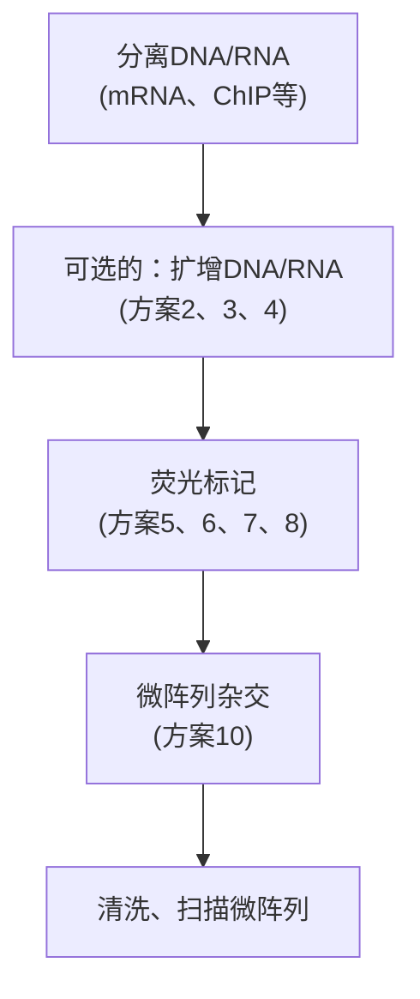

## 方法

1. 在无菌微量离心管中，用无 RNA 酶水制备至少 5 个 10 倍梯度稀释的模板。

制备系列稀释液时，精确移液非常重要。

2. 每个反应管/孔里加入 $5 \mu \mathrm{L}$ 稀释液, 一式三份; 无模板对照组, 三份中各加入 $5 \mu \mathrm{L}$ 水。

3. 在无菌微量离心管中，按照下表配制PCR混合液。每个反应体积为 $5\mu \mathrm{L}$，乘以所需反应数即为所需配制总体积量。

配制 PCR 反应混合物时，可能会出现移液不准的情况，建议要为所有样品和对照多配制 1～2 人份的体积量。如果使用热启动酶，如 Applied Biosystems 公司的 AmpliTaq Gold DNA 聚合酶，需要 9～12min 的热启动（92～95℃）来激活酶的活性，因为 AmpliTaq Gold DNA 聚合酶在室温条件下无活性，所以无需在冰上配制反应液。

SYBR Green I

| 组分 | 单个反应加入量/μL |
| --- | --- |
| 水 | 3 |
| 上游引物(最佳浓度) | 1 |
| 下游引物(最佳浓度) | 1 |
| SYBR Green I 混合液 | 10 |

TaqMan

| 组分 | 单个反应加入量/μL |
| --- | --- |
| 水 | 2.5 |
| 探针(最佳浓度) | 0.5 |
| 上游引物(最佳浓度) | 1 |
| 下游引物(最佳浓度) | 1 |
| TaqMan 混合液 | 10 |

4. 将 $15 \mu \mathrm{L}$ PCR 混合液加到 PCR 孔或板里，用吸头上下轻轻吹打混匀，避免产生气泡。小心盖上管盖。短暂离心，将溶液收集到管底。

5. 将反应板或管移至实时荧光 PCR 仪上，按下表参数设置程序并运行。

SYBR Green I

<table><tr><td></td><td>温度</td><td>时间</td></tr><tr><td colspan="3">起始步骤</td></tr><tr><td>1. AmpErase UNG 酶激活 $^a$ </td><td>50°C</td><td>2min</td></tr><tr><td>2. AmpliTaq Gold 热启动酶激活PCR(40个循环)</td><td>95°C</td><td>10min</td></tr><tr><td>3. 变性</td><td>95°C</td><td>15s</td></tr><tr><td>4. 复性/延伸</td><td>60°C</td><td>1min</td></tr><tr><td colspan="3">熔解曲线</td></tr><tr><td>5. 变性</td><td>55~95°C</td><td></td></tr></table>

a. 该步骤仅适用于含有 AmpErase UNG 酶的体系。

TaqMan

<table><tr><td></td><td>温度</td><td>时间</td></tr><tr><td colspan="3">起始步骤</td></tr><tr><td>1. AmpErase UNG 酶激活 $^a$ </td><td>50°C</td><td>2min</td></tr><tr><td>2. AmpliTaq Gold 热启动酶激活PCR(40个循环)</td><td>95°C</td><td>10min</td></tr><tr><td>3. 变性</td><td>95°C</td><td>15s</td></tr><tr><td>4. 复性/延伸</td><td>60°C</td><td>1min</td></tr></table>

a. 该步骤仅适用于含有 AmpErase UNG 酶的体系。

配好反应液后应尽快进行 PCR 反应。一些市售的混合液含有甘油和 DMSO，可以在-20℃储存 12h 以上，但其他的体系不宜长时间放置。请参阅生产商的说明。

6. 使用仪器自带软件进行分析，以 $C_{\mathrm{T}}$ 值对稀释倍数的对数作图，得到图9-9所示的图形，测定斜率（评价有效性）和 $R^2$ 值

如上所述，最佳斜率为-3.32，但-3.10～-3.74（85%～110%的效率）的斜率范围也是能接受的（若结果不理想，见“疑难解答”）。 $R^{2}$ 最佳值为1，但大于0.98即可（若结果不符，见“疑难解答”）。

line

| log C0 | CT |
| --- | --- |
| -1.375 | 32.45 |
| -0.375 | ~29.0 |
| 0.625 | ~25.5 |
| 1.625 | ~22.0 |
| 2.398 | 18.55 |

图9-9 标准曲线示例。每个数据点集代表模板浓度重复3次。该线性的斜率为-3.45（效率为$94.9\%$），$R^2$为0.99，表明该定量结果可靠。

7. 若使用的是SYBR Green I染料，要分析熔解曲线以确保仅有特异产物扩增，并且模板浓度在分析范围内（见方案1，步骤9）。

## 比较 $C_{\mathrm{T}}$ 值法的标准曲线

使用比较 $C_{\mathrm{T}}$ 值法的前提是靶基因和内参基因的扩增效率接近 $100\%$ 且偏差在 $5\%$ 以内。这两个参数可以通过归一化实验进行判定。将同时表达靶基因和内参基因的样品进行梯度稀释，在不同的管里分别对两基因进行实时荧光PCR扩增，获得不同稀释浓度的靶基因和内参基因的 $C_{\mathrm{T}}$ 值，然后可以计算出其差值: $\Delta C_{\mathrm{T}} = C_{\mathrm{T}}$ （靶基因）- $C_{\mathrm{T}}$ （内参基因）；

以该  $\Delta C_{T}$  值对起始浓度的对数作图获得一条半对数回归直线。若在起始模板浓度范围内，靶基因和内参基因的扩增效率相同，则直线斜率为 0；若斜率小于 0.1 或大于 0.1，说明扩增效率不一致，实验需要重新优化。

## 疑难解答

问题（步骤 6）:PCR 扩增效率太低。

解决方案:低扩增效率说明引物设计得不好、反应条件不合适或有移液误差。为提高扩增效率，需要优化引物浓度，设计合适的引物，并小心移液以尽量避免移液误差。

问题（步骤6）:PCR扩增效率太高。

解决方案: 效率超过 100% 可能是因为样品中的抑制剂导致高浓度样品  $C_{T}$  值滞后, PCR 抑制剂可来源于原始材料（如蛋白质或多糖），也可由核酸提取过程引入（如 SDS、苯酚、乙醇、蛋白酶 K、离液剂或乙酸钠），此时，可尝试用其他适合该样品类型的试剂盒对提取的 DNA 样品重新提取。

问题（步骤6）: $R^{2}$ 值太低（<0.9）。

解决方案:低 $R^2$ 值可能意味着引物设计不好。重新设计引物。

问题（步骤6）:重复性差。

解决方案:许多技术方面的因素会造成重复性的损失，如移液不精确、组分混合不完全、反应孔中有气泡、孔边缘的信号下降、在管/板盖上做标记等。为提高重复性，要小心移液，确保反应组分混合均匀，离心样品以去除气泡，确保所有组分位于反应管/孔底部，并且不在管盖上做标记。

问题（步骤6）:最低浓度起始核酸对应的一个或多个点偏离曲线图的线性范围。

解决方案:当浓度水平低于检测灵敏度时，这是完全可能的。为提高灵敏度，需要优化引物浓度或设计不同的引物。

问题（步骤6）:最高浓度起始核酸对应的一个或多个点偏离曲线图的线性范围。

解决方案:当靶基因浓度超出实验的有效范围和反应饱和时有可能发生这种现象。为解决这种问题，可减少核酸的加入量或将样品核酸进行稀释。

问题（步骤6）:几个随机点高于或低于直线。

解决方案:可能是精确移液的问题。检查吸头是否与移液器完全匹配且体积分装均匀。

## 方案 3 实时荧光 PCR 定量检测 DNA

在进行实时荧光 PCR 实验前，进行引物浓度优化（TaqMan 法还需优化探针浓度）以确定实验的有效性、灵敏性和重复性是非常重要的（见方案 1 和方案 2）。在设计实时荧光 PCR 时，确定采用哪种定量方法（或数据分析）也很重要（见本章导言中的“实时荧光 PCR 实验数据处理”）。若采用绝对定量，必须与测试样品一起运行标准曲线（见方案 2）。可以用已知绝对浓度的质粒 DNA 或其他 DNA 来制作标准曲线。但是，必须确定所使用标准品的 PCR 扩增效率与未知样本相同。若采用相对定量，内参基因也必须要和检测样本同步实验（见本章导言）。

## 材料

为正确使用本方案中的器材和危险试剂，必须查阅相应的材料安全数据表并咨询所在机构的环境卫生和安全办公室。

## 试剂

上游和下游引物（最佳浓度，见方案1）

无 RNA 酶的水

探针（若使用TaqMan探针法）（最佳浓度，见方案1）

用于 SYBR Green I 或 TaqMan 的实时荧光 PCR 预混液

预制的实时荧光 PCR 预混液包含除模板和引物以外的所有 PCR 所需试剂，可从公司（如 Applied Biosystems、QIAGEN、Life Technologies、Bio-Rad）购买。这种预混液可以简化实验过程，降低污染概率，提供最佳性能。另外，可以参考本章节附录自行配制预混液。

DNA 模板

## 设备

适用于自动微量移液器的滤芯吸头

微量离心管（0.4～1.5mL，无菌）

PCR 塑料制品（PCR 管，单排或 96/384 孔板）

PCR 塑料制品要根据 PCR 制造商的说明要求来选择。所使用的反应板必须与 PCR 仪的加热模块完全匹配才能保证高效的传热性能和孔间均一性。假如系统通过管盖收集信号，那么必须使用光学等级的管盖。为避免样品蒸发，必须确保反应管或板有良好的密封性。有些系统（但不是所有的）能很好地与热封覆盖膜兼容。

实时荧光 PCR 热循环仪

## 方法

1. 每个反应体系里加入  $5 \mu L$  DNA 模板，一式三份；对照组加入  $5 \mu L$  水，一式三份。
2. 在无菌微量离心管中，按照下表配制 PCR 混合液。每个反应体积为 $15 \mu \mathrm{L}$，乘以所需反应数即为所需配制总体积量。

配制 PCR 反应混合物时，可能会出现移液不准的情况，建议要为所有样品和对照多配制 1～2 人份的体积量。如果使用热启动酶，如 Applied Biosystems 公司的 AmpliTaq Gold DNA 聚合酶，需要 9～12min 的热启动来激活酶的活性，因为 AmpliTaq Gold DNA 聚合酶在室温条件下无活性，所以无需在冰上配制反应液。

SYBR Green I

| 组分 | 单个反应加入量/μL |
| --- | --- |
| 水 | 3 |
| 上游引物(最佳浓度) | 1 |
| 下游引物(最佳浓度) | 1 |
| SYBR Green I 混合液 | 10 |

TaqMan

| 组分 | 单个反应加入量/μL |
| --- | --- |
| 水 | 2.5 |
| 探针(最佳浓度) | 0.5 |
| 上游引物(最佳浓度) | 1 |
| 下游引物(最佳浓度) | 1 |
| TaqMan 混合液 | 10 |

3. 将 $15 \mu \mathrm{L}$ PCR 混合液加到 PCR 孔或板里, 用吸头上下轻轻吹打混匀, 避免产生气泡。小心盖上管盖。短暂离心, 将溶液收集到管底。

4. 将反应板或管移至实时荧光 PCR 仪上，按下表参数设置程序并运行。

SYBR Green I

<table><tr><td></td><td>温度</td><td>时间</td></tr><tr><td colspan="3">起始步骤</td></tr><tr><td>1. AmpErase UNG 酶激活 $^a$ </td><td>50°C</td><td>2min</td></tr><tr><td>2. AmpliTaq Gold 热启动酶激活PCR(40个循环)</td><td>95°C</td><td>10min</td></tr><tr><td>3. 变性</td><td>95°C</td><td>15s</td></tr><tr><td>4. 复性/延伸</td><td>60°C</td><td>1min</td></tr><tr><td colspan="3">熔解曲线</td></tr><tr><td>5. 变性</td><td>55~95°C</td><td></td></tr></table>

a. 该步骤仅适用于含有 AmpErase UNG 酶的体系。

TaqMan

<table><tr><td></td><td>温度</td><td>时间</td></tr><tr><td colspan="3">起始步骤</td></tr><tr><td>1. AmpErase UNG 酶激活 $^a$ </td><td>50°C</td><td>2min</td></tr><tr><td>2. AmpliTaq Gold 热启动酶激活PCR(40个循环)</td><td>95°C</td><td>10min</td></tr><tr><td>3. 变性</td><td>95°C</td><td>15s</td></tr><tr><td>4. 复性/延伸</td><td>60°C</td><td>1min</td></tr></table>

a. 该步骤仅适用于含有 AmpErase UNG 酶的体系。

配制好反应液后应尽快进行 PCR 反应。一些市售的混合液含有甘油和 DMSO，可以在-20℃储存 12 h 以上。但其他的体系不宜长时间放置。请参阅生产商的说明。

PCR 运行结束后，分析实验数据（方案 5）。

## 方案 4 实时荧光 PCR 定量检测 RNA

本方案所介绍的是使用两种酶（见本章导言的选酶部分）和两步法的实时荧光 PCR 实验，可以采用 SYBR Green 或 TaqMan 探针法。本方案所使用的 PCR 体系为 20μL（多数生产商建议使用 50μL 体系）。但在靶基因浓度很低时（如样本浓度为 1～10 个拷贝），使用较大体积，样品间的重复性可能会更好。

有关制备高质量 RNA、选取引发方法和内参基因的其他信息请参加本章导言中实时荧光 PCR 操作部分。

## 材料

为正确使用本方案中的器材和危险试剂，必须查阅相应的材料安全数据表并咨询所在机构的环境卫生和安全办公室。

▲为了减少污染外源 DNA 的概率，要准备和使用 PCR 专用试剂和耗材。所使用的玻璃器皿要在  $150^{\circ}$ C 烘烤 6h，塑料器皿要高压灭菌。至于更多的信息，参看本章介绍中 PCR 污染部分。

## 试剂

## 脱氧核糖核酸酶 I （DNase I）

有几种选择可供采用。第一种，使用 Ambion 公司的 DNA 酶处理和去除试剂有可能在溶液中进行消化。成本较低的方法是使用 DNase I 处理 RNA 样本，然后用苯酚抽提处理 DNase I，再用乙醇纯化（见第 6 章，方案 8），但这样处理很可能导致 RNA 损失和苯酚污染。QIAGEN 公司的 DNase 可以直接用于 RNA 柱提，因此减少了污染和引入 PCR 抑制剂的机会。

dNTP 混合液（10mmol/L）

DTT (0.1mol/L)

上游和下游引物（最佳浓度，见方案1）

无 RNA 酶的水

$\mathrm{MgCl_{2}}$ (25 mmol/L)

聚合酶

两步法扩增，需使用热稳定性反转录酶（如 Life Technologies 公司的 Superscript III）和热启动 Taq 聚合酶（如 ABI 的 AmpliTaq 酶或 AmpliTaq Gold 酶）

反转录引物 $[50\mu \mathrm{mol} / \mathrm{L}$ oligo（dT）$_{20}$，$2\mu \mathrm{mol} / \mathrm{L}$ 特异性引物，或 $50\mathrm{ng} / \mu \mathrm{L}$ 随机引物]探针（若使用TaqMan探针法）（最佳浓度，见方案1）

用于SYBR GreenI或TaqMan的实时荧光PCR预混液

预制的实时荧光 PCR 预混液包含除模板和引物以外的所有 PCR 所需试剂，可从公司（如 Applied Biosystems、QIAGEN、Life Technologies、Bio-Rad）购买。这种预混液可以简化实验过程，降低污染概率，提供最佳性能。另外，可以参考本章附录自己配制预混液。

## 参照模板

该模板用于对照或制作标准曲线（如通用 RNA；Stratagene 公司）

反转录酶（如 Life Technologies 公司的 SuperScript III 酶）（200U/μL）

目前市售的 M-MLV 反转录酶是经过改进的反转录酶，降低了 RNase H 活性，增强了其热稳定性（Life Technologies、Stratagene）。该酶在 42～55℃ 条件下可以将纯化的 poly(A) $^{+}$ 或总 RNA 合成 cDNA 第一条链，其特异性高于其他反转录酶，cDNA 产物量越多，合成的链越长。后述实验使用 SuperScript III 酶（Life Technologies）。

RNase H（可从 Life Technologie 公司购买）(2U/μL)

RNase 抑制剂（可从 Life Technologie 公司购买）(40U/μL)

请参阅第 6 章信息栏 “RNase 抑制剂”。

RT 缓冲液（10×）

SuperScript III 的  $10 \times RT$  缓冲液含有 200mmol/L Tris-HCl （pH 8.4）和 500mmol/L KCl。

总RNA模板，不含DNA，浓度已知且片段完整

用单相裂解试剂提取的RNA是进行实时RT-PCR最好的模板（见第6章中“用单相裂解试剂提取总RNA方案”，方案 $1\sim 4$ )。提取后，必须检测RNA的完整性（见第6章“检测所制备RNA的质量”，方案10）并进行定量。使用 $\mathrm{A}_{260}$ 读数测定的RNA浓度来进行实时RT-PCR不太准确。取而代之的是NanoDrop分光光度计或Ribo-Green法（见第6章，方案6）。重要的是，同批实验要用同一方法测量所有样品的浓度，并且不能将不同程序得到的数据相比较，因为采用不同的方法会产生不同的结果。

## 设备

适用于自动微量移液器的滤芯吸头

微量离心管（0.4～1.5mL，无菌）

PCR塑料制品（PCR管，单排或96/384孔板）

PCR 塑料制品要根据 PCR 制造商的说明要求来选择。所使用的反应板必须与 PCR 仪的加热模块完全匹配才能保证高效的传热性能和孔间均一性。假如系统通过管盖收集信号，那么必须使用光学等级的管盖。为避免样品蒸发，必须确保反应管或板有良好的密封性。有些系统（但不是所有的）能很好地与热封覆盖膜兼容。

实时荧光 PCR 热循环仪

水浴锅或加热块，预设成  $25^{\circ}$ C（若需要的话）、 $50^{\circ}$ C、 $65^{\circ}$ C、 $85^{\circ}$ C

## 方法

## 反转录

1. 在无菌微量离心管中配制如下反应混合液，一式三份（一份作为无反转录酶对照）。

| 总 RNA | 最多 5μg |
| --- | --- |
| 引物 | 1μL |
| dNTP 混合液(10mmol/L) | 1μL |
| 水 | 至 10μL |

若使用oligo（dT）或随机引物，一次反应得到的cDNA产物可用于分析多种不同的mRNA。如果使用基因特异引物，针对每种待分析靶mRNA都需要配制一管反应混合物。

2. 将上述混合液在 $65^{\circ} \mathrm{C}$ 反应 $5 \mathrm{~min}$ 使 RNA 变性, 然后迅速转移到冰上放置 $1 \mathrm{~min}$ 。

3. 在反应管中，按顺序加入如下组分。

| RT buffer (10×) | 2μL |
| --- | --- |
| ${\mathrm{{MgCl}}}_{2}$ (25mmol/L) | 4μL |
| DTT (0.1mol/L) | 2μL |
| RNaseOUT (40U/μL) | 1μL |
| SuperScript III RT (200U/μL) | 1μL |

4. 无反转录酶对照管中，按以下顺序加入反应组分。

| RT buffer (10×) | 2μL |
| --- | --- |
| $MgCl_2$(25mmol/L) | 4μL |
| DTT (0.1mol/L) | 2μL |
| RNaseOUT (40U/μL) | 1μL |
| 水 | 1μL |

无论引物是否跨越内含子，都需要验证实时 RT-PCR 实验的特异性，可通过无反转录酶对照评价 DNA 扩增的特异性来进行验证。如上所述，RT-PCR 可能会扩增含有短内含子（≤1kb）的 DNA 序列。有些基因还具有额外的副本或缺失一至多个内含子的假基因。因此，必须检测 qRT-PCR 实验中是否有潜在的 DNA 扩增，这需要通过运行包含反转录过程及同一 RNA 但不含反转录酶的反应来实现。

5. 轻弹管壁以混匀管内组分，简短离心使内容物集中于管底。如果引物使用的是 oligo（dT）或特异性引物，反应体系在  $50^{\circ}$ C 温育 50min；若使用的是随机引物，反应体系先于  $25^{\circ}$ C 反应 10min，再在  $50^{\circ}$ C 温育 50min.
6. 将反应管在  $85^{\circ}$ C 反应 5min 以终止反转录。反应管在冰上制冷至少 1min。简短离心，使内容物集中于管底。
7. 每管加入 $1\mu \mathrm{L}$ RNase H 酶，$37^{\circ}C$ 孵化 $20\mathrm{min}$，以去除 cDNA:RNA 杂交体中的 RNA 模板。

合成的 cDNA 可以立即用于 PCR 反应，也可在  $-20^{\circ}C$  保存至多 6 个月。

## 实时荧光 PCR

8. 每个反应体系里加入  $5 \mu L$  cDNA 模板，一式三份；对照组加入  $5 \mu L$  水，一式三份。

若需要作标准曲线，用无 RNA 水制备出至少 5 个 10 倍梯度稀释的模板，每管加入  $5 \mu L$  稀释模板，各重复 3 管。

9. 在无菌微量离心管中，按照下表配制 PCR 混合液。每个反应体积为  $15 \mu L$ ，乘以所需反应数即为所需配制的总体积量。

配制 PCR 反应混合物时，可能会出现移液不准的情况，建议要为所有样品和对照多配制 1～2 人份的体积量。如果使用热启动酶，如 Applied Biosystems 公司的 AmpliTaq Gold DNA 聚合酶，需要 9～12min 的热启动来激活酶的活性，因为 AmpliTaq Gold DNA 聚合酶在室温条件下无活性，所以无需在冰上配制反应液。

SYBR Green I

| 组分 | 单个反应加入量/μL |
| --- | --- |
| 水 | 3 |
| 上游引物(最佳浓度) | 1 |
| 下游引物(最佳浓度) | 1 |
| SYBR Green I 混合液 | 10 |

TaqMan

| 组分 | 单个反应加入量/μL |
| --- | --- |
| 水 | 2.5 |
| 探针(最佳浓度) | 0.5 |
| 上游引物(最佳浓度) | 1 |
| 下游引物(最佳浓度) | 1 |
| TaqMan 混合液 | 10 |

10. 将 $15\mu \mathrm{L}$ PCR混合液加到PCR孔或板里，用吸头上下轻轻吹打混匀，避免产生气泡。小心盖上管盖。简短离心，将溶液收集到管底。

11. 将反应板或管移至实时荧光 PCR 仪上，按下表参数设置程序并运行。

SYBR Green I

<table><tr><td></td><td>温度</td><td>时间</td></tr><tr><td colspan="3">起始步骤</td></tr><tr><td>1. AmpErase UNG 酶激活 $^a$ </td><td>50°C</td><td>2min</td></tr><tr><td>2. AmpliTaq Gold 热启动酶激活PCR(40个循环)</td><td>95°C</td><td>10min</td></tr><tr><td>3. 变性</td><td>95°C</td><td>15s</td></tr><tr><td>4. 复性/延伸</td><td>60°C</td><td>1min</td></tr><tr><td colspan="3">熔解曲线</td></tr><tr><td>5. 变性</td><td>55~95°C</td><td></td></tr></table>

a. 该步骤仅适用于含有 AmpErase UNG 酶的体系。

TaqMan

<table><tr><td></td><td>温度</td><td>时间</td></tr><tr><td colspan="3">起始步骤</td></tr><tr><td>1. AmpErase UNG 酶激活 $^a$ </td><td>50°C</td><td>2min</td></tr><tr><td>2. AmpliTaq Gold 热启动酶激活PCR(40个循环)</td><td>95°C</td><td>10min</td></tr><tr><td>3. 变性</td><td>95°C</td><td>15s</td></tr><tr><td>4. 复性/延伸</td><td>60°C</td><td>1min</td></tr></table>

a. 该步骤仅适用于含有 AmpErase UNG 酶的体系。

配制好反应液后应尽快进行 PCR 反应。一些市售的混合液含有甘油和 DMSO，可以在  $-20^{\circ}C$  储存 12h 以上。但其他的体系不宜长时间放置。请参阅生产商的说明。

PCR 运行结束后，分析实验数据（方案 5）。

## 疑难解答

问题（步骤 11）:无 RT 酶对照组产生信号。

解决方案:如果无 RT 酶对照组的  $C_{T}$  值比正常组大 5 个以上（少 32 倍），则 DNA 扩增不受影响。但是，如果无 RT 酶对照组的  $C_{T}$  值与正常组的差异小于 5 个循环，DNA 扩增可能不能正确反映 mRNA 的量。在 DNA 扩增子含量较高时，进行 qRT-PCR 前应该用无 RNA 酶的 DNase I 消化 RNA，以得到可信的 mRNA 定量结果。

## 方案 5 实时荧光 PCR 实验数据的分析和归一化

实时荧光 PCR 实验产生大量的实验数据，一般可用实时荧光 PCR 仪器自带软件进行数据分析。实验设计和使用的仪器不同，数据分析也会不一样，因此按照制造商说明书上提供的合适方式进行数据分析是非常必要的。但是，即使有分析数据的软件，为了生成可报告的结果，也要对原始荧光数据进行检查，然后再评价数据的质量和可靠性。这需要三个基本步骤。

- 查看原始数据（扩增曲线），如果有必要可以调节基线和阈值。 $C_{T}$ 值是基线和阈值的函数。软件的默认选项提供了一定程度的主观性，但这些设置并不总是适合，可能需要改变。
- 验证实验的效率和灵敏度。
- 应用定量方法并归一化数据。

一旦数据被分析，研究者面临数据进一步处理的一系列选择。本文将以一个广泛应用于归一化 ChIP-qPCR 数据的方法作为例子进行介绍（见下文）。另外，绝对定量和相对定量需要假设靶基因和内参基因的扩增效率一致，并且整个 PCR 过程都保持恒定（尽管并非总是如此）。为了规避扩增效率问题，现已开发出几个数学模型用来处理 PCR 数据（Cikos and Koppel 2009）。这样的数据处理可以极大地影响实时荧光 PCR 结果的解释，并显著影响最终结果，使得难以对已发表的数据集进行比较。在没有公认的参考程序（请看本章导言部分的“MIQE 指南”）前，由研究者自行决定数据处理的方法。

## 材料

为正确使用本方案中的器材和危险试剂，必须查阅相应的材料安全数据表并咨询所在机构的环境卫生和安全办公室。

## 设备

实时荧光 PCR 热循环仪和配套的数据管理分析软件。

## 方法

## 查看原始数据（扩增曲线）

## 设置基线

数据分析的目的之一就是确定靶基因的扩增信号明显高于背景信号，以便更准确地测定荧光。基线范围通常由仪器自动生成，绝大多数仪器的基线设置范围为循环数3～15。尽管该设置方法适合大多数实验，但检查生成的基线正确与否、是否需要进行调整还是极其重要的。为此，需要查看所有样本的扩增曲线（如用来制作扩增曲线的标准品），找出所有不正常曲线。多数情况下，不规则的扩增曲线都是由不合适的基线造成的，需要手动调节基线（这可能要根据情况对每个孔进行单独的调节）。正确设置的基线需要凭经验决定。一个较好的做法是，基线的最小值（有时也称为“起始循环数”）应该设置在背景噪声的尾巴之后，最大值（称之为“结束循环数”）应该设置在信号对数扩增起始点。设置范围不应太宽，大概5个循环就可以，但多一些循环数会更好。正确的基线设置最好由扩增曲线的对数图来设定，因为这样可以看到背景信号的变化情况。

## 1. 分析扩增曲线对数图

假如样本扩增曲线刚好在基线最大值处开始出现（如最高浓度的样品），基线不用再调节（图9-10A）。一般如果最大浓度的样本 $C_{T}$ 小于15（基线的上限），基线也不必再调节。如果最大浓度样本的扩增曲线出现在基线最大值的前面，表明基线太高，需要进行调节。基线若太高，扩增曲线的中间有“破坏断裂”发生（图9-10B）。在这种情况下，可以将基线的结束值调小1～2个循环数，使其位于最大浓度的扩增曲线之前，再进行重新分析。假如最大浓度样本的扩增曲线起始点距基线最大值太远，表明基线太低。这时，扩增曲线在较低 $C_{T}$ 值处出现“破坏断裂”（图9-10C）。可以将基线结束值调大1～2个循环数，使其在最早扩增曲线的前面，再进行重新分析。

如果基线调节不能纠正扩增曲线的不规则，见“疑难解答”。

图 9-10 扩增曲线图（对数图）示例。每组重叠的曲线代表不同 DNA 样本重复 3 次的结果。（A）正常的曲线图，最早扩增的样品在基线最大值的后面。（B）基线偏高的不正常的扩增曲线，该图显示曲线在中间位置出现特有的断裂（圆圈标示处）。（C）基线偏低的不正常扩增曲线，该图显示曲线在较早循环位置出现特有的断裂（圆圈标示处）。

## 设置域值

域值是分配给每个反应的数值，它由早期 PCR 循环数的平均标准偏差  $R_{n}$  乘以归一化因子计算得到。域值是荧光信号相对于基线有统计学意义的显著增强的点，它应该被设置在 PCR 产物指数扩增区。大多数仪器根据基线（背景）平均信号自动计算荧光信号的阈值水平，设定一个比平均值高 10 倍的阈值。一旦基线已正确设置，也可以手动调整阈值。与基线设置一样，可以根据经验调节阈值。要注意的是，正在读取阈值相关的分析数据时，不得改变阈值设置。只有分析相同或不同的样品，或同一标准曲线的样品中不同的靶基因时，才可以调整阈值来读取不同基因的分析数据。

2. 查看对数扩增曲线，在能代表指数扩增的区域设置域值，既不能设置在扩增的起始阶段，也不能设置在背景荧光区域内。
3. 一旦改变域值，就要查看标准曲线的斜率和 $R^2$ 有无改善。若没有使用标准曲线，可检查三复孔的标准偏差，好的域值设置可以减少 $C_{\mathrm{T}}$ 值的散乱。

## 其他分析

4. 检测复孔。所有复孔间的差别应该在 $0.5C_{\mathrm{T}}$ 内。在35个循环以后，$C_{\mathrm{T}}$ 值变化较大，定量结果可能不太可靠。
5. 若使用标准曲线，要确保所有数据点都在标准曲线的定值浓度范围内。
6. 若使用标准曲线，通过标准曲线的斜率和 $R^2$ 来判断PCR的效率和灵敏度。斜率必须在 $-3.2\sim -3.5$ 之间， $R^2$ 必须大于0.98。
7. 若使用 SYBR Green I 染料，需要检测熔解曲线。理想的熔解曲线应该是单一峰，如方案 1 中图 9-8A 所示。

## 运用定量方法和归一化数据

## 绝对定量

需要提醒的是，进行绝对定量时，必须满足两个标准。首先，待测样品的  $C_{T}$  值必须落在标准曲线的  $C_{T}$  值范围内才可进行定量。其次，为了在待测样品和标准曲线间进行精确的比较，样本和标准品的扩增效率必须一致。理想情况下，测试样本和标准品的扩增效率要优化到接近 100%。

准确计算反应效率和起始模板量依赖于能不能确定原始荧光强度数据的哪部分落在对数线内。斜率的一个小变化将引起计算值的大不同，因此，点的选择是至关重要的。现已有几种方法发表，包括用眼睛选择恰好落在最佳直线上的点，计算数据的二阶导数(Luu-The et al. 2005)，通过反应的线性阶段来进行相当复杂的回归线的统计分析（Ramakers et al. 2003）。

绝对定量的数学公式很简单。通过标准品的拷贝数的对数（x 轴）和对应的  $C_{T}$  值（y 轴）作图来建立标准曲线。常规线性回归直线方程式为

$$
y = m x + b
$$

式中，m 表示直线的斜率；b 表示 y 轴截距，或

$$
C _ {\mathrm{T}} = m (\text {浓度的对数}) + b
$$

根据此公式，下面的公式可以推导出未知样本的浓度。

$$
\text {浓度} = 1 0 ^ {\left([ C _ {\mathrm{T}} - b ] / m\right)}
$$

根据计算公式，每个复孔样品的靶基因浓度都能计算出来，然后归一化到同一个单位，如细胞数、体积或总核酸量。这个数值通常用平均值±SD表示。

## 相对定量

对于相对定量的标准曲线法和比较 $C_{\mathrm{T}}$ 值法，选择一个合适的归一化方法很重要。为了分析靶基因表达，往往使用内参基因（如持家基因）来归一化。若对染色质免疫沉淀反应（常缩写为ChIP-qPCR）进行DNA定量，则需要对起始染色质的量、沉淀效率和ChIP后复性DNA变异方面的差异进行归一化。目前用于ChIP分析的归一化方法包括背景消减（Mutskov and Felsenfeld 2004）、输入百分比（%IP）（Nagaki et al. 2003）、富集倍数（Tariq et al. 2003）、对照序列相关的归一化（Mathieu et al. 2005）、核小体密度相关的归一化（Kristju-han and Svejstrup 2004）。关于这些方法及其优缺点的讨论可以参见Haring等（2007）。

标准曲线法。使用这个方法，靶基因和外源对照的 PCR 效率可以不同。对于每个实验样本，靶基因和外参基因都通过合适的标准曲线来测定，与前述的绝对定量方法相似。通过靶基因的量除以外源性参照的量得到归一化后的靶基因值。实验样品之一（如未处理组或不同时间点研究中的 0 时间组）被选作校正品。每个归一化后的靶基因值除以校准品归一化的靶基因值得出表达的相对水平；这种方式中，校准品的水平被设为 1。因此，归一化后的靶基因值是一个无单位的数值，所有的定量都被表示为相对于校准品的差异倍数。

比较  $C_{T}$  值法。如前面所述，若使用比较  $C_{T}$  值法，靶基因的扩增效率和外参基因的扩增效率必须接近 100% 且差异不能超过 5%。另外，靶基因和参照基因的动力学范围相似。这些参数均可用验证试验进行验证（见方案 2）。

当进行验证试验时,一定要确保实验数据经过严格分析且实时荧光PCR实验操作正确,PCR抑制剂、基线和域值设置不正确、重复孔出现异常值都会改变效率计算值。当预计会发生高倍数（如100倍或1000倍）的变化时，效率发生变化可以接受，因为倍数变化计算稍有误差，不会影响最终结果的解释。然而，如果只发生了较小倍数的变化（如2～4倍），对效率的改变容忍度可能会极小。这种情况下，可能需要重新设计实验，使其能够通过验证试验，或者使用相对标准曲线法。PCR效率不同引入的误差可以通过比较相对标准曲线法和比较 $C_{T}$ 法得到的结果来评价。因为相对标准曲线法的准确性不依赖于靶基因和参照基因的相对效率，这种对比方法可以用于评价比较 $C_{T}$ 法结果的误差量。因此，有必要评估出现的误差是否能被特异性实验所接受。

只要靶基因和参照基因具有相似的扩增效率及动力学范围，那么比较  $C_{T}$  值法就是最适用的方法。定量时，对于待测品和校准品，首先都要用参照基因的  $C_{T}$  值归一化靶基因的  $C_{T}$  值:

$$
\Delta C _ {\mathrm{T}} (\text {待测样}) = C _ {\mathrm{T}} (\text {靶基因，待测样}) - C _ {\mathrm{T}} (\text {参照基因，待测样})
$$

$$
\Delta C _ {\mathrm{T} (\text {校准品})} = C _ {\mathrm{T} (\text {靶基因，校准品})} - C _ {\mathrm{T} (\text {参照基因，校准品})}
$$

然后，待测样本的  $\Delta C_{T}$  用校准品的  $\Delta C_{T}$  进行归一化:

$$
\Delta \Delta C _ {\mathrm{T}} = \Delta C _ {\mathrm{T}} (\text {待测样}) - \Delta C _ {\mathrm{T}} (\text {校准品})
$$

最后，应用 $2^{-\Delta \Delta C_{\mathrm{T}}}$ 方程式可计算出归一化后的表达率，2表示 $100\%$ 的扩增效率（见本章导言中“标准曲线的构建”部分）。如果靶基因和参照基因具有相同的扩增效率，但效率不等于2，可以使用修正公式，用真实效率代替2（例如，若靶基因和参照基因的扩增效率为1.95，可以使用公式 $1.95^{-\Delta \Delta C_{\mathrm{T}}}$）。

## 疑难解答

问题（步骤 1）:通过调整基线不能纠正不规则扩增曲线。

解决方案:仪器的光源可能需要更换（多数仪器要求使用 2000h 以后进行更换）。

## 参考文献

- Cikos S, Koppel J. 2009. Transformation of real-time PCR fluorescence data to target gene quantity. Anal Biochem 384: 1–10.
- Haring M, Offermann S, Danker T, Horst I, Peterhansel C, Stam M. 2007. Chromatin immunoprecipitation: Optimization, quantitative analysis and data normalization. Plant Methods 3: 11. doi: 10.1186/1746-4811-3-11.
- Kristjuhan A, Svejstrup JQ. 2004. Evidence for distinct mechanisms facilitating transcript elongation through chromatin in vivo. EMBO J 23:4243–4252.
- Luu-The V, Paquet N, Calvo E, Cumps J. 2005. Improved real-time RT-PCR method for high-throughput measurements using second derivative calculation and double correction. BioTechniques 38: 287–293.
- Mathieu O, Probst AV, Paszkowski J. 2005. Distinct regulation of histone H3 methylation at lysines 27 and 9 by CpG methylation in Arabidopsis. EMBO J 24: 2783–2791.
- Mutskov V, Felsenfeld G. 2004. Silencing of transgene transcription precedes methylation of promoter DNA and histone H3 lysine 9. EMBO J 23: 138–149.
- Nagaki K, Talbert PB, Zhong CX, Dawe RK, Henikoff S, Jiang J. 2003. Chromatin immunoprecipitation reveals that the 180-bp satellite repeat is the key functional DNA element of Arabidopsis thaliana centromeres. Genetics 163: 1221–1225.
- Ramakers C, Ruijter JM, Deprez RH, Moorman AF. 2003. Assumption-free analysis of quantitative real-time polymerase chain reaction (PCR) data. Neurosci Lett 339: 62–66.
- Tariq M, Saze H, Probst AV, Lichota J, Habu Y, Paszkowski J. 2003. Erasure of CpG methylation in Arabidopsis alters patterns of histone H3 methylation in heterochromatin. Proc Natl Acad Sci 100: 8823–8827.

# 信息栏

## 多重 PCR

多重 PCR 反应是指扩增一种以上的靶基因。现有多种跨越可见光谱的荧光染料可使用，这使运行多重实时荧光 PCR 成为可能。TaqMan 探针、分子信标、蝎型探针和 LUX 荧光引物都可用于多重 PCR 实验，只要每条探针标记具有不同光谱的报告-猝灭染料对。为避免检测到非特异信号，光谱范围距离越远越好。举例来说，两重 PCR 反应最好采用 FAM-BHQ-1 和 HEX-BHQ-1 或 BHQ-2。一个反应管中能同时检测的基因数目随着 DABCYL 的使用得到了增加，DABCYL 是一个可以在探针 3'端代替 TAMRA 的通用猝灭剂。

对于多重 PCR 反应，最关键的一点是所有实验要一起设计（如 Beacon Designer 软件 Premier Biosoft International 能设计出四重 PCR 反应），因为扩增长度必须相似（差异小于 5bp），而且所有引物和探针的复性温度必须一样。此外，还需规避寡核苷酸序列间潜在的交叉杂交。为了进行多重 PCR 实验，选用激光、卤钨灯或 LED 光源激发的热循环仪，因为这可使发射光谱和荧光团间的匹配更精确。此外，多重实验必须使用能检测不同荧光团的仪器。

## SNP 基因分型

SNP 分析需要两条不同的探针，每条分别与对应的特异等位基因相匹配并标记不同的荧光-猝灭对。探针与靶 DNA 错配杂交体的熔解温度较低，而完全配对杂交体的熔解温度较高。熔解温度上的差异足以用来鉴别区分野生型或突变型靶 DNA。对于等位基因鉴别实验，将多态位点放置在探针的中间位置是非常重要的，同时与多重 PCR 一样，要保证两条探针的  $T_{m}$  值是相同的。Applied Biosystems 公司推荐使用 TaqMan MGB 探针，尤其传统 TaqMan 探针长度超过 30 个核苷酸时。

TaqMan MGB 探针在 3'端含有无荧光的猝灭剂（因为猝灭剂不发荧光，所以可更加准确地测定报告染料的贡献）和小沟结合剂，小沟结合剂能增加探针的  $T_{m}$ ，从而可使用较短的探针。因此，Taq Man MGB 探针使匹配和错配探针的  $T_{m}$  差异更大，更易进行准确的等位基因鉴别。

分子信标也适用于 SNP 基因分型。分子信标的茎环结构使其比线性探针能更好地识别单碱基错配，因为与线性探针的错配杂交体相比，发夹结构使错配杂交体的热稳定性降得更低。扩增前，茎上的互补碱基杂交形成分子信标的“茎环”结构。茎的形成使探针  $T_{m}$  值升高，因此分子信标能识别靶序列上的单碱基差异。

(陈苏红 赵怡 译，陈红星 校)

## 第10章 核酸平台技术

导言 | 微阵列的应用 553

进行微阵列实验 556

方案 | 1 印制微阵列 560 6 RNA 的氨基烯丙基-dUTP 间接标记 581

2 Round A/Round B DNA 扩增 564 7 用 Klenow 酶对 DNA 进行 Cyanine-dCTP
3 核小体 DNA 和其他小于 500bp 的 标记 583
DNA的T7线性扩增（TLAD） 567 8 DNA的间接标记 585
4 RNA 的扩增 572 9 封闭自制微阵列上的多聚赖氨酸 587
5 RNA 的 Cyanine-dUTP 直接标记 578 10 自制微阵列的杂交 589

## 导言

所有的微阵列实验都是基于共同的模式（图 10-1）。第一步，将大量的核酸“点”排列在一个基质上，常用的基质有玻璃片、硅芯片或者微球。第二步，通常用荧光染料对核酸样品（从细胞中分离、体外合成文库筛选或者其他来源）进行标记。第三步，将标记的核酸与微阵列上的互补点杂交。第四步，洗涤杂交后的微阵列，对杂交的标记物进行定量。通过对原始数据进行分析，可计算出核酸样品中每种 RNA 的表达水平。

flowchart

图 10-1 双色微阵列实验的设置及运行的基本步骤。

每一步骤的详细介绍见正文（彩图请扫封底二维码）。

微阵列可以采用单色或者双色标记的形式。在单色微阵列芯片中，只有一个样品（如肝细胞RNA）被标记，根据基因互补点的荧光强度推断目的RNA的丰度。对于每一个点来说，杂交都会受到许多因素的影响，因此对单色实验的解释可能是复杂的。数据分析时需使用适当的生物信息学工具处理这些复杂的影响因素。双色微阵列（图10-1）是一种竞争性杂交，用某一种颜色（如绿色）标记其中一种核酸样品，第二种核酸样品用另外一种颜色（如红色）标记。杂交结束后，去除未结合的核酸，然后对微阵列进行激光扫描，检测红色和绿色荧光标记的位置，确定每一个点的荧光强度，然后计算每一个点的红/绿荧光值。进行数据分析时，该比值可以用来衡量两个样品中目的核酸分子数量的值。例如，正常肝脏细胞的 RNA 标记为绿色，肝脏肿瘤的 RNA 标记为红色，则红色点代表在肿瘤中表达上调的 RNA，绿色点代表表达下调的 RNA。

Tiling 微阵列由一系列按规律间隔排列的寡核苷酸组成，能够密集地覆盖部分或整个基因组。例如，酵母 III 号染色体若用长度为 50 个核苷酸、间隔 20 个碱基的寡核苷酸平铺，则点 1 包括 1～50 碱基，点 2 为 21～70 碱基，依此类推。因此 Tiling 微阵列连续地覆盖了整条染色体，可以进行全基因组范围内的转录结构、蛋白定位的研究。Tiling 微阵列的一个不足之处是，并非所有的基因组序列都适用于微阵列操作。例如，一个基因组中并不是所有的 50 核苷酸聚合体都是唯一的，这会导致平铺的路径上出现缺口，使基于杂交的方法无法确定杂交材料来源于基因组中的拷贝一或拷贝二（或拷贝 N）。更进一步说，杂交相关的特征，如 AT 残基的百分比、寡核苷酸的 $T_m$ 值均依据不同探针而变化。不过许多类似的问题可以通过对双色阵列的标准化来解决。标准化能够补偿点之间或者微阵列之间的系统性技术差异，进而区别样品之间的系统性生物学差异。

## 微阵列的应用

早期微阵列研究大多集中于 mRNA 的表达谱分析，但实际上微阵列可用于以比较两个核酸群体差异为目的的任何研究中，如比较从肿瘤细胞和正常细胞中提取的 RNA 之间的差异。在此，我们列举了一些已经发表的微阵列分析的例子（但绝不是全部）。

## mRNA 表达水平

早期的基因表达微阵列由排列的点构成，每一个点含有对应于一个基因的 cDNA。例如，第一个酵母基因表达微阵列包括 6000 个 cDNA 点，几乎涵盖了啤酒酵母（S. cerevisia）基因组的所有基因（DeRisi et al. 1997）。寡核苷酸芯片的问世，逐渐淘汰了 cDNA 芯片，随着寡核苷酸合成技术的发展，合成与任意一个给定的基因互补的长链寡核苷酸组成的基因表达微阵列已经成为可能。合成的寡核苷酸可以以液体形式出售，由点样仪排列成为阵列，类似 cDNA 阵列。也有一些商品化的微阵列是生产厂家采用“原位”合成寡核苷酸的方法，将寡核苷酸直接印制在微阵列基片上。这使得寡核苷酸微阵列的印制更加灵活，比液态寡核苷酸阵列的使用更为广泛，实验室不再需要为了进行微阵列实验而购买过量的寡核苷酸。

## 监测转录组的变化

典型的 mRNA 表达实验起始于两种相关的细胞 poly(A)tRNA 的分离，如  $30^{\circ}$ C 培养的酵母和从  $30^{\circ}$ C 升温至  $37^{\circ}$ C 培养的酵母，然后分别用分离的 mRNA 制备荧光标记的 cDNA。通常使用的花青染料是 Cy5(在芯片图像中呈现伪彩色红色)和 Cy3（伪彩色绿色）。标记的 cDNA 混合并和微阵列杂交。杂交并清洗后，用可以激发荧光团的激光扫描微阵列，处理图像，得到微阵列上每一个点的 Cy5/Cy3 值。微阵列数据经标准化后，产生每一个点的 Cy5/Cy3 值列表，进而分析全基因组的转录组变化。

微阵列数据经标准化后，使平均  $\log_{2}(\mathrm{Cy5/Cy3})$  为 0；这是微阵列数据分析必需的步骤，因为任一通道的绝对强度（Cy5 或 Cy3）均受多种因素的影响，如 RNA 的使用量、标记效率等。在解释基因微阵列的结果时应始终牢记此标准化过程。例如，肝 RNA 和精子 RNA 之间的比较结果可能表明一些 RNA 相对富集于精子，但由于两种细胞中的 RNA 丰度不同，因此精子中这些 RNA 的绝对数量可能低于肝细胞中的数量。