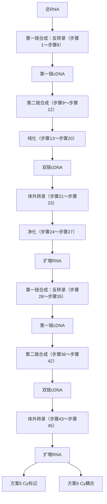

NEB（2004年年初）将提供的Klenow酶缓冲液从EcoPol缓冲液改为NEB缓冲液2。使用此缓冲液的产量至少与旧缓冲液相当，实际上一般可能提高约 $14\%$ 的产量。

▲不要使用矿物油。痕量的矿物油会干扰净化和体外转录。

8. 在热循环仪中设置如下的程序:

i.  $94^{\circ}$ C, 2min。

ii. 从  $94^{\circ}$ C 梯度降温至  $35^{\circ}$ C，速度为  $1^{\circ}$ C/s，然后保持 2min 复性。

iii. 从  $35^{\circ}$ C 梯度降温至  $25^{\circ}$ C，速度为  $0.5^{\circ}$ C/s。

iv.  $25^{\circ}$ C保持45s（或达6min）。

在此期间，加入  $1 \mu L$ （5U）Klenow DNA 聚合酶。如果需要，可离心将管壁和管盖上的液体收集到管底。

v.  $37^{\circ}$ C, 90 min。

vi.（可选）4℃暂时终止酶活性直到从循环仪中取出反应管。

9. 加入  $2.5 \mu L$  EDTA (0.5 mol/L, pH 8.0) 终止反应（终浓度为 45 mmol/L）。

10. 按照厂家提供的方案，用 MinElute 小柱净化 DNA。用  $20 \mu L$  洗脱 DNA。

若 DNA 量少于 100ng，按照厂家的方案采用  $10\mu L$  的洗脱体积，则回收率可低于 QIAGEN 声称的 80%。若需要可增加洗脱体积至  $15 \sim 20\mu L$ ，然后晾干以减少体积。对于 50ng 样品来说，此步骤的  $20\mu L$  洗脱体积能提高回收率 30%～40%。

## 体外转录（IVT）

11. 体外转录（IVT）需要 $8\mu \mathrm{L}$ 双链DNA（dsDNA）。使用旋转蒸发仪以中等热力加热 $10\sim 12\mathrm{min}$，将洗脱产物从 $20\mu \mathrm{L}$ 蒸发减少至 $8\mu \mathrm{L}$ （蒸发速度约为 $1\mu \mathrm{L / min}$）。

12. 在 0.2mL 无 RNA 酶的 PCR 管中按如下配方配制体外转录反应液:

| 75mmol/L NTP 混合物 | 8μL |
| --- | --- |
| 反应缓冲液(首先恢复至室温!) | 2μL |
| RNA 酶抑制剂和 T7 RNA 聚合酶 | 2μL |
| 双链 DNA 模板 | 8μL |

如果 IVT 试剂盒是新的，先在一个管中混合各种 NTP，然后再分装至 4 个管中。在第一个反复 3 次的冻融过程中，每冻融一次回收率下降 10%～15%。如果 NTP 冻融超过 3 次，每一次后续的冻融可导致回收率下降达 50%。

缓冲液需在室温下使用。冰冷的缓冲液和 dsDNA 混合将导致 DNA 沉淀。若发生沉淀，将缓冲液回温至  $37^{\circ}$ C，直至沉淀溶解。

13. 将反应液置于顶盖加热的热循环仪或空气浴孵箱中， $37^{\circ}$ C保温过夜。

反应时间为 5\~20h；通常过夜，一般大约 16h。

## 使用 RNeasy 小柱纯化扩增的 RNA（aRNA）

14. 准备缓冲液（每一个 IVT 反应需  $433.5 \mu L$ ):

| β-巯基乙醇(14.2mol/L储存液) | 3.5μL |
| --- | --- |
| 无RNA酶的水 | 80μL |
| RLT缓冲液(RNeasy Mini Kit提供) | 350μL |

15. 将混合物分装至无 RNA 酶/DNA 酶的 1.5mL 管中。

16. 将 IVT 混合物（来自步骤 13）转移至无 RNA 酶/DNA 酶的管中，轻轻瞬时振荡。

17. 加入  $250 \mu L$   $95\% \sim 100\%$  的乙醇，用移液器混匀（不要离心！）。采用离心或者真空泵方法，用 RNeasy 小柱纯化扩增的 aRNA。

## 离心纯化aRNA

i. 将样品全部加入 RNeasy Mini 离心柱，置于收集管之上。大于或等于 $8000\mathrm{g}$ 离心 $15\mathrm{s}$，将流出液弃去。

ii. 将 RNeasy 小柱转移至新的收集管，加入  $500 \mu L$  RPE 缓冲液（使用前务必加入乙醇），大于或等于 8000g 离心 15s。弃去流出液，重复使用收集管。

iii. 在 RNeasy 小柱中加入  $500 \mu L$  RPE 缓冲液，以最大转速离心 2min。

iv. 弃去流出液，再吸取  $500 \mu L$  RPE 缓冲液加入小柱，最大转速离心 2min。

这次额外的清洗，不是 QIAGEN 的实验方案中要求的，而是避免洗脱的 RNA 被异硫氰酸胍污染所必需的。

## 用多头真空装置纯化 aRNA

i. 将样品（700μL）加入 RNeasy Mini 离心柱，并连接真空装置，抽真空。

ii. 关闭真空泵，吸取  $500 \mu L$  RPE 缓冲液加入小柱，抽真空。

iii. 重复步骤 ii。将离心柱转移至 2mL 收集管，最高转速离心 2min。

iv. 将小柱再次连接真空装置，加入  $500 \mu L$  RPE 缓冲液，抽真空。

v. 将离心柱转移至 2mL 收集管，最高转速离心 1min，使柱子流干。

18. 将 RNeasy 柱转移至一个新的 1.5mL 收集管，直接在膜上加入 30μL 无 RNA 酶的水，大于或等于 8000g 离心 1min 以洗脱 RNA。可重复此过程，回收率大于 30μg。

19. 检测  $A_{260}$  的吸光度和  $A_{260}/A_{280}$ ，检查 RNA 的浓度和纯度。

见“疑难解答”。

20. 进行方案 5 或者方案 6，对 RNA 进行荧光标记。


## 疑难解答

除了下面列出的内容，IVT试剂盒生产厂家提供的操作指南中的疑难解答部分也是很有参考价值的。

问题（步骤 19）:扩增的 RNA 好像被 RNA 酶破坏。

解决方案:用 Ambion IVT 试剂盒中提供的 250ng pTRI-Xef-线性化质粒进行 IVT 对照试验。如果不使用此试剂盒，可用适量含 pT7 启动子的 dsDNA 模板。确认所选择的模板曾被成功地用作 T7 RNA 聚合酶的模板。限于 QIAGEN RNeasy 小柱的结合能力约为 100μg，产量一般为 100～140μg。如果 IVT 对照模板的产量很低，通过 2%非变性琼脂糖凝胶电泳 Tris-acetate-EDTA (TAE) 和溴化乙锭（EB），可推断是否被 RNA 酶污染。被 RNA 酶污染的 IVT 样品将产生低分子质量的拖尾（smear）。如果确实由于 RNA 酶被污染，确保使用气溶胶屏障和无 RNA 酶的移液器吸头，并用 RNA 酶净化剂（如 RNA 酶 Zap; Ambion catalog no. 9780）处理工作台面。这对于 ChIP 样品的操作尤为重要。

问题（步骤 19）:aRNA 产量很低，但不是由于 RNA 酶污染造成的。

解决方案:如未检测到 RNA 酶污染，问题有可能是因为 IVT 的反应条件。考虑以下几点:

\- NTP 混合物过度冻融。NTP 对冻融过程很敏感，每冻融一次均降低产量。使用新鲜的 IVT 试剂盒，并在使用前对 NTP 混合物进行分装。

\- 在反应过程中，反应体积过度蒸发。前面描述的 IVT 条件（步骤 11～步骤 13）是为限制长时间孵育过程中蒸发和蒸汽体积而设计。不推荐使用矿物油，因为有可能干扰 IVT 反应和（或）aRNA 净化。


## 讨论

此方案的产物是扩增的 RNA(aRNA)，经标记后适用于方案 5 和方案 6 中提及的微阵列研究。确定产生的 aRNA 产量及计算所获的扩增量是很重要的。典型的扩增结果将导致至少 200 倍的扩大。例如，投入 75ng DNA 将产生 20μg 的 aRNA。使用 1%～2% 的凝胶电泳评价扩增的 RNA 组成及质量。除非 RNA 的大小分布对实验至关重要，否则不必进行变性凝胶电泳。由于凝胶电泳分辨率的限制，扩增产物在凝胶上的迁移可能延缓 20～40bp。这种漂移是可以预计的，因为增加了小分子的 poly(A) 尾及由 T7 启动子增加的序列。poly(A) 尾巴的大小分布在固定大小的模板的扩增产物中变得尤为明显，如 PCR 产物或限制酶消化的质粒。

## 用有限的引物合成第二链

第二链合成过程中，起始材料的浓度显著低于引物浓度时,偶尔在凝胶底部出现约100bp低分子质量条带。在这些情况下，可能会产生大量的小分子质量产物，这是在第二条链合成过程中通过引物二聚体形成的TVT有效模板而产生的扩增产物。如果这种低分子质量产物为下游分析的无关物质，观察到其大量产生时，则必须限制引物的量。

当从非常少量的初始材料扩增时，限制引物的量是非常重要的。限制引物量不仅可减少引物二聚体的产生，也可提高目标扩增产物的产率。表 10-2 描述了用于所建议的初始材料质量范围的单次反应的体积。

表 10-2 用有限的引物合成第二链

| DNA/ng | T7 引物/μL | NEB 2 缓冲液/μL | 5mmol/L dNTP/μL | 水/μL | 加尾的 DNA/μL | Klenow/μL | 总体积 /μL |
| --- | --- | --- | --- | --- | --- | --- | --- |
| >75 | 0.60 (25μmmol/L) | 5.0 | 2.0 | 20.4 | 20.0 | 2.0 | 50 |
| 50~75 | 0.30 (25μmmol/L) | 2.5 | 1.0 | 0.20 | 20.0 | 1.0 | 25 |
| 25 | 0.15 (25μmmol/L) | 2.5 | 1.0 | 0.35 | 20.0 | 1.0 | 25 |
| $10^a$ | 1.50 (1μmmol/L) | 1.0 | 0.4 | 0.20 | 6.5 | 0.4 | 10 |
| $5^a$ | 0.75 (1μmmol/L) | 1.0 | 0.4 | 0.95 | 6.5 | 0.4 | 10 |
| $2.5^a$ | 0.38 (1μmmol/L) | 1.0 | 0.4 | 1.32 | 6.5 | 0.4 | 10 |

注:按照总反应体积  $10 \mu L$ ，在真空离心管中将加尾的 DNA 浓缩至指定的体积。

a. 如果使用无加热盖的热循环仪，则在  $37^{\circ}$ C 过程中，每 30min 离心一次。

## 参考文献

Liu CL, Schreiber SL, Bernstein BE. 2003. Development and validation of a T7 based linear amplification for genomic DNA. BMC Genomics 4: 19. doi: 10.1186/1471-2164-4-19.

Liu CL, Kaplan T, Kim M, Buratowski S, Schreiber SL, Friedman N, Rando OJ. 2005. Single-nucleosome mapping of histone modifications in S. cerevisiae. PLoS Biol 3: e328. doi: 10.1371/journal.pbio.0030328.

## 方案 4 RNA 的扩增

研究基因表达谱通常需要微克级数量的 mRNA，有时很难获得。在这种情况下，RNA 必须扩增，以便有足够的材料进行微阵列标记和杂交。目前，RNA 扩增最常用的工具是使用商品化的试剂盒，如已被成功应用的 MessageAmpII（Ambion）。这些试剂盒一般比较昂贵，因而该方案提供了一种替代的 RNA 扩增程序，改编自 Baugh 等(2001)的相关资料。

该方案可以从有限数量的总RNA产生扩增的反义RNA（aRNA）（图10-4）。它的设计是围绕最大限度地提高产量和产品长度，同时最大限度地减少模板非依赖的反应。模板非依赖的反应与模板依赖的反应相竞争，比使用的RNA模板量不足的情况更糟。如果扩增产物主体为模板非依赖的产物，将导致微阵列杂交的敏感性和信号差异显著降低。值得注意的是，用于反转录（RT）实验的oligo（dT）引物在体外转录（IVT）过程中可产生不依赖于任何cDNA模板的高分子质量产物(Baugh et al. 2001)。此反应在实验过的所有条件下均可发生，因而此方案的设计旨在限制反应起始使用的引物量。此外，若使用的T7 RNA聚合酶活性过高，存在生物素化的NTP且不存在任何多聚体时，也会产生高分子质量、模板非依赖的产物。T7 RNA聚合酶活性过高时，还可产生分子质量不正确、下游反应中功能受限的模板依赖的产物。从本质上讲，产量更高并不总是更好。此方案通过采用小体积的cDNA合成来限制引物的数量。


<details>
<summary>flowchart</summary>


</details>

图 10-4 RNA 的第一轮和第二轮扩增步骤顺序。

方案2和方案3中所述的关于DNA标记，任何扩增方案中关键要考虑的是防止扩增材料的产物发生偏差。如同DNA扩增实验，对于一个RNA扩增的新手来说，通过微阵列杂交比较非扩增RNA和扩增RNA是一种很有价值的初始实验。实验结果应当能揭示扩增后哪些序列过表达和低表达以及程度如何。

在此方案的结尾，对扩增材料的产率进行量化。单轮扩增一般能产生5～20倍的起始材料的转化。如果第一轮的aRNA用于第二轮扩增的模板，一般产生200～400倍扩增。


## 材料

为正确使用本方案中的器材和危险试剂，必须查阅相应的材料安全数据表并咨询所在机构的环境卫生和安全办公室。

本方案的专用试剂标注&lt;R&gt;，配方在本方案末提供。常用储备溶液、缓冲液和试剂标注&lt;A&gt;，配方见附录1。储备溶液应稀释至适用浓度后使用。

## 试剂

载体

加入  $5 \mu g$  线性聚丙烯酰胺（LPA）或  $20 \mu g$  糖原。如果使用第二轮扩增（或者其他下游的反转录逆应），则推荐使用 LPA，而不是糖原。LPA 能减缓 Microcon 的清洗（500g、室温条件下 100s，从 12～14min 延缓到 28～32min），但不会影响反转录酶活性。

DEPC 双蒸水

DEPC 处理的 TE(pH 8.0)

大肠杆菌 DNA 连接酶

DNA 聚合酶 I

dNTP (10mmol/L)

DTT (100mmol/L)

(dT)-T7（引物）

引物序列:5'-GCATTAGCGGCCGCGAAATTAATACGACTCACTATAGGGAGA(T)21V-3'（V代表A,C，或者G）。

乙醇（70%和95%）

第一链缓冲液（5×），由试剂盒提供

高产量 T7 体外转录试剂盒（如 Epicentre 公司的 AmpliScribe；Ambion、Promega 及其公司的类似产品）

IVT 缓冲液（10×），由 IVT 试剂盒提供

NaCl (5mol/L)

NTP 混合物 (100mmol/L)

NTP 混合物含有 ATP、CTP、GTP 和 UTP，各 100mmol/L。

酚:氯仿

随机引物

反转录酶（SuperScript II；Life Technologies 公司）

大肠杆菌 RNase H

第二链合成缓冲液（5×）&lt;R&gt;(Lifetech 公司或自制)

T4gp32（单链结合蛋白；8mg/mL）

T4 DNA 聚合酶

高浓度 T7 RNA 聚合酶（80U/ $\mu$ L）

总 RNA（100ng 溶于水或 TE；步骤 1 中 RNA 被浓缩，所以不用考虑浓度）

## 仪器设备

Bio-Gel P-6 Micro-Spin 柱(Bio-Rad 公司)

$65^{\circ}$ C 和  $70^{\circ}$ C 的加热块

14\~16℃的孵箱

Microcon 100 离心柱(Millipore 公司)

Phase Lock Gel Heavy tubes (0.5mL) (Eppendorf 公司)

热循环装置（顶盖加热）或设置为  $42^{\circ}$ C 和  $70^{\circ}$ C 的空气浴箱

管子（0.6mL）

旋转蒸发仪（如 SpeedVac）


## 方法

## 反转录

1. 将 100ng (dT)-T7 引物和 100ng 总 RNA 混合，加入 0.6mL 小管中。抽真空将体积降低至 5.0μL。

▲不要使 RNA 彻底干燥。

2. 在冰上准备反转录预混合物:

| 第一链缓冲液(5×) | 2.0μL |
| --- | --- |
| DTT(100mmol/L) | 1.0μL |
| dNTP(10mmol/L) | 0.5μL |
| T4gp32(8.0mg/mL) | 0.5μL |
| RNA酶抑制剂(约20U) | 0.5μL |
| SuperScript II(100U) | 0.5μL |

3. 将 RNA/引物混合物放入带顶盖加热的热循环仪中, $70^{\circ} \mathrm{C} 、 4 \mathrm{~min}$ 使其变性。

4. 在冰上快速冷却混合物。

变性后体积可能会减小。

5. 将  $5.0 \mu L$  预冷反转录预混合物加入含有 RNA/引物混合物的小管中，用移液器混匀。终体积为  $10 \mu L$ 。

如果在变性过程中（步骤 3）蒸发导致体积减小，加双蒸水调整体积至  $10 \mu L$ 。在加入 RNA 之前，先用一个对照核酸进行初始的这些步骤来确定蒸发导致的体积损失。

6. 将 RT 反应液在顶盖加热的热循环仪或空气孵箱中  $42^{\circ}$ C 保温 1h，勿用水浴以减少污染。

7.  $65^{\circ}$ C热灭活反应15min。

8. 置于冰上冷却。

## 第二链合成

9. 准备第二链合成（SSS）预混合物:

| 第二链合成缓冲液(5×) | 15μL |
| --- | --- |
| dNTP (10 mmol/L) | 1.5μL |
| DNA 聚合酶I | 20U |
| 大肠杆菌 RNase H | 1U |
| 大肠杆菌 DNA 连接酶 | 5U |
| 加水 | 至65μL |

置于冰上冷却。

10. 将  $65 \mu L$  冰浴后的 SSS 预混合物加入 RT 反应管，用移液器混匀。 $14 \sim 16^{\circ} C$  反应 2h。

11. 加入 2U（10U）T4 DNA 聚合酶，颠倒、轻轻振荡混匀。14～16℃再反应 15min。

12.  $70^{\circ}$ C、10min 灭活反应。从  $15^{\circ}$ C 迅速升温至  $70^{\circ}$ C，不要将小管置于室温，以免出现不需要的酶活性。

13. 加入  $75 \mu L$  的酚:氯仿（1:1），剧烈抽吸混匀。将混合物转移至预先离心过的 Phase Lock Gel Heavy  $0.5 \mu L$  小管，13 000r/min 离心 5min。

14. 根据生产厂家提供的使用说明，准备 Bio-Gel P-6 Micro-Spin 小柱。

15. 转移步骤 13 的水相至准备好的 P-6 小柱，1000g 离心 4min，将流出液（80μL）收集至干净的 1.5mL 小管中。

流出液可以在 1.5mL 小管中保存，也可以根据 IVT 反应步骤的细节要求，转移至不同大小的小管。例如，如果要在热循环仪中进行反应，则将产物保存于  $4^{\circ}$ C，而不要过度孵育。

16. 加入适量的载体和  $3.5 \mu L$  的 5 mol/L NaCl 用以沉淀 DNA，振荡混匀。加入 2.5 倍体积的 95% 乙醇（约  $220 \mu L$ ），充分混匀。 $-20^{\circ} C$  沉淀至少 2 h。

17. 13 000r/min 离心 20min 沉淀 DNA。

18. 小心去除上清。用  $500 \mu L$  70% 的乙醇清洗沉淀，然后 13 000r/min 离心 5min。

19. 小心去除上清。短暂离心（最大转速），收集残留于管底的乙醇。

20. 用移液器吸去残留的上清。将沉淀放置 2\~3min 晾干。

## 体外转录

21. 室温下准备 IVT 预混合物以免沉淀:

| DEPC 水 | 16.5μL |
| --- | --- |
| IVT 缓冲液(10×) | 4.0μL |
| ATP (100mmol/L) | 3.0μL |
| CTP (100mmol/L) | 3.0μL |
| GTP (100mmol/L) | 3.0μL |
| UTP (100mmol/L) | 3.0μL |
| DTT (100mmol/L) | 4.0μL |
| RNA 酶抑制剂(约 60U) | 1.5μL |
| 高浓度 T7 RNA 聚合酶(80U/mL) | 2.0μL |

22. 将  $40 \mu L$  IVT 预混合物加入到 DNA 沉淀中（步骤 20）。将沉淀重悬于预混合物中，轻轻地颠倒、振荡混匀。 $42^{\circ}C$  反应 9h。

如果起始的总 DNA 浓度达到微克级，则使用  $60 \mu L$  或  $80 \mu L$  反应体积，可提高 IVT 产量。

23. 进行净化和另外的扩增，或将 IVT 反应物-80℃冷冻保存。

## 净化

24. 在 IVT 反应管中加入  $480 \mu L$  DEPC 处理过的 TE。

25. 将  $500 \mu L$  反应物转移至 Microcon 100，500g 离心直至体积小于  $20 \mu L$ （不加 LPA 时，室温 11～15min；加 LPA 时，28～32min）。

如果样品中含有 LPA 时，反应物流出 Microcon 柱的速度较慢，但不影响结果。亦可选择 RNeasy 柱用于净化过程。

26. 再加入  $500 \mu L$  DEPC 处理的 TE，如前所述离心。再次重复这一步骤（共 3 次）。

如果计划进行第二次扩增，最后一次清洗要用水，并应使滤液体积减小。

27. 如果需要，测定并调整溶液体积，以便用于后续操作。

最好通过电泳对产物进行定量及定性分析，也可直接进行第二轮扩增。

## 第二轮扩增

28. 将  $0.5 \mu g$  随机引物加入至 aRNA（来源于步骤 26）。抽真空缩小体积至  $5.0 \mu L$ 。

29. 用顶盖加热的热循环仪  $70^{\circ}$ C、5min 使 RNA 变性。

30. 将混合物置于冰上快速冷却，然后室温下放置 5min。

31. 在冰上准备 RT 预混合物:

| 第一链缓冲液(5×) | 2.0μL |
| --- | --- |
| DTT(100mmol/L) | 1.0μL |
| dNTP(10mmol/L) | 0.5μL |
| T4gp32(8.0mg/mL) | 0.5μL |
| RNA酶抑制剂(约20U) | 0.5μL |
| SuperScript II(100 U) | 0.5μL |

32. 将  $5 \mu L$  平衡至室温的 RT 预混合物加入到 RNA，用移液器混匀。

终体积应为  $10.0 \mu L$ 。如果变性过程中体积有蒸发损失（步骤 28），加水调整体积至  $10.0 \mu L$ 。

33. 将反应管置于顶盖加热的热循环仪中，进行如下的程序:

i.  $37^{\circ}$ C、20min;

ii.  $42^{\circ}$ C、20min;

iii. 50℃、10min;

iv.  $55^{\circ}$ C、10min;

v.  $65^{\circ}$ C、15min;

vi.  $37^{\circ}$ C保温。

34. 加入 1U RNA 酶 H，轻轻振荡混匀。37℃反应 30min，然后 95℃加热 2min。

35. 将管子置于冰上，短暂离心收集浓缩物，置于冰上。

36. 向冰浴中的管内加入  $1 \mu L$   $100 ng/\mu L$  的 (dT)-T7 引物。 $42^{\circ} C$  反应 10 min 使引物复性。

37. 准备 SSS 预混合物（不含连接酶）:

| 第二链缓冲液(5×) | 15μL |
| --- | --- |
| dNTP(10mmol/L) | 1.5μL |
| DNA 聚合酶I | 20U |
| 大肠杆菌 RNase H | 1U |
| 加水 | 至65μL |

38. 将步骤 36 中的样品置于冰上快速冷却。

39. 在预冷的反应管中加入 $65 \mu \mathrm{L}$ 冰冷的 SSS 预混合物, $14 \sim 16^{\circ} \mathrm{C}$ 反应 $2 \mathrm{~h}$ 。

40. 加入 10U T4 DNA 聚合酶，然后轻轻颠倒振荡混匀。14～16℃再反应 15min。

41. 加热至  $70^{\circ}$ C 灭活反应。

42. 按照步骤 13～20 进行酚:氯仿抽提，Bio-Gel P-6 色谱分析以及核酸沉淀。

43. 按照步骤 21 准备 IVT 预混合物。

44. 在 DNA 沉淀中加入 $40\mu \mathrm{L}$ IVT 预混合物（步骤 42），通过轻轻颠倒振荡混匀。$42^{\circ} \mathrm{C}$ 反应 $9 \mathrm{~h}$。

45. 按照步骤 24～27 进行净化，或将 IVT 反应物-80℃冷冻保存。


## 讨论

此步骤的产物为扩增的 RNA，适用于微阵列杂交的直接或者间接标记（方案 5 或方案 6）。对于 DNA 扩增，通常定量扩增样品的产率，设置不加 RNA 的对照扩增反应，以确保所有试剂均未被污染。

初次使用此方案的实验者会发现，用变性或非变性凝胶对扩增产物进行分析很有益（图 10-4，Baugh et al. 2001）。如果在无模板的对照中出现高分子质量的产物，可能说明引物过量，可以通过减少初始的体外转录反应体系中的引物浓度尽量避免。

另一个有用的对照是从高丰度 RNA 的源材料中扩增 RNA，用扩增的 RNA 与源 RNA 和含有基因的 5'端和 3'端探针的微阵列竞争杂交。如果 RNA 扩增方案运行良好，则 aRNA 和原始的 RNA 样品应高度相关，且 5'/3'比值应接近 1。5'/3'比值低提示体外转录反应欠佳，可通过增加此方案中 RNA 的投入量予以纠正。此外，5'/3'比值低还提示可在体外转录反应体系中未加入单链 DNA 结合蛋白 T4gp32。


## 配方

为正确使用本方案中的器材和危险试剂，必须查阅相应的材料安全数据表并咨询所在机构的环境卫生和安全办公室。

第二条链合成缓冲液（5×）

| 试剂 | 终浓度 |
| --- | --- |
| Tris-HCl (pH 6.9) | 100mmol/L |
| MgCl2 | 23mmol/L |
| KCl | 450mmol/L |
| β-NAD | 0.75mmol/L |
| (NH4)2SO4 | 50mmol/L |

## 参考文献

Baugh LR, Hill AA, Brown EL, Hunter CP. 2001. Quantitative analysis of mRNA amplification by in vitro transcription. Nucleic Acids Res 29: e29. doi: 10.1093/nar/29.5.e29.

## 方案 5 RNA 的 Cyanine-dUTP 直接标记

此方案提供了用于表达分析的最简单的 RNA 标记方法。用 oligo(dT) 和随机六聚体引物进行 RNA 反转录。随机六聚体能改进标记的总效率，尤其是 RNA 5' 端的标记。荧光标记的 dUTP 掺入 cDNA，反转录后，RNA 被降解，然后将标记的 cDNA 与未结合的 Cy 染料分离以纯化。最后，按方案 10 所述用 Cy3 和 Cy5 标记的样品与封闭核苷酸混合，用于杂交。


## 材料

为正确使用本方案中的器材和危险试剂，必须查阅相应的材料安全数据表并咨询所在机构的环境卫生和安全办公室。

本方案的专用试剂标注&lt;R&gt;，配方在该方案末提供。常用储备溶液、缓冲液和试剂标注&lt;A&gt;，配方见附录1。储备溶液应稀释至适用浓度后使用。

## 试剂

Cy3-dUTP 或 Cy5-dUTP (GE Healthcare Life Sciences 公司)

DEPC 水

HCl (0.1mol/L)

NaOH (0.1mol/L)

oligo(dT) (2μg/μL)

随机六聚体 (4μg/μL)

N6 随机六聚体可以从任何寡聚核苷酸公司订购，浓度为 5mg/mL，溶于无 RNA 酶的 TE 或水。

反转录酶 200U/ $\mu$ L (SuperScript II 公司；Life Technologies 公司)

第一链缓冲液&lt;R&gt;和 DTT 由 SuperScript II 提供，需在步骤 3 中制备混合物的母液。

总 RNA（来自于方案 3 或方案 4）

未标记的 dNTP（低 dTTP）储液&lt;R&gt;

## 仪器设备

设定为  $65^{\circ}$ C 的加热块

MinElute kit (QIAGEN 公司, 目录号 28004)

热循环仪


## 方法

## RT 反应

1. 在微量离心管中分别准备如下 RNA/寡聚体反应混合物。

|  | Cy3 | Cy5 |
| --- | --- | --- |
| 总 RNA(建议使用 30μg) | 20~50μg | 20~50μg |
| oligo(dT)(2μg /μL) | 2μL | 2μL |
| 随机六聚体(4μg /μL) | 1μL | 1μL |
| DEPC 水 | 定容至 15.4μL | 定容至 15.4μL |

2. 65℃加热微量离心管10min，然后置于冰上降温以使引物与RNA复性。

3. 当 RNA/寡聚体反应时，准备两种反应混合物母液，其中一种含 Cy3-dUTP，另一种含 Cy5-dUTP，体积要足以使每管 RNA/寡聚体混合物中加入  $14.6 \mu L$  混合物母液。

|  | Cy3-dUTP | Cy5-dUTP |
| --- | --- | --- |
| 第一链缓冲液(5×) | 6.0μL | 6.0μL |
| DTT (0.1mol/L) | 3.0μL | 3.0μL |
| 未标记的 dNTP (低 dTTP) | 0.6μL | 0.6μL |
| Cy3-dUTP (1mmol/L) | 3.0μL |  |
| Cy5-dUTP (1mmol/L) |  | 3.0μL |
| SuperScript II (200U/μL) | 2.0μL | 2.0μL |
| 总体积 | 14.6μL | 14.6μL |

4. 每管 Cy3 RNA/寡聚体反应混合物中加入  $14.6 \mu L$  Cy3 反应混合物母液（步骤 3），每管 Cy5 RNA/寡聚体反应混合物中，加入  $14.6 \mu L$  Cy5 反应混合物母液（步骤 3）。 $42^{\circ}C$  反应 1h。

5. 每个反应体系中加入 $1\mu \mathrm{L}$ SuperScript II 酶（$200\mathrm{U} / \mu \mathrm{L}$），用移液器充分混合，继续反应 $1\mathrm{h}$。

6. 每个反应体系中加入  $15 \mu L$  0.1 mol/L 的 NaOH， $65 \sim 70^{\circ}C$  反应 10 min 以降解 RNA。
7. 每个反应体系中加入  $15 \mu L$  0.1 mol/L 的 HCl 中和反应。

## 净化

若欲对掺入的荧光定量，则需用 MinElute 柱分别对 Cy5 和 Cy3 标记的 cDNA 样品净化。如果杂交时使用薄的盖玻片或探针的量较少（方案 10），则必须纯化 Cy5 和 Cy3 标记的 cDNA 样品，或在洗脱后真空离心以缩小体积。

8. 每个样品中加入  $600 \mu L$  缓冲液 PB（结合缓冲液）。

9. 将 MinElute 柱置于一个 2mL 的收集管上。

10. 将全部 $660 \mu \mathrm{L}$ 或者 $720 \mu \mathrm{L}$（每种颜色的样品经过分别净化或同时净化可导致体积不同）加入 MinElute 柱。$10000 \mathrm{~g}$ 离心 $1 \mathrm{~min}$。弃去流出液，将柱子放回管中。

11. 在柱子中加入 $750\mu \mathrm{L}$ 清洗缓冲液PE，$10000g$ 离心 $1\mathrm{min}$，弃去流出液，将柱子放回管中。

12. 用最大转速再离心 1min，以去除残留的乙醇。

13. 将小柱置于新的 1.5mL 管，加入 10μL 水洗脱。加入洗脱缓冲液后至少放置 2min。

14. 最大转速离心 1min。加入  $10 \mu L$  水洗脱。加入洗脱缓冲液后至少放置 2min。

15. 最大转速离心 1min。

16. 测定每个样品的洗脱液体积。每个柱的洗脱体积应约为  $18 \mu L$ 。


## 讨论

该方案的产物是 Cy5 和 Cy3 标记的 cDNA。标记的 DNA 可立即用于微阵列杂交，亦可用铝箔包裹储存（以免褪色），4℃下可储存 1 周。检测标记是否成功的简单方法是观察去除未结合的核苷酸以后标记样品的颜色（见步骤 16）。良好的标记实验能得到蓝色的 Cy5-DNA 以及红色的 Cy3-DNA。


## 配方

为正确使用本方案中的器材和危险试剂，必须查阅相应的材料安全数据表并咨询所在机构的环境卫生和安全办公室。

第一链缓冲液

| 试剂 | 终浓度 |
| --- | --- |
| Tris-HCl (pH 8.3) | 250mmol/L |
| KCl | 375mmol/L |
| MgCl2 | 15mmol/L |

未标记的 dNTP（低 dTTP）储存液

| 未标记的 dNTP | 体积 | 终浓度 |
| --- | --- | --- |
| dATP (100mmol/L) | 25μL | 25mmol/L |
| dCTP(100mmol/L) | 25μL | 25mmol/L |
| dGTP(100mmol/L) | 25μL | 25mmol/L |
| dTTP(100mmol/L) | 15μL | 15mmol/L |
| ddH2O | 10μL |  |
| 总体积 | 100μL |  |

# 方案 6 RNA 的氨基烯丙基-dUTP 间接标记

该方案比简单的直接标记方案耗时略长，但比利用方案5中昂贵的Cy-dNTP更便宜。该标记方法被称为间接标记，因为荧光基团在反转录过程中不掺入RNA，而是掺入核苷酸类似物（氨基烯丙基-dUTP），然后分离cDNA，花青染料与氨基烯丙基基团结合，产生需要的荧光标记cDNA。


## 材料

为正确使用本方案中的器材和危险试剂，必须查阅相应的材料安全数据表并咨询所在机构的环境卫生和安全办公室。

本方案的专用试剂标注&lt;R&gt;，配方在本方案末提供。常用储备溶液、缓冲液和试剂标注&lt;A&gt;，配方见附录1。储备溶液应稀释至适用浓度后使用。

## 试剂

aa-dUTP 混合物（50×）&lt;R&gt;

锚定的 oligo(dT) (Life Technologies 公司)

锚定的 oligo(dT)引物是一个 12 核苷酸引物的混合物，每条引物含 20dT 残基的序列，尾部为 2 个核苷酸 VN，V 代表 dA、dC 或 dG，N 表示 dA、dC、dG 或 dT。因此，VN 锚限制了引物与 mRNA 5'端的 poly（A）尾发生复性。

花青染料（通常是 Cy3 和 Cy5）(GE Healthcare Life Sciences 公司)

颜料为干粉，可用  $11 \mu L$  DMSO 重悬，足以用于 3 个标记反应。如果一次不能全部用完，则分装成  $3 \mu L$  的小份，真空干燥，储存于  $-20^{\circ}C$ 。

DTT (0.1mol/L)

EDTA (0.5mol/L)

HEPES (1mol/L, pH 7.5)

$NaHCO_{3}$  (50mmol/L, pH 9.0)

NaOH (1mol/L)

反转录酶(SuperScript II 公司；Life Technologies 公司)

反转录酶缓冲液（5×）(Life Technologies 公司)

RNasin (核酸酶抑制剂)

总 RNA (来源于方案 3 或方案 4)

## 仪器设备

设为  $67^{\circ}$ C、 $70^{\circ}$ C 及  $95^{\circ}$ C 的加热块

避光的盒子

MinElute kit (QIAGEN 公司，目录号 28204)

热循环仪(42℃)

Zymo 柱(Zymo Research 公司，目录号 D3024)


## 方法

## 反转录获得 aa-dUTP 标记的 cDNA

1. 将  $30 \mu g$  总 RNA 加水至终体积为  $14.5 \mu L$ ，加入  $1 \mu L$  浓度为  $5 \mu g / \mu L$  的锚定 oligo(dT)，用移液器混匀， $70^{\circ}C$  加热 10min。

2. 将反应管置于冰上冷却 10min。

3. 短暂离心使反应物沉淀至管底。

4. 使用前准备混合物母液（必须最后加酶）:

| SuperScript II 反转录酶缓冲液 (5×) | 6.0μL |
| --- | --- |
| DTT (0.1mol/L) | 3.0μL |
| aa-dUTP 混合物 (50×) | 0.6μL |
| 水 | 2.0μL |
| SuperScript II 反转录酶 | 1.9μL |
| RNasin | 1.0μL |

5. 在 RNA 管中加入 $14.5 \mu \mathrm{L}$ 混合物母液, 用移液器混匀, $42^{\circ} \mathrm{C}$ 反应 $2 \mathrm{~h}$ 。

6.  $95^{\circ}$ C 反应 5min，迅速移至冰上。

7. 加入 $13\mu \mathrm{L} 1\mathrm{mol} / \mathrm{L}$ NaOH 和 $1\mu \mathrm{L} 0.5\mathrm{mol} / \mathrm{L}$ EDTA 以水解 RNA。混合反应试剂并短暂离心。$67^{\circ}\mathrm{C}$ 反应 $15\mathrm{min}$。

8. 加入  $50 \mu L$  1mol/L HEPES（pH 7.5）中和反应。振荡并短暂离心。

9. 使用 Zymo 柱纯化反应物，以去除未结合的核苷酸。

i. 在反应物中加入 1mL 结合缓冲液，用移液器混匀。将一半的材料加入小柱。最大转速离心 10s，弃去流出液。

ii. 加入剩余的反应物，最大转速离心 10s，弃去流出液。

iii. 加入  $200 \mu L$  清洗缓冲液，最大转速离心 30s。

通常会同时进行多个不同的标记实验，因为一个双色的芯片至少需要2个反应。

iv. 再加入  $200 \mu L$  清洗缓冲液，最大转速离心 1min。弃去流出液，最大转速离心 1min。

v. 在滤膜上加入  $10 \mu L$  50mmol/L 的  $\mathrm{NaHCO}_{3}(\mathrm{pH} 9.0)$ 。室温反应 5min。最大转速离心 30s 以洗脱 cDNA。

10. 将洗脱的物质直接加入 DMSO 重悬的 Cy3 或者 Cy5 中，使花青染料与 aa-dUTP 掺入的 cDNA 偶联。室温下，在避光盒或抽屉中避光保存 1h 至过夜。

## 纯化标记的 cDNA

11. 按照生产厂家的使用说明，用 MinElute 试剂盒纯化 DNA。


## 讨论

该方案的产物是 Cy5 标记和 Cy3 标记的 cDNA，可用于微阵列杂交。实验材料可在铝箔（避免褪色）中  $4^{\circ}$ C 保存一周。去除未标记的核苷酸后，观察标记的 cDNA 的颜色是检查标记是否成功的方法:良好的标记结果是净化的产物中呈蓝色（Cy5）或红色（Cy3）。


## 配方

为正确使用本方案中的器材和危险试剂，必须查阅相应的材料安全数据表并咨询所在机构的环境卫生和安全办公室。

```txt
aa-dUTP 混合物（50×）
```

将 1mg 氨基烯丙基-dUTP(Sigma-Aldrich 公司)溶解于以下溶液

| 试剂 | 数量 | 终浓度 |
| --- | --- | --- |
| dATP (100mmol/L) | 32.0μL | 12.5mmol/L |
| dGTP (100mmol/L) | 32.0μL | 12.5mmol/L |
| dCTP (100mmol/L) | 32.0μL | 12.5mmol/L |
| dTTP (100mmol/L) | 12.7μL | 5mmol/L |
| 水 | 19.3μL |  |

## 方案 7 用 Klenow 酶对 DNA 进行 Cyanine-dCTP 标记

与 RNA 直接标记方案（方案 5）相似，用 Cy-dCTP 对 DNA 进行直接标记是标记 DNA 最简单、最快捷的方法。此处提供的是一个标准的 Klenow 标记方案，在标记反应过程中，Cy-dCTP 被掺入 DNA，反应终止后，标记的核苷酸与未发生反应的 Cy-dCTP 分离，将 Cy3 和 Cy5 标记的样品混合后用于杂交（方案 10）。此方案适用于很多操作应用，包括拷贝数变化的检测、核小体作图，以及其他定位分析（如 ChIP-chip）。


## 材料

为正确使用本方案中的器材和危险试剂，必须查阅相应的材料安全数据表并咨询所在机构的环境卫生和安全办公室。

本方案的专用试剂标注&lt;R&gt;，配方在本方案末提供。常用储备溶液、缓冲液和试剂标注&lt;A&gt;，配方见附录1。储备溶液应稀释至适用浓度后使用。

## 试剂

Cy3-dCTP 和 Cy5-dCTP(GE Life Sciences 公司)

dNTP 混合物（10×）&lt;R&gt;

EDTA (0.5mol/L, pH 8.0)

基因组 DNA（或方案 2 中的）

人 Cot-1 DNA (1μg/μL) (GIBCO 公司)

大肠杆菌 DNA 聚合酶 I 的 Klenow 片段（40～50U/μL）

poly(dA-dT) (Sigma-Aldrich 公司)

用无核酸酶的水配制成  $5 \mu g/\mu L$  的储存液， $-20^{\circ}C$  保存。

随机引物/缓冲液&lt;R&gt;

可以从 Life Technologies 公司提供的 “BioPrime” 标记试剂盒中获得或实验室配制。

TE (pH 7.4)

酵母 tRNA (GIBCO 公司)

用无核酸酶的水配制成  $5 \mu g/\mu L$  的储存液。

## 仪器设备

设为  $37^{\circ}C$  和  $95 \sim 100^{\circ}C$  的加热块

Microcon 30 离心柱(Millipore 公司)


## 方法

1. 在离心管中加入  $2 \sim 3 \mu g$  DNA。

对于复杂程度高的 DNA，如哺乳动物基因组 DNA，通过超声或限制性内切核酸酶消化减小片段大小，可提高标记效率。通过超声剪切至平均大小约 1000bp 可满足后续操作。

2. 在 DNA 中加水至终体积 $21\mu \mathrm{L}$，加入 $20\mu \mathrm{L} 2.5 \times$ 随机引物/缓冲液混合物，将离心管置于加热块中，$95 \sim 100^{\circ} \mathrm{C}$ 煮沸 $5 \mathrm{~min}$。

3. 将离心管置于冰上 5min。

4. 按顺序加入下列试剂:

| dNTP 混合物(10×) | 5μL |
| --- | --- |
| Cy5-dCTP 或 Cy3-dCTP | 3μL |
| Klenow 酶高浓度(40~50U/μL) | 1μL |

也可使用 Cy-UTP，但如果使用 UTP，需相应地调整  $10 \times dNTP$  混合物。

5.  $37^{\circ}$ C 反应  $1 \sim 2h$ 。

为了提高标记效率，反应进行 1h 后加入  $1\mu L$  Klenow。继续反应 1h。

6. 加入  $5 \mu L$  EDTA (0.5 mol/L, pH 8.0) 以终止反应。

## 标记 DNA 的净化

7. 将 Cy3 和 Cy5 标记的样品混合，加入  $450 \mu L$  TE(pH 7.4)。

8. 将混合后的样品加入 Microcon 30 离心柱。使用微型离心机 10 000g 离心 10\~11min。

9. 弃去流出液。

10. 如果使用自制的微阵列进行杂交，在此步骤加入封闭核苷酸:

| ${\mathrm{C}}_{\mathrm{o}}\mathrm{t} - 1$ DNA (1μg/μL) | 30~50μg |
| --- | --- |
| 酵母 tRNA (5μg/μL) | 100μg |
| Poly(dA-dT) (5μg/μL) | 20μg |

如果使用商品化的微阵列，按厂家的使用说明使用特定的杂交缓冲液和封闭核苷酸。

11. 加入  $450 \mu L$  TE，如步骤 8 所示离心。

12. 测定离心柱内剩余液体的体积。如果需要，再离心 $1\mathrm{min}$ 。所需探针的体积约为$20\mu \mathrm{L}$ 。探针的精确体积取决于含芯片的盖玻片大小。如果是小的微阵列，则体积可低至$12\mu \mathrm{L}$ （参见方案10，步骤3）。

13. 弃去流出液。将离心柱反向放置于新的收集管，从膜上回收标记的 DNA。10 000g 离心 1min。

14. 进行微阵列杂交步骤（方案 9 和方案 10）。


## 讨论

该方案的产物是 Cy5 标记和 Cy3 标记的 cDNA，可用于微阵列杂交。实验材料可在铝箔（避免褪色）中  $4^{\circ}$ C 保存一周。去除未标记的核苷酸后，观察标记的 cDNA 的颜色是检查标记是否成功的方法:良好的标记结果是净化的产物中呈蓝色（Cy5）或红色（Cy3）。


## 配方

为正确使用本方案中的器材和危险试剂，必须查阅相应的材料安全数据表并咨询所在机构的环境卫生和安全办公室。

dNTP 混合物（10X）

| 试剂 | 终浓度 |
| --- | --- |
| dATP | 1.2mmol/L |
| dGTP | 1.2mmol/L |
| dTTP | 1.2mmol/L |
| dCTP | 0.6mmol/L |
| Tris (pH 8.0) | 10mmol/L |
| EDTA | 1mmol/L |

随机引物/缓冲液溶液

| 试剂 | 终浓度 |
| --- | --- |
| Tris (pH 6.8) | 125mmol/L |
| MgCl2 | 12.5mmol/L |
| β-巯基乙醇 | 25mmol/L |
| 随机八聚体 | 750μg/mL |

## 方案 8 DNA 的间接标记

与 RNA 标记方案一样，DNA 的直接与间接标记之间的主要差别在于费用和时间的权衡。DNA 的间接标记比直接标记要多用约 2h，但费用便宜数百美元。


## 材料

为正确使用本方案中的器材和危险试剂，必须查阅相应的材料安全数据表并咨询所在机构的环境卫生和安全办公室。

本方案的专用试剂标注&lt;R&gt;，配方在本方案末提供。常用储备溶液、缓冲液和试剂标注&lt;A&gt;，配方见附录1。储备溶液应稀释至适用浓度后使用。

## 试剂

aa-dUTP/dNTP 混合物（3mmol/L）

将  $6 \mu L$   $50 \times$  的用于 cDNA 合成的储存液 &lt;R&gt; 加入  $44 \mu L$  水。

花青染料（通常是 Cy3 和 Cy5）(GE Healthcare Life Sciences 公司)

颜料为干粉，可用  $11 \mu L$  DMSO 重悬，足以用于 3 个标记反应。如果一次不能全部用完，则分装成  $3 \mu L$  的小份，真空干燥，储存于  $-20^{\circ}C$ 。

EDTA (0.5mol/L, pH 8.0)