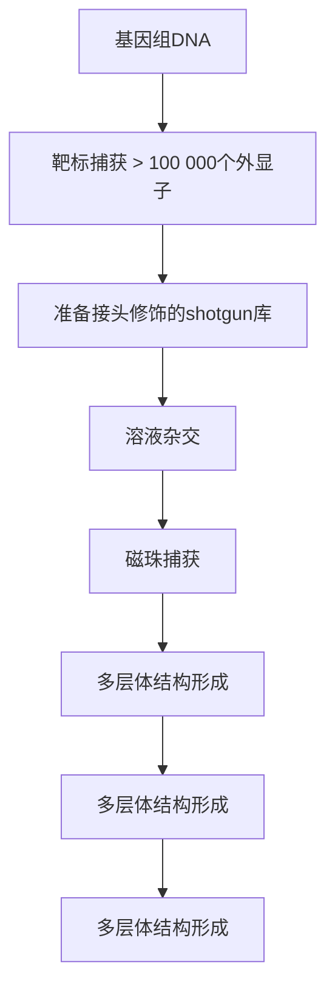

## 下一代测序技术的现状

至 2005 年，人们已经利用前述传统的、基于克隆的方法对许多生物的基因组（包括人类的基因组）构建了高精度的物理图，并完成了全基因组测序。有了这些参考基因组，生物学家就可以着手研究物种间及种内的基因组差异，研究具有各种遗传疾病表型的个体的基因组特点等。2005 年出现的首批商业化的下一代测序仪使这类实验变得更加容易且价格越来越低廉。

与基于克隆及毛细管的测序技术相比，下一代测序技术一般有几个与之不同的特点。一个特点是建库的步骤，要求将待测序 DNA 打断成相对短（100～800bp）的片段，并将其末段削平或者补平，将特定的接头（linker/adaptor）（人工设计合成的特定序列 dsDNA）结合到打断的测序 DNA 片段的两侧，就可产生一个适于测序的 DNA 模板库（这样就省去了将 DNA 片段克隆进载体并在宿主菌内扩增的复杂工作）。第二个特征是固定化 DNA 片段的扩增。这种片段扩增是以酶催化且在固体支持物（珠子或玻片，依仪器而不同）上进行，固体支持物表面通过共价键与接头相连，这些接头使单个分散的待测 DNA 分子进行扩增，在局部空间上产生大量相同 DNA 片段以便于在测序反应中产生足够的信号可被检测。因为每个扩增的分子簇来自于单个模板分子，下一代测序方法对每一个特定的序列可提供一个表征其丰度的数值。因此，每个簇代表库中一个独立来源的分子，在测序实验中该序列被读取的次数代表了它在初始库中的相对频数，在数据分析时可以用各种分析方法来了解这个特征。最终通过仪器、建库和扩增组合起来实现了下面将要叙述的下一代测序技术中的 DNA 大规模平行测序。各种下一代测序平台特性的比较，包括每轮的数据量、读长、反应离子类型、成本等，见表 11-1。

表 11-1 各种下一代测序平台特征的比较

| 平台设备 | 运行时间 | 读长/bP | 每次运行的数据量/Gb | 测序方法 | 错误类型 | 错误率/% | 每次运行的试剂成本 | 进货成本(X1000) |
| --- | --- | --- | --- | --- | --- | --- | --- | --- |
| 454 FLXTitanium | 10h | 400(avg) | 0.5 | 焦磷酸测序 | Indel | 1 | $6 000 | $500 |
| 454 GS Jr.Titanium | 10h | 400(avg) | 0.5 | 焦磷酸测序 | Indel | 1 | $3 000 | $108 |
| HiSeq 2000 v3 | 10~11 d/2Flow cells | 100×100 | >600 | 合成测序 | Substitution | &lt;0.7 | $23 500 | $690 |
| MiSeq | 19h | 150×150 | >1 | 合成测序 | Substitution | &lt;0.1 | $1 000 | $125 |
| SOLiD 5500x1 | 8~14 d/2FlowChips | 75×35PE60×60MP | 155 | 连接测序 | A-T bias insubstitution | &lt;0.01 | $13 500 | $595 |
| PGM 316 Chip | 3h | 100(avg) | 0.1 | pH感应测序 | Indel | 1 | $750 | $49.50 |
| Pacific Biosciences RS | 14 h/~8SMRTCells | 1500(avg) | 0.045 per SMRTCell | 实时荧光测序 | Insertion | 15 | $500 | $695 |

PE, paired-end reads; MP, mate-pair reads.

下一代测序技术的测序过程与传统的基于毛细管的测序方法形成鲜明的对比，在传统的基于毛细管的测序方法中，测序反应发生在微量滴定板（96孔板）独立的反应孔中，仪器则用来分离和检测反应产物的条带。下一代测序则通过一系列重复的步骤进行测序（引物延伸、检测新加入核苷酸、以化学或酶的方法清除反应底物或荧光源），同时检测每个片段群进行反应所产生的信号。这样的“大规模并行测序”可以使数十万乃至数亿个测序反应同时进行和被同步检测，因此，一轮测序的数据量相当可观，需要特定的数据分析方法。下一代测序技术的另一个标志是测序产生的读长相比毛细管测序的长度更短。下一代测序技术的短读长问题所带来的挑战及其在生物医学实验中日益普及的应用，使得面向基因组的生物信息学和算法研究又重新焕发了活力。一个例外是Pacific Biosciences平台，它可产生很长的读段数（reads）。这些 reads 目前比起其他下一代测序平台有更高的错误率，故而产生了其特有的生物信息学问题。

下一代测序最后一个特征是从片段库的两端产生 DNA 序列数据（图 11-3）。这种双末端测序根据所用的库片段的长度不同可分为两种类型。测序产生的配对 reads 提供了两个相隔已知距离（该距离有一定的波动范围）的序列，一种测序类型为 “paired-end” 测序，用长 300～500bp 的短片段建库，这些短片段的 5' 端和 3' 端加入了不同序列的接头（图 11-3A）。这些片段先从一端测序，也就是从 “正向” 接头开始，然后在另一端利用反向接头的作为引物测序。另一种类型的双末端测序为 “mate-pair” 测序:先将长的库片段（1000～10 000 bp）的两端环化并在环化部位连入一段已知序列接头。一旦两个末端利用接头配对成功，即可通过一些巧妙的实验方法构建只含有接头和最初 DNA 的两侧末端的片段库（图 11-3B）。

图11-3 双末端测序。这里描述的两种方法都采用了双接头策略，结合到基因组DNA片段的接头由两套序列组成。A1和A2接头序列（adaptor sequence）与测序芯片“flow cell”表面上的寡核苷酸互补，因此DNA片段可以杂交到测序芯片表面，而SP1和SP2则与测序引物互补，用于测序反应。（A）paired-end建库。（B）mate-pair建库（彩图请扫封底二维码）。

## 利用全基因组测序寻找变异

通过下一代测序的 reads 比对来分析个体变异的前提是有一个高质量的基因组作为参考序列。为全基因组准备的标准建库流程如上所述，由 DNA 打断、接头连接和测序前扩增组成。基因组的“覆盖”倍数或者采样倍数受以下因素的影响:测序读长（长读长意味着只需要低覆盖）、高质量 reads 的比例，以及是否为 paired-end/mate-pair 数据。一般而言，所要求的覆盖倍数力求获得:①足够的 reads 测序深度以确保能够可靠地识别变异；②充分的覆盖面以确保基因组的所有部分都能达到足够的覆盖深度从而发现变异。一般而言，对于短 reads 测序技术如 Illumina 和 SOLiD，全基因组测序中业内接受的标准覆盖倍数为 30 倍左右；而对于长 reads 测序技术如 Roche/454，则只需要 12 倍，覆盖倍数“越多越好”。业内公认的标准对于发现高度可信的变异是足够了，更多的覆盖倍数可获得更高的可信度。然而，太高的覆盖数对排除假阳性率是不利的——比如，Illumina 测序数据达到 10 000 倍的覆盖时，随机的碱基判读错误可能被误认为是非随机的变异。

在从全基因组数据发现变异的过程中，要找出不同类型的变异需要用不同的算法去分析。正如我们下面将要详细讨论的, 所有变异的发现都依赖于将 reads 和参考基因组作比对。根据各实验室的经验和实践, 可以单独或组合应用各种算法查找分析变异位点, 例如, 单核苷酸变异 (single nucleotide variant, SNV) 是一条序列相对于参考基因组发生的碱基替换, 一个或多个碱基的插入或缺失常常被叫做 “in/del” 变异, 它要求特殊的比对算法, 允许碱基的插入或缺失, 匹配有空隙的或断掉的 reads。结构变异 (structural variant, SV) 的检测方法最具数学挑战性, 因为有几种类型, 如大于 100bp 的缺失或插入、染色体内序列倒置, 以及染色体内和染色体间的序列易位。现在的结构变异算法中, 适用于克隆测序数据的算法是由 Eichler 及其同事建立的(Tuzun et al. 2005), 而适用于下一代测序数据的算法则是由 Snyder 及其同事提出的(Korbel et al. 2007)。针对下一代测序数据的算法主要依赖于 paired-end 或 mate-pair 数据中的 reads 所处的位置和方向。例如, 如果一个 paired-end 库具有 300bp 的平均建库长度, 配对的 reads 映射 (mapping) 到参考基因组上时, 其相对距离期望值应该接近这个距离, 实际距离和理论距离之间有一定范围的偏差。如果两个 reads 映射位置间的距离明显大于或小于期望的距离范围, 并且多对 reads 都反映出这种异常映射, 那么就很有可能发生了缺失或插入事件。

对结构变异特征的进一步分析可借助局部拼接算法（有很多）来完成。在这种方法中，识别特定结构变异的 reads 作为局部拼接算法的输入数据，常可以拼接出一段序列，前提是这段序列满足两点:①真实存在；②相对不那么复杂。通过这种方法，结构变异可以精确到单个核苷酸，因此可以预测下游基因转移导致的可能的基因融合，或者识别发生过缺失突变的基因。结构变异的识别是一个非常活跃的领域，很可能在本书出版时又有了新的进展。进行此类研究的人员需要利用文献中最新的方法。

虽然从数据的产生和分析来看，全基因组测序仍然较昂贵，但它却是掌握所有变异的最全面的方法。这对于疾病很重要，比如癌症一直以来被认为含有各种类型的、广泛的结构变异，因而需要特异性的诊断、预后和治疗（Her2阳性的乳癌和慢性粒细胞白血病就是两个人们熟知的例子）。然而对于癌基因组测序来说，肿瘤标本被传统病理学分析之后常常所剩无几，而且某些类型的肿瘤（如前列腺癌和胰腺癌）具有分散的现象，这些肿瘤细胞的富集需要采用激光显微切割和捕获。由于肿瘤形成初期即含有早期基因变异信息（这些早期变异常被认为是癌变的始作俑者），研究早期的组织增生病灶是有必要的。基于各种理由，我们已经开发出了低模板投入量的肿瘤全基因组测序方法，它能够产生一个复杂度足够的模板库，并通过测序产生足够的覆盖倍数（>30×），且不需要对基因组DNA进行扩增，这样可以减少人为引入的错误。该方法基本上精简了可能导致DNA损失的步骤，并且省掉了置换缓冲液和酶的乙醇沉淀步骤。该方法对待测DNA片段库的片段大小分析实现了自动化，采用自由区带电泳（free-zone electrophoresis）装置如Caliper XT，不需要人工观察电泳条带的位置，而是利用仪器自动比较DNA片段库的电泳条带与参考条带的位置，从而得出DNA片段的平均长度。该方法利用100ng DNA就可以实现全基因组建库，主要操作程序将在本章后面叙述。

## 定向测序:概述

对基因组特定区域进行测序，过去常采用 PCR 扩增目标区域，这需要针对目标区域设计一对或多对引物以作为 DNA 聚合酶复制的起始位点。PCR 产物经纯化以去除多余的引物和核苷酸，而后直接进行测序或者亚克隆到 TA 载体并用通用引物进行测序。随着下一代测序技术的产生，每台下一代测序仪的测序能力很快超过了高度自动化的 PCR 测序流水线的产出。对特定基因而非全基因组选择性测序需求的增加，催生了称为“杂交捕获”的各种测序方法。杂交捕获的最初设想和实现均基于固体表面寡核苷酸微阵列 (Albert et al. 2007; Hodges et al. 2007; Okou et al. 2007)，利用标准的微阵列打印技术将目标序列的互补序列高密度地固化在微阵列中，然后用基因组 DNA 与这些阵列杂交，洗掉未结合的 DNA。最后洗脱被捕获的 DNA，建库并测序。几个描述这种方法的研究报告差不多同时一起发表出来。此外，还有一篇详细描绘了一种可以靶向很多但不是所有外显子的高度多重化的方案 (Porreca et al. 2007)。其中，有一种捕获方法还显示了个体基因组中几乎所有已注释的外显子，即外显子组（exome），都能够被捕获和测序(Hodges et al. 2007)。但是这个过程需要相当的实验技巧和从微阵列中洗脱及提取 DNA 的复杂步骤，这意味着将其规模化应用于大量样品是很困难的。幸运的是，理念的快速发展和在溶液中完成这些步骤的能力解决了这些问题。

基于溶液杂交捕获的基本前提是，人工合成的单链 DNA 或 RNA 探针（见第 13 章）(Gnirke et al. 2009; Bainbridge et al. 2010)与过量的全基因组片段库混合时，能够杂交为探针/片段复合物。第二步是选择性分离探针/片段复合物，去除剩下的基因组片段和单链探针，上述分离依赖于探针序列含有生物素，可以与携带链霉亲和素的磁珠反应，在磁场的作用下可将复合物从溶液中吸出来（见信息栏“生物素”和“磁珠”）。而后，被捕获的大量片段从探针上释放出来并用 PCR 进行扩增。图 11-4 显示了用于下一代测序的杂交捕获技术的基本流程。目前针对人和小鼠外显子组的试剂已经能够捕获基因组中绝大多数的已注释基因。由于不同的试剂所要捕获的基因有所不同，用户在选择这类产品时应仔细考察以确保想得到的基因确实是对应探针集所定向捕获的基因(Clark et al. 2011; Parla et al. 2011)。有些试剂中的探针长度是均一的，而另外一些长度不完全均一。如果是后者，则可以通过调整探针的长度来调整 $T_{\mathrm{m}}$ 值，这可能增加被成功捕获的基因的数量。另一个导致某个试剂没有成功捕获到特定基因的原因是该基因属于某个基因家族，要针对这样的目的基因设计特异性的探针或许是不可能的。认识到这一点很重要，因为一个探针靶向一个特定的基因，而每个探针的捕获效率并不完全一样，结果目的基因序列有可能在捕获的片段中出现得很少。大多数为定向捕获而设计的变异检测算法为找出真正的变异都要求目的片段覆盖倍数达到一个最低限值，而性能不良的探针常常使覆盖倍数达不到要求。对于复杂的哺乳动物基因组，通常 $85\% \sim 90\%$ 的已知基因都有针对大多数或所有外显子设计好的探针。这些探针中 $80\% \sim 85\%$ 会产生足够的覆盖度用于检测变异（Clark et al. 2011; Parla et al. 2011）。

flowchart

图 11-4 外显子组或靶区域的杂交捕获。在杂交捕获中，全基因组文库片段的末端都包含平台特异性接头，这些片段被一组含有与靶基因相对应的探针所筛选。这些探针加有生物素标记，因而可以利用磁珠将探针-基因组文库片段的杂合体挑选出来。捕获的杂合体通过磁场从溶液中分离出来。通过变性过程，将基因组的文库片段从杂合体中洗脱出来，这些片段用于后续的测序工作（彩图请扫封底二维码）。

然而，人们或许不希望把整个外显子组作为靶标，定制试剂可以为亚外显子组（即外显子组的一部分）靶标所设计，包括在外显子以外或外显子之间独特的序列。亚外显子组捕获的问题是，在基因组上定位到亚外显子组的总大小（碱基对）越少，由于“脱靶效应”，将导致捕获效率越低。脱靶效应得到随机捕获的片段，这些片段来自于捕获过程中的随机或局部杂交而阻抑了探针靶向序列的获得。产生这种效应的原因是基因组中非靶标序列大大多于靶标序列，导致许多被测序的片段并没有出现在基因组的靶区域。因此，尽管有针对性的捕获比全基因组测序的方法要便宜，但它的费用会超出预想，尤其是当靶区域很窄的时候。

## 有关序列覆盖率的问题

“序列覆盖率”是一个简单但又常容易混淆的概念，指的是在基因组上某一特定区域（如每个碱基）上能发生匹配的测序reads的数量，它关系到某个指定测序项目为了产生一定质量的数据而必需的序列覆盖率。覆盖率通常表示为测序长度内所有覆盖率的平均值，近来又被当做阈值。例如，平均 $10\times$ 或者10倍覆盖表示在测序区域（或基因组）内每个碱基平均被10个独立的测序reads所覆盖到。当用来表示阈值时，覆盖率值通常表示为目标区域被覆盖到的百分比。例如，$80\%$ 的目标区域达到至少 $20\times$ 的覆盖率。这表示目标区域的每1000个碱基中有800个碱基至少被20个独立测序的reads所覆盖到。

有一些因素决定了某个项目所需要的覆盖率。例如，细菌等单倍体基因组所需的覆盖率比二倍体基因组的要低，因为要想发现二倍体基因组中所有的等位基因，两条染色体都要被充分覆盖到。另一个决定样品需要更高覆盖率的因素是样品复杂度。例如宏基因组样品或者肿瘤组织和正常组织的混合样品就属此例。

理解平均覆盖率的含义也很重要。比如在人类基因组测序达到 $20 \times$ 覆盖率的情况下，我们可以推知，平均每一个碱基被 20 个独立的 reads 覆盖到。然而，请记住这个值只代表一个分布，因此，有的碱基会明显多于或少于 20 倍的覆盖率。虽然在二倍体基因组中对于每一个碱基来说 $20 \times$ 的覆盖率已经足够用于检测变异，而事实上，$20 \times$ 的覆盖率表示一部分基因组只被少数 reads 所覆盖到，因而不足以检测基因组上这些部分的变异。因此，在做二倍体生物纯 DNA 样品全基因组测序项目时，研究者通常设定短 reads 的最低平均覆盖率为 $30 \times$ 。另外一些因素，如典型的肿瘤组织样本，可能要将平均覆盖率提高到 $50 \times$ 或者更高；相反，当利用下一代测序来发现大规模的结构变异时，可以使用低得多的覆盖率，但是更高的覆盖率可以得到更好的分辨率和更加精确的分析结果。

虽然全基因组测序给出某个平均覆盖率时意味着一个相对可预测的覆盖率范围，但是存在一些与纯统计模型相关的偏差，使某一区域覆盖率过高或者过低。实验要求越多的样品处理过程，如靶向捕获和外显子组测序，就可能会有很大潜在的偏差。这些偏差导致外显子组的某些区域极大地高于或者低于平均覆盖率（甚至完全没有覆盖到）。因此，表述外显子组覆盖率最好的方式是用我们上面所提到的阈值。例如，我们可以说80%的目标区域（这是一个通用值）有20×或者30×的最小覆盖度。对于覆盖率的进一步探讨，见信息栏“覆盖率和多重性:由飞速发展的测序通量所带来的困境”。

认识下一代测序中质量控制的评估也很重要，下面将详细描述。

## 覆盖率和多重性（multiplexing）:由飞速发展的测序通量所带来的困境

当第一台商业化的 Solexa（后来变成 Illumina）测序仪在 2007 年出现的时候，微流体 “flow cell” 中每 8 个 lanes 可以产生 10 亿个碱基（相当于每个 lane 产生 1.25 亿个碱基）。这些努力的结果是测序技术与之前的仪器相比发展迅速，但是对人类全基因组进行测序，每个项目需要许多的 lanes 或者多个完整的 run。然而，测序产量从 2007 年初到 2011 年之间有所增长，IlluminaHiSeq 2000 目前 16 个 lanes 的测序产量是 6000 亿个碱基，即平均每个 lane 产生 375 亿个碱基。飞速增长的测序能力却产生了相反的效果，只有较大的项目才能实现低成本的运行方式。现有的仪器可以让全基因组在少数 lane 上测序（而一代高通量测序仪需要几十个完全 run），就目前的下一代测序而言，即使是人类外显子组测序这样的大项目，也不能充分地利用单个 lane 的容量。

一种解决实际覆盖率和需求不一致的方法是，在建每个测序文库的时候将 DNA 条形码（bar code）序列包含在接头序列（adaptor sequence）内。这样产生的文库可以在测序前以等比例结合；然后在测序过程中，DNA 条形码序列被看成是测序数据产出的一部分。利用 DNA 条形码的标识，那些结合上的文库以外的片段在测序数据进行分析后一起作废。从某种程度上说，这是一种易于处理的方法；然而，测序产出量的快速增长与满足更高通路测序所需的现成 bar-code 不相符。例如，对于一个 50Mb 的人类外显子文库，现有的 HiSeq 2000 一个 lane 可以产出 750 倍的覆盖率，其中只需要 100 倍的覆盖率来检测可靠的 SNP 和插入缺失。虽然这种理想化的计算没有考虑诸如在捕获靶标时的动态变化因素，但这一水平的覆盖率仍然大大高出几乎任何外显子组测序的需求。

问题由此变成，为了充分利用现有的测序能力，如何利用足够的条形码使样品能够汇集到Illumina测序仪上的单个lane。这一问题在测序容量增加或者需要测序的基因组区域降低时会变得更糟。例如，如果需要测序的只是人类基因组中的100个基因，其平均大小为50kb，Illumina HiSeq2000一个lane可以在靶基因上产生约7500倍的覆盖率。理论上，相同的lane可以从75个样本中产生100倍的覆盖率。此外，重要的是，要认识到这种理论计算从未完全与真实的实践值相符合。例如，合并样品时的移液器误差等问题可能导致一个样品多于或少于理论值，因此必须在一定程度上超量测序，以确保所有样品的最低覆盖率。然而，显而易见的是，问题是对于每一个样品如何在一个lane上集合50套基因而不是同一样品中的50个基因，这样可以大规模降低测序的费用。等到本书英文版出版之时（2012年），很可能大多数的仪器制造商会有很多解决这种问题的方法。这些解决方案会从低容量测序仪（参见信息栏“桌面基因组测序仪:下一代测序的未来？”）到多重性试剂，因此允许足够多的加条形码样品合并到一个测序lane，充分利用仪器的通量能力。

## 序列验证和质量控制

任何测序数据，无论是基于 Sanger 测序法还是下一代测序法，都是实验数据，因此会有相关误差。下一代测序产生的大量数据集，不仅需要统计学方法，还需要特殊的验证变异的方法。当对靶标正确使用、充足的覆盖率时，下一代测序仪会产生非常准确的一致序列。然而，虽然如此，这样的数据还是会有一些错误。例如，人类的全基因组测序中每1000万个碱基发生一次错误的错误率已经很低，但是仍然会产生大约200～300个错误。也许更真实的错误率是每300万个碱基发生一次错误，同样的数据会包含大约1000个错误。另外，有的区域会覆盖得不够好（甚至完全没有覆盖到），导致数据出现假阴性。

下一代测序有许多处理质量控制的方法，随着技术的发展会有质量评估的方法。在全基因组测序中，质量评估的一个重要途径是将测序结果与全基因组 SNP 阵列的结果进行比较（Ley et al. 2008）。这种方法通过利用与测序过程相同的基因组 DNA 进行微阵列分析来检测变异。通过将基因组序列中发现的 SNP 与微阵列实验所得的结果进行比较，可以确定由微阵列检测到同时也被测序检测到的纯合子和杂合子变异的比例。与基因组覆盖度一样，这种方法提供了质量评估的附加值（根据假阴性率），但是不能测量假阳性率；同时提供了对于样品标识的确定。

在基因组测序或者只测序如外显子或单个基因等很小的范围时，最好是进行其他类型的验证方法，如特异的关键突变和其他随机选取的突变。后者使人们认识到总体误差率固有存在于测序和发现变异的过程中。可以通过在小规模内选择一些变异型，扩增基因组上的这些区域，用毛细管测序仪（一种快速和廉价的产生正交数据的方式）直接测序这些扩增产物的方式进行验证。大量的变异型可以用定制的捕获阵列进行验证，例如，癌症基因组研究中的全基因组验证（E Mardis, pers. comm.），可能会演变为一个更快的转折，特别是近期发展的桌面下一代测序仪（见信息栏“桌面基因组测序仪:下一代测序的未来？”）。关键问题是需要某种外部的质量控制方式，最好是正交的，从而可以监测下一代测序及其所有相关步骤（可能包括捕获、远距离 PCR，或者其他一些分离基因组区域的方法），以及其他地方讨论过的变异型检测算法，都会在错误和覆盖度方面有所体现。

## 外包测序

产生数据所需的费用快速降低，这使得人类基因组测序成为人类遗传学中的一种日益可行的工具。虽然在任何一个达到指定水平的实验室进行全基因组测序在技术上是可行的，但是建设需要的基础设施有时却任务艰巨，特别是计算生物学分析。因此，许多人类遗传学家寻求基础设施齐备、并能做所需生物信息学的外部合作者，或者将项目外包给越来越多的合同测序公司。

虽然外包测序有一定的劣势，包括失去对项目某一阶段的控制权和依赖他人的时间表，但是当数量有限的全基因组需要在一个相对较短的时间内被测序完全的时候，外包确实提供了一个特别有吸引力的方案。目前，一些合约服务可以提供人类全基因组测序，如 Complete Genomics 和 Illumina，以及其他较少公开的公司。

这一过程从把基因组 DNA 样品送到合约测序公司开始；服务包括提供个人全基因组序列的服务，同时也提供一些深度的生物信息学分析。也有一些公司会分析其他来源的测序数据。这些选择对于那些不需要在很长一段时间内或者定期进行全基因组测序，而是只需要对有限数量的样品进行测序和/或分析的人特别有用。

合约服务也可以应用于全基因组测序以外的一些其他服务（如外显子组测序）。然而，由于外显子组测序需要更多前期的样品准备和处理过程，就每个碱基的成本而言，它比全基因组测序要昂贵得多。由于现在的成本差异相当倾向于全基因组测序，多个公司以廉价的全基因组测序积极竞争占领市场。在编写本书的时候（2011年），利用商业供应商测序一个全基因组可能要比一个外显子组昂贵2～3倍。然而，在一个下一代测序基础设施已经到位的实验室里，全基因组测序的成本大概是外显子组测序的10倍以上。这种合同成本与内部成本之间的差异应该予以考虑，尤其是外显子组测序或其他靶向测序项目。

## 下一代测序对科学研究的影响

下一代测序技术（NGS）在生物学研究中仍然有着意义深远的影响。由 NGS 单独产生数据的规模是前所未有的，超过摩尔定律预测的几倍。依据产生和存储数据的直接成本总量计算，学术实验室可以在几天内花费大约 10 000 美元左右测序一个相当于整个人类基因组的序列（截止到定稿时），该价格包括所有产生和存储数据的直接费用。NGS 在研究 RNA 表达的时候可以标识一个样品中的所有表达基因，成本与一个给定目标的（defined-content）微阵列相当，但却可以同时提供多得多的表达水平的数据，并检测 RNA 水平的各种现象，如可变剪切。另外，下一代测序从根本上增加了对基因组范围内的组蛋白和转录因子结合位点进行分类的幅度与精度（见第 20 章）。

随着测序范围的扩大和测序成本的降低，下一代测序促进了新的研究领域的发展。其中一个应用是增加非编码 RNA 的分类和新的转录产物种类的发现。“宏基因组学”也随着下一代测序的进步而得到快速发展。从一个特定环境里分离收集到的所有物种 DNA，首先通过测序来描述其特征，然后与数据库中已测序过的所有数据进行比对。尽管最初在一个特定环境分离的 DNA 是先通过鸟枪法建库，然后利用毛细管测序法进行测序，但下一代测序因其在相对短的时间内便可获得足够浓度的测序数据，其低成本、高通量的优点却大大加速了这一领域的发展。受到下一代测序技术促进的不仅只有核酸测序方面。基因组 DNA 上甲基化位点的分析现已可采用 “Methyl-seq”（甲基化测序）方法在全基因组范围完成。甲基化测序方法、首先利用亚硫酸氢盐转换、免疫共沉淀等方法进行处理，然后对这些经过处理的片段进行测序（见第 12 章）。

除了单一用途以外，从前许多基于阵列的实验可转而应用下一代测序技术进行，这为多次实验间引入了可重复性。因为以杂交为基础的方法容易导致实验结果发生波动，从而缺乏这种可重复性。此外，由于所有的分析都是基于测序且产生的都是数字化的数据，在一个样本或一组样本等多种实验中使用下一代测序技术可大大增强数据间的一体化。

数据分析依然是最难、最贵、最费时的一个环节。相较于毛细管电泳测序，下一代测序数据比对和/或数据组装的主要难点在于测序长度较短、reads错误形式多样。好在生物信息学和计算生物学的兴起为解决这些棘手的问题带来了创新和活力。然而，相对于庞大的测序数据产量而言，数据分析能力呈现出严重的“瓶颈”状态。第8章广泛论述了短序列的分析方法。

## 下一代测序仪器的概述

截止到定稿时(2011年底)，常用的三个主要测序平台分别是Roche/454焦磷酸测序仪、Illumina/Solexa测序仪和Life Technologies SOLiD/5550测序仪。本节会对这些测序平台和一些新的“个人测序仪”（personal genome machines），以及桌面测序仪进行描述（不同测序平台的特性比较见表11-1）。另外，我们将首次对有可能成为新的测序趋势的单分子测序仪进行简单介绍。

## Roche/454 焦磷酸测序仪

第一款商业化的下一代测序仪是由后来被Roche收购的454公司开发的(Margulies et al.2005)。这台仪器融合了一项新的技术——油包水PCR（emPCR），即在表面上共价结合有衔接子的聚苯乙烯珠子上扩增文库片段，从而进行大规模并行焦磷酸测序。该仪器其他的大规模并行特征包括:PicoTiter板（PTP）；一个双重用途的石英玻璃耗材[①可容纳扩增过的珠子，以及表面带有用于产生信号的酶的更小的辅助性珠子；②含有流体管道保证测序试剂扩散到孔中]。PTP的一面是透明的，这样给珠子和获取图像的CCD相机提供了接口。由于用于454焦磷酸测序的试剂是没有荧光标记的核苷酸，它们在PTP中需要分步聚合，这就要求在每次反应后必须进行图像捕获并清除未反应试剂。

焦磷酸测序的主要步骤见图 11-5。当每次核苷酸从连有引物的文库片段上流过时，如果该核苷酸与模板上的核苷酸互补，就会发生由 DNA 聚合酶催化的聚合反应。当聚合反应发生时，产生的焦磷酸盐（PPi）将会触发下游一系列由偶联到珠子上的酶（包括硫酸化酶和萤光素酶）催化的反应，进而发光。发射的光信号会被电荷耦合（CCD）的相机检测到，荧光信号采集发生在每次核苷酸聚合后，可采集来自数十万计的 PTP 孔中珠子上的信号，产生的光强度与增加的核苷酸数目成比例（直到荧光检测最大值）。在测序文库衔接子分子上含有一段 “key” 序列，该序列以特定的顺序在每条待测 DNA 序列的起始位置提供单个 T、G、C 和 A 碱基，用来对代表单个碱基聚合的荧光值进行定量。机器每运行一次测序反应，系统利用 “key” 序列中每个碱基聚合产生的荧光值来计算每个循环所掺入的碱基数目。运行后的分析过程会使用初始 4 个 flow（即 “key” 序列）的信号翻译 PTP 上每个位置每个核苷酸 flow 的信号。最终产生的 “flowgram” 由碱基和相应的质量值构成。

图 11-5 焦磷酸测序。Roche/454 测序仪使用该法扩增单链 DNA，这些单链 DNA 来源于珠子上的片段文库。（A）文库构建准备，基因组 DNA 被打断成片段并在其末端加上衔接子。（B）DNA 片段与珠子以约 1:1 的比例混合，珠子上含有与 DNA 片段末端的衔接子互补的寡核苷酸，通过强烈的振荡将该混合物包入含有 PCR 试剂并被油包裹着的液相里，最后被移到 96 孔板进行 PCR 扩增。（C）珠子上最终生成原始单链片段的约 100 万个拷贝 DNA，这为接下来检测和记录核酸结合事件的焦磷酸测序过程提供了充足的信号强度。sstDNA，单链模板 DNA（Mardis 2008）（彩图请扫封底二维码）。

由于每个核苷酸 flow 是按顺序依次流入，454 的碱基替换错误率是相当低的。相反，插入和缺失错误却以较高的频率发生，特别是在单碱基重复序列中。该错误的产生是由于相同类型的多个碱基（例如一串 A 碱基）同时插入会产生一个很高的信号峰，仪器的碱基读取软件无法准确地整合峰的面积，从而无法确定具体加入的碱基数目。当核苷酸合成过程中检测 CCD 达到对光信号线性响应的最高值时，该问题可能会更早出现。

在 Roche/454 测序仪上市之前，基于微量滴定板的焦磷酸测序系统已经商业化。该仪器系列称为 PyroMark，由 QIAGEN 公司提供，适用于突变的检测和/或验证，以及甲基化检测（见第 12 章）。它的一个主要的优点是，在对种群的 DNA 混合模板进行测序时，单一测序反应便可提供定量的测序数据（例如，一个患病人群样本等位基因多态性频率或 DNA 甲基化修饰位点频率的确定）。该设备与 Roche/454 有着相似的测序原理，随着每个核苷酸的依次掺入而发光，每个序列被包含在微量滴定板上不同的孔里。然而该仪器的结果分析是逐孔进行的，因为与 454 焦磷酸测序系统的 PTP 板相比，PyroMark 微量滴定板孔密度很小，因此不需要明显的分析时间，也不需要大量的计算分析，就可以向用户返回序列结果。

## Illmina/Solexa 测序仪

自 2006 年上市以来，Solexa 测序仪不管是在测序反应本身还是在每次运行可以产生的 reads 的数量上都与其他下一代测序系统不同。文库构建过程与上述的总体描述一致（见前面“下一代测序技术的现状”），但建库之后的其他过程均与 454 测序不同。它不是在珠子上进行油包水 PCR，而是在硅基玻璃片表面的 8 个微流体通道组成的“flow cell”上添加 DNA，之后 DNA 被导入一个“三明治”结构中，形成密闭的微流体结构。flow cell 上的通道介导试剂的进入和移除。在 flow cell 通道的表面被厂商预涂有与用于文库构建通用衔接子序列互补的寡核苷酸序列。当变性的文库序列通过 flow cell 上的通道时，文库序列就会与涂布在 flow cell 上的核苷酸序列杂交。紧接着文库序列会在原位进行所谓的“桥式扩增”，即与共价结合在 flow cell 上的互补衔接子序列杂交的文库序列，由 DNA 聚合酶介导进行多次等温扩增反应（循环间由 NaOH 变性），从而使每个片段扩增得到一簇大量的 DNA。一旦扩增结束，一种特殊试剂会流入 flow cell，使通道上正向反应特异性衔接子释放离开通道，其他的衔接子依旧附着在 flow cell 上。这种化学反应产生线性 DNA 模板，这种模板先被降解来提供单链模板，然后通过与释放衔接子对应的特异寡核苷酸引物结合来启动 DNA 测序反应（图 11-6），该引物提供用于 DNA 合成的游离 3'-OH，复制每一簇 DNA 中的每一条模板，掺入的核苷酸共价结合两个特殊的化学基团，其 3' 端含有阻遏基团，将合成反应限制在每次结合一个核苷酸。此外，还有一个荧光基团，当用激光扫描 flow cell 时，该基团可以发出荧光供系统识别。

当 flow cell 上部和下部的所有通道被仪器扫描后（HiSeq 2000 系统，以及更早的 Solexa/Illumina 测序仪只扫描一面），每个结合核苷酸上的阻遏基团和荧光标记基团被化学切割，使合成反应继续进行，从而允许启动下一个测序循环。这一系列的测序步骤重复运行，直至达到用户定义读长，然后启动从该序列末尾开始的第二次读取（如果需要）。在准备第二次读取时，测完序的链从它们的模板链变性移除，再运行一次简短有限的桥式扩增产生双链 DNA 簇。再次以一个化学反应来释放相反的衔接子，产生适于启动反向测序的线性分子。系统引进第二个 read 测序所用寡核苷酸引物并复性，重复前述的第一个 read的测序过程。第二个 read 测序结束后，系统使用 Illumina 提供的数据处理流程，对每一循环、每一簇的波长信号进行分析，重建每一簇的第一个 read 和第二个 read 序列，包括每个碱基的质量值。紧接着是一系列的用于除去低质量序列的过滤，高质量的序列将会比对到选定的参考基因组上。基于这些比对和其他运行参数，一系列运行结果参数将会产生并解析成报告（如过滤后的簇数、每个 flow cell 的碱基数、平均错误率等），这些结果和参数可以帮助用户评估每次测序反应的质量。

图 11-6 合成测序法。(A) 在含有 DNA 聚合酶的 flow cell 上, 桥式扩增产生的簇与测序引物杂交, 掺入 4 种荧光基团标记且 $3^{\prime}$-羟基端含阻遏基团的核苷酸。(B) 簇链每次延长一个核苷酸。在一次聚合反应结束后, 没有使用的核苷酸和聚合酶分子被冲洗掉, 扫描缓冲液被添加到 flow cell 上, 光学系统对 flow cell 上的每个 lane 的不同单元 (简称 tile) 分别进行图像捕获。成像结束后, 末端碱基上的荧光基团和阻遏基团被降解掉, 以利于下一轮荧光标记核苷酸的聚合 (引自 Mardis 2008) (彩图请扫封底二维码)。

## Life Technologies SOLiD/5500 测序仪

SOLiD 利用连接测序而非依赖于 DNA 合成酶的逐个碱基测序，这种被称为“双碱基编码”的大规模平行测序利用 DNA 连接酶连接特殊设计的杂交寡核苷酸到复性的引物末端。SOLiD 测序文库(小的插入文库或 mate-pair 文库)可在直径约  $1 \mu m$  的磁珠上通过 emPCR 进行扩增，经纯化去除表面没有 DNA 的磁珠。在 FlowChip 上可以进行大量珠子的测序，因此需要很大的 emPCR 反应体系。需要三个阶段来准备所需的文库:①乳化；②大体积 emPCR 扩增；③去乳化和回收珠子。将珠子加到 FlowChip 上，第一轮测序引物结合到文库片段上，然后引入 DNA 连接酶和一系列半简并寡核苷酸。所有寡核苷酸根据 3' 端的第 1 位和第 2 位的碱基固定为 16 种可能的双核苷酸组成之一，其余位置为简并状态。每个寡核苷酸在 5' 端还含有四种荧光标签之一，每种荧光标签代表一套双核苛酸组成形式。在测序过程中，如果出现与珠子表面给定文库片段能够有 5 个碱基正确杂交的寡核苷酸，那么随后会被连接到引物上。荧光扫描可以对靠近引 5' 端的碱基进行“解码”（在寡核苷酸的位置 1）。由于前两个碱基是固定的，所以引物 5' 端的第二个核苷酸也可以被确认，因此称为“双碱基编码”（图 11-7A）。扫描完成后，利用外切酶消化简并的寡核苷酸部分，除去荧光基团，为随后的寡核苷酸链接提供新的引物 5' 端，为下一轮连接测序做准备。之后采用相似的方法进行下一轮的杂交，寡核苷酸连接和扫描确定碱基。每一轮合成反应起始于引物 5' 端的固定距离（例如，第 5 位、第 10 位、第 15 位碱基等）。当引物通过每次解码 5 个碱基而延伸到达指定的重复次数（读长）后，新合成链通过降解和水洗而移除，接下来反应起始于一个 5' 端复性到模板（n-1）位置上的引物，随后重复进行预期次数的连接测序反应。而后，程序分别利用位于模板（n-2）、（n-3）、（n-4）位置上的引物进行重复测序，使得一个连续的序列被读出来（图 11-7B）。典型的 SOLiD 读长为 50～75 个核苷酸。后处理软件可以用来整理数据，过滤低质量的 reads，获得核苷酸序列和每个碱基的质量值。

图 11-7 SOLiD 测序。（A）双碱基编码原理。由于连接在 8-mer 上的每个荧光信号组区分一个碱基组合（每个组合包含 4 种 2bp 序列），通过单个 reads 与已知的高质量参考序列比对，可以判别碱基读取的是错误、真实的多态性还是单碱基缺失。（B）Applied Biosystems SOLiD 测序仪的连接测序。采用类似于 Roche/454 油包水 PCR 扩增的方式，SOLiD 测序的 DNA 片段先在 flow cell 上的 1μm 磁珠表面进行扩增，从而可提供足够的测序反应信号。连接测序开始于引物复略到每个扩增片段末端共有的接头序列上，随后 DNA 连接酶，以及第 4 位和第 5 位标记荧光基团的 8-mers 寡核苷酸流入，并发生连接反应。每一连接步骤后进行荧光检测，然后降解简并碱基（包括荧光基团和阻遏基团），同时准备好已延伸的引物用于另一轮连接测序（引自 Mardis 2008）（彩图请扫封底二维码）。

## Pacific Biosciences RS

由 Pacific Biosciences 生产的 DNA 测序仪在 2010 年中期被引入 beta-test 实验室，并且在 2011 年 5 月正式上市。这种测序仪是基于一种叫做 “ZMW”（零模波导孔）的纳米结构，该结构能够聚焦检测 DNA 模板上进行合成的 DNA 聚合酶活性位点。ZMW 是一个小的针孔结构，它可以让仪器的光和检测信号特异地聚焦在聚合酶活性位点上（图 11-8A）。数以万计的 ZMW 被植入二氧化硅芯片表面，用以提供大量的检测信号。Pacific Biosciences 的文库构建和其他的下一代测序是很类似的——特定接头连接在所有的片段上。接头是部分双链部分开环的新型 “棒棒糖（lollipop）” 结构（图 11-8B）。片段和接头连接后变性产生环状 DNA 分子。每个 DNA 环特异地共价连接在 ZMW 表面的 DNA 聚合酶形成复合物，这些复合物被加入到含有 150 000 个 ZMW 的 SMARTCell 装置上，经过短暂的时间，DNA/聚合酶复合物就沉淀到 ZMW 内，加入测序试剂进行测序。在收集数据时，仪器对每个正在进行聚合反应的聚合酶活性位点实时捕获 “影像” 信号（每个 run 达到 75 000 个 ZMW），每个影像记录活性位点荧光标记核苷酸进入后停留的时间，该时间足够使荧光基团被激光激发从而被检测到。一个检测完成之后光学系统进行复位，即可开始第二个反应的检测，记录另外一组影像。不像其他已介绍的测序仪，Pacific Biosciences 仪器每个 SMARTCell 只需要单次添加反应物，每个 SMARTCell 运行时间为 105min，目前平均读长为 1500bp 左右，而大于 10 000bp 或者更长的 reads 也经常被检测到。影像立刻在仪器上转化为相当小的脉冲文件，然后转换成带有质量值的碱基信号。

图 11-8 PacBio 测序。（A）一个活化聚合酶固定在 ZMW 底部，核苷酸底物扩散到 ZMW。4 个核苷酸 A、C、G、T 被不同激发光谱的荧光染料标记，用于识别碱基。由于信号从 ZMW 的底部激发，由聚合酶结合的核苷酸在聚合前发出延伸信号来识别聚合的碱基。（B）SMARTCell 测序模板的构建，DNA 片段被连接到发夹结构的衔接子上。下侧描述的是 DNA 聚合酶结合到其中一个接头序列的通用聚合酶起始位点上（Redrawn, 经允许引自 Pacific Biosciences of California, Inc.）。

Pacific Biosciences RS 可以被用来对不同应用和不同插入长度的文库进行测序，如非常短的插入序列（250bp）、标准插入序列（1～3kb）或者更长插入片段（10kb）的文库。在测序非常短的插入序列（250bp）时，每个片段的链可以在每个 run 里被测定多次，从而产生一个高质量的一致序列（重复测环状模板）。这种技术被称为“环状共有序列测序”技术（CCS）。它被典型应用于 PCR 产物测序，从而进行检测或者鉴定突变。用非常长的插入片段（10kb）和延伸影像获取时间（75min 左右）可以使 DNA 聚合酶在每个插入里产生非常长的读长，这些序列可以与高覆盖的短 reads（如 Illumina 末端配对测序）结合起来，从头组装超长的基因组序列。在“标准模式”运行中，1～3kb 的片段可以用 45min 的影像捕获而获得。初级 reads 集可以用来组装细菌或者病毒的基因组。对于更大的基因组（如简单的真核生物基因组），标准长度与非常长的插入文库的结合可以用来填补标准读长的 contigs 间的 gaps，因此可以为基因组提供连续的组装。这个系统也可以在 DNA 合成时实时进行 DNA 修饰基团的检测，如 5-羟甲基-胞嘧啶甲基化。这种检测的原理在于，聚合酶遇到修饰碱基时，相比于遇到无修饰碱基的标准 IPD（脉冲间距离），观察到的结合信号时间间隔会变长（引自 Flusberg 2010）。

## Ion Torrent 个人用基因组测序仪（PGM）

Ion Torrent 测序仪所用的理念和流程都与 Roche/454 测序仪极其相似（图 11-9）。与检测核苷酸聚合后萤光素酶催化发光不同，Ion Torrent 测序仪检测核苷酸聚合后氢离子的释放所导致的 pH 变化。许多过程都与 454 测序相同，包括:①油包水 PCR 扩增连接在磁珠上的带有接头的文库片段；②打破乳液为测序做准备；③油包水 PCR 结束后，在 PGM 离子芯片上装载扩增的磁珠；④通过连续添加核苷酸的方式逐步测序。目前 Ion Torrent 的平均读长是 100 个核苷酸，完成一个完整的 run 需要大约 2h。未来 Ion Torrent 和其他“桌面”测序仪的详细内容，参见信息栏“桌面基因组测序仪:下一代测序的未来？”

图 11-9 Ion Torrent 工作流程。(改编自 Ion Torrent Systems, Inc.)

## 桌面基因组测序仪:下一代测序的未来？

今天的超高通量下一代测序已使得实验领域越来越多样化，如分子生物学、植物基因组学和人类遗传学；然而它们也是有局限的。其中一个问题在信息栏“覆盖度和（多重性）:由飞速发展的测序通量所带来的困境”中讨论过。另外，虽然现在的设备通量很高，但运行成本也很高，购买仪器的花费和有效利用数据的生物信息学支持的花费也相当高。

因此，三个主要的仪器制造企业向市场推出了体积小、低产量、低花费的“桌面测序仪”，其中包括罗氏的454 GS Junior测序仪、Life Technologies公司的Ion Torrent PGM测序仪和Illumina公司的MiSeq测序仪。到本书定稿时，GS Junior测序仪已经被客户使用一年多了，Ion Torrent测序仪在2011年中旬推出，MiSeq在2011年夏末运送给早期授权用户。因为只有GS Junior在市场上持续推出了一段时间（见表11-1），因此我们无法对这些仪器有一个完整的描述。然而，桌面测序仪在未来的测序工作中将扮演重要角色，因此在这里是值得讨论的。另外一部分关于Ion Torrent仪器的内容在导言部分已经讲述。

所有这些“个人用”测序仪都是为产生比毛细管测序仪更多的数据量而设计的。但是它们的容量却远远低于相应的高端仪器，结果是，虽然大型测序中心可能会利用这些小型仪器开发/优化一些技术，并且进行文库的质量控制，但是这些仪器放在小型实验室里比放在大型的测序公司里更加适合。

桌面测序仪有许多潜在用途，包括:小到中型序列的测序工作，采用正交试验的方法验证检测到的变异体（例如，用 Ion Torrent 验证利用 Illumina 仪器测序整个基因组所检测到的变异体），文库的质量检测和探索新方法。Ion Torrent 和 MiSeq 都旨在让运行速度大大高于各自仪器制造商生产的高端仪器。例如，Illumina MiSeq 仅需要一天的时间即可完成从建库到测序再到与参考序列比对的全部工作；与此相比，利用 Illumina HiSeq2000 测序需要额外的 10 天时间才能获得最大的通量。然而，值得注意的是，HiSeq2000 由此将产出 6000 亿个碱基对，而 MiSeq 最早说明书中提到的 MiSeq 一个 run 只能产生 15 亿个碱基（令人惊奇的是，2007 年 MiSeq 的统计量比原始的 Solexa 仪器公布的要高）。除了这些仪器的速度和非常有用的通量以外，它们在初始购买价和运营开支方面都比高端仪器要低很多。与数千美元的高端仪器相比，最新的仪器一个 run 消耗低于 1000 美元（到本书定稿时）。此外，仪器本身的耗费只占同厂生产的高端仪器的 10%～20%。通过连续几代化学技术和硬件条件的改进，这些仪器的发展将会很有前景。对于许多生物学家来说，他们测序的主要需求将会被这些新兴仪器满足。

## Sanger 测序与下一代测序的比较:如何合理选择测序平台

Sanger 测序（毛细管测序）和下一代测序技术有明显的区别，在此进行简短的概述。Sanger 测序技术的优势在于能够从小的目标分子中产生准确度高的、较长片段的数据；而下一代测序技术能从大量的分子中获得读长较短（至少短于毛细管电泳），准确度稍低的数据。考虑到两种测序技术的差异，在何种情况下采用何种测序技术就很明确了。

在测序技术中，有时测序要求计算不同序列的分子数量，如检测 RNA 的相对表达水平、使用 ChIP-Seq 分析蛋白结合位点（参见第 20 章，方案 6），以及大规模测序项目。这些项目显然是需要下一代测序技术。在另一些时候，常常需要测定某个特定克隆的序列，或使用特异性引物扩增的目的基因片段，或通过测序检查特定基因是否发生突变，或通过