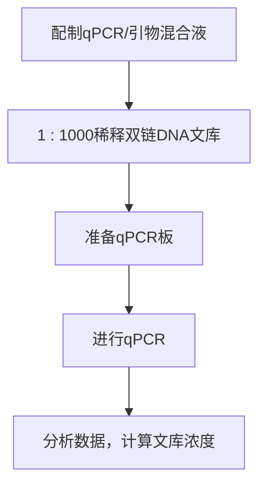

3. 往 1\~3μg gDNA 样品中加入洗脱缓冲液稀释至终体积 80μL。

| DNA(gDNA) | 1~3μg |
| --- | --- |
| EB缓冲液 | (80μL DNA 体积) |

用EB缓冲液或水作为洗脱缓冲液，不要用TE缓冲液，因为TE中的EDTA会影响后面的酶反应。

4. 将稀释液转移至 Covaris 管，注意避免产生气泡。

5. 将 Covaris 管放在固定支架上放入 Covaris 超声破碎仪，运行所需的 Covaris 方案。如果要得到 250bp 左右的剪切片段，使用下述参数:

Duty Cycle: 10%

Intensity: 5

Cycle Burst: 200

Time: 90 s (Treatments: 30 s, 30 s, and 30 s)

6.（可选项）DNA 1000 Bioanalyzer 芯片分析 $1 \mu \mathrm{L}$ 剪切的样品，检测样品的片段分布。

## 浓缩剪切的 DNA

按照 Bioo Scientific 公司的操作方案将 DNA 浓缩至  $40 \mu L$ 。

7. 室温融化 AMPure XP 磁珠至少 30min。

8. 振荡磁珠 1min，使其彻底混匀。

9. 取  $144 \mu L$  （ $1.8 \times 80 \mu L$ ）磁珠放入 1.5 mL 离心管或 MIDI 板的孔里。

10. 将剪切的 DNA 样品转入含有 AMPure XP 磁珠的 1.5mL 离心管或 MIDI 板孔里。

11. 吹打混匀，将 MIDI 板盖上平板盖。

12. 瞬时离心（约 1s）收集磁珠（不要沉淀磁珠）。

13. 室温条件下 2000r/min 振荡 5min 又 30s，使 DNA 结合到磁珠上。

14. 瞬时离心（约 1s）收集磁珠（不要沉淀磁珠），然后放在磁力架上静置 2min。

15. 轻轻地吸去上清液，以免搅动磁珠。

千万不要吸走珠子，宁可残留少量液体到乙醇清洗阶段去掉。

16. 用新配置的 80%乙醇清洗磁珠。

i. 现配 80%乙醇。

80%乙醇具有吸湿性，应该现用现配以取得最佳结果。

ii. 在磁力架上往每个样品中加入  $200 \mu L$  80% 乙醇，室温静置 30s。

小心不要搅动磁珠沉淀。

iii. 用移液器吸去 80%乙醇。

17. 重复步骤 16 一次。

18. 室温风干磁珠 5min 去除残留乙醇。

用  $37^{\circ}$ C 烘箱可以加快磁珠干燥，然而干磁珠容易破裂成薄片，需要额外小心，不要让磁珠飘飞。

19. 往干磁珠中加入  $42 \mu L$  无核酸酶的水，室温孵育 5min 彻底重悬磁珠。

20. 离心使磁珠沉淀。

21. 放在磁力架上静置 2min，吸取  $40\mu L$  洗脱液转移到 PCR 板里。

## 文库制备

按照 Bioo Scientific NEXTflex DNA 测序试剂盒提供的方法制备末端配对（PE）文库。

22. 配制末端修复反应如下反应体系如下:

| 试剂 | 体积 |
| --- | --- |
| 浓缩的DNA片段(来自步骤21) | 40μL |
| NEXTflex End Repair Buffer Mix | 7μL |
| NEXTflex End Repair Enzyme Mix | 3μL |
| 总体积 | 50μL |

吹打混匀，放入 PCR 仪  $22^{\circ}$ C 孵育 30min。

23. 按照附加方案 “AMPure XP 磁珠纯化” 的步骤纯化末端修复的 DNA。使用 $x=1.8$ 倍体积（90μL AMPure 磁珠）（即 1.8×50μL）和 $y=17\mu L$ Resuspension Buffer（Bioo Scientific 公司）。

24. 配制 3'腺苷酰化反应如下:

| 试剂 | 体积 |
| --- | --- |
| 纯化的末端互补 DNA(步骤 23) | 17μL |
| Adenylation Mx(NEXTflex 公司) | 3.5μL |
| 总体积 | 20.5μL |

吹打混匀，放入 PCR 仪  $37^{\circ}$ C 孵育 30min。

## 接头连接

我们用 Bioo Scientific NEXTflex DNA Barcodes 进行连接。目前我们使用 48 个 Barcodes（每个条形码长度是 6 个碱基）。将条形码标记文库合并在一起时，一定要尽可能地平衡条形码库的碱基组成。例如，全部 4 个碱基都应该出现于条形码库中所有条形码的第 1 到第 6 位，如果做不到，至少要保证每个位置有一个 A 或 C 和一个 G 或 T。

表 11-5 用已知组合的 48 Barcodes 合并的例子阐述这个原则。

25. 配制接头连接反应如下:

| 试剂 | 体积 |
| --- | --- |
| 3'-腺苷酰化 DNA | 20.5μmol/L |
| NEXTflex Ligation Mix | 31.5μmol/L |
| NEXTflex DNA Barcode | 2.5μmol/L |
| 合计 | 54.5μmol/L |

吹打混匀，放入 PCR 仪  $22^{\circ}$ C 孵育 30min。

26. 使用下述方法之一进行连接产物的大小筛选。

凝胶筛选的效果好但是费时间，磁珠筛选更适合于高通量。根据实验需要选择哪一种方法，更多的考虑参见讨论部分。

i. 按照附加方案 “AMPure XP 磁珠纯化” 的步骤进行第一轮纯化。使用 x=0.4 倍体积（22μL AMPure 磁珠）和  $y=55\mu L$  Resuspension Buffer（Bioo Scientific 公司）洗脱 DNA。

这一步滞留 400bp 以上的 DNA 片段。

ii. 按照附加方案 “AMPure XP 磁珠纯化” 的步骤进行第二轮纯化。使用 x=1.0 倍体积（55μL AMPure 磁珠）和  $y=20\mu L$  Resuspension Buffer（Bioo Scientific 公司）洗脱 DNA。

这一步有助于去除可能的引物二聚体。

iii. 继续步骤 27。

表 11-5 NEXTflex Barcode 组合

| Barcode 编号 | 序列 | 基于 Barcode 中前 3 个碱基 |
| --- | --- | --- |
| 1 | CGATGT | 和其他任意 Barcode 合并 |
| 2 | TGACCA | 和其他任意 Barcode 合并 |
| 3 | ACAGTG | 和其他任意 Barcode 合并 |
| 4 | GCCAAT | 和其他任意 Barcode 合并 |
| 5 | CAGATC | 不能与 33 号 Barcode 合并 |
| 6 | CTTGTA | 和其他任意 Barcode 合并 |
| 7 | ATCACG | 和其他任意 Barcode 合并 |
| 8 | TTAGGC | 和其他任意 Barcode 合并 |
| 9 | ACTTGA | 不能与 25 号 Barcode 合并 |
| 10 | GATCAG | 和其他任意 Barcode 合并 |
| 11 | TAGCTT | 和其他任意 Barcode 合并 |
| 12 | GGCTAC | 和其他任意 Barcode 合并 |
| 13 | AGTCAA | 不能与 14 号 Barcode 合并 |
| 14 | AGTTCC | 不能与 13 号 Barcode 合并 |
| 15 | ATGTCA | 不能与 26 号 Barcode 合并 |
| 16 | CCGTCC | 和其他任意 Barcode 合并 |
| 17 | GTAGAG | 和其他任意 Barcode 合并 |
| 18 | GTCCGC | 和其他任意 Barcode 合并 |
| 19 | GTGAAA | 不能与 20 号 Barcode 合并 |
| 20 | GTGGCC | 不能与 19 号 Barcode 合并 |
| 21 | GTTTCG | 和其他任意 Barcode 合并 |
| 22 | CGTACG | 和其他任意 Barcode 合并 |
| 23 | GAGTGG | 和其他任意 Barcode 合并 |
| 24 | GGTAGC | 和其他任意 Barcode 合并 |
| 25 | ACTGAT | 不能与 9 号 Barcode 合并 |
| 26 | ATGAGC | 不能与 15 号 Barcode 合并 |
| 27 | ATTCCT | 和其他任意 Barcode 合并 |
| 28 | CAAAAG | 不能与 29 号 Barcode 合并 |
| 29 | CAACTA | 不能与 28 号 Barcode 合并 |
| 30 | CACCGG | 不能与 31 和 32 号 Barcode 合并 |
| 31 | CACGAT | 不能与 30 和 32 号 Barcode 合并 |
| 32 | CACTCA | 不能与 30 和 31 号 Barcode 合并 |
| 33 | CAGGCG | 不能与 5 号 Barcode 合并 |
| 34 | CATGGC | 不能与 35 号 Barcode 合并 |
| 35 | CATTTT | 不能与 34 号 Barcode 合并 |
| 36 | CCAACA | 和其他任意 Barcode 合并 |
| 37 | CGGAAT | 和其他任意 Barcode 合并 |
| 38 | CTAGCT | 不能与 39 号 Barcode 合并 |
| 39 | CTATAC | 不能与 38 号 Barcode 合并 |
| 40 | CTCAGA | 和其他任意 Barcode 合并 |
| 41 | GACGAC | 和其他任意 Barcode 合并 |
| 42 | TAATCG | 和其他任意 Barcode 合并 |
| 43 | TACAGC | 和任意 Barcode 合并 |
| 44 | TATAAT | 和任意 Barcode 合并 |
| 45 | TCATTC | 和任意 Barcode 合并 |
| 46 | TCCCGA | 和任意 Barcode 合并 |
| 47 | TCGAAG | 不能与 48 号 Barcode 合并 |
| 48 | TCGGCA | 不能与 47 号 Barcode 合并 |

该表由 Cold Spring Harbor Laboratory McCombie 实验室的 Stephanie Muller 制作。

## 用磁珠加凝胶电泳进行大小筛选

i. 按照附加方案 “AMPure XP 磁珠纯化” 的步骤进行第一轮纯化。使用 x=1.0 倍体积(55μL AMPure 磁珠)和  $y=55\mu L$  Resuspension Buffer（Bioo Scientific 公司）洗脱 DNA。

ii. 按照附加方案“AMPure XP 磁珠纯化”的步骤进行第二轮纯化。使用 x=1.0 倍体积(55μL AMPure 磁珠)和  $y=20\mu L$  Resuspension Buffer（Bioo Scientific 公司）洗脱 DNA。

这一步有助于去除可能的引物二聚体。

iii. 参照附加方案“琼脂糖凝胶大小筛选”的步骤进行最后一步纯化。

iv. 继续步骤 27。

## 用连接的介导 PCR 扩增捕获前样品文库

用与测序接头互补的引物扩增连接了接头的 DNA 文库, 用于和 SeqCap 探针文库杂交。

27. 配制连接介导的（LM）-PCR 反应混合液如下:

| LM-PCR 混合液 | 每份反应的量 | 终浓度 |
| --- | --- | --- |
| Phusion Master Mix HF Buffer (2×) | 50μL | 1× |
| PCR 级水 | 26μL |  |
| TS-PCR Oligo1 (100μmol/L) | 1μL | 1μmol/L |
| TS-PCR Oligo2 (100μmol/L) | 1μL | 1μmol/L |
| 总体积 | 80μL |  |

NG Tech Note 推荐使用终浓度为  $2 \mu mol/L$  的 TS-PCR 引物。我们减少这个量以降低引物二聚体峰。

28. 吸取 $80 \mu \mathrm{L}$ 混合液到 $0.2 \mathrm{~mL}$ 离心管或 96 孔 PCR 板中。

29. 往混合液中加入 $20\mu \mathrm{mol} / \mathrm{L}$ 来自步骤26的文库样品(或PCR级水作为阴性对照)，吹打混匀。

30. 放入 PCR 仪，按照下述程序进行 PCR 扩增。

| 循环数 | 变性 | 复性 | 聚合 |
| --- | --- | --- | --- |
| 1 | 98°C,30s |  |  |
| 8个循环 | 98°C,10s | 60°C,30s | 72°C,30s |
| 末循环 |  |  | 72°C,5min |

结束后维持在  $4^{\circ}$ C。

31. 纯化扩增的捕获前文库样品。

▲一定要用 PCR 级水而不要用 TE 或 EB 缓冲液洗脱扩增的文库样品。

## 使用纯化柱纯化文库

i. 将样品加入到 QIAGEN QIAquick DNA 纯化柱。

ii. 用  $50 \mu L$  PCR 级水洗脱样品。

## 使用磁珠纯化文库

按照附加方案 “AMPure XP 磁珠纯化” 的步骤进行纯化。使用 x=1.8 倍体积（180μL AMPure 磁珠）和  $y=50\mu L$  PCR 级水洗脱 DNA。

32. 用分光光度计（如 NanoDrop）或荧光光度计（如 Qubit 或荧光偏振检测仪，比如 Wallac 1420 VICTOR³）对样品进行定量。

33. 取少量纯化的文库样品用 DNA 1000 试剂盒在 Agilent 2100 Bioanalyzer 上进行分析，验证 PCR 富集片段的大小、质量和大小分布。

参见“疑难解答”。

## 制备外显子组文库

34. 将来自步骤 31 的样品与人外显子组文库杂交。

i. 按照 NimbleGen Technical Note Supplement: Targeted Sequencing with Nimble-Gen SeqCap EZ Libraries and Illumina TruSeq DNA Sample Preparation Kits 里介绍的 “Hybridization of Amplified Sample and EZ Probe Libraries” 方法进行操作。

ii. 用 EZ Choice 或 EZ Human Exome Library v2.0 探针作为自定义探针源。

TS-HE Index Oligos:我们用 TS-HE GENERIC Index Oligo 替代不同的特异性 TS-HE Index Oligos。这种通用引物可以在杂交实验过程中替代任意的 TS-HE 引物，从而降低原料成本和实验流程的复杂度；不过通用引物得到的实验结果质量可能不如用特异性 TS-HE 引物的好。

如果杂交之前要进行多组重复扩增文库样品的合并，那么将合并样品的总量调整为  $1 \mu g$ 。比如，如果要合并 4 份样品，则每份取 250ng 进行合并可得到总共  $1 \mu g$  样品。

35. 用链亲和素 Dynabeads 磁珠回收结合在探针上的模板 DNA，洗去未结合的 DNA。按照 NimbleGen SeqCap EZ Exome Library SR 用户操作指南 2.2 版第 6 章的 “Washing and Recovery of Captured DNA” 方法进行操作。

## 捕获后样品文库的扩增

用 LM-PCR 扩增链亲和素 Dynabeads 磁珠捕获 DNA。每个样品进行两份反应，随后合并以降低 PCR 试验误差。

36. 配制 LM-PCR 混合液如下:

| LM-PCR 混合液 | 两个反应的总体积 | 终浓度 |
| --- | --- | --- |
| Phusion Master Mix HF Buffer (2×) | 100μL | 1× |
| PCR 级水 | 52μL |  |
| TS-PCR 引物 1 (100μmol/L) | 4μL | 2μmol/L |
| TS-PCR 引物 2 (100μmol/L) | 4μL | 2μmol/L |
| 总体积 | 80μL |  |

37. 吸取  $80 \mu L$  混合液到两个 0.2 mL 离心管或 96 孔 PCR 板中。

38. 往每份混合液中加入 $20\mu \mathrm{L}$ 捕获的DNA样品作为模板。吹打混匀。另外，用PCR级水代替DNA设置一个阴性对照。

39. 放入 PCR 仪，按照下述程序进行 PCR 扩增。

| 循环数 | 变性 | 复性 | 聚合 |
| --- | --- | --- | --- |
| 1 | 98°C,30s |  |  |
| 18个循环 | 98°C,10s | 60°C,30s | 72°C,30s |
| 末循环 |  |  | 72°C,5min |

结束后维持在  $4^{\circ}$ C。

## 捕获后扩增文库样品的纯化和质控

40. 合并每个样品的两份反应产物得到共  $200 \mu L$  合并的捕获后扩增文库。

参见步骤 41 的注释。

41. 纯化反应产物。

## 使用纯化柱纯化

用 QIAGEN QIAquick DNA 纯化柱纯化样品，用  $50 \mu L$  PCR 级水洗脱样品。

## 使用磁珠纯化

按照附加方案 “AMPure XP 磁珠纯化” 的步骤进行纯化。使用 x=1.8 倍体积（360μL AMPure 磁珠）和  $y=50\mu L$  EB 洗脱 DNA。

两份反应可以分开（即每份反应用  $180 \mu L$  AMPure 磁珠）纯化，然后合并纯化产物。

## 富集片段的大小、质量和大小分布

42. 取少量样品用 DNA 1000 试剂盒在 Agilent 2100 Bioanalyzer 上进行分析，验证 PCR。参见“疑难解答”。

43. 配制至少  $10 \mu L$  文库样品的 10 nmol/L 稀释液。

▲如果捕获后要进行多份样品的合并, 确保总体积为  $10 \mu L$ 。例如, 如果是合并 4 个样品, 那么每个样品加  $2.5 \mu L$  得到总共  $10 \mu L$ 。

现在样品可以用于 Illumina 测序仪测序了。

## 疑难解答

问题（步骤 33）:回收到的捕获前文库非常少或没有。

解决方案 1:考虑提高初始 DNA 的量并重新开始文库制备。

解决方案 2:检查试剂、材料和设备，确保没有质量问题。

问题（步骤 33 和步骤 42）:回收的文库片段（捕获前和捕获后文库）不符合所需的大小范围。

解决方案:检查试剂、材料和设备，确保没有质量问题，特别是纯化阶段用到的东西。

问题（步骤 42）:捕获后文库中检测到大量的引物二聚体。

解决方案 1:在杂交反应中将文库用量提高到  $1.5 \sim 2.0 \mu g$  并加入双倍的 HE 引物。

解决方案 2:用方案 8 中的附加方案 “AMPure XP 磁珠校准” 进行磁珠校准，根据校准结果修改磁珠比。

## 讨论

用  $1 \sim 3 \mu g$  初始基因组制备文库应该得到  $1 \sim 4 \mu g$  捕获前 DNA。捕获得到的 DNA 量随着捕获探针靶向基因组不同的特定区段而有所不同。最终，捕获后 DNA 产量必须足够进行目标 DNA 的测序。

文库片段的大小筛选是样品处理过程中一个重要也是非常耗时的环节。研究者们尝试用多种方法来加快大小筛选进程，包括使用专用设备和改良的处理流程。虽然凝胶电泳传统上是一种制备高质量文库的可靠方法，但现在看来最好的解决方案是不要使用凝胶。而且仅涉及液体处理的新方案具有可以使用机器人进行全自动操作的优势（方案11）。

# 附加方案 AMPure XP 磁珠纯化

AMPure XP 磁珠纯化方法应用于方案 13 中各种不同酶促反应步骤之后。按照这里提供的通用步骤进行操作。一定要使用适合的磁珠比（标为 $x$，通常是磁珠-试剂体积比）及适合反应的洗脱液体积（标为 $y$）。

## 附加材料

为正确使用本方案中的器材和危险试剂，必须查阅相应的材料安全数据表并咨询所在机构的环境卫生和安全办公室。

材料

AMPure XP 磁珠

## 方法

1. 室温融化一份 AMPure XP 磁珠，至少 30min。

2. 振荡 1min 充分混匀。

3. 取  $x \mu L$  （适合的磁珠比）AMPure XP 磁珠放入 1.5 mL 离心管或者 MIDI 板的孔里。

4. 将酶促反应后的 DNA 样品放入来自步骤 3 的离心管或者 MIDI 板孔里。

5. 充分混匀，室温孵育 15min 使样品结合在 AMPure XP 磁珠上。如果使用 MIDI 板，在孵育之前要盖上盖子。

6. 将离心管或者平板放在磁力架上静置 5min，直到样品澄清。

7. 轻轻地吸去上清液，注意不要吹散磁珠，宁可残留少量液体。

8. 用新配置的 80%乙醇清洗磁珠。

i. 现配 80%乙醇。

80%乙醇具有吸湿性，应该现用现配以取得最佳结果。

ii. 在磁力架上往每个样品中加入  $200 \mu L$  80% 乙醇，室温静置 30s。

小心不要搅动磁珠沉淀。

iii. 用移液器吸去 80%乙醇。

9. 重复步骤 8 一次。

10. 从磁力架上取下离心管或者平板，室温风干 5min 去除残留乙醇。

11. 用 $y \mu \mathrm{L}$ (取决于前面的酶促反应步骤) 推荐的洗脱缓冲液（EB）重悬干磁珠。轻轻吹打混匀，确保磁珠不再贴壁。

12. 室温孵育重悬的磁珠 2min。

13. 将离心管或者平板放在磁力架上静置 5min，直到样品澄清。

14. 吸取上清液至新离心管或 PCR 板。

如果需要暂停实验，可以在这一步将样品-20℃保存。下次将冻存的样品放在冰上融化继续后面的步骤。

# 附加方案 琼脂糖凝胶大小筛选

琼脂糖凝胶电泳可以应用于纯化接头连接反应后的基因组 DNA 片段。电泳以后，切下所需 DNA 片段大小位置的凝胶块，然后从胶块中提取 DNA 并过柱纯化。

## 附加材料

为正确使用本方案中的器材和危险试剂，必须查阅相应的材料安全数据表并咨询所在机构的环境卫生和安全办公室。

## 试剂

用  $1 \times TAE < A >$  配制的含有 SYBR Gold（每 150mL 冷却的  $1 \times TAE < A >$  加入  $15 \mu L$  SYBR Gold）的琼脂糖凝胶（2% 的低熔点凝胶），其他琼脂糖凝胶电泳所需的试剂和仪器见第 2 章，方案 1

纯化柱

柱洗脱液

DNA 结合缓冲液液

DNA 清洗缓冲液液（加乙醇的，参见试剂配制）

100%乙醇，室温存放

上样缓冲液（6×）

连接了接头的全基因组 DNA（gDNA）片段

DNA 分子质量标记物（100bp）

NEXTflex PCR-Free DNA Sequencing 试剂盒所提供的试剂（Bioo Scientific 公司）

## 设备

1.5mL 无核酸酶离心管

用于切胶的干净刀片或手术刀

紫外透射仪或凝胶成像分析系统

## 方法

1. 往每份 gDNA 样品中加入  $4 \mu L$  上样缓冲液（6×），将全部样品上样到一个泳道中。
如果要处理多个样品，建议分开电泳或者样品间隔几个空泳道以免交叉污染。

2. 往一个泳道中加入 $6 \mu \mathrm{L}$ 分子质量标记物, 与样品至少隔开两个泳道。

3. 100\~120V 电泳 60\~120min。

4. 用紫外透射仪或凝胶成像分析系统观察胶。

5. 用干净刀片或手术刀切取 300\~500bp 区段的凝胶。

这个区段内的 DNA 包含 200～400bp 的 gDNA 插入片段（每个片段有约 120bp 是 NEXTflex Barcode 接头）。根据所需片段大小切取相应的凝胶区段。

6. 往胶块中加入 $400\mu \mathrm{L}$ DNA 结合缓冲液并混匀。室温孵育并不时地振荡直到凝胶彻底溶解。

7. 往每个样品中加入 $20 \mu \mathrm{L} 100 \%$ 乙醇并混匀, 然后转移到纯化柱中。

8. 14 000r/min 离心纯化柱 1min。

9. 倒去流出液，将纯化柱放回原收集管中。

10. 往每个纯化柱中加入  $700 \mu L$  DNA 清洗缓冲液，14 000r/min 离心 1min。

11. 倒去流出液，将纯化柱放回原收集管中。

12. 重复步骤 10 和步骤 11。

13. 14 000r/min 离心 1min 去除残留乙醇。

14. 将纯化柱放入干净的 $1.5\mathrm{mL}$ 无核酸酶离心管中，往纯化柱中央加入 $25\mu \mathrm{L}$ 洗脱缓冲液，室温静置 $1\mathrm{min}$。

15. 14 000r/min 离心 1min 洗脱 DNA。

如果需要暂停实验，可以在这一步将样品-20℃保存。下次将冻存的样品放在冰上融化继续后面的步骤。

## 方案 11 自动化大小筛选

Caliper LabChip XT 是一种替代基于凝胶大小的筛选方法的自动化核酸分选仪。该仪器通过利用纵横交错的微液流管道、光学检测和电脑控制自动提取目标片段并输送到收集孔。得到的样品具有精确大小，并且溶于测序兼容的缓冲液。

## 材料

为正确使用本方案中的器材和危险试剂，必须查阅相应的材料安全数据表并咨询所在机构的环境卫生和安全办公室。

本方案的专用试剂标注&lt;R&gt;，配方在本方案末提供。常用储备溶液、缓冲液和试剂标注&lt;A&gt;，配方见附录1。储备溶液应稀释至适用浓度后使用。

## 试剂

芯片试剂盒（5个芯片）

收集缓冲液（红色瓶）

DNA 样品

染料（蓝色瓶）

DNA 分子质量标记物（黄色瓶）

用于 LabChip® XT 的试剂盒（DNA 750 Hi Res Kit）

上样缓冲液（6×）（绿色瓶）

配制缓冲液（粉色瓶）

TE&lt;A&gt;

生物学级水

## 设备

LabChip XT (Caliper Life Sciences 公司)

1mL 吸头(如 MAXYMum Recovery、Axygen Biosciences 等公司)

抽真空管

用于准备 DNA 芯片时去除样品可收集孔中多余的胶。

## 方法

## 制备步骤准备样品和试剂

1. 将试剂盒平衡至室温，大概要 30min。

2. 配制 DNA 分子质量标记物如下:

i. 用 $8 \mu \mathrm{L}$ 水或 TE 稀释 $2 \mu \mathrm{L}$ DNA 分子质量标记物。

用与步骤 3 相同的溶液稀释。

ii. 往稀释的 DNA 分子质量标记物中加入 $2 \mu \mathrm{L} 6 \times$ 上样缓冲液（绿色瓶），振荡后，瞬时离心进行收集。

3. 准备 DNA 样品如下:

i. 如有必要，可以将 DNA 样品稀释至  $10 \mu L$ 。

ii. 往  $10 \mu L$  样品中加入  $2 \mu L$   $6 \times$  上样缓冲液（绿色瓶），振荡后，瞬时离心进行收集。

## 设置 LabChip 软件的 Run File

▲完成芯片准备前直接先打开运行软件。

4. 在 LabChip XT 主界面选择 Tools→Run File Editor。打开 “Run File Editor” 窗口。

5. 从 Fractionation Method 下拉列表中选择 XT DNA 方法。

6. 在 Run File Editor 窗口的 Setup 表格中输入每个管道要收集的片段大小范围和名称。

7. 点击 Run File Editor 窗口的 Advanced 表格，为每个管道选择要进行的操作:

Disabled, Ladder, eXtract and Stop, eXtract and Continue, eXcLuDe Region, Separation, eXtract and Pause, 或者 Skip Extraction。多重提取选择 eXtract and Pause 操作模式（图 11-14）。

text_image

Extraction
mode/
operation
Size range
Fluorescence
trigger
Peak start
Peak
maximum
Click to
collect
Smear
maximum
Exclusion
Extract and
pause
Extract and
continue
Extract and
stop
Separate
Ladder

图 11-14 实验芯片显示（彩图请扫封底二维码）。

- Disabled。这个管道将不会使用。任何一个已经用过的管道均会自动设为 Disabled，不能再使用。
- Ladder。这个管道含 DNA 分子质量标记物，用于估算处于其他管道的样品片段大小。
- eXtract and Stop。这个管道中的样品将一直运行到提取完毕。提取后其他样品将不能再通过这个管道。
- eXtract and Continue。这个管道中的样品将一直运行到芯片末端。在 Extraction Region 中指定大小范围的片段将收集到收集管中。
- eXcLuDe Region。除了选定范围片段进入芯片的收集孔外，这个管道中的剩余样品将收集到芯片的废液孔中。从废液孔提取所需产物。

Separation。这个管道中的样品将输入到废液孔中。不收集。

8. 选择需要的提取模式: (a) Size Range; (b) Fluorescence; (c) Peak Start; (d) Peak Max; (e) Collect On Click; (f) Smear Max (图 11-14)。

9. 点击 “Sizing Table” 选项。用默认的或自选分子质量标记物。

i. 如果用默认的分子质量标记物，选择 Method Ladder。
ii. 如果用自选分子质量标记物，选择 Custom Ladder 选项，在相应位置输入各个分子质量标记物峰的大小。

10. 单击 Output 选项，确认 Data Path 并输入 File Format。点击 Save 按钮在指定文件夹创建运行文件。点击 Save 按钮创建运行文件。

11. 为每个管道选择需要的提取模式。

\- Size Range。指定大小范围片段将转移到芯片收集孔。大小范围可以在 Setup 表格设定为 Size±百分比, 或者在 Advanced 表格的 Extraction Region 文本框中输入起始和结束大小。Setup 和 Advanced 表格将被同步以确保设定相同参数。

\- Peak Start。该模式设定一个斜率阈值用于检测峰值的开始，单位为 RFU（相对荧光单位）/min。当斜率大于输入的阈值时开始收集。当 “Collection Width” 文本框中设定的碱基（bp）数被收集到时，结束收集。

\- Fluorescence。该模式设定一个 RFU 阈值，超过阈值时开始收集。当 “Collection Width” 文本框中设定的碱基（bp）数被收集到时，结束收集。

\- Peak Max。该模式以百分比形式设定一个以最大峰为中心的、要收集的 Collection Width。在最大峰到达开关点时，检波点和开关点之间的芯片空间提供转移样品到收集管的时间。当软件检测到收集范围内的最大峰时，会通过用最大峰减去 Collection Width 的一半来计算起始收集大小。如果收集宽度很大，计算的起始收集大小已经通过转换点，立即开始收集，仍然收集与收集宽度相等的大小范围。如果在指定的大小范围内没有检测到最大值，则不进行提取。如果在指定大小范围的起始处信号逐渐降低，则从指定的起始大小开始提取。实际获得的收集范围将报告于 Channel Table。

\- Collect On Click。该模式以百分比形式设定一个要收集的 Collection Width。当用户点击 LabChip XT 主窗口的 CLICK 时，会打开一个确认窗口。点击 Confirmation 窗口的 OK 开始收集。当文本框中指定的 Collection Width(%)被收集到后结束。

12. 点击 Output 并确认 Data Path。
13. 点击 Save 按钮将创建的运行文件保存于指定文件夹。

## 准备 XT DNA 芯片

14. 从锡箔袋中取出一个芯片，撕开芯片顶部密封条。
15. 轻轻取掉样品孔和收集孔梳子。

16. 在抽真空管末端接一个吸头，吸去样品和收集孔中过量的凝胶。
17. 确保芯片上表面干燥。
18. 将芯片放在工作台上。
19. 往圆形的收集孔（图 11-15）中加  $20 \mu L$  收集缓冲液（红色瓶）。

text_image

1
2
3
4
S
W
C
Caliper

加入 Stacking buffer

图 11-15 芯片收集孔（彩图请扫封底二维码）。

20. 往方形的样品孔中加  $20 \mu L$  Stacking buffer（粉色瓶）。
21. 将芯片放入 LabChip XT，关上盖子。点击 Instrument 和 Test Chip，在继续下一步之前改正任何可能的错误。
22. 从 LabChip XT 中取出芯片。
23. 振荡染料后瞬时间离心。往 4 个废液孔中各加入 $15 \mu \mathrm{L}$ XT DNA 染料（蓝色瓶）。
24. 捏住芯片的侧面左右轻轻摇动，混匀染料和缓冲液。在继续下一步之前，肉眼观察确认染料均匀分布于整个孔。
25. 将样品和准备好的分子质量标记物加入样品孔。

▲调整移液器的位置，确保移液器的吸头轻轻接触但不要戳入孔底。用移液器非常慢地加入样品，目标是将样品注入孔底且避免样品与Stacking buffer混合。

## 运行 LabChip XT

26. 使左上角的切口与仪器上的图案对齐，将芯片放入 LabChip XT 仪器。
27. 关上盖子，点击 Instrument 和 Start Run。
28. 点击 Start Fractionation 窗口下方的 Import 键来从先前保存的运行文件中导出设置。
29. 选择所需的运行文件，点击 Open 按钮，然后点击 Start。

## 收集分选产物

30. 运行完成后，打开仪器的盖子。
31. 取出芯片放在实验桌上。
32. 从每个收集孔吸出回收的 DNA 样品，放入干净离心管用于后续实验。

## 方案 12 用 SYBR Green-qPCR 进行文库定量

为了对复杂 DNA 文库进行定量，Kapa Biosystems 公司改造得到一种专门用于基于 SYBR Green 的 qPCR 的 DNA 聚合酶，能有效扩增野生型 DNA 聚合酶难以扩增的模板，如富含 GC 的 DNA（参见第 1 章导言部分关于 SYBR Green 的讨论）。Kapa Library Quantification

Kits 含有这种改造的聚合酶，可以确保有效扩增很宽 GC 含量范围的 DNA 长片段。

Kapa Library Quantification Kits 提供 6 个 DNA 标准品。在每一个 qPCR 板中都应该包含三份重复的这一套 DNA 标准品。除了 DNA 标准品外，每个双链 DNA 文库需要至少 12 份反应（1:1000 稀释文库的 3 份重复反应，以及可选的 1:2000、1:4000 和 1:8000 稀释各 3 份重复反应）。图 11-16 总结了对 DNA 片段文库中可扩增分子进行精确定量的必要步骤。

flowchart

图 11-16 qPCR 实验流程。

## 材料

为正确使用本方案中的器材和危险试剂，必须查阅相应的材料安全数据表并咨询所在机构的环境卫生和安全办公室。

## 试剂

洗脱缓冲液（EB）

Illumina GA DNA Standards (6×80μL) (目录号 KK4804; 试剂盒目录号 KK4852)

Illumina GA Primer Premix (10×,1×1mL) (目录号 KK4805，试剂盒目录号 KK4852)

Kapa SYBR FAST qPCR Master Mix (2×)

文库稀释缓冲液（10mmol/L Tris-HCl pH8.0, 0.05% Tween20）

文库 DNA 或 DNA 标准品（5nmol/L）

PCR 级水

## 设备

台式离心机

Kapa SYBR FAST LightCycler 480 qPCR Kit（目录号 KK4610；试剂盒目录号 KK4852）

低吸附吸头

本方案全程使用低吸附吸头。

qPCR 仪器（如 LightCycler 480）

振荡仪

## 方法

为了得到准确的结果，确保所有试剂在使用前都已经溶解且混匀。

## 文库样品制备

1. 每个 5nmol/L 文库样品用稀释缓冲液配制 3 份 1:1000 稀释液如下:

| 文库稀释缓冲液 | 999.0μL |
| --- | --- |
| 文库 DNA | 1μL |
| 总计 | 1000.0μL |

成功的文库定量高度取决于准确的 DNA 文库稀释，确保使用正确的移液技术。

2. 振荡 10s 充分混匀。

每份稀释液运行两次，每个文库总共会得到6份数据。

## qPCR 设置

3. 往 5mL Kapa SYBR FAST qPCR Master Mix (2×) 中加入 1mL 10×Illumina GA Primer Premix。
4. 为 6 个 DNA 标准品和每个文库稀释液（来自步骤 1）设置 3 份重复的 qPCR，每个样品上样 2 次，每个文库总共 6 份重复。往 PCR 板每个孔加入总体积 $20 \mu \mathrm{L}$ 的下述试剂:

| 含Primer Premix的Kapa SYBR- FAST qPCR Master Mix | 12.0μL |
| --- | --- |
| PCR级水 | 4.0μL |
| 稀释的文库DNA或DNA标准品(1~6) | 4.0μL |

5. 确保 qPCR 板密封好，轻轻混匀反应液，然后瞬时离心。
6. 进行 qPCR。

i. 在 qPCR 仪上设定合适的参数（如下），对文库样品和 DNA 标准品进行 qPCR。

ii. 点击桌面上的 Admin 图标，输入用户名和密码（在机器上）。

- 点击 New Experiment From Template。
- 在 Templates 中选择 Kapa\_Sybr\_Illumina\_std.curve。
- 在 Subset Templates 中什么都不选。
- 在 Sample Editor templates 中选择 Matt automation standard a19。
- 点击 check mark symbol。
- 将 PCR 板放入仪器并核对 a1 orientation。
- 点击 Start Run。
- 选择实验文件夹并命名。

## 分析

7. 按照 qPCR 仪器操作指南分析数据之前标注 DNA 标准品如下:

| 样品名 | 双链 DNA 浓度/(pmol/L) |
| --- | --- |
| Std 1 | 20 |
| Std 2 | 2 |
| Std 3 | 0.2 |
| Std 4 | 0.02 |
| Std 5 | 0.002 |
| Std 6 | 0.0002 |

每个标准品必须做 3 次重复试验，每  $20 \mu L$  反应使用  $4 \mu L$  试剂盒提供的 DNA 标准品。输入双链 DNA 的准确浓度。

8. 确认根据 DNA 标准品梯度稀释计算的反应效率介于 90%\~110% 之间。

9.（可选）确认根据两次重复的文库 DNA 标准梯度稀释计算的反应效率介于 90%～110%之间。

10. 按照下述范例激素计算每个文库的浓度:

i. 以 DNA 标准品 1～6 的浓度为参照计算 DNA 文库 1:1000（以及可选的 1:2000、1:4000 和 1:8000）稀释液的浓度。

ii. 根据文库片段大小平均值与 DNA 标准品大小（452bp）的差异对计算结果进行修正。

iii. 通过稀释倍数（1000）和每份反应所用体积（4μL）来计算未稀释文库的浓度。

| 文库名 | qPCR仪计算的浓度(3份重复数据)/(pmol/L) | 平均浓度/(pmol/L) | 大小修正后浓度/(pmol/L) | 文库浓度/(pmol/L) |
| --- | --- | --- | --- | --- |
| 文库1:1000 | A1 A2 A3 | A | A×452=W片段平均长度 | W×1000 |

11. 采用落在DNA标准品动态范围之内稀释倍数最低的6份重复试验数据平均值计算未稀释文库的浓度。

12. 去掉 6 个数据中两两差异超过 0.5 的数据，计算平均值并换算为 nmol/L。

如果结果小于 3nmol/L 或大于 11nmol/L，用 5nmol/L 文库样品重新进行 qPCR。

如果 6 份重复试验数据中有一个异常值，那么去掉这个值进行计算。

如果 3 份重复试验数据中有不止一个异常值，则重做整个试验。

13. 如果重复实验数据复制物长在 $3\sim 11\mathrm{nmol / L}$ 范围内，根据计算得到的浓度配制文库的 $2\mathrm{nmol / L}$ 稀释液。

删除不用的 nmol/L 栏，即如果整个试验都用 2nmol/L 稀释液，那么删除或隐藏表中 1nmol/L 栏。

14. 测序前用 1nmol/L 和 2nmol/L 稀释样品进行 qPCR 验证样品质量。如果误差在 0.2nmol/L 以内，则可以进行测序；如果超出了这个范围，则要检讨文库制备过程中哪个环节可能有问题。

15. 将样品上样至微流槽进行桥式 PCR。

本方法较计算得到的未稀释文库浓度通常比非 qPCR 方法得到的高，因而用这个方法计算的每个微流槽最佳浓度通常是偏低的。

## 方案 13 用 PicoGreen 荧光法进行文库 DNA 定量

本方案介绍用 PicoGreen 和荧光光度计进行 DNA 定量来测量用于后续试验的 DNA 样品浓度（参见第 1 章导言部分关于 PicoGreen 的讨论）。因为基于染料的方法不检测降解的或小片段 DNA，所以 PicoGreen 法要求 DNA 大于 50bp，像 20bp 的短片段也可以检测但结果不那么可靠。

## 材料

为正确使用本方案中的器材和危险试剂，必须查阅相应的材料安全数据表并咨询所在机构的环境卫生和安全办公室。

本方案的专用试剂标注&lt;R&gt;，配方在本方案末提供。常用储备溶液、缓冲液和试剂标注&lt;A&gt;，配方见附录1。储备溶液应稀释至适用浓度后使用。

## 试剂

对照 DNA: Human buffy coat (罗氏  $100 \mu g$  人全基因组 DNA) &lt;R&gt;

DNA 样品（2μL）

溶于 TE 缓冲液的 DNA 标准品（100μg/mL）

PicoGreen 双链 DNA 试剂

PicoGreen Reagent Kit (Life Technologies 公司的 Quant-iT)

TE 缓冲液（20×）&lt;A&gt;

无核酸酶的水（Sigma-Aldrich 公司）

## 设备

可以离心平板的离心机

锥底管（50mL）

荧光光度计（Thermo Scientific 公司的 Varioskan）

96 孔板（Thermo Scientific 公司的 Microfluor）

## 方法

开始实验前，将所有试剂和 DNA 样品平衡至室温。

## 配制 DNA 标准品和 DNA 对照

1. 参照下表用无核酸酶的水和 $100\mu \mathrm{g / mL}$ DNA标准品（PicoGreen Assay Kit提供）配制2份重复的梯度稀释:

| 样品(PicoGreen std) | 初始浓度/(ng/μL) | 样品/μL | 水/μL | 最终浓度/(ng/μL) |
| --- | --- | --- | --- | --- |
| 100ng/μL | 100 | 10 | 10 | 50 |
| 50ng/μL | 50 | 10 | 10 | 25 |
| 25ng/μL | 25 | 10 | 10 | 12.5 |
| 12.5ng/μL | 12.5 | 10 | 10 | 6.25 |
| 6.25ng/μL | 6.25 | 10 | 10 | 3.125 |
| 3.13ng/μL | 3.125 | 10 | 10 | 1.5625 |
| 1.56ng/μL | 1.5625 | 10 | 10 | 0.78 |

## 配制 PicoGreen 工作液

一板 DNA 标准品和对照 DNA 需要大约 5mL 的 PicoGreen 稀释液。一板 96 个样品需要大约 10mL 的 PicoGreen 稀释液。

2. 用  $20 \times$  储备溶液配制  $40 \, mL \times TE$  缓冲液。

3. 往 $50\mathrm{mL}$ 锥底管中加入 $15\mathrm{mL} 1 \times \mathrm{TE}$ 缓冲液，然后加入 $75\mu \mathrm{L}$ PicoGreen，翻转几次混匀。

▲PicoGreen 是光敏感的。每次新鲜配制，并用锡箔包住锥底管以避光。

4. 往标准品/对照 96 孔板的 A1-H1、A2-H2、A3-C3、A4-C4 孔中加入 $98\mu \mathrm{L}$ PicoGreen 稀释液。

5. 往 96 孔样品板中每孔加入  $98 \mu L$  PicoGreen 稀释液。