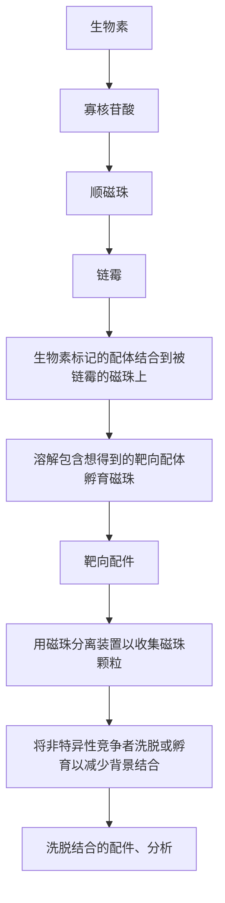

iii. 转移含有富集的 DNA 磁珠的上清至一个单独的 1.5mL 的离心管中。

iv. 重复步骤 80.i～iii 以更好地回收 DNA 磁珠，将两次的溶液（共  $1400 \mu L$ ）合并在一起。

v. 弃掉含富集磁珠的离心管。

vi. 依旧通过离心沉淀富集的 DNA 磁珠。

vii. 弃掉上清，用  $1 \, mL \times$  复性缓冲液洗涤富集 DNA 磁珠。弃掉上清液，不要碰到磁珠。

viii. 再用 1mL 1× 复性缓冲液重悬磁珠以完全中和溶解液，如上离心，弃掉上清液，不要碰到磁珠。

ix. 重复步骤 80.viii 2 次，共洗涤 3 次。

x. 弃掉最后一次洗涤液，加入  $200 \mu L$   $1 \times$  复性缓冲液 TW。

## 测序引物链接反应

81. 各个含磁珠的离心管中加入  $50 \mu L$  测序引物，涡旋 5s。

82. 将离心管放置在  $65^{\circ}$ C 加热块上 5min，冰上 2min。

83. 加入  $800 \mu L$   $1 \times$  复性缓冲液，按照之前的方法沉淀磁珠，弃掉上清。

84. 用 1mL 1×复性缓冲液洗涤磁珠一次，涡旋，离心，弃掉上清。

85. 重复步骤 84，洗涤 2 次。

86. 用  $950 \mu L$   $1 \times$  复性缓冲液 TW 重悬磁珠。

87. 根据说明书，用库尔特计数器计算出  $3 \mu L$  溶液所含有的磁珠数。

磁珠的数目因 emPCR 及富集的效率而不同。

88. 将带有克隆扩增的、富集的 sstDNA 文库的磁珠储存于  $4^{\circ}$ C。

89. 用干净的吸液纸擦洗试验台表面，吸液纸扔入垃圾桶。

90. 用下面物品清洗工作台:

\- $10\%$ 漂白液

\- DNA Away

\- 棉签（酒精擦拭巾）

将用过的纸巾丢入垃圾篓。

## 方案 17 Roche/454 测序:执行一个测序运行

该方案叙述:①用于 Prewash 运行的 sstDNA 文库（经过克隆扩增和富集的）的准备(见方案 16)；②测序反应中 PicoTiter Plate（PTP 板）的准备，具体的操作详见 454 Life Sciences Titanium XLR Sequencing System 说明书。注意:建库（见方案 15）和 emPCR（见方案 16）的准备工作对于 454 FLX 测序系统同样适用，二者只是循环次数和读长有区别。如果使用 FLX 测序系统有更好的预期效果，则可以参照厂家提供的针对 FLX 的操作手册进行。

## 材料

为正确使用本方案中的器材和危险试剂，必须查阅相应的材料安全数据表并咨询所在机构的环境卫生和安全办公室。

## 试剂

漂白剂 (10%)

去核酸试剂

乙醇（50%）

454 Life Sciences Titanium XLR Sequencing 试剂盒

试剂盒 1:

腺苷三磷酸焦磷酸酶（Apyrase）

磁珠缓冲液添加剂

对照组 DNA

dATPs

DTT

酶珠

Insert w/assorted 缓冲液

聚合酶

聚合酶辅助因子

试剂盒 2:

磁珠缓冲液

Prewash 缓冲液

试剂盒 3:

吸管

试剂盒 4:

CB 缓冲液（5 瓶，4℃放置 48h 后，过滤并室温放置）

试剂盒 5:

Prewash 管

试剂盒 6:

包装珠子

试剂盒 7:

载珠片

密封垫

PicoTiter Plate (PTP 板)

SparKLEEN 实验用洗涤剂

sstDNA 磁珠，前期制作的（见方案 15 和方案 16）

Texwipes（酒精擦拭巾）

吸液垫

去离子蒸馏水

## 设备

磁珠沉淀装置

磁珠沉淀装置底座

磁珠沉淀装置平衡锤

密封垫

离心机

离心机微型板托盘

离心机吊篮

锥型管(50mL)

各种规格的吸头

手套

无尘擦镜纸

磁力架（MPC）

纸巾

PicoTiter Plate (PTP)槽

不同规格的移液器，包括 50mL

预洗添加物

试剂槽

Zeiss 擦镜湿纸巾

## 方法

## 实验室和试剂准备

1. 使用下列物品清洁工作台:

- 10%漂白剂
- 去核酸试剂
- 酒精擦拭巾

使用过的纸巾和湿巾要放入废纸篓里，工作台要用吸液垫擦拭。

2. 将冷冻保存的 Sequencing Reagents Insert 试剂盒取出。

聚合酶及聚合酶辅助因子需在-20℃放置。

3. 打开包装袋，将试剂在室温条件下放置 2～3h 使其解冻，或者放在盛有水的水槽中进行解冻，但是要保持试剂盒的直立，并且避光放置。
4. 将瓶装的磁珠缓冲液放在冰上。
5. 按照下面的方法过滤 5 瓶 CB 缓冲液:

i. 需要一个 1L、0.22μm 孔径的 Stericup 滤器。
ii. 将滤器安装在真空泵上。
iii. 过滤 CB 缓冲液。
iv. 在过滤缓冲液时，请用去离子水清洗原瓶。
v. 将过滤后的缓冲液 CB 转移至清洗后的原瓶。
vi. 用标有刻度的吸管，将从第 5 瓶得到的 44mL 过滤后的 CB 缓冲液转移到 50mL 的 Falcon 管中，并放置于冰上冰浴。

6. 当 Sequencing Reagents Insert 完全解冻之后，将其转移至  $4^{\circ}$ C 冷藏，直到使用。

注意储存时间不要超过8h。

## 预洗涤运行

7. 将 GS FLX Sequencing 试剂盒和 GS PicoTiter Plate 试剂盒取出，-20℃保存的试剂转移至冰上，4℃保存的试剂放于常温下。但是清洗液 2 和磁珠缓冲液 1 需要 4℃保存。
8. 点击上右上角的 “X” 关闭上一次测序运行的窗口。
9. 窗口关闭后，通过双击 “SystemStop” 图标使系统停止，让它再运行，然后再停止。
10. 双击 “System Start” 图标，等待灯光颜色变成橙色并停止闪烁。
11. 打开外部门，抬起吸管架。取出 Insert cassette，旋转试管架。

12. 将试剂槽中试剂瓶里残留的液体倒掉，并冲洗 Insert cassette。

13. 用纸巾将试剂槽的表面擦干。

14. 用 $50\%$ 乙醇对试剂槽进行清洗。

15. 更换所有吸管。

i. 移除（逆时针）所有已使用的吸管。

ii. 安装（顺时针）新的吸管（4个长的在左侧；8个短的在右侧）。当听到咔哒声时停止旋转。

iii. 旋转吸管至水平位置。

16. 准备 Prewash 试剂盒:将 Prewash cassette insert 分装至 8 个小管（右侧）及 4 个大管（左侧）中。

17. 用 Prewash 缓冲液将管子填满，放于试剂槽中，小心将吸管放低并关闭外部的门。

## 启动预洗涤运行

18. 如果 “Instrument Run” 窗口没有打开，请双击 “GS Sequencer” 图标。

19. 确保用户名是 “adminrig”，然后点击 “Sign In”。

20. 点击 “start”。

21. 当 “Instrument Procedure” 界面打开后，请进行如下操作:

$$
" \text {Prewash}" \rightarrow \text {Next}" \rightarrow \text {Start}"
$$

## PicoTiter Plate 装置的准备

22. 准备磁珠缓冲液 2: 将 $34 \mathrm{~mL}$ 的三磷酸腺苷焦磷酸酶（Apyrase）溶液加至盛有 $200 \mathrm{~mL}$ 磁珠缓冲液的瓶内，在瓶身做好标记后置于冰上。

23. 准备 PTP 板。

i. 去除 PTP 板托盘的盖子。

ii. 小心地用手指或塑料钳将 PTP 板从托盘中移出 (请勿触摸顶部的托盘)。

iii. 将 PTP 板放置在上述托盘上。

记录 PTP 板背面的 6 位数条形码供以后使用。

24. 将磁珠缓冲液 2 倒入托盘，直到 PTP 板完全被浸没。

25. 将 PTP 板在磁珠缓冲液 2 中室温下浸泡至少 10min，直到开始组装 Bead Deposition Device（BDD）（步骤 44）。

26. 从包装中取出磁珠装载垫，并用 SparKLEEN solution 进行清洗。然后用纳米级纯水进行第二次清洗，清洗完毕后放于纸巾上晾干。

## 孵育混合和 DNA 珠子的准备（样本）

27. 孵育混合和 DNA 珠子的准备:按照下表中的试剂比例进行混合，并放于 2 个 $1.7 \mathrm{~mL}$ 的离心管内，轻轻涡旋，短暂离心后收集底部的所有液体。

| 上样区大小 | PTP板规格 | 珠子缓冲液 | 聚合酶辅助因子 | DNA聚合酶 | 总体积/μL |
| --- | --- | --- | --- | --- | --- |
| 大(30mm×60mm) | 70mm×75mm | 785(×2) | 75(×2) | 150(×2) | 1010(×2) |

28. 确保得到足量 sstDNA 珠子。我们可以依据 emPCR 过程中的珠子数来确定所需体积。如果 sstDNA 库中珠子的浓度是 2000 珠子/mL，可选用下表中的体系。

这只是一个例子，你需要按照正确体系比例:

| 上样区大小 | PTP 板规格 | DNA 珠子数/区 | sstDNA 珠子(样品)/μL | 对照组 DNA 珠子数/μL |
| --- | --- | --- | --- | --- |
| 大(30mm×60mm) | 70mm×75mm | 90 0000 (×2) | 450 (×2) | 18 (×2) |

29. 涡旋并混匀 sstDNA 库磁珠，取适量的体积转移至 2mL 的管子中。
30. 取适量对照组 DNA 珠子加入到每个 sstDNA 管中（上表中第 5 列）。
31. 于转速 10 000r/min（9300 RCF）下离心 1min，管子 180° 旋转后再离心 1min。
32. 保留 $30 \mu \mathrm{L}$ 的上清液, 其余丢弃 (DNA 珠子数量依据缓冲液的要求决定)。

下面我们以浓度为 2000 珠子/ $\mu$ L 的 sstDNA 库为例。

| 上样区大小 | PTP板规格 | 总体积/μL | 移除/μL | 剩余/μL |
| --- | --- | --- | --- | --- |
| 大(30mm×60mm) | 70mm×75mm | 233(×2) | 203(×2) | 30(×2) |

33. 移除上清液，注意不要接触磁珠。

34. 按照下表所示，吸取适当体积的 DNA bead incubation mix，加入至含 DNA 珠子的管中并涡旋。保留剩余的 DNA 磁珠以备用。

| 上样区大小 | PTP板规格 | DNA珠子/μL | DNA bead incubation mix/μL | 总体积/μL |
| --- | --- | --- | --- | --- |
| 大(30mm×60mm) | 70mm×75mm | 30(×2) | 870(×2) | 900(×2) |

35. 把样品放在转子（rotator）上，室温下孵育 30min。

## 包装珠子的准备

36. 准备包装珠子。

i. 涡旋包装珠子。
ii. 将 1mL 的磁珠缓冲液 2 加入到装有包装磁珠的管中，涡旋直至充分均匀悬浮。
iii. 10 000r/min（9300 RCF）离心 5min。
iv. 小心去除上清液，不要接触到珠子。

37. 重复步骤 36 两次清洗磁珠。
38. 清洗三次以后，加入磁珠缓冲液 2（550μL/管），涡旋直至充分悬浮。
39. 用一个移液器分别从每个管中吸取 $360\mu \mathrm{L}$ 重悬的包被珠子，分别加入 $2\mathrm{mL}$ 的管子中。再向每个管子中加入 $80\mu \mathrm{L}$ 剩余的DNA bead incubation mix（来自步骤34）。
40. 把管子放在转子中旋转 15\~20min 备用。

## 酶珠子的准备

41. 涡旋酶珠子并开始使用磁力架（Maghetic Particle Collector，MPC）收集珠子。

i. 把盛有酶珠子的管子在磁力架上放置 30s，使珠子沉降。翻转磁力架（MPC）几次，将可能残留在管帽里的珠子冲洗下来。再放置 30s 使珠子沉降。
ii. 去除上清液，小心不要让微量移液器吸头接触到珠子。
iii. 从磁力架中移除管子。

42. 清洗酶珠子三次, 具体步骤如下:

i. 向每管酶珠子中各加入 1mL 磁珠缓冲液 2，并涡旋使其混合均匀。
ii. 将管子在磁力架（MPC）上放置 30s，使珠子沉降。翻转磁力架（MPC）几次，将可能残留在管帽里的珠子冲洗下来。再放置 30s 使珠子沉降。
iii. 去除上清液，注意请不要让吸头接触到珠子。
iv. 将管子从磁力架（MPC）上移开。

43. 清洗三次后，加入起始量的磁珠缓冲液 2（1000μL/管），涡旋使沉淀重悬。放在冰上，保持酶珠子的悬浮。

## 珠子分解装置（Bead Deposition Device，BDD）的组装

44. 将浸泡的 PicoTiter 板（PTP）从包装中取出，用无尘纸擦拭 PicoTiter 板的背面。

45. 将 PicoTiter 板放到 BDD 基座上，确保 PicoTiter 板上的缺口角与 BDD 基座对齐。

i. 将洗净、干燥的垫圈扣紧在 BDD 基座上。

ii. 把 BDD 盖在组装好的 BDD 基座/PicoTiter 板/垫圈顶部。

iii. 将 BDD 基座的两个把手卡在 BDD 顶部的凹槽里，保证密封。

## 测序运行

## 湿润 PicoTiter 板

46. 每个加样区域应根据所使用的加样垫圈的规格加入一定体积的磁珠缓冲液 2:

| 上样区大小 | PicoTiter 板规格 | 加样体积/μL |
| --- | --- | --- |
| 大(30mm×60mm) | 70mm×75mm | 1860(×2) |

47. 将组装好的 BDD 和 BDD 平衡物放入离心机吊篮，检查并确认将吊篮对称放置在转子上。检查 microplate carriers 放置是否正确。

48. 2640r/min（1254RCF）离心 5min。

当准备好下一步之后再去掉 PicoTiter 板中的磁珠缓冲液 2。

## 分解第 1、2 层珠子（DNA 和包装珠子）

49. 取出装有 PicoTiter 板的 BDD，用吸头吸出并丢弃内部所有的磁珠缓冲液 2。

50. 加 $960 \mu \mathrm{L}$ 磁珠缓冲液 2 到 DNA mix 管子中, 涡旋 DNA beads mix 管子 20s, 将管子快速离心, 使液体从收集管中流下。

51. 反复吹吸 3 次使珠子重悬，在 BDD 板每个区域加注  $1860 \mu L$  bead mix。

52. 将 PicoTiter 板静置在 BDD 里 10min，使 DNA beads 沉降到板子上。

53. 取出 BDD 板，用吸管将每个区域内的上清液吸出，分别加入 2mL 管子中。

54. 将盛有上清液的管子于 10 000r/min（9300RCF）离心 1min。

55. 用吸管吸取 $1460\mu \mathrm{L}$ 上清，注意不要接触到磁珠，并加入到装有 $440\mu \mathrm{L}$ 包装珠子的管子中，涡旋混匀。

56. 从每个管子里吸取 $1860 \mu \mathrm{L}$ packing beads mix, 加入到 BDD 板的两面。

57. 以转速 2640r/min（1430RCF）离心 BDD 板 10min。

离心期间可以进行仪器和测序试剂的准备（见步骤70～84）。

## 分解第 3 层珠子(酶珠子)

58. 涡旋清洗过的酶珠子，确保混匀。

59. 在两个 $2\mathrm{mL}$ 的管子中，按下表所示比例混合酶珠子和Bead buffer 2，并上下吹吸珠子多次，确保混合均匀。

| Kit | 酶珠子/μL | 磁珠缓冲液 2/μL | 总体积/μL |
| --- | --- | --- | --- |
| 70×75 | 920(×2) | 980(×2) | 1900(×2) |

60. 涡旋确保混合完全，得到均匀的悬浮液。

61. 待包装珠子层离心结束后，将 BDD 板从离心机中取出，从包装珠子层吸弃上清液。

62. 取总的稀释的酶珠子上清液 $1860 \mu \mathrm{L}$ (步骤 59, 表格最后一列)。

63. 用吸管吹吸 3 次使其重悬，并将珠子上清液注入到 BDD 板中，重复操作加满 BDD 每个区域。

64. 待所有区域都加满后，将 BDD 板 2640 r/min（1430 RCF）离心 10min，转速同上。
使用这 10min 的时间完成机器准备（见步骤 70～84）。

## 运行测序:工具准备

65. 确保预洗涤运行完成后，打开外门，将吸管架完全抬起。
66. 从机器的前方取出试剂槽。
67. 将预洗涤的管子和架子从槽中拿出，清空管子后丢掉。
68. 用纸巾擦拭试剂槽的外表面。
69. 用纸巾蘸取 $50\%$ 乙醇，擦拭板子，并使之风干。

## 测序试剂盒的准备和上样

70. 将 4 瓶 CB 缓冲液放到试剂槽里，打开瓶盖并分别加入 $1 \mathrm{~mL}$ DTT，盖上瓶盖，轻轻涡旋混匀。
71. 将 $4^{\circ} \mathrm{C}$ 保存的试剂取出, 放置于载有焦磷酸酶 (黄色标签) 管子的试剂槽上。
72. 取  $164 \mu L$  焦磷酸酶到含焦磷酸酶缓冲液的管子里，涡旋混匀。
73. 加 1.5mL dATP 到含 dATP buffer 的瓶子里（紫色标签），涡旋并使其混匀。
74. 去掉所有的盖子，把试剂槽放在仪器里，大的瓶子放在右边，小的管子放在左边。小心地降低吸管架高度，关上外门。

## 加载 PicoTiter Plate

75. 在软件中选择 “Unlock Camera Door”，残液将会被泵到废液瓶，门将自动解锁，然后手动打开门。

如果打开相机盖后 PicoTiter 板暗盒没有完全清空残液，那么盖上相机盖，等待 5s，重新打开相机盖弃去残液。重复上述步骤直到没有任何液体残留在盒子内。

76. 按压 PicoTiter 板的弹簧闸会使 PicoTiter 板抬起，取下暗盒内用过的 PicoTiter 板。按照下列步骤清洗暗盒:

i. 将密封垫从暗盒中取出并丢弃。
ii. 将 50% 的乙醇喷洒在无尘纸上，擦拭晾干。
iii. 用 10% 的 Tween 重新擦拭，并晾干。
iv. 用湿润的 Zeiss 擦镜纸再次擦拭相机面板并晾干。

## 在计算机上运行建立

77. 当准备运行（Prep Run）完成后，一个小的“Run Complete”窗口会弹出。点击OK按钮并继续。

78. 在窗口操作以下步骤:

i. 点击 Start。
ii. 选择 Custom Sequencing Run 自定义测序反应。
iii. 选择 Next。
iv. 在 PicoTiter 板 ID 框内，将 PicoTiter 板背后的六位数字（见步骤 23.iii）输入到 ID 框内，选择 Next。

79. 在出现的两个对话框中，选择 Application 1。
80. 打开登录终端，登录 Linux 系统，并输入 ssh@linus170，按[Enter]键。
81. 输入密码，并按[Enter]键。
82. 输入 454Loader，并按[Enter]键，在打开的界面内输入对应的信息。
83. 在 454 载入界面的底部，找到 “DRI Name” 按钮，输入从供给商得到的 DRI name。

i. 点击 “Add To Filled Region List” 按钮。确认窗口显示的信息正确，再次点击按钮。
ii. 窗口会再次显示信息，确认并点击 “Click Here to Generate Run PSE ID To Copy and Paste” 按钮。
iii. 上一步会生成一个 ID 号，选择、复制并粘贴到 “Instrument Procedure” 窗口的 “454 Run Name” 框内。

84. 完成程序设置:

i. 点击 Next 选择 “LR70” 框。
ii. 点击 Next 选择 2 Region。
iii. 点击 Next 选择 100 Cycles。
iv. 点击 Next 选择合适的分析方法。
v. 点击 Next，再次点击 Next。

软件准备就绪。

## 安装 PicoTiter Plate 到机器上并开始运行

85. 待第三层珠子离心结束后（步骤64），从离心机上取下BDD。

86. 轻轻吸取并丢弃第二层珠子的上清。

87. 按照以下步骤将 PTP（Pico Titer Plate）从 BDD 中取出:

i. 向下旋转 BDD 的把手。
ii. 小心地取下 BDD 的盖子。
iii. 轻轻提起垫圈。
iv. 取下 PTP，注意只能接触边缘位置。

88. 将 PTP 安装到暗盒里。

89. 按照下列方法安装密封圈:

i. 确认方形区域的密封圈朝上，将其放入暗盒凹槽内。
ii. 如果有必要的话，戴手套轻叩密封圈，一定不要用任何东西重击密封圈。
iii. 将 PTP 卡在暗盒内。
iv. 点击窗口底部的 Finish 键退出窗口并且开始运行。

90. 清理准备区

i. 将吸液垫晾于桌面（可丢弃于垃圾筒中）。
ii. 用下列方式清洗工作台表面:

- 10%的漂白剂
- DNA Away
- 酒精棉球

iii. 将用过的纸巾和湿巾丢弃在垃圾筒内。

## 方案 18 结果有效性确认

下一代测序技术已经开启了全新的研究领域，但要清醒地认识到这些新技术产生的实验数据是存在误差的。在执行严谨而熟练的操作，以及选择适当覆盖倍数的条件下，成熟的下一代测序平台（454、Illumina 及 SOLiD）均仅有很低的错误率（大约 1000 万个碱基出现一个错误）。然而，受分析错误的影响，测序的错误率可能增加，这些分析错误包括测序片段被错误地匹配到参考基因组上、扩增过程中引入的碱基替换，以及未能去除 PCR 反应中产生的包含同样错误的重复片段。这些问题在大规模的实验中可能会被放大，导致在最终的 DNA 序列中存在大量的错误。对于研究人员来说，注意以下几点至关重要:①知晓这些错误；②了解错误发生的原因；③采取过滤策略，去除已知来源的错误。

验证下一代测序的结果也十分重要。有两种方法可用于下一代测序结果的验证，分别为统计验证、对特定感兴趣的结果进行确认。

## 统计验证

统计验证的意思是随机选择变异位点，使用相同的或者不同的测序方法重新进行测序（参见方案2和方案3中的毛细管测序）。或许将来重复测序试验是不必要的，但现在这似乎是当前测序领域的标准。前些年研究人员倾向于验证毛细管测序的结果，使人们对于毛细管测序存在固有误差有了清醒的认识。

毛细管测序验证为下一代测序数据提供了严格的检验，但它的成本和通量方面的原因导致这种验证往往不切实际。重点数据（如从目标捕获区域获得的数据）的统计验证可以通过测定一定数量的随机变异体来实现，同时测定一些不变区域用于验证假阴性率。这些测序结果可以使用 PCR 结合毛细管测序进行验证。更大的数据集（外显子组或整个基因组）可使用大规模 PCR 或液相捕获，然后用 Roche/454、Ion Torrent、Pacific Biosciences CCS 或 MiSeq 平台进行测序。

统计验证的另外一种重要形式是使用测序确定的多态性基因型与来源于阵列的基因型数据之间的交叉验证。正如上文所述，在全基因组和外显子捕获的测序中，最好对同一样品进行 SNP 阵列分析作为验证。阵列和测序数据之间的相关性包括:①对于假阴性现象和测序深度有很好的提示作用；②可能发现样本弄混的情况。然而，阵列结果并不能确定假阳性的情况。因此，要估计假阳性的数量，由下一代测序得出的一系列随机变异应用 PCR 和毛细管测序验证，如果存在大量变异，则应采用液相捕获技术结合适当规模的测序平台加以解决（所选方法由验证位点的数目决定，见下文）。

正如在本章的导言部分所述，测序技术正在发生变革。令人特别感兴趣的是，针对基因组小区域的新测序方法的诞生，以及新的个人基因组测序仪如 Ion Torrent 和 MiSeq 的出现。这些仪器使快速高质量评估变异成为可能，同时可以消除对毛细管测序验证方法的需求。由于这些测序技术具有互补性，因此由 HiSeq 测序仪发现的大量变异可由像 Ion Torrent 这样的小型测序仪进行验证。

另一种验证方法是对特定感兴趣的结果进行确认。对于具有生物学意义的变异进行额外验证在时间和费用上都非常值得，这样可以避免对假阳性变异结果进行大量的进一步实验。

生物学指标也可以用来帮助识别错误率。例如，当对大量个体进行测序时，在样本中出现百分比较高的变异（如 $5\%$ 或者更高），其假阳性的可能性明显比那些罕见的变异低。虽然这并不意味着罕见的变异不是真正的变异，但这些罕见变异更有可能是由于测序错误引起的，而不是存在于测试样本中的共有变异。同样，在进行家系分析时，非孟德尔事件的存在可能是由于测序错误造成，因此，至少一个区域的序列应使用不同的测序技术进行验证。

总之，下一代测序数据与新数据分析方法结合来寻找新的生物学发现导致错误产生。研究人员必须认识和了解特定系统中的错误，采用持续发展的业界标准验证下一代测序技术发现的变异。因为这些技术都很新，随着我们更好地了解不同的分析方法所产生的错误类型，测序领域的通行方法很可能将继续改进——至少在短期内会是如此。

## 方案 19 测序数据的质量评估

下一代测序仪产生大量的测序数据，因此，每次运行测序时都进行质量监测十分关键，可确保仪器和测序试剂处于最佳性能。主流下一代测序平台上的质量评估非常相似，所有的平台都提供每个碱基的质量值，该值主要依靠信噪比进行评估。此外，在每次运行中还提供基本的测序指标，如片段长度、总数据量或测序平台特有的数据过滤。来源于标准库或者已知参考序列的对照样品的测序结果可以提供测序错误率和整体测序质量。在测序过程中，实时的测序指标往往会在屏幕上显示，提示测序过程中试剂或仪器性能可能存在的问题。每个平台的用户指南都提供了指标说明、问题解决方法和保持高测序质量的所有必要细节。通常情况下，数据质量的检验发生在测序的后处理阶段，主要是样品总体测序表现、接头污染、GC偏性、文库插入大小、重复reads、匹配质量及碱基识别的可靠性。我们这里以Illumina平台作为质量评估的具体例子。

对照样品的测序对于质量控制和故障诊断是非常有用的。最常见的对照是掺入Illumina公司的PhiX对照文库。每个lane中加入少量（一般为 $1\% \sim 3\%$ ）的PhiX库及目的测序样品。Illumina的实时分析软件（RTAv1.10）提供实时碱基识别、质量值验证及PhiX库的结果比对情况。每次测序的总结报告既可以在测序设备上直接观察，也可以在报告被传递到辅助服务器上时从报告文件中解析。对照样品的测序结果可以用于评估仪器功能与试剂质量。对于一个pair-end的100次循环测序，比对到参考基因组后PhiX库每个片段的错误率应 $< 1\%$ （片段长度较短的应产生更少的错误）。虽然read2结果文件（反向测序）的错误率普遍稍高，但如果仪器工作正常，错误率与read1（正向测序）相差不应太大。

RTA 软件和 CASAVA 软件也提供总结报告、簇密度图、信号强度图、质量值图和错误率图，这些图表提供了一系列详细的质量指标（见 CASAVA v1.8 User Guide 第 2 章“运行质量解释”）。在运行过程中，可以查看各种图形报告，该报告包含 flow cell 上的 read、循环、lane、tile 的相关信息。簇密度图可以显示样品加载量的多少，或显示簇生成失败。簇过密会导致簇匹配故障，并会导致 Illumina 的信噪比质量过滤失败；而簇稀疏则会使数据产量低。监测 flow cell 每个循环的信号强度与聚焦效果可以评估 4 种染料是否均匀掺入，并检测由于试剂流动受阻、相机或激光故障、气泡或其他表面障碍导致的信号丢失。碱基识别质量图往往可作为测序运行表现的早期指标。测序片段 3'端的碱基测序质量往往略有下降，但良好的测序结果中整条序列的碱基质量值都应该在 30 以上。同理，如果测序片段比对到参考序列上，观察不同碱基位置的错误率可以确定后处理过程中是否有必要剪切 3'端片段。Summary.htm 文件中包含对每个 lane 或每个样品运行情况的统计及详细的概述，包括簇密度、通过 Illumina 质量过滤的簇的百分比、碱基质量不低于 Q30 的百分比、比对与错误统计、信号强度，以及相位超前与相位延迟率。在非常高的簇密度下，测序片段通过过滤的比例趋于下降，但一般在推荐密度范围内的通过过滤比例应在 80% 左右。正常情况下，应获得较高百分比（约 80%）的 Q30 碱基，同时有较大比例的片段（约 80%）应以预期的方向匹配到参考序列上，并且错误率应该是很低的（注意，多态性和结构变异会影响比对和错配率）。每对片段的相位超前与延迟百分比均应低于 1%。该值过高可能表明试剂发生化学问题（流量问题、试剂质量等）。read1 和 read2 统计信息有明显区别可能表明发生了末端配对模块或模板再生故障。保留在运行过程中拍摄图像的“缩略图”相当有价值，如果在任何特定的 lane、tile 或循环中发现数据质量下降，通过手工检查图像往往可以定位或确认问题。CASAVA v1.8 Users Guide 提供了 QC 图和运行报告的例子，对各个参数做了说明，对每个指标能够普遍接受的标准给出了提示。

FASTQ 文件(使用的 Sanger 质量值编码方式)由 CASAVA v1.8 生成(参见 CASAVA v1.8 Users Guide 第 3 章 “BCL 转换”)。FASTQ 文件是一种普遍被接受的输入文件格式，很多下游分析工具使用这种格式进行组装、比对、寻找变异。基本 Sanger 格式的 FASTQ 文件是一种包含 4 行记录的、紧凑的文件格式。第一行为标题行，然后是测序片段序列，第三行为另一个标题行，最后是碱基的质量值（分数由质量值+33 的 ASCII 码进行编码）。仪器上的 Real Time Analysis 软件（RTA v1.10）所产生的 .bcl 文件以二进制格式包含了碱基识别的质量值信息，.bcl 文件传输到辅助服务器后转换为 FASTQ 格式。如果在每个 lane 中有多个样品的测序并使用了 Illumina 3 的测序片段索引方法（barcode 标记），那么样品测序数据可以使用 CASAVA v1.8 软件进行分离。分离过程使样品文件依照索引排序分开，同时对于每一个特定的索引提供摘要信息（每个索引的片段数、每个索引的质量值等）。

有关 Illumina 的检查运行质量的分析流程与工具的最新信息，请参阅 Illumina CASAVA v1.8 Users Guide；HiSeq 仪器请参阅 RTA v1.10/HCS v1.3 Guide；GAIIx 仪器请参阅 RTA v1.9/SCS v2.9 Guide。

## 方案20 数据分析

## 变异体发现分析

发现变异体的首要步骤是下一代测序数据与参考基因组的比对。可以从测序仪器的生产公司、SourceForge或其他开源网站，或者与同行沟通来获得大量的比对算法。目前，Burrough-Wheeler算法（bwa）较受欢迎。大多数比对算法产生一个匹配质量指标，该指标可被下游变异检测算法识别，因为测序数据错误匹配到参考序列（可由低的匹配质量提示）可以很容易地被错误地检测为变异。正如本章的导言部分中提到的，变异检测需要不同的算法，算法的数量和类型由想要发现的变异类型所决定，其中的一些方法参见第8章。

## 从头组装

下一代测序数据的另一种常用的应用方式为无需使用参考序列的基因组组装（即所谓的“无向导”组装）。短的 reads 组装可以包括一个或多个测序类型/平台的数据，并可以结合 paired-end 数据和不同插入长度的 mate-pair 数据，以期拼接出最长序列。病毒和细菌的基因组组装相对容易和完整，但大型哺乳动物的基因组太复杂，有太多的重复序列，因此无法组装完全，甚至无法部分组装成完整的染色体。

## 信息栏

## 生物素

生物素（维生素 H，又名辅酶 R；相对分子质量 244.31）（化学结构，见图 1）是一种可以高亲和力结合亲和素（avidin）的水溶性维生素。亲和素是具有 4 亚基的糖蛋白，在卵白液中含量丰富（综述见 Green 1975）。亲和素的每个亚基可以结合一个生物素分子，所以 1mg 的亲和素可以结合约 14.8μg 的生物素。结合形成的复合物的解离常数约为 1.0 ×10$^{-15}$mol/L，对应的结合自由能为 21kcal/mol。由于结合如此紧密，解离速度非常之慢，在 pH7.0，复合物半衰期为 200 天（Green and Toms 1973）。因此从实际意义上说，亲和素与生物素的结合几乎是不可逆的。另外，亲和素-生物素复合物对离液剂（3mol/L 盐酸胍）及极端的 pH 和离子强度具有抵抗力（Green and Toms 1972）。

chemical

Chemical structure of a disaccharide with carboxylic acid and methyl groups

图 1 生物素的结构。

生物素可以连接到许多蛋白质和核酸上，这种连接通常不改变它们的性质。亲和素（或链霉亲和素、非糖基化的原核等同物质）可以连接到报告酶上，通过酶反应定位和/或定量亲和素-生物素-靶标物质复合物。例如，在酶联免疫检测中，生物素化的抗体可以结合到固定化抗原上，已经连接了亲和素-生物素的辣根过氧化物酶或碱性磷酸酶就可以检测一级抗体的量（Young et al. 1985；French et al. 1986）。在核酸杂交中，生物素标记的探针可以被亲和素标记的酶或荧光物质所检测。生物素衍生物可用于标记蛋白质、多肽及其他分子（综述及参考文献见 Wilchek and Bayer 1990），它们包括:

- 多种 N-羟基琥珀酰亚胺生物素酯，可与蛋白质或多肽中的自由氨基反应形成酰胺（N-羟基琥珀酰亚胺作为副产品得到释放）。
- 具有光反应活性的生物素（光敏生物素），可被汞蒸气灯照射（350nm）激发，通过形成一个芳香硝基中间化合物，非特异性地与蛋白质、寡糖、脂类及核酸反应。
- 吲哚生物素，可特异性地与巯基反应，产生一个稳定的硫酯键。
- 肱化生物素，可与碳水化合物中经温和氧化产生的醛基反应。
- 带长臂的生物素衍生物（如 $\varepsilon$-氨基己酰-$N$-羟基琥珀酰亚胺生物素酯），这些长臂提高了亲和素与生物素化的大分子之间的反应效率。

生物素与亲和素之间的强力反应提供了一个桥梁系统，使天然状态下没有亲和力的分子能够紧密连接在一起。

## 核酸的生物素标记

从商业途径获得的生物素化核苷酸是多种聚合酶的有效底物，它们包括大肠杆菌的DNA聚合酶、Taq酶、T4噬菌体聚合酶等DNA聚合酶，以及T3和T7噬菌体的RNA聚合酶，因此生物素标记的核酸几乎可以用于所有体外制备放射性标记探针的方法（缺口平移、PCR末端填补、随机引物标记和转录标记）。另外，生物素加合物可通过化学方法引入核酸和寡核苷酸，这包括 5' 氨基基团的连接。在常规氰乙基亚磷酸胺法合成寡核苷酸的最后一步接上氨基基团，带氨基的寡核苷酸可用商业来源的 N-琥珀酰亚胺-生物素酯进行标记。

如果标记核酸中生物素的量不超过一定的比例，则标记探针结合靶序列的比率与未标记探针大致相同。标记时引入过多的生物素残基不太可能增加检测的敏感性，因为结合到单个生物素残基上的一个典型的亲和素-报告分子（如亲和素-碱性磷酸酶）将覆盖50～100个核苷酸。

如果生物素基团与核酸之间的连接序列足够长，能够消除空间位阻并使生物素基团有效地深入到亲和素上的结合位点，那么用亲和素-报告分子系统检测生物素标记探针的效率将大大增加。有多家公司出售带连接序列的生物素化核苷酸，这些连接序列含有6个或更多的碳原子。

可以简单地将光敏生物素和双链 DNA 或单链 DNA 或 RNA 混合，然后用可见光照射激发（350nm），从而将生物素引入核酸（Forster et al. 1985），这种方案制备的核酸中平均每 200 个左右核苷酸带有一个生物素残基。这种适当水平的修饰当然不会影响探针与靶序列的杂交，而且足够用于从哺乳动物 DNA 的 Southern 杂交中检测出单拷贝序列（Mcinnes and Symons 1989）。生物素标记探针的优点如下:

- 可长时间保存不丧失活性。
- 不需特殊处理方法。
- 生物素标记探针的信号可通过多种亲和素-报告分子进行检测, 包括可用化学发光和荧光检测的报告分子。这意味着单个探针可用于多种不同的用途（例如，同时用于 Southern 印迹和原位杂交）。
- 生物素标记探针可以用亲和素柱或亲和素包被的磁珠亲和纯化回收。

注意，引入大量的生物素基团将导致核酸电泳移动速度下降。例如，每加入一个生物素-14-dCTP相当于给核酸增加了1.75个半胱氨酸的分子质量（Mertz et al. 1994）

## 参考文献

Forster AC, McInnes JL, Skingle DC, Symons RH. 1985. Non-radioactive hybridization probes prepared by the chemical labelling of DNA and RNA with a novel reagent, photobiotin. Nucleic Acids Res 13:745–761.

French BT, Maul HM, Maul GG. 1986. Screening cDNA expression libraries with monoclonal and polyclonal antibodies using an amplified biotin-avidin-peroxidase technique. Anal Biochem 156: 417–423.

Green NM. 1975. Avidin. Adv Protein Chem 29: 85–133.

Green NM, Toms EJ. 1972. The dissociation of avidin-biotin complexes by guanidinium chloride. Biochem J 130: 707–711.

Green NM, Toms EJ. 1973. The properties of subunits of avidin coupled to Sepharose. Biochem J 133: 687–700.

McInnes JL, Symons RH. 1989. Preparation and detection of nonradioactive nucleic acid and oligonucleotide probes. In Nucleic acid probes (ed. Symons RH), pp. 33–80. CRC Press, Boca Raton, FL.

Mertz LM, Westfall B, Rashtian A. 1994. PCR nonradioactive labeling system for synthesis of biotinylated probes. Focus 16: 49–51.

Wilchek M, Bayer AE. 1990. Biotin-containing reagents. Methods Enzymol 184: 123–138.

Young RA, Bloom BR, Grosskinsky CM, Ivanyi J, Thomas D, Davis RW. 1985. Dissection of Mycobacterium tuberculosis antigens using recombinant DNA. Proc Natl Acad Sci 82: 2583–2587.

## 磁珠

自 1989 年被引入分子克隆以来（Hultman et al. 1989），磁珠（又名微球）已被用于多种目的，这包括 PCR 产物的纯化与测序、扣除探针 cDNA 文库的构建、DNA 结合蛋白的亲和纯化、感染细胞中穿梭质粒的回收和共价连接的寡核苷酸的杂交。尽管传统的技术也可完成上述任务，但这些老方法都非常烦琐且效率低下。磁珠有许多优点，可以提高操作速度，以接近自由溶液中的动力学速率进行反应。由于磁珠的这些特性，配体的结合只需要数分钟，而磁性分离仅需数秒，大多数情况下洗涤与洗脱可在 15min 内完成。

磁珠是无孔、单分散度、由聚苯乙烯和二乙烯基苯构成的超级磁性颗粒，含有一个磁芯（$8 \pm 2$）$\times 10^{-3}$cgs单位，直径约为 $2.8\mu \mathrm{m}$。不同类型的磁珠在其表面共价结合有不同基团（OH、$\mathrm{NH}_2$、$\mathrm{OH[NH_2]}$、COOH等），用于共价连接蛋白和核酸配体（见Lund et al. 1988）。但大多数研究者喜欢购买预先共价连接有链霉亲和素的磁珠（Lea et al. 1988），它可将吸附任何生物素标记的核酸或蛋白质吸附在表面（综述见Haukanes and Kvam 1993）。注意，磁珠的大小、结构及其结合的配体大小不同，磁珠的结合量也不同。不同商标的磁珠上共价结合的链霉亲和素的量不同，所以来自不同制造商的磁珠的结合能力也不等同。另外，有些牌子的磁珠可以回收重复使用，而别的只能在一次性使用后丢弃。一旦连接好后，标记的配体就可用来从溶液中亲和捕获和纯化靶分子。由于表面积非常大（5～8m²/g），磁珠在包被链霉亲和素后可结合相当多的生物素（>200pmol/mg）。而且，由于链霉亲和素与生物素之间高亲和力（$K_{\mathrm{ass}} = 10^{15} \mathrm{~L} / \mathrm{mol}$；Wilchek and Bayer 1988），两者结合的速度非常快，一旦结合就对极端的pH、有机溶剂和许多变性剂具有抵抗力（Green 1975）。严紧洗脱也不会导致连接上的配体从磁珠表面脱落，通过一轮亲和捕获富集倍数就可达到100000。磁珠主要的缺点是:①昂贵的价格；②需要一个有效的磁性颗粒分离装置。最好的这类装置包括一个或多个由铵-铁-硼构成的永久性磁铁，几家生产商以多种形式提供这种装置。

图 2 展示了用连接到磁珠上的生物素标记寡核苷酸配体亲和捕捉特异性 DNA 结合蛋白的一般程序。

flowchart

图 2 利用磁珠进行亲和选择和纯化。图中以一个 DNA 结合蛋白为例，给出了捕获特异性靶标配体的常规步骤。本例中生物素标记的配体是一段可能带有靶标蛋白结合位点的寡核苷酸，其与链霉亲和素包被的磁珠结合后，在含有靶标蛋白的溶液中温育。用磁性分离装置对磁珠进行分离收集，并用含非特异性竞争物的溶液反复洗涤磁珠。最后，洗脱结合的靶标配体并进行分析。

## 参考文献

Green NM. 1975. Avidin. Adv Protein Chem 29: 85–133.

Haukanes B-I, Kvam C. 1993. Application of magnetic beads in biosassays. BioTechnology 11: 60–63.

Hultman T, Stahl S, Hornes E, Uhlén M. 1989. Direct solid phase sequencing of genomic and plasmid DNA using magnetic beads as solid support. Nucleic Acids Res 17: 4937–4946.

Lea T, Vartdal F, Nustad K, Funderud S, Berge A, Ellingsen T, Schmid R, Stenstad P, Ugelstad J. 1988. Monosized, magnetic polymer particles:

Their use in separation of cells and subcellular components, and in the study of lymphocyte function in vitro. J Mol Recognit 1: 9–18.

Lund V, Schmid R, Rickwood D, Hornes E. 1988. Assessment of methods for covalent binding of nucleic acids to magnetic beads, Dynabeads, and the characteristics of the bound nucleic acids in hybridization reactions. Nucleic Acids Res 16: 10861–10880.

Wilchek M, Bayer AE. 1988. The avidin-biotin complex in bioanalytical applications. Anal Biochem 171: 1–32.

## DNA 片段化

大规模的全基因组测序依靠 DNA 随机打断策略，该策略的目的是构建一个重叠克隆文库，提供的克隆片段要涵盖整个基因组。通常采用机械剪切和酶切获得 DNA 片段，可精确控制操作得到想要大小的片段，这是本章描述的样品制备的标准操作。

市售适用于酶切制备样品的标准方法包括 Nextera System(Epicentre, 现在是 Illumina 公司的一部分) 和 NEBNext 双链 DNA 片段化酶 (New England Biolabs 公司)。Nextera System 依赖于 Tn5 转座酶的一个突变体，DNA 打断和加接头在一步反应中完成。NEBNext 系统由两种酶组成，共同在 DNA 双链上形成缺口；其中，一种酶在 DNA 模板的一条链上随机产生缺口；另一种酶识别缺口位点并切断在缺口处切断另一条链，产生双链断裂。

机械剪切有几种不同的方法，通常采用超声处理和雾化法。这两种方法均是在拉力的作用下首先使双链DNA分子展开，然后在双链DNA分子中心区断开磷酸二酯键骨架，从而导致DNA断裂。现在已有很多市售的、在精确控制条件下采用超声处理法自动打断DNA的设备，例如，Covaris提供一种利用高频声波能量打断DNA的设备，这种自动超声装置采用自适应聚焦超声（AFA）技术，该设备运用冲击波提供精确控制的脉冲能量打断DNA样品，获得所需大小的目的片段。

除了剪切方法以外，有时需要用限制性内切核酸酶或其他特殊切割方法打断 DNA。在其他情况下，如福尔马林固定样品、石蜡包埋组织切片、染色质免疫沉淀、年代久远的样品、降解样品中获得的 DNA，剪切是没有必要的，因为原始样品中 DNA 已经足够短。

(童贻刚 梁 龙 译, 梁 龙 童贻刚 校)

## 第 12 章 哺乳动物细胞中 DNA 甲基化分析

导言 | DNA 甲基化影响和揭示的生物学现象 730 各 DNA 甲基化检测方法的优点和局限性 734
DNA 甲基化检测的实验方法 732 展望 734

方案 | 1 DNA亚硫酸氢盐测序法检测单个核苷酸的甲基化 735 4 高通量深度测序法绘制哺乳动物细胞 DNA甲基化图谱 749  
2 甲基化特异性聚合酶链反应法检测特定基因的DNA甲基化 742 5 亚硫酸氢盐转化的DNA文库的Roche454克隆测序 760  
3 基于甲基化胞嘧啶免疫沉淀技术的DNA甲基化分析 745 6 亚硫酸氢盐转化的DNA文库的Illumina测序 765

信息栏 | 用于确定哺乳动物基因启动子区和编码区中 CpG 岛的公共软件 770 高通量亚硫酸氢盐深度测序数据的处理 772
亚硫酸氢盐测序和 MS-PCR 方案中用于扩增亚硫酸氢盐转化产物的引物设计 772