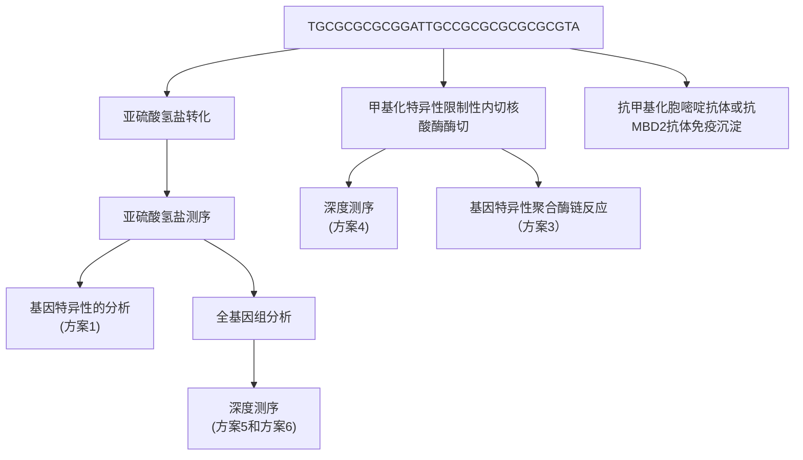
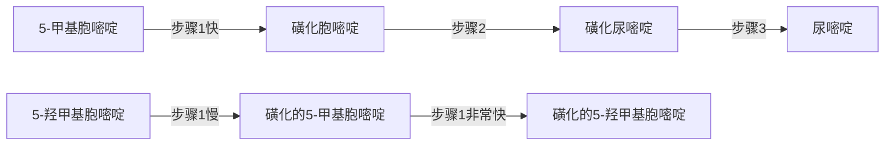
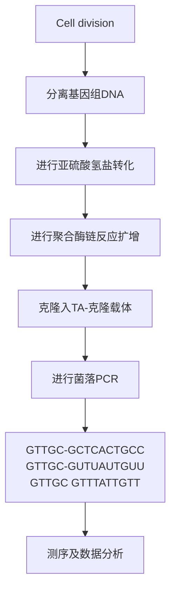
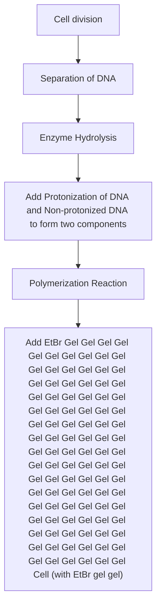

## 导言

DNA 甲基化修饰作为一种实验研究中最常检测的真核细胞表遗传改变，迄今已发表大量研究论文，并研发出了多种 DNA 甲基化检测方法。“甲基化组（methylome）”是指基因组中全部胞嘧啶的甲基化修饰情况。“甲基化组”一词在近年的文献中高频出现，反映出越来越多的科研人员正在从事相关领域的研究工作。有鉴于当前 DNA 甲基化研究中所检测到的实验样品尚局限于细胞群体中复杂表遗传修饰的一小部分，本章的部分读者可能会觉得现在使用“甲基化组”一词还为时过早。当前的 DNA 甲基化检测分析技术还有待进一步提高，本章将介绍用于研究胞嘧啶甲基化这一 DNA 化学修饰的主要方案及常规操作方法（图 12-1）。同时，也将讨论各种方法的优势和局限性。有关哺乳动物 DNA 甲基化的研究概况，可参见 Bird，以及 Klose 和 Bird 撰写的两篇综述（Bird 2002; Klose and Bird 2006）；有关 DNA 甲基化研究中的新技术新方法，可参见 Laird 的文章 (Laird 2010)。

flowchart

图 12-1 基因组 DNA 甲基化谱分析方法。

## DNA 甲基化影响和揭示的生物学现象

成年哺乳动物细胞基因组中，约 40% 的 CpG 岛二核苷酸序列的胞嘧啶 5 位碳原子 (5') 上发生甲基化共价修饰。生殖细胞发育过程中，大部分的甲基化修饰被清除；随后，受精卵中来自父本的基因组被进一步去甲基化。DNA 甲基化标志的重建发生在胚胎发育早期，而在出生时基本完成重建过程。细胞分化过程中建立不同的甲基化标志亚群，并在不同体细胞系中遗传，由此构建细胞分裂过程中的关于谱系定向（developmental commitment）的稳定“记忆”。X 染色体失活和基因印记这两种稳定的染色体特异性的基因沉默现象就是这种“记忆”最具代表性的表现。体细胞中可遗传的 DNA 甲基化修饰所介导的基因沉默还发生在含有散在分布重复元件的基因组广泛区域中。在启动子相关的甲基化胞嘧啶富集区，也称“CpG岛（CpG island）”部位，DNA甲基化通过与PcG蛋白复合体（polycomb group protein complex）的结合而起始并稳定致密染色质状态。发生在这些位点的组蛋白修饰能够募集DNA甲基转移酶，并同时激活这些相互作用蛋白，最终使得甲基化胞嘧啶标志遍布整个CpG岛。这些化学修饰的改变影响启动子附近的DNA序列，构成在体细胞中遗传的、对体细胞重编程敏感并能调节特异染色质状态的表遗传调控机制。正常发育过程或炎症等病理过程中会发生特异位点的甲基化标志缺失。DNA甲基化调控也发生在没有进行细胞分裂的细胞中。最为著名的例子是白细胞介素2（interleukin-2，IL-2）基因的启动子-增强子区域在T淋巴细胞激活后会发生去甲基化（Bruniquel and Schwartz 2003; Murayama et al. 2006)；海马的神经元可塑性基因（neuronal plasticity gene）reelin在机体恐惧状态(contextual fear conditioning)下会发生去甲基化和基因的转录激活(Miller and Sweatt 2007)。上述现象表明，DNA甲基化修饰是高度动态、能被环境因素诱导的反应过程。

简而言之，DNA 甲基化修饰就像是机体的动态二进制记录仪，未发生甲基化修饰的碱基可看成是二进制字符串中的 “0”，而发生了甲基化修饰的碱基就是 “1”，以此来记录基因组和环境之间的相互作用。鉴于生物学反应的高度复杂性/多样性，检测分析哺乳动物细胞中的 DNA 甲基化修饰情况，有可能揭示机体发育过程中因环境因素变化而导致的改变，并以细胞和组织特异性的方式反映机体生活史。由此，检测单个碱基水平的 DNA 甲基化修饰标志能够揭示发育过程中的事件，追踪正常或异常细胞，记录突发环境损害，并衡量细胞衰老（Shibata and Tavare 2006）。然而，基因组甲基化并不是绝对恒定的。由于 DNA 半保留复制过程中 DNA 甲基化修饰标志并不能完全遗传，因此会导致在原来的 DNA 甲基化模式上增加 “噪声” 干扰。在分裂细胞中发生的偶然复制失败和随机变异共同构成了由各个细胞的 DNA 修饰状态所组成的二进制字符串记录的细胞生物钟。

## DNA 甲基化和亚硫酸氢盐反应的化学过程

最为常见的 DNA 甲基化修饰是在 CpG 岛中的胞嘧啶上加入 5'甲基基团，以 mCG 表示。在干祖细胞中还检测到其他类型的胞嘧啶甲基化修饰，如 mCHG 和 mCHH（这里的 H 代表 A、C 或者 T）（Lister et al. 2009）。此外，也有研究发现神经元细胞中存在胞嘧啶的羟甲基化（hmCG）修饰（Kriaucionis and Heintz 2009）。

检测胞嘧啶甲基化的“金标准”是以亚硫酸氢钠处理转化DNA，而后对其进行测序。该反应利用了胞嘧啶和甲基胞嘧啶脱氨基作用的动力学差异:在适当的实验条件下，胞嘧啶脱氨并转化为尿嘧啶的速度显著快于甲基胞嘧啶。当脱氨基的DNA通过聚合酶链反应（PCR）扩增时，模板DNA中新生成的尿嘧啶残基介导胸腺嘧啶的掺入。因此PCR结束时，在扩增的DNA产物中未发生甲基化修饰的胞嘧啶位置会出现胸腺嘧啶残基；而原来DNA样本中发生了甲基化修饰的胞嘧啶位置将维持不变。由于亚硫酸氢盐作用下的5-羟甲基胞嘧啶脱氨速度与5-甲基胞嘧啶的脱氨速度类似，因此该方法无法区分5-羟甲基胞嘧啶和5-甲基胞嘧啶这两种不同的碱基化学修饰。Huang等（2010）研究DNA中三种不同形式的胞嘧啶发生亚硫酸氢钠修饰的动力学特征时发现:5-甲基胞嘧啶的脱氨率约比胞嘧啶脱氨的速度慢两个数量级；同时，5-羟甲基胞嘧啶能够快速转化为不易进行脱氨反应的胞嘧啶-5-亚甲基磺酸盐（CMS），因此当5-羟甲基胞嘧啶位于CC二核苷酸序列中时，CMS加合物的形成可能引发一些特殊的问题。分析当前已获得的实验结果，在检测 $5\mathrm{hmC}$ 碱基修饰时，持续存在的CMS加合物可能由于Taq聚合酶停顿而使得PCR的扩增产量降低，因而限制了亚硫酸氢盐化学法的使用。

## DNA 甲基化检测的实验方法

总体而言，通过 DNA 测序方法对每个碱基进行检测的方法能够对被修饰碱基进行更好的分析；但某些情况下，非测序检测方法更经济些。表 12-1 列举了常用的 DNA 甲基化检测方法。

表 12-1 DNA 甲基化检测方法一览表

<table><tr><td>甲基化依赖的处理方法</td><td>检测方法</td><td>检测类型</td><td>注释说明</td><td>消耗和时间</td><td>方案</td></tr><tr><td rowspan="5">亚硫酸氢盐转化 $^a$ </td><td>克隆的Sanger测序PCR产物Sanger测序</td><td>检测特异性位点检测特异性位点</td><td>检测单个碱基半定量评估DNA甲基化的平均水平;不很敏感</td><td>花费不多,耗时花费不多,速度快</td><td>方案1</td></tr><tr><td>甲基化特异性PCR发夹-亚硫酸氢盐测序甲基化芯片</td><td>检测特异性位点检测特异性位点检测多个位点</td><td>半定量检测双链的甲基化中到高度复杂;检测单链;有一定的杂交倾向</td><td>花费不多,速度快花费不多,速度快贵,耗时</td><td>方案2</td></tr><tr><td>直接焦磷酸测序</td><td>检测多个位点</td><td>中度复杂,高通量单个碱基分析</td><td>贵,速度快</td><td>方案5</td></tr><tr><td>靶捕获后新一代测序减少冗余后新一代测序</td><td>检测多个位点全基因组</td><td>全基因组搜索;高频位点单个碱基分析</td><td>贵,耗时贵,耗时</td><td>方案6</td></tr><tr><td>全基因组新一代测序</td><td>全基因组</td><td>全基因组测序;单个碱基分析</td><td>贵</td><td>方案6</td></tr><tr><td rowspan="3">亲和富集 $^b$ </td><td rowspan="3">质谱定量PCR芯片新一代测序胶依赖法芯片</td><td rowspan="3">检测多个位点检测特异性位点全基因组全基因组</td><td rowspan="3">高度复杂</td><td rowspan="3">花费不多,速度快花费不多,速度快贵,耗时贵,耗时</td><td rowspan="3">方案3</td></tr><tr></tr><tr></tr><tr><td>甲基化敏感的酶切 $^c$ </td><td>芯片新一代测序</td><td>多个位点或全基因组全基因组</td><td>分辨率低易受人为杂交影响</td><td>花费不多,速度快贵,耗时贵,耗时</td><td>方案4</td></tr></table>

a. 适用于单链 DNA，精确，重复性好,能检测单个碱基，可能引起样本明显降解。

b. 适用于单链 DNA（甲基化胞嘧啶免疫沉淀，MeC IP）或双链 DNA（MBD），需要大量 DNA 样本，分辨率相对较低，无法区分 5mC 和 5hmC。

c. 需要制备高质量的单链 DNA，可能因不完全酶切导致产生假阳性结果。

## DNA 亚硫酸氢盐测序法检测单核苷酸位点的 DNA 甲基化

最常用的胞嘧啶甲基化检测方法是对被亚硫酸氢钠修饰之后的 DNA 进行测序（方案 1）。该方法的优点是理论上能够监测每个候选胞嘧啶的甲基化状态；缺点是亚硫酸氢盐处理常导致 DNA 样本的片段化，使得持续可读的 DNA 链长度限制在 800 个碱基以内。

有针对性的亚硫酸氢盐测序法一般需要通过 PCR 技术对有限数量、感兴趣的基因位点进行扩增，然后用标准的 DNA 测序法检测分析这些 PCR 产物。另一个更令人感兴趣且成本更低的选择是使用 Sequenom 公司的 EpiTYPER 平台。EpiTYPER 技术将亚硫酸氢盐转化的 DNA 通过体外转录生成 RNA 分子，而后进行碱基特异性的切割和随后的对裂解片段的质谱分析。EpiTYPER 平台部分自动化，因此该平台非常适合于大量样品、中等大小 CpG 岛（48～96nt）的研究。在对人类 DNA 开展的研究中，常需要进行大量的 CpG 二核苷酸序列分析，此时 Infinium HumanMethylation 27 BeadChip 芯片（Illumina 公司）是一个很好的选择。该芯片有较高的覆盖率，价格尚可。该产品对亚硫酸盐转换的 DNA 进行检测，能够检测到与 14 475 个人类基因转录起始位点和 110 个 miRNA 启动子相关的 27 578 个 CpG 位点的甲基化状态。

## 通过甲基化特异性 PCR 检测特定基因的 DNA 甲基化情况

甲基化特异性 PCR（MS-PCR）技术是以亚硫酸氢盐转化后的 DNA 为模板，在适当条件下用两套不同的扩增引物对模板 DNA 进行扩增。其中一对引物能够扩增甲基化的 DNA；另一对引物则扩增未甲基化的 DNA（方案 2）。该方法尽管不能提供扩增 DNA 的单个碱基的修饰情况，但操作简便、灵活，实验成本低。

## 用抗体或甲基结合蛋白2免疫沉淀甲基化DNA

该检测方法首先利用能够特异性结合含有 5mC 的 DNA 的蛋白质或抗体对含有甲基化胞嘧啶的 DNA 组分进行区分和富集（方案 3）。这类方法最适合进行单链 DNA 的分离，同时在试验中常需要较多的 DNA 样本。正如 Laird 等所述（Laird 2010），参与反应的 DNA 量及亲和试剂的比例影响富集效率，并且基因组中的 5mC 密度改变也会对富集效率产生影响。由于免疫沉淀方法获得的结果受到各种试剂化学计量学的影响，通过预实验优化实验方案显得尤为重要。进行免疫沉淀之后，可通过多种分析方法获得 DNA 甲基化数据。如今已有多种研究采用了免疫沉淀后进行 DNA 芯片分析（MeDIP）的方法。在今后的研究中将免疫沉淀技术与高通量深度测序技术相结合，有可能进一步推进相关研究的进展。

## 通过限制性内切核酸酶法进行 DNA 甲基化整体分析

限制性内切核酸酶技术在位点特异性DNA甲基化检测和全基因组DNA甲基化分析中显示出巨大作用。使用单一限制性内切核酸酶对检测序列有一定的限制，通过组合使用多个限制性内切核酸酶能够将基因组区分为甲基化富含区和未甲基化区。Irizarry等（Irizarry2008）指出，作为DNA甲基化芯片检测的替代方法，用甲基化依赖性限制性内切核酸酶McrBC联合优化的生物信息学分析法（CHARM）所获得的结果，与用相同的样品进行的Illumina Infinium HumanMethylation 27 BeadChip芯片检测结果之间具有相当高的相关性（相关系数0.76）。该研究中评估的其他技术方法还包括MeDIP、HELP（Oda and Greally2009）和McrBC（未进行CHARM数据分析）等，它们的检测结果与Infinium数据的相关系数分别为0.38、0.48和0.63。有鉴于越来越多的研究者认为测序分析是研究甲基化敏感或甲基化依赖的限制性内切核酸酶消化获得的基因组区段的首选方法，本章对芯片检测方法未进行详细描述。

本章将讲述通过酶切使得基因组分成甲基化和非甲基化组分(Edwards et al. 2010)的全基因组 DNA 甲基化分析方案（方案 4）。由于此方法没有使用亚硫酸氢盐处理 DNA，因而能获得相对较长的 DNA 片段。此方法生成的末端配对文库中的 DNA 插入片段大小分别为 0.8～1.5kb、1.5～3kb 和 3～6kb。通常情况下，可以用 Applied Biosystems 公司的软件将末端配对结构定位到基因组上。此方法的基因组覆盖范围较广，研究成本相对可接受，并且能够对人类基因组中的重复序列元件进行甲基化状态分析。因为该方法获得的 DNA 样品能够覆盖相对较长的序列区域，所以在大多情况下能够获得哺乳动物基因组印记区域中有价值的链特异性信息。

## 高通量深度测序检测部分基因组或全基因组甲基化情况

第二代和第三代高通量测序平台（参见第 11 章）因为能够多次精细读取细胞基因组中每个基因位点的 DNA 甲基化修饰情况，在检测分析亚硫酸氢盐转化的 DNA 样本时显示出明显的优势。深度测序能够提供丰富而详尽的信息，特别是读取长度大于150个碱基的样本时（如Roche454平台）优势更为显著。方案5描述了使用Roche454平台对亚硫酸氢盐转换的DNA进行分析的方法步骤。Zeschnigk等(2009)报道了人类血液和精子样本中6000多个CpG岛的DNA甲基化状态。这些CpG岛的甲基化谱研究发现，同一位点在不同检测分析中常显示出不同的甲基化修饰模式，提示印记特异性甲基化或等位基因特异性调节模式仍有待进一步研究阐明。

高通量深度测序法的另一个优点是能够发现发生在经典的CpG二核苷酸序列以外的胞嘧啶甲基化修饰。方案6提供了一种利用Illumina平台分析亚硫酸氢盐转化的DNA样本的方法（MethylC测序，Lister et al. 2009，Popp et al. 2010）。通过该研究方法发现，胚胎干细胞中近1/4的甲基化发生在非CG序列，这种非CG序列位点的甲基化在分化后的胚胎干细胞中消失，而在诱导多能干细胞（induced pluripotent stem cell，iPS）中重新出现。这一研究进一步凸显出该检测方法在检测全基因组DNA甲基化修饰状态时的独特优势。

## 各 DNA 甲基化检测方法的优点和局限性

DNA甲基化研究中，选用何种方法和技术平台取决于待解决的具体生物学问题、待分析样品的数量和种类、所需基因组信息的广度和精确度、研究预算等。

由于能获得的用于分析的 DNA 量的限制，有时需要通过 DNA 扩增来获得足够的检测样本。如果需要用亚硫酸氢盐对 DNA 进行修饰，则该步骤必须先于 DNA 扩增，以确保 DNA 甲基化模式的信息能够被保留下来。本章中描述的一些方法仅需 100ng 的基因组 DNA 样本，而另一些方法则需要 2～10mg 的样品。值得注意的是，一些全基因组测序方法，如利用 Illumina 平台的高通量方法所需的 DNA 样本量为 150ng（Popp et al. 2010）。

如果待检测的样品来源于癌细胞，就需要考虑可能存在的基因缺失、易位、区域扩增和重排等情况。由于这种情况下的实验结果可能因为基因拷贝数的变异而出现偏差，所以必须小心使用亲和富集研究法。而用限制性内切核酸酶的方法检测甲基化与非甲基化DNA之间的比率不易受到基因拷贝数的影响（Szpakowski et al. 2009）。

理想的基因检测覆盖范围和分辨率是实验设计及方法选择中的重点考虑因素。如果只需对几百个基因的启动子进行分析，亚硫酸氢盐测序或MS-PCR是很好的选择。前者能够检测800个碱基范围中每个核苷酸的情况，后者操作简单且成本较低。进行全基因组DNA的甲基化分析时，基因芯片会比测序方法更经济些；但测序法能提供更详尽的DNA甲基化信息。如果待分析的样品包含不同类型或不同发育阶段的细胞，则需要通过测序来获得不同克隆中同一基因位点的不同甲基化状态的信息。换句话说，克隆深度测序能够检测不同样本中各不相同的甲基化“数字化”信息。例如，通过超深测序技术能够检测到200个细胞样品中的一个细胞（或许是研究者感兴趣的祖细胞）中发生的一种罕见的甲基化修饰模式改变。

## 展望

本章写于2011年，单分子测序技术尚未完全开发。通过新技术的不断发展，在不久的将来有可能进行单分子水平的DNA甲基化数据检测，并实现数据的实时性和大规模并行分析。DNA甲基化检测将可能使用生理条件下的限制性聚合酶（physically constrained polymerases）[例如，零模波导（Eid et al. 2009)]测序平台或物理方法处理[如纳米孔（Clarke et al. 2009）]的DNA链。区分5-甲基胞嘧啶和5-羟甲基胞嘧啶也将成为可能。事实上，Flusberg等（2010）在2010年研发了一种能够不通过亚硫酸氢盐转化而直接检测DNA甲基化的单分子实时测序（single molecule, real-time, SMRT）技术。这种方法不仅能够检测5-甲基胞嘧啶，也能对 $N^6$ -甲基腺嘌呤和5-羟甲基胞嘧啶进行检测。

## 参考文献

- Bird A. 2002. DNA methylation patterns and epigenetic memory. Genes Dev 16: 6–21.
- Bruniquel D, Schwartz RH. 2003. Selective, stable demethylation of the interleukin-2 gene enhances transcription by an active process. Nat Immunol 4: 235–240.
- Clarke J, Wu HC, Jayasinghe L, Patel A, Reid S, Bayley H. 2009. Continuous base identification for single-molecule nanopore DNA sequencing. Nat Nanotechnol 4: 265–270.
- Edwards JR, O'Donnell AH, Rollins RA, Peckham HE, Lee C, Milekic MH, Chanrion B, Fu Y, Su T, Hibshoosh H, et al. 2010. Chromatin and sequence features that define the fine and gross structure of genomic methylation patterns. Genome Res 20: 972–980.
- Eid J, Fehr A, Gray J, Luong K, Lyle J, Otto G, Peluso P, Rank D, Baybayan P, Bettman B et al. 2009. Real-time DNA sequencing from single polymerase molecules. Science 323: 133–138.
- Flusberg BA, Webster DR, Lee JH, Travers KJ, Olivares EC, Clark TA, Korlach J, Turner SW. 2010. Direct detection of DNA methylation during single-molecule, real-time sequencing. Nat Methods 7: 461–465.
- Huang Y, Pastor WA, Shen Y, Tahiliani M, Liu DR, Rao A. 2010. The behaviour of 5-hydroxymethylcytosine in bisulfite sequencing. PLoS ONE 5: e8888. doi: 10.1371/journal.pone.0008888.
- Irizarry RA, Ladd-Acosta C, Carvalho B, Wu H, Brandenburg SA, Jeddeloh JA, Wen B, Feinberg AP. 2008. Comprehensive high-throughput arrays for relative methylation (CHARM). Genome Res 18: 780–790.
- Klose RJ, Bird AP. 2006. Genomic DNA methylation: The mark and its mediators. Trends Biochem Sci 31: 89–97.
- Kriaucionis S, Heintz N. 2009. The nuclear DNA base 5-hydroxymethylcytosine is present in Purkinje neurons and the brain. Science 324: 929–930.
- Laird PW. 2010. Principles and challenges of genome-wide DNA methylation analysis. Nat Rev Genet 11: 191–203.
- Lister R, Pelizzola M, Dowen RH, Hawkins RD, Hon G, Tonti-Filippini J, Nery JR, Lee L, Ye Z, Ngo QM, et al. 2009. Human DNA methylomes at base resolution show widespread epigenomic differences. Nature 462: 315–322.
- Miller CA, Sweatt JD. 2007. Covalent modification of DNA regulates memory formation. Neuron 53: 857–869.
- Murayama A, Sakura K, Nakama M, Yasuzawa-Tanaka K, Fujita E, Tateishi Y, Wang Y, Ushijima T, Baba T, Shibuya K, et al. 2006. A specific CpG site demethylation in the human interleukin 2 gene promoter is an epigenetic memory. EMBO J 25: 1081–1092.
- Oda M, Greally JM. 2009. The HELP assay. Methods Mol Biol 507: 77–87.
- Popp C, Dean W, Feng S, Cokus SJ, Andrews S, Pellegrini M, Jacobsen SE, Reik W. 2010. Genome-wide erasure of DNA methylation in mouse primordial germ cells is affected by AID deficiency. Nature 463:1101–1105.
- Shibata D, Tavare S. 2006. Counting divisions in a human somatic cell tree: How, what and why? Cell Cycle 5: 610–614.
- Szpakowski S, Sun X, Lage JM, Dyer A, Rubinstein J, Kowalski D, Sasaki C, Costa J, Lizardi PM. 2009. Loss of epigenetic silencing in tumors preferentially affects primate-specific retroelements. Gene 448: 151–167.
- Zeschnigk M, Martin M, Betzl G, Kalbe A, Sirsch C, Buiting K, Gross S, Fritzilas E, Frey B, Rahmann S, et al. 2009. Massive parallel bisulfite sequencing of CG-rich DNA fragments reveals that methylation of many X-chromosomal CpG islands in female blood DNA is incomplete. Hum Mol Genet 18: 1439–1448.

## 方案 1 DNA 亚硫酸氢盐测序法检测 单个核苷酸的甲基化

DNA 甲基化在多种生物学过程中发挥重要的作用。因此，检测 DNA 甲基化状态变化的方法具有广泛的应用意义。目前，最常见和可靠的 DNA 甲基化状态检测方法是亚硫酸氢盐测序法（Clark et al. 1994）。以亚硫酸氢钠处理变性的 DNA 分子（即单链 DNA），将未发生甲基化的胞嘧啶（C）残基转化成尿嘧啶（U）残基，而发生了甲基化修饰的胞嘧啶保持不变（图 12-2）。而后，以基因特异性引物扩增转化后的 DNA 分子。尿嘧啶（U）将会通过 PCR 扩增生成胸腺嘧啶（T），故能够通过测序对其进行鉴定。需要注意的是，最近在胚胎干细胞和浦肯野神经元细胞中发现了一类新的胞嘧啶修饰方式——5-羟甲基胞嘧啶修饰（Kriaucionis and Heintz 2009; Tahiliani et al. 2009）。亚硫酸氢盐转化法不能对 5-甲基胞嘧啶和 5-羟甲基胞嘧啶这两种修饰方式进行区分（图 12-2）。

DNA 亚硫酸氢盐测序使用相同的一组引物对甲基化的和未甲基化的 DNA 进行扩增。引物设计需要遵循一定的标准以便对特定基因区域进行有效扩增。亚硫酸氢盐测序方案的引物设计原则将在信息栏“亚硫酸氢盐测序和 MS-PCR 方案中用于扩增亚硫酸氢钠转换产物的引物设计”中加以讨论。本方案将论述亚硫酸氢盐转化和特定基因或特定的基因组区段（genomic region）检测的详细步骤。亚硫酸氢盐转化法关键步骤的流程如图 12-3 所示。

flowchart

图 12-2 亚硫酸氢盐测序过程中胞嘧啶、5-甲基胞嘧啶和 5-羟甲基胞嘧啶的反应过程。亚硫酸氢盐处理后，胞嘧啶快速转化成尿嘧啶，而 5-甲基胞嘧啶和 5-羟甲基胞嘧啶对这种转换有一定抗性。

flowchart

图 12-3 亚硫酸氢盐测序方案流程图。亚硫酸氢盐测序被看成当前 DNA 甲基化分析的 “金标准”。

## 材料

为正确使用本方案中的器材和危险试剂，必须查阅相应的材料安全数据表并咨询所在机构的环境卫生和安全办公室。

本方案的专用试剂标注&lt;R&gt;，配方在本方案末提供。常用储备溶液、缓冲液和试剂标注&lt;A&gt;，配方见附录1。储备溶液应稀释至适用浓度后使用。

## 试剂

乙酸

琼脂糖凝胶（请参阅第2章，方案1）

乙酸铵

5-氮杂-2'-脱氧胞苷（5Aza2dC）

细菌细胞，超敏感受态

dNTP (10mmol/L)

EDTA

乙醇（70%和100%）

溴化乙锭溶液

凝胶缓冲液（1×TBE）

基因组 DNA

体外培养细胞或外周血淋巴细胞可以用 QIAGEN 公司的 “Blood and Cell Culture DNA Midi Kit” 试剂盒制备 DNA。哺乳动物组织在液氮处理下粉碎后于 55℃ 消化过夜（10mmol/L 氯化钠，10mmol/L Tris pH8，25mmol/L EDTA pH 8，0.5% SDS，100ng/mL 蛋白酶 K），酚:氯仿抽提 DNA，乙醇沉淀，RNA 酶 A 消化，最后将 DNA 储存在 pH 8.0 的 TE 缓冲液中 -20℃ 保存。琼脂糖凝胶电泳验证高分子质量 DNA 的质量，NanoDrop2000 进行 DNA 定量。

糖原（1mg/mL）

异丙醇

LB 氨苄青霉素板 &lt;A&gt;（含 100mg/mL 氨苄青霉素）

连接酶和连接酶缓冲液

矿物油

氢氧化钠（3mol/L）

PCR 缓冲液

PCR 纯化柱试剂盒（QIAGEN 公司）

菌落 PCR 引物

如果拟将克隆构建在 pGMT 载体中，可使用下列引物:

正向引物，5'-ATGCGATATAGAGGAGACCGT-3'

反向引物，5'-TCAGAAACGTGAGATTGAT-3'

QIAquick 凝胶提取试剂盒（QIAGEN 公司）

苯二酚（1,4-二羟基苯）

亚硫酸氢钠，饱和 &lt;R&gt;

在临用前准备新鲜的饱和亚硫酸氢钠溶液（步骤3）。

TA 克隆试剂盒（Promega 公司）或 TOPO 克隆试剂盒（Life Technologies 公司）

Taq 聚合酶

X-Gal

## 仪器

序列比对软件

PCR 仪（Thermal cycler）

## 试验对照

第一次进行亚硫酸氢盐测序时，设置对照十分重要。可以用任意人类细胞株作为阳性对照。按40%融合的密度接种细胞后，10mmol/L的5-氮杂-2'-脱氧胞苷（5Aza2dC）作用3天。制备基因组DNA，按步骤以亚硫酸氢钠处理DNA，而后以亚硫酸氢盐转化后的DNA作为阳性对照，应用于后续所有步骤。5Aza2dC是一种DNA甲基转移酶抑制剂，以DNA复制依赖的方式使细胞内DNA去甲基化。因此，如果一个细胞的倍增周期为24h，以5Aza2dC处理3天将去除细胞中近75%的基因组DNA的甲基化修饰。

## 方法

## 亚硫酸氢盐转化 DNA

1. 在基因组 DNA 中加入终浓度为 $0.3 \mathrm{~mol} / \mathrm{L}$ 的 $\mathrm{NaOH}$ 使 DNA 变性（例如，在 $18 \mu \mathrm{L}$ 稀释好的 DNA 中加入 $2 \mu \mathrm{L}$ 的 $3 \mathrm{~mol} / \mathrm{L} \mathrm{NaOH}$）。

建议取  $2 \mu g$  DNA 用于亚硫酸氢盐转化反应。当能获得的 DNA 量有限时（例如，样品源自患者组织或石蜡块），也可用较少的 DNA（<100ng）进行反应。

2. PCR 仪程序如下:第一个循环为 $37^{\circ} \mathrm{C}$ 孵育 $15 \mathrm{~min}$；而后 $95^{\circ} \mathrm{C}$ 反应 $2 \mathrm{~min}$；最后 $4^{\circ} \mathrm{C}$ 反应 $5 \mathrm{~min}$。先加入 DNA，而后运行程序，使 DNA 转变成单链形式。

要确保 PCR 仪的机盖温度高于  $100^{\circ}$ C，以避免稀释的 DNA 蒸发。

3. 配制反应液:

| 变性的 DNA | 20μL |
| --- | --- |
| 饱和亚硫酸氢钠(pH5.0) | 208μL |
| 喹啉(10mmol/L) | 10μL |
| 矿物油 | 200μL |

轻柔混匀后离心，使反应液聚集至反应管底部。55℃避光孵育4h或过夜。

注意:要使用新配制的亚硫酸氢钠溶液，避光反应以防氧化，对已发生降解的 DNA 样本（如从石蜡包埋的组织块中分离获得的 DNA），进行亚硫酸氢盐转化时不要反应过夜。

4. 用 PCR 纯化柱, 按照厂家的使用说明纯化亚硫酸盐转化后的基因组 DNA。

5. 加入终浓度为 $0.3 \mathrm{~mol} / \mathrm{L}$ 的 $\mathrm{NaOH}$ 使 DNA 变性。混合液在 $42^{\circ} \mathrm{C}$ 孵育 $20 \mathrm{~min}$ 。

6. 加入 0.25 倍体积的 5mol/L 乙酸铵（pH 8.0）以中和反应液。

乙酸铵能够使尿嘧啶磺酸盐转化为尿嘧啶。此步十分重要，因为磺化尿嘧啶衍生物会抑制 PCR 反应。

7. 加入 2 倍体积的乙醇沉淀 DNA。

如果用于亚硫酸氢盐转化反应的 DNA 量较低，可加入  $1 \mu g/mL$  的糖原提高沉淀效率。使用等体积的异丙醇而非乙醇能够增加亚硫酸盐转化的 DNA 的产量。

8. 以 10 000 r/min 的转速  $4^{\circ}$ C 离心 30min。

9. 倒出上清液, 用 $1 \mathrm{~mL}$ 的 $70 \%$ 乙醇洗涤沉淀。完全干燥沉淀 (吹干净的气流或将反应管放在真空干燥器内 20min)。以 40μL 无菌蒸馏水溶解沉淀。亚硫酸盐转化后的 DNA 最好尽早进行后续的 PCR 反应（也可以在-20℃储存 1～2 个月）。

经过亚硫酸氢盐转化后的DNA既能够直接用于基因特异性的PCR扩增（本研究方案），也可以进行整体测序（方案5和方案6）。DNA的亚硫酸氢盐处理也可用表12-2中描述的其他市售试剂盒进行。操作中使用亚硫酸氢盐转化试剂盒较方便，但会增加实验成本。

表 12-2 商业化的亚硫酸氢盐转化 DNA 试剂盒

| 供应商 | 特点 |
| --- | --- |
| Life Technologies (MethylCode) | 将所有未甲基化的胞嘧啶转化为尿嘧啶在处理/回收过程中模板降解和DNA损失少亚硫酸氢盐转化后的DNA产量高一步完成DNA变性和亚硫酸氢盐转化不需要沉淀DNA步骤 |
| QIAGEN (EpitTect) | 将所有未甲基化的胞嘧啶转化为尿嘧啶采用了DNA保护系统增加检测敏感性能保证>1ng的DNA的转化效果通过离心柱或96孔板进行纯化和脱磺酸基反应使用QIAGEN QIAcude时可以完全自动化 |
| Applied Biosystems (methylSEQr) | PCR扩增过程中DNA降解极少所有未甲基化的胞嘧啶转化为尿嘧啶样品DNA可以保存长达2.5年 |
| Millipore (CpGenome Fast) | 所有未甲基化的胞嘧啶转化为尿嘧啶 |
| Millipore (GpGenome Universal) | 所有未甲基化的胞嘧啶转化为尿嘧啶 |
| Zymo Research (EZ DNA Methylation) | 在柱内进行脱磺酸基反应和恢复在处理/回收过程中模板降解和DNA损失少所有未甲基化的胞嘧啶转化为尿嘧啶 |
| Sigma-Aldrich (Imprint DNA Mod. Kit) | 至少需要50pg的DNA或20个细胞整个操作过程耗时不到2h大于99%的转化效率极低的降解可选用一步操作方案 |
| Human Genetic Signatures (MethylEasy) | 亚硫酸氢钠DNA丢失减少大于90%至少需要100pg的DNA不需要对DNA进行预处理未转化率低 |
| Human Genetic Signatures (MethylEasy Xceed) | 至少需要50pg的DNA操作在柱内完成可以在PCR管内用传统的烤箱或孵化器孵育一个转换步骤后可以检测多个位点整个过程耗时不足90min |
| ActiveMotif (MethylDetector) | 热变性和转换反应,不需要氢氧化钠介导针对G/C含量高的序列和未切割的DNA非甲基化的胞嘧啶残基的转化效率达99%在纯化柱内进行洗脱沉淀和脱磺酸基步骤 |
| BioChain (DNA Methylation Detection) | 保证超过99%的胞嘧啶被转化保证超过99%的CpG保护效率检测的敏感范围为2μg~500pg |

## 扩增亚硫酸氢盐转化后的 DNA

10. 配制  $50 \mu L$  的 PCR 反应液:

| PCR缓冲液(10×)(含1.5mmol/L氯化镁) | 5μL |
| --- | --- |
| dNTP(10mmol/L) | 1μL |
| 正向引物(10pmol) | 1μL |
| 反向引物(10pmol) | 1μL |
| 亚硫酸氢盐转化的DNA(10%从步骤9获得的DNA) | 5μL |
| Taq聚合酶(5U/μL) | 1μL |
| $H_2O$ | 36μL |

扩增 DNA。

扩增条件根据经验确定。最佳条件的确定受扩增基因大小及胞嘧啶和鸟嘌呤含量等若干因素的影响。总体而言，一般情况下最常用的复性温度是48～50℃。

11. 1.5%琼脂糖凝胶分离 PCR 产物。

详见“疑难解答”。

12. 用 QIAquick 凝胶提取试剂盒（QIAquick gel extraction kit）纯化 PCR 扩增产物。
13. 用 10% 的总 DNA 或从凝胶中洗脱获得的 DNA 和克隆试剂盒按照产品说明进行连接反应，16℃ 连接过夜。
14. 用一半的连接反应产物转化感受态细胞（转化率 $=10^{8}$ ）。
15. 将细胞转移到两个已涂布了 $10 \mu \mathrm{L}$ 的 $1 \mathrm{~mol} / \mathrm{L}$ IPTG 和 $50 \mu \mathrm{L}$ 的 $50 \mathrm{mg} / \mathrm{mL}$ 的 X-Gal 的 LB-氨苄青霉素培养板。LB 板在 $37^{\circ} \mathrm{C}$ 孵育 $16 \sim 20 \mathrm{~h}$ 。
16. 挑选单个白色菌落，每个白色菌落稀释到  $15 \, mL$  水中。
17. 进行菌落 PCR 反应, $25 \mu \mathrm{L}$ 反应混合液配制如下:

| PCR缓冲液(10×)(含1.5mmol/L氯化镁) | 2.5μL |
| --- | --- |
| dNTP(10mmol/L) | 0.5μL |
| 正向引物(10pmol) | 0.5μL |
| 反向引物(10pmol) | 0.5μL |
| 稀释的菌落 | 2.0μL |
| Taq聚合酶(5U/μL) | 0.5μL |
| $H_2O$ | 18.5μL |

将反应管放入 PCR 仪，编程如下:

| 循环次数 | 变性 | 复性 | 聚合 |
| --- | --- | --- | --- |
| 35个循环 | 95°C,30s | 56°C,45s | 72°C,30s |

18. 将菌落 PCR 产物按 1:10 的比例稀释至  $1 \times \text{TE} (\text{pH} 8.0)$  缓冲液中，取  $2 \mu L$  稀释液进行 Sanger 测序。测序引物为  $2 \mu L$  的 SP6 引物（ $5 \mu mol/L$ ）。

19. 每个基因位点至少测 10 个菌落。

20. 对转换后的 DNA 数据进行配对排列（pairwise alignment）分析。此时，所有的胞嘧啶已替换成胸腺嘧啶。在 Linux 或 OS X 计算机上用 UNIX 命令&lt;sed 's/C/T/g;s/c/t/g' sequencefile&gt;进行数据转换，序列文件采用标准的 NCBI DNA 序列。使用 EBI 的比对软件（http://www.ebi.ac.uk/Tools/psa/）对数据进行配对排列比对。使用 ClustalW 或 ClustalX 程序 (Thompson et al. 1997; Chenna et al. 2003; Larkin et al. 2007)能够很方便地进行序列对应排列比对。

## 疑难解答

问题（步骤 11）:PCR 未能扩增出亚硫酸氢盐转化后的 DNA。

解决方案:蛋白酶 K 对基因组 DNA 的处理不够充分。再次用蛋白酶 K 消化 DNA，而后乙醇沉淀。

问题（步骤 11）:PCR 未能扩增出亚硫酸氢盐转化后的 DNA，且 DNA 被降解。

解决方案:减少亚硫酸氢钠反应的孵育时间。

问题（步骤 11）:PCR 未能扩增出亚硫酸氢盐转换后的 DNA，但并非前面两个原因所致。

解决方案:请尝试下列方法中的一个或多个方法:

- 增加 PCR 中的亚硫酸氢盐转化后的 DNA 的量。
- 核对以确保亚硫酸氢盐 PCR 引物设计正确性。按照所有的胞嘧啶通过亚硫酸氢盐作用都转化为尿嘧啶来设计引物。
- 尝试不同的温度梯度以优化复性温度。
- 尝试巢式 PCR。依据经验，采用巢式 PCR 和较低的复性温度（50℃）往往能够有助于解决此类问题。

问题:PCR 扩增后出现非特异条带（步骤 11）。

解决方案:这可能是由于复性温度过低引起。尝试在不同的温度梯度条件下进行 PCR 反应。如果仍无效，则需要另外设计替代引物对，以避免引物在复性时非特异配对到其他基因组位点。此外，采用巢式 PCR 常常能够解决这个问题（见第 7 章，方案 7）。

## 试剂配方

为正确使用本方案中的器材和危险试剂，必须查阅相应的材料安全数据表并咨询所在机构的环境卫生和安全办公室。

## 饱和亚硫酸氢钠（pH5.0）

制备 10mL 饱和亚硫酸氢钠:

1. 称取 4.75g 焦亚硫酸钠（di-sodium disulfite,  $Na_{2}S_{2}O_{5}$ ）加到 6.25mL 无菌双蒸水中。
2. 加入 1.75mL 的 2mol/L NaOH。
3. 加入 1.25mL 的 1mol/L 氢醌（称取 0.11g 氢醌加入 1mL 无菌双蒸水中）。
4. 避光加热到  $50^{\circ}$ C，反复翻转试管。
5. 调节 pH 至 5.0。

亚硫酸氢钠溶液应新鲜配制。整个反应避光操作以防氧化。

## 参考文献

<small>Chenna R, Sugawara H, Koike T, Lopez R, Gibson TJ, Higgins DG, Thompson JD. 2003. Multiple sequence alignment with the Clustal series of programs. Nucleic Acids Res 31: 3497–3500.</small>

<small>Clark SJ, Harrison J, Paul CL, Frommer M. 1994. High sensitivity mapping of methylated cytosines. Nucleic Acids Res 22: 2990–2997.</small>

<small>Kriaucionis S, Heintz N. 2009. The nuclear DNA base 5-hydroxymethylcytosine is present in Purkinje neurons and the brain. Science 324: 929–930.</small>

<small>Larkin MA, Blackshields G, Brown NP, Chenna R, McGettigan PA, McWilliam H, Valentin F, Wallace IM, Wilm A, Lopez R, et al. 2007. Clustal</small>

<small>W and Clustal X version 2.0. Bioinformatics 23: 2947–2948.</small>

<small>Tahiliani M, Koh KP, Shen Y, Pastor WA, Bandukwala H, Brudno Y, Agarwal S, Iyer LM, Liu DR, Aravind L, et al. 2009. Conversion of 5-methylcytosine to 5-hydroxymethylcytosine in mammalian DNA by MLL partner TET1. Science 324: 930–935.</small>

<small>Thompson JD, Gibson TJ, Plewniak F, Jeanmougin F, Higgins DG. 1997. The ClustalX windows interface: Flexible strategies for multiple sequence alignment aided by quality analysis tools. Nucleic Acids Res 25: 4876–4882.</small>

## 方案 2 甲基化特异性聚合酶链反应法检测特定基因的 DNA 甲基化

Herman 等在 1996 年研发出甲基化特异性 PCR（MS-PCR）方法（Herman et al. 1996）。在最初的研究中，用这种方法分析了 4 个抑癌基因 p16、p15、E-cadherin 和 VHL 的甲基化状态。MS-PCR 法需要两组配对引物，分别用于扩增非甲基化的和甲基化的基因区段。MS-PCR 的引物设计原则将在信息栏“亚硫酸氢盐测序和 MS-PCR 方案中用于扩增亚硫酸氢钠转化产物的引物设计”中加以讨论。此方法只能获得某基因区段内的 CpG 岛甲基化密度的相对差异情况，而不能像亚硫酸氢盐测序法（方案 1）那样检测 CpG 岛中各核苷酸的甲基化修饰情况。与亚硫酸氢盐测序法相比，MS-PCR 是一个更为快速的检测 DNA 甲基化变化情况的试验方法。此外，通过引入一些自动化过程，样品制备和分析可以在 96 孔板中进行。该方法可用于定量（基于定量 PCR 技术的 MethyLight 检测法）（EADS et al. 2000）或定性（琼脂糖凝胶电泳法）检测 DNA 甲基化的变化。这两种方法都将在本方案中论述。图 12-4 显示的是 MS-PCR 方案的主要步骤。在 MS-PCR 中用到的一些商品化的试剂盒介绍见表 12-3。

flowchart

图 12-4 MS-PCR 流程图。MS-PCR 操作快捷，可用于大量样品的检测分析。

## 材料

为正确使用本方案中的器材和危险试剂，必须查阅相应的材料安全数据表并咨询所在机构的环境卫生和安全办公室。

## 试剂

琼脂糖凝胶（3%，含有1mg/mL的溴化乙锭）

乙酸铵

亚硫酸氢盐转化试剂（参见方案1）

DNA 回收试剂盒（QIAGEN 公司）

dNTP (10mmol/L)

乙醇

溴化乙锭溶液

凝胶缓冲液（1×TBE）

基因特异性的 TaqMan 探针

基因组 DNA

体外培养细胞或外周血淋巴细胞可以用 QIAGEN 公司的 “Blood and Cell Culture DNA Midi Kit” 试剂盒进行 DNA 制备。哺乳动物组织在液氮处理下粉碎后于 55℃ 消化过夜（10mmol/L 氯化钠，10mmol/L Tris pH8，25mmol/L EDTA pH8，0.5% SDS，100ng/mL 蛋白酶 K），酚:氯仿抽提 DNA，乙醇沉淀，RNase A 消化，最后将 DNA 储存在 pH8 的 TE 缓冲液中 -20℃ 保存。琼脂糖凝胶电泳验证高分子质量 DNA 的质量，NanoDrop2000 进行 DNA 定量。

糖原

异丙醇

氯化镁

矿物油

5'带荧光染料（6FAM）、3'带猝灭染料（TAMRA）的寡核苷酸探针

PCR 缓冲液（10×；1.5mmol/L 氯化镁）

引物

所选用的特异性引物取决于是做定性分析还是做定量分析。

Taq 聚合酶（5U/μL）

TaqMan 探针缓冲液 A（包含参照染料和 Taq 聚合酶）

## 仪器

PCR 仪（Thermal cycler）

定量 PCR 仪

## 试验对照

与亚硫酸氢盐测序的对照设置类似，用 5Aza2dC 处理后细胞所制备的基因组 DNA 作为对照进行 MS-PCR 检测分析。详见方案 1 中的“试验对照”。

表 12-3 商业化的 MS-PCR 检测试剂盒

| 供应商 | 特点 |
| --- | --- |
| QIAGEN (EpitTect) | ·结果假阳性低·引物设计的灵活性·操作简便·使用“Master mix”反应液,以简化反应MSP能够对精确到对一个CpG位点进行检测分析·能够检测CpG甲基化的发生概率·将甲基化模式的变化与转录调控相关联 |
| Millipore (CpGenome and CpG WIZ MSP) | ·适用于任何感兴趣基因的研究·Southern杂交不需要使用限制性酶切·可以用于检测$\geqslant 1ng$的DNA |

## 方法

## 亚硫酸氢盐转化 DNA

1. 按照方案 1 中的步骤 1\~9 进行亚硫酸氢盐转化。
2. 进行定性甲基化分析时，按下文中的方法 A 操作。进行 DNA 甲基化定量分析时，使用方法 B。

## 方法 A:通过琼脂糖凝胶电泳对甲基化特异性 PCR 产物进行检测

i. 设置两个 PCR 反应，一个用于检测非甲基化的 DNA，另一个用于检测甲基化的 DNA。25μL 的 PCR 反应体系包含:

| PCR缓冲液(10×)(含1.5mmol/L$MgCl_{2}$) | 2.5μL |
| --- | --- |
| dNTP(10mmol/L) | 0.5μL |
| 正向引物(10pmol) | 0.5μL |
| 反向引物(10pmol) | 0.5μL |
| 亚硫酸氢盐转化的DNA(5%的亚硫酸氢盐转化DNA) | 2.5μL |
| Taq聚合酶(5U/μL) | 0.5μL |
| $H_{2}O$ | 18.0μL$^{\text{1}}$ |

ii. 将反应管置于 PCR 仪中进行 DNA 扩增。最佳扩增条件通过试验摸索。
iii. PCR 产物在含溴化乙锭的 3% 琼脂糖凝胶中电泳分离。其中一个泳道加入分子质量为 100～300bp 的电泳分子标志物。紫外灯下观察结果。

每 50mL 的琼脂糖凝胶中加入  $5\mu L$  的 10mg/mL 溴化乙锭。

参见“疑难解答”。\*

## 方法 B:通过Methylight 进行DNA 甲基化的定量检测分析

亚硫酸氢盐转化后的 DNA 产物可以通过位点特异性的 PCR 引物进行荧光定量 PCR 反应，从而定量检测 DNA 的甲基化情况。该方法被命名为 MethylLight 技术，其灵敏度能够达到在 10 000 倍过量的未甲基化的 DNA 样本中检测到甲基化 DNA 的存在（Eads et al. 2000）。在最初的报道中，研究者通过此方法能够检测出 MLH1 基因是单等位基因还是双等位基因都发生了甲基化修饰（Eads et al. 2000）。需要注意的是，对序列的鉴别既可以在 PCR 扩增过程中进行，也可以通过荧光探针杂交进行。这两种基因鉴别方法都是依赖于完全匹配的寡核苷酸的复性温度与不匹配的寡核苷酸复性温度之间存在差异。如果在 PCR 扩增过程中进行序列鉴别，设计的引物（或者引物和探针）要与潜在的 CpG 二核苷酸序列重叠。通过设计位于甲基化或非甲基化区域的引物进行序列鉴别是基于定量 PCR 技术的 MS-PCR 检测方法的核心。通过 MethyLight 定量检测样本 DNA 甲基化修饰水平差异的方法步骤如下。

<small>① 原文中此处为  $36 \mu L$ ，译者依据总体积  $25 \mu L$  将其更改为  $18 \mu L$ 。</small>

i. 用侧翼带寡核苷酸探针的位点特异性 PCR 引物扩增亚硫酸盐转化后的基因组 DNA。5'寡核苷酸探针标荧光报告染料（6FAM），3'寡核苷酸探针标猝灭染料（TAMRA）。25μL 的 PCR 反应体系包括:

| 每个引物 | 600nmol/L |
| --- | --- |
| 探针 | 200nmol/L |
| dATP、dCTP、dGTP | 200μmol/L |
| dUTP | 400μmol/L |
| MgCl2 | 3.5mmol/L |

TaqMan 探针缓冲液 A

含染料和 Taq DNA 聚合酶（1×）

亚硫酸氢盐转化的 DNA

或未转化的 DNA

对照样品进行系列稀释（如 5Aza2dC 处理的对照样本），绘制标准曲线。

ii. 将反应管放入 PCR 仪。PCR 循环参数如下:

$50^{\circ}\mathrm{C}, 2 \mathrm{~min}$

$95^{\circ}\mathrm{C},\quad10\mathrm{min}$

40个循环: $95^{\circ}\mathrm{C}$ ，15s；然后 $60^{\circ}\mathrm{C}$ ，1min

iii. 使用现有的定量 PCR 数据分析方法进行数据分析，例如，第 9 章 Yuan 等报道的方法（Yuan et al. 2006）。

## 疑难解答

在亚硫酸氢盐测序法中遇到的各种技术问题也都可能影响 MS-PCR 的检测结果。请参阅方案 1 中的 “疑难解答” 部分。

## 参考文献

Eads CA, Danenberg KD, Kawakami K, Saltz LB, Blake C, Shibata D, Danenberg PV, Laird PW. 2000. Methylight: A high-throughput assay to measure DNA methylation. Nucleic Acids Res 28: e32. doi: 10.1093/nar/28.8.e32.

Herman JG, Graff JR, Myohanen S, Nelkin BD, Baylin SB. 1996. Methylation-specific PCR: A novel PCR assay for methylation status of

CpG islands. Proc Natl Acad Sci 93: 9821–9826.
Yuan JS, Reed A, Chen F, Stewart CN Jr. 2006. Statistical analysis of real-time PCR data. BMC Bioinformatics 7: 85. doi: 10.1186/1471-2105-7-85.

## 方案 3 基于甲基化胞嘧啶免疫沉淀技术的 DNA 甲基化分析

哺乳动物细胞中 DNA 的甲基化修饰通常发生在 CpG 二核苷酸序列中的胞嘧啶 5'位置，但某些情况（如人类胚胎干细胞中）也存在非 CpG 序列的胞嘧啶的甲基化修饰（Lister et al. 2009）。发生了甲基化修饰的 DNA 分子能够选择性地募集那些具有 5-甲基胞嘧啶（5mC）