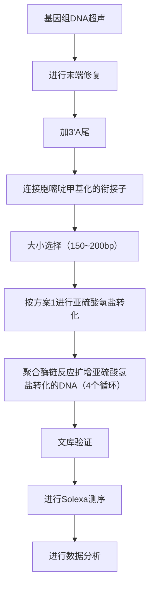

Bst DNA 聚合酶（Epicentre Biotechnologies 公司）

dATP、dGTP、dTTP 混合物（10mmol/L）

DNA 梯度的分子质量标准物（100bp）（Life Technologies 公司，目录号 15628-019）

dNTP mix (2.5mmol/L 的 dATP、dGTP 和 dTTP，不含 dCTP)

限制性内切核酸酶 MseI、Tsp509I、NlaIII、HpyCH4V（New England Biolabs 公司）

乙醇（70%和100%）

基因组 DNA

GoTaq Green Master Mix（Promega 公司）

Klenow DNA 聚合酶

5 - 甲基-dCTP（Jena Bioscience GmbH 公司）

MethylEasy Xceed 试剂盒（Human Genetic Signatures 公司）

MinElute 或 QIAquick PCR 纯化试剂盒（QIAGEN 公司）

MinElute 或 QIAquick PCR 的凝胶纯化试剂盒（QIAGEN 公司）

Microcon100 超滤装置（Amicon 公司）

NEBuffer 2 (10 ×)

Roche 454 DNA 检测用到的寡核苷酸[衔接子（adaptors）A 和 B，引物 GSFLXA 和 GSFLXB]

序列源自 Margulies et al. (2005)。

为了能够在亚硫酸氢钠修饰过程中保证序列不变，44 bp 的衔接子 A 和 B 中为 5-甲基胞嘧啶而非胞嘧啶核苷酸。

44bp 的衔接子 A，CCATCTCATCCCTGCGTGTCCCATCTGTTCCCTCCCTGTCTCAG

44bp 的衔接子 B，5BioTEG/CCTATCCCCTGTGTGCCTTGCCTATCCCCTGTTGCGTGTCTCAG

引物 GSFLXA，20bp，与 44bp 的衔接子 A 的 5'端互补

引物 GSFLXB，20bp，与 44bp 的衔接子 B 的 5'端互补

酚:氯仿:异戊醇 &lt;A&gt;

Phusion 热启动高保真 DNA 聚合酶（New England Biolabs 公司）

QIAGEN 血液和细胞培养 DNA Midi 试剂盒（QIAGEN，目录号:13343）

快速连接酶试剂盒（New England Biolabs 公司，M2200S）

乙酸钠（3mol/L，pH5.3）

SYBR Green solution (Life Technologies 公司)

TAE 缓冲液（50×）&lt;A&gt;

T4 DNA 连接酶和 1 × 连接缓冲液

T4 DNA 聚合酶

TE (pH8.0) &lt;A&gt;

T4 多核苷酸激酶

未甲基化 cl857 Sam7 λ DNA（Promega 公司）

Wizard SV 凝胶和 PCR 纯化系统（Promega 公司）

## 仪器

2100 生物分析仪（Agilent 公司）

454 GS FLX 仪（Roche 公司）

RNA 6000 微型芯片实验室（Agilent Technologies 公司）

NanoDrop 1000 或 2000 分光光度计（Thermo Scientific 公司）

PCR 仪

水浴（或加热块）

## 方法

## DNA 提取

1. 蛋白酶 K 处理分离组织 DNA。

本步骤可采用商品化的蛋白酶 K 组织 DNA 分离试剂盒（如 QIAamp DNA Mini kit）。体外培养细胞或外周血淋巴细胞可以用 QIAGEN Blood and Cell Culture DNA Midi Kit 制备基因组 DNA。

## DNA 酶消化和按分子质量大小分离

2. 顺序使用限制性内切核酸酶 MseI 和 Tsp509I 对 $40 \mu \mathrm{g}$ 的基因组 DNA 进行酶切, 操作按照说明书进行。每种酶加 40U 孵育 2h, 然后再加 40U 的酶, 继续孵育 2h。

3. 第二次孵育 Tsp509I 结束后，用酚:氯仿:异戊醇抽提纯化 DNA，乙醇沉淀。

4. 重悬 DNA，然后用限制性内切核酸酶 NlaIII，接着是 HpyCH4V 顺序酶切（操作参照步骤 2）。

5. 酚:氯仿:异戊醇抽提纯化 DNA，然后用 Microcon 100 device 超滤浓缩 DNA，500g 离心 5min。

6. 在 1.8% 的琼脂糖凝胶中分离酶切后的 DNA, 每道上  $1.2 \mu g$  DNA。100bp 的 DNA ladder 用作分子质量对照。电泳凝胶直到蓝色染料标记迁移超过凝胶的 2/3。

7. SYBR Green 染胶（见第 2 章，方案 2），手术刀切取 350\~800bp 大小的 DNA。

8. 用 Wizard SV 凝胶和 PCR 纯化系统纯化胶内 DNA。

9. Microcon 100 device 超滤获取 DNA, 500g 离心 5min。

## DNA 文库制备

10. 按照罗氏公司的操作说明 “GS FLX Titanium General Library Preparation Method Manual (Roche Diagnostics GmbH, April 2009a)” 和 “GS FLX Titanium General Library Preparation Quick Guide (Roche Diagnostics GmbH, April 2009b)” 所描述的步骤进行 DNA 文库制备，具体修改如下:

i. 酶切平/抛光（polishing）反应（Roche 手册 3.4 节）。在含 5-甲基-dCTP 而非 dCTP 的 dNTP 中进行“抛光”反应。

ii. 衔接子（adaptor）连接（Roche 手册 3.5 节）。衔接子 A 和 B 均包括双链寡核苷酸，将其连接到已“抛光”的 DNA 片段末端。为在后续的亚硫酸氢盐修饰过程中保留 DNA 的序列特性，衔接子 A 和 B 的序列中用 5-甲基胞嘧啶代替了胞嘧啶。衔接子 B 上碱基的生物素修饰保持不变。

iii. “填写”（fill-in）反应（Roche 手册 3.8 节）。在此步骤中，链置换 DNA 聚合酶通过其链置换活性修复 DNA 分子上的缺口（nicks）。为保持衔接子序列中甲基化胞嘧啶的存在，在含 5-甲基-dCTP 而非 dCTP 的 dNTP 中进行反应。

## DNA 文库的亚硫酸氢盐修饰

11. 按方案 1 中所述进行单链 DNA 片段的亚硫酸氢盐修饰。

12. 10μL 灭菌双蒸水重悬亚硫酸氢钠处理的 DNA。

## Roche 454 GS FLX 系统大规模平行预测序

13. 取  $2 \mu L$  的亚硫酸盐转化后的 DNA 文库进行 PCR 反应，使用 GoTaq Green Master Mix 反应预混液，引物 GSFLXA 和 GSFLXB 各 200nmol/L，总体积为  $25 \mu L$ 。

引物 GSFLXA 和 GSFLXB 均为 20 个核苷酸长短，分别结合在衔接子 A 和 B 的 5'部位。

14. PCR 扩增条件如下:

| 循环次数 | 变性 | 复性 | 聚合 |
| --- | --- | --- | --- |
| 1 | 95°C,2min |  |  |
| 20个循环 | 95°C,30s | 62°C,30s | 72°C,1min |
| 末循环 |  |  | 72°C,5min |

15. 为除去非特异反应产物，按步骤 $6\sim 9$ 所述在 $1.8\%$ 琼脂糖凝胶中电泳PCR产物，回收 $440\sim 900\mathrm{bp}$ 大小的DNA片段。

16. 用 RNA 6000 Pico LabChip 在 Agilent 2100 生物分析仪上对 DNA 进行质量检测。

17. 依据 Roche 基因组测序仪 FLX, GS emPCR Kit 试剂盒的用户使用手册 “shotgun protocol” 进行微珠制备和序列分析。

18. 依照手册操作对扩增产物进行大规模并行焦磷酸测序（见第 11 章，方案 17）。

## 数据分析

用 Marcel Martin 开发的软件模块 “cutadapt”（http://code.google.com/p/cutadapt/）进行简单的序列比对，查找 454 测序结果中是否有与衔接子序列重叠的序列。如果发现衔接子序列，则将它从结果中删除，然后用 Marcel Martin 研发的另一个 VerJInxer 软件将测序结果映射到基因组中（Zeschnigk et al. 2009）。VerJInxer 是一个可从 http://verjinxer.googlecode.com 下载的公开可用软件（source code under the Artistic License/GPL）。为映射从 CGI 富集片段读取的数据，从每个 CGI 序列两端包含有额外的 200 个核苷酸序列的 RepeatMasked 人类基因组参考序列中提取 UCSC 浏览器所定义的 CGI 序列，建立 CGI 参考序列。

为进一步读取亚硫酸氢盐测序结果的基因组映射定位，VerJInxer 软件创建了一个 CGI-RefSeq 的亚硫酸氢盐 q-gram 索引（这里的 q-gram 代表长度为 q 的序列子串）。索引是模拟亚硫酸氢盐处理过的序列，而非原本序列。模拟了每个在靶序列中发现的 q-gram 的所有可能的甲基化模式。所有得到的 q-gram 被记录在该位置的索引中。例如，对于 q = 5，设参考序列某个位置上的序列是 CGACA。因为第一位的胞嘧啶可能发生甲基化也可能不发生甲基化，因此该位点的亚硫酸氢盐转化后的序列既可能是 CGATA 也可能是 TGATA。索引中则会包含有这两种 q-gram。VerJInxer 软件索引中还包括非亚硫酸氢盐处理的 q-gram，以便检测完全未修饰或部分未修饰的数据。考虑到亚硫酸氢钠处理的 DNA 经 PCR 扩增后，与未甲基化的 C 对应的 G 被替换成 A（相对于 RefSeq 序列），该索引中还模拟了所有 DNA 甲基化修饰中可能产生的 A 代替 G 的 q-gram；对于每个读取序列都会计算它的反向互补碱基并分别映射到参考序列中。模拟产生的 q-gram 的数目很大。平均每个 CGI-RefSeq 的亚硫酸氢钠 q-gram 索引（q = 10）序列位置上含有 4.36 个 q-gram。匹配结果以 BED 格式输出。一个 BED 格式输出的读取数包括基因组坐标、链信息、html 颜色轨道说明（最后一栏）等。示例如下:

| chr12 | 50687522 | 50687614 | Read no.9 | 0 | - | 50687522 | 50687614 | 0,255,0 |
| --- | --- | --- | --- | --- | --- | --- | --- | --- |
| chr19 | 2311464 | 2311570 | Read no. 53 | 0 | + | 2311464 | 2311570 | 0,255,0 |
| chr19 | 2311464 | 2311570 | Read no. 83 | 0 | + | 2311464 | 2311570 | 0,255,0 |

有关序列数据分析的更多详细信息,请参阅 Zeschnigk 等的文章(Zeschnigk et al. 2009)。

## 参考文献

- Margulies M, Egholm M, Altman WE, Attiya S, Bader JS, Bemben LA, Berka J, Braverman MS, Chen YJ, Chen Z, et al. 2005. Genome sequencing in microfabricated high-density picolitre reactors. Nature 437: 376–380.
- Roche Diagnostics GmbH. 2009a. GS FLX Titanium General Library Preparation Method Manual: April 2009. http://dna.uga.edu/docs/GS-FLX-Titanium-General-Library-Preparation-Method-Manual%20 (Roche).pdf. Roche Applied Science, Mannheim, Germany.
- Roche Diagnostics GmbH, 2009b. GS FLX Titanium General Library Preparation Quick Guide (April 2009). ftp://ftp.genome.ou.edu/pub/for\_

broe/titanium/GS%20FLX%20Titanium%20General%20Library%20
Preparation%20Quick%20Guide%20(April%202009).pdf. Roche Applied Science, Mannheim, Germany.
Zeschnigk M, Martin M, Betzl G, Kalbe A, Sirsch C, Buiting K, Gross S, Fritzilas E, Frey B, Rahmann S, et al. 2009. Massive parallel bisulfite sequencing of CG-rich DNA fragments reveals that methylation of many X-chromosomal CpG islands in female blood DNA is incomplete. Hum Mol Genet 18: 1439–1448.

## 网络资源

cutadapt tool http://code.google.com/p/cutadapt/

VerJInxer software http://verjinxer.googlecode.com

## 方案 6 亚硫酸氢盐转化的 DNA 文库的 Illumina 测序

Illumina 公司的 Solexa 测序技术通过集群 PCR（cluster PCR）进行克隆序列的扩增。每个测序循环中，改良后的 DNA 聚合酶能够催化一个碱基的延伸。反应混合液中的 4 种核苷酸原料各自标有不同的荧光标记，并含一个可以被切割的终止结构区。每个循环完成（延伸了一个碱基）后都通过 4 个通道进行成像，由此读出该循环中延伸的是哪种核苷酸；而后进行荧光标记的化学切割并终止该轮反应，进入下一轮循环。Solexa 测序的读长通常为 36bp，但也可用于检测长达 100bp 的序列。此外，该技术也可用于 DNA 的配对末端测序（详细讨论参见第 11 章，方案 4～10）。

此技术平台的成本相对较低，因此是哺乳动物细胞全基因组甲基化测序的理想平台。该技术最早应用于亚硫酸氢钠简并文库测序（reduced representation bisulfite sequencing）（Meissner et al. 2008），将 MspI 消化的 40～220bp 的小鼠基因组 DNA 进行亚硫酸氢盐转化，而后测序。两个研究小组分别使用 MethylC-seq（Lister et al. 2009）和 BS-seq（Popp et al. 2010）的方法对哺乳动物细胞的 DNA 甲基化组（DNA methylomes）进行了精确到核苷酸水平的映射定位。这两种方法之间的主要区别是使用的衔接子（adaptor）不同。在 MethylC-seq 方案中，用甲基化的衔接子构建测序文库；而 BS-seq 方案中使用的是两个不同的非甲基化衔接子。

本章中我们介绍通过 Illumina 的 Genome Analyzer II 平台进行的 “单读（single-read）” 测序。这是一个标准的 MethylC-seq 方案（Lister et al. 2009）。该方案将甲基化的测序衔接子连接到超声处理后的基因组 DNA 上，而后进行凝胶纯化、亚硫酸氢钠转化、PCR 扩增，最后测序。本方案的关键步骤参见图 12-8。

flowchart

图 12-8 MethylC-seq 流程图。MethylC-seq 使用亚硫酸氢盐转化 DNA，而后用 Illumina 平台进行深度测序。

## 材料

为正确使用本方案中的器材和危险试剂，必须查阅相应的材料安全数据表并咨询所在机构的环境卫生和安全办公室。

本方案的专用试剂标注&lt;R&gt;，配方在本方案末提供。常用储备溶液、缓冲液和试剂标注&lt;A&gt;，配方见附录1。储备溶液应稀释至适用浓度后使用。

## 试剂

琼脂糖(low-range ultra)

亚硫酸氢盐转化试剂（见方案1）

胞嘧啶甲基化的衔接子寡核苷酸混合物（Illumina 公司）

dATP、dGTP、dTTP（100mmol/L）（Promega 公司）

DNA 分子质量标记物（50bp）（New England Biolabs 公司）

DNA 上样缓冲液（6×）（New England Biolabs 公司）

EB 缓冲（来自 QIAGEN 公司的 MinElute Purification Kit）

DNA 末端修复试剂盒（Epicentre Technologies 公司）

细胞系或组织中分离获得的基因组 DNA

Klenow 酶（3'→5'Exo⁻）片段 DNA 聚合酶

MinElute 凝胶纯化试剂盒（QIAGEN 公司）

MinElute PCR 纯化试剂盒（QIAGEN 公司）

NEBuffer 2 (10×)

PCR 引物 PE 1.1 （25μmol/L）（Illumina 公司）

PCR 引物 PE 2.1 （25μmol/L）（Illumina 公司）

PfuTurbo Cx 热启动 DNA 聚合酶（Stratagene 公司）

快速连接酶试剂盒（New England Biolabs 公司，M2200S）

SYBR Gold solution (Life Technologies 公司)

TAE 缓冲液（50×）&lt;A&gt;

未甲基化的 cl857 Sam7 λ DNA（Promega 公司）

## 仪器

Bioruptor 非接触式全自动超声破碎仪（Diagenode 公司）

Dark Reader 荧光透射仪（BioExpress 公司）

基因分析仪 Genome Analyzer II（Illumina 公司）

PCR 仪

水浴（或加热块）

## 方法

## 基因组 DNA 片段化

1. 在 $0.5 \mathrm{~mL}$ 反应管中加入 $5 \mu \mathrm{g}$ 基因组 DNA 和 $25 \mathrm{ng}$ 非甲基化的 cl857 Sam7 λ DNA。加入 TE 使 DNA 样品的总体积为 $100 \mu \mathrm{L}$ 。

用 DNeasy Mini Kit 试剂盒提取细胞或组织的基因组 DNA。非甲基化的  $\lambda$  DNA 作为未转化率和测序错误频率的系统误差估算对照。

2. Bioruptor 非接触式全自动超声破碎仪设定超声 30s 后停 30s。

3. 输出选择切换到“高”。

4. 冰预冷的水装至低于最大装填线 0.5cm。

5. 添加约 0.5cm 的冰。

6. 将 DNA 样本放入 Bioruptor。

7. 在所有空位置上填满装有  $100 \mu L$  水的 0.5 mL 反应管。

8. 将计时器设定为超声 DNA 样品 15min。

9. 第一次运行后，将 DNA 样本放入冰内，泵出温水，然后重复步骤 4～8。

DNA 样本经过步骤 2～9 的操作后应剪切成大小为 50～500bp 的片段。对于不同的样本，需要进行超声条件的优化以获得合适的 DNA 片段。

10. 按照操作说明，用 MinElute PCR 纯化试剂盒纯化 DNA。用 $34\mu \mathrm{L}$ 的 EB 缓冲液进行洗脱。

## 基因组 DNA 末端修复

11. 准备  $50 \mu L$  的末端修复（即末端补平）反应体系:

| 柱纯化的基因组 DNA | 34μL |
| --- | --- |
| 末端修复缓冲液(10×)(末端 DNA 修复试剂盒) | 5μL |
| dATP、dGTP 和 dTTP 混合物(2.5mmol/L) | 5μL |
| ATP(10mmol/L) | 5μL |
| End-It enzyme mix (T4 DNA 聚合酶和 T4 PNK) | 1μL |

室温孵育 45min。

12. 按操作说明，用 MinElute PCR 纯化试剂盒纯化 DNA。用 $32\mu \mathrm{L}$ 的 EB 缓冲液洗脱纯化柱。

## 3'端加-A

13. 准备以下  $50 \mu L$  加尾反应体系:

| 末端修复的DNA | 32μL |
| --- | --- |
| NEBuffer 2(10×) | 5μL |
| dATP(1mmol/L) | 10μL |
| Klenow片段(5U/μL) | 3μL |

在  $37^{\circ}$ C 反应 30min。

14. 按说明用 MinElute PCR 纯化试剂盒纯化 DNA。纯化柱以 $10 \mu \mathrm{L}$ 的 EB 缓冲液洗脱。

## 胞嘧啶甲基化衔接子的连接

15. 准备以下  $50 \mu L$  连接反应:

| 柱纯化的 DNA | 10 μL |
| --- | --- |
| 快速连接缓冲液(2×) | 25 μL |
| 胞嘧啶甲基化的衔接子寡核苷酸混合液 | 10 μL |
| 快速 T4 DNA 连接酶(1U/μL) | 5 μL |

在室温下孵育 15min。

此过程使用的衔接子与基因组 DNA 的摩尔比为 10:1（基于超声前定量的  $5 \mu g$  的 DNA 进行计算）。如果开始时的 DNA 用量不同，则衔接子的体积需要作相应调整。

16. 按照说明，用 MinElute PCR 纯化试剂盒纯化 DNA。纯化柱以 $40\mu \mathrm{L}$ 的 EB 缓冲液洗脱。

17. 用  $1 \times$  TAE 配制 50mL 的 2% 琼脂糖凝胶（low-range ultra agarose）。

18. 在连接了衔接子的基因组 DNA 中加入 $8 \mu \mathrm{L}$ 的 $6 \times$ DNA 上样染料。

19. 在凝胶上样孔中加入  $10 \mu L$  的 50bp 的 DNA 分子质量标记物。

20. 在凝胶的另一泳道的上样孔中加入全部的基因组 DNA 样本，样品和分子质量标记物之间至少要隔一个空泳道。

21. 120V 电泳，直至染料前沿迁移超过凝胶的 2/3。

22. 将  $10 \mu L$  的  $10\,000 \times SYBR$  Gold solution 加入  $100 \, mL$  的  $1 \times TAE$  缓冲液配制成染液，用于凝胶染色。用铝箔纸覆盖染色皿，室温轻柔摇动  $15 \sim 20 \, min$ 。

23. Dark Reader transilluminator 检测凝胶。用干净的手术刀切除大小在 150～200bp 的条带。

参见“疑难解答”。

24. 用DNA MinElute Gel Extraction Kit试剂盒纯化DNA，操作按照使用说明进行。纯化柱以 $30\mu \mathrm{L}$ 的EB缓冲液洗脱。

## 亚硫酸氢盐转化

25. 按照方案 1 中的步骤进行 DNA 的亚硫酸氢盐转化。

## 亚硫酸氢盐转化 DNA 的 PCR 扩增

26. 将亚硫酸氢盐转化后的 DNA 均分成三份样品，分别加入 $15\mu \mathrm{L}$ 的 EB 缓冲液中。加入下列试剂，设立三个独立的扩增反应:

| PfuTurbo 反应缓冲液(10×) | 5μL |
| --- | --- |
| dNTP (2.5mmol/L) | 4μL |
| PCR 引物 PE 1.1 | 1μL |
| PCR 引物 PE 2.1 | 1μL |
| 蒸馏水 | 23μL |
| PfuTurbo CX 热启动 DNA 聚合酶(2.5 U/μL) | 1μL |

各占 1/3 的亚硫酸氢盐转换后的 DNA 样品被用来创建一个放大的文库；即步骤 25 中转化获得的 DNA 制备出三个库。此步骤中，扩增循环数较低，能够降低 PCR 放大导致的克隆读取错误率。

27. PCR 反应循环程序如下:

| 循环次数 | 变性 | 复性 | 聚合 |
| --- | --- | --- | --- |
| 1 | 95°C,2min |  |  |
| 2 | 98°C,45s | 60°C,30s | 72°C,4min |
| 3、4、5 | 98°C,15s | 60°C,30s | 72°C,4min |
| 末循环 |  |  | 72°C,10min |
| 保持在4°C |  |  |  |

28. 当隔热盖温度升到 $95^{\circ} \mathrm{C}$ 时, 将三个反应管 (步骤 26) 放置到 PCR 仪中开始运行。

29. 按照使用说明，用 MinElute PCR 纯化试剂盒纯化每个扩增得到的 DNA 样本。纯化柱以 $40\mu \mathrm{L}$ 的 EB 缓冲液洗脱 DNA。

30. 按步骤 17\~24 中所描述的，用凝胶纯化 PCR 产物。

参见“疑难解答”。

## 文库验证

31. 确定凝胶纯化的 DNA 在 $260\mathrm{nm}$ 和 $280\mathrm{nm}$ 处的吸光值。理想情况下，$\mathrm{OD}_{260} / \mathrm{OD}_{280}$ 的比值应该是 1.8 左右。

32. 通过 $2 \%$ 琼脂糖凝胶电泳再次确认纯化 DNA 样品的分子质量大小和浓度。

## Solexa 测序和数据分析

33. 用 Illumina Genome Analyzer II 进行文库测序，操作按照操作手册进行。“单读”（Single-read）测序分析可以进行多达 87 次循环，获得较长序列，能够进行更准确的人基因组序列映射。

34. 对Illumina标准通道的读取数据进行预处理，去除低质量的碱基和衔接子，并用胸腺嘧啶替代所有的胞嘧啶。

35. 将所的读取序列数据与两个计算转换的参考基因组序列进行比对。其中之一的胞嘧啶被胸腺嘧啶取代；另一个是腺嘌呤取代了鸟嘌呤。

36. 将被胸腺嘧啶取代的胞嘧啶重新加入对比后的读取数据中以确定发生甲基化的胞嘧啶。

## 疑难解答

问题（步骤 23）:超声后的 DNA 分子太大。

解决方案:延长超声时间。

问题（步骤 30）:PCR 扩增后没有 PCR 产物（由于超声过程过热导致 DNA 降解）。

解决方案:任何时候都要保持样品冷却。

问题（步骤 30）:PCR 扩增后没有 PCR 产物（DNA 由于亚硫酸氢钠处理而降解）。

解决方案:减少亚硫酸氢盐转化的反应时间。

问题（步骤 30）:PCR 扩增后没有 PCR 产物（衔接子连接不成功）。

解决方案:调整衔接子与基因组 DNA 的比例，以获得最佳的连接反应，并延长连接反应时间。

问题（步骤 30）:PCR 扩增后没有 PCR 产物（末端修复和加 3'-A 的效率低）。

解决方案:延长反应时间。

## 参考文献

Lister R, Pelizzola M, Dowen RH, Hawkins RD, Hon G, Tonti-Filippini J, Nery JR, Lee I, Ye Z, Ngo QM, et al. 2009. Human DNA methylomes at base resolution show widespread epigenomic differences. Nature 462: 315–322.
Meissner A, Mikkelsen TS, Gu H, Wernig M, Hanna J, Sivachenko A, Zhang X, Bernstein BE, Nusbaum C, Jaffe DB, et al. 2008. Genomescale DNA methylation maps of pluripotent and differentiated cells. Nature 454: 766–770.

Popp C, Dean W, Feng S, Cokus SJ, Andrews S, Pellegrini M, Jacobsen SE, Reik W. 2010. Genome-wide erasure of DNA methylation in mouse primordial germ cells is affected by AID deficiency. Nature 463:1101–1105.

## 信息栏

## 用于确定哺乳动物基因启动子区和编码区中 CpG 岛的公共软件

互联网上提供的一些免费程序能够使我们更方便地识别基因组中的 CpG 岛。表 1 列出了其中的部分程序。这里，我们简单地描述了两种较为常用的预测 CpG 岛（CGIS）的计算方法。

“CpG 簇（CpGcluster）”的 CpG 岛预测

源代码（perl）见 http://www.biomedcentral.com/content/supplementary/1471-2105-7-446-S7.zip。

“CpG簇（CpGcluster）”是一个快速有效的算法，只使用整数算法预测那些统计学显著的CpG二核苷酸簇。该算法所预测的CGI的开始和结束序列都是CpG二核苷酸，这与其基于CpG二核苷酸的基因组功能相对应。CpGcluster程序唯一需要的搜索参数是连续两个CpG之间的距离；而不需要 $\mathrm{G + C}$ 的丰度、CpG分数、长度阈值等在其他搜索程序中常常用到的CpG岛统计学特征参数。这些参数可能会使CpGcluster预测结果具有较高的特异性，并降低与散在Alu元件间的重叠（Hackenberg et al. 2006, 2010）。

表 1 CpG 岛的鉴定程序

| 组织 | 网址 | 可用性 | 操作系统的兼容性 | 浏览器兼容性 |
| --- | --- | --- | --- | --- |
| European Bioinformatics InstituteEMBOSS CpG Plot/Report/Isochore | http://www.ebi.ac.uk/Tools/emboss/cpgplot/index.html | 免费(在线) |  |  |
| University of Southern CaliforniaCpG Island Searcher | http://cpgislands.usc.edu/ | 免费(在线) | Mac 或 Windows | IE |
| University of LyonCpGProD | http://pbil.univ-lyon1.fr/software/cpgprod_query.html | 免费(在线) | Mac 或 Windows |  |
| Iowa State UniversityFinding CpG Islands | http://deepc2.psi.iastate.edu/aat/mavg/cg.html | 免费(在线或下载) | Mac 或 Windows |  |
| Hong Kong UniversityCpG Island Explorer | http://bioinfo.hku.hk/cpgieintro.html | 免费(下载) | Mac, Windows,Linux, UNIX |  |
| UHN Microarray Centrea$^{a}$Human CpG Island Database | http://data.microarrays.ca/cpg/index.htm | 免费(在线) |  |  |
| BioinformaticsSequence Manipulation Suite | http://www.bioinformatics.org/sms/ | 免费(在线) | Mac 或 Windows | Firefox, Safari,Netscape, IE |
| NCBIQUMA | http://quma.cdb.riken.jp/ | 免费(在线) | Mac 或 Windows | Firefox, Safari,Netscape, IE |
| Gregor Mendel InstituteCyMATE | http://www.gmi.oeaw.ac.at/en/cymate-index/ | 免费(在线) | Mac 或 Windows |  |
| $CpG\ PatternFinderb^b$$CpG\ Analyzerb^b$ |  |  | WindowsWindows |  |

a. 能找到此软件的网站，但该程序不允许访问。

b. 尽管有文章引用这两个程序，但未找到相应的程序。

## 基于 HMM 模型的 CpG 岛预测

该软件的网址为 http://rafalab.jhsph.edu/CGI/index.html。Irizarry 实验室开发的 CpG 岛的预测软件（make-CGI）以隐马尔可夫模型（HMM）为基础，建立了 30 个物种的基因组 HMM 模型。其相关结果可查阅加州圣塔克鲁兹大学（University of California Santa Cruz）的基因组浏览器(http://genome.ucsc.edu/goldenPath/customTracks/cust-Tracks.html#Multi)。他们的研究结果支持一个新观点:DNA 甲基化在物种多样性和进化中发挥作用。CpG 岛和非 CpG 岛中“观察到的 CpG 残基”与“预期 CpG 残基”的比例（observed to expected ratio, O/E）沿着进化线分离，在更复杂的动物群体中二者都表现为显著丢失；但在 CpG 岛和非 CpG 导之间保持近乎恒定的 O/E 比例差异。一些物种的 CGI 列表可在 http://www.rafalab.org（Irizarry et al. 2009; Wu et al. 2010）中查到。

## 参考文献

| Hackenberg M, Previti C, Luque-Escamilla PL, Carpena P, Martínez-Aroza J, Oliver JL. 2006. CpGcluster: A distance-based algorithm for CpG-island detection. BMC Bioinformatics 7: 446. doi: 10.1186/1471-2105-7-446. |
| --- |
| Hackenberg M, Barturen G, Carpena P, Luque-Escamilla PL, Previti C, Oliver JL. 2010. Prediction of CpG-island function: CpG clustering |

| vs. sliding-window methods. BMC Genomics 11: 327. doi: 10.1186/1471-2164-11-327. |
| --- |
| Irizarry RA, Wu H, Feinberg AP. 2009. A species-generalized probabilistic model-based definition of CpG islands. Mamm Genome 20: 674–680. |
| Wu H, Caffo B, Jaffee HA, Irizarry RA, Feinberg AP. 2010. Redefining CpG islands using hidden Markov models. Biostatistics 11: 499–514. |

## 网络资源

CpGcluster CpG island prediction http://www.biomedcentral.com/content/supplementary/1471-2105-7-446-S7.zip

HMM Model-Based CpG island prediction http://rafalab.jhsph.edu/CGI/index.html:
Rafael Irizarry research page http://www.rafalab.org

## 亚硫酸氢盐测序和 MS-PCR 方案中用于扩增亚硫酸氢盐转化产物的引物设计

无论是亚硫酸氢盐测序法（方案1）还是MS-PCR法（方案2），都需要PCR引物对亚硫酸氢钠处理过的基因组DNA进行扩增。亚硫酸氢盐测序法使用一对引物同时扩增甲基化和非甲基化位点。MS-PCR法则使用两个不同的引物对，分别对未甲基化或甲基化区域进行选择性地扩增。我们强烈建议用巢式PCR进行亚硫酸氢盐测序，以提高扩增的成功率并增加对被分析的基因组区域的特异性。通常情况下，如果只分析几个位点，可以使用下列的引物设计步骤；如果需要设计多个基因位点的引物，则选用表2列举的程序。

1. 将感兴趣的核苷酸序列剪切并粘贴到 Word 文档中。
2. 标记核苷酸序列中的 CpG 岛。
3. 将所有的胞嘧啶（C）更换为胸腺嘧啶（T）。
4. 对于亚硫酸氢盐测序，设计两套长度至少为 20 个核苷酸的巢式引物。所设计的引物不能与 CpG 二核苷酸序列重叠，否则这些引物无法正确地与亚硫酸氢盐转化后的 DNA 复性。

表 2 多个基因位点的引物的设计方案

| 组织 | 网址 | 可用性 | MSP或BSP |
| --- | --- | --- | --- |
| Institute of Enzymology BiSearch | http://bisearch.enzim.hu/ | 免费(在线) | Both |
| Urogene MethPrimer | http://www.urogene.org/methprimer/index1.html | 免费(在线) | Both |
| Sequenom EpiDesigner Beta | http://www.epidesigner.com/ | 免费(在线) | BSP |
| Ghent University methBLAST | http://medgen.ugent.be/methBLAST/ | 免费(在线) | Both |
| Ghent University MethPrimerDB | http://medgen.ugent.be/methprimerdb/index.php | 免费(在线) | Both |
| Murdoch Children's Research Institute PerlPrimer | http://perlprimer.sourceforge.net/ | 免费(在线) | BSP |
| Applied Biosytems Methyl Primer Express 1.0 | https://products.appliedbiosystems.com/ab/en/US/adirect/ab?cmd=catNavigate2&amp;catID=602121&amp;tab=Overview | 免费(在线) | Both |
| University of Helsinki FastPCR | http://www.biocenter.helsinki.fi/bi/Programs/fastpcr.htm | 免费(在线) | BSP |
| Chang Bioscience Primo MSP 3.4 | http://www.changbioscience.com/primo/primom.html | 免费(在线) | MSP |

## 高通量亚硫酸氢盐深度测序数据的处理

高通量深度测序生成亿万字节的序列数据。深度测序技术是快速、可靠并相对经济的全基因组信息检测平台。如果分辨率足够高，甚至能够提供单个核苷酸的信息。但该技术的数据重复性还有待提高，数据分析费用也十分昂贵。因此，如果研究项目仅需要小规模、低解析度的序列信息，就无需使用高通量深度测序法。此外，由于缺乏有效的数据管理通用软件，对其获得的亿万数据的加工分析极其困难。表3介绍了一些常用的用于深度测序数据分析、比对、组合和可视化的软件程序。

迄今为止，尚没有对深度测序法得到的高通量全基因组数据进行分析的标准方法；因此开发一个统一的数据分析和管理流程及应用系统非常重要。标准化数据分析系统的建立对于重复分析源于不同实验室的全基因组 DNA 甲基化数据十分必要。为满足高通量深度测序技术提出的挑战，美国国家生物技术信息中心（National Center for Biotechnology Information, NCBI）已启动了这方面的工作，创建了一个称为序列数据存档（Sequence Read Archive, SRA）的门户网站。SRA 提供了一个短读测序数据的中央存储库，并提供链接到其他参考序列或使用这些数据的资源。它还能够进行基于辅助信息和序列比较的检索。此外，还建立了用户交互提交和检索平台。

表 3 不同的全基因组高通量深度测序 DNA 甲基化研究中使用的数据和统计分析方法汇总

<table><tr><td>测序平台</td><td>研究目标</td><td>测序数据分析和统计分析方法</td><td>参考文献</td></tr><tr><td rowspan="2">Roche/454</td><td>乳腺癌患者组织和血清中的全基因组DNA 甲基化分析</td><td>本研究通过MethylMapper对测序数据和亚硫酸氢盐诱变的效率进行了分析。该研究还对数据集进行了检测,以确保每次扩增和每个患者的结果的代表性。进行t检验和判别分析以判断癌症样本与非癌症样本扩增产物之间是否存在显著改变。所有的统计分析使用SAS(SAS Institute)和R(R Foundation for Statistical Computing)软件</td><td>Bormann et al. 2010</td></tr><tr><td>精子和女性白细胞的全基因组CpG岛的甲基化分析</td><td>首先通过数据预处理去除所有序列中的衔接子序列,然后使用VerJInxer软件(可在http://verjinxer.googlecoe.com获得)对其余序列进行映射。为进行CpG岛富含片段的映射,通过UCSC浏览器从Repeat Masked human genome reference sequence提取CpG岛序列并对其进行定义,从而获得CpG岛参考序列</td><td>Zeschnigk et al. 2009</td></tr><tr><td rowspan="2">ABI SOLiD</td><td>评估SOLiD在对大且复杂的基因组进行亚硫酸氢盐测序时的效用</td><td>首先,创建两个参考基因组:未经亚硫酸氢盐转化的参考基因组和用T取代DH10B基因组DNA链中所有的C的亚硫酸氢盐转化参考基因组。然后使用SOLiD系统的分析工具SOLiD System Analysis Pipeline Tool(http://solidsoftwaretools.com/gf/project/corona/)将测序获得的读取序列分别与亚硫酸盐转换的参考基因组和正常DH10B基因组进行比对,每次读取中最多允许有5个错配</td><td>Lister et al. 2008</td></tr><tr><td>发现Methyl-MAPS方法,能够检测全基因组的非重复DNA序列和重复DNA序列的甲基化状态</td><td>使用SOLiD系统的分析工具(http://solidsoftwaretools.com/gf/project/corona/)进行初始标签序列的映射。配对末端标签则各自映射到相应的颜色相同的区段,每25bp最多允许出现2个不匹配,作为参考序列的人hg18序列从UCSC基因组浏览器获得。一个自定义的Perl脚本被用于进一步确定序列中的甲基化与非甲基化区域。CpG岛,RepeatMasker,RefSeq基因数据都从UCSC基因组浏览器下载。每个CpG岛根据它的基因组位置进行注释。距基因转录起始位点1kb以内的被定义为启动子岛</td><td>Edwards et al. 2010</td></tr><tr><td rowspan="3">Illumina / Solexa</td><td>多能干细胞和分化的细胞的全基因组DNA 甲基化分析</td><td>用标准Illumina base-calling software和客户计算系统对亚硫酸盐转化文库测序的结果进行分析</td><td>Meissner et al. 2008</td></tr><tr><td>拟南芥(Arabidopsis)单碱基分辨率的DNA 甲基化谱</td><td>通过Illumina Firecrest和Bustard应用程序从图像文件提取序列信息,而后用Illumina ELAND算法将其映射定位到拟南芥(COL-0)的参考基因组序列(TAIR 7)中。读取的数据分别映射定位到亚硫酸氢盐转化后的基因组序列和未转化的基因组序列。能被对齐到三个基因组中的多个位置的读取数据通过cross_match算法与未转换的基因组对齐。要确定是否存在甲基化胞嘧啶,需要综合二项分布(binomial distribution)、测序深度(read depth)和预先计算获得的亚硫酸氢盐转换失败及测序错误造成的错误概率来确定每个碱基位点的显著性阈值。甲基胞嘧啶数据一旦低于某位点的甲基化所需的最低阈值,则判为未甲基化。这种方法能够保证不超过5%的甲基胞嘧啶假阳性。研究人员还开发了一个称为Anno-J的基于网络的基因组数据可视化开源应用程序</td><td>Ruike et al. 2010</td></tr><tr><td>人类DNA 甲基化的单碱基分析</td><td>MethylC序列测序数据通过Illumina的分析系统进行加工,FastQ格式的读取数据通过Bowtie alignment algorithm46对齐到人参考基因组(hg18)。每条链上的每个参考位置的基础数据用来确定甲基化胞嘧啶的存在,其错误发现率为1%</td><td>Lister et al. 2009</td></tr></table>

转载得到了 Gupta 等的许可（Gupta et al. 2010）

## 参考文献

- Bormann Chung CA, Boyd VL, McKernan KJ, Fu Y, Monighetti C, Peckham HE, Barker M. 2010. Whole methylome analysis by ultra-deep sequencing using two-base encoding. PLoS ONE 5: e9320. doi:10.1371/journal.pone.0009320.
- Edwards JR, O'Donnell AH, Rollins RA, Peckham HE, Lee C, Milekic MH, Chanrion B, Fu Y, Su T, Hibshoosh H, et al. 2010. Chromatin and sequence features that define the fine and gross structure of genomic methylation patterns. Genome Res 20: 972–980.
- Gupta R, Nagarajan A, Wajapeyee N. 2010. Advances in genome-wide DNA methylation analysis. BioTechniques 49: iii–xii.
- Lister R, O'Malley RC, Tonti-Filippini J, Gregory BD, Berry CC, Millar AH, Ecker JR. 2008. Highly integrated single-base resolution maps of the epigenome in Arabidopsis. Cell 133: 523–536.
- Lister R, Pelizzola M, Dowen RH, Hawkins RD, Hon G, Tonti-Filippini J, Nery JR, Lee L, Ye Z, Ngo QM, et al. 2009. Human DNA methylomes
- at base resolution show widespread epigenomic differences. Nature 462: 315–322.
- Meissner A, Mikkelsen TS, Gu H, Wernig M, Hanna J, Sivachenko A, Zhang X, Bernstein BE, Nusbaum C, Jaffe DB, et al. 2008. Genome-scale DNA methylation maps of pluripotent and differentiated cells. Nature 454: 766–770.
- Ruike Y, Imanaka Y, Sato F, Shimizu K, Tsujimoto G. 2010. Genome-wide analysis of aberrant methylation in human breast cancer cells using methyl-DNA immunoprecipitation combined with high-throughput sequencing. BMC Genomics 11: 137. doi: 10.1186/1471-2164-11-137.
- Zeschnigk M, Martin M, Betzl G, Kalbe A, Sirsch C, Buiting K, Gross S, Fritzilas E, Frey B, Rahmann S, et al. 2009. Massive parallel bisulfite sequencing of CG-rich DNA fragments reveals that methylation of many X-chromosomal CpG islands in female blood DNA is incomplete. Hum Mol Genet 18: 1439–1448.

## 网络资源

SOLiD System Analysis Pipeline Tool http://solidsoftwaretools.com/gf/project/corona/

VerJInxer software http://verjinxer.googlecode.com

(宋 宜 译，赵志虎 校)

## 第 13 章 标记的 DNA 探针、RNA 探针和寡核苷酸探针的制备

导言 | 核酸的放射性和非放射性标记 777 设计寡核苷酸用作探针 783
非放射性检测系统的类型 778

方案 | 1 随机引物法:用随机寡核苷酸延伸法 11 去磷酸化的平端或5'凹端 DNA 分子的标记纯化的 DNA 片段 792 磷酸化 836
2 随机引物法:在融化琼脂糖存在下用 12 用 T4 多核苷酸激酶进行寡核苷酸随机寡核苷酸延伸法标记 DNA 798 5'端的磷酸化 839
3 用切口平移法标记 DNA 探针 800 13 用末端脱氧核苷酸转移酶标记
4 用聚合酶链反应标记 DNA 探针 804 寡核苷酸 3'端 841
- 附加方案 不对称探针 808 - 替代方案 用 TdT 合成非放射性
5 体外转录合成单链 RNA 探针 809 标记的探针 843
- 附加方案 用 PCR 法将噬菌体编码的 RNA 聚合酶启动子加至 DNA 片段上 816
- 附加方案 加尾反应 843
- 附加方案 合成非放射性标记探针的修饰 844
6 用随机寡核苷酸引物法从 mRNA 合成 cDNA 探针 818 14 用大肠杆菌 DNA 聚合酶 I 的 Klenow 片段标记合成的寡核苷酸 845
7 用随机寡核苷酸延伸法制备放射性标记的消减 cDNA 探针 15 用乙醇沉淀法纯化标记的寡核苷酸 849
820 16 用空间排阻层析法纯化标记的
8 用大肠杆菌 DNA 聚合酶 I 的 Klenow 募核苷酸 850
片段标记双链 DNA 的 3'端 825 17 用 Sep-Pak C$_{18}$ 柱色谱法纯化标记的
9 用碱性磷酸酶进行 DNA 片段的 募核苷酸 852
去磷酸化 831 18 寡核苷酸探针在水溶液中杂交:在
10 含 5'突出羟基端的 DNA 分子磷酸化 833 含季铵盐缓冲液中洗涤 854
11 去磷酸化的平端或 5'凹端 DNA 分子的磷酸化 836
12 用 T4 多核苷酸激酶进行寡核苷酸
5'端的磷酸化 839
13 用末端脱氧核苷酸转移酶标记寡核苷酸3'端 841
- 替代方案 用 TdT 合成非放射性标记的探针 843
● 附加方案 加尾反应 843
● 附加方案 合成非放射性标记探针的修饰 844
14 用大肠杆菌 DNA 聚合酶 I 的 Klenow
片段标记合成的寡核苷酸 845
15 用乙醇沉淀法纯化标记的寡核苷酸 849
16 用空间排阻层析法纯化标记的寡核苷酸 850
17 用 Sep-Pak C$_{18}$ 柱色谱法纯化标记的寡核苷酸 852
18 寡核苷酸探针在水溶液中杂交:在含季铵盐缓冲液中洗涤 854

信息栏 dNTP 储备溶液的制备 857 碱性磷酸酶 866

大肠杆菌 DNA 聚合酶 I 和 Klenow
解链温度 867
片段 857

体外转录系统 863

碱性磷酸酶 866

解链温度 867

## 导言

标记的核酸和寡核苷酸作为试剂或探针在分子克隆中的应用。

- 标记的克隆化 DNA 片段和特定长度的寡核苷酸片段可作为试剂用于分析 RNA，包括用 S1 核酸酶消化、RNA 酶保护和引物延伸。在这些实验中，标记试剂可形成不同分子质量的产物，能利用多种方法进行检测，其中凝胶电泳结合放射自显影法或光成像为最常见的方法。标记的 DNA 和 RNA 也可用作凝胶电泳的分子质量标志物。
- 标记的 DNA、RNA、LNA 和寡核苷酸探针可用于各种杂交技术以定位和结合 DNA 及 RNA 的互补序列。这些技术包括 Southern、Northern 分析和原位杂交。

上述应用的成功与否完全取决于通过各种酶法，如末端标记法、随机引物法、切口平移法、体外转录法和各种聚合酶链反应（PCR），将标记物顺利地引入核酸或寡核苷酸。一些方法可将标记物引入核酸分子中的特定位置（如5'端或3'端），或在核酸分子内多个位点标记；可获得标记的单链分子，亦可标记双链核酸分子；可合成固定长度的探针，亦可合成不同分子质量的标记分子群体。表13-1列出了标记核酸方法的种类，以指导研究者选择适合自己当前工作的方法。

表 13-1 体外标记核酸的方法

<table><tr><td>材料</td><td>方法</td><td>酶</td><td>探针类型</td><td>标记的位置</td><td>探针的长度</td><td>用途</td><td>放射性标记的比活性</td><td>可否非放射性标记</td><td>方案编号</td></tr><tr><td rowspan="6">DNA</td><td>随机引物法</td><td>Klenow</td><td>双链DNA</td><td>内部</td><td>400~600核苷酸</td><td>Southern和Northern杂交</td><td> $5 \times 10^{8} \sim 5 \times 10^{9}$ dpm/μg</td><td>是</td><td>1,2</td></tr><tr><td>切口平移</td><td>DNA 酶I+DNA聚合酶I</td><td>双链DNA</td><td>内部</td><td>约400核苷酸</td><td>Southern和Northern杂交、原位杂交</td><td> $5 \times 10^{8} \sim 5 \times 10^{9}$ dpm/μg</td><td>是</td><td>3</td></tr><tr><td>PCR</td><td>热稳定的DNA聚合酶(如Taq)</td><td>单链或双链DNA</td><td>内部</td><td>取决于引物的位置;产生固定长度的探针</td><td>S1核酸酶作图Southern和Northern杂交</td><td>约 $1 \times 10^{9} \sim 2 \times 10^{9}$ dpm/μg</td><td>是</td><td>4</td></tr><tr><td>引物延伸</td><td>T4多聚核苷酸激酶</td><td>单链DNA</td><td>内部</td><td>限制性酶消化后产生固定长度的探针</td><td>S1核酸酶作图Southern和Northern杂交</td><td>约 $1 \times 10^{9}$ dpm/μg</td><td>否</td><td>第6章,方案16</td></tr><tr><td>体外转录</td><td>DNA依赖的RNA聚合酶(如T3、T7或SP6)</td><td>单链RNA</td><td>内部</td><td>产生与模板等量的、固定长度的探针</td><td>RNA酶保护Southern和Northern杂交、原位杂交</td><td>约 $1 \times 10^{9}$ dpm/μg</td><td>是</td><td>5(也见第6章方案17)</td></tr><tr><td>加核苷酸至3&#x27;凹端</td><td>Klenow</td><td>双链DNA</td><td>3&#x27;端</td><td>产生与模板近似等量的、固定长度的探针</td><td>S1核酸酶作图RNA酶保护引物延伸分子质量标志物</td><td>约 $1 \times 10^{8} \sim -2 \times 10^{8}$ dpm/μg</td><td>是</td><td>8</td></tr><tr><td rowspan="2">RNA</td><td>5&#x27;端磷酸化</td><td>T4多核苷酸激酶</td><td>双链DNA</td><td>5&#x27;端</td><td>产生与模板等量的、固定长度的探针</td><td>S1核酸酶作图RNA酶保护引物延伸分子质量标志物</td><td>约 $1 \times 10^{8} \sim 2 \times 10^{8}$ dpm/μg</td><td>否</td><td>9,10,11</td></tr><tr><td>随机引物</td><td>反转录酶Klenow</td><td>单链DNA或DNA-RNA杂交体</td><td>内部</td><td>约400~600核苷酸</td><td>差异筛选</td><td>约 $1 \times 10^{9}$ dpm/μg</td><td>否</td><td>6,7</td></tr><tr><td rowspan="3">寡核苷酸或LNA</td><td>5&#x27;端磷酸化</td><td>T4多聚核苷酸激酶</td><td>单链DNA</td><td>5&#x27;端</td><td>与寡核苷酸等量的、固定长度的探针</td><td>Southern和Northern杂交</td><td>约 $1 \times 10^{8} \sim 4 \times 10^{8}$ dpm/μg</td><td>否</td><td>12</td></tr><tr><td>加核苷酸至3&#x27;端</td><td>末端脱氧核苷酸转移酶</td><td>单链DNA</td><td>3&#x27;端</td><td>产生与模板近似等量的、固定长度的探针</td><td>Southern和Northern杂交</td><td> $3 \times 10^{10}$ dpm/μg</td><td>是</td><td>13</td></tr><tr><td>引物延伸</td><td>Klenow</td><td>双链DNA双链随后必须分离</td><td>内部</td><td>产生与模板近似等价的、固定长度的探针</td><td>Southern和Northern杂交</td><td> $2 \times 10^{10}$ dpm/μg</td><td>否</td><td>14(也见第6章,方案18)</td></tr></table>

## 核酸的放射性和非放射性标记

在常规的体外放射性标记中，放射性同位素——通常为  ${}^{32}P$ ，通过取代非放射性同系物而掺入探针的天然结构中。在 DNA 和寡核苷酸的 5' 端标记反应中， $[\gamma-{}^{32}P]$  ATP 用于提供  ${}^{32}P$  的来源，利用大肠杆菌 T4 多核苷酸激酶将  ${}^{32}P$  转移至 5' 脱氧核苷三磷酸（dNTP）。这种磷酸化反应导致一个核酸分子中掺入一个  ${}^{32}P$  原子。 $[\alpha-{}^{32}P]$  dNTP 的放射性衍生物在内标记法中用于替代反应中的非放射性标记物，这类反应在 1 个  ${}^{32}P$  dNTP 和 3 个未标记的 dNTP 的存在下进行，使一个核酸分子中掺入多个  ${}^{32}P$  原子。应用其中一种内标记酶法，如随机引物或引物延伸[用大肠杆菌 DNA 聚合酶 I 的 Klenow 片段（Pol I）]、切口平移（用 DNA 酶 I 和 DNA 聚合酶 I）、PCR（用热稳定的 DNA 聚合酶如 Taq）和体外转录（用噬菌体 DNA 依赖的 RNA 聚合酶），可将放射性核苷酸掺入核酸分子。这样，应用大肠杆菌 DNA 聚合酶的 Klenow 片段，将一个或多个放射性标记的  $[\alpha-{}^{32}P]$  dNTP 加至 DNA 3' 凹端而使之被标记，而应用末端脱氧核苷酸转移酶（TdT）催化非模板指导的核苷酸掺入单链 DNA（ssDNA）的 3' 羟基端，可使寡核苷酸的 3' 端被标记。

与放射性标记法不同的是，非放射性标记法将核酸分子中非正常存在的化学基团或化合物作为掺入物。非放射性标记物可通过光化学法或合成反应（见综述，Kricka 1992; Mansfield et al. 1995）掺入探针，用于放射性标记的酶反应（如随机引物法、切口平移法、体外转录法）是将标记的核苷酸掺入探针的更常用的方法。然而，以下详细描述的方法不同于放射性标记，5'端的非放射性标记不能通过酶反应完成。与目标核酸杂交后，探针中修饰的基团可通过适当的指示系统检测。

## 选择标记物:放射性或非放射性？

放射性探针的主要优点是其高敏感性，主要的缺陷是使用有害的放射性同位素。 $^{32}$ P衰变释放的高能量β粒子对于操作者的辐射可能很显著。近年来涉及同位素的文字工作，以及检测放射性物质的使用和处理所需的仪器设备量剧增。毫不奇怪，同位素现已成为一个负担。此外，储存和处理低水平的放射性废物所面临的实际及政治问题日益严峻，而且还在进一步加剧。在实际操作中亦存在不便，例如，实验必须根据放射性标记物到达的时间安排。

非放射性方法的优点在于可更快地获得结果、探针更稳定、成本更低。然而，选择非放射性检测方法不是一件轻松的事——市场上可供选择的非放射性检测试剂盒数量过多，尚有更多的产品随时出现。对于厂商声称的产品的敏感性和信噪比应当持谨慎态度。许多结果是根据理想条件下的实验获得的，这些条件对于缺乏经验的研究者在杂乱无序的实验室中则很难迅速或容易地得到重复，因此信噪比常常高于广告的宣传，初学者可能很难获得与传统放射性标记物敏感性相近的结果。许多试剂盒价格昂贵，只有对自己当前工作条件进行优化后，应用非放射性检测方法才划算。

在选择放射性或非放射性标记物时，或许需要考虑的主要因素是拟进行的实验类型。对于某些技术来说，放射性标记物的应用仍是主要的标记方法。例如，差异显示、消减杂交和应用 S1 核酸酶的 RNA 分析、RNA 酶保护或引物延伸几乎专一性地依赖放射性标记的探针（见第 6 章）。在这些方法中，放射性标记产物首先通过凝胶电泳分离，然后通过放射性自显影或光成像检测。然而，值得注意的是，相应的非放射性改良方法已有报道（如 Turnbow and Garner 1993; Chan et al. 1996）。

对于各种 Southern 和 Northern 杂交技术（分别见第 2 章和第 6 章），研究者可选择应