## 引物

一般可通过商品渠道购买寡核苷酸引物，但亦可用 DNA 酶 I 酶解小牛胸腺 DNA 或在自动 DNA 合成仪上合成获得。引物的长度至关重要，短于 6 个碱基的引物是不可取的，而长于 7 个碱基的引物则增加了自身复性及自身引导的概率（Suganuma and Gupta 1995）。因此，适用于随机引物法的理想寡核苷酸引物集群的长度应当为 6 个或 7 个核苷酸，集群中所有可能的序列应当以相同的频率出现。

随机引物反应合成的探针的平均长度与引物的浓度成反比(Hodgson and Fisk 1987): 放射性标记产物的长度 $= k / \sqrt{\ln P_{c}}, P_{c}$ 表示引物的浓度。

此方案描述的标准引物反应采用 60ng 和 125ng 六聚体或七聚体的随机寡核苷酸，产生的放射性标记产物长度为 400～600 核苷酸，可用碱性琼脂糖凝胶或变性聚丙烯酰胺凝胶电泳测定探针的长度。较高浓度的引物可导致空间位阻或  $\left[\alpha-^{32}P\right]$  dNTP 前体耗竭而使产量降低；较低浓度的引物则导致放射性标记产物集群大小不均一（0.4～4kb）（Hodgson and Fisk 1987），从而引起杂交动力学异常。

## 模板 DNA

此方案的反应条件系根据 Feinberg 和 Vogelstein（1983，1984）的方法修改、优化而来，用以标记长度达 1kb 的线性双链 DNA 模板。较短的 DNA 模板产生的探针比活度低，在严谨条件下杂交效果不佳。闭环的双链 DNA 是低效模板，在进行随机引物反应之前，应当用限制性内切核酸酶消化成线性分子。条件允许的情况下，应尽可能用纯化的 DNA 片段代替完整质粒作模板，这样的放射性标记 DNA 在用作杂交探针时，可使本底水平显著降低（Feinberg and Vogelstein 1983, 1984）。

## 材料

为正确使用本方案中的器材和危险试剂，必须查阅相应的材料安全数据表并咨询所在机构的环境卫生和安全办公室。

本方案的专用试剂标注&lt;R&gt;，配方在本方案末提供。常用储备溶液、缓冲液和试剂标注&lt;A&gt;，配方见附录1。储备溶液应稀释至适用浓度后使用。

## 试剂

碱性琼脂糖凝胶或变性聚丙烯酰胺凝胶（见步骤4）

乙酸铵（10mol/L）&lt;A&gt;（可选，见步骤5）

乙醇（可选，见步骤5）。

凝胶过滤介质（Sephadex G-50 或 Bio-Gel），用  $1 \times TEN$  平衡（pH 8.0）&lt;A&gt;

大肠杆菌聚合酶 I Klenow 片段

NA 终止 / 储备缓冲液&lt;R&gt;

非放射性标记溶液

dNTP 溶液，其中含浓度各为 1mmol/L dATP、dCTP、dGTP 和 0.65 mmol/L dTTP

有关配制及储存 dNTP 储备溶液，见信息栏 “dNTP 储备溶液的制备”

生物素-dUTP、荧光素-dUTP 或 DIG-dUTP（0.35mmol/L）

或

放射性标记溶液

含三种未标记的 dNTP 溶液（各 5mmol/L）

此溶液的组分取决于欲使用的  $\left[\alpha-^{32}P\right]$  dNTP。如应用放射性标记的 dATP，混合物应含各 5mmol/L 的 dCTP、dTTP 和 dGTP。如应用两种放射性标记的 dNTP，则溶液中应含各 5mmol/L 的其他两种 dNTP。有关制备和储存 dNTP 储备溶液，见信息栏 “dNTP 储备溶液的制备”。

$\left[\alpha-^{32}P\right]$  dNTP（10mCi/mL，比活度大于3000Ci/mmol）

为最大限度地减少前体的辐射分解，应尽可能在  $\left[^{32}P\right]$  dNTP 到达实验室的当天制备放射性标记探针。

长度为 6 或 7 个碱基的随机脱氧核苷酸引物（125ng/ $\mu$ L 溶于 TE, pH 7.6）

合成的随机寡核苷酸长度均一，无序列偏性，因此为引物的首选。最佳长度的寡核苷酸（六聚体和七聚体）（Suganuma and Gupta 1995）可从商业渠道购买（如 Sigma-Aldrich 公司或 Life Technologies 公司）或在自动 DNA 合成仪上合成。引物溶液应以小份分装储存于-20℃。

随机引物缓冲液（5×）&lt;R&gt;

模板 DNA（5～25ng/μL 溶于 TE, pH 7.6）

按第 1 章介绍的方法之一纯化欲进行标记的 DNA。

本方案中取 25ng 的模板 DNA 在 50μL 标准体积中反应最好。应用此法时模板 DNA 的量越大，产生的探针比活度越低；DNA 的量越小，则所需的反应时间越长（参看步骤 4 的注释）。

## 仪器

预热至 $95^{\circ} \mathrm{C}$ 的沸水浴或加热块

用于离心柱色谱法的仪器（玻璃棉和 1mL 一次性注射器）

Sephadex G-50 离心柱，用 pH 7.6 TE 平衡（可选，见步骤 5）

Sephadex G-50 凝胶过滤介质可用于从低分子质量物质（放射性前体保留在柱中）中分离 DNA（DNA 可穿过介质）。放射性标记 DNA 的纯化用 Sephadex G-50 柱可从几个商品渠道获得，如 Quick Spin Columns（Roche Applied Science 公司）。但是，用 1mL 装填硅化玻璃棉的一次性注射器很容易完成（见本方案步骤 6～14）。

## 方法

1. 在一个 0.5mL 的微量离心管中加入溶于 30μL 水的模板 DNA（25ng）及 1μL 随机脱氧核苷酸引物（约 125ng）。盖紧微量离心管，置于沸水浴中 2min。

2. 将微量离心管移至冰上放置 $1\mathrm{min}$，$4^{\circ}\mathrm{C}$ 下离心 $10\mathrm{s}$，使引物与模板的混合物沉降至管底，将微量离心管重新置于冰上。

3. 应用以下一种反应混合物进行标记反应

## 制备放射性标记探针

在引物与模板的混合物中加入:

| 5mmol/L dNTP 溶液 | 1μL |
| --- | --- |
| 5×随机引物缓冲液 | 10μL |
| 10mCi/mL [$\alpha^{-32}P$] dNTP | 5μL(比活度 3000Ci/mmol) |
| $H_2O$ | 加至 50μL |

## 制备 DIG、生物素或荧光素标记的探针

在引物与模板的混合物中加入:

| 1mmol/L dNTP 溶液 | 1μL(含0.65mmol/L dTTP) |
| --- | --- |
| 5×随机引物缓冲液 | 10μL |
| 0.35mmol/L 标记的dUTP | 5μL |
| $H_2O$ | 加至50μL |

4. 加入 5U（约  $1 \mu L$ ）的 Klenow 片段，轻弹管壁以混合各组分。以最大速度离心  $1 \sim 2s$ ，使所有液体沉降于管底。反应混合物室温下反应 60min。

如标记大量的 DNA，按步骤 3 和步骤 4 准备反应混合物，温育反应 60min。如标记小量的 DNA，则反应时间与加入模板的量成反比。例如，含有 10ng DNA 模板的随机引物反应，温育时间应为 2.5h。

为监测反应的进程，检测放射性标记的 dNTP 掺入三氯乙酸（TCA）可沉淀物中的比例（见附录 2）。

在这些反应条件下，放射性标记产物的长度约为 400～600 个核苷酸。通过碱性琼脂糖凝胶电泳（第 6 章，方案 11）或变性聚丙烯酰胺凝胶电泳（第 6 章，方案 11）可确定标记产物的分子质量。

5. 在反应液中加入 $10 \mu \mathrm{L} \mathrm{NA}$ 终止/储备缓冲液, 可根据需要进行以下步骤。

\- 储存放射性标记的探针于-20℃以备杂交用。

或

\- 通过离心柱色谱法（按以下步骤6～14，使用商品化的柱子或自制的柱子）分离放射性标记的探针与未结合的dNTP或以乙酸铵和乙醇选择性地沉淀放射性标记的DNA（见第1章，方案4）。如果大于50%的放射性dNTP已在反应中掺入，可略过该步骤。

假定 50% 的放射活度在随机引物反应中已掺入 TCA 可沉淀部分，而且 90% 的产物系由模板 DNA 通过随机引物反应产生（非寡核苷酸自身引导），探针 DNA 的总比活度应约为  $4.5 \times 10^{7}$  dpm（可用于 2～5 次哺乳动物基因组 DNA 的 Southern 杂交）。探针的比活度可达约  $1.8 \times 10^{9}$  dpm/ $\mu$ g，反应中合成的 DNA 量可达 9.7ng，足以通过 Southern 分析检测哺乳动物 DNA 单拷贝序列。

## 离心柱色谱法

6. 将 $1\mathrm{mL}$ 一次性注射器的底部填入少量无菌的玻璃棉。最好用注射器的针筒将玻璃棉填实。

7. 在注射器中填入 Sephadex G-50 或 Bio-Gel P-60，用  $1 \times TEN$  缓冲液（pH 8.0）平衡。轻敲注射器针筒几次使缓冲液流出。再加入一些树脂，直至注射器完全充满。

注意，并非所有树脂皆可用于离心沉淀——DEAE Sephacel 在离心过程中可形成不渗透的块状物。由于离心可使珠子被挤碎，因此不能使用更高级别的 Sephadex ( $\geqslant$ G-100)。如果需要大分子的筛选树脂，可使用 Sepharose CL-4B。

8. 将注射器插入一只 $15 \mathrm{~mL}$ 一次性塑料离心管, 使用吊桶式转头台式离心机, $1600 \mathrm{~g}$ 、室温下离心 $4 \mathrm{~min}$ 。无需担心柱子的外观, 离心过程中树脂可沉淀呈部分脱水状。继续加入树脂并离心, 直至柱子的体积达到约 $0.9 \mathrm{~mL}$ 且在离心后体积不变。

9. 在柱子中加入  $0.1 \, mL \times TEN$  缓冲液，重复步骤 8，再次离心。

10. 重复步骤 9 两次。

如需要，在此阶段可储存离心柱备用。可同时制备几个离心柱，使用前储存于 $4^{\circ}\mathrm{C}1$ 至数月。在注射器中加入$1\times \mathrm{TEN}$ 缓冲液，用Parafilm膜包裹以避免蒸发。将柱子直立储存于 $4^{\circ}\mathrm{C}$ 。这样储存的离心柱在使用前可按照步骤9用 $1\times \mathrm{TEN}$ 缓冲液洗1次。

11. 将总体积为 $0.1 \mathrm{~mL}$ 的 DNA 样品加入柱中（用 $1 \times \mathrm{TEN}$ 缓冲液补充体积）。将离心柱放入一个新的一次性离心管，其中含一个去盖的微量离心管。

12. 按步骤 8 离心，收集注射器底部流入去盖离心管的液体（约  $100 \mu L$ ）。

13. 移去注射器，其中含未掺入的放射性标记的 dNTP 或其他小分子物质。用镊子小心取出含有洗脱的 DNA 的去盖离心管，将管中的液体转移至一个有盖并标注的微量离心管。

将注射器和洗脱的 DNA 置于手提式小型探测器，可粗略估计掺入核酸的放射性部分。

14. 如果注射器具有放射性，小心弃于放射性废弃物中。将洗脱的 DNA 储存于  $-20^{\circ}C$  以备用。

text_image

Sephadex G-50
无菌的玻璃棉

## 配方

为正确使用本方案中的器材和危险试剂，必须查阅相应的材料安全数据表并咨询所在机构的环境卫生和安全办公室。

NA 终止/储备缓冲液（1mL）

| 试剂 | 体积 | 终浓度 |
| --- | --- | --- |
| Tris-Cl (1mol/L, pH 7.5) | 50μL | 50mmol/L |
| NaCl (5mol/L) | 10μL | 50mmol/L |
| EDTA (0.5mol/L, pH 8.0) | 10μL | 5mmol/L |
| SDS (10%, m/V) 50μL | 0.5%(m/V) |  |

随机引物缓冲液（1mL）

| 试剂 | 体积 | 终浓度 |
| --- | --- | --- |
| Tris-Cl (1mol/L, pH 8.0) | 250μL | 250mmol/L |
| MgCl2(1mol/L) | 25μL | 25mmol/L |
| NaCl (5mol/L) | 20μL | 100mmol/L |
| 二硫苏糖醇(Dithiothreitol, DTT) (1mol/L) | 10μL | 10mmol/L |
| HEPES (2mol/L, 用4mol/L NaOH调pH至6.6) | 500μL | 1mol/L |

使用前用  $H_{2}O$  稀释储存于  $-20^{\circ}C$  的 1mol/L DTT 储备溶液。用后弃去稀释的 DTT 溶液。

## 参考文献

- Eweida M, Sit TL, Sira S, AbouHaidar MG. 1989. Highly sensitive and specific non-radioactive biotinylated probes for dot-blot, Southern and colony hybridizations. J Virol Methods 26: 35–43.
- Feinberg AP, Vogelstein B. 1983. A technique for radiolabeling DNA restriction endonuclease fragments to high specific activity. Anal Biochem 132: 6–13.
- Feinberg AP, Vogelstein B. 1984. A technique for radiolabeling DNA restriction endonuclease fragments to high specific activity. Addendum. Anal Biochem 137: 266–267.
- Goulian M. 1969. Initiation of the replication of single-stranded DNA by Escherichia coli DNA polymerase. Cold Spring Harbor Symp Quant Biol 33: 11–20.
- Hodgson CP, Fisk RZ. 1987. Hybridization probe size control: Optimized "oligolabelling." Nucleic Acids Res 15: 6295.
- Kessler C, Holtke HJ, Seibl R, Burg J, Muhlegger K. 1990. Non-radioactive labeling and detection of nucleic acids. I. A novel DNA labeling and detection system based on digoxigenin: anti-digoxigenin ELISA principle (digoxigenin system). Biol Chem Hoppe Seyler 371: 917–927.
- Lehman IR, Richardson CC. 1964. The deoxyribonucleases of Escherichia coli. IV. An exonuclease activity present in purified preparations of
- deoxyribonucleic acid polymerase. J Biol Chem 239: 233–241.
- Roy BP, AbouHaidar MG, Sit TL, Alexander A. 1988. Construction and use of cloned cDNA biotin and  ${}^{32}$ P-labeled probes for the detection of papaya mosaic potexvirus RNA in plants. Phytopathology 78: 1425–1429.
- Roy BP, AbouHaidar MG, Alexander A. 1989. Biotinylated RNA probes for the detection of potato spindle tuber viroid (PSTV) in plants. J Virol Methods 23: 149–155.
- Sayavedra-Soto LA, Gresshoff PM. 1992. Taq DNA polymerase for labeling DNA using random primers. BioTechniques 13: 568, 570, 572.
- Stent GS, Fuerst CR. 1960. Genetic and physiological effects of the decay of incorporated radioactive phosphorus in bacterial viruses and bacteria. Adv Biol Med Phys 7: 2–71.
- Suganuma A, Gupta KC. 1995. An evaluation of primer length on random-primed DNA synthesis for nucleic acid hybridization: Longer is not better. Anal Biochem 224: 605–608.
- Taylor JM, Illmensee R, Summers J. 1976. Efficient transcription of RNA into DNA by avian sarcoma virus polymerase. Biochim Biophys Acta 442: 324–330.

# 方案 2 随机引物法:在融化琼脂糖存在下用随机寡核苷酸延伸法标记 DNA

此法由方案 1 修改而成，可用于放射性标记从低熔点琼脂糖凝胶中回收的 DNA（Feinberg and Vogelstein 1983, 1984）。本方法中使用的大多数材料与方案 1 相同，仅标记缓冲液稍加修改，其中含未标记的 dNTP 和随机寡核苷酸引物。根据研究者的需要，标记反应可采用方案 1 中介绍的缓冲液或本法所述缓冲液。有关此法中所用材料、所合成的探针比活度和长度，见方案 1 中的导言部分。

## 材料

为正确使用本方案中的器材和危险试剂，必须查阅相应的材料安全数据表并咨询所在机构的环境卫生和安全办公室。

本方案的专用试剂标注&lt;R&gt;，配方在本方案末提供。常用储备溶液、缓冲液和试剂标注&lt;A&gt;，配方见附录1。储备溶液应稀释至适用浓度后使用。

## 试剂

碱性琼脂糖凝胶或变性聚丙烯酰胺（见步骤4）

$\left[\alpha-^{32}P\right]$ dNTP（10mCi/mL，比活度>3000Ci/mmol）

为最大限度地减少前体的辐射分解，应尽可能在  $\left[^{32}P\right]$  dNTP 到达实验室的当天制备放射性标记探针。

乙酸铵（10mol/L）&lt;A&gt;（可选，见步骤5）

牛血清白蛋白（BSA）(10mg/mL)

乙醇（可选，见步骤5）

溴化乙锭（10mg/mL）或 SYBR Green 染液

大肠杆菌 DNA 聚合酶 Klenow 片段

在每一随机引物反应中需要 Klenow 片段（5U）

NA 终止/储备缓冲液&lt;R&gt;

5×寡核苷酸标记缓冲液&lt;R&gt;

5×寡核苷酸标记缓冲液的组分取决于欲使用的 $[\alpha-^{32}P]dNTP$ 。如使用放射性标记的dATP，缓冲液中应含有dCTP、dTTP和dGTP。如使用两种放射性标记的dNTP，缓冲液中则含有其他两种未标记的dNTP。有关制备和储存dNTP储备缓冲液，见信息栏“dNTP储备溶液的制备”。

长度为 6 个或 7 个碱基的随机脱氧核苷酸引物（125ng/ $\mu$ L 溶于 TE, pH 7.6）

合成的随机寡核苷酸引物长度均一，无序列偏性，因而是引物的首选。最佳长度的寡核苷酸（六聚体或七聚体）（Suganuma and Gupta 1995）可从商业渠道购买（如 Sigma-Aldrich 公司或 Life Technologies 公司）或在自动 DNA 合成仪上合成。引物溶液应分装成小份储存于 -20℃，使用时将引物加入 5×寡核苷酸标记缓冲液。

## 模板 DNA

通过低熔点（LMT）琼脂糖凝胶（如 FMC SeaPlaque LMT 琼脂糖）回收待标记的 DNA（见本方案的步骤 1～3）。用  $1 \times$  Tris-乙酸盐电泳缓冲液制备凝胶及电泳。关于低熔点琼脂糖凝胶的制备及凝胶电泳见第 2 章，方案 9。

此方案中应用 25ng 模板 DNA 于标准的 50μL 反应体积为最好。DNA 模板量越大，产生的探针比活度越低；DNA 模板量越小，则所需的反应时间越长。见步骤 4 的注释。

## 设备

沸水浴

Sephadex G-50 离心柱，用 TE（pH 7.6）平衡（可选，见步骤 5）。

Sephadex G-50 凝胶过滤介质可用于从低分子质量物质（放射性前体保留在柱中）中分离 DNA（DNA 可穿过介质）。放射性标记 DNA 纯化用的 Sephadex G-50 柱可从几个商业渠道获得，如 Quick Spin Columns（Roche Applied Science 公司）。但是，用 1mL 装填硅化玻璃棉的一次性注射器很容易完成（见方案 1，步骤 6～14）。

## 方法

1. 电泳后用溴化乙锭（终浓度 $0.5\mu \mathrm{g} / \mathrm{mL}$ ）或SYBR Green染胶，切下所需条带，尽可能切去多余的琼脂糖凝胶。
2. 将切下的条带放入预先称重的微量离心管中，称出条带的重量。每克琼脂糖凝胶加水 $3 \mathrm{~mL}$ 。
3. 将微量离心管放在沸水浴中煮 7min 以使凝胶融化，同时也使 DNA 变性。

如立即进行放射性标记，可将离心管置于  $37^{\circ}C$ ，直至需要加入模板；否则可储存于  $-20^{\circ}C$ 。但每次从  $-20^{\circ}C$  取出后，含 DNA 的凝胶团要在  $100^{\circ}C$  加热  $3 \sim 5 \, min$ ，然后置于  $37^{\circ}C$  直至放射性标记反应开始。

4. 将一个新的微量离心管置于  $37^{\circ}$ C 水浴或加热块上，按下列次序加入:

| 寡核苷酸标记缓冲液(5×) | 10μL |
| --- | --- |
| 牛血清白蛋白溶液(10mg/mL) | 2μL |
| DNA(体积不超过32μL) | 20~50ng |
| [α-32P]dNTP(10mCi/mL) | 5μL(比活度>3000Ci/mmol) |
| Klenow片段(5U) | 1μL |
| ${\mathrm{H}}_{2}\mathrm{O}$ | 加至50μL |

用微量加样器彻底混合各组分，于室温温育 2～3h 或 37℃ 温育 60min。

如标记大量的 DNA，按比例调整反应液的体积，温育反应 60min。如标记小量的 DNA，则温育反应时间与加入模板的量成反比。例如，含 10ng 模板 DNA 的随机引物反应，温育时间应为 2.5h。

为监测反应的进程，可检测放射性标记 dNTP 掺入 TCA 可沉淀物中的比例（见附录 2）。

上述反应条件下，放射性标记产物的长度约为400～600个核苷酸，通过碱性琼脂糖凝胶（第2章，方案9）或变性聚丙烯酰胺凝胶（第6章，方案11）可确定标记产物的分子质量。

5. 在反应体系中加入 $50 \mu \mathrm{L} \mathrm{NA}$ 终止/储备缓冲液, 根据需要继续进行下列步骤:

\- 储存放射性标记探针于 $-20^{\circ} \mathrm{C}$ 以备杂交时用。

或

\- 通过离心柱色谱法（按照方案1，步骤6～14，用商品化的柱子或自制的柱子）分离放射性标记的探针与未掺入的dNTP，或用乙酸铵及乙醇选择性地沉淀放射性标记DNA（见第1章，方案4）。如大于 $50\%$ 放射性标记的dNTP已在反应中掺入，此步骤可省去。

假设 50% 的放射性活度已在随机引物反应中掺入 TCA 可沉淀的物质，且 90% 的该物质系随机引物反应沿模板 DNA 产生（而非寡核苷酸的自身引导），探针 DNA 的总比活度则约为  $4.5 \times 10^{7}$  dpm（足以进行 2～5 次哺乳动物基因组 DNA 的 Southern 杂交）。探针的比活度可达约  $1.8 \times 10^{9}$  dpm/ $\mu$ g，反应中合成的 DNA 重量可达 9.7ng，足以检测单拷贝序列。

## 配方

为正确使用本方案中的器材和危险试剂，必须查阅相应的材料安全数据表并咨询所在机构的环境卫生和安全办公室。

NA 终止/储备缓冲液（1mL）

| 试剂 | 体积 | 终浓度 |
| --- | --- | --- |
| Tris-Cl (1mol/L, pH 7.5) | 50μL | 50mmol/L |
| NaCl (5mol/L) | 10μL | 50mmol/L |
| EDTA (0.5mol/L, pH 8.0) | 10μL | 5mmol/L |
| SDS (10%, m/V) | 50μL | 0.5% (m/V) |

寡核苷酸标记缓冲液（1mL）

| 试剂 | 体积 | 终浓度 |
| --- | --- | --- |
| Tris-Cl (1mol/L, pH 8.0) | 250μL | 250mmol/L |
| MgCl2(1mol/L) | 25μL | 25mmol/L |
| DTT (1mol/L) | 20μL | 20mmol/L |
| 未标记的 dNTP (100mmol/L) | 20μL | 每种 2mmol/L |
| HEPES (2mol/L, 用 4mol/L NaOH 调 pH 至 6.6) | 585μL | 1mol/L |
| 随机寡核苷酸引物,长度为 6 个碱基(10mg/mL) | 100μL | 1mg/mL |

分装小份储存于-20℃。此缓冲液冻融数次效果不受影响。

## 参考文献

Feinberg AP, Vogelstein B. 1983. A technique for radiolabeling DNA restriction endonuclease fragments to high specific activity. Anal Biochem 132:6–13.

Feinberg AP, Vogelstein B. 1984. A technique for radiolabeling DNA restriction endonuclease fragments to high specific activity. Addendum. Anal

Biochem 137: 266–267.
Suganuma A, Gupta KC. 1995. An evaluation of primer length on random-primed DNA synthesis for nucleic acid hybridization: Longer is not better. Anal Biochem 224: 605–608.

## 方案 3 用切口平移法标记 DNA 探针

切口平移需要两种不同的酶活性参与反应（图 13-2）。DNase I 可在双链靶 DNA 的两条链上的随机位点切割（切口）磷酸二酯键（在  $Mg^{2+}$  存在下，DNase I 具有单链内切核酸酶活性）。大肠杆菌 DNA 聚合酶 I 则将脱氧核苷酸加到 DNase I 切割产生的 3' 羟基端。DNA 聚合酶 I 除具有聚合酶活性，还具有 5'→3' 外切核酸酶活性，因而能从切口 5' 端去除核苷酸。5' 端核苷酸的去除与 3' 端标记核苷酸的加入同时进行，使切口沿着 DNA 链移动（切口平移），产生高比活性的标记 DNA（Kelly et al. 1970）。反应产生的双链探针可用于多种研究目的，包括基因组和 cDNA 文库的筛选、Southern、Northern 和原位杂交。应用该法可合成放射性和非放射性的探针，但需要的 DNA 量较大（1μg），反应时间相对较长（2h），且反应温度（15℃）很重要。

```mermaid
graph TD
  A["5'"] --> B["3'"]
  C["3'"] --> D["5'"]
  E["5'"] --> F["3'"]
  G["3'"] --> H["3'"]
  I["3'"] --> J["5'"]
  K["3'"] --> L["3'"]
  M["3'"] --> N["5'"]
  O["3'"] --> P["3'"]
  Q["3'"] --> R["5'"]
  S["3'"] --> T["3'"]
  U["3'"] --> V["5'"]
  W["3'"] --> X["3'"]
  Y["3'"] --> Z["5'"]
  AA["5'"] --> AB["3'"]
  AC["3'"] --> AD["5'"]
  AE["3'"] --> AF["5'"]
  AG["3'"] --> AH["5'"]
  AI["3'"] --> AJ["5'"]
  AK["3'"] --> AL["5'"]
  AM["3'"] --> AN["5'"]
  AO["3'"] --> AP["5'"]
  AQ["3'"] --> AR["5'"]
  AS["3'"] --> AT["5'"]
  AU["3'"] --> AV["5'"]
  AW["3'"] --> AX["5'"]
  A --> B
  B --> C
  C --> D
  D --> E
  E --> F
  F --> G
  G --> H
  H --> I
  I --> J
  J --> K
  K --> L
  L --> M
  M --> N
  N --> O
  O --> P
  P --> Q
  Q --> R
  R --> S
  S --> T
  T --> U
  U --> V
  V --> W
  W --> X
  X --> Y
  Y --> Z
  Z --> AA
  AA --> AB
  AB --> AC
  AC --> AD
  AD --> AE
  AE --> AF
  AF --> AG
  AG --> AH
  AH --> AI
  AI --> AJ
  AJ --> AK
  AK --> AL
  AL --> AM
  AM --> AN
  AN --> AO
  AO --> AP
  AP --> AQ
  AQ --> AR
  AR --> AS
  AS --> AT
  AT --> AU
  AU --> AV
  AV --> AW
  AW --> AX
  AX --> AZ
  AZ --> BA
  BA --> BB
  BB --> BC
  BC --> BD
  BD --> BE
  BE --> BF
  BF --> BG
  BG --> BH
  BH --> BI
  BI --> BJ
  BJ --> BK
  BK --> BL
  BL --> BM
  BM --> BN
  BN --> BO
  BO --> BP
  BP --> BR
  BR --> BC
  BC --> BD
  BD --> BE
  BE --> BF
  BF --> BG
  BG --> BH
  BH --> BI
  BI --> BJ
  BJ --> BK
  BK --> BL
  BL --> BM
  BM --> BN
  BN --> BO
  BO --> BP
  BP --> BG
  BG --> BH
  BH --> BI
  BI --> BJ
  BJ --> BK
  BK --> BL
  BL --> BM
  BM --> BN
  BN --> BO
  BO --> BP
  BP --> BG
  BG --> BH
  BH --> BI
  BI --> BJ
  BJ --> BK
  BK --> BL
  BL --> BM
  BM --> BN
  BN --> BO
  BO --> BP
  BO --> BG
  BG --> BH
  BH --> BI
  BI --> BJ
  BJ --> BK
  BK --> BL
  BL --> BM
  BM --> BN
  BN --> BO
  BO --> BP
  BP --> BG
```

flowchart

图 13-2 利用大肠杆菌 DNA 聚合酶的切口平移反应。（引用于 Krieg and Melton，1987, Elsevier 许可）。

切口平移作为放射性标记双链 DNA 的首选方法独领风骚多年之后，现已基本上被随机寡核苷酸引物法所取代，后者仅需一种酶参与反应。切口平移法长期存在的主要问题是平衡反应中的 DNA 聚合酶 I 及 DNase I 的活性。随着切口平移试剂盒的诞生（如 NIK-IT, Worthington Biochemical 公司），这个难题最终得以解决。切口平移反应中的注意事项描述于信息栏“优化切口平移反应”。

## 优化切口平移反应

切口平移反应中标记物掺入的量取决于DNA酶I切割产生的模板DNA中3'羟基端的数目。切口过多会产生过多的起始位点，可导致放射性标记物的最大掺入，但却产生过短的DNA片段而不能用作杂交探针。另一方面，切口过少则使切口平移可用的起始位点数目受限，从而产生低比活度的产物。制备过程中每批DNase I的活性可有所不同，大肠杆菌DNA聚合酶I中所污染的DNA酶的量亦相差悬殊。因此需要测定每批DNase I，摸索出酶的适当浓度，以产生所需比活度及长度的探针。当酶切（切口）和聚合反应同时进行时，在核苷酸的掺入开始之前可观察到微细滞后现象（Rigby et al. 1977），此滞后现象反映了DNase I在模板上产生切口的时间，而并不具实际意义。若以切口和聚合反应相继进行，取代两个反应同时进行，滞后现象即可消失（Koch et al. 1986）。

有必要摸索 DNase I 的合适浓度，以使约 40% 的  $[\alpha-^{32}P]$ dNTP 在反应中掺入。在此条件下，标准的切口平移反应可产生比活度高于  $10^{8}cpm/\mu g$  的放射性标记探针。标记 DNA 链的长度为 400～750 个核苷酸，因此必须依据实验确定每种酶的最佳用量，以获得高比活度及长度适当的探针。可通过固定 DNA 聚合酶的用量（如 2.5U）而改变 DNase I 的用量使优化反应得以实现。

虽然大肠杆菌 DNA 聚合酶 I 能在 dNTP 的浓度低至 2μmol/L 时作用，但在高浓度的底物存在时，酶催化 DNA 合成会更有效。为减少花费，切口平移反应中通常含有最低浓度的放射性标记 dNTP（0.5～5μmol/L），而未标记的 dNTP 的浓度则高得多（1mmol/L）。很大程度上，反应中放射性标记的 dNTP 的比活度决定终产物的比活度。这样，用同源未标记的 dNTP 来稀释放射性标记的 dNTP，可制备不同比活度的标记 DNA。如需要制备高比活度（>5×10$^{8}$ dpm/μg）的探针（用于重组 DNA 文库的筛选或用于复杂的哺乳类动物基因组 DNA 的 Southern 杂交检测单拷贝序列），切口平移反应中应含有所有 4 种放射性标记的 dNTP（比活度>800Ci/mmol），而不含有未标记的 dNTP。对于大多数研究目的，应用一种[α-$^{32}$P]（800Ci/mmol）标记的 dNTP 及三种未标记的 dNTP 即可，或用适量未标记的 dNTP 稀释每种[α-$^{32}$]dNTP，则足以满足需要。在比活度为 800Ci/mmol（约 12pmol/μL）的溶液中，放射性标记的 dNTP 浓度比在比活度为 3000Ci/mmol（约 3.3pmol/μL）的溶液中高约 3.75 倍。

## 材料

为正确使用本方案中的器材和危险试剂，必须查阅相应的材料安全数据表并咨询所在机构的环境卫生和安全办公室。

本方案的专用试剂标注&lt;R&gt;，配方在本方案末提供。常用储备溶液、缓冲液和试剂标注&lt;A&gt;，配方见附录1。储备溶液应稀释至适用浓度后使用。

## 试剂

$[\alpha-^{32}P]$ dATP（800Ci/mmol），0.5mmol/L 生物素-11-dUTP 或 0.5mmol/L DIG-11-dUTP

为最大限度地减少前体的辐射分解，应尽可能在  $\left[^{32}P\right]$  dNTP 到达实验室的当天制备放射性标记探针。

DNase I (1mg/mL 储备溶液，稀释 1000 倍或 10 000 倍，见以下的注释)

DNase I 通常以溶液形式出售（无 RNA 酶和/或无蛋白酶），亦有浓度为 2000～3000U/mg 蛋白的冻干粉出售。制备储备溶液时，可将 1mg DNase I 冻干粉溶于 1mL 含 20mmol/L Tris-Cl（pH 7.5）和 1mmol/L MgCl₂ 的溶液。将溶液分装微量离心管，迅速置于干冰上，然后储存于 -80℃。这样的溶液可保持酶活性储存达 1 年。使用时，将溶液在冰上融化，未用完的液体不可继续冻存。

当制备放射性标记的探针时，用含 20mmol/L Tris-Cl（pH 7.5）、0.5mg/mL BSA 和 10mmol/L β-巯基乙醇的溶液稀释储备溶液 10 000 倍，此溶液在 4℃下可储存达 1 个月。因此，在制备非放射性探针时，以 1000 倍稀释 DNase I 储备溶液。

dNTP 溶液，含 dTTP、dCTP 和 dGTP，每种浓度为 0.5mmol/L

当制备非放射性探针时，用含 dUTP、dCTP 和 dGTP（每种浓度为 0.5mmol/L）的溶液代替含 dTTP、dCTP 和 dGTP 的 dNTP 溶液。

大肠杆菌 DNA 聚合酶 I（10U/ $\mu$ L）

EDTA (0.5mol/L, pH 8.0) &lt;A&gt;

切口平移反应缓冲液（10×）&lt;R&gt;

模板 DNA（50～500ng/μL）/TE（pH 7.6）

应用本方案最好在标准的  $50 \mu L$  反应体系中用  $50 \mu g$  DNA。

## 设备

冰盒

Sephadex G-50 离心柱，用 pH 7.6 TE 平衡（可选；见步骤 4）

Sephadex G-50 凝胶过滤介质可用于从低分子质量物质（放射性前体保留在柱中）中分离 DNA（DNA 可穿过介质）。放射性标记 DNA 的纯化用 Sephadex G-50 柱可从几个商品渠道获得，如 Quick Spin Columns（Roche Applied Science 公司）。但是，用 1mL 装填硅化玻璃棉的一次性注射器很容易完成（见方案 1，步骤 6～14）。

水浴（15℃）

## 方法

1. 将 $1.5 \mathrm{~mL}$ 的微量离心管置于冰上, 在管中加入下列组分:

| 切口平移反应缓冲液(10×) | 5μL |
| --- | --- |
| dNTP 溶液 | 5μL |
| $\left\lbrack {\alpha - {}^{32}\mathrm{P}}\right\rbrack \mathrm{{dATP}}\left( {{50\mu }\mathrm{{Ci}}}\right)$ ,生物素-11-dUTP (0.5 mmol/L) 或 DIG-11-dUTP (0.5mmol/L) | 5μL |
| 稀释的 DNase I |  |
| 大肠杆菌 DNA 聚合酶 I | 2μL |
| 在步骤 2 加入 DNA 后,水加至终体积 | 50μL |

2. 用于放射性标记时加入 $0.5\mu \mathrm{g}$ DNA，用于生物素或DIG标记时加入 $1\mu \mathrm{g}$ DNA。盖好微量离心管的盖子，轻敲管壁以混合各组分。以最大速度离心 $1\sim 2\mathrm{s}$，使所有液体降至管底。

3. 制备放射性标记探针时，$15^{\circ}\mathrm{C}$ 下温育反应 $1\mathrm{h}$ 。制备DIG或生物素标记探针时，$15^{\circ}\mathrm{C}$ 下延长温育反应时间至 $2\mathrm{h}$ 。

制备非放射性标记探针时，延长反应时间可使修饰的脱氧核苷酸掺入的效率达到最佳。

4. 加入  $2 \mu L$   $0.5 \, mol/L$  EDTA 以终止反应，根据情况继续进行以下步骤。

\- 储存放射性标记的探针于 $-20^{\circ} \mathrm{C}$ 以备杂交。

或

\- 通过离心柱色谱法（按照方案1，步骤6～14，用商品化的柱子或自制的柱子）将放射性标记探针与未标记的dNTP分离，或以乙酸铵和乙醇选择性地沉淀放射性标记的DNA（见第1章，方案4）。如>50%放射性标记的dNTP已在反应中掺入，则此步骤可省去。

见“疑难解答”。

5. 通过适当的分子标记物和琼脂糖迷你胶电泳分析小量反应混合物。理想的情况下，消化的 DNA 分子质量应当在 100bp 和 500bp。如果探针的大小在 500bp 和 1000bp（或更长），可增加反应中 DNase I 的量。

见“疑难解答”。

## 疑难解答

问题（步骤 4）:标记物不能充分地掺入探针。

解决方案:反应时间太短或 DNase I 量太低。为使切口平移反应优化，需要优化反应时间和加入反应的 DNase I 的量。可建立一系列平行反应，采用不同的反应时间和酶量，检测  $[\alpha-^{32}P]$ dATP 掺入探针的量，理想的情况下，探针中应当有 30%～40% 的标记物掺入。

问题（步骤 4）:探针降解。

解决方案:反应时间过长或 DNase I 量过高。如上所述，建立一系列平行反应优化反应时间和酶量。

问题（步骤 5）:标记物不能充分地掺入探针。

解决方案:DNA 模板片段可能过短（<500 bp）。可增加 DNase I 量以确保 DNA 至少形成一个切口。

## 配方

为正确使用本方案中的器材和危险试剂，必须查阅相应的材料安全数据表并咨询所在机构的环境卫生和安全办公室。

切口平移反应缓冲液（10×）

| 试剂 | 体积(1mL) | 终浓度 |
| --- | --- | --- |
| Tris-Cl (1mol/L, pH 7.5) | 500μL | 0.5mol/L |
| MgCl2(1mol/L) | 100μL | 0.1mol/L |
| DTT (1mol/L) | 10μL | 10mmol/L |
| BSA (10mg/mL) | 50μL | 0.5mg/mL |

分装并储存于 -20℃

## 参考文献

Kelly RB, Cozzarelli NR, Deutscher MP, Lehman IR, Kornberg A. 1970. Enzymatic synthesis of deoxyribonucleic acid. XXXII. Replication of duplex deoxyribonucleic acid by polymerase at a single strand break. J Biol Chem 245: 39–45.
Koch J, Kolvraa S, Bolund L. 1986. An improved method for labelling of DNA probes by nick translation. Nucleic Acids Res 14: 7132.

Krieg PA, Melton DA. 1987. In vitro RNA synthesis with SP6 RNA polymerase. Methods Enzymol 155: 397–415.

Rigby PW, Dieckmann M, Rhodes C, Berg P. 1977. Labeling deoxyribonucleic acid to high specific activity in vitro by nick translation with DNA polymerase I. J Mol Biol 113: 237–251.

## 方案 4 用聚合酶链反应标记 DNA 探针

聚合酶链反应法（见第 7 章）可用于制备非放射性标记的 DNA 探针和高比活度的放射性标记的 DNA 探针。该法的优点如下:

- 可扩增和标记目的 DNA 的限定片段，而不依赖于限制性酶切位点的定位与类型。
- 不需要分离 DNA 片段或将片段亚克隆入含噬菌体启动子的载体。
- 仅需要小量的模板 DNA（2～10 ng 或约 1 fmol）。
- 放射性标记扩增的 DNA 的比活性可达 $10^{9} \mathrm{dpm} / \mu \mathrm{g}$。

能同时扩增并放射性标记DNA的方法有四种。下述前三种方法需要靶DNA的序列信息，而第四种方法则无此需要。

\- 应用常规 PCR 法可获得双链 DNA 探针，PCR 反应中含有同样浓度的上、下游引物。合成放射性探针时，反应中含有三种未标记的 dNTP，其浓度均超过各自的 $K_{\mathrm{m}}$ (200μmol/L)，一种 $[\alpha -^{32}\mathrm{P}]$ 标记的 dNTP 浓度等于或略高于其 $K_{\mathrm{m}}$ (2\~3μmol/L) (Jansen and Ledley 1989; Schowalter and Sommer 1989)。合成非放射性探针时，反应中含有非放射性标记的脱氧核苷酸，如生物素-11-dUTP 或 DIG-11-dUTP，浓度为正常水平的 1/3 (66.7μmol/L)，其中，dTTP 的量降至正常水平的 2/3 (133μmol/L)。

\- 可通过 PCR 合成以 DNA 的一条链占优势的标记探针。此反应中，一条引物的浓度为另一条引物的 20～200 倍。在 PCR 最初的几个循环中，双链 DNA 以常规指数方式扩增。但当一条引物的浓度受限时，反应则以算术级数积聚单链 DNA，结果合成的 DNA 一条链的浓度大于另一条链 3～5 倍（Scully et al. 1990）（详见后文附加方案:不对称探针）。

\- 通过热循环反应可合成完全由 DNA 的一条链构成的标记探针。此反应中含有双链 DNA 模板，但仅含有一条引物。通过 40 个循环反应，双链 DNA 模板（20ng）可产生约 200ng 的单链探针。通过引物结合位点下游的一个限制性位点，切割模板 DNA，可限定探针的长度（Stürzl and Roth 1990; Finckh et al. 1991）。注意，用细菌 T4 多核苷酸激酶和 Klenow 酶，通过引物延伸法亦可合成均一标记的单链 DNA 探针（见第 6 章，方案 16）。

\- 靶 DNA 可用限制性内切核酸酶 CviJ I 酶切。此酶以三磷酸腺苷（ATP）为辅助因子，能切割识别序列 GC（YGCR 除外，Y 为嘧啶，R 为嘌呤）（Swaminathan et al. 1996）。由于二核苷酸 GC 在大多数 DNA 中频繁出现，因而酶切后产生分子质量较小的平端 DNA 片段，长度为 20～60 个核苷酸。这些小片段可作为 PCR 反应中的序列特异性引物，其中一等份的靶 DNA 可作为模板，产生分子质量不均一的双链 DNA 分子群，其分子质量从最小约 60bp 至最大超过靶 DNA 分子不等（Swaminathan et al. 1994）。其中大分子片段被认为是自嵌合模板与引物产生的复杂而混乱的靶 DNA 版本。研究者们对应用其序列与原模板 DNA 呈非共线性关系的探针深感不安，希望避免使用这种方法，但该技术仍受到那些因缺乏 DNA 序列信息而又想应用 PCR 技术的人们的青睐。

下述方案由 Mala Mahendroo 和 Galvin Swift（得克萨斯州立大学，西南医学中心，达拉斯）提供，与 Schowalter 和 Sommer（1989）的制备放射性标记双链探针的方法十分接近。有关利用 PCR 法制备不对称探针的改进方法见后文附加方案:不对称探针。

## 材料

为正确使用本方案中的器材和危险试剂，必须查阅相应的材料安全数据表并咨询所在机构的环境卫生和安全办公室。

本方案的专用试剂标注&lt;R&gt;，配方在本方案末提供。常用储备溶液、缓冲液和试剂标注&lt;A&gt;，配方见附录1。储备溶液应稀释至适用浓度后使用。

## 试剂

$\left[\alpha-^{32}\mathrm{P}\right]\mathrm{dCTP}$ （10mCi/mL，比活度为 3000Ci/mmol）

为最大限度地减少前体的辐射分解，应尽可能在  $\left[^{32}P\right]$  dNTP 到达实验室的当天制备放射性标记探针。

乙酸铵（10mol/L）&lt;A&gt;

扩增缓冲液（10×）&lt;R&gt;

生物素-11-dUTP 或 DIG-11-dUTP

用于乙醇沉淀放射性标记探针的载体（见步骤5）

可使用糖原（储备溶液=50 mg/mL，水配制）或酵母 tRNA（储备溶液浓度为 10mg/mL，水配制）。

氯仿

dCTP（0.1mmol/L，用于放射性标记）

用 99 体积的 10mmol/L Tris-Cl（pH8.0）稀释 1 体积的 10mmol/L dCTP 储备溶液，将稀释后的溶液分装成 50μL 小份储存于 -20℃。

dNTP 溶液

含 dATP、dGTP 和 dTTP 各 10mmol/L 的 dNTP 溶液 1

或

含 dATP、dGTP 和 dCTP 各 10mmol/L 的 dNTP 溶液 2

溶液 1 中加入放射性标记的 dCTP，溶液 2 中加入非放射性标记的 dUTP。关于制备和储存 dNTP 储备溶液，见信息栏 “dNTP 储备溶液的制备”。

dTTP（5mmol/L，用于 DIG 或生物素标记）

乙醇

正向引物（20μmol/L）及反向引物（20μmol/L）（水配制）

每条引物的长度应为20～30个核苷酸，4种碱基的数量应相近，G和C残基分布平衡，不易形成稳定的二级结构。将引物储备溶液储存于-20℃。

自动 DNA 合成仪合成的寡核苷酸引物通常无需纯化即可用于标准的 PCR 反应。然而，如果将寡核苷酸引物用商品化的树脂层析纯化（如 NENSORB 公司、PerkinElmer Life Science 公司的产品）或通过变性聚丙烯酰胺凝胶电泳纯化，则哺乳动物基因组模板单拷贝的扩增和放射性标记常更有效（见第 2 章，方案 3）。

TE (pH 7.6) &lt;A&gt;

模板 DNA（2～10ng）

各种模板均可用于此方案，包括小量制备的质粒 DNA 粗提样品（见第 1 章，方案 1）、分离纯化的琼脂糖或聚丙烯酰胺凝胶中的 DNA 片段（见第 2 章，方案 1），以及低复杂性微生物的基因组 DNA（如细菌和酵母）。

当以重组质粒或其他类型的重组体为模板时，由于寡核苷酸引物与目的 DNA 两侧的载体序列互补或 PCR 在起始模板 DNA 上产生长的通读链，放射性标记的探针中可能会含有小量载体序列。对于大多数杂交实验，低水平载体序列的存在不会干扰实验结果。但是在筛选以高拷贝质粒（如 pUC、pBluescript 和 pGEM 载体）为载体的文库时，探针中的载体序列可导致本底增高。解决的办法包括:①采用定位于靶区内的正向和反向引物；②用凝胶纯化的 DNA 片段作为 PCR 扩增的起始模板；③用限制性内切核酸酶酶切模板 DNA 以防止通读链的合成。

热稳定的 DNA 聚合酶（如 Taq DNA 聚合酶）

每一扩增/标记反应需要热稳定的 DNA 聚合酶（2.5U）。

## 设备

自动微量进样器的屏障吸头

微量离心管（0.5mL，PCR 专用的薄壁小管）

正向置换进样器

Sephadex G-75 离心柱，用 TE（pH 7.6）平衡

Sephadex G-75 凝胶过滤介质可用于从低分子质量物质（放射性前体保留在柱中）中分离 DNA（DNA 可穿过介质）。但是，用 1mL 装填硅化玻璃棉的一次性注射器很容易完成（见方案 1，步骤 6～14，亦可用 Sephadex G-50 柱代替 Sephadex G-75。Sephadex G-50 柱可从商品渠道获得，如 Sigma-Aldrich 公司或 GE Healthcare Life Sciences 公司）。

可编程所需扩增方案的热循环仪

如果热循环仪无加热盖，可使用矿物油或石蜡珠以防止 PCR 过程中反应液蒸发。

## 方法

1. 在一个 0.5mL 的薄壁微量管中设置下列任一扩增/放射性标记反应体系:

放射性标记

| 扩增缓冲液(10×) | 5.0μL |
| --- | --- |
| dNTP溶液1(10mmol/L) | 1.0μL |
| dCTP(0.1mmol/L) | 1.0μL |
| 正向寡核苷酸引物(20μmol/L) | 2.5μL |
| 反向寡核苷酸引物(20μmol/L) | 2.5μL |
| 模板DNA(2~10ng或约1fmol) | 5~10μL |
| [α-32P]dCTP(10mCi/mL) | 5.0μL |
| (比活度3000Ci/mmol) |  |
| H2O | 加至48μL |

DIG 或生物素标记

| 扩增缓冲液(10×) | 5.0μL |
| --- | --- |
| dNTP溶液2(10mmol/L) | 1.0μL |
| dTTP(5mmol/L) | 1.33μL |
| 正向寡核苷酸引物(20μmol/L) | 2.5μL |
| 反向寡核苷酸引物(20μmol/L) | 2.5μL |
| 模板DNA(2~10ng或约1fmol) | 5~10μL |
| 生物素-11-dUTP或DIG-11-dUTP | 至66.7μmol/L |
| ${\mathrm{H}}_{2}\mathrm{O}$ | 加至48μL |

在反应体系中加入 2.5U 的热稳定 DNA 聚合酶。轻敲管壁以混合各组分。

如利用一对引物标记一个以上的 DNA 片段时，可先配制含所有反应组分的母液（DNA 模板除外），将反应母液分入各 PCR 管，在加入酶及开始反应之前，将不同的模板 DNA 加入各管。

2. 如果热循环仪无加热盖，可加一滴（50μL）轻矿物油或一粒石蜡珠于反应混合物之上，以防止样品在反复加热及冷却的循环中蒸发。将微量管放入热循环仪。

3. 通过变性、复性和聚合扩增样品，反应时间见下表。

| 循环数 | 变性 | 复性 | 聚合 |
| --- | --- | --- | --- |
| 30个循环 | 94°C,30~45s | 55~60°C,30~45s | 72°C,1~2min |
| 末循环 | 94°C,1min | 55°C,30s | 72°C,1min |

上述条件适用于 0.5mL 薄壁管、体积为  $50 \mu L$  的反应。如应用其他类型的仪器及反应体积，可适当调整反应时间和温度。

每 1000bp 靶 DNA 的聚合时间应为 1min。

大多数热循环仪常规设有在扩增完毕后  $4^{\circ}$ C 孵育的程序。样品可置于此温度直至取出或过夜，但取出后应储存于  $-20^{\circ}$ C。

4. 从热循环仪中取出反应管, 用微量进样器尽可能地从反应液上层吸去矿物油。用 $50 \mu \mathrm{L}$ 氯仿抽提反应液, 以除去剩余的矿物油。室温下离心 $1 \mathrm{~min}$ 以使液相与有机相分离。

5. 将上层水相转移到一个清洁的微量管中, 加入载体 tRNA (10\~100μg) 或糖原 (5μg), 用等体积的 4mol/L 乙酸铵和 2.5 体积的乙醇沉淀 DNA, 放置于 -20℃、1\~2h, 或 -70℃、10\~20min。4℃ 下以最大速度离心 5\~10min 收集沉淀的 DNA。

6. 将 DNA 溶于  $20 \mu L$  TE (pH 7.6)，按照方案 1 步骤 6～14，用 Sephadex G-75 离心柱色谱法除去残存的未掺入 dNTP 和寡核苷酸引物。

约 60% 的放射性同位素应掺入 DNA，通过离心柱色谱法洗脱而存在于流出液中。

7. 当制备放射性标记探针时，用液闪仪测定  $1.0 \mu L$  离心柱中流出液的放射活性。储存剩余的放射性标记 DNA 于  $-20^{\circ} C$  以备用。

放射性标记 DNA 的产量为 20～50ng，比活性为  $1 \times 10^{9} \sim 2.5 \times 10^{9}$  dpm/ $\mu$ g。

## 附加方案 不对称探针

通过限制扩增反应中一条引物的用量，可使扩增反应中双链 DNA 模板的一条链的合成占优势（Gyllensten and Erlich 1988; Innis et al. 1988; Shyamala and Ames 1989,1993; McCabe 1990; Scully et al. 1990）。产生的不对称探针可用于 Northern 杂交中确定未知 DNA 中哪一条链为基因的有义链、哪一条链为反义链。

应用上述反应合成不对称探针时，可用  $0.4\mu mol/L$  的正向引物或反向引物代替标准的  $20\mu mol/L$  引物溶液（见方案 4，步骤 1）。其余步骤与以上描述的方法完全相同。

谨记不对称扩增最初是以指数速率进行，当一条寡核苷酸引物量受限时，扩增速度延缓而以算术速率进行。不对称探针的比活度与常规 PCR 合成的探针相同，但反应中合成的 DNA 量将明显降低。于步骤 1 设立多组反应可弥补探针总量的减少。

此外，反应中放射性标记的一条链合成占优势，但通常不超过另一条链的 5 倍。如有必要，此比率可加以改进，可通过:①利用凝胶电泳或阴离子交换层析分离单链与双链 DNA 产物；②用更为复杂的两步扩增法使单链探针能以大于 20 倍量合成（Finckh et al. 1991）。

## 配方

为正确使用本方案中的器材和危险试剂，必须查阅相应的材料安全数据表并咨询所在机构的环境卫生和安全办公室。

扩增缓冲液（10×）

| 试剂 | 体积(50mL) | 终浓度 |
| --- | --- | --- |
| KCl(1mol/L) | 25mL | 0.5mol/L |
| Tris-Cl(1mol/L,pH 8.3) | 5mL | 0.1mol/L |
| MgCl2(1mol/L) | 750μL | 15mmol/L |

将  $10 \times$  缓冲液在液体循环  $15 \, psi \, (1.05 \, kg/cm^{2})$  下灭菌  $10 \, min$ 。分装并储存于  $-20^{\circ}C$ 。

## 参考文献

- Finckh U, Lingenfelter PA, Myerson D. 1991. Producing single-stranded DNA probes with the Taq DNA polymerase: A high yield protocol. BioTechniques 10: 35–39. (Erratum BioTechniques [1992] 12: 382.)
- Gyllensten UB, Erlich HA. 1988. Generation of single-stranded DNA by the polymerase chain reaction and its application to direct sequencing of the HLA-DQA locus. Proc Natl Acad Sci 85: 7652–7656.
- Innis MA, Myambo KB, Gelfand DH, Brow MAD. 1988. DNA sequencing with Thermus aquaticus DNA polymerase and direct sequencing of polymerase chain reaction-amplified DNA. Proc Natl Acad Sci 85:9436–9440.
- Jansen R, Ledley FD. 1989. Production of discrete high specific activity DNA probes using the polymerase chain reaction. Gene Anal Tech 6: 79–83.
- McCabe PC. 1990. Production of single-stranded DNA by asymmetric PCR. In PCR protocols: A guide to methods and applications (ed Innis MA, et al.), pp. 76–83. Academic, New York.
- Schowalter DB, Sommer SS. 1989. The generation of radiolabeled DNA and RNA probes with polymerase chain reaction. Anal Biochem 177:90–94.
- Scully SP, Joyce ME, Abidi N, Bolander ME. 1990. The use of polymerase chain reaction generated nucleotide sequences as probes for hybridization. Mol Cell Probes 4: 485–495.
- Shyamala V, Ames GE. 1989. Genome walking by single-specific-primer polymerase chain reaction: SSP-PCR. Gene 84: 1–8.
- Shymala V, Ames GF. 1993. Genome walking by single specific primer-polymerase chain reaction. Methods Enzymol 217: 436–446.
- Stürzl M, Roth WK. 1990. Run-off synthesis and application of defined single-stranded DNA hybridization probes. Anal Biochem 185: 164–169.
- Swaminathan N, George D, McMaster K, Szablewski J, Van Etten JL, Mead DA. 1994. Restriction generated oligonucleotides utilizing the two base recognition endonuclease CviJI\*. Nucleic Acids Res 22: 1470–1475.
- Swaminathan N, Mead DA, McMaster K, George D, Van Etten JL, Skowron PM. 1996. Molecular cloning of the three base restriction endonuclease R.CviJI from eukaryotic Chlorella virus IL-3A. Nucleic Acids Res 24: 2463–2469.

## 方案 5 体外转录合成单链 RNA 探针

制备特异性的单链 RNA 探针不仅比 DNA 探针更容易，在杂交反应中，一般也比具相同比活性的 DNA 探针容易产生更强的信号，这可能是由于 RNA 的杂合链固有的更高稳定性的缘故（Casey and Davidson 1977）。虽然 DNA 探针仍普遍地应用于 Northern 和 Southern 杂交，但当分析哺乳类动物基因的转录时，放射性标记的 RNA 是目前首选探针。由于 RNA 酶 A 既耐用又容易控制，可用其来消化 RNA-RNA 杂交体，而不必用特异性 S1 核酸酶来消化 DNA-RNA 杂合分子，RNA 酶 A 可在较宽的浓度范围内使用而不影响实验结果（Zinn et al. 1983; Melton et al. 1984）（见第 6 章，方案 17）。应用体外转录法可合成放射性标记和非放射性标记的探针。

将含目的 DNA 片段及其上游带噬菌体强启动子的重组质粒线性化（图 13-3，见信息栏“用于体外转录的质粒载体”），或通过 PCR 合成 5'端含噬菌体启动子编码序列的模板（见本方案后的附加方案“用 PCR 法将噬菌体编码的 RNA 聚合酶启动子加至 DNA 片段上”），可产生体外转录 RNA 探针的模板。目前许多厂商销售体外转录试剂盒（如 MAXIscript 和 MEGAscript [Ambion 公司]、Riboprobe Gemini Systems [Promega 公司]）。对于第一次使用体外转录法的研究者来说，如果技术上存在问题，试剂盒显然很方便。但是，实验室里熟练的工作者很容易配制试剂盒中提供的试剂及缓冲液，单独购买酶则较经济。