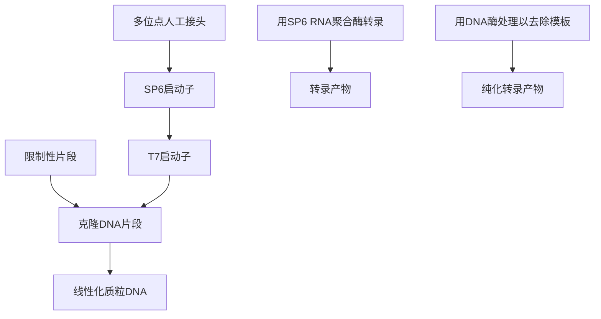

flowchart

图13-3 用噬菌体编码的RNA聚合酶体外合成RNA。[本图由Krieg和Melton（1987）提供，经Elsevier许可]。

在本方案中，我们介绍从含噬菌体编码的RNA聚合酶启动子的质粒中合成高特异性RNA探针的方法。以下附加方案介绍PCR产物的产生和转录。这两种方法的简介和背景信息见下述信息栏。

- 用于转录反应中 RNA 聚合酶的酶学特性详见本章末的信息栏“体外转录系统”。
- 减少 RNA 酶的污染应采取的必要措施概括于第 6 章信息栏“如何去除 RNase”。

## 用于体外转录的质粒载体

许多市售的质粒和噬菌粒载体带有各种不同噬菌体启动子和多克隆位点的组合 [如 pGEM 系列（Promega 公司）]。一些载体还编码 lacZ α互补片段，可利用含有 X-gal（5-溴-4-氯-3-蚓哚-β-D-半乳糖苷）的平板，根据颜色来筛选重组体。如何选用这些载体，在很大程度上要看个人所好。但是，假如需要同时得到两条模板链的转录物，那么选用带两种不同噬菌体启动子的载体会比将模板以两个方向插入只携带一种噬菌体启动子的载体更为有效。仔细考虑模板 DNA 内部及其下游限制性内切核酸酶位点的分布也很重要。转录的 5'端被噬菌体启动子所固定，而它的 3'端则由下游的限制性内切核酸酶位点所限定。所以采用同一质粒经不同的限制性内切核酸酶产生一系列线性模板，就可制备不同长度的 RNA 探针。然而，RNA 探针中的质粒序列会增加杂交背景，这些探针不能用于筛选质粒或黏粒文库。

制备模板 DNA 时，务必用一种限制酶完全切割超螺旋质粒 DNA，少量的环形质粒 DNA 可导致多聚转录物的形成而使产率显著降低。造成平端或 5' 突出端的限制酶可产生最佳的线性模板。但是，两种末端产生的 RNA 产物的 3' 端很不均一 (Melton et al. 1984; Milligan and Uhlenbeck 1989)。具 3' 突出端的模板会导致大量 RNA 分子在模板末端不正确地起始转录，从而产生双链 RNA 分子 (Schenborn and Mierendorf 1985)，因此应避免采用产生 3' 突出端的限制性内切核酸酶。

除质粒外，一些噬菌体和黏粒载体也含有噬菌体启动子，通常分别以相反方向设计在可供外源 DNA 插入的克隆位点的两侧。当以这类载体构建的重组体被一种可在外源 DNA 内部切割数次的限制酶消化后，可产生大量的片段，其中之一将含有某特定噬菌体启动子及紧靠其下游的外源序列。假如所产生的片段不含 3'突出端，那么只有带噬菌体启动子的片段才能作为体外转录反应的模板。所产生的放射性标记 RNA 与原外源 DNA 片段一侧的序列互补，可用作探针以筛选基因组 DNA 文库或 cDNA 文库相互重叠的克隆。这些载体大大简化了从一个重组克隆到另一个重组克隆的染色体步查的任务。以下是两个高效合成链特异性 RNA 探针的方法:

- 可将相关 DNA 片段克隆或亚克隆于含噬菌体编码的 DNA 依赖性 RNA 聚合酶启动子的特化质粒。以重组质粒作为双链模板的来源，体外转录成固定长度的、具链特异性的单链 RNA（Zinn et al. 1983; Melton et al. 1984）。
- 在引物的 5'端设计有噬菌体编码的、依赖 DNA 的 RNA 聚合酶的合成启动子，通过 PCR 扩增待转录的 DNA 片段。将 PCR 产物纯化后，可用作体外转录反应的双链模板（Logel et al. 1992; Bales et al. 1993; Urrutia et al. 1993）。

采用这两种方法均可极为有效地合成 RNA。当体外转录反应随核苷三磷酸（rNTP）饱和时，模板可被转录许多次，产生的 RNA 的量可数倍于模板。rNTP 浓度相对较低时（1～20μmol/L），噬菌体编码的、依赖 DNA 的 RNA 聚合酶也能在体外有效地发挥作用，所以合成高比活度全长探针的成本较低。此外，用无 RNA 酶的 DNase I 处理反应产物，即可从 RNA 探针中除去模板 DNA，因而通常不必用凝胶电泳进行纯化。但是，当用高比活度的 RNA 探针检测稀有 mRNA 转录物时，变性凝胶电泳纯化后的探针可使杂交背景最低。

## 材料

为正确使用本方案中的器材和危险试剂，必须查阅相应的材料安全数据表并咨询所在机构的环境卫生和安全办公室。

本方案的专用试剂标注&lt;R&gt;，配方在本方案末提供。常用储备溶液、缓冲液和试剂标注&lt;A&gt;，配方见附录1。储备溶液应稀释至适用浓度后使用。

▲用于此方案的所有试剂均须用 DEPC 处理的水配制（见第 6 章的信息栏 “如何去除 RNase”）。

## 试剂

琼脂糖凝胶（0.8%\~1.0%）（见步骤1）

$\left[\alpha-^{32}P\right]$ rGTP（10mCi/mL，比活度400～3000 Ci/mmol）

为最大限度地减少前体的辐射分解，应尽可能在 $\left[\alpha-^{32}P\right]$ dNTP到达实验室的当天制备放射性标记探针。

乙酸铵（10mol/L）&lt;A&gt;（可选；见步骤8）

适当的限制性内切核酸酶（见步骤1）

T4 噬菌体 DNA 聚合酶（2.5U/ $\mu$ L）（可选；见步骤 2）

10×T4噬菌体DNA聚合酶缓冲液（可选；见步骤2）

生物素-11-UTP 或 DIG-11-UTP（3.5mmol/L）

牛血清白蛋白（2mg/mL，片段 V，Sigma-Aldrich 公司）

DTT (1mol/L) &lt;A&gt;

## T3、T7 或 SP6 噬菌体依赖 DNA 的 RNA 聚合酶

这些酶由几家公司提供，通常浓度为 $10\sim 20\mathrm{U} / \mu \mathrm{L}$ 。大多数厂家还提供 $10\times$ 转录缓冲液，系适用于各自制备的依赖DNA的RNA聚合酶的优化缓冲液。但如厂商未提供缓冲液，可采用普通的 $10\times$ 转录缓冲液（见以下内容）。

dNTP 溶液，含各 2mmol/L dATP、dCTP、dGTP 和 dTTP（可选；见步骤 2）

有关配制及储存 dNTP 溶液，见信息栏 “dNTP 储备溶液的制备”

乙醇

酚:氯仿（1:1，V/V）

胎盘 RNA 酶抑制剂（20U/ $\mu$ L）

rGTP（0.5mmol/L）（可选；见步骤5）

无 RNA 酶的胰腺 DNase I（1mg/mL）

有几家厂商可提供这种酶（如 RQ1 无 RNA 酶的 DNA 酶 I [Promega 公司]）。

rNTP 溶液 1，含 rATP、rCTP 和 rUTP 各 5mmol/L

或

rNTP 溶液 2，含 rATP、rCTP 和 rGTP 各 10mmol/L 以及 rUTP（6.5mmol/L）

乙酸钠（3mol/L，pH 5.2）&lt;A&gt;

模板 DNA

体外转录的 DNA 片段应克隆于商品化的含噬菌体 RNA 聚合酶启动子质粒 [如 pGEM （Promega 公司）或 pBluescript（Stratagene 公司）] 中的多克隆位点两侧。按第 1 章所述的一种或多种方法纯化超螺旋重组质粒。

用作体外转录反应的模板 DNA 不需高度纯化，小量制备的粗制品即足以胜任。最基本的要求就是模板不含 RNA 酶。这一标准通常用酚:氯仿抽提质粒 DNA 两次即可达到。在纯化过程中，如去除蛋白后再用 RNA 酶处理，这时应通过以下方法用蛋白酶 K 处理而除去 RNA 酶:

1. 在质粒 DNA 样品中加入 0.1 体积 10×蛋白酶 K 缓冲液 [100mmol/L Tris-Cl (pH 8.0) / 50 mmol/L EDTA (pH 8.0) / 500mmol/L NaCl]、0.1 体积 0.5% (m/V) SDS 和终浓度为 100μg/mL 的蛋白酶 K（储备溶液 20 mg/mL）。

2.  $37^{\circ}$ C 温育反应 1 h。

3. 用酚:氯仿抽提及标准乙醇沉淀回收 DNA。

4. 将 DNA 悬浮于无 RNA 酶的 TE（pH 7.6）至浓度为大于等于  $100 \mu g/mL$ 。

10×转录缓冲液&lt;R&gt;

## 设备

微量离心管（0.5mL）

Sephadex G-50 离心柱，用 10mmol/L Tris-Cl（pH7.5）平衡（可选；见步骤 8）。

Sephadex G-50 凝胶过滤介质可用于从低分子质量物质（放射性前体保留在柱中）中分离 DNA（DNA 可穿过介质）。放射性标记 DNA 的纯化用 Sephadex G-50 柱可从几个商品渠道获得 [如 Quick Spin Columns（Roche Applied Science 公司）]。但是，用 1mL 装填硅化玻璃棉的一次性注射器很容易完成（见方案 1，步骤 6～14）。

水浴（40℃）（如在步骤4中应用SP6噬菌体依赖DNA的RNA聚合酶）

## 方法

1. 用适量的限制酶消化超螺旋质粒 DNA 制备 5pmol 的线性模板 DNA。取一小份消化的 DNA（100ng）进行琼脂糖凝胶电泳分析。如有必要，再补加限制酶继续温育，直至不再残存痕量的未消化 DNA。

2μg 3kb 质粒相当于约 1pmol。

▲质粒 DNA 模板必须酶切完全，因为痕量的闭环质粒 DNA 可产生含质粒序列的极长转录物。由于这些转录物很长，因而会占用相当比例的放射性标记 rNTP 掺入。

2. 如必须用产生 3' 突出端的限制酶如 PstI 或 SstI，则应用 T4 噬菌体 DNA 聚合酶在 4 种 dNTP 的存在下处理消化的 DNA 片段，以除去产生的 3' 突出端。

3' 突出端可在依赖 DNA 的 RNA 聚合酶的作用下转移到模板的互补链，产生具有延伸二级结构的长 U 形回转转录物。T4 DNA 聚合酶具有 3' → 5' 外切核酸活性，对于单链底物的作用比双链底物更强，此酶能快速水解 3' 突出端，然后继续以较慢的速度去除 DNA 底物的双链部分。然而，在高浓度 dNTP 的存在下，由外切核酸活性产生的凹进的 3' 羟基端可作为模板的引物，通过 5' → 3' 聚合酶活性引导单核苷酸的加入。由于 T4 DNA 聚合酶的合成能力超过其外切核酸活性，突出的 3' 端即转变成平端（Richardson et al. 1964）。

i. 酶切后先用酚:氯仿抽提，再用含 2.5mol/L 乙酸铵的乙醇沉淀，以纯化 DNA（见第 2 章，方案 4）。

ii. 将 DNA 沉淀溶于

| 10×T4 噬菌体 DNA 聚合酶缓冲液 | 2μL |
| --- | --- |
| 未标记的 dNTP 溶液(2mmol/L) | 1μL |
| T4 噬菌体 DNA 聚合酶(2.5U/μL) | 1μL |
| ${\mathrm{H}}_{2}\mathrm{O}$ | 加至 20μL |

iii.  $37^{\circ}$ C下温育反应5min。

3. 用酚:氯仿抽提及标准乙醇沉淀纯化模板 DNA。将 DNA 溶解于水，使其终浓度为 $100\mathrm{nmol/L}$ （如 $3\mathrm{kb}$ 质粒为 $200\mu \mathrm{g/mL}$）。

4. 选择下列配方之一，将前6种组分置于室温下复温。在一个灭菌的 $0.5\mathrm{mL}$ 微量离心管中，室温下按以下列顺序混合:

放射性标记

| 模板 DNA | 0.2pmol(3kb 质粒为 400ng) |
| --- | --- |
| 无 RNA 酶的水 | 加至 6μL |
| rNTP 溶液 1(5mmol/L) | 2μL |
| DTT(100mmol/L) | 2μL |
| 转录缓冲液(10×) | 2μL |
| 牛血清白蛋白(2mg/mL) | 1μL |
| [α-32P]rGTP(10mCi/mL) | 5μL(比活性 400~3000 Ci/mmol) |

DIG或生物素标记

| 模板 DNA | 0.2pmol(3kb 质粒为 400ng) |
| --- | --- |
| 无 RNA 酶的水 | 加至 9μL |
| rNTP 溶液 2(10mmol/L) | 2μL(含 6.5mmol/L rUTP) |
| DTT(100mmol/L) | 2μL |
| 10×转录缓冲液 | 2μL |
| 牛血清白蛋白(2mg/mL) | 1μL |
| 生物素-11-UTP 或 DIG-11-UTP (3.5mmol/L) | 2μL |

轻弹管外壁以使各组分混合。然后加入:

| 胎盘 RNA 酶抑制剂(10U) | 1μL |
| --- | --- |
| 噬菌体依赖 DNA 的 RNA 聚合酶(约 10U) | 1μL |

▲注意:在室温下按上述顺序加入各成分，以避免模板 DNA 被转录缓冲液中高浓度的亚精胺沉淀。

轻敲管壁外侧使反应物混合，离心 1～2s 以使所有液体沉降到管底。37℃（T3 和 T7 噬菌体依赖 DNA 的 RNA 聚合酶）或 40℃（SP6 噬菌体依赖 DNA 的 RNA 聚合酶）温育反应物 1～2h。

可依试剂的稀释程度调整反应体积至  $20 \sim 50 \mu L$ 。

如按上述反应条件，一般能使 $80\% \sim 90\%$ 的放射性标记物掺入RNA。当 $[\alpha^{-32}\mathrm{P}]\mathrm{GTP}$ 的比活性为 $3000\mathrm{Ci / mmol}$ 时，RNA的产率约为 $20\mathrm{ng}$ （比活性为 $4.7\times 10^{9}\mathrm{dpm / \mu g})$ ；当前体的比活性为 $400\mathrm{Ci / mmol}$ 时，RNA产率约为 $150\mathrm{ng}$ （比活性为 $6.2\times 10^{8}\mathrm{dpm / \mu g})$ 。

当使用生物素或 DIG 标记的 rNTP 时，反应中使用低浓度的修饰的核苷酸以确保仅有少量标记的核苷酸掺入探针的每个分子（每 20～25 个聚合的核苷酸中掺入约 1 个标记的核苷酸）。当仅有几个碱基被标记的同类物取代时，标记物在杂交后可被抗体更有效地识别。过多修饰核苷酸的掺入可减少探针与目标 mRNA 或 DNA 的杂交。

5.（可选）当制备放射性标记探针时，如需全长转录物，可加入 $2\mu \mathrm{L}0.5\mathrm{mmol / L}$ rGTP，在适宜该聚合酶的温度下再温育 $60\mathrm{min}$ 。

6. 加入 $1\mu \mathrm{L} 1\mathrm{mg / mL}$ 无RNA酶的胰DNaseI以终止体外转录反应。轻弹管外壁以混合各试剂。 $37^{\circ}C$ 温育反应混合物 $15\mathrm{min}$ 。

7. 加入  $100 \mu L$  无 RNA 酶的水，通过用酚:氯仿抽提纯化 RNA。

在某些实验中，探针的长度更为重要（如 RNA 酶保护试验），应通过聚丙烯酰胺凝胶电泳纯化放射性标记的 RNA（见第 2 章，方案 3），此步骤可除去探针中截短的标记分子。

8. 将水相转移至一个新的微量离心管，用下列三种方法中的任一方法将标记的 RNA 与不需要的小分子 RNA 和 rNTP 分开。

## 用乙醇沉淀纯化 RNA

i. 在水相中加入  $30 \mu L$  10mol/L 乙酸铵，混匀后再加入  $250 \mu L$  冰预冷的乙醇。置于冰上 30min 后，在微量离心机中  $4^{\circ}C$  下以最大速度离心 10min 收集 RNA。
ii. 小心地尽量吸去其中的乙醇，然后将管口敞开，在实验台上放置几分钟，使剩余的可见乙醇挥发干净。把 RNA 溶于  $100 \mu L$  无 RNA 酶的水中。
iii. 加 2 倍体积冰预冷的乙醇，于  $-70^{\circ}C$  储存备用。

回收 RNA 时，吸出一份乙醇溶液，转移到新的微量离心管。加入 0.25 体积的 10mol/L 乙酸铵，混匀后将管置于 -20℃ 至少 15min。在微量离心机中 4℃ 下以最大速度离心 10min。吸去乙醇，将 RNA 溶于适量体积的无 RNA 酶缓冲液中。

## 通过离心柱色谱法纯化 RNA

i. 如不使用商品化的离心柱, 将 Sephadex G-50 离心柱 (见方案 1) 平衡于 $10 \mathrm{mmol} / \mathrm{L}$ Tris-Cl (pH 7.5) 中灭菌处理。
ii. 按方案 1 用离心柱色谱法纯化 RNA。
iii. 将洗脱的 RNA 储存于  $-70^{\circ}$ C 备用。

## 通过凝胶电泳纯化 RNA

i. 按第 6 章，方案 11 准备中性聚丙烯酰胺凝胶。
ii. 在水相中加入适量的凝胶上样缓冲液，通过凝胶电泳纯化 RNA。

iii. 按第 2 章，方案 7 通过放射性自显影定位 RNA。

iv. 按第 2 章，方案 10 用挤碎和浸泡的方法从凝胶块中纯化 RNA。

v. 将 RNA 储存于  $-70^{\circ}$ C 备用。

上述任一纯化方法均应能够从 RNA 中除去大于 99.0% 未掺入的 rNTP。

见“疑难解答”。

## 疑难解答

问题（步骤 8）:无 RNA 合成。

解决方案: 如果不见 RNA 合成, 最常见的一个原因就是试管或试剂中污染了 RNA 酶。采取第 6 章概述中所述的注意事项可避免污染。

另一个不太常见的原因是  $10 \times$  转录缓冲液中的亚精胺使 DNA 模板发生沉淀。务必注意在室温下并按所述顺序添加反应液各成分。如有必要，取少量反应液用琼脂糖凝胶电泳分析，确证模板处于溶解状态。

问题（步骤 8）:按错误的 DNA 链进行转录。

解决方案:通常由噬菌体依赖的 DNA 的 RNA 聚合酶体外合成的大于 99.8% 转录物沿正确的 DNA 链产生（Melton et al. 1984），但只有采用非 3' 突出端的线状模板才能获得这样高的特异性。模板中污染的超螺旋质粒 DNA 将会增加 RNA 链，同时在 DNA 的两条链上错误起始。而且噬菌体启动子下游的 3' 突出端也将导致产生与全长的 DNA 错误链互补的转录物（如 U 形回转录物）。制备模板时多加小心即可避免这个问题（见步骤 1 和步骤 2）。

问题（步骤 8）:合成的转录物小于所需长度。

解决方案:合成产物未能达到全长的原因可能是由于所使用的特殊的依赖 DNA 的 RNA 聚合酶在某些终止转录的模板序列上停止转录；受前体（常为放射性标记的 rNTP）的浓度制约则可能为另一个原因。

为解决第一个问题，可构建一个新的质粒，在该质粒中由另一种噬菌体编码的聚合酶对目的序列进行转录。对于噬菌体依赖 DNA 的 RNA 聚合酶来说，转录终止子序列并不会同样有效地被各种酶所识别。

虽然转录终止信号的强度相差悬殊，但只要增加限速 rNTP 的浓度，除最强的终止信号外，所有终止信号均可能被超越，至少是部分被超越。在大多数情况下，增加反应中放射性标记 rNTP 的浓度是不切实际的，因为提高全长产物的产率是以降低探针的比活度为代价的。此时，可采用其他步骤:

\- 降低转录反应的温度至 $30^{\circ} \mathrm{C}$ (Krieg and Melton 1987)。

\- 把待转录序列减到最小，这样有可能从克隆中去除终止序列。

\- 按第 2 章，方案 1 或方案 3 所述，用聚丙烯酰胺或琼脂糖凝胶电泳纯化目的产物。由于转录反应的效率很高，即使它们在反应中仅占合成的总 RNA 中相对较少的一部分，亦常能纯化出足够量的目的 RNA。

# 附加方案 用 PCR 法将噬菌体编码的 RNA 聚合酶启动子加至 DNA 片段上

通过将目的 DNA 片段克隆到带噬菌体启动子的质粒中可产生噬菌体编码的 RNA 聚合酶作用的模板（方案 5），亦可用基因特异性的引物通过 PCR 合成模板，该基因特异性引物 5'端编码合成的启动子，供噬菌体编码的依赖 DNA 的 RNA 聚合酶起始转录。PCR 产物经纯化后，可用作体外转录反应的双链模板（Logel et al. 1992; Bales et al. 1993; Urrutia et al. 1993）。这样通过采用含编码不同启动子的成对引物，可合成 DNA 片段，以此为模板用适当的 RNA 聚合酶即可进行链特异性的转录。PCR 法的优越性如下:

- 探针可直接从不同群体的 DNA 片段扩增出来的 DNA 模板合成。
- 不需质粒的克隆及制备。
- 探针中不含质粒或多克隆位点序列。
- 可合成高比活性及任意大小的探针。

T3、T7噬菌体编码的RNA聚合酶可转录高特异性及含适当启动子的PCR扩增的DNA，但所获RNA的产率比线状质粒模板低3～4倍。当用PCR扩增的DNA作模板时，20%～30%标记的rNTP成为酸不溶性物质；而用线性质粒DNA作模板时，则大于75%标记的rNTP成为酸不溶性物质（Logel et al. 1992）。尽管如此，以PCR扩增产物合成的RNA的产率和比活性足以满足大多数实验目的。据报道，由SP6噬菌体编码的RNA聚合酶转录PCR扩增产物的效率远低于转录线性质粒DNA的效率（Logel et al. 1992）。因此，我们建议采用编码T3和T7噬菌体启动子的引物。

## 引物设计

通常引物很长（>50个核苷酸），由三个区域组成:

| 5'夹子(约10个核苷酸) | 核心启动子(约22个核苷酸) | 基因特异性序列3'(约20个核苷酸) |
| --- | --- | --- |

由 T3 和 T7 噬菌体 RNA 聚合酶识别的核心启动子序列由 Jorgensen 等(1991)报道(见信息栏“体外转录系统”):

| T7噬菌体核心启动子:5'TAATACGACTCACTATAGGGAGA3' |
| --- |
| T3噬菌体核心启动子:5'ATTAACCCTCACTAAAGGGAGA3' |

T3 启动子的 3'端的大多数二核苷酸可能为 GA 或 AG。

引物对的每一条引物使用不同的夹子序列，推测夹子序列为（Logel et al. 1992）5'CAGAGATGCA3'和5'CCAAGCCTTC3'。应按常规设计基因特异性引物（见第7章导言中有关引物设计的讨论）。

## 扩增条件

扩增反应含 10～20pg 的单种模板 DNA，如模板为 DNA 的复杂集群，则按比例增加模板量。其余扩增反应试剂均按标准浓度（见第 7 章，方案 1）。以下列举的变性、复性和聚合时间适用于 50μL 反应体积、使用 0.5mL 薄壁小管及应用以下热循环仪，如 Perkin-Elmer 9600 或 9700、Master Cycler（Eppendorf 公司）及 PTC 100（MJ Research 公司）。如应用其他类型的仪器及不同的反应体积，反应时间和温度应适当调整。

| 循环数 | 变性 | 复性 | 聚合 |
| --- | --- | --- | --- |
| 1~4 | 94°C, 1min | 54°C, 2min | 72°C, 3min |
| 5~36 | 94°C, 1min | 65°C, 1min | 72°C, 3min |

每 1000bp 的靶 DNA 聚合时间应为 1min。

大多数热循环仪设置  $4^{\circ}$ C 温育扩增样品的终末程序直至样品取出。样品在此温度下可过夜，但此后应储存于  $-20^{\circ}$ C。

## 扩增 DNA 的纯化

虽然扩增的 DNA 不经纯化即可用作体外转录反应的模板(Bales et al. 1993; Urrutia et al. 1993)，但如通过低融点琼脂糖凝胶、Sephadex G-75 离心柱色谱法或通过商品化的树脂吸附/洗脱而除去剩余引物和扩增反应的副产品，如采用 Wizard PCR 样品纯化系统（Promega 公司）或 QIAquick（Qiagen 公司）进行纯化，RNA 合成的效率会更高。

## 扩增 DNA 的体外转录

在适当噬菌体编码的依赖 DNA 的 RNA 酶的催化下，约  $0.5 \mu g$  纯化的扩增 DNA 可用作标准转录反应中的模板（见方案 5）。

## 配方

为正确使用本方案中的器材和危险试剂，必须查阅相应的材料安全数据表并咨询所在机构的环境卫生和安全办公室。

$10 \times$ 转录缓冲液

| 试剂 | 体积(1mL) | 终浓度 |
| --- | --- | --- |
| Tris-Cl(1mol/L,pH 7.5) | 400μL | 400mmol/L |
| MgCl2(1mol/L) | 60μL | 60mmol/L |
| Spermidine HCl(100mmol/L) | 200μL | 20mmol/L |
| NaCl(5mol/L) | 10μL | 50mmol/L |

对  $10\times$  缓冲液进行过滤除菌，然后分装、储存于  $-20^{\circ}C$ ，使用后弃去。

## 参考文献

- Bales KR, Hannon K, Smith CK II, Santerre RF. 1993. Single-stranded RNA probes generated from PCR-derived DNA templates. Mol Cell Probes 7: 269–275.
- Casey J, Davidson N. 1977. Rates of formation and thermal stabilities of RNA:DNA and DNA:DNA duplexes at high concentrations of formamide. Nucleic Acids Res 4: 1539–1552.
- Jorgensen ED, Durbin RK, Risman SS, McAllister WT. 1991. Specific contacts between the bacteriophage T3, T7, and SP6 RNA polymerases and their promoters. J Biol Chem 266: 645–651.
- Krieg PA, Melton DA. 1987. In vitro RNA synthesis with SP6 RNA polymerase. Methods Enzymol 155: 397–415.
- Logel J, Dill D, Leonard S. 1992. Synthesis of cRNA probes from PCR-generated DNA. BioTechniques 13: 604–610.
- Melton DA, Krieg PA, Rebagliati MR, Maniatis T, Zinn K, Green MR. 1984. Efficient in vitro synthesis of biologically active RNA and RNA hybridization probes from plasmids containing a bacteriophage
- SP6 promoter. Nucleic Acids Res 12: 7035–7056.
- Milligan JF, Uhlenbeck OC. 1989. Synthesis of small RNAs using T7 RNA polymerase. Methods Enzymol 180: 51–62.
- Richardson CC, Schildkraut CL, Aposhian HV, Kornberg A. 1964. Enzymatic synthesis of deoxyribonucleic acid. XIV. Further purification and properties of deoxyribonucleic acid polymerase of Escherichia coli. J Biol Chem 239: 222–232.
- Schenborn ET, Mierendorf RC Jr. 1985. A novel transcription property of SP6 and T7 RNA polymerases: Dependence on template structure. Nucleic Acids Res 13: 6223–6236.
- Urrutia R, McNiven MA, Kachar B. 1993. Synthesis of RNA probes by the direct in vitro transcription of PCR-generated DNA templates. J Biochem Biophys Methods 26: 113–120.
- Zinn K, DiMaio D, Maniatis T. 1983. Identification of two distinct regulatory regions adjacent to the human β-interferon gene. Cell 34: 865–879.

# 方案 6 用随机寡核苷酸引物法从 mRNA 合成 cDNA 探针

此法以 $\mathrm{poly(A)^+}$ RNA作为模板，通过随机引物反应合成放射性标记的cDNA探针，这类探针可用于cDNA文库的差异筛选。

## 材料

为正确使用本方案中的器材和危险试剂，必须查阅相应的材料安全数据表并咨询所在机构的环境卫生和安全办公室。

本方案的专用试剂标注&lt;R&gt;，配方在本方案末提供。常用储备溶液、缓冲液和试剂标注&lt;A&gt;，配方见附录1。储备溶液应稀释至适用浓度后使用。

▲用于此方案的所有试剂均须用 DEPC 处理的水配制（见第 6 章的信息栏 “如何去除 RNase”）。

## 试剂

$\left[\alpha-^{32}P\right]$ dCTP（10mCi/mL，比活度>3000Ci/mmol）

为最大限度地减少前体的辐射分解，应尽可能在 $\left[\alpha-^{32}P\right]$ dNTP到达实验室的当天制备放射性标记探针。

乙酸铵（10mol/L）&lt;A&gt;

dCTP (125μmmol/L)

在  $160 \mu L$  25mmol/L Tris-Cl（pH 7.6）中加入  $1 \mu L$  20mmol/L dCTP 储备溶液。将稀释的溶液以小份分装，储存于  $-20^{\circ}C$ 。

dNTP 溶液，含有 dATP、dGTP 和 dTTP 各 20mmol/L

有关配制及储存 dNTP 溶液，见信息栏 “dNTP 储备溶液的制备”。

DTT (1mol/L)

EDTA (0.5mol/L, pH 8.0)

乙醇

HCl (2.5mol/L)

NaOH(3mol/L)

酚:氯仿（1:1，V/V）

胎盘 RNA 酶抑制剂（20U/ $\mu$ L）

这些抑制剂有几家厂商以各种商品名销售（如 RNasin [Promega 公司]、RNaseOUT [Life Technologies 公司]。详情见第 6 章信息栏 “RNase 的抑制剂”。

长度为 6 或 7 个碱基的随机脱氧核苷酸引物

随机序列的合成寡核苷酸长度均一，无序列偏性，因而作为首选引物。最佳长度的寡核苷酸（六聚体或七聚体）（Suganuma and Gupta 1995）可从商品来源获得（如 Sigma-Aldrich 公司和 Boehringer Mannheim 公司）或在自动 DNA 合成仪上合成。将引物溶于 TE（pH 7.6），浓度为  $0.125 \mu g/\mu L$ ，分装成小份储存于  $-20^{\circ}C$ 。

## 反转录酶

Moloney 小鼠白血病病毒（Mo-MLV）pol 基因衍生的反转录酶在 cDNA 合成中的效率高于从禽髓系白血病病毒获得的反转录酶（见 Fargnoli et al. 1990）。克隆的 Mo-MLV 编码的反转录酶是本方案的首选酶。缺乏 RNase H 活性的酶的突变株 [如 StrataScript（Stratagene 公司）或 Superscript II（Life Technologies 公司）] 比野生型酶具有以下优越性:①全长延伸产物的产率高；②在 47℃ 和 37℃ 下均能有效作用（Gerard and D'Alessio 1993）。

Mo-MLV 反转录酶对温度很敏感，应储存于  $-20^{\circ}C$  直至步骤 2 时使用。

10×反转录酶缓冲液&lt;A&gt;

$$
\mathrm{SDS} (10 \%, m / V) <   \mathrm{A}>
$$

模板 mRNA

按第 6 章，方案 9 所述制备 poly(A) $^{+}$ RNA，溶于无 RNA 酶的水，浓度为 250μg/mL。

$$
\text {Tris - Cl} (1 \mathrm{mol} / \mathrm{L}, \mathrm{pH} 7. 4) <   \mathrm{A} >
$$

## 设备

冰水浴

Sephadex G-50 离心柱，平衡于 TE（pH7.6）（可选；见步骤 7）。

Sephadex G-50 凝胶过滤介质可用于从低分子质量物质（放射性前体保留在柱中）中分离 DNA（DNA 可穿过介质）。放射性标记 DNA 纯化用 Sephadex G-50 柱可从几个商品渠道获得 [如 Quick Spin Columns （Roche Applied Science 公司）]。但是，用 1mL 装填硅化玻璃棉的一次性注射器很容易完成（见方案 1，步骤 6～14）。

预热至  $45^{\circ}$ C、 $68^{\circ}$ C 和  $70^{\circ}$ C 的水浴或加热块。

## 方法

1. 将 $1 \mu \mathrm{g} \mathrm{poly}(\mathrm{A})^{+} \mathrm{RNA}$ 转移至无菌的离心管。用无 RNA 酶的水将溶液的体积调至 $4 \mu \mathrm{L}$ 。盖紧微量离心管盖，于 $70^{\circ} \mathrm{C}$ 加热 $5 \mathrm{~min}$，然后迅速将离心管置于冰水浴中。

2. 在微量离心管的冷溶液中加入:

| DTT(10mmol/L) | 2.5μL |
| --- | --- |
| 胎盘RNA酶抑制剂 | 20U |
| 随机脱氧寡核苷酸引物 | 5μL |
| 10×反转录缓冲液 | 2.5μL |
| dGTP、dATP和dTTP溶液(20mmol/L) | 1μL |
| dCTP溶液(125μmol/L) | 1μL |
| [α-32P]dCTP(10mCi/mL) | 10μL |
| (比活性为>3000Ci/mmol) |  |
| 无RNA酶的水 | 加至24μL |
| 反转录酶(200U) | 1μL |

▲ 最后加反转录酶。

由不同厂商提供的每单位反转录酶的活性不同。当使用一批新的酶时，应设立一系列含等量 $\mathrm{poly(A)^+RNA}$ 、寡核苷酸引物及不同酶量的延伸反应。如有可能，应使用对于 $\mathrm{poly(A)^+RNA}$ 中以中等丰度存在的某一 mRNA 为特异性的引物。按本方案所述，通过凝胶电泳分析每次反应的产物。应用能产生最高得率的延伸产物所需的最小酶量。本方案中所述的酶单位对于大多数批次的 StrataScript 和 Superscript II 都适用。

轻敲管壁以混匀各成分，稍加离心以除去气泡。45℃温育反应混合物1h。

可用比活性为 800 Ci/mmol 的  $[\alpha-^{32}P]$ dCTP 代替反应混合物中的 125μmol/L dCTP。

3. 加入下列试剂以终止反应:

| EDTA (0.5 mol/L, pH 8.0) | 1μL |
| --- | --- |
| SDS (10%, m/V) | 1μL |

充分混合管中的试剂。

单链放射性标记的 cDNA 很黏，能非特异性地附着于玻璃、滤膜和某些塑料制品。因此用于本方案步骤 3 的溶液至少应含 0.05% (m/V) SDS，以及杂交缓冲液中含 0.1%\~1.0% SDS。

4. 在反应管中加入 $3 \mu \mathrm{L} 3 \mathrm{~mol} / \mathrm{L} \mathrm{NaOH}, 68^{\circ} \mathrm{C}$ 温育混合物 $30 \mathrm{~min}$ 以水解 RNA。

5. 使反应混合物的温度降至室温，加入 $10 \mu \mathrm{L} 1 \mathrm{~mol} / \mathrm{L}$ Tris-Cl（$\mathrm{pH} 7.4$）以中和溶液，完全混匀，然后加入 $3 \mu \mathrm{L} 2.5 \mathrm{~mol} / \mathrm{L} \mathrm{HCl}$。取极小量液体在 $\mathrm{pH}$ 试纸上，以检测溶液的 $\mathrm{pH}$。

6. 用酚:氯仿抽提纯化 cDNA。

7. 用离心柱色谱法（按照方案1步骤 $6\sim 14$ 用商品化的柱子或自制的柱子）或在$2.5\mathrm{mol / L}$ 乙酸铵存在下用乙醇选择性地沉淀（见第1章，方案4)，将放射性标记的探针与未掺入的dNTP分离。

8. 确定放射性标记 dNTP 掺入 TCA 沉淀物中的比例（见附录 2）。

假定 30% 的放射性活性在随机引物反应中掺入了 TCA 可沉淀物，且 90% 该物质是沿模板 RNA 由随机引物反应产生的（而非寡核苷酸的自身引导），那么探针 DNA 的总活性将为约  $6 \times 10^{7}$  dpm，探针的比活性可达约  $5 \times 10^{9}$  dpm/ $\mu$ g，反应中合成的 DNA 量为 11.7ng。

如需标记大量的 cDNA，可按比例增加各成分的体积。重要的是保持 200U 反转录酶/ $\mu$ g mRNA 的比例，以确保最高产率。

纯化的放射性标记 cDNA 无须变性即可用于杂交。每张 150mm 滤膜可用  $5 \times 10^{7}$  dpm 放射性标记的 cDNA，每张 90mm 滤膜可用  $5 \times 10^{6} \sim 1 \times 10^{7}$  dpm 放射性标记的 cDNA。

## 参考文献

Fargnoli J, Holbrook NJ, Fornace AJ Jr. 1990. Low-ratio hybridization subtraction. Anal Biochem 187: 364–373.

Gerard GF, D'Alessio JM. 1993. Reverse transcriptase (EC2.7.7.49): The use of cloned Moloney murine leukemia virus reverse transcriptase to synthesize DNA from RNA. In Enzymes of molecular biology (ed Burrell

MM), pp. 73–94. Humana, Totowa, NJ.
Suganuma A, Gupta KC. 1995. An evaluation of primer length on random-primed DNA synthesis for nucleic acid hybridization: Longer is not better. Anal Biochem 224: 605–608.

## 方案 7 用随机寡核苷酸延伸法制备放射性标记的消减 cDNA 探针

此方案中 cDNA 的合成是在 4 种饱和浓度的 dNTP 及一种痕量的放射性标记的 dNTP 中进行的。消减杂交后，在大肠杆菌 DNA 聚合酶 I 的 Klenow 片段作用下，富集的单链 cDNA 通过随机寡核苷酸引物延伸的二次合成反应，标记成高比活度的探针。由于第一轮反应中 dNTP 的浓度为非限制性的，所生成的 cDNA 的量及大小均高于标准方案，因此消减杂交步骤以高效进行。由此产生的 cDNA 群体不易受辐射分解的破坏，从而可长期储存，必要时尚可标记成较高比活度的探针。

如初始反应中合成的 cDNA 为全长或接近全长，本方案最为适用。所以本方案 cDNA 的合成以 oligo(dT) 引导，而不以随机六核苷酸作引物。随后的放射性标记反应则以随机寡核苷酸作引物，产生较短的 DNA 产物，如此大小的片段是杂交的理想探针。

按本方案中步骤 1～10 所述制备的 cDNA 可转变成双链 DNA，并克隆到噬菌体或质粒载体而产生消减 cDNA 文库（Sargent and Dawid 1983; Davis 1986; Rhyner et al. 1986; Fargnoli et al. 1990），可用消减探针筛选 cDNA 文库。由于消减文库中富集了与低丰度 mRNA 相对应的 cDNA 克隆，所以要找到一个相应于稀有 mRNA 克隆所需的筛选量可减少 10 倍。本方案介绍的放射性标记的消减探针可检测到相当于每个哺乳类动物细胞表达 5 个 mRNA 分子水平的 cDNA。

## 材料

为正确使用本方案中的器材和危险试剂，必须查阅相应的材料安全数据表并咨询所在机构的环境卫生和安全办公室。

本方案的专用试剂标注&lt;R&gt;，配方在本方案末提供。常用储备溶液、缓冲液和试剂标注&lt;A&gt;，配方见附录1。储备溶液应稀释至适用浓度后使用。

▲用于此方案的所有试剂均须用 DEPC 处理的水配制（见第 6 章的信息栏 “如何去除 RNase”）。

## 试剂

$\left[\alpha-^{32}P\right]$ dATP（10mCi/mL，比活性>3000Ci/mmol）

$\left[\alpha-^{32}\mathrm{P}\right]\mathrm{dCTP}$ （10mCi/mL，比活性800～3000Ci/mmol）

为最大限度地减少前体和探针的辐射分解，应尽可能在 $\left[\alpha-^{32}P\right]$ dNTP到达实验室的当天制备放射性标记探针。

乙酸铵（10mol/L）&lt;A&gt;

含 4 种 dNTP 各 5mmol/L 的 dNTP 溶液（完全溶液）

含 dCTP、dGTP 和 dTTP 各 5mmol/L 的 dNTP 溶液

▲此溶液中省去 dATP。

有关制备和储存 dNTP 溶液见信息栏 “dNTP 储备溶液的制备”。

驱动 mRNA（见步骤 8）

DTT (1mol/L) &lt;A&gt;

EDTA (0.5mol/L, pH 8.0) &lt;A&gt;

乙醇

HCl (2.5mol/L)

异丁醇

大肠杆菌 DNA 聚合酶 I Klenow 片段

NaOH (3mol/L)

oligo(dT) $_{12\sim18}$

可购买 oligo(dT) $_{12\sim18}$ ，将其溶解于 TE（pH 7.6），浓度为 1mg/mL。-20℃储存。

酚:氯仿（1:1，V/V）

胎盘 RNA 酶抑制剂

几家厂商以不同的商品名出售这类抑制剂 [如 Rnasin（Promega 公司）；RNaseOUT（Life Technologies 公司）]。详细内容见第 6 章的信息栏 “RNase 的抑制剂”。

长度为 6 或 7 个碱基的随机脱氧核苷酸引物

随机序列的合成寡核苷酸长度均一、无序列偏性，为引物首选。最佳长度的寡核苷酸（六聚体和七聚体）（Suganuma and Gupta 1995）可从商业渠道购买（如 Sigma-Aldrich 公司和 Life Technologies 公司）或在自动 DNA 合成仪上合成。将引物溶于 TE（pH 7.6），浓度为  $0.125 \mu g/\mu L$ ，分装成小份储存于  $-20^{\circ}C$ 。

$5 \times$ 随机引物缓冲液 $< \mathrm{A} >$

反转录酶

Moloney 小鼠白血病病毒（Mo-MLV）pol 基因衍生的反转录酶在 cDNA 合成中的效率高于从禽髓系白血病病毒获得的反转录酶（见 Fargnoli et al. 1990）。克隆的 Mo-MLV 编码的反转录酶是本方案的首选酶。缺乏 RNase H 活性的酶的突变株 [如 StrataScript（Stratagene 公司）或 Superscript II（Life Technologies 公司）] 比野生型酶具有以下优越性:①全长延伸产物的产率高；②在 47℃ 和 37℃ 下均能有效作用（Gerard and D'Alessio 1993）。

10×反转录酶缓冲液&lt;A&gt;

SDS (20%, m/V) &lt;A&gt;

SDS/EDTA 溶液

EDTA (30mmol/L, pH 8.0)

SDS (1.2%)

乙酸钠（3mol/L, pH 5.2）&lt;A&gt;

磷酸钠缓冲液（2mol/L, pH 6.8）&lt;A&gt;

SPS 缓冲液

磷酸钠缓冲液（0.12mol/L, pH 6.8）

SDS (0.1%, m/V)

模板 RNA

从表达目的 mRNA 的细胞或组织中两次过柱制备的 poly(A) $^{+}$ 丰富的 mRNA

从不表达目的 mRNA 的细胞或组织中两次过柱制备的 poly(A) $^{+}$ 丰富的 mRNA

通过 oligo(dT)磁珠制备和分离 mRNA 见第 6 章，方案 9。两种 RNA 应溶解于水，浓度约为 1mg/mL。

Tris-Cl (1mol/L, pH 7.4) &lt;A&gt;

无 RNA 酶的水

## 设备

Sephadex G-50 离心柱，平衡于 TE（pH 7.6）

Sephadex G-50 凝胶过滤介质可用于从低分子质量物质（放射性前体保留在柱中）中分离 DNA（DNA 可穿过介质）。放射性标记 DNA 纯化用 Sephadex G-50 柱可从几个商品渠道获得 [如 Quick Spin Columns（Roche Applied Science 公司）]。但是，用 1mL 装填硅化玻璃棉的一次性注射器很容易完成（见方案 1，步骤 6～14）。

硅化的微量离心管（1.5mL）

预热至  $45^{\circ}$ C、 $60^{\circ}$ C 和  $68^{\circ}$ C 的水浴或加热块

## 方法

1. 4℃下在一个灭菌的微量离心管中混合下列组分以合成 cDNA 第一链:

| 模板 RNA(1mg/mL) | 10μL |
| --- | --- |
| oligo(dT)12~18(1mg/mL) | 10μL |
| dNTP完全溶液(5mmol/L) | 10μL |
| DTT(50mmol/L) | 1μL |
| 10×反转录酶缓冲液 | 5μL |
| [α-32P]dCTP(10mCi/mL) | 5μL |
| (比活性800Ci/mmol或3000Ci/mmol) |  |
| 胎盘RNA酶抑制剂 | 25U |
| 无RNA酶的水 | 加至46μL |
| 反转录酶(约800U) | 4μL |

▲ 最后加反转录酶。

由不同厂商提供的每单位反转录酶的活性不同。当使用一批新的酶时，应设立一系列含等量 $\mathrm{poly(A)^+RNA}$ 、寡核苷酸引物及不同酶量的延伸反应。如有可能，应使用对于 $\mathrm{poly(A)^+RNA}$ 中以中等丰度存在的某一 mRNA 为特异性的引物。按本方案所述，通过凝胶电泳分析每次反应的产物。应用能产生最高得率的延伸产物所需的最小酶量。本方案中所述的酶单位对于大多数批次的 StrataScript 和 Superscript II 都适用。

轻弹管外壁以混合各组分，稍加离心以收集管底的反应物。于  $45^{\circ}$ C 温育反应物 1 h。

$\alpha-^{32}P$ dCTP 可用作示踪剂检测 cDNA 第一链的合成。

2. 检测放射性标记的 dNTP 掺入 TCA 可沉淀物的比率（见附录 2）。用下列公式计算 cDNA 的产率。在含每种 dNTP 各 50nmol 的反应中:

$$
\frac {\text {掺入的cpm}}{\text {总cpm}} \times 2 0 0 \mathrm{nmol} \mathrm{dNTP} \times 3 3 0 \mathrm{ng} \mathrm{nmol} = \text {合成的cDNA(ng)}
$$

3. 加入下列试剂以终止反应:

| EDTA (0.5 mol/L, pH 8.0) | 2μL |
| --- | --- |
| SDS (20%, m/V) | 2μL |

充分混匀微量管中的各成分。

单链放射性标记的 cDNA 很黏，能非特异性地附着于玻璃、滤膜和某些塑料制品。因此用于本方案步骤 3 的溶液至少应含 0.05% (m/V) SDS，以及杂交缓冲液中含 0.1%～1.0% SDS。

4. 在反应管中加入 $5 \mu \mathrm{L} 3 \mathrm{~mol} / \mathrm{L} \mathrm{NaOH}$, 于 $68^{\circ} \mathrm{C}$ 温育反应 $30 \mathrm{~min}$ 以水解 RNA。

5. 将反应物温度降至室温。加入  $10 \mu L$  1mol/L Tris-Cl（pH 7.4），充分混匀以中和溶液，然后加  $5 \mu L$  2.5mol/L HCl。点一小滴溶液（<1  $\mu L$ ）在 pH 试纸上以检测溶液的 pH。

6. 用酚:氯仿抽提纯化 cDNA。

7. 用 Sephadex G-50 离心柱色谱法分离放射性标记的探针与未掺入的 dNTP（见方案 1，步骤 6～14）。

▲此步骤及随后的所有步骤均须使用硅化管（见附录2）。

8. 按以下步骤进行两轮消减杂交:

i. 在放射性标记的 cDNA 中，加入 10 倍重量的驱动 mRNA（用于消减 cDNA 探针）、0.2 体积的 10mol/L 乙酸铵和 2.5 倍体积的冷乙醇。在 0℃ 下反应 10～15min，然后在 4℃ 下、微量离心机中以最大速度离心 5 min，以回收核酸。

ii. 吸去所有的乙醇，敞开管盖，置于实验台上，使大多数残留的乙醇蒸发。将核酸溶于  $6 \mu L$  无 RNA 酶的水中。

iii. 在溶解的核酸中加入:

| 磷酸钠(2 mol/L, pH 6.8) | 2μL |
| --- | --- |
| SDS/EDTA 溶液 | 2μL |

iv. 用一滴轻矿物油覆盖于溶液上，将微量离心管置于沸水浴中 5min，然后转移至  $68^{\circ}$ C 水浴，使核酸杂交至  $C_{r_{0}} t = 1000 \, mol \cdot sec/L$ 。

为计算达此  $C_{r_{0}}t$  所需的时间，解下列方程求 t:

$$
D / D _ {0} = \mathrm{e} ^ {- k C _ {r _ {0}} t}
$$

式中，D 为在 t 时刻未反应的单链 cDNA 的浓度； $D_{0}$  为投入 cDNA 的总量；e 为自然对数；k 为生成 RNA-DNA 杂交体的速度常数，取决于 mRNA 群体的复杂度，可假定为约  $6.7 \times 10^{-3}$  L/mol-sec， $C_{r_{0}}t$  为 RNA 驱动方的初始浓度（在杂交反应中无显著变化）（有关此方程的精确描述见 Sargent 1987，其他信息请见 538 页 Davidson 1986）。

v. 从水浴中取出离心管，用一个尖部拉长的吸头连到微量进样器上，从微量离心管中吸出杂交液，将杂交反应液转移至含 1mL SPS 缓冲液的管中。

vi.  $60^{\circ}$ C下通过羟基磷灰石层析分离单链和双链核酸。

用液体闪烁计数仪测定每一组分中的放射性量。至少应有 $90\%$ 投入的 $\left[{ }^{32} \mathrm{P}\right]$ cDNA已与mRNA杂交，应存在于 $>0.36 \mathrm{~mol} / \mathrm{L}$ 磷酸钠洗涤液中。

vii. 合并含单链 cDNA 的各组分，用异丁醇反复抽提浓缩。加入等体积的异丁醇，涡旋振荡混匀两相，室温下以最大速度在微量离心机中离心 2min。弃上相（有机相）。反复用异丁醇抽提，直至水相体积小于 100μL。

viii. 用含 0.1% SDS 的 TE（pH 8.0）平衡的 Sephadex G-50 离心柱色谱法，去除 cDNA 中的盐（见方案 1，步骤 6～14）。

▲勿用乙醇沉淀浓缩 cDNA，因为磷酸离子的存在会干扰 DNA 沉淀。勿采用透析去除磷酸离子，因为 cDNA 会附着于透析袋。

ix. 测定样品中的放射性量，计算消减探针中 DNA 的量。

x. 重复步骤（i）～（ix）。

10%\~30%的 cDNA 将在第二轮杂交中与驱动方 RNA 形成杂交体。

若探针用于检测 cDNA 文库，则无须对 cDNA 终产物进行浓缩或除盐。放射性标记的 cDNA 探针无须变性即可用于杂交。高比活性的放射性探针可因放射化学衰变而被迅速破坏，因此消减杂交应在实际情况许可的前提下尽快进行，探针亦尽早使用，切勿延误。每张 150mm 滤膜用  $5 \times 10^{7}$  dpm 放射性标记的 cDNA，每张 90 mm 滤膜用  $5 \times 10^{6} \sim 1 \times 10^{7}$  dpm 放射性标记的 cDNA。

如用放射性标记的消减探针筛选基因组 DNA 文库，可将 oligo(dA) 以  $1 \mu g/mL$  的浓度加到预杂交和杂交反应液中，以防止 cDNA 的 oligo(dT) 尾与基因组 DNA 中 oligo(dA) 非特异性杂交。

9. 用异丁醇续贯抽提浓缩最终的 cDNA，按照上述步骤 8 中 vii 和 viii 所述，通过 Sephadex G-50 层析除盐。

10. 通过标准的乙醇沉淀回收 cDNA（见第 1 章，方案 4）。将 cDNA 溶于水，终浓度为  $15ng/\mu L$ 。

▲ 在用离心柱色谱法去除磷酸离子之前不可用乙醇沉淀 cDNA，磷酸离子的存在会干扰 DNA 沉淀。

11. 为制备高比活度的放射性标记的消减 cDNA 探针，在一个 $0.5 \mathrm{~mL}$ 微量离心管中混合下列试剂:

| 消减 cDNA | 5μL |
| --- | --- |
| 随机脱氧核苷酸引物(125μg/mL) | 5μL |

12. 于  $60^{\circ}$ C 加热混合物 5 min，然后冷却至  $4^{\circ}$ C。

13. 向引物:cDNA 模板混合物中加入:

| 5×随机引物缓冲液 | 10μL |
| --- | --- |
| 含dCTP、dGTP和dTTP | 5μL |
| 各5mmol/L的dNTP溶液 |  |
| $[\alpha-^{32}P]$ dATP(10mCi/mL) | 25μL |
| (比活度大于3000Ci/mmol) |  |
| Klenow片段(12.5U) | 2.5μL |
| $H_2O$ | 加至50μL |

室温下反应 4～6 h。每次随机引物反应需要 10～15U 的 Klenow 片段。

14. 加入下列试剂以终止反应:

| EDTA (0.5mol/L, pH 8.0) | 1μL |
| --- | --- |
| SDS (20%, m/V) | 2.5μL |

15. 用 Sephadex G-50 离心柱色谱法分离放射性标记的 cDNA 与未掺入的 dNTP（见方案 1，步骤 6～14）。

杂交前，放射性标记的 cDNA 应在  $100^{\circ}$ C 加热 5min 变性。每张 138mm 滤膜用  $5 \times 10^{7}$  dpm 放射性标记的 cDNA，每张 82mm 滤膜用  $5 \times 10^{6} \sim 1 \times 10^{7}$  dpm 放射性标记的 cDNA。探针经放射性标记后，应立即使用，以避免放射化学衰变导致的破坏。

## 配方

为正确使用本方案中的器材和危险试剂，必须查阅相应的材料安全数据表并咨询所在机构的环境卫生和安全办公室。

$5 \times$ 随机引物缓冲液

| 试剂 | 体积(1mL) | 终浓度 |
| --- | --- | --- |
| Tris-Cl(1mol/L,pH 8.0) | 250μL | 250mmol/L |
| MgCl2(1mol/L) | 25μL | 25mmol/L |
| NaCl(5mol/L) | 20μL | 100mmol/L |
| DTT(1mol/L) | 10μL | 10mmol/L |
| HEPES(2mol/L,用4mol/L NaOH调至pH 6.6) | 500μL | 1mol/L |

用水新鲜稀释储存于-20℃的1mol/L DTT储备溶液，使用后弃去稀释的DTT溶液。

## 参考文献

- Davidson EH. 1986. Gene activity in early development, 3rd ed., pp. 538–540. Academic, New York.
- Davis MM. 1986. Subtractive cDNA hybridization and the T-cell receptor genes. In Handbook of experimental immunology (ed Weir DM, et al.), vol. 2, pp. 76.1–76.13. Blackwell Scientific, Oxford.
- Fargnoli J, Holbrook NJ, Fornace AJ Jr. 1990. Low-ratio hybridization subtraction. Anal Biochem 187: 364–373.
- Gerard GF, D'Alessio JM. 1993. Reverse transcriptase (EC2.7.7.49): The use of cloned Moloney murine leukemia virus reverse transcriptase to synthesize DNA from RNA. In Enzymes of molecular biology (ed Burrell MM), pp. 73–94. Humana, Totowa, NJ.

Rhyner TA, Biguet NF, Berrard S, Borbély AA, Mallet J. 1986. An efficient approach for the selective isolation of specific transcripts from complex brain mRNA populations. J Neurosci Res 16: 167–181.

Sargent TD. 1987. Isolation of differentially expressed genes. Methods Enzymol 152: 423–432.

Sargent TD, Dawid IB. 1983. Differential gene expression in the gastrula of Xenopus laevis. Science 222: 135–139.

Suganuma A, Gupta KC. 1995. An evaluation of primer length on random-primed DNA synthesis for nucleic acid hybridization: Longer is not better. Anal Biochem 224: 605–608.

## 方案 8 用大肠杆菌 DNA 聚合酶 I 的 Klenow 片段标记双链 DNA 的 3' 端

线性双链 DNA 最简单的标记方法是利用大肠杆菌 DNA 聚合酶 I 的 Klenow 片段催化一个或多个  $[\alpha-^{32}P]dNTP$  掺入 3' 凹端（Telford et al. 1979; Cobianchi and Wilson 1987）。有关可用于 DNA 末端标记的其他方法的总结见表 13-3。可用适当的限制性内切核酸酶消化 DNA，产生末端补平反应适宜的模板片段，然后用 Klenow 酶催化 dNTP 附着于凹进的 3' 羟基（见信息栏“大肠杆菌 DNA 聚合酶 I 和 Klenow 片段”）。标记反应为通用而迅速的反应，其优越之处在于反应能在限制酶消化中进行，无须更换缓冲液。由于 Klenow 酶的 3'→5' 外切酶活性较弱，因而酶对于平端或 3' 突出端核酸掺入的能力有限。根据 DNA 末端及标记反应中放射性标记的核苷酸的性质，可标记线性双链 DNA 分子 3' 端的一端或两端（见信息栏“3' 凹端和平端的标记”）。然而，多数情况下，标记反应中最好含有未标记的 dNTP，因而可在 3' 凹端的任何位置进行标记。此外，在标记 dNTP 下游掺入未标记 dNTP，可保护标记的核苷酸免受惰性 3'→5' 外切核酸酶的作用。两端均标记的 3' 端片段可用作:

- Southern 杂交中的分子质量标准（见步骤 4 后的信息栏 “制备凝胶电泳用的放射性标记分子质量标准”）
- 凝胶上小量 DNA 的示踪剂

只标记一端的片段可用于:

- S1 核酸酶进行 RNA 作图使用的探针（第 6 章，方案 16）
- 引物延伸反应中的引物