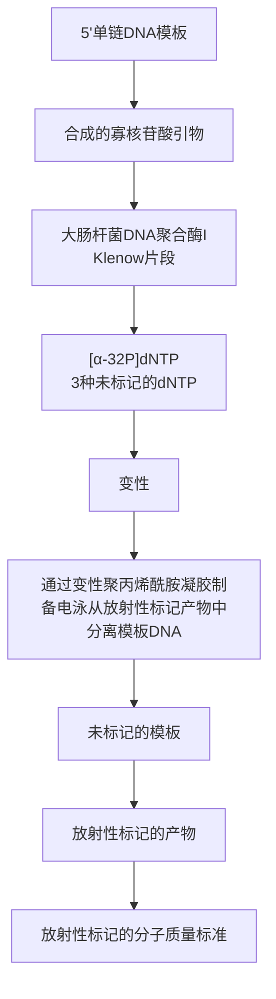

DNA 寡核苷酸（约 10pmol DNA 3'端，10～100ng，取决于长度）

见方案 9 中信息栏 “计算 DNA 样品中 5' 端含量”。

EDTA (0.2mol/L, pH8.0) &lt;A&gt; (可选，见步骤3)

重组末端转移酶（400U/μL）

重组形式的末端转移酶比天然酶的活性更高，由几家公司（如 Roche Applied Science 公司和 New England Biolabs 公司）提供。

5×末端转移酶反应缓冲液&lt;R&gt;

无核酸酶的无菌水

## 设备

水浴或加热块（37℃和70℃）（可选）

## 方法

1. 在一个置于冰上的微量离心管中，加入下列试剂:

| 末端转移酶反应缓冲液 | 10μL |
| --- | --- |
| ${\mathrm{{CoCl}}}_{2}$(25nmol/L) | 5μL |
| DNA 寡核苷酸(10pmol 3'端) | ${x\mu }{\mathrm{L}}^{\mathrm{a}}$ |
| $\left\lbrack {\alpha - {}^{32}\mathrm{P}}\right\rbrack \mathrm{{ddATP}}$ | 5μL |
| 末端转移酶 | 1μL |
| ${\mathrm{H}}_{2}\mathrm{O}$ | 加至终体积 50μL |

a. 根据 DNA 寡核苷酸的浓度决定适宜的体积。

轻柔而持续敲击管壁以混匀试剂。瞬时离心以收集管底部的溶液。将  $0.5 \mu L$  的反应混合物加入一支含有 0.02 mol/L EDTA 的管中，放置待步骤 4 时确定放射性标记物的掺入。

2.  $37^{\circ}$ C下温育反应60min。

3. $70^{\circ} \mathrm{C}$ 加热 $10 \mathrm{~min}$ 或加入 $5 \mu \mathrm{L} 0.2 \mathrm{~mol} / \mathrm{L}$ EDTA (pH 8.0) 以终止反应。

4. 用一小份反应混合物测定转移至寡核苷酸底物的放射性标记物，以确定标记反应是否成功。将反应的样品（0.5μL）移至含有0.02mol/L EDTA的管中。通过以下任一方法，用此样品（以及步骤1的样品）测定 $^{32}$ P-ddATP掺入的效率:

\- 测定放射性标记的 dNTP 掺入 TCA 可沉淀物中的比例（见附录 2）。

或

\- 通过 Sephadex G-15 或 Bio-Rad P-60 分子排阻色谱评估随寡核苷酸迁移的标记物比例，测定标记反应的效率。此方法的详细描述见方案 17。某些情况下，在两种方法中此法更为便捷，因为掺入和未掺入的相对量可在层析过程中用手提式微型探测器估计。至少应获得 30% 的掺入率。

5. 如果寡核苷酸的比活性是可接受的，可按方案 $15\sim 17$ 所述纯化放射性标记的寡核苷酸。

## 替代方案 用 TdT 合成非放射性标记的探针

## 方法

为改进上述方案以用于非放射性的核苷酸，可增加反应中  $3'$  端的量至约 100pmol，使反应中  $CoCl_{2}$  的量加倍至 5mmol/L。

1. 在一个置于冰上的微量离心管中加入下列试剂:

| 末端转移酶反应缓冲液 | 4μL |
| --- | --- |
| $CoCl_2$(25mmol/L) | 4μL |
| DNA 寡核苷酸(100pmol 3'端) | $x\mu L^a$ |
| 生物素、DIG 或荧光素-ddUTP | 1μL |
| 末端转移酶 | 1μL |
| $H_2O$ | 加至终体积 20μL |

a. 根据 DNA 寡核苷酸的浓度决定适宜的体积。

轻柔而持续敲击管壁以混匀试剂。瞬时离心以收集管底部的溶液。

2.  $37^{\circ}$ C下温育反应15min。
3. 70℃加热 10min 或加入 2μL 0.2mol/L EDTA（pH 8.0）以终止反应。
4. 按方案 15～17 所述从未掺入的标记物中分离纯化探针。

## 附加方案 加尾反应

加尾反应在标记的和未标记的 dATP、dTTP、dGTP 或 dCTP 的存在下进行。添加 dNTP 的速率和尾的长度取决于 DNA 3'端和 dNTP 浓度的比率，以及所用特异性的 dNTP。下列数据是在  $37^{\circ}$ C 下温育 15min 得出的近似估算值。

<table><tr><td rowspan="2">pmol 3&#x27;端的比率/ (μmol/L dNTP)</td><td colspan="4">尾长(37°C下温育15min)(核苷酸)</td></tr><tr><td>dATP</td><td>dTTP</td><td>dGTP</td><td>dCTP</td></tr><tr><td>1:0.1</td><td>1~5</td><td>1~5</td><td>1~3</td><td>1~3</td></tr><tr><td>1:1</td><td>10~20</td><td>10~20</td><td>5~10</td><td>10~20</td></tr><tr><td>1:5</td><td>100~300</td><td>200~300</td><td>10~25</td><td>50~200</td></tr><tr><td>1:10</td><td>300~500</td><td>250~350</td><td>15~25</td><td>100~150</td></tr></table>

本方案中所述反应条件产生尾长为 75～125 个核苷酸的片段，用于尾部携 dATP 和 dTTP 的放射性标记探针，以及尾部携 dGTP 和 dCTP 的、长度为 15～30 个核苷酸的探针。

## 其他材料

试剂

dNTP 标记混合物（见步骤 1）

## 方法

## 1. 为进行放射性标记，准备下列试剂:

$CoCl_{2}$  溶液（15mmol/L 储备溶液）

放射性标记混合物

如使用 dATP 或 dTTP 标记混合物，将 1 倍体积 2.5mmol/L 的 dATP 或 dTTP 与 4 倍体积的  $[\alpha-^{32}P]$ dATP 或  $[\alpha-^{32}P]$ dTTP（800Ci/mmol）及 15 倍体积的水混合。如使用 dGTP 或 dCTP 标记混合物，将 1 倍体积 2 mmol/L 的 dGTP 或 dTTP 与 4 倍体积的  $[\alpha-^{32}P]$ dATP 或  $[\alpha-^{32}P]$ dTTP（800Ci/mmol）及 15 倍体积的水混合。

## 2. 在一个置于冰上的微量离心管中，加入:

| 末端转移酶反应缓冲液 | 4μL |
| --- | --- |
| ${\mathrm{{CoCl}}}_{2}$(15mmol/L) | 2μL(用 dATP 或 dTTP 的加尾反应)或1μL(用 dGTP 或 dCTP 的加尾反应) |
| DNA 寡核苷酸(1pmol 3'端) | ${x\mu }{\mathrm{L}}^{\mathrm{a}}$ |
| 放射性标记的 dNTP 标记混合物 | 1μL |
| 末端转移酶 | 1μL |
| ${\mathrm{H}}_{2}\mathrm{O}$ | 加至终体积 20μL |

a. 根据 DNA 寡核苷酸的浓度决定适宜的体积。

轻柔而持续敲击管壁以混匀试剂。瞬时离心以收集管底部的溶液。

3.  $37^{\circ}$ C下温育反应15min。

4. 70℃加热10min，或加入2μL 0.2mol/L EDTA（pH 8.0）以终止反应。

## 附加方案 合成非放射性标记探针的修饰

非放射性标记探针的加尾反应是在生物素-、DIG-或荧光素-dUTP，以及dATP、dTTP、dGTP或dCTP的存在下进行的。尾长反映了掺入标记的dUTP的数量，这取决于dNTP的类型和浓度，以及标记的dUTP核苷酸与未标记的核苷酸的比率。下列方案是在标记的dUTP:dNTP比率为1:10的条件下得出的结果。

|  | dATP | dTTP | dGTP | dCTP |
| --- | --- | --- | --- | --- |
| 平均尾长 | 50 | 10 | 15 | 25 |
| 尾长范围 | 10~100 | 1~20 | 5~10 | 10~40 |
| 标记的 dUTP 分子/尾 | 5 | 1 | 1.5 | 2.5 |

## 方法

## 1. 在一个置于冰上的微量离心管中，加入下列试剂:

| 末端转移酶反应缓冲液 | 4μL |
| --- | --- |
| $CoCl_2$(25mmol/L) | 4μL |
| DNA 寡核苷酸(100pmol 3'端) | $x\mu L^a$ |
| 生物素-、DIG-或荧光素-dUTP(1mmol/L) | 1μL |
| dATP、dTTP、dGTP 或 dCTP(10mmol/L) | 1μL |
| 末端转移酶 | 1μL |
| $H_2O$ | 加至终体积 20μL |

a. 根据 DNA 寡核苷酸的浓度决定适宜的体积。

轻柔而持续敲击管壁以混匀试剂。瞬时离心以收集管底部的溶液。

2.  $37^{\circ}$ C下温育反应15min。
3. 70℃加热 10min 或加入 2μL 0.2mol/L EDTA（pH 8.0）以终止反应。

## 配方

为正确使用本方案中的器材和危险试剂，必须查阅相应的材料安全数据表并咨询所在机构的环境卫生和安全办公室。

$5 \times$ 末端转移反应缓冲液

| 试剂 | 体积(10mL) | 终浓度 |
| --- | --- | --- |
| 二甲基胂酸钾 | 1.76g | 1mol/L |
| Tris-HCl(1mol/L,pH6.6) | 1.25 | 0.125mol/L |
| BSA(10mg/mL) | 12.5mL | 1.25mg/mL |

## 参考文献

Deng G, Wu R. 1983. Terminal transferase: Use of the tailing of DNA and for in vitro mutagenesis. Methods Enzymol 100: 96–116.

Igloi GL, Schiefermayr E. 1993. Enzymatic addition of fluorescein- or biotin-riboUTP to oligonucleotides results in primers suitable for DNA sequencing and PCR. BioTechniques 15: 486–488, 490–482, 494–487.

Kumar A, Tchen P, Roullet F, Cohen J. 1988. Nonradioactive labeling of synthetic oligonucleotide probes with terminal deoxynucleotidyl transferase. Anal Biochem 169: 376–382.

Yousaf SI, Carroll AR, Clarke BE. 1984. A new and improved method for 3'-end labelling DNA using  $[\alpha-^{32}P]$ ddATP. Gene 27: 309–313.

## 方案 14 用大肠杆菌 DNA 聚合酶 I 的 Klenow 片段标记合成的寡核苷酸

用大肠杆菌 DNA 聚合酶 I 的 Klenow 片段合成与寡核苷酸互补的一条 DNA 链，可获得 5' 和 3' 端标记的高比活度的探针（Studencki and Wallace 1984; Ullrich et al. 1984b；综述见 Wetmur 1991）。先用一条短引物与待标记放射性探针序列互补的寡核苷酸杂交，再以模板指导的方式，用 Klenow 片段催化  $[\alpha-^{32}P]dNTP$  掺入使引物延伸。反应完成后，模板与产物通过变性及随后的变性聚丙烯酰胺凝胶电泳分离（图 13-4）。用这种方法制备寡核苷酸探针，可以使每个寡核苷酸分子含有数个放射性原子，获得比活度高达  $2 \times 10^{10}$  cpm/ $\mu$ g 的探针。由于反应的终产物为双链 DNA，需解开双链，分离标记的产物（见下述），因此，本方法一般不用于制备非放射性标记的寡核苷酸。为获得最佳结果，可考虑信息栏“优化用 Klenow 片段进行的寡核苷酸标记”中的要点。

flowchart

图13-4 用大肠杆菌DNA聚合酶I的Klenow片段标记合成的寡核苷酸。

## 优化用 Klenow 片段进行的寡核苷酸标记

当设计此类标记实验时，请考虑下列几点:

- 反应中 $[\alpha -^{32}\mathrm{P}]\mathrm{dNTP}$ 的比活度。所有 $\alpha$ 位磷酸根全部被 $^{32}\mathrm{P}$ 取代的dNTP比活度为约9000Ci/mmol，如低于此比活度，则为 $^{32}\mathrm{P}$ 标记及未标记的寡核苷酸的混合物。假如参与合成反应的一种dNTP比活度为3000Ci/mmol，而有3个位置供核苷酸掺入终产物，那么每一个探针分子中平均只含有1个 $^{32}\mathrm{P}$ 原子（探针的比活度将与T4噬菌体多核苷酸激酶催化标记的探针大致相当）。如果已知所需探针的序列和可用的反应前体的比活度，就有可能预测在1种、2种、3种或全部4种 $[\alpha -^{32}\mathrm{P}]\mathrm{dNTP}$ 参与反应时探针的比活度。
- 反应中 dNTP 的浓度。要使核苷酸多聚化反应能有效地进行，反应的全过程中每种 dNTP 的浓度始终维持在 1μmol/L 或更高（1μmol/L=约 0.66ng/μL）。假定反应中所有的单链序列都可以作为模板，计算掺入到探针中每一种 dNTP 的量。反应中每一种 dNTP 的总量应是掺入探针量加 0.66ng/μL 之和。
- 引物必须足够长，具有与模板结合的特异性，并能在适当的位点启动合成。用于此目的的引物长度一般为7\~9个核苷酸，其序列与模板寡核苷酸3'端或近3'端序列互补。由于难以预测如此短的杂交体的稳定性，故在进行大规模标记反应之前，应确定能获得全长探针最高产率的模板与引物的比率。

\- 终产物为双链 DNA 片段，其长度等于或稍短于模板（取决于与引物互补序列的位置）。为了更有效地发挥探针的作用，必须将未标记的模板链与互补的放射性标记产物分开。否则，由于两条互补的链复性，可使探针与靶序列杂交的效率降低。对于长度小于 30 个核苷酸的寡核苷酸，用 20% 聚丙烯酰胺凝胶电泳是最有效的分离互补链的方法。如果两条互补链长度不等，分离的效果会更好。因此，应尽可能将引物设计在模板近末端的互补位置。如果引物不能杂交于模板 3' 端 2\~3 个核苷酸的位置上，放射性标记的产物将短于未标记的模板，因而更有利于电泳分离。即使二者长度完全相等，通过电泳仍有可能使模板与产物链在某种程度上分离，因为单链 DNA 在凝胶中移动的速率不仅取决于其长度，而且还取决于其碱基组成与序列。

在合成探针前,用非放射性的 ATP 将两条链之一(模板或引物)磷酸化(见方案 12),或通过保留连在引物 5'端的二甲氧三苯甲基（Studencki and Wallace 1984），可进一步提高分离度。由于不可能预料究竟何种方法对于某一特定的寡核苷酸最有效，所以通常有必要进行一系列预实验，以确定在各种条件下产物与模板的分离效率。

## 材料

为正确使用本方案中的器材和危险试剂，必须查阅相应的材料安全数据表并咨询所在机构的环境卫生和安全办公室。

本方案的专用试剂标注&lt;R&gt;，配方在本方案末提供。常用储备溶液、缓冲液和试剂标注&lt;A&gt;，配方见附录1。储备溶液应稀释至适用浓度后使用。

## 试剂

$\left[\alpha-^{32}\mathrm{P}\right]\mathrm{dNTP}$

为保持反应底物的高浓度，应在尽可能小的体积中进行链延伸反应。因此，最好使用溶于乙醇-水中的放射性标记 dNTP，而不是溶于缓冲的水溶液中。适量体积的醇溶性  $[\alpha-^{32}P]dNTP$  可在用于进行反应的微量离心管中混合和蒸发干燥。为最大限度地减少前体和探针的辐射分解，尽可能在  $[^{32}P]dNTP$  到达实验室的当天制备放射性标记的探针。

变性聚丙烯酰胺凝胶

聚丙烯酰胺在凝胶溶液中的比例及电泳条件，依反应混合液中寡核苷酸的大小不同而异，表 13-4 列出一些有用的提示。

表 13-4 不同寡核苷酸所需聚丙烯酰胺的浓度

| 寡核苷酸的长度 | 聚丙烯酰胺的浓度/% |
| --- | --- |
| 12~15个核苷酸 | 20 |
| 25~35个核苷酸 | 15 |
| 35~45个核苷酸 | 12 |
| 45~70个核苷酸 | 10 |

聚丙烯酰胺凝胶通常用  $1 \times$  TBE（89mmol/L TBE，2mmol/L EDTA）灌制，电泳亦在此缓冲液中进行。聚丙烯酰胺凝胶灌制与操作详见第 1 章，方案 3。

甲酰胺上样缓冲液&lt;A&gt;

10×Klenow 缓冲液&lt;A&gt;

大肠杆菌 DNA 聚合酶 I Klenow 片段

寡核苷酸引物

寡核苷酸引物应当通过 PAGE 纯化。为确保有效地放射性标记，反应混合液中的引物浓度应 3～10 倍摩尔过量于模板 DNA。

寡核苷酸模板

应当通过PAGE纯化模板寡核苷酸。寡核苷酸模板的序列应与所需放射性标记探针的序列互补。

## 设备

磷荧光粘贴标签（有商品供应）或热放射性墨水标记的粘贴标签&lt;A&gt;

水浴或加热块（80℃）

## 方法

1. 计算出能达到比活度要求及足以使全部模板链完全合成所需的 $[\alpha -^{32}\mathrm{P}]\mathrm{dNTP}$ 量，将其加入微量离心管中（见本方案的概述）。

在反应的任一阶段，dNTP 的浓度都不能低于  $1 \mu mol/L$ 。为保持反应底物的高浓度，应在尽可能小的体积中进行延伸反应。

2. 在离心管中加入适量的寡核苷酸引物和模板寡核苷酸。

为确保有效的放射性标记，反应液中引物的摩尔浓度应3\~10倍过量于模板DNA。

3. 加入 0.1 倍体积的  $10 \times$  Klenow 缓冲液，充分混匀。

4. 按每  $5 \mu L$  反应体积 2～4U 加入 Klenow 片段，充分混匀， $14^{\circ} C$  下反应 2～3h。

如有必要，反应过程中可取出小量（0.1μL）样品，测定可被10% TCA沉淀的放射性比例来监测反应的进程（见附录2）。

5. 用等体积甲酰胺上样缓冲液稀释反应混合液，于 $80^{\circ}\mathrm{C}$ 加热 $3\mathrm{min}$，然后将全部样品加至变性聚丙烯酰胺凝胶。

6. 电泳结束后，卸下电泳装置，将聚丙烯酰胺凝胶黏附于一侧的玻璃上（详细操作见第6章，方案11）。

▲未掺入的 $[\alpha-^{32}P]dNTP$ 可能迁移到下层电泳槽中，使其带有放射性。此时应将凝胶、玻璃板、缓冲液及电泳装置均作为放射源处理。应在树脂玻璃防护屏后谨慎处理。

7. 将凝胶及其背面的玻璃板一起包裹于塑料薄膜，记下指示染料的位置，用手提式小型监测仪检测凝胶上含寡核苷酸区域的放射性活度。在包裹样品的塑料膜的边缘粘贴一组用热放射性墨水或磷光圆点标签标记的粘贴标签，并用胶带覆盖放射性标签，以防放射性墨水污染胶片夹或增感屏。

8. 将凝胶在放射性自显影胶片上曝光（见第 2 章，方案 5）。

通常掺入探针的放射性活度甚高，获得胶片图像的时间仅需数秒。

9. 胶片显影后，将放射性墨水的影像和放射性标签重叠，以定位探针在凝胶上的位置。切下条带，按第2章，方案11所述方法回收放射性标记的寡核苷酸。

## 讨论

通过对这一放射性标记方法的改良，可以用两条3'端序列互补的寡核苷酸合成更长的探针（Ullrich et al. 1984a）。首先将两条寡核苷酸通过它们互补的3'端复性，然后在Klenow片段的催化下延伸。反应中两条链均可延伸（即被标记），所获得的双螺旋体长于最初的任一寡核苷酸。虽然这种方法需要两条寡核苷酸，但其优点在于产物的两条链均可被放射性标记。因此，放射性标记探针的分离和纯化不必非用聚丙烯酰胺凝胶电泳不可，而可以按方案1所述，选用 Sephadex G-50 或 Bio-Gel P-60 层析纯化放射性标记的探针。

## 参考文献

Studencki AB, Wallace RB. 1984. Allele-specific hybridization using oligonucleotide probes of very high specific activity: Discrimination of the human β A- and β S-globin genes. DNA 3: 7–15.

Ullrich A, Berman CH, Dull TJ, Gray A, Lee JM. 1984a. Isolation of the human insulin-like growth factor I gene using a single synthetic DNA probe. EMBO J 3: 361–364.

Ullrich A, Gray A, Wood WI, Hayflick J, Seeburg PH. 1984b. Isolation of a cDNA clone coding for the  $\alpha$ -subunit of mouse nerve growth factor using a high-stringency selection procedure. DNA 3: 387–392.

Wetmur JG. 1991. DNA probes: Applications of the principles of nucleic acid hybridization. Crit Rev Biochem Mol Biol 26: 227–259.

## 方案 15 用乙醇沉淀法纯化标记的寡核苷酸

如果标记的寡核苷酸只是用作杂交探针的话，一般不必完全除去未掺入的标记物。然而，为了使本底降至最低，应当将未掺入的大部分标记物与标记的寡核苷酸分离。如果寡核苷酸长度超过18个核苷酸，则绝大部分未掺入的前体物质可通过乙醇分级沉淀除去。如需将未掺入的放射性标记物完全除去（如放射性标记的寡核苷酸用于引物延伸反应时），则必须用层析法（方案17和方案18）或凝胶电泳法（主要在第2章、方案3中介绍）纯化。

## 材料

为正确使用本方案中的器材和危险试剂，必须查阅相应的材料安全数据表并咨询所在机构的环境卫生和安全办公室。

本方案的专用试剂标注&lt;R&gt;，配方在本方案末提供。常用储备溶液、缓冲液和试剂标注&lt;A&gt;，配方见附录1。储备溶液应稀释至适用浓度后使用。

## 试剂

乙酸铵（10mol/L）&lt;A&gt;

乙醇

放射性标记的寡核苷酸

纯化的原始材料是方案 12（步骤 3 或步骤 5）或方案 13 的反应混合物，酶已被加热灭活或化学灭活。

TE (pH 7.6) &lt;A&gt;

## 方法

1. 在含有放射性标记的寡核苷酸的管中加入 $40\mu \mathrm{L}$ 水，充分混匀，再加入 $240\mu \mathrm{L}5\mathrm{mol / L}$ 的乙酸铵溶液。再次混匀后，加入用冰预冷的乙醇 $750\mu \mathrm{L}$，混匀，于 $0^{\circ}\mathrm{C}$ 放置 $30\mathrm{min}$。

用乙酸铵代替乙酸钠以确保更有效地除去未掺入的核苷酸。核糖核苷酸与脱氧核糖核苷酸在乙醇-乙酸铵溶液中的溶解度大于乙醇-乙酸钠溶液。未掺入的核糖核苷酸在沉淀反应中被保留在乙醇相。

2. 在 $4^{\circ} \mathrm{C}$ 下以最大转速离心 $20 \mathrm{~min}$, 回收放射性标记的寡核苷酸。

3. 用装有一次性吸头的微量移液器小心吸去管中的所有上清。

▲在标记放射性探针时，上清中含有大部分未掺入的放射性核苷酸。因此，应小心、谨慎处理未掺入的放射性物质、移液器吸头及微量离心管。

4. 在管中加入 $500\mu \mathrm{L}80\%$ 的乙醇，弹动管壁以洗涤核酸沉淀，再次在 $4^{\circ}\mathrm{C}$ 下以最大转

速离心 5min。

5. 用装有一次性吸头的微量移液器小心吸去管中的上清（此时上清中仍含有相当剂量的放射性）。将离心管放置于实验台上树脂玻璃防护屏后（如果是放射性标记的寡核苷酸），打开管盖，让剩余的乙醇挥发干净。

6. 用 $100\mu \mathrm{L}$ TE（pH7.6）溶解放射性标记的寡核苷酸。

放射性标记的寡核苷酸在 $-20^{\circ}C$ 下可以保存数天。但是，保存期延长时， $^{32}P$ 的衰变引起的放射化学损伤会导致寡核苷酸与靶序列杂交的能力下降。非放射性标记的寡核苷酸可保存更久。

## 方案 16 用空间排阻层析法纯化标记的寡核苷酸

标记的寡核苷酸用于酶促反应如引物延伸反应时，需要完全除去未掺入的标记物。此时，层析法（本方案和方案17）或凝胶电泳法（主要在第2章，方案3中介绍）则优于乙醇或十六烷基溴化吡啶（cetylpyridinium bromide, CPB）差异沉淀寡核苷酸的方法。本方案介绍的是利用空间排阻层析时寡核苷酸与单核苷酸移动速率差异，分离标记的寡核苷酸与未掺入的标记物的方法。几家公司（如Biosearch Technologies公司、Dionex公司、Roche Molecular Biochemicals公司）出售即用型离心柱，提供了一种快速、简便的方法，可从标记反应中去除未掺入的核苷酸。

虽然空间排阻层析法能用于纯化放射性标记或非放射性标记的寡核苷酸，但本方案以纯化放射性标记的寡核苷酸为主，用小型探测器可检测柱中的流出液，通过液体闪烁计数仪可检测未掺入的核苷酸的分离情况。

## 材料

为正确使用本方案中的器材和危险试剂，必须查阅相应的材料安全数据表并咨询所在机构的环境卫生和安全办公室。

本方案的专用试剂标注&lt;R&gt;，配方在本方案末提供。常用储备溶液、缓冲液和试剂标注&lt;A&gt;，配方见附录1。储备溶液应稀释至适用浓度后使用。

## 试剂

氯仿（可选；见步骤7）

EDTA (0.5 mol/L, pH 8.0) &lt;A&gt;

乙醇

酚:氯仿（可选；见步骤7）

放射性标记的寡核苷酸

纯化的原始材料是方案12（步骤3或步骤5）或方案13的反应混合物，酶已被加热灭活或化学灭活。

乙酸钠（3mol/L, pH5.2）&lt;A&gt;（可选；见步骤7）

TE (pH7.6) &lt;A&gt;

Tris-Cl（1mol/L, pH8.0）&lt;A&gt;（可选；见步骤7）

Tris-SDS 层析缓冲液

Tris-Cl (pH 8.0) 10 mmol/L

SDS (0.1%, m/V)

## 设备

凝胶过滤树脂（Bio-Gel P-60 [精细级] 或 Sephadex G-15）

Bio-Gel P-60(精细级)可以从 Bio-Rad 公司购买, 大多数化学试剂供应商可提供 Sephadex G-15(如 Sigma-Aldrich 公司)。Bio-Gel P-60 是预胀后产品, 而 Sephadex G-15 则必须在使用前膨胀及平衡。

玻璃棉

用铝箔包裹少量的玻璃棉，按包裹物的灭菌程序在 15psi（1.05 kg/cm²）下高压灭菌 15min。

微量离心管（1.5mL）放于管架或分部收集器

用于收集从层析柱中洗脱的放射性标记的寡核苷酸。

巴斯德吸管

## 方法

1. 在含有放射性标记的寡核苷酸的管中加入 $30\mu \mathrm{L}20\mathrm{mmol / L}$ EDTA（pH8.0）溶液。在准备空间阻排层析树脂时，将样品保存于 $0^{\circ}\mathrm{C}$ 。

为方便起见，本方案以 Bio-Gel P-60 树脂为例，亦可同样有效地应用于 Sephadex G-15。

2. 用消毒巴斯德吸管制备 Bio-Gel P-60 层析柱。

i. 将厂家提供的 Bio-Gel P-60 树脂用 10 倍体积的 Tris-SDS 层析缓冲液平衡。
如果有离心干燥机（Savant SpeedVac 或类似设备），可以用 0.1% 的碳酸氢铵溶液制备 Bio-Gel P-60 层析柱及操作。收集的含放射性标记的寡核苷酸组分（见步骤 6）可以用离心蒸发器干燥，而不须用有机溶剂抽提和乙醇沉淀。
ii. 将一团灭菌后的玻璃棉塞入消毒的巴斯德吸管底部。
玻璃毛细管亦可作为很好的填塞工具。
iii. 准备好层析管后，倒入少量的 Tris-SDS 层析缓冲液，检查缓冲液流速（以数秒一滴为宜）。
iv. 将 Bio-Gel P-60 树脂浆倒入层析管。树脂随重力下沉，缓冲液流出，柱身迅速形成。再加入树脂浆，使玻璃棉塞至吸管顶端附近的溢痕处完全被充填。
v. 用 3mL Tris-SDS 层析缓冲液冲洗柱子。

▲勿让层析柱流干。必要时用封口膜封住管底。

3. 用吸管吸去树脂上多余的缓冲液，然后迅速将放射性标记的寡核苷酸加到树脂上（体积为 $100\mu \mathrm{L}$ 或稍小）。

4. 样品进入树脂后，立即加入 $100\mu \mathrm{L}$ 缓冲液，待缓冲液进入树脂后，即刻连续补充新的缓冲液，不要让层析柱流干。

5. 用手提式微型探测仪检测放射性标记寡核苷酸的流动。待流出液开始出现放射性时，用微量离心管收集两滴液体。

▲磷酸化反应常常使用大于  $100 \mu Ci$  放射性标记的 ATP，因此，洗脱液中放射性剂量相当可观，应小心、谨慎处理未掺入的放射性物质、移液器吸头及微量离心管。

6. 当放射性液体接近全部流出时，用液体闪烁计数仪测量各组分的契仑科夫计数。如果快速移动的洗脱峰（放射性标记的寡核苷酸）与移动较慢的未掺入的核苷酸能明显分离，可以合并所有的含放射性标记寡核苷酸的组分。如果各峰分离不明显，则取每一组分各约 $0.5 \mu \mathrm{L}$，通过薄层层析进行分析，再合并不含未掺入的放射性核苷酸的放射性标记寡核苷酸组分。

7. 如放射性标记的寡核苷酸用于酶促反应，应进行下列步骤；否则，进行步骤8。

i. 用等体积酚:氯仿抽提合并的标记寡核苷酸组分。
ii. 用  $50 \mu L$  10mmol/L Tris-Cl（pH 8.0）反向抽提有机相，合并两次的水相。
iii. 用等体积氯仿抽提合并的水相。

iv. 加入 0.1 倍体积 3mol/L 乙酸钠（pH 5.2），充分混旋，再加入 3 倍体积的乙醇，0℃下放置 30min。在微量离心机中 4℃下以最大转速离心 20min。用装有一次性吸头的微量移液器吸去管中的乙醇（放射性含量应当很低）。

8. 在离心管中加入 $500 \mu \mathrm{L} 80 \%$ 的乙醇, 稍加振荡, 再以最大转速离心 $5 \mathrm{~min}$ 。

9. 用装有一次性吸头的微量移液器吸去管中的乙醇。将离心管打开管口，放置在实验台树脂玻璃防护屏后，直到剩余的乙醇挥发干净。

10. 用  $20 \mu L$  TE（pH 7.6）溶解沉淀的寡核苷酸，于  $-20^{\circ}C$  保存。

## 方案 17 用 Sep-Pak C$_{18}$ 柱色谱法 纯化标记的寡核苷酸

本方案介绍的是利用寡核苷酸对于硅胶反相亲和的特性，将放射性标记的寡核苷酸与未掺入的放射性标记物分离的方法。该方法是由 Lo 等（1984）、Sanchez-Pescador 和 Urdea（1984）及 Zoller 和 Smith（1984）介绍的方法改良而成的。本方案只可用于纯化含 5' 端磷酸基团的放射性标记的或非标记的寡核苷酸。即用型 Sep-Pak C$_{18}$ 层析柱由厂家提供（如 Science Kit, Millipore 公司的 Waters 部门）。

## 材料

为正确使用本方案中的器材和危险试剂，必须查阅相应的材料安全数据表并咨询所在机构的环境卫生和安全办公室。

本方案的专用试剂标注&lt;R&gt;，配方在本方案末提供。常用储备溶液、缓冲液和试剂标注&lt;A&gt;，配方见附录1。储备溶液应稀释至适用浓度后使用。

## 试剂

乙腈（5%、30%和100%）

每个 Sep-Pak 柱用 10mL 高效液相（HPLC）级乙腈（100%）。使用前用水稀释乙腈。

碳酸氢铵（25mmol/L, pH 8.0）

含 5% (V/V) 乙腈的碳酸氢铵 (25mmol/L, pH 8.0)

将 5mL 乙腈与 95mL 25mmol/L 碳酸氢铵混合。

放射性标记的寡核苷酸

纯化的原始材料是方案 12（步骤 3 或步骤 5）或方案 13 的反应混合物，酶已被加热灭活或化学灭活。

TE (pH 7.6) &lt;A&gt;

## 设备

离心干燥机（Savant SpeedVac 或同类设备）

微量离心管（1.5mL）放于管架或分部收集器

用于收集层析柱中的放射性标记寡核苷酸洗脱液。

Sep-Pak 经典层析柱，短柱身

每一 Sep-Pak 经典层析柱（可从 Millipore 公司的 Waters 部门购买）含有 360mg/柱疏水反相层析树脂（ $C_{18}$ ）。纯化是利用寡核苷酸在溶剂极性较大时吸附于树脂，而在溶剂（如甲醇与水混合液）极性降低时脱离的原理。每一次磷酸化反应需要一个分离柱。

注射器（10mL 聚丙烯）

## 方法

1. 按下列方法准备 Sep-Pak C18 反相层析柱:

i. 将装有 10mL 乙腈的聚丙烯注射器连接于 Sep-Pak C $_{18}$ 柱。

ii. 缓慢推动注射器，使乙腈流过 Sep-Pak 柱。

iii. 先将注射器与 Sep-Pak 柱分离，再将注射器的柱芯抽出注射器针筒，这样可以防止空气抽入层析柱内。将注射器针筒再连于层析柱。

iv. 用 $10 \mathrm{~mL}$ 无菌水洗去有机溶剂, 共 2 次, 每次冲洗后均重复步骤 1 (iii)。

2. 用无菌水将放射性标记的寡核苷酸稀释至 $1.5 \mathrm{~mL}$，并将全部样品用注射器推入层析柱。

3. 用下列 4 种溶液冲洗层析柱，每次冲洗后重复步骤 1（iii）。

| 碳酸氢铵(25mmol/L, pH 8.0) | 10mL |
| --- | --- |
| 碳酸氢铵/5%乙腈(25mmol/L, pH 8.0) | 10mL |
| 乙腈(5%) | 10mL |
| 乙腈(5%) | 10mL |

4. 用 3 份 $1 \mathrm{~mL} 30 \%$ 乙腈洗脱放射性标记的寡核苷酸, 用 $1.5 \mathrm{~mL}$ 微量离心管分别收集每个组分, 每次洗脱后重复步骤 1 (iii)。

▲磷酸化反应常常使用大于  $100 \mu Ci$  放射性标记的 ATP，因此，洗脱液中的放射性剂量相当可观，应小心、谨慎处理未掺入的放射性标记物、移液器吸头及微量离心管。

5. 用离心干燥机（Savant SpeedVac 或同类设备）干燥含寡核苷酸的洗脱液。

6. 将放射性标记的寡核苷酸溶于小体积（10μL）TE（pH 7.6）。

## 参考文献

<small>Lo K-M, Jones SS, Hackett NR, Khorana HG. 1984. Specific amino acid substitutions in bacterioopsin: Replacement of a restriction fragment in the structural gene by synthetic DNA fragments containing altered codons. Proc Natl Acad Sci 81: 2285–2289.</small>

<small>Sanchez-Pescador R, Urdea MS. 1984. Use of unpurified synthetic deoxynucleotide primers for rapid dideoxynucleotide chain termination</small>

<small>sequencing. DNA 3: 339–343. Zoller MJ, Smith M. 1984. Oligonucleotide-directed mutagenesis: A simple method using two oligonucleotide primers and a single-stranded DNA template. DNA 3: 479–488.</small>

## 方案 18 寡核苷酸探针在水溶液中杂交: 在含季铵盐缓冲液中洗涤

Jacobs 等（1988）介绍了在含季铵盐缓冲液中杂交的方法与原理。下述为该法的简单变通方案。杂交首先在低于解链温度的常规溶液中进行，随后在含有季铵盐缓冲液的严格条件下洗涤。TMACl 用于长度为 14～50 个核苷酸的探针，而 TEACl 则用于长度为 50～200 个核苷酸的探针。

图 13-5 中的曲线用于 TMAC1 缓冲液中给定长度的寡核苷酸探针洗涤温度的估算。当使用 TEAC1 缓冲液时，可用图中 TMAC1 曲线的计算值减去  $33^{\circ}$ C。

line

| 长度/bp | \(Tm/{}^{\circ}C\) |
| --- | --- |
| ~12 | ~44 |
| ~14 | ~46 |
| ~15 | ~49 |
| ~18 | ~54 |
| ~20 | ~58 |
| ~27 | ~71 |
| ~30 | ~75 |
| ~31 | ~77 |
| ~36 | ~78 |
| ~46 | ~83 |
| ~75 | ~88 |
| ~87 | ~89 |
| ~100 | ~89 |

图13-5 含 $3.0\mathrm{mol / L}$ TMACl的缓冲液中 $T_{\mathrm{m}}$ 值的估算（示图来自Wood1985，经许可使用）。

## 材料

为正确使用本方案中的器材和危险试剂，必须查阅相应的材料安全数据表并咨询所在机构的环境卫生和安全办公室。

本方案的专用试剂标注&lt;R&gt;，配方在本方案末提供。常用储备溶液、缓冲液和试剂标注&lt;A&gt;，配方见附录1。储备溶液应稀释至适用浓度后使用。

## 试剂

固定于硝酸纤维素滤膜、尼龙滤膜或其他滤膜的靶核酸（例如，Southern 或 Northern 印迹、裂解的细菌集落或噬菌体噬菌斑的滤膜）

寡核苷酸杂交溶液&lt;R&gt;

寡核苷酸预杂交溶液&lt;R&gt;

放射性标记的寡核苷酸探针

按方案 12 或方案 14 制备探针。我们推荐使用磷酸化的探针，杂交前按方案 16 所述用 CPB 沉淀法纯化探针。这种纯化方法可以除去未掺入的  $[^{32}P]$ ATP，从而减少放射性自显影时易与阳性杂交信号混淆的强放射性斑点（胡椒粉斑点）的数量。

$6 \times$ SSC 或 SSPE&lt;A&gt;

在进行本方案步骤 4 和步骤 5 之前，将此溶液放置于冰上。

## TEAC1 洗涤液&lt;R&gt;

该洗涤液用于长度为 50～200 个核苷酸的探针。使用前须预温至所需温度（见步骤 6 和步骤 7）。

TMACl（5mol/L）或 TEACl（3mol/L）

配制 5mol/L TMACl 或 3mol/L TEACl 水溶液。TMACl 用于长度为 14～50 个核苷酸的探针，而 TEACl 则用于长度为 50～200 个核苷酸的探针。这两种试剂均可从 Sigma-Aldrich 公司购买。在 TMACl 或 TEACl 溶液中，加入终浓度约为 10% 的活性炭，搅拌 20～30min。活性炭沉降下来后，用 Whatman 1 号滤纸过滤季铵盐溶液，并用硝酸纤维素滤膜（0.45μm 孔径）过滤除菌。测量溶液的折光指数，用下列公式精确计算季铵盐溶液浓度: $C = (n - 1.331)/0.018$ ，式中，C 是季铵盐溶液摩尔浓度；n 是折光指数。过滤的溶液可在室温下保存于棕色瓶中。

TMAC1 洗涤液&lt;R&gt;

该洗涤液用于长度为 14～50 个核苷酸探针。使用前须预温至所需温度（见步骤 6 和步骤 7）。

## 设备

杂交装置（见步骤1）

振荡培养器、水浴或杂交装置 [预温至  $37^{\circ}$ C（步骤 1 和步骤 3），洗涤时调至适当的洗涤温度（步骤 7）]

## 方法

1. 滤膜或膜在寡核苷酸预杂交液中  $37^{\circ}$ C 下预杂交 4～16h。

圆形滤膜的预杂交、杂交与洗涤最好在 Seal-A-Meal 袋（Rival）或带有密封盖的塑料盒中进行。Southern 和 Northern 杂交膜可在有密封盖的玻璃管中进行。

2. 弃预杂交液，置换成含 180pmol/L 的放射性标记的寡核苷酸探针的杂交液。

当数种寡核苷酸同时杂交时，每一种探针的浓度均应在 180pmol/L，放射性标记探针的比活度应在  $5 \times 10^{5} \sim 1.5 \times 10^{6}$  cpm/pmol。

3. 滤膜在  $37^{\circ}$ C 下温育反应 12～16h。

4. 将放射性的杂交液弃至适当的容器内，在 $4^{\circ}\mathrm{C}$ 下用预冷的 $6\times \mathrm{SSC}$ 或 $6\times \mathrm{SSPE}$ 洗涤滤膜3次，以洗去大部分硫酸右旋糖酐。

5. 在  $4^{\circ}$ C 下用预冷的  $6 \times$  SSC 或  $6 \times$  SSPE 洗涤滤膜 2 次，共 30min。

6. 在  $37^{\circ}$ C 下用 TMAC1 或 TEAC1 液洗涤滤膜 2 次。

此步骤的目的是用季铵盐溶液置换 SSC 或 SSPE，只有认真操作方可见 TEACl 或 TMACl 的优越性。

7. 在低于图 13-5 指示的 $T_m$ 值 $2 \sim 4^\circ C$ 的温度下，用 TMACl 或 TEACl 洗涤液洗涤滤膜 2 次，每次 20min。

注意: 杂交体在含 TEACl 的缓冲液中的  $T_{m}$  值比在含 TMACl 的缓冲液中低  $33^{\circ}C$  。确保缓冲液预温至所需温度，且温度波动小于  $\pm1^{\circ}C$  。

8. 从洗涤液中取出滤膜，室温下吸干液体，按第2章，方案7所述进行放射自显影。

## 配方

为正确使用本方案中的器材和危险试剂，必须查阅相应的材料安全数据表并咨询所在机构的环境卫生和安全办公室。

寡核苷酸杂交液

<table><tr><td>试剂</td><td>体积(1L)</td><td>终浓度</td></tr><tr><td>20×SSC或SSPE</td><td>300mL</td><td>6×</td></tr><tr><td>磷酸钠(0.1mol/L,pH 6.8)</td><td>500mL</td><td>0.05mol/L</td></tr><tr><td>EDTA (0.5mol/L,pH 8.0)</td><td>2mL</td><td>1mmol/L</td></tr><tr><td>50×Denhardt&#x27;s溶液&lt;A&gt;</td><td>100mL</td><td>5×</td></tr><tr><td>变性、断裂的鲑精DNA(10mg/mL)</td><td>10mL</td><td>100μg/mL</td></tr><tr><td>右旋糖酐</td><td>100g</td><td>100mg/mL</td></tr><tr><td colspan="3">变性、断裂的鲑精DNA可从Pharmacia公司购买或按附录1配制。</td></tr></table>

寡核苷酸预杂交液

| 试剂 | 体积(1L) | 终浓度 |
| --- | --- | --- |
| 20×SSC或SSPE | 300mL | 6× |
| 磷酸钠(0.1mol/L,pH 6.8) | 500mL | 0.05mol/L |
| EDTA(0.5mol/L,pH 8.0) | 2mL | 1mmol/L |
| 50×Denhardt's溶液&lt;A> | 100mL | 5× |
| 变性、断裂的鲑精DNA(10mg/mL) | 10mL | 100μg/mL |

TEACI 洗涤液

| 试剂 | 体积(1L) | 终浓度 |
| --- | --- | --- |
| TEACl(5mol/L) | 480mL | 2.4mol/L |
| Tris-Cl(1mol/L, pH 8.0) | 50mL | 50mmol/L |
| EDTA (0.5mol/L, pH 7.6) | 400μL | 0.2mmol/L |
| SDS | 1g | 1mg/mL |

TMACI 洗涤液

| 试剂 | 体积(1L) | 终浓度 |
| --- | --- | --- |
| TMACl(6mol/L) | 500mL | 3mol/L |
| Tris-Cl(1mol/L, pH 8.0) | 50mL | 50mmol/L |
| EDTA(0.5mol/L, pH 7.6) | 400μL | 0.2mmol/L |
| SDS | 1g | 1mg/mL |

## 参考文献

Jacobs KA, Rudersdorf R, Neill SD, Dougherty JP, Brown EL, Fritsch EF. 1988. The thermal stability of oligonucleotide duplexes is sequence independent in tetraalkylammonium salt solutions: Application to identifying recombinant DNA clones. Nucleic Acids Res 16: 4637–4650.

Wood WI, Gitschier J, Lasky LA, Lawn RM. 1985. Base composition-independent hybridization in tetramethylammonium chloride: A method for oligonucleotide screening of highly complex gene libraries. Proc Natl Acad Sci 82: 1585–1588.

## 信息栏

## dNTP 储备溶液的制备

pH 已校正的 dNTP 溶液可从许多厂家购买, 也可用钠盐粉配制。根据研究者的需要, 通常储备溶液中每一种 dNTP 的浓度为 10mmol/L 或 20mmol/L。储备溶液分装成小份, 储存于 -20℃, 使用时可稀释成每种 dNTP 浓度各为 5 mmol/L 的溶液。

用微量天平称取所需量的 dNTP，放入无菌的微量离心管中。当制备不同的 dNTP 溶液时，可使用一次性的小铲或每次称量后用乙醇彻底清洁小铲。下表显示配制 1mL 20mmol/L dNTP 储备溶液时需要的固体无水脱氧核苷酸的量。

| 脱氧核苷酸 | F.W. | 制备 1mL 20mmol/L 溶液所需量/mg |
| --- | --- | --- |
| dATP | 491.2 | 9.82 |
| dCTP | 467.2 | 9.34 |
| dTTP | 482.2 | 9.64 |
| dGTP | 507.2 | 10.14 |

把脱氧寡核苷酸溶解于小体积的水，然后用自动移液器加入 2mol/L NaOH 调整 pH，用 pH 试纸检测，直至 pH 达 8.0。亦可用脱氧核苷酸三磷酸钠盐配制储备溶液，将适量的干粉用 1 mL 水溶解，彻底混匀，分装小份，储存于 -20℃。

## 大肠杆菌 DNA 聚合酶 I 和 Klenow 片段

DNA 聚合酶 I（Kornberg et al. 1956）由单一多肽链组成（相对分子质量约 103 000；Joyce et al. 1982），由大肠杆菌 polA 基因编码（De Lucia and Cairns 1969）。除具有磷酸交换活性外，DNA 聚合酶 I 可通过三个明确的功能域执行三种酶反应（表 1）。

表 1 大肠杆菌 DNA 聚合酶 I 的结构域

| 结构域 | 活性 | 生化功能 |
| --- | --- | --- |
| 羧基端结构域(543~928位残基;约46kDa) | $5' \rightarrow 3'DNA$聚合酶 | 将dNTP的单核苷酸残基加到RNA或DNA引物的$3'$羟基端。这些末端由双链DNA中的切口或裂缝以及与单链DNA分子碱基配对的RNA或DNA短片段组成。 |
| 中间结构域(326~542位残基,约22kDa) | $3' \rightarrow 5'$外切核酸酶 | 切割$3'$羟基端的核苷酸残基,产生$3'$凹端 |
| 氨基端结构域(1~325位残基) | $5' \rightarrow 3'$外切核酸酶 | 碱基配对的$5'$端寡核苷酸的切割 |

注:羧基端和中间结构域构成聚合酶 I 的 Klenow 片段。

在大肠杆菌的 DNA 复制期间，聚合酶 I 的酶活性以协调的方式进行，从新产生的 DNA 5'端除去 RNA 引物，补平 DNA 相邻片段之间的切口。有关这一过程的详细描述请见文献 Kornberg 和 Baker（1992）。聚合酶 I 用枯草芽孢杆菌蛋白酶温和处理后，可被切割成两个片段，其中较大的片段（包含残基 326～928）称为 Klenow 片段。Klenow 片段