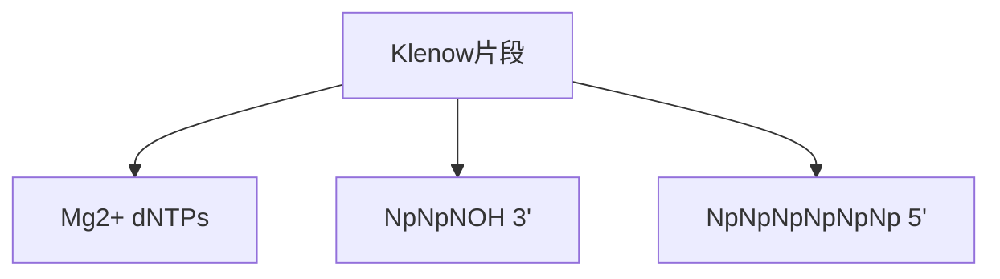
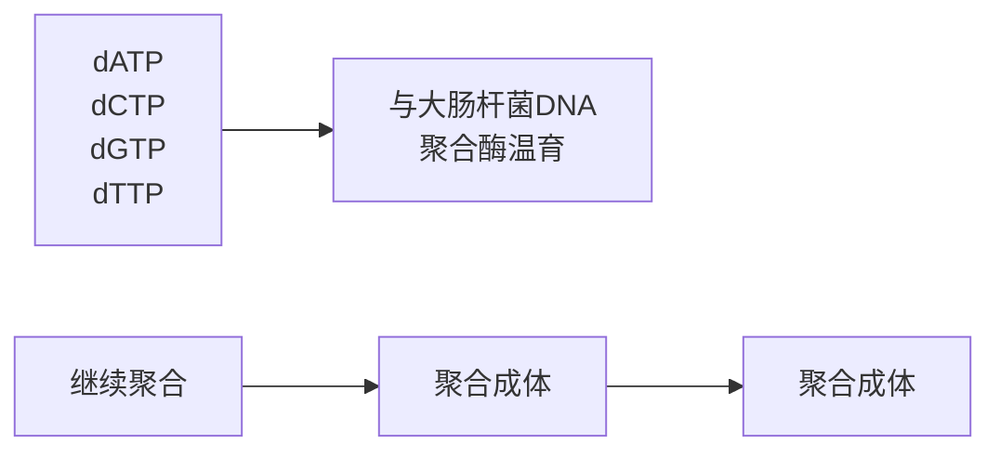

执行聚合酶 I 的 DNA 聚合酶和 3'→5' 外切核酸酶活性（Brutlag et al. 1969; Klenow and Henningsen 1970; Klenow and Overgaard-Hansen 1970; Klenow et al. 1971），而全酶的 5'→3' 外切核酸酶活性存在于较小的氨基端片段（残基为 1\~325）。该片段未命名（见综述，Joyce and Steitz 1987；见表 1）。

DNA 聚合酶 I 基因已被测序（Joyce et al. 1982），并通过原核表达载体表达（Murray and Kelley 1979），这使纯化大量的蛋白质用于商业目的成为可能（Murray and Kelley 1979）。编码 Klenow 酶的聚合酶 I 基因片段也已被克隆至各种各样的表达载体（见 Joyce and Grindley 1983; Pandey et al. 1993），因此能提供大量的纯化蛋白，足以用于商业目的和生物物理学及生物化学研究。

1985 年通过 X 射线衍射获得了 Klenow 片段的三维结构（Ollis et al. 1985），由此产生了一系列一流的结构研究（Beese and Steitz 1991; Beese et al. 1993a,b）、动力学研究（Kuchta et al. 1987,1988; Cowart et al. 1989; Catalano et al. 1990; Guest et al. 1991），以及突变分析（Freemont et al. 1986; Derbyshire et al. 1988,1991; Polesky et al. 1990,1992）。这些采用不同方法的研究结果明显一致，证实了 dNTP 的聚合与  $3'\rightarrow5'$  外切核酸酶消化活性位点分别位于 Klenow 片段的不同结构域，彼此相距  $30\sim35\AA$ 。

由于 Klenow 酶的小结构域（22 kDa）携带外切核酸酶活性（Joyce and Steitz 1987），可通过切除含有错配碱基或移码错误的 DNA 来执行校正功能（Bebenek et al. 1990）。据信双链 DNA 的 3'→5' 消化遵循一个三步途径:底物结合至聚合酶结构域的裂缝处；3' 端转位至外切核酸酶结构域的活性位点；化学性催化（Catalano et al. 1990）。在作为反应的限速步骤转位过程中，双链 DNA 的 4\~5 个末端碱基对发生解链（Cowart et al. 1989），产生缺损的 3' 端以纳摩尔范围 $K_{\mathrm{m}}$ 值结合于外切核酸酶结构域的活性位点（Kuchta et al. 1988）。活性位点中的三个羧基残基与 1 个或 2 个结合于外切核酸酶结构域的二价金属离子直接相互作用，这对于酶的切割是十分关键的。结合于外切核酸酶结构域的金属离子与底物末端磷酸残基相互作用（Derbyshire et al. 1991; Han et al. 1991），从而允许对暴露的磷酸二酯键进行亲核攻击（可能来自氢氧化物离子）（Freemont et al. 1988），此反应产物为 dNMP 。高浓度下，dNMP 作为单链 DNA 缺损末端，占据酶分子中相同的位点，而抑制了 3'→5' 外切核酸酶反应（Que et al. 1978; Ollis et al. 1985）。外切核酸酶降解双链底物的速度很慢，$k_{\mathrm{cat}}$ 值约为 $10^{-3}/\mathrm{s}$ 。然而，消化单链底物的速度却快约 100 倍，$k_{\mathrm{cat}}$ 值为 0.09/s（Kuchta et al. 1988; Derbyshire et al. 1991）。通过采用定点突变改变活性位点内的氨基酸，现已构建出突变型 Klenow 酶，保留了正常的聚合酶活性，而从根本上去除了外切核酸酶活性（Derbyshire et al. 1988, 1991）。这些酶的平均误差率为每聚合 10 000\~40 000 个碱基发生 1 个碱基的置换，比野生型 Klenow 酶的误差率高 7\~30 倍（Bebenek et al. 1990; Eger et al. 1991）。因此，Klenow 酶的高保真特性更多的是来自聚合酶结构域对碱基的高精度选择，而并非通过外切核酸酶结构域进行复制后编辑。

聚合酶结构域中存在的一条大缝隙是引物:模板 DNA 的结合位点（Beese et al. 1993a）。直接参与结合底物及催化的氨基酸残基已通过定点突变获得鉴定（Polesky et al. 1990,1992），并通过对结合于双链 DNA 的 Klenow 片段的 X 射线晶体衍射分析加以证实（Beese et al. 1993a）。聚合酶 Pol I 和若干其他 B 型 DNA 聚合酶，包括来自水生栖热菌及 T5 和 T7 噬菌体的聚合酶，其聚合酶结构域内具有高度同源性（Delarue et al. 1990; Blanco et al. 1991）。这些同源性包括:①直接参与催化的残基簇；②与 dNTP 结合的酪氨酸残基（Beese et al. 1993b）。引物:模板的取向及 Klenow 片段的两个结构域的通用模型显示于图 1。

text_image

5'模板
P3'
指状突
3'
5'引物
E
5'模板
P
3'
5'引物
指状突

图 1 DNA 结合于 Klenow DNA 聚合酶的模型（经 Beese et al. 1993a 许可，版权归美国科学进展协会所有）。

## 大肠杆菌聚合酶 I Klenow 片段在分子克隆中的应用

## 补平由限制性内切核酸酶消化产生的 3'凹端

许多情况下，单一缓冲液即可用于限制性内切核酸酶切割 DNA 及随后的 3'凹端补平。可通过从反应中省去 4 种 dNTP 中的 1 种、2 种或 3 种而控制末端补平反应，从而产生含有新的黏性末端部分补平的末端（图 2 和方案 8）。

flowchart

图 2 用 Klenow DNA 聚合酶补平 DNA 片段的 3'凹端。

## 通过放射性 dNTP 的掺入标记 DNA 片段的 3' 端

一般来说，标记反应含有的3种未标记的dNTP浓度均超过各自的 $K_{\mathrm{m}}$ 值，而放射性标记的dNTP浓度则远低于其 $K_{\mathrm{m}}$ 值。在这种情况下，即使反应速率远未达到最大限度，标记物掺入DNA的比例仍很高。3种未标记dNTP以高浓度存在可降低外切核酸酶从模板的3'端除去核苷酸的可能性。反应中需要加入哪一种 $\alpha$ 标记的dNTP取决于DNA末端的序列和性质。

\- 任何可与 5'突出端未配对碱基互补的 dNTP 均可用于标记 3'凹端。根据研究者对放射性标记 dNTP 的选择，放射性可掺入重建末端内的任何位点。为确保所有放射性标记分子具有同样长度，可能有必要通过含有 4 种高浓度未标记的 dNTP 的“追加”反应来完成末端补平反应。

\- 利用 Klenow 片段的两个结构域的酶反应可标记平端和 3'突出端。首先，通过 3'→5' 外切核酸酶活性除去 DNA 的任何突出尾，产生 3'凹端。然后，在一种高浓度的放射性标记前体存在的条件下，外切核酸酶降解作用由于在 3'端掺入放射性标记的 dNTP 而被平衡。此反应从凹端或平端 DNA 循环去除及置换 3'端而构成，有时又称为交换或置换反应。由于 Klenow 酶的 3'→5' 外切核酸酶作用相当缓慢，尤其是作用在双链底物上，因而可达到适度的特异性活性。T4 DNA 聚合酶的 3'→5' 外切核酸酶活性比 Klenow 片段强约 200 倍，因而为这类反应的首选酶。

如用 $\left[^{35}\mathrm{S}\right]$ dNTP代替常用的 $\left[\alpha-^{32}\mathrm{P}\right]$ dNTP，反应则仅限于一个循环的去除和置换，因为与T4 DNA聚合酶的外切核酸酶不同，大肠杆菌DNA聚合酶I的 $3'\rightarrow5'$ 外切核酸酶不能攻击硫酯键（Kunkel et al. 1981; Gupta et al. 1984）。

## 用随机引物法标记单链 DNA

详见文献 Feinberg 和 Vogelstein（1983,1984），以及方案 1 和方案 2。

## 用引物延伸法合成单链探针

详见文献 Meinkoth 和 Wahl（1984）、Studencki 和 Wallace（1984），以及第 6 章中的方案 18。多年来，聚合酶 I Klenow 片段是质量最高的商品化 DNA 聚合酶，所以它曾是 DNA 体外合成的首选酶，也是最后的手段。然而，随着更适合各种合成任务的聚合酶的发现或工程化，Klenow 已逐渐被取代而不再成为分子克隆中各种程序的首选酶。这些程序包括:

- 用 Sanger 法进行 DNA 测序。Klenow 已经被阅读长度更长的噬菌体的或耐热的聚合酶所取代。
- 在体外诱变中从单链模板合成双链 DNA。虽然 Klenow 片段仍广泛用于应用突变引物进行环状 DNA 体外合成，但它并非达到此目的的最好的酶。除非有大量的连接酶存在于聚合/延伸反应混合物中，否则 Klenow 酶会从模板链上移开致突变的寡核苷酸引物，从而减少所获突变分子的数量。DNA 聚合酶不能引起链置换，用包括 T4 噬菌体 DNA 聚合酶(Nossal 1974; Lechner et al. 1983: Geisselsoder et al. 1987)、T7 噬菌体 DNA 聚合酶(Bebenek and Kunkel 1989)和测序酶(Schena 1989)在内的 DNA 聚合酶可使这个问题得到解决。
T4 噬菌体基因 32 蛋白（单链 DNA 结合蛋白）可用于 DNA 聚合酶（包括 Klenow 酶）催化的引物延伸反应，以减少富含二级结构的模板引起的合成拖延问题（Craik et al. 1985; Kunkel et al. 1987）。
- 聚合酶链反应。Klenow 片段是首先用于 PCR 的酶（Saiki et al. 1985）。然而，现在它已经完全被热稳定的 DNA 聚合酶所取代，从而不需在每一轮合成和变性后补加酶。

## Klenow 片段的事实与数据

用于检测 Klenow 片段聚合酶活性的标准试验是由用 poly（d [A-T]）作为模板的 Setlow（1974）法。一个单位的聚合酶活性是指在  $37^{\circ}$ C 下 10min 内催化 3.3nmol dNTP 掺入酸不溶性物质的酶量。纯的 Klenow 片段样品的特异性活性约为 10 000U/mg 蛋白（Derbyshire et al. 1993）。反应通常在  $Mg^{2+}$  的存在下进行。如用  $Mn^{2+}$  代替  $Mg^{2+}$ ，则会增加错误掺入率，而降低校对的精确性（Carroll and Benkovic 1990）。酶对于 4 种 dNTP 的  $K_{m}$  变化范围为  $4 \sim 20\mu mol/L$ 。Klenow 片段的外切核酸酶活性的检测方法见文献 Freemont 等（1986）和 Derbyshire 等（1988）。

## 聚合酶 | 在分子克隆中的应用

\- 用切口平移法标记 DNA（Maniatis et al. 1975; Rigby et al. 1977）。在这个反应中，酶结合于双链 DNA 的切口或短缝隙中，而后聚合酶 I 的 $5' \rightarrow 3'$ 外切核酸酶活性从 DNA 的一条链除去核苷酸，形成模板，用于同时合成 DNA 的生长链。通过 $5' \rightarrow 3'$ 外切核酸酶和 $5' \rightarrow 3'$ 聚合酶的联合作用，最初的切口沿着 DNA 分子被翻译。图 3 中，双链 DNA 上链的切口从左至右被翻译，新合成的 DNA 片段由深色的箭头表示。切口平移反应通常在 $16^{\circ}\mathrm{C}$ 下进行，以减少折返 DNA 的合成，折返 DNA 是在 DNA 环生长链的 $3'$ 羟基端自身返折成环，并引发发夹形 DNA 分子合成时产生的（Richardson et al. 1964a）。

flowchart

图 3 切口平移示意图。

- cDNA 第二链的置换合成（见文献，Gubler and Hoffman 1983）。在此方法中，第一链合成的产物 cDNA-mRNA 杂交体被用作切口平移反应的模板。RNase H 被用于在杂交体的 mRNA 链上产生切口和缝隙，造成一系列被聚合酶 I 用来起始第二链 cDNA 合成的 RNA 引物。
- 带 3'突出尾的 DNA 分子的末端标记。此反应分两步:首先，全酶的 3'→5'外切核酸酶活性去除 cDNA 的 3'突出尾，造成一个 3'凹端。然后，在一种高浓度的放射性标记前体的存在下，继续进行的核酸外切降解由于 3'端 dNTP 的掺入而得到平衡。虽然聚合酶 I 催化交换反应或取代反应相当有效，但 T4 噬菌体 DNA 聚合酶的 3'→5'外切核酸酶活性更强，因此它仍然是首选酶。

## 关于 DNA 聚合酶 I 的指标和参数

- 大多数厂商提供的聚合酶 I 是从（Kelley and Stump 1979）一株携单拷贝 polA 基因的 λ 噬菌体转导的溶源性大肠杆菌中分离所得（如 NM964）（Murray and Kelley 1979）。
- 1U DNA 聚合酶是指在 $37^{\circ} \mathrm{C}$ 下用 poly (d [A-T]) 作模板, 在 $30 \mathrm{~min}$ 内催化 $10 \mathrm{nmol}$ 总 dNTP 转变为酸不溶型物质所需的酶量 (Richardson et al. 1964b)。商品酶的比活性通常约为 $5000 \mathrm{U} / \mathrm{mg}$ 蛋白。
- 如同所有其他的 DNA 聚合酶，聚合酶 I 活性需要二价阳离子。精确复制选择  $Mg^{2+}$ ，而  $Mn^{2+}$  则有目的地用于提高误差频率。

## 参考文献

- Bebenek K, Kunkel TA. 1989. The use of native T7 DNA polymerase for site-directed mutagenesis. Nucleic Acids Res 17: 5408.
- Bebenek K, Joyce CM, Fitzgerald MP, Kunkel TA. 1990. The fidelity of DNA synthesis catalyzed by derivatives of Escherichia coli DNA polymerase I. J Biol Chem 265: 13878–13887.
- Beese LS, Steitz TA. 1991. Structural basis for the 3'-5' exonuclease activity of Escherichia coli DNA polymerase I: A two metal ion mechanism. EMBO J 10: 25–33.
- Beese LS, Derbyshire VC, Steitz TA. 1993a. Structure of DNA polymerase I Klenow fragment bound to duplex DNA. Science 260: 352–355.
- Beese LS, Friedman JM, Steitz TA. 1993b. Crystal structures of the Klenow fragment of DNA polymerase I complexed with deoxynucleoside triphosphate and pyrophosphate. Biochemistry 32: 14095–14101.
- Blanco L, Bernad A, Blasco MA, Salas M. 1991. A general structure for DNA-dependent DNA polymerases Gene 100: 27–38. (Erratum Gene [1991] 108: 165.)
- Brutlag D, Atkinson MR, Setlow P, Kornberg A. 1969. An active fragment of DNA polymerase produced by proteolytic cleavage. Biochem Biophys Res Commun 37: 982–989.
- Carroll SS, Benkovic SJ. 1990. Mechanistic aspects of DNA-polymerases: Escherichia coli DNA polymerase I (Klenow fragment) as a paradigm. Chem Rev 90: 1291–1307.
- Catalano CE, Allen DJ, Benkovic SJ. 1990. Interaction of Escherichia coli DNA polymerase I with azido DNA and fluorescent DNA probes: Identification of protein-DNA. Biochemistry 29: 3612–3621.
- Cowart M, Gibson KJ, Allen DJ, Benkovic SJ. 1989. DNA substrate structural requirements for the exonuclease and polymerase activities of procaryotic and phage DNA polymerases. Biochemistry 28: 1975–1983.
- Craik CS, Largman C, Fletcher T, Roczniak S, Barr PJ, Fletterick R, Rutter WJ. 1985. Redesigning trypsin: Alteration of substrate specificity. Science 228; 291–297.
- Delarue M, Poch O, Tordo N, Moras D, Argos P. 1990. An attempt to unify the structure of polymerases. Protein Eng 3: 461–467.
- De Lucia P, Cairns J. 1969. Isolation of an E. coli strain with a mutation affecting DNA polymerase. Nature 224: 1164–1166.
- Derbyshire V, Freemont PS, Sanderson MR, Beese L, Friedman JM, Joyce CM, Steitz TA. 1988. Genetic and crystallographic studies of the 3',5'-exonucleolytic site of DNA polymerase I. Science 240: 199–201.
- Derbyshire V, Grindley NDF, Joyce CM. 1991. The 3'-5' exonuclease of DNA polymerase I of Escherichia coli: Contribution of each amino acid at the active site to the reaction. EMBO J 10: 17–24.
- Derbyshire V, Astatke M, Joyce CM. 1993. Re-engineering the polymerase domain of Klenow fragment and evaluation of overproduction and purification strategies. Nucleic Acids Res 23: 5439–5448.
- Eger BT, Kuchta RD, Carroll SS, Benkovic PA, Dahlberg ME, Joyce CM, Benkovic SJ. 1991. Mechanism of DNA replication fidelity for three mutants of DNA polymerase I: Klenow fragment $\mathrm{KF}(\mathrm{exo}^{+})$, $\mathrm{KF}(\mathrm{polA5})$ and $\mathrm{KF}(\mathrm{exo}^{-})$. Biochemistry 30: 1441-1448.
- Feinberg AP, Vogelstein B. 1983. A technique for radiolabeling DNA restriction endonuclease fragments to high specific activity. Anal Biochem 132: 6–13.
- Feinberg AP, Vogelstein B. 1984. A technique for radiolabeling DNA restriction endonuclease fragments to high specific activity. Addendum. Anal Biochem 137: 266–267.
- Freemont PS, Ollis DL, Steitz TA, Joyce CM. 1986. A domain of the Klenow fragment of Escherichia coli DNA polymerase I has polymerase but no exonuclease activity. Proteins 1: 66–73.
- Freemont PS, Friedman JM, Beese LS, Sanderson MR, Steitz TA. 1988. Cocrystal structure of an editing complex of Klenow fragment with DNA. Proc Natl Acad Sci 85: 8924–8928.
- Geisselsoder J, Witney F, Yuckenberg P. 1987. Efficient site-directed in vitro mutagenesis. BioTechniques 5: 786–791.
- Gubler U, Hoffman BJ. 1983. A simple and very efficient method for generating cDNA libraries. Gene 25: 263–269.
- Guest CR, Hochstrasser RA, Dupuy CG, Allen DJ, Benkovic SJ, Millar DP. 1991. Interaction of DNA with the Klenow fragment of DNA polymerase I studied by time-resolved fluorescence spectroscopy. Biochemistry 30: 8759–8770.
- Gupta AP, Benkovic PA, Benkovic SJ. 1984. The effect of the 3',5' thiophosphoryl linkage on the exonuclease activities of T4 polymerase and the Klenow fragment. Nucleic Acids Res 12: 5897–5911.
- IIan II, Rifkind JM, Mildvan AS. 1991. Role of divalent cations in the 3',5'-exonuclease reaction of DNA polymerase I. Biochemistry 30: 11104-11108.
- Joyce CM, Grindley NDF. 1983. Construction of a plasmid that overproduces the large proteolytic fragment (Klenow fragment) of DNA polymerase I of Escherichia coli. Proc Natl Acad Sci 80: 1830–1834.
- Joyce CM, Steitz TA. 1987. DNA polymerase I: From crystal structure to function via genetics. Trends Biochem Sci 12: 288–292.
- Joyce CM, Kelley WS, Grindley NDF. 1982. Nucleotide sequence of the Escherichia coli polA gene and primary structure of DNA polymerase I. J Biol Chem 257: 1958–1964.
- Kelley WS, Stump KH. 1979. A rapid procedure for isolation of large quantities of Escherichia coli DNA polymerase utilizing a λpolA transducing phage. J Biol Chem 254: 3206–3210.
- Klenow H, Henningsen I. 1970. Selective elimination of the exonuclease activity of the deoxyribonucleic acid polymerase from Escherichia coli B by limited proteolytic digestion. Proc Natl Acad Sci 65: 168–175.
- Klenow H, Overgaard-Hansen K. 1970. Proteolytic cleavage of DNA polymerase from Escherichia coli B into an exonuclease unit and a polymerase unit. FEBS Lett 6: 25–27.
- Klenow H, Overgaard-Hansen K, Patkar SA. 1971. Proteolytic cleavage of native DNA polymerase into two different catalytic fragments. Influence of assay conditions on the change of exonuclease activity and polymerase-activity accompanying cleavage. Eur J Biochem 22: 371–381.
- Kornberg A, Baker TA. 1992. DNA replication, 2nd ed. W.H. Freeman, New York.
- Kornberg A, Lehman IR, Bessman MJ, Simms ES. 1956. Enzymic synthesis of deoxyribonucleic acid. Biochim Biophys Acta 21: 197–198.
- Kuchta RD, Benkovic P, Benkovic SJ. 1988. Kinetic mechanism whereby DNA polymerase 1 (Klenow) replicates DNA with high fidelity. Biochemistry 27: 6716–6725.
- Kuchta RD, Mizrahi V, Benkovic PA, Johnson KA, Benkovic SJ. 1987. Kinetic mechanism of DNA polymerase I (Klenow). Biochemistry 26:8410–8417.
- Kunkel TA, Eckstein F, Mildvan AS, Koplitz RM, Loeb LA. 1981. Deoxynucleoside [1-thio]triphosphates prevent proofreading during in vitro DNA synthesis. Proc Natl Acad Sci 78: 6734–6738.
- Kunkel TA, Roberts JD, Zakour RA. 1987. Rapid and efficient site-specific mutagenesis without phenotypic selection. Methods Enzymol 154:367–382.
- Lechner RL, Engler MJ, Richardson CC. 1983. Characterization of strand displacement synthesis catalyzed by bacteriophage T7 DNA polymerase. J Biol Chem 258: 11174–11184.
- Maniatis T, Jeffrey A, Kleid DG. 1975. Nucleotide sequence of the rightward operator of phage λ. Proc Natl Acad Sci 72: 1184–1188.
- Meinkoth J, Wahl G. 1984. Hybridization of nucleic acids immobilized on solid supports. Anal Biochem 138: 267–284.
- Murray NE, Kelley WS. 1979. Characterization of λpolA transducing phages; effective expression of the E coli polA gene. Mol Gen Genet 175: 77–87.
- Nossal NG. 1974. DNA synthesis on a double-stranded DNA template by the T4 bacteriophage DNA polymerase and the T4 gene 32 DNA unwinding protein. J Biol Chem 249: 5668–5676.
- Ollis DL, Brick P, Hamlin R, Xuong NG, Steitz TA. 1985. Structure of the large fragment of Escherichia coli DNA polymerase complexed with dTMP. Nature 313: 762–766.
- Pandey VN, Kaushok N, Sanzgiri RP, Patil M, Modak M, Barik S. 1993. Site-directed mutagenesis of DNA polymerase I (Klenow) from Escherichia coli. Eur J Biochem 214: 59–65.
- Polesky AH, Dahlberg ME, Benkovic SJ, Grindley NDF, Joyce CM. 1992. Side chains involved in catalysis of the polymerase reaction of DNA polymerase I from Escherichia coli. J Biol Chem 267: 8417–8428.
- Polesky AH, Steitz TA, Grindley NDF, Joyce CM. 1990. Identification of residues critical for the polymerase activity of the Klenow fragment of DNA polymerase I from Escherichia coli. J Biol Chem 265: 14579–14591.
- Que BG, Downey KM, So A. 1978. Mechanisms of selective inhibition of 3' to 5' exonuclease activity of Escherichia coli DNA polymerase I by nucleoside 5'-monophosphates. Biochemistry 17: 1603–1606.
- Richardson CC, Inman RB, Kornberg A. 1964a. Enzymic synthesis of deoxyribonucleic acid. XVIII. The repair of partially single-stranded DNA templates by DNA polymerase. J Mol Biol 9: 46–69.
- Richardson CC, Schildkraut CL, Aposhian HV, Kornberg A. 1964b. Enzymatic synthesis of deoxyribonucleic acid. XIV. Further purification and properties of deoxyribonucleic acid polymerase of Escherichia coli. J Biol Chem 239: 222–232.
- Rigby PW, Dieckmann M, Rhodes C, Berg P. 1977. Labeling deoxyribonucleic acid to high specific activity in vitro by nick translation with DNA polymerase I. J Mol Biol 113: 237–251.
- Saiki RK, Scharf S, Faloona F, Mullis KB, Horn GT, Erlich HA, Arnheim N. 1985. Enzymatic amplification of α-globin genomic sequences and restriction site analysis for diagnosis of sickle cell anemia. Science 230: 1350–1354.
- Schena M. 1989. High efficiency oligonucleotide mutagenesis using Sequenase. Comments (U.S. Biochemical Corp.) 15: 23.
- Setlow P. 1974. DNA polymerase I from Escherichia coli. Methods Enzymo 29: 3–12.
- Studencki AB, Wallace RB, 1984. Allele-specific hybridization using oligonucleotide probes of very high specific activity: Discrimination of the human β A- and β S-globin genes. DNA 3: 7–15.

## 体外转录系统

事实上, 所有体外 DNA 转录成 RNA 都由噬菌体编码的依赖 DNA 的 RNA 聚合酶催化进行。噬菌体编码的依赖 DNA 的 RNA 聚合酶现已身价百倍, 这是由于: ①这些酶可在已明确的同源启动子上起始有效且选择性的转录 (Melton et al. 1984); ②这些酶由单一肽链 (约 900 个氨基酸) 组成, 不需辅助转录因子, 这可能是由于其已进化至能高效转录特化基因组内的小量基因。

已充分鉴定的噬菌体 RNA 聚合酶为伤寒沙门氏菌 SP6 噬菌体(Butler and Chamberlin 1982; Green et al. 1983)，以及大肠杆菌 T3 和 T7 噬菌体（Studier and Rosenberg 1981; Davanloo et al. 1984; Tabor and Richardson 1985）编码的 RNA 聚合酶。编码这三类 RNA 聚合酶的基因已被分离（Davannloo et al. 1984; Morris et al. 1986）、测序（Moffatt et al. 1984; McGraw et al. 1987; Kotani et al. 1987）及表达（Davanloo et al. 1984; Morris et al. 1985）。T7 聚合酶的晶体结构已经阐明（Doublie et al. 1998）。SP6、T3 和 T7 依赖 DNA 的 RNA 聚合酶以相似的方式发生作用，彼此之间未见其中某一种具明显的生化优势。虽然 SP6 酶最容易从噬菌体感染的细胞中制备，但它的价格通常却比 T7 和 T3 编码的酶贵 4～5 倍。

上述三种 RNA 聚合酶均能转录单链 DNA（Salvo et al. 1973; Milligan et al. 1987），但实际上体外转录的进行均以含适当启动子的双链线性 DNA 为模板（表 2）。

表 2 由噬菌体编码的 RNA 聚合酶识别的启动子序列

<table><tr><td>噬菌体</td><td colspan="5">启动子</td></tr><tr><td></td><td>-15</td><td>-10</td><td>-5</td><td>+1</td><td>+5</td></tr><tr><td>T7</td><td colspan="5">TAATACGACTCACTATAGGGAGA</td></tr><tr><td>T3</td><td colspan="5">AATTAAACCCTCACTAAAGGGAGA</td></tr><tr><td></td><td colspan="5">T</td></tr><tr><td>SP6</td><td colspan="5">ATTTAGGGGACACTATAGAAG</td></tr></table>

注:启动子的共有序列能被三种噬菌体编码的 RNA 聚合酶 T7（Dunn and Studier 1983）、T3（Beck et al. 1989）和 SP6（Brown et al. 1986）所识别。所有噬菌体的启动子共有一个-7 到+1 的核心序列，提示该区域在启动子功能中具相同作用。位于启动子-8 到-10 的区域有所差异，提示启动子特异性的接触发生于该区域。按常规显示非模板链序列（经允许按 Jorgensen et al. 改编，1991）。

由于噬菌体 RNA 聚合酶最小的启动子长度仅为 21bp（Jorgensen et al. 1991），因此易于用合成寡核苷酸制成便携式噬菌体启动子。含有噬菌体 RNA 聚合酶启动子的双链 DNA 接头可直接与纯化的 DNA 片段（Loewy et al. 1989）或 PCR 产物连接。通过合成适当的接头/衔接子，混合物中的一个 DNA 片段可被修饰，随后被体外转录。

合成启动子亦可被加至 PCR 扩增 DNA 所用引物的 5'端（见方案 5 的附加方案“用 PCR 法将噬菌体编码的 RNA 聚合酶启动子加至 DNA 片段上”）。因此，利用位于 DNA 分子的一端或两端的噬菌体启动子，几乎能扩增任何 DNA 分子。扩增的 DNA 是体外转录反应的有效模板。应用 PCR 也可以很方便地将限制性位点引入 DNA 片段的末端，使模板容易线性化，亦可将翻译信号引入 DNA 片段的 5'端，使 RNA 产物能在无细胞的蛋白合成系统中被有效地翻译（Browning 1989; Kain et al. 1991）。

噬菌体聚合酶与其启动子的亲和力相当低（约 $10^{-7} / \mathrm{mol}$），因此需核苷三磷酸来稳定瞬时的启动子酶复合物。在一个短暂的延滞期后，RNA的合成迅速达到 $37^{\circ} \mathrm{C}$ 下每秒 $200 \sim 300$ 个核苷酸的速率（T7和T3聚合酶），与同样条件下大肠杆菌RNA聚合酶相比，速度几乎快10倍。T3和T7 RNA聚合酶对于ATP、UTP和CTP的 $K_{\mathrm{m}}$ 值为 $40 \sim 100 \mu \mathrm{mol} / \mathrm{L}$ (Oakley et al.1979)。GTP则相反，可能由于GTP被用作链起始核苷酸。例如，T3 RNA聚合酶起始的RNA链以pppGGGA和pppGGGG开始（见综述Chamberlin and Ryan 1982）。当模板DNA的浓度为 $20 \mathrm{~nmol} / \mathrm{L}$ 、每一rNTP的浓度大于 $50 \mu \mathrm{mol} / \mathrm{L}$ 时，RNA合成速率至少在1h内呈线性关系，而反应的速率则与加入反应的酶量成正比。反应过程中，RNA链在每一模板分子上起始多次；最佳条件下，每摩尔模板可产生 $10 \sim 20 \mathrm{~mol}$ 的全长转录物。然而，当用一个放射性标记的或修饰的碱基作为前体时，为优化罕见组分掺入而改变了反应条件，产率则大为降低。通常的做法是从反应中去除同源核苷酸或显著降低其浓度。但如反应中该核苷酸的浓度降至其 $K_{\mathrm{m}}$ 值以下，则不仅影响总产率，而且全长RNA链的比例亦将显著降低。

虽然三种噬菌体聚合酶共有许多生化特性，但对各自的启动子均显示相当大的偏性，不能在其他启动子的驱动下以显著的速率起始转录。噬菌体酶不能识别克隆 DNA 序列中的细菌、质粒或真核启动子。由于 RNA 链终止的有效信号亦属稀有，因此噬菌体编码的聚合酶能合成几乎任何置于适当启动子控制下的 DNA 的全长转录物。这些转录物仅与模板的一条链互补，因而它们是用于包括 Southern、Norhtern、原位杂交和 RNA 酶保护试验的所有杂交技术的极好的探针。此外，聚合酶能合成大量的、与哺乳类动物基因不稳定的初级转录物序列一致的长 RNA，导致真核 mRNA 3'端剪接与加工的体外试验发展（见文献，Green 1991）。合成的 RNA 亦是配体，供诸如人免疫缺陷病毒的 tat 基因产物的调控蛋白结合（Roy et al. 1990）。

体外制备的全长转录物常用作真核无细胞蛋白合成系统中的 mRNA。只有模板 RNA 5'端被加帽时，这些及其他反应（如体外剪接反应）才能有效进行。5'端帽结构的添加亦极大地改进了注射进卵母细胞中 RNA 的稳定性（见文献，Yisraeli and Melton 1989）。通过降低反应混合物中 GTP 浓度至 50μmol/L，加入 10 倍摩尔数过量的帽类似物（如 G [5'] ppp [5'] G）（Contreras et al. 1982; Konarska et al. 1984），加帽的 RNA 可在体外合成。在此条件下合成的大多数转录物于 5'帽状结构处起始合成。然而，一旦 RNA 合成开始，帽类似物的独特化学结构（含两个暴露的 3'羟基）可确保不再发生帽状核苷酸的掺入。

最后，在发展原核和真核表达系统的过程中，噬菌体 RNA 聚合酶的高度特异性已得到开发。将靶 cDNA 或基因克隆于噬菌体启动子序列的下游及适当转录终止序列的上游，再将所产生的重组质粒（第一个质粒）导入含有以可调控方式表达噬菌体 RNA 聚合酶的第二个质粒的细胞。因此，诱导聚合酶基因可导致第一个质粒中靶 DNA 的转录及其所编码产物随后的充分表达。T7 噬菌体 RNA 聚合酶和启动子为在大肠杆菌中应用最广泛的二元表达系统（Tabor and Richardson 1985; Studier and Moffatt 1986; Studier et al. 1990）。在真核细胞中，可通过感染含 T7 聚合酶基因的重组痘病毒（Fuerst et al. 1986）或通过转染表达质粒而产生 T7 RNA 聚合酶。

## 事实和提示

为自大规模反应中获得毫克量级的 RNA，应使  $MgCl_{2}$  的浓度比反应中总核苷酸浓度高 6nmol/L（Milligan and Uhlenbeck 1989），反应中应含有 5U/mL 的酵母无机焦磷酸酶（Cunningham and Ofengand 1990）。焦磷酸酶可防止  $Mg^{2+}$  以焦磷酸镁的形式螯合。

噬菌体 RNA 聚合酶可接受生物素化的核苷酸作为前体。但是与放射性标记的 NTP 相比掺入效率不高，反应产物含有较高比例的截短 RNA（Grabowski and Sharp 1986; Yisraeli and Melton 1989）。

T7 RNA 聚合酶受 T7 溶菌酶的强烈抑制（Moffatt and Studier 1987; Ikeda and Bailey 1992），因而有人已应用 T7 溶菌酶基因共表达作为降低转化菌中 T7 聚合酶活性的方法（综述见 Studier et al. 1990）。

## 参考文献

- Beck S, O'Keeffe T, Coull JM, Koster H. 1989. Chemiluminescent detection of DNA: Application for DNA sequencing and hybridization. Nucleic Acids Res 17: 5115–5123.
- Brown JE, Klement JF, McAllister WT. 1986. Sequences of three promoters for the bacteriophage SP6 RNA polymerase. Nucleic Acids Res 14:3521–3526.
- Browning KS. 1989. Transcription and translation of mRNA from polymerase chain reaction-generated DNA. Amplifications 3: 15–16.
- Butler ET, Chamberlin MJ. 1982. Bacteriophage SP6-specific RNA polymerase. I. Isolation and characterization of the enzyme. J Biol Chem 257: 5772–5778.
- Chamberlin M, Ryan T. 1982. Bacteriophage DNA-dependent RNA polymerases. In The enzymes, 3rd ed. (ed Boyer PD), vol. 15, pp. 87–108. Academic, New York.
- Contreras R, Cheroutre H, Degrave W, Fiers W. 1982. Simple, efficient in vitro synthesis of capped RNA useful for direct expression of cloned eukaryotic genes. Nucleic Acids Res 10: 6353–6362.
- Cunningham PR, Ofengand J. 1990. Use of inorganic pyrophosphatase to improve the yield of in vitro transcription reactions catalyzed by T7 RNA polymerase. BioTechniques 9: 713–714.
- Davanloo P, Rosenberg AH, Dunn JJ, Studier FW. 1984. Cloning and expression of the gene for bacteriophage T7 RNA polymerase. Proc Natl Acad Sci 81: 2035–2039.
- Doublie S, Tabor S, Long AM, Richardson CC, Ellenberger T. 1998. Crystal structure of a bacteriophage T7 DNA replication complex at 2.2 Å resolution. Nature 391: 251–258.
- Dunn JJ, Studier FW. 1983. Complete nucleotide sequence of bacteriophage T7 DNA and the locations of T7 genetic elements. J Mol Biol 166: 477–535.
- Fuerst TR, Niles EG, Studier FW, Moss B. 1986. Eukaryotic transient-expression system based on recombinant vaccinia virus that synthesizes bacteriophage T7 RNA polymerase. Proc Natl Acad Sci 83: 8122–8126.
- Grabowski PJ, Sharp PA. 1986. Affinity chromatography of splicing complexes: U2, U5, and U4+U6 small nuclear ribonucleoprotein particles in the spliceosome. Science 233: 1294–1299.
- Green MR. 1991. Biochemical mechanisms of constitutive and regulated pre-mRNA splicing. Annu Rev Cell Biol 7: 559–599.
- Green MR, Maniatis T, Melton DA. 1983. Human β-globin pre-mRNA synthesized in vitro is accurately spliced in Xenopus oocyte nuclei. Cell 32: 681–694.
- Ikeda RA, Bailey PA. 1992. Inhibition of T7 RNA polymerase by T7 lysozyme in vitro. J Biol Chem 267: 20153–20158.
- Jorgensen ED, Durbin RK, Risman SS, McAllister WT. 1991. Specific contacts between the bacteriophage T3, T7, and SP6 RNA polymerases and their promoters. J Biol Chem 266: 645–651.
- Kain KC, Orlandi PA, Lanar DE. 1991. Universal promoter for gene expression without cloning: Expression-PCR. BioTechniques 10: 366–374.
- Konarska MM, Padgett RA, Sharp PA. 1984. Recognition of cap structure in splicing in vitro of mRNA precursors. Cell 38: 731–736.
- Kotani H, Ishizaki Y, Hiraoka N, Obayashi A. 1987. Nucleotide sequence and expression of the cloned gene of bacteriophage SP6 RNA polymerase. Nucleic Acids Res 15: 2653–2664.
- Loewy ZG, Leary SL, Baum HJ. 1989. Site-directed transcription initiation with a mobile promoter. Gene 83: 367–370.
- McGraw NJ, Bailey JN, Cleaves GR, Dembinski DR, Gocke CR, Joliffe LK, MacWright RS, McAllister WT. 1985. Sequence and analysis of the gene for bacteriophage T3 RNA polymerase. Nucleic Acids Res 13:6753–6766.
- Melton DA, Krieg PA, Rebagliati MR, Maniatis T, Zinn K, Green MR. 1984. Efficient in vitro synthesis of biologically active RNA and RNA hybridization probes from plasmids containing a bacteriophage SP6 promoter. Nucleic Acids Res 12; 7035–7056.
- Milligan JF, Uhlenbeck OC. 1989. Synthesis of small RNAs using T7 RNA polymerase. Methods Enzymol 180: 51–62.
- Milligan JF, Groebe DR, Witherell GW, Uhlenbeck OC. 1987. Oligoribonucleotide synthesis using T7 RNA polymerase and synthetic DNA templates. Nucleic Acids Res 15: 8783–8798.
- Moffatt BA, Studier FW. 1987. T7 lysozyme inhibits transcription by T7 RNA polymerase. Cell 49: 221–227.
- Moffatt BA, Dunn JJ, Studier FW. 1984. Nucleotide sequence of the gene for bacteriophage T7 RNA polymerase. J Mol Biol 173: 265–269.
- Morris CE, Klement JF, McAllister WT. 1986. Cloning and expression of the bacteriophage T3 RNA polymerase gene. Gene 41: 193–200.
- Oakley JL, Strothkamp RE, Sarris AH, Coleman JE. 1979. T7 RNA polymerase: Promoter structure and polymerase binding. Biochemistry 18: 528–537.
- Roy S, Delling U, Chen CH, Rosen CA, Sonenberg N. 1990. A bulge structure in HIV-1 TAR RNA is required for Tat binding and Tat-mediated trans-activation. Genes Dev 4: 1365–1373.
- Salvo RA, Chakraborty PR, Maitra U. 1973. Studies on T3-induced ribonucleic acid polymerase. IV. Transcription of denatured deoxyribonucleic acid preparations by T3 ribonucleic acid polymerase. J Biol Chem 248: 6647–6654.
- Studier FW, Moffatt BA. 1986. Use of bacteriophage T7 RNA polymerase to direct selective high-level expression of cloned genes. J Mol Biol 189: 113–130.
- Studier FW, Rosenberg AH. 1981. Genetic and physical mapping of the late region of bacteriophage T7 DNA by use of cloned fragments of T7 DNA. J Mol Biol 153: 503–525.
- Studier FW, Rosenberg AH, Dunn JJ, Dubendorff JW. 1990. Use of T7 RNA polymerase to direct expression of cloned genes. Methods Enzymol 185: 60–89.
- Tabor S, Richardson CC. 1985. A bacteriophage T7 RNA polymerase/promoter system for controlled exclusive expression of specific genes. Proc Natl Acad Sci 82: 1074–1078.
- Yisraeli JK, Melton DA. 1989. Synthesis of long, capped transcripts in vitro by SP6 and T7 RNA polymerases. Methods Enzymol 180: 42–50.

## 碱性磷酸酶

几种碱性磷酸酶（或碱性磷酸单酯酶）常用于分子克隆，包括细菌碱性磷酸酶（BAP）和牛小肠碱性磷酸酶（CIP、CIAP 或 CAP）。近年来又分离到类似的酶，如从更为神秘的冷血生物中分离的碱性磷酸酶（虾 SAP）可供使用，它们在去磷酸化反应之后比 BAP 或 CIP 更易灭活。所有的碱性磷酸酶均为 Zn（II）金属酶，它们通过形成磷酸化的丝氨酸中间体而催化磷酸单酯水解。碱性磷酸酶在分子克隆中用于三个目的:

- 去除核酸 5'端的磷酸残基，以便通过γ-标记 ATP 的 $[^{32}P]$ 转移对所产生的 5'羟基进行放射性标记。第二种反应受 T4 噬菌体多核苷酸激酶的催化(Chaconas and van de Sande 1980)。
- 去除 DNA 片段 5'端磷酸残基，以防止自身连接。这种去磷酸反应主要用于抑制载体分子的自身连接，从而减少克隆过程中“空心”克隆产生的数目（Ullrich et al. 1977）。
- 作为非放射性系统中的报告酶检测及定位核酸和蛋白质。在这种情况下，碱性磷酸酶被偶联于配体，如能与生物素化靶分子特异性相互作用的链霉抗生物素蛋白（Leary et al. 1983）。

## 去磷酸化反应

碱性磷酸酶能从各种底物分子中去除 3'磷酸基，包括 3'磷酸化多核苷酸和 3'-单磷酸脱氧核苷（Reid and Wilson 1971）。但是，BAP、CIP 和 SAP 在分子克隆中的主要用途为催化单链或双链 DNA 和 RNA 5'端磷酸残基的去除。所产生的 5'羟基端不再参与连接反应，而成为多核苷酸激酶催化的放射性标记反应底物（Chaconas and van de Sande 1980）。

虽然碱性磷酸酶在 5'端核酸标记中的作用毋庸置疑，但其防止自身连接的价值仍有争议。毫无疑问，去磷酸化后减少了线性质粒 DNA 的重新环化，因而减少了含“空心”质粒的转化细菌集落的本底（Ullrich et al. 1977; Ish-Horowicz and Burke 1981; Evans et al. 1992）。但是更为常见的是携所需重组体的菌落数亦平行下降。此外，一些研究者认为 5'羟基的存在可导致重排或缺失克隆出现频率的增高。由于这些原因，只要有适宜的限制性酶切位点可用，定向克隆应为首选方法。

## 碱性磷酸酶的性质

用于分子克隆的碱性磷酸酶在碱性 Tris 缓冲液（pH 8.0～pH 9.0）及低浓度  $Zn^{2+}$ （<1mmol/L）的存在下显示最高活性。

\- BAP 以单体形式分泌（相对分子质量 47 000）到大肠杆菌的周质间隙内，在周质间隙中二聚化，成为有催化活性的酶分子（Bradshaw et al. 1981）。在中性或碱性 pH 下，二聚体 BAP 含多达 6 个 Zn$^{2+}$，其中 2 个对酶活性是必要的（见综述，Coleman and Gettins 1983）。每个二聚体的两个催化位点中仅有一个在低浓度人工底物下具有活性，而在高浓度下两个位点均有活性（Heppel et al. 1962; Fife 1967）。

BAP 是种非常稳定的酶，能抵抗加热及去垢剂的灭活。因此，BAP 在去磷酸反应后难以去除。

- CIP 是一个二聚体糖蛋白，由两个 514 个残基的单体构成，通过磷脂酰肌醇锚定于质膜（Hoffmann-Blume et al. 1991; Weissig et al. 1993），其最佳酶活性取决于 $\mathrm{Mg}^{2+}$ 和 $\mathrm{Zn}^{2+}$ 的浓度。某些结合于催化位点的 $\mathrm{Zn}^{2+}$ 为催化活性所必需。$\mathrm{Mg}^{2+}$ 为变构激活剂，它们结合于不同的位点。但是，如果 $\mathrm{Zn}^{2+}$ 以高浓度存在，将竞争 $\mathrm{Mg}^{2+}$ 的结合位点，并阻碍变构激活（Fernley 1971）。蛋白酶 K 和/或在 $10\mathrm{mmol/L}$ EGTA的存在下加热（$65^{\circ}\mathrm{C} 30\mathrm{min}$ 或 $75^{\circ}\mathrm{C} 10\sim15\mathrm{min}$）很容易灭活 CIP。去磷酸化的 DNA 可通过酚:氯仿抽提纯化。
- SAP 是自北极虾中分离，其酶的特性与 CIP 相似。与 BAP 不同的是，SAP 在温度升高时不稳定。据厂商介绍，将其加热至  $65^{\circ}$ C、15 min 可完全灭活。但在分子生物学的交流网站上常有顾客评论，认为短暂加热不能使酶完全灭活。公平地说，约同样数量的报告认为灭活 SAP 没有问题。但是为安全起见，我们建议加热至  $70^{\circ}$ C 维持 20min，以确保 SAP 的完全灭活。

几种碱性磷酸酶均受无机正磷酸盐（Zittle and Della Monica 1950）及金属离子螯合剂如 EDTA 和 EGTA 的抑制，其他丝氨酸水解酶的强力抑制剂——二异丙基氟磷酸的抑制作用（Dabich and Neuhaus 1966）未达到具有统计学意义的水平。L-苯丙氨酸为 CIP 的非竞争性抑制剂（Weissig et al. 1993）。

## 参考文献

- Bradshaw RA, Cancedda F, Ericsson LH, Neumann PA, Piccoli SP, Schlesinger MJ, Shriefer K, Walsh KA. 1981. Amino acid sequence of Escherichia coli alkaline phosphatase. Proc Natl Acad Sci 78: 3473–3477.
- Chaconas G, van de Sande JH. 1980. 5'-32P labeling of RNA and DNA restriction fragments. Methods Enzymol 65: 75–85.
- Coleman JE, Gettins P. 1983. Alkaline phosphatase, solution structure, and mechanism. Adv Enzymol Relat Areas Mol Biol 55: 381–452.
- Dabich D, Neuhaus OW. 1966. Purification and properties of bovine synovial fluid alkaline phosphatase. J Biol Chem 241: 415–420.
- Evans GA, Snider K, Hermanson GG. 1992. Use of cosmids and arrayed clone libraries for genome analysis. Methods Enzymol 216: 530–548.
- Fernley HN. 1971. Mammalian alkaline phosphatases. In The enzymes, 3rd ed. (ed Boyer PD), vol. 4, pp. 417–447. Academic, New York.
- Fife WK. 1967. Phosphorylation of alkaline phosphatase (E. coli) with o- and p-nitrophenyl phosphate at pH below 6. Biochem Biophys Res Commun 28: 309–317.
- Heppel LA, Harkness DR, Hilmoe RJ. 1962. A study of the substrate specificity and other properties of the alkaline phosphatase of Escherichia coli. J Biol Chem 237: 841–846.
- Hoffmann-Blume E, Garcia Marenco MB, Ehle H, Bublitz R, Schulze M, Horn A. 1991. Evidence for glycosylphosphatidylinositol anchoring
- of intralumenal alkaline phosphatase of the calf intestine. Eur J Biochem 199: 305–312.
- Ish-Horowicz D, Burke JF. 1981. Rapid and efficient cosmid cloning. Nucleic Acids Res 9: 2989–2998.
- Leary JJ, Brigati DJ, Ward DC. 1983. Rapid and sensitive colorimetric method for visualizing biotin-labeled DNA probes hybridized to DNA or RNA immobilized on nitrocellulose: Bio-blots. Proc Natl Acad Sci 80: 4045–4049.
- Reid TW, Wilson IB. 1971. E coli alkaline phosphatase In The enzymes, 3rd ed. (ed Boyer PD), vol. 4, pp. 373–415. Academic, New York.
- Ullrich A, Shine J, Chirgwin J, Pictet R, Tischer E, Rutter WJ, Goodman HM. 1977. Rat insulin genes: Construction of plasmids containing the coding sequences. Science 196: 1313–1319.
- Weissig H, Schildge A, Hoylaerts MF, Iqbal M, Millán JL. 1993. Cloning and expression of the bovine intestinal alkaline phosphatase gene: Biochemical characterization of the recombinant enzyme. Biochem J 290:503–508.
- Zittle CA, Della Monica ES. 1950. Effects of borate and other ions on the alkaline phosphatase of bovine milk and intestinal mucosa. Arch Biochem Biophys 26: 112–122.

## 解链温度

将双链 DNA 溶液加热，可使互补碱基间的氢键断裂而使双螺旋解开。单一氢键力相对较弱（约 5kcal/mol/键），因此很容易受加热破坏。然而，任意两条互补 DNA 链拥有的氢键数目越多，引起所有氢键断裂进而使 DNA 两条链分离所需的温度也越高。由温度引起的从双链（双螺旋）到单链（卷曲）构象的转变，可通过光吸收增强来监测，在构象转变的温度下，以消光系数急剧增加为特征。光吸收增加的中点所对应的温度称为解链温度（ $T_{m}$ ）。用结构术语来描述， $T_{m}$  为双链 DNA 中 50% 的碱基对变性时的温度。核酸结构与热稳定性之间关系的实验探索已有 40 年了。

Marmur 和 Doty（1959, 1962）根据核酸与热稳定之间的关系提出，对于大多数 DNA 样品，其碱基组成与 $T_m$ 呈线形关系。（G+C）含量每增加 1%，直线的斜率增加 0.41℃。对于 DNA 样品（G+C 的含量在 30%～75%之间）在 0.15mol/L NaCl 和 15mmol/L 柠檬酸钠溶液中变性，解链温度为:

$$
T _ {\mathrm{m}} = 6 9. 3 ^ {\circ} \mathrm{C} + 0. 4 1 (\% [ G + C ]) \tag {1}
$$

利用此公式可很容易地通过测定样品的  $T_{m}$  来精确计算 DNA 样品的碱基组成。如检测其他盐溶液中 DNA 样品的  $T_{m}$ ，可以用下列更通用的公式:

$$
T _ {\mathrm{m}} = 8 1. 5 ^ {\circ} \mathrm{C} + 1 6. 6 \log_ {1 0} \left[ M ^ {+} \right] + 0. 4 1 (\% [ G + C ]) \tag {2}
$$

式中， $[M^{+}]$  为  $M^{+} \leqslant 0.5 mol/L$  时的单价阳离子浓度。

## 分子杂交

20 世纪 60 年代发展起来的分子杂交技术一直是对于分子生物学家最有用的工具之一。分子杂交技术简单而灵敏，促使我们对于基因结构、基因表达和基因组构成理解的更新，并且也成为临床实验室及制药公司的诊断工具。

核酸探针与靶序列间分子杂交理想条件的建立须掌握靶序列:核酸探针双链体的 $T_{m}$ 的知识。虽然在有些情况下， $T_{m}$ 值可通过实验确定（见方案7），但更多的是计算 $T_{m}$ 值。目前已研究出多种公式，可用于估算一定条件下靶序列:探针双链体的 $T_{m}$ 。

当靶与探针均为寡核苷酸，在此 $T_{\mathrm{m}}$ 下，分子内存在由变性区将天然双链体拆开的伸展力。此时从双螺旋向卷曲构象的转变是在分子内进行的，因而不依赖于寡核苷酸的浓度（Wetmur 1991）。$T_{\mathrm{m}}$ 是碱基组成、溶剂成分、双螺旋长度和碱基错配程度的函数（Hall et al. 1980; Wahl et al. 1987; Baldino et al. 1989）。Wetmur（1991）对公式（2）作了改良，可用于 $1 \mathrm{~mol} / \mathrm{L} \mathrm{NaCl}$ 高盐溶液中的杂交:

$$
\begin{array}{l} T _ {\mathrm{m}} = 8 1. 5 + 1 6. 6 \log_ {1 0} ([ \mathrm{Na} ^ {+} ] / \{1. 0 + 0. 7 [ \mathrm{Na} ^ {+} ] \}) \\ + 0. 4 1 \left(\% [ G + C ]\right) - 5 0 0 / n - P - F \tag {3} \\ \end{array}
$$

式中，n 是双螺旋体的长度；P 为碱基错配百分率的温度校正（一般每 1% 错配为  $1^{\circ}$ C），每 1% 甲酰胺浓度 F 为  $0.63^{\circ}$ C。对于 RNA 双螺旋:

$$
\begin{array}{l} T _ {\mathrm{m}} = 7 8 + 1 6. 6 \log_ {1 0} ([ \mathrm{Na} ^ {+} ] / \{1. 0 + 0. 7 [ \mathrm{Na} ^ {+} ] \}) \\ + 0. 7 (\% [ G + C ]) - 5 0 0 / n - P - F \tag{4} \\ \end{array}
$$

式中，每1%甲酰胺F为0.35℃。对于RNA与DNA杂交体:

$$
\begin{array}{l} T _ {\mathrm{m}} = 6 7 + 1 6. 6 \log_ {1 0} \left(\left[ \mathrm{Na} ^ {+} \right] / \left\{1. 0 + 0. 7 \left[ \mathrm{Na} ^ {+} \right] \right\}\right) \\ + 0. 8 (\% [ G + C ]) - 5 0 0 / n - P - F \tag {5} \\ \end{array}
$$

式中，每 1% 甲酰胺 F 为 0.5℃。公式（4）与公式（5）分别由 Bodkin 和 Knudson（1985）及 Casey 和 Davidson（1977）提出。

当探针为寡核苷酸、温度为  $T_{m}$  时，半数双螺旋已解链。此时从双螺旋向卷曲构象的转变是在分子间进行的，因而  $T_{m}$  取决于寡核苷酸的浓度（Wetmur 1991）、序列和溶剂组成。虽然公式（3）、（4）、（5）的多种变通公式亦属常用，但仅用%（ $G + C$ ）不足以预测  $T_{m}$ 。利用最近邻模型结合序列相关热力学数据，可估算出更精确的  $T_{m}$  值（Breslauer et al. 1986; Freier et al. 1986; Kierzek et al. 1986; Rychlik et al. 1990; Wetmur 1991; Rychlik 1994)。由此模型推导的公式是:

$$
\begin{array}{l} T _ {\mathrm{m}} / ^ {\circ} \mathrm{C} = (T ^ {0} \Delta H ^ {0}) / (\Delta H ^ {0} - \Delta G ^ {0} + R T ^ {0} \ln [ c ]) \\ + 1 6. 6 \log_ {1 0} ([ \mathrm{Na} ^ {+} ] / \{1. 0 + 0. 7 [ \mathrm{Na} ^ {+} ] \}) - 2 6 9. 3 \tag {6} \\ \end{array}
$$

其中

$$
\begin{array}{l} \Delta H ^ {0} = \sum_ {\mathrm{nn}} (\mathrm{nn} \Delta H _ {\mathrm{nn}} ^ {0}) + \Delta H _ {\mathrm{p}} ^ {0} + \Delta H _ {\mathrm{e}} ^ {0} \\ \Delta G ^ {0} = \sum_ {\mathrm{nn}} (N _ {\mathrm{nn}} \Delta G _ {\mathrm{nn}} ^ {0}) + \Delta G _ {\mathrm{i}} ^ {0} + \Delta G _ {\mathrm{e}} ^ {0} \\ \end{array}
$$

式中， $N_{nn}$  为最近邻数目（如 14 聚体的 13 位）；R=1.99 cal/mol（开氏温度）； $T^{0}=298.2^{\circ}K$ ；C 是总摩尔链浓度； $[Na^{+}]\leqslant1\ mol/L$ 。

几个热力学术语的近似值:

平均最近邻焓:

$$
\Delta H _ {\mathrm{nn}} ^ {0} = - 8. 0 \mathrm{kcal/mol}
$$

平均最近邻自由能:

$$
\Delta G _ {\mathrm{nn}} ^ {0} = - 1. 6 \mathrm{kcal/mol}
$$

启动条件:

$$
\Delta G _ {\mathrm{i}} ^ {0} = + 2. 2 \mathrm{kcal/mol}
$$

平均自由末端焓:

$$
\Delta H _ {\mathrm{e}} ^ {0} = - 8. 0 \mathrm{kcal/mol/末端}
$$

平均自由末端自由能:

$$
\Delta G _ {\mathrm{e}} ^ {0} = - 1 \mathrm{kcal/mol/末端}
$$

平均错配/环焓:

$$
\Delta H _ {\mathrm{p}} ^ {0} = - 8. 0 \mathrm{kcal/mol/错配}
$$

注意对每一个错配或环的  $N_{nn}$  应减去 2，在复杂范围内相反末端的公式为:

$$
T _ {\mathrm{m}} = 2 (A + T) + 4 (G + C) \tag {7}
$$

式中， $(A+T)$  为寡核苷酸中腺嘌呤和胸腺嘧啶的数目； $(G+C)$  是寡核苷酸中鸟嘌呤和胞嘧啶的数目，并在完全匹配靶序列的短寡核苷酸中起作用（Suggs et al. 1981）。更准确地讲，这一公式预测的是寡核苷酸与固相载体结合的靶序列的杂交体的解离温度 $(T_{\mathrm{d}})$ 。有关 $T_{d}$  的详细讨论见文献 Wetmur（1991）。

上述方法计算出的  $T_{m}$  值可能有较大差异。例如，在 0.5mol/L NaCl 中，与靶 DNA 序列完全匹配（%  $[G + C] = 50$ ）的 14 个碱基的寡核苷酸探针杂交时的  $T_{m}$  的预测，用公式（3）为  $59^{\circ}C$ ，公式（6）为  $55^{\circ}C$ ，公式（7）为  $42^{\circ}C$ 。

## 参考文献

- Baldino FJ, Chesselet MF, Lewis ME. 1989. High resolution in situ hybridization. Methods Enzymol 168: 761–777.
- Bodkin DK, Knudson DL. 1985. Assessment of sequence relatedness of double-stranded RNA genes by RNA-RNA blot hybridization. J Virol Methods 10: 45–52.
- Breslauer KJ, Frank R, Blöcker H, Marky LA. 1986. Predicting DNA duplex stability from the base sequence. Proc Natl Acad Sci 83: 8893–8897.
- Casey J, Davidson N. 1977. Rates of formation and thermal stabilities of RNA:DNA and DNA:DNA duplexes at high concentrations of formamide. Nucleic Acids Res 4: 1539–1552.
- Freier SM, Kierzek R, Jaeger JA, Sugimoto N, Caruthers MH, Neilson T, Turner DH. 1986. Improved free-energy parameters for predictions of RNA duplex stability. Proc Natl Acad Sci 83: 9373–9377.
- Hall TJ, Grula JW, Davidson EH, Britten RJ. 1980. Evolution of sea urchin non-repetitive DNA. J Mol Evol 16: 95–110.
- Kierzek R, Caruthers MH, Longfellow CE, Swinton D, Turner DH, Freier SM. 1986. Polymer-supported RNA synthesis and its application to test the nearest-neighbor model for duplex stability. Biochemistry 25:7840–7846.
- Marmur J, Doty P. 1959. Heterogeneity in deoxyribonucleic acids. 1. Dependence on composition of the configurational stability of deoxy-

ribonucleic acids. Nature 183: 1427–1429.

Marmur J, Doty P. 1962. Determination of the base composition of deoxyribonucleic acid from its thermal denaturation temperature. J Mol Biol 5: 109–118.

Rychlik R. 1994. New algorithm for determining primer efficiency in PCR and sequencing. J NIH Res 6: 78.

Rychlik W, Spencer WJ, Rhoads RE. 1990. Optimization of the annealing temperature for DNA amplification in vitro. Nucleic Acids Res 18:6409–6412. (Erratum Nucleic Acids Res [1991] 19: 698.)

Suggs SV, Hirose T, Miyake T, Kawashima EH, Johnson MJ, Itakura K, Wallace RB. 1981. Use of synthetic oligodeoxyribonucleotides for the isolation of specific cloned DNA sequences. In Developmental biology using purified genes (ed Brown DB, et al.), pp. 683–693. Academic, New York.

Wahl GM, Berger SL, Kimmel AR. 1987. Molecular hybridization of immobilized nucleic acids: Theoretical concepts and practical considerations. Methods Enzymol 152: 399–407.

Wetmur JG. 1991. DNA probes: Applications of the principles of nucleic acid hybridization. Crit Rev Biochem Mol Biol 26: 227–259.

(郭 宁 译, 王友亮 校)

## 第 14 章 体外诱变方法

<table><tr><td rowspan="3">导言</td><td>历史背景</td><td>873</td><td>研究目的</td><td>877</td></tr><tr><td>诱变术语</td><td>873</td><td>商品化试剂盒</td><td>877</td></tr><tr><td>诱变方法</td><td>876</td><td></td><td></td></tr></table>

<table><tr><td rowspan="6">方案</td><td>1 用易错 DNA 聚合酶进行随机诱变</td><td>879</td><td>6 利用密码子盒插入进行饱和诱变</td><td>915</td></tr><tr><td>2 重叠延伸 PCR 产生插入或缺失诱变</td><td>890</td><td>7 随机扫描诱变</td><td>922</td></tr><tr><td>3 以双链 DNA 为模板的体外诱变:</td><td></td><td>8 多位点定向诱变</td><td>926</td></tr><tr><td>用 Dpn I 选择突变体</td><td>897</td><td>9 基于 PCR 的大引物诱变</td><td>930</td></tr><tr><td>4 突变型β-内酰胺酶选择法定点诱变</td><td>904</td><td></td><td></td></tr><tr><td>5 通过单一限制性位点消除进行寡核苷酸指导的诱变(USE 诱变)</td><td>910</td><td></td><td></td></tr></table>

<table><tr><td rowspan="2">信息栏</td><td>区域诱变</td><td>933</td><td> $N^{6}$ -甲基化腺嘌呤、DAM 甲基化</td><td></td></tr><tr><td>质粒 DNA 高通量定点诱变</td><td>934</td><td>酶和甲基化敏感限制酶</td><td>934</td></tr></table>

## 导言

原核细胞和真核细胞经常受到外在因素和内在因素的刺激而发生 DNA 损伤，如果这种损伤不能被修复就会导致突变（Lombard et al. 2005；Boesch et al. 2011）。为了能在这种持续的基因毒性环境下继续存活并正确地复制基因组，原核细胞和真核细胞自身有一种特殊的专用 DNA 修复机制，以修复 DNA 损伤，放慢遗传突变在细胞内的积累（Lombard et al. 2005；Boesch et al. 2011）。然而，并不是所有的突变都对蛋白质的生物学功能产生影响。一旦生物体中出现基因突变，我们需要了解该突变的功能特性，探究该突变是否会对某一特定蛋白质或某一非编码 RNA 的功能产生影响。

有几种不同的诱导基因突变的方法可以在哺乳类动物基因的预定位点或区域引入突变。这些体外诱变的方法，可以帮助了解蛋白质、转录调控元件和非编码RNA的功能，是目前分子生物学研究不可或缺的一部分。本章中，介绍了几种最常用的诱导基因突变的实验方法，提供了这些常用诱变方法的详细实验方案（表14-1）。表中描述的这9种不同的诱变方法研究者可根据研究需要引入突变。下面将介绍3种主要的诱变方法及其主要用途。

表 14-1 不同诱变方案的比较

| 方案 | 模板 | 突变体富集方法 | 特点/优点 | 缺点 |
| --- | --- | --- | --- | --- |
| 1 | 双链DNA | 选择性PCR扩增突变DNA | 可引入广谱突变 | 无法实现特定位置突变 |
| 2 | 双链DNA | 重叠延伸 | i. 可用于在某特定目标DNA序列的定点突变、插入或缺失ii. 不需要限制性内切核酸酶 | 研究者需要预先知道拟进行的特定突变 |
| 3 | 双链DNA | 用DpnI选择突变体 | i. 可以精确地在目的基因中实现突变ii. 转化后80%的克隆含有携带预定突变的质粒 | 质粒大小超过7kb时,突变效率低 |
| 4 | 双链DNA | 突变体载体β-内酰胺酶活性改变 | 与其他定点突变方法一样,需要在DNA序列中预先确定突变的位置 | 质粒需含有抗生素筛选标记 |
| 5 | 双链DNA | 限制性酶切位点的缺失(USE诱变) | 可以精确地在目的基因中进行定点突变 | 突变回收率低 |
| 6 | 双链DNA | 基于SapI的消化 | 可用于在一个目的基因的特定DNA序列中引入定点突变体文库 | 需要存在SapI酶切位点 |
| 7 | 单链DNA | 选择尿嘧啶替换的DNA | 在目标位置引入广谱的氨基酸改变 | 在体外DNA合成的过程中发生诱变,产生的质粒文库中目标区域突变氨基酸分布具有偏向性 |
| 8 | 双链DNA | 用DpnI选择突变体 | 通过一次克隆步骤即可引入多个独立的突变 | i. 此方法需要的PCR轮数较多,一般有几个突变位点就需几轮PCR反应ii. 当有3个以上突变位点时,用一些商品化化的试剂盒更省时 |
| 9 | 双链DNA | 大引物 | i. 可以精确地在目的基因中进行突变;ii. 可以在同一个反应管中利用两轮PCR反应连续完成突变过程 | 突变体的产出率只有82%左右 |

## 历史背景

现代体外诱变方法的发展过程以诺贝尔奖为铺路基石，目前已经从以生物整体为靶点的水平发展到以 DNA 分子特定位点为靶点的水平。1926 年，当得克萨斯大学的 Hermann J. Muller（1890～1967 年）阐述了 X 射线导致果蝇的基因突变以及染色体发生变化的证据时，震惊了整个科学界。1926 年，他在一次学术会议上宣布了自己的实验成果，随后在《科学》杂志上发表了论文 Artificial Transmutation of the Gene（Muller 1927）。X 射线照射产生突变这一方法在 1941 年 George Beadle 和 Edward Tatum 报道的关于脉孢菌（Neurospora）实验中发挥了重要作用。在文章中，他们根据实验结果提出“一个基因一个蛋白质”的假设（Beadle and Tatum 1941）。

1938～1940 年，Muller 和 Charlotte Auerbach（1899～1994 年）在爱丁堡大学对可以产生突变的物质进行研究。在 20 世纪 40 年代早期，Auerbach 和 J.M.Robson 利用芥子气使果蝇产生突变（Auerbach and Robson 1947; Stevens et al. 1950）。在后来的报道中，Auerbach 提到:

“在我看来，可能有很多种方法可以使基因的化学性质和染色体的物理完整性发生变化:与蛋白质或者核苷酸发生直接的化学反应、染色体周围的能量释放、与染色体代谢相关的酶失活，以及用竞争性类似物干扰基因的复制等”（Auerbach 1951）。

Auerbach 提出来的这些问题在 1953 年 James D. Watson 和 Francis H.C. Crick 发现 DNA 分子结构后变成了可能, 这一发现也改变了诱变研究的性质。Michael Smith(1932\~2000 年) 关于寡核苷酸的合成和他在 Fred Sanger 实验室对大肠杆菌噬菌体的 1975 个测序, 使得诱变技术具有很强的特异性。Smith 意识到诱变方法应该靶向特定的碱基。他发现小的寡核苷酸可以在低温下形成稳定二聚体, 而 Clyde A. Hutchison III 和 Marshall H. Edgell 进行的研究显示“在转染之前利用野生型 DNA 互补片段对 $\phi$X174 突变体进行复性反应可以恢复点突变”。他们以 $\phi$X174 DNA 作为模板, 以一个含有单核苷错配的 120 个核苷酸的寡聚体为引物, 利用大肠杆菌 DNA 聚合酶, 制备了一个在一条链中整合有这段寡核苷酸的闭合环状双链 DNA (Hutchison et al. 1978)。大概在同一时期, 第一个限制酶的发现使得分离特异性 DNA 片段成为可能 (Smith and Wilcox 1970)。

1983 年，Kary Mullis 发明了聚合酶链反应（PCR）（Saiki et al. 1985; Mullis et al. 1986），随之 PCR 很快成为体外定点诱变技术中不可缺少的部分。这也是体外突变最后一个关键要素。

关于诺贝尔奖获奖情况，1946年Muller获生理学或医学奖，1993年Smith和Mullis共同获得化学奖，1958年Beadle和Tatum获生理学或医学奖，1962年Watson和Crick获生理学或医学奖。

## 诱变术语

诱变术语有很多，有一些虽为同一种实验方法但名称不同，容易使人混淆。下列清单为众多诱变方法定义了术语。

## 5' 添加诱变

一种基于 PCR 的方法，用于在 PCR 产物 5' 端添加一段新的序列或者化学基团。