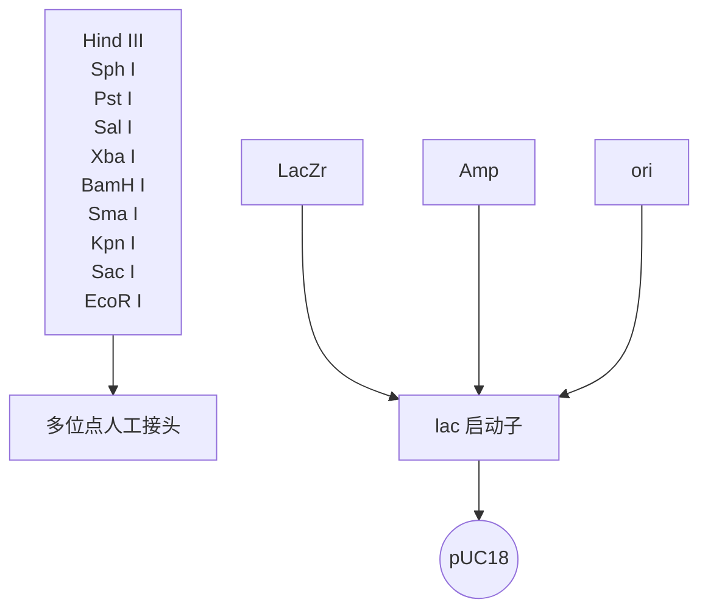

## 丙氨酸扫描诱变

该方法用于确定一个特定蛋白质的结构-功能关系。选择丙氨酸作为残基进行替代的原因是其消除了远端β-碳的侧链，然而不改变主链的构象，也不会产生极端静电或空间的效应（见“扫描诱变”）。

## 盒式诱变

用来高效率地插入突变寡聚核苷酸盒，这种方法可以对靶氨基酸密码子进行多种突变的饱和突变。

## 化学诱变

探究化学诱变剂的性质，如羟胺和 N-乙基-N-亚硝基脲，在靶 DNA 序列中引入随机突变。

## 环状诱变

利用突变引物在环状 DNA 目标分子中引入定点突变。

## 密码子盒式诱变

使用通用的突变盒，在双链 DNA 的特定位点中插入单一密码子。

## 缺失诱变

用来在较大的 DNA 区域内产生随机位点和定向位点缺失，从而构建缺失突变体。

## 定向进化

用于蛋白质工程领域，利用自然选择的力量获得在自然界未发现的、具有某种期望特性的蛋白质或 RNA。

## 定向诱变

见“定点诱变”。

## 区域诱变

用于在克隆 DNA 的一个特定区域引入多个突变。

## 插入诱变

用于在 DNA 模板上插入一个或者多个碱基。这种插入可以自然产生，如通过转座子；也可以人为地用实验室的装置产生。

## 接头扫描诱变

在接头扫描诱变中，首先需要建立一个 $5^{\prime}$ 端和 $3^{\prime}$ 端的缺失体集合，末端连接到一个寡核苷酸接头上。依赖于每个缺失突变体上的DNA序列，所产生的配对组合将被选择而产生一个新的DNA片段。在新的DNA片段中，接头准确地替换了一段原始序列，而不改变周围核苷酸的空间位置。

## 基于 PCR 的大引物诱变

要突变一个 DNA 序列，需要设计 2 个外侧寡核苷酸引物和 1 个内部突变引物，并通过两轮 PCR 反应实现。第一轮 PCR 用一个外侧引物和包含目的突变的突变引物，从而产生一个 PCR 中间产物，并以此作为第二轮反应的“大引物”，与另外一个外侧引物一起，进行第二轮 PCR。最后一轮 PCR 产物被克隆到合适的载体中，进行下一步的应用。

## 错掺诱变

利用反转录酶作为易错聚合酶产生突变。

## 错配诱变

产生特定的 DNA 碱基错配。

## 多位点定向诱变

每个位点只需要一个单独的寡核苷酸引物，就能同时在多个位点实现诱变。

## 寡核苷酸指导的诱变

利用一个突变的寡核苷酸引物在 DNA 链中引入突变。此方法可以使用 PCR，也可以不用 PCR。

## PCR 诱变

统指使用 PCR 在一个特定的 DNA 序列中产生突变的诱变方法。

## PCR 定点诱变

利用突变的寡核苷酸引物而引入预定的突变。

## 随机诱变

在一个特定 DNA 序列中产生随机突变，如紫外线辐射。

## 随机扫描诱变

一种基于寡核苷酸的方法，可以在一种蛋白质的某个氨基酸位点产生19种可能的替换。

## 反转录病毒插入诱变

利用反转录病毒颗粒产生插入诱变。

## 饱和诱变

定点诱变的一种形式，该方法可尝试在一个基因的特定位点或者很小的区域内产生所有可能的突变。

## 扫描诱变

通过对蛋白质每一个氨基酸位点进行丙氨酸或者半胱氨酸残基替换，构建突变体库研究蛋白质结构和功能的关系（见“丙氨酸扫描诱变”）。

## 序列饱和诱变

此方法应用于在一段目标序列每个单核苷酸位点产生突变。

## 信号标签诱变（STM）

一种用来研究基因功能的遗传技术，STM 可通过观察突变在表型上的影响来推断特定基因的功能。STM 最初和最常见的应用是发现某种病原体在宿主体内与其毒力相关的基因，从而可以设计更好的医治方案。

## 定点诱变

也称为“位点专一诱变”或“寡核苷酸指导的诱变”，是一种在DNA分子上特定位点产生预定突变的技术。

## 位点专一诱变

见“定点诱变”。

## 转座子诱变

也称为“转座诱变”，是一种将基因转入宿主染色体中阻断或修饰原有基因功能的生物过程。


## 诱变方法

## 寡核苷酸指导的诱变

寡核苷酸指导的诱变可用于检测蛋白质特定氨基酸残基对结构、催化活性和配体结合能力的作用。在缺乏三维结构（3D）的情况下，蛋白质工程依赖于对蛋白质结构，以及单个氨基酸残基在蛋白质稳定性和功能中作用的信息预测。关键问题是要鉴别影响局部结构的突变和对蛋白质的整体折叠或稳定性造成极大破坏性的突变。典型的实验是在编码一种酶的基因的不同位点上产生一定数量的点突变。当对这些突变体活性进行分析时，发现一些突变导致催化功能降低，另一些则没有改变。在缺乏其他数据的情况下，不可能只根据以上结果得出关于该酶结构的确切结论，无法确认用一个氨基酸替换另一个氨基酸的结果仅仅是影响该酶活性位点的功能还是有更多对整体功能的影响。即使知道野生型酶的三维结构仍无法回答这些问题，因为至今还没有一种算法能精确预测氨基酸残基的替换、添加或缺失等原因所引起的蛋白质结构变化，但通过对目的蛋白的折叠性进行独立分析有助于解决这些困难，这些分析方法通常包括分析蛋白质与特异性针对空间或线性表位的单克隆或多克隆抗体结合能力、分析蛋白质在细胞内正确转运和翻译后修饰、催化活性或者配基结合能力，以及分析突变体蛋白对蛋白酶消化的敏感性或抵抗力等。

如果有能够确定突变蛋白正确折叠的可靠分析方法，寡核苷酸指导的诱变就将成为具有精确特异性和应用非常广泛的分析技术。现在已经能够做到把一个在自然条件下从未被发现的突变精确地引入靶基因的特定位置，能够把蛋白质功能定位在特异结构区域内，能够消除酶的非必需活性从而提高所需的催化活性和物理特性。简言之，寡核苷酸指导的诱变已成为遗传工程的法宝。

## 饱和诱变

利用饱和诱变可在特定编码序列的多个位点上产生突变。尽可能以无偏好性的方式引入突变，而忽略关于单个氨基酸在野生型序列中功能的固有概念。目的是收集关于整个“序列空间”的信息，即氨基酸序列与蛋白质三维结构之间的关系。饱和诱变通常适用于编码单结构域的小片段DNA。该方法最大的好处在于，它能提供对目标结构域结构和功能无损害作用的氨基酸或氨基酸组合。例如，对 $\lambda$ 噬菌体阻抑物研究显示，大量氨基酸组合就能满足该分子疏水核及 $\alpha$ 螺旋的结构和功能需求（Reidhaar-Olson and Sauer 1988; Lim and Sauer 1989）。

## 扫描诱变

丙氨酸扫描诱变用于分析蛋白质表面上特定氨基酸残基的功能。蛋白质表面带电荷残基通常不是蛋白质整体结构所必需的，但一般参与配基结合、寡聚作用或催化作用。用丙氨酸残基系统地替换带电荷氨基酸残基，可消除β碳外的侧链，破坏氨基酸之间功能性相互作用，但不改变蛋白质主链构象。因此，丙氨酸扫描是研究蛋白质表面特定区域功能的一种非常有用的方法（Cunningham and Wells 1989）。半胱氨酸扫描诱变是丙氨酸扫描诱变方法的延伸，即用非配对半胱氨酸残基替代蛋白质特定位置上的单个氨基酸残基。非配对的半胱氨酸残基是中等大小、不带电荷的疏水性氨基酸。由于它们可有效地与N-甲基顺丁烯二酰亚胺等修饰试剂相作用，通过扫描诱变引入的半胱氨酸可作为一种生化标签验证跨膜蛋白的拓扑结构，也可测定水相或脂相中残基与修饰试剂的可及性（例如，见Akabas et al. 1992; Dunten et al. 1993; Kurz et al. 1995; Frillingos and Kaback 1996; He et al. 1996; Frillingos et al. 1997a, b, 1998）。


## 研究目的

体外诱变常用于改变一段 DNA 片段的碱基序列。这些改变可以是局部的或整体的，随机的或靶向性的。整体的、非特异性的诱变方法更适合用于分析基因的调控区，如利用易错 DNA 聚合酶进行的随机诱变（方案 1）；而精确的诱变常用于推断单个氨基酸或一组氨基酸对靶蛋白质结构和功能的影响，如重叠延伸 PCR、定点诱变或者基于 PCR 的大引物诱变方法（分别见方案 2、方案 3、方案 7）。随机诱变和靶向诱变这两种方法，都具有在体外产生突变体而不需进行表型筛选的优点。

在过去几十年里，根据不同需要，已经发展了若干种不同类型的突变方法。尽管这些方法有时可能有重叠的部分，但是根据研究的最终目的，可将这些技术进行分类。例如，如果研究者想分析蛋白质表面一些特定氨基酸残基的功能，最好的选择是扫描诱变方法。该方法的延伸被称为随机扫描诱变，这种方法可使研究者对靶位点测试更多种类氨基酸改变。关于该方法更详细的介绍，见方案7。

如果研究者的目的是收集关于整个“序列空间”的信息（例如，关于蛋白质氨基酸序列和三维结构之间的关系），则应该利用“饱和诱变”的方法，关于该技术的详情，参考方案6。

如果研究的目的是检测某特定残基对蛋白质结构、催化活性或者配基结合能力的作用，则应选择“寡核苷酸指导的诱变”的方法。关于该方法的完整描述详见方案3和方案6。方案8和方案9分别介绍多位点定向诱变和基于PCR的大引物诱变。


## 商品化试剂盒

表 14-2 是可用于本章所描述诱变方案的商品化试剂盒。这些试剂盒使诱变方法的每一步骤和整个过程简化。而且试剂盒价格合理，在大多数情况下，能够提供优化的方案，保证诱变实验及时完成。

表 14-2 应用于诱变方案的商品化试剂盒

<table><tr><td>诱变方法</td><td>供应商</td><td>试剂盒名称</td><td>试剂盒突出的特点</td></tr><tr><td rowspan="2">随机诱变</td><td>Clontech</td><td>Diversify PCR Random 诱变试剂盒</td><td>在高浓度 $Mg^{2+}$ 条件下,用Taq聚合酶进行诱变;诱变速率可控;扩增的PCR片段可以大至4kb;能产生范围较广的多样化的突变</td></tr><tr><td>Agilent</td><td>GeneMorph II Random 诱变试剂盒</td><td>采用两种酶的混合物(一种易错DNA聚合酶和一种突变的Taq DNA聚合酶),用来减少突变偏差;用该试剂盒可以只用一种缓冲液条件而实现每1kb DNA片段中引入1~16个突变;通过调节反应体系中靶DNA的数量或者调节扩增循环数可以很容易地控制诱变速率</td></tr><tr><td rowspan="3">插入和缺失诱变</td><td>Affymetrix</td><td>Change-IT Multiple Mutation Site Directed 诱变试剂盒</td><td>可产生插入或缺失突变;缺失片段可达到300bp;只需一天即可完成</td></tr><tr><td>Finnzyme</td><td>Mutation Generation System 试剂盒</td><td>一个试剂盒可以产生成千上万个插入克隆;在绘制相关突变体谱方面具有灵活性;可以在所有3个阅读框中产生5个氨基酸的插入</td></tr><tr><td>Epicentre Biotechnologies</td><td>EZ-Tn5 In-Frame Linker Insertion 试剂盒</td><td>可以在所有3个阅读框里产生可阅读的随机57bp的插入</td></tr><tr><td rowspan="5">定点诱变</td><td>Agilent</td><td>QuickChange Site-Directed 诱变试剂盒</td><td>使用基于DpnI消化的方案(类似于本章讲述的方案3)</td></tr><tr><td>Affymetrix</td><td>Change-IT Multiple Mutation Site Directed 诱变试剂盒</td><td>可产生插入或缺失;缺失片段可达到300bp;仅需一天即可完成</td></tr><tr><td>New England Biolabs</td><td>Phusion Site-Directed 诱变试剂盒</td><td>方案只需简单的3个步骤;需要对引物进行5&#x27;端磷酸化</td></tr><tr><td>Life Technologies</td><td>GeneArt Site-Directed 诱变试剂盒</td><td>在一个反应中将DNA甲基化和扩增步骤结合起来;免除了突变后消化和纯化步骤</td></tr><tr><td>Clontech</td><td>Transformer Site-Directed 诱变试剂盒</td><td>诱变效率高;可用任何双链质粒;无需亚克隆</td></tr><tr><td rowspan="2">多位点定向诱变试剂盒</td><td>Affymetrix</td><td>Change-IT Multiple Mutation Site Directed 诱变试剂盒</td><td>利用基于DpnI酶消化的方法可在质粒中产生单个或者多个突变(方案3)</td></tr><tr><td>Agilent</td><td>QuickChange Lightning Multisite-Directed 诱变试剂盒</td><td>较其他多位点定向诱变试剂盒更快(4h内就能完成诱变,转化过夜)</td></tr><tr><td>区域诱变</td><td>Agilent</td><td>GeneMorph II EZClone 区域诱变试剂盒</td><td>应用一种特殊的易错DNA聚合酶来实现一种均匀的突变谱;可以消除在诱变过程中对限制性酶切位点和亚克隆的需求</td></tr></table>

## 参考文献

- Akabas MH, Stauffer DA, Xu M, Karlin A. 1992. Acetylcholine receptor channel structure probed in cysteine-substitution mutants. Science 258: 307–310.
- Auerbach C. 1951. Problems in chemical mutagenesis. Cold Spring Harb Symp Quant Biol 16: 199–213.
- Auerbach C, Robson JM. 1947. Tests of chemical substances for mutagenic action. Proc R Soc Edinb Biol 62: 284–291.
- Beadle GW, Tatum EL. 1941. Genetic control of biochemical reactions in Neurospora. Proc Natl Acad Sci 27: 499–506.
- Boesch P, Weber-Lotfi F, Ibrahim N, Tarasenko V, Cosset A, Paulus F, Lightowlers RN, Dietrich A. 2011. DNA repair in organelles: Pathways, organization, regulation, relevance in disease and aging. Biochim Biophys Acta 1813: 186–200.
- Cunningham BC, Wells JA. 1989. High-resolution epitope mapping of hGH-receptor interactions by alanine-scanning mutagenesis. Science 244: 1081–1085.
- Dunten RL, Sahin-Toth M, Kaback HR. 1993. Cysteine scanning mutagenesis of putative helix XI in the lactose permease of Escherichia coli. Biochemistry 32: 12644–12650.
- Frillingos S, Kaback HR. 1996. Probing the conformation of the lactose permease of Escherichia coli by in situ site-directed sulfhydryl modification. Biochemistry 35: 3950–3956.
- Frillingos S, Gonzalez A, Kaback HR. 1997a. Cysteine-scanning mutagenesis of helix IV and the adjoining loops in the lactose permease of Escherichia coli: Glu126 and Arg144 are essential. Biochemistry 36:14284–14290.
- Frillingos S, Ujwal ML, Sun J, Kaback HR. 1997b. The role of helix VIII in the lactose permease of Escherichia coli: I. Cys-scanning mutagenesis. Protein Sci 6: 431–437.
- Frillingos S, Sahin-Toth M, Wu J, Kaback HR. 1998. Cys-scanning mutagenesis: A novel approach to structure function relationships in polytopic membrane proteins. FASEB J 12: 1281–1299.
- He MM, Sun J, Kaback HR. 1996. Cysteine-scanning mutagenesis of transmembrane domain XII and the flanking periplasmic loop in the lactose permease of Escherichia coli. Biochemistry 35: 12909–12914.
- Hutchison CA III, Phillips S, Edgell MH, Gillam S, Jahnke P, Smith M. 1978. Mutagenesis at a specific position in a DNA sequence. J Biol Chem 253: 6551–6560.
- Kurz LL, Zuhlke RD, Zhang HJ, Joho RH. 1995. Side-chain accessibilities in the pore of a K$^{+}$ channel probed by sulfhydryl-specific reagents after cysteine-scanning mutagenesis. Biophys J 68: 900–905.
- Lombard DB, Chua KF, Mostoslavsky R, Franco S, Gostissa M, Alt FW. 2005. DNA repair, genome stability, and aging. Cell 120: 497–512.
- Muller HJ. 1927. Artificial transmutation of the gene. Science 46: 84–87.
  Mullis K, Faloona F, Scharf S, Saiki R, Horn G, Erlich H. 1986. Specific enzymatic amplification of DNA in vitro: The polymerase chain reaction. Cold Spring Harb Symp Quant Biol 51: 263–273.
- Saiki RK, Scharf S, Faloona F, Mullis KB, Horn GT, Erlich HA, Arnheim N. 1985. Enzymatic amplification of β-globin genomic sequences and restriction site analysis for diagnosis of sickle cell anemia. Science 230: 1350–1354.
- Smith HO, Wilcox KW, 1970. A restriction enzyme from Hemophilus influenzae. I. Purification and general properties. J Mol Biol 51: 379–391.
- Stevens CM, Mylorie A, Auerbach C, Moser H, Kirk I, Jensen KA, Westergaard M. 1950. Biological action of 'mustard gas' compounds. Nature 166: 1019–1021.

## 方案 1 用易错 DNA 聚合酶进行随机诱变

随机诱变是指允许研究者针对某一特定 DNA 序列构建大容量突变体文库的技术。一旦构建完成，这些文库有多种用途，包括结构-功能分析和定向进化研究。随机诱变与其他诱变技术的不同在于它无需研究者预先了解关于目标 DNA 序列的任何结构特征，因此可以无偏向性地发现全新的或者有益的突变。正因如此，随机诱变在蛋白质进化研究中尤其有用。

该方案是根据 Mondon 等（2010）的技术方案改编的，该技术主要依赖于 DNA 聚合酶 X 和 Y 家族的超突变倾向特性。关于该方案中 DNA 聚合酶的内容见讨论部分。尽管还存在随机诱变的其他方法，如盒式诱变或化学诱变，但它们无法达到与该技术相同的突变谱或突变范围。

该方案描述了如何利用低保真 DNA 聚合酶进行诱变，并进一步对新生成的突变序列进行选择性 PCR 扩增来实现体外诱变的复制。最初的诱变 DNA 复制步骤是对模板 DNA 进行热变性和引物复性，复性引物包含 50 个与模板非互补的延长序列。使用非互补延长序列的目的是便于随后只对突变链模板进行选择。然后，在低保真 DNA 聚合酶（如聚合酶β、聚合酶η或聚合酶ι，或这三者的任意组合）作用下进行 DNA 复制。在模板引入突变后，利用 PCR 对诱变链进行选择性扩增。对突变链的选择性扩增是通过 PCR 步骤完成的，首先在第一轮循环中采用低杂交温度，然后在随后的选择性循环中采用高杂交温度，以确保未突变的原始模板不被扩增。图 14-1 列出了这一方案的主要步骤。

这一方法曾被Mondon等（2007）（人DNA聚合酶）和Emond等（2008）（人淀粉蔗糖酶）使用。


<details>
<summary>flowchart</summary>

```mermaid
graph TD
  Start["Start Process"] --> Step1["变形模板\n杂交延长引物"]
  Step1 --> Step2["易错DNA聚合酶\n复制DNA"]
  Step2 --> Step3["选择性PCR扩增\n突变产物"]
  
  subgraph Cycle1 [非选择性第一轮循环\n(用50℃低杂交温度)]
    direction TB
  PathA["Path A: Initial Loop"] --> PathB["Path B: Intermediate Loop"]
  PathB --> PathC["Path C: Final Loop"]
  end
  
  subgraph Cycle2 [选择性循环\n(用72℃高杂交温度)]
    direction TB
  PathD["Path D: Initial Loop"] --> PathE["Path E: Intermediate Loop"]
  PathE --> PathF["Path F: Final Loop"]
  end
  
  Step3 --> EndNode["End Process"]
  EndNode --> LoopCheck{"延长引物不杂交"}
  LoopCheck --> EndNode
```
</details>

图 14-1 用易错 DNA 聚合酶进行随机诱变。易错 DNA 聚合酶致随机诱变的主要步骤。该方案包括一个单一的突变复制步骤，随后对复制产物进行选择性 PCR 扩增。引物设计中引入一段不与模板互补的延长序列（绿色）。在模板变性后，引物与模板杂交后在低保真 DNA 聚合酶作用下进行复制。突变的 DNA 拷贝（黑色）然后在 PCR 步骤下被选择性扩增，第一轮循环是在较低的杂交温度下进行，随后在一个高杂交温度下进行选择性扩增循环（一直到 25），此时原始模板不扩增。（红色循环）随机诱变位点（经 Springer Scienceb Business Media 许可，改编于 Mondon et al. 2010），（彩图请扫封底二维码）。


## 材料

为正确使用本方案中的器材和危险试剂，必须查阅相应的材料安全数据表并咨询所在机构的环境卫生和安全办公室。

本方案专用的试剂标注&lt;R&gt;，配方在本方案末提供。常用储备溶液、缓冲液和试剂标注&lt;A&gt;，配方见附录1。储备溶液应稀释至适用浓度后使用。

## 试剂

因为试剂较多，根据所采用的各试验方案对其进行了细分以方便使用。

## 人 DNA 聚合酶的克隆

氨苄青霉素（American BioAnalytical 公司）

人聚合酶（Pol）β、聚合酶η和聚合酶ι的 cDNA（步骤1）

大肠杆菌 TOP10 菌株，化学感受态（Life Technologies 公司）

小量制备试剂盒（如 QIAprep Spin 小量制备试剂盒；QIAGEN 公司）

限制性内切核酸酶和缓冲液（New England Biolabs 公司）

载体 pMG20A 和 pMG20B

2×YT 培养基&lt;A&gt;

## 易错聚合酶表达与纯化

Bradford 蛋白质含量测定（Bio-Rad 公司）

考马斯亮蓝

透析缓冲液&lt;R&gt;

大肠杆菌 BL21（DE3）菌株，化学感受态（Stratagene 公司）

洗脱缓冲液&lt;R&gt;

甘油（EUROMEDEX 公司）

异丙基硫代- $\beta$ -D-半乳糖苷（IPTG）（1mol/L 储备溶液，储存于-20℃）

裂解缓冲液&lt;R&gt;

蛋白酶抑制剂混合物（如 Roche 公司）

SDS-聚丙烯酰胺凝胶电泳（SDS-PAGE）胶 [40%丙烯酰胺/双丙烯酰胺 29:1 溶液（Bio-Rad 公司），TEMED（EUROMEDEX 公司），10%过硫酰胺（Sigma-Aldrich 公司），20%SDS（EUROMEDEX 公司）]

洗脱缓冲液&lt;R&gt;

2×YT琼脂培养基&lt;R&gt;

2×YT琼脂培养基（氨苄青霉素/1%葡萄糖平板）

2×YT 琼脂培养基，含  $100 \mu g/mL$  氨苄青霉素和 1% 葡萄糖。抗生素和葡萄糖需在高压灭菌后当 2×YT 琼脂培养基温度冷却至  $50^{\circ}C$  以下添加。

## DNA 模板制备

大肠杆菌 TOP10 菌株，化学感受态（Life Technologies 公司）

LB 培养基&lt;R&gt;

高压灭菌法灭菌

含氨苄青霉素的 LB 培养基&lt;R&gt;

含氨苄青霉素的 LB 琼脂平板&lt;R&gt;

待突变含 X 基因的质粒载体，pUC18-X（克隆所用的限制性内切核酸酶位点为 BamH I 和 EcoR I）

## 易错聚合酶下的 DNA 复制实验

dNTP [每种脱氧腺苷三磷酸(dATP)、脱氧胸苷三磷酸(dTTP)、脱氧胞苷三磷酸(dCTP)和脱氧鸟苷三磷酸(dGTP)均为2.5mmol/L]

二硫苏糖醇（DTT）

乙醇（100%无水和70%乙醇，V/V）（Prolabo公司）

正向引物 MutpUC18\_S1 和反向引物 MutpUC18\_R1（图 14-2）

10%甘油

人 DNA 聚合酶β、聚合酶η和聚合酶ι（从“易错 DNA 聚合酶表达与纯化”部分中通过纯化获得）

人 DNA 聚合酶β复制缓冲液&lt;R&gt;

人 DNA 聚合酶η和聚合酶ι复制缓冲液&lt;R&gt;

酚:氯仿（Sigma-Aldrich 公司）

质粒 DNA 模板（pUC18-X）

乙酸盐（3mol/L, pH 5.2）

蒸馏水


<details>
<summary>text_image</summary>

T7 启动子
6XHis tag
多位点人工接头
pBR322 Ori
Ampr
pMG20
</details>

质粒 pMG20 的多克隆位点

BamH I

Xho I

Kpn I

EcoR I

Hind III

5' GGGATCCGAGCTCGAGATCTGCAGCTGGTACCATTATGGGAATTCGAAGCTTCGATCCGGC 3'
B

图 14-2 随机诱变。A. pMG20A 载体；B. 质粒 pMG20 的多克隆位点(MCS)(经 Springer Science + Business Media 许可，改编于 Mondon et al. 2010)。

## 复制产物的选择性扩增

dNTP [每种脱氧腺苷三磷酸（dATP）、脱氧胸苷三磷酸（dTTP）、脱氧胞苷三磷酸（dCTP）和脱氧鸟苷三磷酸（dGTP）均为 2.5mmol/L]

$MgCl_{2}$ （50mmol/L）（Life Technologies 公司）

Milli-Q 无菌水

Platinum Taq DNA 聚合酶（Life Technologies 公司）

10×Platinum Taq DNA 聚合酶缓冲液（含 500mmol/L KCl 和 200mmol/L Tris-HCl, pH 8.4）（Life Technologies 公司）

引物

正向引物 MutpUC18\_S1 和反向引物 MutpUC18\_R1（步骤 29）

## 突变体文库克隆

琼脂糖凝胶（1%）（1% [m/V] 琼脂糖溶于  $1 \times$  TAE 缓冲液）

BamH I 和 EcoR I 限制性内切核酸酶，NEB 2 缓冲液，100×BSA 溶液（New England Biolabs 公司）

大肠杆菌 XL1-Blue 电击感受态细胞（Stratagene 公司）

SOC 培养基&lt;R&gt;

T4 DNA 连接酶和连接缓冲液（New England Biolabs 公司）

$50 \times$ TAE 缓冲液&lt;R&gt;

蒸馏水

2×YT琼脂培养基&lt;R&gt;

2×YT 培养板/氨苄青霉素/1%葡萄糖

2×YT 培养基/氨苄青霉素/1%葡萄糖/15%甘油

1L 蒸馏水含 6g 细菌用胰蛋白胨、10g 酵母抽提物和 5g NaCl。高压蒸馏灭菌。抗生素、葡萄糖和甘油需在高压灭菌后当 2×YT 琼脂培养基溶液温度冷却至 50℃以下添加。

## 文库分析

含  $100 \mu g/mL$  氨苄青霉素的 LB 培养基

引物 M13（-21）和引物 M13R（-29）

M13 (-21): 5'-TGTAAAACGACGGCCAG-3'

M13 (-29): 5'-CAGGAAACAGCTATGACC-3'

## 设备

离心过滤装置，Microcon PCR（Millipore 公司）

50mL 圆锥形的离心管（Falcon 公司）

冷水浴器

透析膜（Visking）

电转仪 2510（Eppendorf）和 0.2cm 电击杯（Cell Projects UK）

无菌玻璃锥形瓶（1L），（Pyrex）

超声波破碎仪（Bandelin SONOPULS HD2200，探针 TT13 平尖）

冷藏旋转式培养摇床（Sartorius）

Microcon PCR 离心柱装置（Millipore 公司）

MilleGen 高通量测序仪（步骤 46）

Montage 质粒小量制备 HTS 96 试剂盒

MutAnalyse 软件

Ni - NTA 树脂（QIAGEN 公司）

PCR 热循环仪（Thermo Cycler PT100 MJ Research）

质粒小量制备试剂盒（QIAGEN 公司）

Poly-Prep 层析柱，无填充物（Bio-Rad 公司）

QIAprep 离心式中量质粒提取试剂盒（QIAGEN 公司）

分光光度计

高速真空系统（ISS110，Thermo Savant 公司）

注射器（50mL）（Terumo 公司）

注射器式滤器（0.45μm）（Luer-Lok 公司）

Tecan Genesis RSP200 平台（或类似的机器人系统）

超净胶回收 DNA 提取试剂盒（MO BIO Laboratories）


## 方法

## 人 DNA 聚合酶的克隆

1. 通过一个来源可靠的途径如从 Open Biosystems 中获取人聚合酶β的 cDNA（Pubmed 基因 ID:5434）、人聚合酶η的 cDNA（Pubmed 基因 ID:5429）和人聚合酶ι的 cDNA（Pubmed 基因 ID:11201）。
2. 将聚合酶β的 cDNA 亚克隆到 pMG20B 载体中以便表达；而聚合酶η和ι的 cDNA 则应亚克隆到 pMG20A 载体中（图 14-2）。
3. 将含有聚合酶β、聚合酶η和聚合酶t DNA 基因的质粒通过 3 次独立的转化，分别导入大肠杆菌 TOP10 化学感受态细胞中。各转化子在 5mL 含 100μg/mL 氨苄青霉素的 2×YT 培养基中小规模过夜培养。
4. 用小规模 “小量制备” 方法（如 QIAprep Spin 小量制备试剂盒）从小规模培养物中分离质粒 DNA（步骤 3）。
5. 建议在使用前对纯化的、含各自人 DNA 聚合酶基因的重组质粒载体进行双链 DNA 测序。

## 人易错聚合酶的表达与纯化

6. 将各携带人易错 DNA 聚合酶 cDNA 的载体分别转化大肠杆菌菌株 BL21（DE3）。转化细胞涂布于含 100mg/mL 氨苄青霉素的 2×YT 琼脂平板上。37℃过夜孵育平板。

7. 将 10mL 含 100mg/mL 氨苄青霉素的 2×YT 培养液转移到一系列的 50mL Falcon 试管中。每个平板挑取几个独立的转化子分别接种于这些试管中，在细菌摇床培养箱中 37℃ 振荡培养过夜。

8. 分光光度计测量每种过夜培养物的  $OD_{600nm}$  值。准备 3 个锥形瓶/摇瓶，每个瓶中加入 300mL 2×YT 和 100mg/mL 氨苄青霉素。在每个大规模培养基中接种足量上述过夜培养物，使起始培养物最初的  $OD_{600nm}$  达到 0.1。以 230r/min 于 37℃ 振荡培养，监测  $OD_{600nm}$  值。

9. 当培养物 $\mathrm{OD}_{600\mathrm{nm}}$ 达到 0.8 时，将培养物转移至 $15^{\circ}\mathrm{C}$ 冷水浴中。每个摇瓶中加入 $0.2\mathrm{mmol/L}$ IPTG 诱导人聚合酶表达，以 $230\mathrm{r/min}$ 速度于 $15^{\circ}\mathrm{C}$ 振荡培养 $5\mathrm{h}$ 。然后，将培养物以 $3000\mathrm{g}$ 离心 $15\mathrm{min}$ 。将离心后细胞沉淀物保存于 $-20^{\circ}\mathrm{C}$ 以备纯化。

10. 将每种表达培养物的细胞沉淀物均匀地重悬于 $20\mathrm{mL}$ 含蛋白酶抑制剂的裂解缓冲液中（根据厂商说明书）。

11. 超声波破碎仪器裂解浸入冷冰水烧杯内的细胞。若使用 Bandelin SONOPULS HD 2200（推荐），设定功率为 $25\%$，2min 内释放 4 次脉冲，每次脉冲设定降温间隔。

12. 裂解液于  $4^{\circ}$ C 16 200g 离心 30min。

13. 上清液用 $50\mathrm{mL}$ 注射器通过 $0.45\mu \mathrm{m}$ 滤膜过滤。将每种上清液用裂解缓冲液预先平衡的 $1\mathrm{mL}$ Ni-NTA树脂柱（$50\%$，$V / V$）过柱。

14. 上清液过柱后，用至少 25mL 洗涤缓冲液冲洗树脂。

15. 每次用 $500 \mathrm{~mL}$ 洗脱缓冲液分 5 份分步洗脱蛋白。分别用 Bradford 测定法（第 19 章，方案 10）和 SDS-PAGE（第 2 章，方案 3～方案 5）结合考马斯亮蓝染色评价每份样品中蛋白质的数量和质量。优先选择蛋白质大小正确、最高浓度的易错 DNA 聚合酶洗脱部分/组分。

见“疑难解答”。

16. 利用步骤 15 的结果，分别集中 3 种 DNA 聚合酶对应的优先组分，并将其分别在大体积的冰冷透析缓冲液中，过夜透析。

17. 加入终浓度为 $50\% (V / V)$ 的甘油至透析后的蛋白质组分中。用Bradford蛋白质含量测定法测量最终蛋白质浓度。将收集的蛋白质组分保存于 $-80^{\circ}\mathrm{C}$ 。

## DNA 模板制备

18. 将基因 $X$ 通过 BamHI 和 EcoRI 位点克隆到 pUC18-X 载体中以便进行随机诱变（图 14-3）。

基因 X 可以是一个编码某个基因或某个长达 3kb 基因片段的 cDNA。另外，如果基因 X 是通过 BamHI 和 EcoRI 之外的酶切位点克隆的，则需要重新设计引入正确限制性酶切位点的引物 MutpUC18\_S1 和 MutpUC18\_R1。

19. 将含 $X$ 基因的 pUC18-X 载体转化到大肠杆菌 TOP10 感受态细胞中，并将其划线接种于 LB/氨苄青霉素琼脂平板上，$37^{\circ}\mathrm{C}$ 培养过夜。

20. 将一个含 BamHI 和 EcoRI 位点（译者认为应为:含 pUC18-X 载体）的大肠杆菌 TOP10 单克隆菌接种入 5mL 含 100μg/mL 氨苄青霉素的 LB 培养物中。200r/min 37℃ 振荡培养 16h。

21. 培养后，根据厂商说明书，用 QIAprep Spin Midiprep 试剂盒提取质粒 DNA。纯化后的 pUC18-X 载体保存于 -20°C。


<details>
<summary>flowchart</summary>


</details>

图 14-3 pUC18 质粒结构（引自 Griffiths et al. 2000）。

## 易错聚合酶进行 DNA 复制实验

22. 下表列出了在 3 种 DNA 聚合酶类催化下，体外 DNA 合成反应中预期产生的突变频率。该频率（以每合成 1000 个碱基 DNA 的突变数表示）受反应混合物中 dATP 和 $\mathrm{Mn}^{2+}$ 浓度的影响。

|  | 聚合酶β | 聚合酶η | 聚合酶ι |
| --- | --- | --- | --- |
| 条件A | 2~4 | ND | ND |
| 条件B | 15~20 | ND | ND |
| 条件E | 6~10 | ND | ND |
| 条件N | ND | 7~9 | 10~12 |

注:ND，未测定。

某一特定 DNA 链上所需要的突变频率范围决定了所用人聚合酶类型（Pol β、Pol η 或 Pol η-ι）和反应条件（步骤 23）。每种 DNA 聚合酶有其自己的突变特性，产生独特的突变谱。为了获得最大多样性的突变文库，最好将这 3 种 DNA 聚合酶产生的文库进行混合。

23. 将 $1 \mu \mathrm{g} \mathrm{pUC} 18 - \mathrm{X}$ DNA 质粒、$200 \mathrm{nmol} / \mathrm{L}$ 引物（MutpUC18\_和 MutpUC18\_R1）和 $2 \mu \mathrm{L} 10 \times$ 复制缓冲液混合于一个微量离心管中，加入需要量的 dNTP 和 $\mathrm{Mn}^{2+}$，以获得预期的突变频率（下表）。加入适量水，将反应终体积调至 $20 \mu \mathrm{L}$。这将是 DNA 复制混合物。

|  | dATP/(μmol/L) | dNTP/(μmol/L) | dNTP/(μmol/L) | dNTP/(μmol/L) | $Mn^{2+}/(mmol/L)$ |
| --- | --- | --- | --- | --- | --- |
| 条件A | 50 | 50 | 100 | 100 | N/A |
| 条件B | 20 | 100 | 100 | 100 | 0.5 |
| 条件E | 20 | 100 | 100 | 100 | 0.25 |
| 条件N | 100 | 100 | 100 | 100 | N/A |

注:N/A，不适用。

24. DNA 复制混合物在水浴箱中  $95^{\circ}$ C 孵育 5min 进行模板 DNA 变性。立即将微量离心管转移至冰浴箱中。
25. 在 $10\mu \mathrm{L}$ 的DNA复制缓冲液中分别加入4U DNA聚合酶β、聚合酶η或聚合酶ι，并将其加入每管DNA复制混合物中。

在  $37^{\circ}$ C 条件下，1h 内，将 1nmol 的 dNTP（全核苷酸）掺入酸性不溶物的酶量定义为 1 个单位（U）。

26. DNA 复制混合物于  $37^{\circ}$ C 孵育 1h。
27. 酚:氯仿抽提纯化反应混合物中的诱变 DNA（第 1 章）。

28. 加入 0.1 倍体积的 3mol/L 乙酸钠和 2.5 倍体积的无水乙醇沉淀 DNA。-20℃ 放置至少 2h，4℃，13 000g 离心 20min。以 500μL 的 70% 乙醇洗涤沉淀 2 次，将沉淀在 Speed Vacrotary 蒸发器中干燥 3min，将干燥后沉淀溶解于 20μL 无菌 Milli-Q 水。分光光度计对 DNA 进行定量。

## 诱变 DNA 产物的选择性扩增

29. 诱变产物的选择性 PCR 扩增。PCR 反应总体积为 $30\mu \mathrm{L}$，含 $5\mathrm{ng}$ 来自步骤 28 的纯化诱变复制产物、$3\mu \mathrm{L}10\times$ Platinum Taq 聚合酶缓冲液、$200\mathrm{mmol / L}$ dNTP、$0.2\mu \mathrm{mol / L}$ 引物 MutpUC18\_S1 和 MutpUC18\_R1，以及 1U 的 Platinum Taq 聚合酶。关于选择性 PCR 循环的原则如下表:

| 循环数 | 变性 | 复性 | 聚合反应 |
| --- | --- | --- | --- |
| 1(变性) | 94°C,2min | N/A | N/A |
| 2(低严紧度) | 94°C,2min | 58°C,10s | 72°C,2min |
| 3~28(高严紧度) | 94°C,20s | 72°C,90s | 延续复性步骤 |

选择性 PCR 程序是基于两种不同复性温度。第一轮循环的复性温度（58℃）允许引物杂交。在第 3～第 28 轮中执行高严紧度循环，复性温度为 72℃。

设计的引物 MutpUC18\_S1 和 MutpUC18\_R1 分别复性到 pUC18 载体 BamHI 位点上游的 5' 端（27 个核苷酸）和 EcoRI 位点下游 3' 端。

引物 MutpUC18\_S1 和 MutpUC18\_R1 序列如下表:

| 引物 | 序列 | 限制性酶切位点 |
| --- | --- | --- |
| MutpUC18_S1 | 5'-TCTGACGAGTACTAGCTGCTACATGCAGGTCGACTCTAGAGGATCC-3' | BamH I |
| MutpUC18_R1 | 5'-ACAGCTACGTGATACGACTCACACTATGACCATGATTACGAATTCC-3' | EcoR I |
| M13(-21) | 5'-TGTAAAACGACGGCCAG-3' | N/A |
| M13R(-29) | 5'-CAGGAAACAGCTATGACC-3' | N/A |

30. 根据厂商说明书用 Microcon 过滤器纯化 PCR 产物。分光光度计进行 DNA 定量。见“疑难解答”。

## 突变体文库

31. 在各个反应中，分别用 60U BamHI 和 60U EcoRI 消化全部 PCR 纯化产物和 $2\mu \mathrm{g}$ pUC18 载体。
32.  $37^{\circ}$ C孵育反应6h。
33. 1%琼脂糖凝胶电泳纯化酶切的 DNA（PCR 产物和 pUC18）（第 2 章，方案 1 和方案 2）。用超纯凝胶回收 DNA 提取试剂盒回收 DNA。纯化的 DNA 混悬于  $10 \mu L$  水中。用已知大小和浓度的 DNA 分子质量标准，通过 1%琼脂糖凝胶分析  $1 \mu L$  DNA 溶液来测量 DNA 的浓度。
34. 用 T4 DNA 连接酶和物质的量比为 $1:3$ 的载体和插入 DNA 进行连接反应。
35.  $16^{\circ}$ C孵育反应过夜。
36. 根据厂商说明书用 Microcon 过滤器纯化连接反应产物。
37. 取 $2\mu \mathrm{L}$ 纯化后连接产物加入 $50\mu \mathrm{L}$ XL1-Blue电击感受态细胞中，将混合物转移至$0.2\mathrm{cm}$ 间隙的电穿孔比色杯中（电击杯中）。
38. 以 $1.8 \mathrm{kV} 、 25 \mathrm{mF}$ 和 $200 \mathrm{~W}$ 的参数电穿孔细胞。
39. 加  $450 \mu L$  SOC 培养基至电转化细胞中， $37^{\circ}C$ ，轻摇微量离心管，孵育 1h。
40. 收集转化子并将其涂布于 1 或 2 块含 $100\mu \mathrm{g} / \mathrm{mL}$ 氨苄青霉素和 $1\%$ 葡萄糖的 $2 \times \mathrm{YT}$

培养平板上。在含同样培养基的培养平板上，用梯度稀释涂布转化子来测定文库大小。

41. 37℃孵育培养平板过夜。

42. 计算梯度稀释涂布于平板上的菌落后，刮掉平板上的菌落并转移至含 $15\%$ 甘油 $(V / V)$ 的 $2\times \mathrm{YT}$ 培养基中（含氨苄和 $1\%$ 葡萄糖），$-80^{\circ}\mathrm{C}$ 保存菌种。

## 文库分析

43. 从稀释平板上随机挑取 $4 \times 96$ 个克隆, 接种到含有 $100 \mu \mathrm{g} / \mathrm{mL}$ 氨苄青霉素的 LB 液体培养基的 4 块 96 孔深孔板中 (来自 Montage 质粒小量制备 HTS 96 试剂盒)。

44. 96 孔深孔板在摇床中  $37^{\circ}$ C 振荡（800r/min）培养过夜。

45. 在一个集成机器人的 Tecan Genesis RSP200 平台上，用质粒小量制备 HTS 96 试剂盒分离提取质粒 DNA。

QIAGEN 公司和其他厂商也可提供这种类似的质粒小量制备机器人系统。

46. 采用 MilleGen 高通量测序仪，用引物 M13（-21）和 M13R（-29）对 DNA 突变部分序列进行测序（引物设计见步骤 29 和表 14-3）。

47. 用 MutAnalyse 软件分析序列，确定突变频率、文库质量（缺失、插入和置换出现频率）、野生序列出现频率、每种突变体的突变数量和整个诱变 DNA 序列上碱基置换的分布状态。

见“疑难解答”。

表 14-3 用于克隆 DNA 聚合酶β、聚合酶η和聚合酶ι的 cDNA 和构建随机诱变文库的引物

| 引物 | 序列 | 限制性酶切位点 |
| --- | --- | --- |
| ETAS1 | 5'-AATAGGATCCATGGCTACTGGACAGGATCG-3' | BamR I |
| ETAR1 | 5'-AATAGAATTCCTAATGTGTTAATGGCTTAAAAAATGATTCC-3' | EcoR I |
| BetaS1 | 5'-TAGATCATATGAGCAAACGGAAGGCGCCG-3' | Nde I |
| BetaR1 | 5'-GACTAAGCTTAGGCCTCATTCGCTCCGGTC-3' | Hind III |
| IOTAS1 | 5'-ATATGGATCCATGGAACTGGCGGACGTGGG-3' | BamH I |
| IOTAR1 | 5'-TAATAAGCTTTTATTTATGTCCAATGTGGAAATCTGATCC-3' | Hind III |
| MutpUC18_S1 | 5'-TCTGACGAGTACTAGCTGCTACATGCAGGTCGACTCTAGAGGATCC-3' | BamH I |
| MutpUC18_R1 | 5'-ACAGCTACGTGATACGACTCACACTATGACCATGATTACGAATTCC-3' | EcoR I |
| M13 (-21) | 5'-TGTAAAACGACGGCCAG-3' | N/A |
| M13R (-29) | 5'-CAGGAAACAGCTATGACC-3' | N/A |

注:经 Springer Science+Business Media 许可，再版于 Mondon et al. 2010。


## 疑难解答

问题（步骤 15）:除了目标蛋白聚合酶外，洗脱液中还有其他的蛋白质。

解决方案:上样前用某一蛋白如 BSA 封闭树脂。洗脱前充分地洗涤树脂柱。

问题（步骤 15）:考马斯亮蓝分析仅仅检测到低浓度的聚合酶蛋白。

解决方案:一个可能的原因是聚合酶蛋白在纯化过程中被降解了。尝试加入更多蛋白酶抑制剂。也有可能是在步骤 9 中大肠杆菌细胞未处于 IPTG 有效诱导蛋白质表达的正确对数生长阶段。

问题（步骤 30）:选择性扩增诱变 PCR 产物后，PCR 产物量少或检测不到 PCR 产物。

解决方案:首先检查引物 MutpUC18\_S1 和 MutpUC18\_R1 是否能有效地启动 PCR 扩增。假如能够，通过调整 MutpUC18\_S1 和 MutpUC18\_R 引物的复性温度，进行梯度 PCR。

问题（步骤 47）:突变分析没有检测到诱变或诱变量少。

解决方案:在步骤23中，尝试其他复制条件。另外，在最初的诱变步骤中用一种不同的聚合酶或尝试不同的聚合酶组合。


## 讨论

大体上，DNA 聚合酶根据结构相似性分为 7 个不同的结构家族（A、B、C、D、X、Y 和 RT）（Rattray and Strathern 2003）。核苷酸掺入保真度随各 DNA 聚合酶家族的不同而变化。其他几个因素，如  $3'\rightarrow5'$  外切核酸酶结构域的存在也决定着保真度。例如，A、B 和 C 家族的复制 DNA 聚合酶具有较高保真度，核苷酸掺入错误率约为  $10^{-6}$ （即每掺入 100 万个核苷酸有一个错误）。

另外，对核苷酸掺入的低保真度使 DNA 聚合酶 X 和 Y 结构家族最适合应用于随机诱变。例如，DNA 聚合酶β是 DNA 聚合酶 X 家族中一个代表性成员，其错误率范围为  $10^{-3} \sim 10^{-4}$  （Kunkel 1985）。聚合酶 Y 家族，也称为跨损伤修复（translesion synthesis，TLS）聚合酶，以分配的方式复制 DNA，并且缺乏外切核酸酶的校正活性。因此，它们在 DNA 聚合酶中显示出最高的错误率（ $10^{-1} \sim 10^{-3}$ ）（Yang 2005）也就不足为奇了。人类 3 个已知的聚合酶 Y 家族成员是聚合酶η、聚合酶ι和聚合酶 κ。


## 配方

为正确使用本方案中的器材和危险试剂，必须查阅相应的材料安全数据表并咨询所在机构的环境卫生和安全办公室。

透析缓冲液

| 试剂 | 终浓度 |
| --- | --- |
| Tris-HCl (pH 8.0) | 40mmol/L |
| DTT | 2mmol/L |
| EDTA | 0.2mmol/L |
| NaCl | 200mmol/L |

洗脱缓冲液

| 试剂 | 终浓度 |
| --- | --- |
| $NaH_2PO_4/Na_2HPO_4$ (pH 8.0) | 50mmol/L |
| NaCl | 300mmol/L |
| 咪唑 | 250mmol/L |

人 DNA 聚合酶β复制缓冲液

| 试剂 | 终浓度 |
| --- | --- |
| Tris-HCl (pH 8.8) | 50mmol/L |
| MgCl2 | 10mmol/L |
| KCl | 100mmol/L |
| DTT | 1mmol/L |
| 甘油 | 10% |

人 DNA 聚合酶η和ι复制缓冲液

| 试剂 | 终浓度 |
| --- | --- |
| Tris-HCl (pH 7.2) | 50mmol/L |
| DTT | 1mmol/L |
| MgCl2 | 5mmol/L |
| 甘油 | 2.5% (V/V) |

LB 培养基

| 试剂 | 量(1L) |
| --- | --- |
| 细菌用胰蛋白胨 | 10g |
| 酵母提取物 | 5g |
| NaCl | 5g |

溶入 1L 的蒸馏水中，高压灭菌。

## LB/氨苄培养基

配制含  $100 \mu g/mL$  氨苄青霉素（50mg/mL 储备于蒸馏水中）的 LB 培养基。

## LB/氨苄培养板

配制含 1.5%（m/V）琼脂和 100μg/mL 氨苄青霉素（50mg/mL 储备于蒸馏水中）的 LB 培养基。

按上述配方配制液体 LB 培养基，当高压灭菌的 LB-琼脂溶液冷却至  $50^{\circ}$ C 以下时加入抗生素。

裂解缓冲液

| 试剂 | 终浓度 |
| --- | --- |
| $NaH_2PO_4$ (pH 8.0) | 50mmol/L |
| NaCl | 300mmol/L |
| 咪唑 | 10mmol/L |
| Triton X-100 | 0.05% |
| EDTA | 1mmol/L |
| DTT | 1mmol/L |
| 溶菌酶 | 1mg/mL |

SOC 培养基

| 试剂 | 终浓度 |
| --- | --- |
| 胰蛋白胨 | 2% |
| 酵母抽提物 | 0.5% |
| NaCl | 10mmol/L |
| KCl | 2.5mmol/L |
| MgCl2 | 10mmol/L |
| MgSO4 | 10mmol/L |
| 葡萄糖 | 20mmol/L |

TAE 缓冲液(50×)

| 试剂 | 量(1L) |
| --- | --- |
| Tris (hydroxymethyl) aminomethane | 242g |
| 乙酸 | 57.1mL |
| $Na_{2}EDTA$ | 7.43g |

溶入蒸馏水中，定容至1L。

洗涤缓冲液

| 试剂 | 终浓度 |
| --- | --- |
| $NaH_2PO_4/Na_2HPO_4$ (pH 8.0) | 50mmol/L |
| NaCl | 300mmol/L |
| 咪唑 | 20mmol/L |
| Triton X-100 | 0.05% |
| EDTA | 1mmol/L |
| DTT | 1mmol/L |