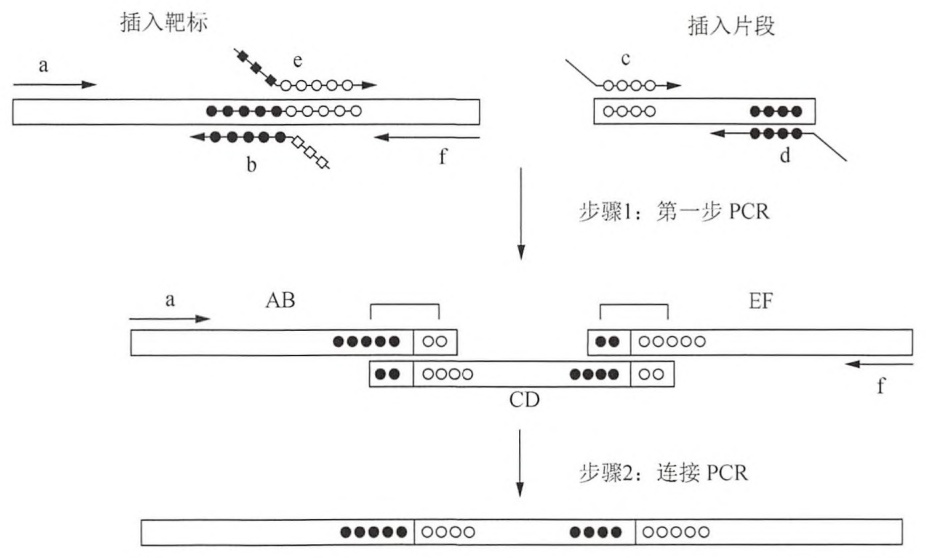
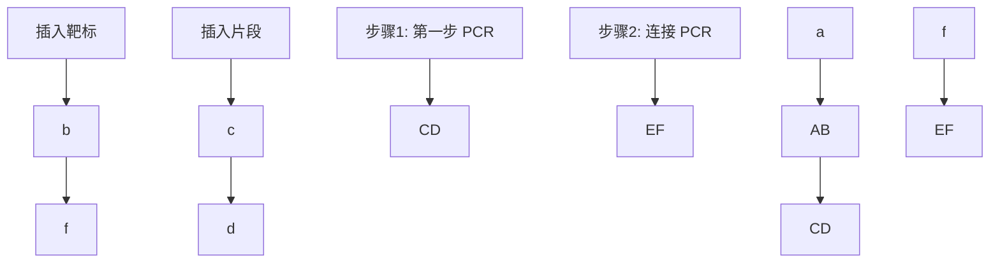
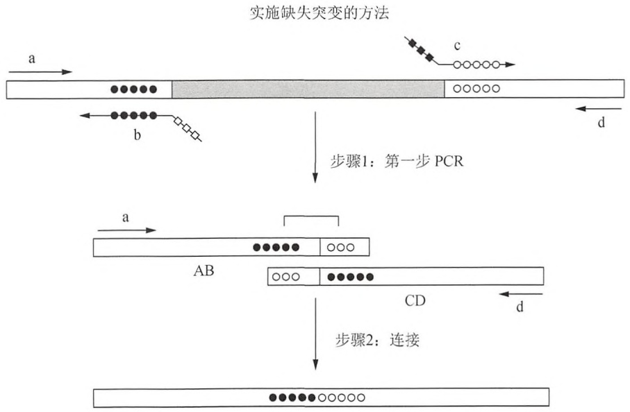
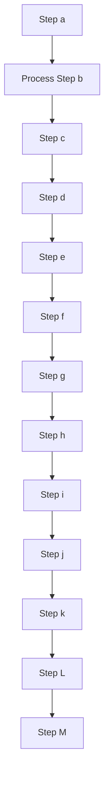
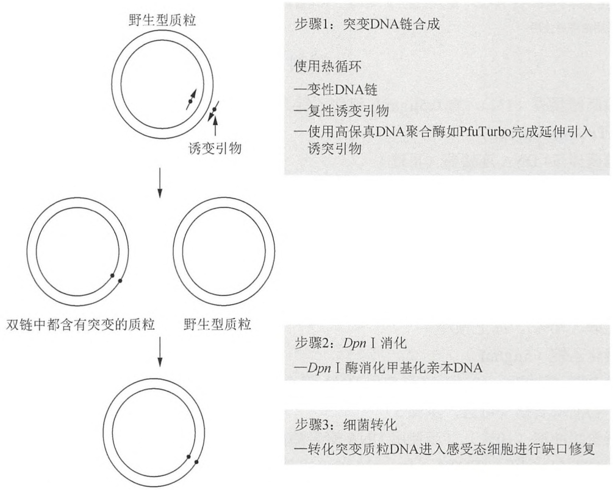
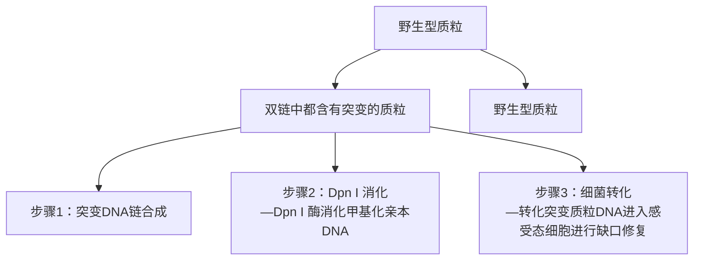
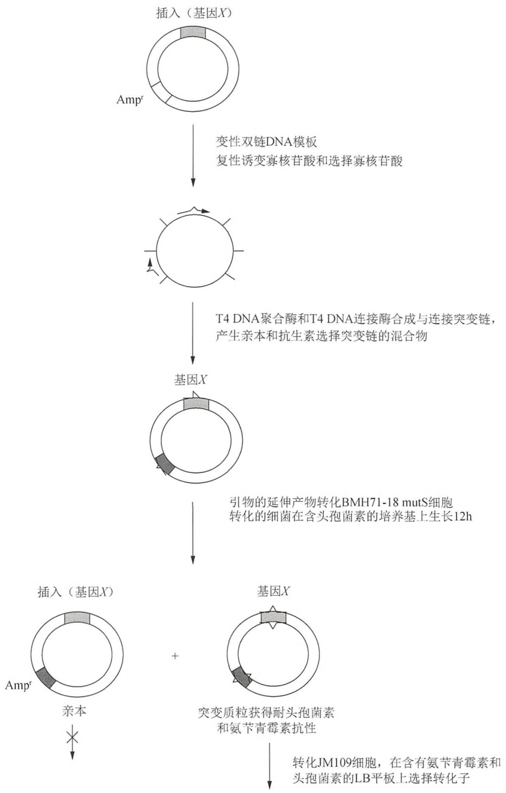
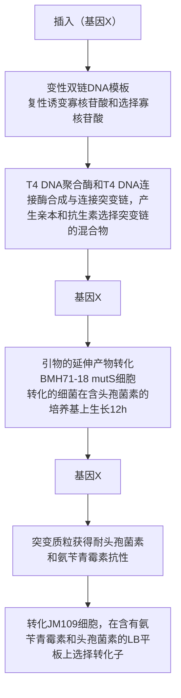

YT 琼脂培养基(2×)

| 试剂 | 量(1L) |
| --- | --- |
| 琼脂 | 15g |
| 细菌用胰蛋白胨 | 16g |
| 酵母提取物 | 10g |
| NaCl | 5g |

溶入 1L 的蒸馏水中，高压灭菌。

## 参考文献

- Emond S, Mondon P, Pizzut-Serin S, Douchy L, Crozet F, Bouayadi K, Kharrat H, Potocki-Veronese G, Monsan P, Remaud-Simeon M. 2008. A novel random mutagenesis approach using human mutagenic DNA polymerases to generate enzyme variant libraries. Protein Eng Des Sel 21: 267–274.
- Griffiths AJF, Miller JH, Suzuki DT, Lewontin RC, Gelbart WM. 2000. An introduction to genetic analysis, 7th ed. WH Freeman, New York.
- Kegler-Ebo DM, Docktor CM, DiMaio D. 1994. Codon cassette mutagenesis: A general method to insert or replace individual codons by using universal mutagenic cassettes. Nucleic Acids Res 22: 1593–1599.
- Kunkel TA. 1985. The mutational specificity of DNA polymerase- $\beta$ during in vitro DNA synthesis. Production of frameshift, base substitution,
- and deletion mutations. J Biol Chem 260: 5787–5796.
- Mondon P, Souyris N, Douchy L, Crozet F, Bouayadi K, Kharrat H. 2007. Method for generation of human hyperdiversified antibody fragment library. Biotechnol J 2: 76–82.
- Mondon P, Grand D, Souyris N, Emond S, Bouayadi K, Kharrat H. 2010. Mutagen: A random mutagenesis method providing a complementary diversity generated by human error-prone DNA polymerases. Methods Mol Biol 634: 373–386.
- Rattray AJ, Strathern JN. 2003. Error-prone DNA polymerases: When making a mistake is the only way to get ahead. Annu Rev Genet 37: 31–66.
- Yang W. 2005. Portraits of a Y-family DNA polymerase. FEBS Lett 579:868–872.

## 方案 2 重叠延伸 PCR 产生插入或缺失诱变

重叠延伸 PCR 可以在一段特定目标 DNA 序列中产生特定的点突变、插入或缺失突变。与其他诱变方法相比，重叠延伸 PCR 诱变方法无需事先准备，并且不需要使用限制酶。该方法的通用性使其应用越来越广泛。与随机诱变方法不同，使用重叠延伸 PCR 诱变引入插入和缺失突变需要事先考虑好将要进行的特定突变。

传统的重叠延伸 PCR 方法在一些关键步骤上还保留一些局限性，尤其是需要产生插入诱变和缺失时。例如，传统方法需要将所有序列变化含在引物中，但这样会使多于 30 个核苷酸片段插入突变很难实现。

该方案描述的重叠延伸 PCR 诱变方法比之前的方法更通用。该方法可以在所给的 DNA 序列的任何位点插入或缺失任何大小的片段。为产生插入突变，首先要利用第一步 PCR 制备拟插入的片段和两个两侧的片段，然后利用第二步 PCR 使插入的片段与从原始模板衍生来的两个两侧片段发生重组。该方法中的引物之所以称为“嵌合引物”，是因为它们是由一个来自原始模板的 18 个核苷酸序列和来自插入片段的 9 个核苷酸的序列连接而成。而位于嵌合引物 5' 端的 9 个核苷酸片段非常关键，因为它使插入片段与两侧的 DNA 片段进行杂交。图 14-4A 是产生插入突变实验步骤总示意图。该方法也可以用来产生缺失突变，将在此方案的后面部分对其进行讨论（图 14-4B）。该方案摘自 Lee 等（2004，2010）的文献。

A

实施插入突变的方法

flowchart

B

flowchart

图 14-4 如何使用重叠延伸 PCR 产生插入和缺失。（A）重叠延伸 PCR 指导的插入诱变。

六边形表示插入的片段（空心或实心）、圆圈表示两侧序列（空心或实心）。27个核苷酸大小的嵌合引物（如图中b和e）由来自模板（圆圈）的18个核苷酸片段和来自插入序列（六边形）的9个核苷酸片段组成。每个六边形或者圆圈代表3个核苷酸。箭头表示引物的 $3^{\prime}$ 端。插入片段插入的位置被两个相邻的不同底纹的圆圈隔开（空心或实心）。在第一步PCR反应中，用适当的引物首先将3种PCR产物（图中AB、CD和EF）分别制备出来。例如，DNA片段AB是由引物a和b产生的PCR产物等。产物片段包含18个核苷酸重叠区域（括弧）在一端（AB和EF）或者两端（CD）。在另一个反应中，用前面PCR反应产生的3种产物作为此次PCR反应的模板，用最外侧的引物（a和f）进行第二次PCR反应。由于重叠区域中末端的互补性，这些产物会发生复性反应并在第二步PCR反应的第1个循环中进行延伸。在第二步PCR反应中，第一次PCR反应生成的产物将连接在一起。（B）分别用一个非嵌合和一个嵌合引物，即a和b或c和d制备拟缺失序列的两侧区域，获得两种PCR产物。在第二步PCR中，以来自第一步PCR的两种产物（AB和CD）为模板，以最外侧的引物对a和d进行连接PCR反应。灰色，拟缺失序列（圆圈、实心或空心）两侧区域（经BioTechniques许可，改编于Lee et al. 2004，经Springer Scienceb Business Media许可，改编于Lee et al. 2010）

## 材料

为正确使用本方案中的器材和危险试剂，必须查阅相应的材料安全数据表并咨询所在机构的环境卫生和安全办公室。

本方案的专用试剂标注&lt;R&gt;，配方在本方案末提供。常用储备溶液、缓冲液和试剂标注&lt;A&gt;，配方见附录1。储备溶液应稀释至适用浓度后使用。

## 试剂

含  $0.5 \mu g/mL$  溴化乙锭的 1% 琼脂糖凝胶

模板 DNA

用 PEG 沉淀方法或者商品化化试剂盒（如 QIAGEN 公司的 QIAprep Spin Miniprep kit）准备模板 DNA。纯化后将质粒 DNA 溶解在 1×Tris-EDTA 缓冲液中&lt;R&gt;

dNTP 溶液（包含 4 种 dNTP 的混合溶液，每种 dNTP 的浓度为 2.5mmol/L）

PCR 缓冲液（10×）&lt;R&gt;

PCR 聚合酶（2.5 U/μL）

要谨慎选择 Taq DNA 聚合酶。推荐选用 Pfu 聚合酶（Agilent）或其他高保真 Taq DNA 聚合酶。

无菌水

合成引物（设计引物说明，见方案）

将合成引物溶解在水中，浓度为  $10 \, pmol/\mu L$ 。

## 设备

凝胶电泳设备或 QIAquick 凝胶回收试剂盒（QIAGEN 公司）

微量离心管（0.5mL；PCR 扩增反应用薄壁离心管）

微量加样器

Nano Drop 机器（NanoDrop machine）

灭菌刀片（用于凝胶纯化）

热循环仪

紫外灯

## 方法

## 插入的产生

首先，利用合适的引物对进行 PCR 反应，制备插入片段和两条侧翼片段。两条侧翼片段在 5' 端均含有重叠区域。待插入片段在两端都含有重叠区域。在第二步 PCR 反应中，将插入片段和两侧片段混合在一起，进行变性、复性和延伸反应，从而生成最终产物。在随后的 PCR 循环中，用最外侧引物对扩增可产生最终的延长产物（图 14-4A）。

## 引物设计

1. 该方案共需要 6 条引物。其中 4 条为嵌合引物（引物 b、c、d 和 e），用于第一步 PCR。另 2 条引物（引物 a 和 f）是非嵌合引物，用于第二步 PCR。
2. 4 条嵌合引物的序列（引物 b、c、d 和 e）一部分来自拟插入的 DNA 序列，一部分来自原始的 DNA 模板序列（因此命名为嵌合引物）。为制备两侧的 PCR 片段（图中 AB 和 EF），需要设计 1 个 27 个核苷酸的嵌合引物（引物 b 和 e），其中 18 个核苷酸来自模板，9 个核苷酸来自插入序列（图 14-4A）。在嵌合引物设计时要考虑正确的方向，即 18 个核苷酸序列应该位于  $3'$  端，而 9 个核苷酸序列应该位于  $5'$  端。

3. 同样，为了产生插入片段（如 CD），应设计另外两个 27 个核苷酸嵌合引物（如引物 b 和 c），其中 18 个核苷酸来自插入序列，9 个核苷酸来自模板序列。利用这对引物在插入片段两侧引入与两侧 PCR 片段（图 14-4 中 AB 和 EF）互补的 9 个核苷酸序列，并以此作为第二步 PCR 的杂交模板。

4. 两条最外侧的引物（图中a和f）也是在第二步PCR反应中需要的。两侧的引物末端应该包括限制性酶切位点，以便于将PCR产物克隆到载体中。

## 第一步 PCR

在第一步 PCR 中，通过 3 个独立的 PCR 反应制备 AB、EF 和 CD 3 个 PCR 片段，进而在第二步 PCR 中通过将 3 个片段混合以产生延伸产物（图 14-4A）。第一步 PCR 反应的两个 PCR 产物对应的是掺入位点两侧区（图 14-4 中 AB 和 EF），第 3 个 PCR 产物对应的是插入片段区（图 14-4 中 CD）。分别用一个非嵌合引物和一个嵌合引物（a 和 b 或 e 和 f）制备两侧片段，并由此在两侧片段 AB 和 EF 中均各自引入插入序列区一端的 9 个核苷酸。由两个嵌合引物（图 14-4 中引物 c 和 d）制备插入序列（图 14-4 中 CD），在其两个末端引入与两侧 PCR 片段的重叠区。

5. 3 个 PCR 片段（AB，CD 和 EF）的 PCR 反应体系均为  $50 \mu L$ ，其中包含 10～20ng 待修饰的 PCR 模板 DNA 或拟插入片段，具体的反应体系如下:

| PCR 模板 DNA | 10~20ng |
| --- | --- |
| PCR 缓冲液(10×) | 5μL |
| dNTP 混合液 | 4μL |
| 引物 1(10μmol/L) | 2μL |
| 引物 2(10μmol/L) | 2μL |
| Taq DNA 聚合酶(2.5U/μL) | 0.5μL |
| 无菌水 | 加至总体积为 50μL |

不同 PCR 片段用不同的模板和引物扩增。

扩增AB片段:

将原始模板 DNA 与 a、b 引物混合。

扩增 CD 片段:

将拟插入片段的 DNA 与 c、d 引物混合。

扩增 EF 片段:

将原始模板 DNA 与 e、f 引物混合。

6. 按如下程序在热循环仪中进行 PCR 反应。

| 循环数 | 变性 | 复性 | 聚合反应 |
| --- | --- | --- | --- |
| 1 | 98°C,2min |  |  |
| 2~26 | 98°C,10s | 55°C,15s | 72°C,1min |

最后一轮反应结束后，将样品置于  $72^{\circ}$ C 继续孵育 10min，保证延伸反应完全。

见“疑难解答”。

7. 为了纯化 PCR 产物，以便进行第二步 PCR 反应，将全部 PCR 产物上样到含有 $0.5\mathrm{mg/mL}$ 溴化乙锭的 $1\%$ 琼脂糖凝胶中，进行琼脂糖凝胶电泳（第2章）。电泳完毕，将琼脂糖凝胶置于紫外灯下观察 PCR 产物条带，以检查扩增效率。采用商品化试剂盒（如 QIAquick 胶回收试剂盒）回收 PCR 产物。在进行下一步骤前，用 NanoDrop 机器（NanoDrop machine）对纯化的 DNA 进行质量分析。

## 第二步 PCR

第二步 PCR 反应的目的是将在第一步 PCR 反应中获得的 3 个 PCR 片段连接在一起形成最终的产物。首先，将第一步 PCR 反应产生的片段（AB、CD 和 EF）混合，因末端核苷酸序列互补而发生复性反应。然后，杂交 DNA 分子在热稳定 DNA 聚合酶和最外侧引物（如 a 和 f）作用下进行延伸和扩增。

8. 在微量离心管中制备 $50\mu \mathrm{L}$ 如下PCR反应体系，其中包含3个来自第一轮PCR反应的产物片段各 $10\sim 20\mathrm{ng}$。

| 凝胶纯化的第一轮PCR反应产物(AB、CD和EF片段) | 10~20ng |
| --- | --- |
| PCR缓冲液(10×) | 10μL |
| dNTP混合液 | 4μL |
| 引物a(10μmol/L) | 2μL |
| 引物f(10μmol/L) | 2μL |
| 热稳定DNA聚合酶(2.5U/μL) | 0.5μL |
| 无菌水 | 至总体积为50μL |

9. 按如下程序在热循环仪中进行 PCR 反应。

| 循环数 | 变性 | 复性 | 聚合反应 |
| --- | --- | --- | --- |
| 1 | 98°C, 2min |  |  |
| 2~26 | 98°C, 10s | 55°C, 15s | 72°C, 1min |

最后一轮反应结束后，样品置于  $72^{\circ}$ C 继续孵育 10min，保证延伸反应完全。

见“疑难解答”。

10. 如上所述纯化 PCR 产物，将最终的 PCR 产物克隆到合适的载体，进一步进行测序从而确定产生了所需的诱变。

## 缺失的产生

产生缺失突变的方法和前面讲述的产生插入突变的方法类似，但是在该方法中，第一步 PCR 反应中产生的 PCR 片段是 2 个，而不是前面所述的 3 个（图 14-4B）。为实现缺失突变，首先要利用 PCR 反应制备拟缺失序列两侧的片段，并在两个片段中引入来自缺失序列对侧模板的末端序列。这两个末端序列可以使该两侧的片段进行杂交，从而在第二步 PCR 反应中延伸产生变短了的最终产物。换言之，缺失即是两侧序列的连接或重组。

## 引物设计

11. 制备缺失突变共需要 4 条引物:两条嵌合引物（引物 b 和 c）和两条非嵌合引物（引物 a 和 d）。
12. 两条嵌合引物（如引物 b 和 c）由来自紧邻缺失片段两侧的 18 个核苷酸和来自对侧紧邻缺失片段的 9 个核苷酸组成（图 14-4B）。设计时要确保引物正确的方向性。
13. 最外侧的两个引物（引物 a 和 d）是用来对最终的缺失后产物进行 PCR 扩增的。两侧引物末端应该包含限制性酶切位点，以便后续对最终的 PCR 产物进行克隆。

## 第一步 PCR

在第一步 PCR 反应中，通过两个独立的 PCR 过程分别扩增片段 AB 和 CD，以便将两片段在第二步 PCR 反应中进行杂交（图 14-4B）。第一步 PCR 产生的两个 PCR 产物分别来自被缺失片段的两侧，每个片段分别用一条嵌合引物和一条非嵌合引物扩增而来。

14. 用 $10 \sim 20 \mathrm{ng}$ 模板 DNA, 对 AB 和 CD 片段进行 PCR 反应, $50 \mu \mathrm{L}$ 反应体系如下。

| 原始 DNA 模板 | 10~20ng |
| --- | --- |
| PCR 缓冲液(10×) | 5μL |
| dNTP 混合液 | 4μL |
| 引物 1(10μmol/L) | 2μL |
| 引物 2(10μmol/L) | 2μL |
| 热稳定 DNA 聚合酶(2.5U/μL) | 0.5μL |
| 灭菌水 | 加至总体积为 50μL |

扩增 AB 片段时:

用引物 a 和 b。

扩增 CD 片段时:

用引物 c 和 d。

15. 按如下程序在热循环仪中进行 PCR 反应。

| 循环数 | 变性 | 复性 | 聚合反应 |
| --- | --- | --- | --- |
| 1 | 98°C,2min |  |  |
| 2~26 | 98°C,10s | 55°C,15s | 72°C,1min |

最后一轮反应结束后，样品置于 $72^{\circ} \mathrm{C}$ 继续孵育 $10 \mathrm{~min}$，保证延伸反应完全。

见“疑难解答”。

16. 为了纯化 PCR 产物，以便进行第二步 PCR 反应，将全部 PCR 产物上样到含有 $0.5\mathrm{mg/mL}$ 溴化乙锭的 $1\%$ 琼脂糖凝胶中，进行琼脂糖凝胶电泳（第2章）。电泳完毕，将琼脂糖凝胶置于紫外灯下观察 PCR 产物条带，以检查扩增效率。采用商品化试剂盒（如 QIAquick 胶回收试剂盒）回收 PCR 产物。在进行下一步骤前，用 NanoDrop 机器对纯化的 DNA 进行质量分析。

## 第二步 PCR

第二步 PCR 反应的目的是扩增第一步 PCR 反应的两种产物，从而得到缺失突变体。在第二步 PCR 反应中，PCR 产物 AB 和 CD 混合后并利用末端的互补区段发生复性。杂交的 DNA 分子在热稳定 DNA 聚合酶作用下进行延伸和扩增，从而生成缺失突变的目标产物。

17. 在微量离心管中制备  $50 \mu L$  如下 PCR 反应体系，其中包含两个来自第一轮 PCR 反应产物片段各  $10 \sim 20 ng$ 。

| 凝胶纯化的第一轮PCR反应产物(AB和CD片段) | 10~20ng |
| --- | --- |
| PCR缓冲液(10×) | 10μL |
| dNTP混合液 | 4μL |
| 引物a(10μmol/L) | 2μL |
| 引物d(10μmol/L) | 2μL |
| 热稳定DNA聚合酶(2.5U/μL) | 0.5μL |
| 无菌水 | 加至总体积为50μL |

18. 用如下程序在热循环仪中进行 PCR 反应。

| 循环数 | 变性 | 复性 | 聚合反应 |
| --- | --- | --- | --- |
| 1 | 98°C,2min |  |  |
| 2~26 | 98°C,10s | 55°C,15s | 72°C,1min |

最后一轮反应结束后，样品再在  $72^{\circ}$ C 继续孵育 10 min，保证延伸反应完全。

见“疑难解答”。

19. 利用凝胶电泳纯化缺失突变产物（第 2 章），并将其克隆入选定的载体中，通过 DNA 序列测定确证缺失突变产物。

## 疑难解答

问题（步骤 6、步骤 9、步骤 15 和步骤 18）:PCR 产物出现错误。

解决方案:为减少错误，需控制拟扩增 PCR 产物长度小于 2.0kb。

问题（步骤 6、步骤 9、步骤 15 和步骤 18）:产物中出现一处或者多处突变。

解决方案:使用从未用 PCR 扩增过的质粒 DNA。

问题（步骤6、步骤9、步骤15和步骤18）:产生不需要的副产物。

解决方案:在进行 PCR 之前有几点需要注意。首先，控制 PCR 程序循环数不超过 25 个（加上开始的变性循环数）。其次，根据引物预计的解链温度来调整复性温度，这点非常重要。

## 配方

为正确使用该方案中的器材和危险试剂，必须查阅相应的材料安全数据表并咨询所在机构的环境卫生和安全办公室。

10×PCR 缓冲液

| 试剂 | 终浓度 |
| --- | --- |
| Tris-HCl (pH 8.3) | 100mmol/L |
| KCl | 500mmol/L |
| $MgCl_2$ | 15mmol/L |
| 明胶 | 0.1% |

1×Tris-EDTA 缓冲液

| 试剂 | 终浓度 |
| --- | --- |
| Tris-HCl (pH 8.3) | 10mmol/L |
| EDTA | 1mmol/L |

## 参考文献

<small>Lee J, Lee HJ, Shin MK, Ryu WS. 2004. Versatile PCR-mediated insertion or deletion mutagenesis. BioTechniques 36: 398–400.</small>

<small>Lee J, Shin MK, Ryu DK, Kim S, Ryu WS. 2010. Insertion and deletion mutagenesis by overlap extension PCR. Methods Mol Biol 634: 137–146.</small>

# 方案 3 以双链 DNA 为模板的体外诱变: 用 Dpn I 选择突变体

在该方案与方案 5 中，以变性质粒 DNA 为模板，在高保真聚合酶作用下，使用两条寡核苷酸链引导 DNA 合成。两条寡核苷酸链中均含有预定突变位点，并且两者在质粒 DNA 上的结合序列彼此反向互补。在该方案中，经多轮热循环，双链质粒 DNA 的全长均以线性形式扩增，最终产生一种 DNA 双链上带交错缺口的突变质粒 DNA（图 14-5）(Hemsley et al. 1989)。

flowchart

图 14-5 用 Dpn I 和 PCR 进行定点诱变。在本方案中，一个含有目标基因片段的双链 DNA（dsDNA）载体和两个包含所需突变位点的寡核苷酸引物（见方案 1，图 14-1）混合在一起。两个寡核苷酸引物在 PCR 中向相反方向进行扩增。形成的寡核苷酸引物生成一个含有交错缺口的诱变质粒。PCR 扩增后，扩增产物用 Dpn I 处理。Dpn I 限制性内切核酸酶主要消化甲基化和半甲基化的 DNA，而亲本 DNA 模板是甲基化的，因此可以利用 Dpn I 的剪切能力消化去除模板 DNA，从而使带有突变位点的 PCR 产物得到富集。黑色圆圈表示突变插入位点。

因为扩增反应中使用了一定数量的模板 DNA，野生型质粒 DNA 的转化子背景将非常高，因此需要增加富集突变体 DNA 的步骤。该方案通过采用可以特异性消化完全甲基化序列（GMe6ATC 序列，Vovis and Lacks 1977）的限制酶 Dpn I 处理线性扩增产物来实现这一目标。Dpn I 酶可以消化扩增反应体系中大肠杆菌产生的模板 DNA，而不能消化体外合成的 DNA（信息栏“ $N^{6}$ -甲基化腺嘌呤、DAM 甲基化酶和甲基化敏感限制酶”）。不能被 Dpn I 消化的诱变体分子可通过转化并筛选带有抗生素抗性的大肠杆菌而获得。根据诱变体的复杂性和 DNA 模板长度不同，最终将有 15%～80% 的转化子含有所需突变的质粒（Weiner et al. 1994）。该方法可成功应用于中等大小（<7kb）的质粒，将诱变体直接引入到全长 cDNA 中，免去了额外的亚克隆操作。

该方法（通常被称为环状诱变）成功的关键在于引物的设计和选择恰当的热稳定 DNA 聚合酶，这在该方案的讨论部分会有进一步的论述。环状诱变所使用的商品化试剂为 QuickChange 试剂盒（Agilent 公司），该试剂盒中含有一个质粒 DNA 模板和诱变引物，可作为阳性对照。这个试剂盒尤其适合首次进行环状诱变试验的研究人员使用。

## 材料

为正确使用该方案中的器材和危险试剂，必须查阅相应的材料安全数据表并咨询所在机构的环境卫生和安全办公室。

该方案的专用试剂标注&lt;R&gt;，配方在该方案末提供。常用储备溶液、缓冲液和试剂标注&lt;A&gt;，配方见附录1。储备溶液应稀释至适用浓度后使用。

## 试剂

琼脂糖凝胶（1%），含  $0.5 \mu g/mL$  溴化乙锭（步骤 8）

ATP (10mmol/L)

噬菌体 T4 DNA 连接酶（可选）

噬菌体 T4 多核苷酸激酶和缓冲液（可选；步骤 10）

hsdR17 基因型的大肠杆菌感受态菌株（如 XL1-Blue、XL2-Blue、MRF' 或 DH5α）

DNA 分子质量标准（1kb）

dNTP 溶液（含有 4 种 dNTP，每种 5mmol/L）

Dpn I 限制性内切核酸酶和缓冲液

乙醇（70%），冰上预冷

溴化乙锭（5μg/mL）

长 PCR 缓冲液（10×）（当使用 DNA 聚合酶混合物时）&lt;R&gt;

矿物油或石蜡（可选；步骤5）

诱变缓冲液（10×）（当使用 DNA 聚合酶如 Pfu 时）&lt;R&gt;

NaOH（1mol/L）/EDTA（1mmol/L）（可选）

寡聚核苷酸引物

关于设计的寡核苷酸引物，请参见本方案的导言部分。要想得到更好的实验结果，最好用快速高效液相层析（FPLC）或PAGE来纯化寡核苷酸引物，以便减少盐离子的干扰。将引物用蒸馏水配制成20mmol/L。

酚:氯仿（可选；步骤9）

质粒 DNA

用于诱变的模板 DNA 是一个含有目标基因或 cDNA 的环形互补质粒。一般来说，质粒越短越有利于目标 DNA 的扩增。质粒总长度 <7kb 效果最好。然而，也有质粒模板长达 11.5kb 的成功案例（Gatlin et al. 1995）。质粒 DNA 应该用含有低浓度 EDTA（<0.1mmol/L；1×Tris EDTA 缓冲液 &lt;R&gt;）的 1mmol/L Tris-HCl（pH 7.6）缓冲液溶解至 1μg/mL。

乙酸钠（3mol/L, pH 4.8）（可选）

该溶液是用作中和剂，因此 pH 略低于用于分子克隆的乙酸钠溶液。

TE 缓冲液（pH 8.0） &lt;R&gt;

热稳定的 DNA 聚合酶（如 Pfu DNA 聚合酶）

该方案描述的条件是针对 PfuTurbo DNA 聚合酶进行优化获得的。但也适用于其他热稳定的聚合酶或聚合酶的混合物。Agilent 公司提供 3 种形式的 Pfu:一种是天然酶；另外一种是从 Pfu 基因克隆体中表达的重组酶；还有一种是复合型的 PfuTurbo 制剂。PfuTurbo 由两个成分组成，一种是重组的 Pfu DNA 聚合酶，一种是新的热稳定因子，目前对这种因子的特性还不是很清楚，但是该因子可以增强扩增产物的扩增效率，且不会改变 DNA 复制的保真度。制造商声称，PfuTurbo DNA 聚合酶能够扩增 15kb 的 DNA 片段。然而目前我们认为，当扩增的 DNA 片段超过 7～8kb 时，扩增效率就会降低。

## 设备

适用于自动微量加样器的带滤芯吸头

DNA 测序仪

凝胶电泳设备

微量离心管（0.5mL 的薄壁管，用来扩增反应）或微量滴定板

正排量移液器

设定好程序的热循环仪

如果热循环仪没有配备加热盖，使用矿物油或石蜡以防止反应混合物在 PCR 过程中蒸发。

## 附加材料

转化（步骤 14；见第 3 章）、杂交（步骤 15；见第 2 章）和测序（步骤 16；见第 11 章）所用的试剂和设备。

## 方法

## 用诱变引物扩增目标 DNA

步骤 1 和 2 可选（步骤 3 后的标注）。

1. 将  $1 \sim 10 \mu g$  质粒 DNA 溶于含有  $10 \mu L$  1mol/L NaOH/1mmol/L EDTA 的  $40 \mu L$  的水中， $37^{\circ} C$  孵育 15min，使质粒 DNA 模板变性。
2. 加入  $5 \mu L$   $3 \, mol/L$  的乙酸钠（pH 4.8）中和反应液。用  $150 \mu L$  预冷的乙醇沉淀 DNA。
3. 在 $4^{\circ} \mathrm{C}$ 离心 $10 \mathrm{~min}$ 以收集变性的质粒 DNA。小心倒出乙醇上清液，再用 $150 \mu \mathrm{L}$ 的 $70 \%$ 乙醇洗涤沉淀。离心 $2 \mathrm{~min}$，弃去上清液，并在室温晾干至乙醇完全蒸发。最后将 DNA 溶解于 $20 \mu \mathrm{L}$ 水中。

理论上，在质粒 DNA 用作 PCR 模板前不需要使其变性。如果省略碱变性步骤，超螺旋的天然双链 DNA 也可以在 PCR 过程的第一个循环被加热至  $94^{\circ}$ C 而变性。之所以选择步骤 1 和步骤 2，是由于质粒 DNA 在碱溶液中持续变性后会形成特定的状态。在暴露于 0.2mol/L NaOH 期间，质粒 DNA 会折叠成一个致密的、不可逆转的变性线团状物，这种形式的质粒 DNA 可以作为 PCR 反应的模板，但没有明显转化细菌的能力。因此，包含非变异的野生型 DNA 克隆的背景将明显减少（Du et al. 1995; Dorrell et al. 1996）。相应地，在聚合酶链反应的第一循环中短时间将模板 DNA 暴露于  $95^{\circ}$ C 可打乱碱基配对，但并不会破坏质粒分子转化的能力。因此，转化后的克隆含有比例较高的非变异的亲本质粒分子。在实验最后阶段，当需要从克隆中筛选出含有突变的 DNA 的时候，碱性变性的优势便会体现出来。

如果诱变效率低且所选的 Dpn I 无效，含有野生型分子的克隆比例可能会异常高。

4. 在无菌薄壁 $0.5\mathrm{mL}$ 离心管，加入一系列含有不同量（如 $5\mathrm{ng}$ 、 $10\mathrm{ng}$ 、 $25\mathrm{ng}$ 和 $50\mathrm{ng}$）质粒DNA和一定量两个寡核苷酸引物的反应混合物。

| 诱变缓冲液(10×) | 5μL |
| --- | --- |
| 模板质粒 DNA | 5~50ng |
| 寡核苷酸引物 1(20mmol/L) | 2.5μL |
| 寡核苷酸引物 2(20mmol/L) | 2.5μL |
| dNTP 混合物 | 2.5μL |
| ${\mathrm{H}}_{2}\mathrm{O}$ | 加至总体积 50μL |

在反应混合物中加入 2.5U 的 PfuTurbo DNA 聚合酶。

为了减少 PfuTurbo 3'→5' 外核酸酶活性降解引物的概率，按照上述顺序添加试剂是非常有必要的。

5. 如果热循环仪未装有热盖，用1滴（约 $50\mu \mathrm{L}$ ）轻矿物油或石蜡覆盖反应混合物以防止反应混合液在重复循环的加热和冷却过程中发生蒸发。将管子放在热循环仪中。

6. 扩增核酸使用的变性、复性和聚合反应时间和温度条件如下表所示。

| 循环数 | 变性 | 复性 | 聚合反应 |
| --- | --- | --- | --- |
| 1 | 95°C, 1min |  |  |
| 2~18$^{a}$ | 95°C, 30s | 55°C, 1min | 68°C进行反应2min/1000个碱基 |
| 最后一个循环 | 94°C, 1min | 55°C, 1min | 72°C, 10min |

这些时间适用于 $0.5\mathrm{mL}$ 管中的 $50\mu \mathrm{L}$ 反应体系，一般在以下型号的热循环仪中进行，如PerkinElmer9600或9700、Mastercycler（Eppendorf公司）和PTC100（MJ Research公司）等。对于不同的设备和反应体积，时间和温度可能需要加以调整。

a. 对于单碱基替换，使用12个循环的线性扩增；对于一个氨基酸的替换（通常要进行两个或三个连续碱基的替换），使用16个循环；对于含有插入和（或）缺失的反应，使用18个循环。

使用 $Pfu$ 进行扩增反应的扩增速率比使用 $Taq$ 酶进行扩增反应要慢 $1.5 \sim 2.0$ 倍。

使用大量的初始模板和较少循环数反应可用于减少质粒DNA和基因或cDNA扩增过程中的非特异突变。

7. DNA 扩增完成后，将反应混合液放置在冰上。

8. 取 $100 \mu \mathrm{L}$ 反应产物在含有 $0.5 \mu \mathrm{g} / \mathrm{mL}$ 溴化乙锭的 $1 \%$ 琼脂糖凝胶中进行电泳, 以确定是否扩增获得目标 DNA。同时在近旁的凝胶跑道中上样 $50 \mathrm{ng}$ 未扩增的线性质粒 DNA 和 $1 \mathrm{kb} \mathrm{DNA}$ 分子质量标准作为对照。

如果扩增效率很低，可设置一系列反应来优化扩增反应体系和循环参数。

## 扩增产物的连接与转化

步骤 9～步骤 12 均为可选，一般仅在诱变效率很低时使用（如构建插入和缺失突变时）。

9. 用酚:氯仿抽提两次扩增的 DNA，并用乙醇沉淀。

10. 用以下试剂重悬 DNA 沉淀:

| 噬菌体T4多核苷酸激酶缓冲液(10×) | 5μL |
| --- | --- |
| ATP(10mmol/L) | 5μL |
| 噬菌体T4多核苷酸激酶 | 5U |
| $H_2O$ | 加至总体积50μL |

在 $37^{\circ}\mathrm{C}$ 孵育反应 $1\mathrm{h}$ 。在 $68^{\circ}\mathrm{C}$ 加热 $10\mathrm{min}$ 灭活激酶活性。用酚:氯仿提取磷酸化DNA两次，并用乙醇沉淀法收集DNA。

11. 重悬磷酸化的 DNA 沉淀（每个样品约 $0.9\mu \mathrm{g}$）于 $90\mu \mathrm{L}$ 的 TE 缓冲液。设置一系列浓度范围从 $0.1 \sim 1\mu \mathrm{g} / \mathrm{mL}$ 的磷酸化 DNA 进行连接反应。

| 磷酸化 DNA | (10~100ng) |
| --- | --- |
| 噬菌体 T4 DNA 连接酶缓冲液(10×) | 10μL |
| ATP (10mmol/L) | 10μL |
| 噬菌体 T4 DNA 连接酶 | 4U |
| ${\mathrm{H}}_{2}\mathrm{O}$ | 加至总体积 100μL |

在  $16^{\circ}$ C 孵育反应  $12 \sim 16$ h。

如果使用由制造商提供的 $10 \times$ 噬菌体T4连接酶缓冲液，其中包含ATP，则省略上述连接反应中的ATP。

连接反应形成环状单体的原理和条件等理论已经很成熟（Collins and Weissman 1984），但是在实践中很难实现。DNA末端分子的物质的量浓度必须很低以易于形成内分子环状结构。但是，利用逆向PCR扩增获得的DNA分子很难计算其适当的浓度，因为末端完好的全长产物的比例是未知的。

12. 用酚:氯仿提取两次连接后的 DNA 产物，并由乙醇沉淀 DNA。用 $45\mu \mathrm{L}$ 水重悬每个沉淀物。在每个管中添加 $5\mu \mathrm{L} 10 \times Dpn$ I 缓冲液。
13. 通过直接向剩余的扩增反应液（步骤7）或磷酸化并连接的DNA（步骤12）中添加10U的DpnI来消化扩增后的DNA产物。混合后吹打溶液几次，微型离心机离心5s，然后在 $37^{\circ}\mathrm{C}$ 下孵育1h。

如果温度循环在矿物油或石蜡中运行，重要的是要确保 Dpn I 添加到反应混合物的水溶液部分。使用带滤芯的微量吸管，并且一定要插入到矿物油或石蜡覆盖面以下。

14. 用 $1 \mu \mathrm{L} 、 2 \mu \mathrm{L}$ 和 $5 \mu \mathrm{L}$ 消化后的 DNA 分别转化大肠杆菌感受态细胞（第 3 章）。

请确保没有矿物油从消化混合物转移到感受态细胞。

使用具有较强转化能力的 XL2-Blue MRF'大肠杆菌细胞（Agilent 公司）和改进后的转化步骤以利于诱变产物的回收（Dorrell et al. 1996）。然而，自制的高转化能力大肠杆菌亦可适用于大多数的环状诱变产物。

15. 从至少 12 个独立转化克隆中提取质粒 DNA。用 DNA 测序方法筛选 DNA 突变体，或者用寡核苷酸杂交的方法（第 2 章）进行鉴定，如果引入的突变形成或破坏了一个限制酶识别位点，或模板中引入了插入或缺失突变，此时可以使用限制酶消化少量粗提质粒 DNA 的方法来鉴定。

见“疑难解答”。

16. 测定一整段序列来验证目标 DNA 中所需的突变是否存在，同时在扩增过程中没有非预期突变生成（第 11 章）。

见“疑难解答”。

## 疑难解答

问题（步骤 15）:没有携带所需突变的质粒。

解决方案:用寡核苷酸杂交法筛选整个转化体群来找出所需的突变克隆。

问题（步骤 16）:扩增反应可以进行，但产量很低。

解决方案:Dpn I 可能是问题的关键所在。设置一系列反应来检查这种酶是否能够在  $1 \times Pfu$  反应缓冲液中完全消化 50ng 亲本质粒。如果有必要，调整 Dpn I 使用量和消化时间。如果 Dpn I 消化反应效率高，请考虑使用两步扩增反应（Wang and Malcolm 1999）。在第一阶段，进行两个单独的不对称扩增反应，每个反应使用两个寡核苷酸引物中的一个。

反应产物均是单链 DNA 分子，可以作为第二阶段线性扩增的模板，用这两个寡核苷酸作为引物进行扩增反应。第一阶段反应的目的是产生不与野生型的双链竞争且能与诱变引物完全结合的模板。

## 讨论

## 引物设计

两个寡核苷酸引物:

- 必须能与同一目标序列的互补链复性。
- 长度必须相等（在25和45个碱基对之间）；计算出的解链温度为 $78^{\circ}\mathrm{C}$ 或更高。$T_{\mathrm{m}}$ 应足够高以防止错配，并且足够低以便允许引物-引物二聚体在扩增反应的变性步骤解开。

\- 应终止在一个 G 或 C 残基。

\- 不需要磷酸化。这是因为热稳定 DNA 聚合酶 $Pfu$ 最常用于催化扩增反应，无论寡核苷酸是否磷酸化，$Pfu$ 都无法取代寡核苷酸与目标序列杂交。

\- 通常未经纯化便可使用。然而，如果使用快速液相色谱法（FPLC）或聚丙烯酰胺凝胶电泳（PAGE）纯化获得的引物进行突变，尤其是产生插入和缺失突变时，效率会更高。

当引入点突变时，一个引物带有野生型序列，而另一条引物含有所需的突变，并且在突变位置的两侧都至少有12个碱基的正确序列。如果产生缺失突变，两个引物都含有野生型序列，但它们的间距在模板上的距离与缺失片段的长度相关。产生插入突变的话，需要一个引物包含野生型序列而另一个引物的5'端需含有插入片段的序列。

## 热稳定 DNA 聚合酶

用于对变性质粒模板进行诱变的热稳定性 DNA 聚合酶有 3 个必需的属性:

- 校对活性高；
- 碱基错配率低；
- 缺乏非模板末端转移酶活性。

Taq 不能满足这些条件，因此完全不适合定点诱变（Stemmer and Morris 1992；Watkins et al. 1993）。然而，160:1 的 Klentaq（AB Peptides 公司）和 Pfu 聚合酶（Agilent 公司）也有了可用的试剂盒。一个典型的试剂盒中 1.2μL 总体积中分别含有 0.187U 的 Pfu 和 33.7U 的 Klentaq。Agilent 公司的 TaqPlus 和 Boehringer-Mannheim 公司的高保真 PCR 扩增系统均为可选的商品化试剂盒。

单一的热稳定性 DNA 聚合酶已成功地用于环状 PCR 反应，包括 Pwo DNA 聚合酶（Hidajat and McNicol 1997）、rTth DNA 聚合酶 XL（Du et al. 1995; Gatlin et al. 1995）、Vent $_{R}$  DNA 聚合酶（Hughes and Andrews 1996）和 Pfu DNA 聚合酶（见下文）。这些聚合酶有一个主要的缺点——对寡核苷酸引物浓度的要求相对较高，目的是:①抵消 3'→5' 外切酶活性；②确保引物的物质的量浓度大于模板 DNA 浓度（50～100 倍）（第 7 章，表 7-1）。然而，这种高浓度有利于两个互补的寡核苷酸引物杂交，因此也降低了扩增效率。因为引物有效浓度不确定，一些研究人员利用预实验来优化扩增反应的组成体系。通常使用琼脂糖凝胶电泳来检测包含一定量 DNA 模板（通常为 50ng）和一系列不同浓度引物的扩增产物中线性全长 DNA 的量（如 Parikh and Guengerich 1998）。然而，在该方案中，引物浓度的优化不是必要的，除非突变非常复杂（3 个以上单碱基改变；或者超过 2 个核苷酸的缺失或插入突变）。

当使用单个热稳定 DNA 聚合酶时，可能需要采取其他步骤进一步降低非必要突变体在扩增期间积累的机会。

- dNTP 混合物和  $Mg^{2+}$  在反应混合物中的初始浓度分别不能超过  $250\mu mol/L$  和 1.5mmol/L。
- 因为热稳定性 DNA 聚合酶如 $Pfu$ 和 $Pwo$, 比 $Taq$ 需要更多的碱性缓冲液, 故 Tris 缓冲液反应混合物的 pH 应为 8.9 (25°C 测量)。
- 线性扩增循环数必须保持到最低（本方案步骤6），即使在扩增反应中要求使用相对较大量的DNA模板。

## 配方

为正确使用本方案中的器材和危险试剂，必须查阅相应的材料安全数据表并咨询所在机构的环境卫生和安全办公室。

长 PCR 缓冲液（10×）

将此缓冲液与 DNA 聚合酶的混合物一同使用

| 试剂 | 终浓度 |
| --- | --- |
| Tris-Cl(pH 9.0,室温) | 500mmol/L |
| 硫酸铵 | 160mmol/L |
| MgCl2 | 25mmol/L |
| 牛血清白蛋白 | 1.5mg/mL |

由制造商提供的缓冲液和适合的热稳定 DNA 聚合酶可以代替上述缓冲液。

诱变缓冲液（10×）

应用 DNA 聚合酶如 Pfu 时使用此配方

| 试剂 | 终浓度 |
| --- | --- |
| KCl | 100mmol/L |
| 硫酸铵 | 100mmol/L |
| Tris(pH 8.9,室温) | 200mmol/L |
| MgSO4 | 20mmol/L |
| Triton X-100 | 1% |
| 牛血清白蛋白(无核酸酶) | 1mg/mL |

Tris-EDTA（TE）缓冲液（1×）

| 试剂 | 终浓度 |
| --- | --- |
| Tris-HCl (pH 8.0) | 10mmol/L |
| EDTA | 1mmol/L |

## 参考文献

- Collins FS, Weissman SM. 1984. Directional cloning of DNA fragments at a large distance from an initial probe: A circularization method. Proc Natl Acad Sci 81: 6812–6816.
- Dorrell N, Gyselman VG, Foynes S, Li SR, Wren BW. 1996. Improved efficiency of inverse PCR mutagenesis. BioTechniques 21: 604–608.
- Du Z, Regier DA, Desrosiers RC. 1995. Improved recombinant PCR mutagenesis procedure that uses alkaline-denatured plasmid template. Bio-Techniques 18: 376–378.
- Gatlin J, Campbell LH, Schmidt MG, Arrigo SJ. 1995. Direct-rapid (DR) mutagenesis of large plasmids using PCR. BioTechniques 19: 559–564.
- Hemsley A, Arnheim N, Toney MD, Cortopassi G, Galas DJ. 1989. A simple method for site-directed mutagenesis using the polymerase chain reaction. Nucleic Acids Res 17: 6545–6551.
- Hidajat R, McNicol P. 1997. Primer-directed mutagenesis of an intact plasmid by using Pwo DNA polymerase in long distance inverse PCR. Bio-Techniques 22: 32–34.
- Hughes MJ, Andrews DW. 1996. Creation of deletion, insertion and substitution mutations using a single pair of primers and PCR.

Bio Techniques 20: 188–196.

Parikh A, Guengerich FP. 1998. Random mutagenesis by whole-plasmid PCR amplification. BioTechniques 24: 428–431.

Stemmer WP, Morris SK. 1992. Enzymatic inverse PCR: A restriction site independent, single-fragment method for high-efficiency, site-directed mutagenesis. BioTechniques 13: 214–220.

Vovis GF, Lacks S. 1977. Complementary action of restriction enzymes endo R-DpnI and endo R-DpnII on bacteriophage f1 DNA. J Mol Biol 115: 525–538.

Wang W, Malcolm BA. 1999. Two-stage PCR protocol allowing introduction of multiple mutations, deletions and insertions using QuikChange Site-Directed Mutagenesis. BioTechniques 26: 680–682.

Watkins BA, Davis AE, Cocchi F, Reitz MSJ. 1993. A rapid method for site-specific mutagenesis using larger plasmids as templates. BioTechniques 15: 700–704.

Weiner MP, Costa GL, Schoettlin W, Cline J, Mathur E, Bauer JC. 1994. Site-directed mutagenesis of double-stranded DNA by the polymerase chain reaction. Gene 151: 119–123.

## 方案 4 突变型β-内酰胺酶选择法定点诱变

有许多方法可以进行定点突变，本方案介绍一种最常用的定点突变方法，即突变型β-内酰胺酶选择法。β-内酰胺酶是一种氨苄青霉素切割酶，对细菌无作用。β-内酰胺酶特定活性位点的突变可以改变其酶切的底物特异性，使其对于头孢菌素类抗生素家族的水解活性增强，而野生型的β-内酰胺酶则不具有这种活性（Cantu et al. 1996）。与野生型大肠杆菌相比，带有β-内酰胺酶3个点突变（G238S:E240:R241G）的大肠杆菌表现出对头孢噻肟（cefotaxime）和头孢曲松（ceftriaxone）这两种头孢菌素类抗生素具有增强抗性。本方案利用这一特性来筛选含有定点突变的质粒。

具体来说，首先将含有一个待突变目的基因（基因 $X$）和一个 $\beta$-内酰胺酶基因的双链质粒DNA模板进行碱变性，然后将两个寡核苷酸引物同时与其进行复性反应。其中一个寡核苷酸引物（抗生素选择寡核苷酸）——编码了氨基酸残基改变的 $\beta$-内酰胺酶基因，使其对头孢菌素类抗生素具有增强的抗性。另一个寡核苷酸（诱变寡核苷酸），一是复性结合到 $X$ 基因上；二是编码的突变序列要掺入 $X$ 基因。诱变用寡核苷酸杂交到抗生素筛选用寡核苷酸的相同序列上，利用DNA聚合酶延伸两个寡核苷酸，可以得到一个异源双链体，其将改良的 $\beta$-内酰胺酶基因和突变的基因 $X$ 串联在一起。之后将这个双链DNA转化到BMH71-18 mutS突变的修复缺失型大肠杆菌中。这个细菌株可以用来在细胞中预先去除未发生所需突变的质粒。由BMH71-18 mutS中提取得到的质粒随即转化JM109细菌细胞株。最后，转入质粒的JM109感受态细胞涂布到含有头孢菌素混合物的LB平板上，从而筛选和纯化获得带有突变基因并串联有改良 $\beta$-内酰胺酶的质粒。图14-6描述了本方案的主要步骤。该方案改编自Andrews和Lesley（2002）的方法。

flowchart

图 14-6 突变型β-内酰胺酶选择法定点诱变。双链质粒 DNA（dsDNA）模板第一次碱变性。两个寡核苷酸引物同时复性结合到模板中。第一个寡核苷酸编码的核苷酸改变β-内酰胺酶基因，赋予其增强的头孢菌素抗性。第二个寡核苷酸带有对基因 X 设计的突变，与作为抗生素筛选用的寡核苷酸都杂交到质粒 DNA 的同一条链。这两个寡核苷酸通过 DNA 聚合酶延伸，可产生一个异源双链体，将抗性基因与突变基因相连。此时质粒 DNA 转化到修复缺陷型大肠杆菌（如 BMH71-18 mutS）中，随后在修复完全型大肠杆菌中实现克隆分离（经 Oxford University Press 许可，改编于 Lewis and Thompson 1990）。