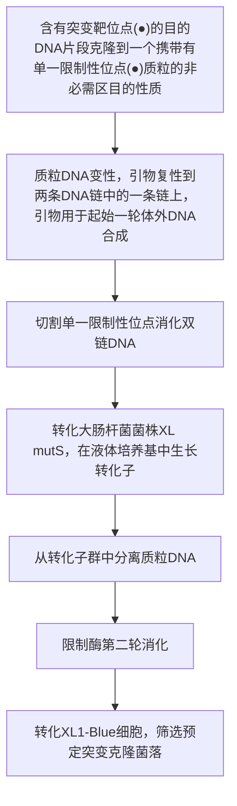
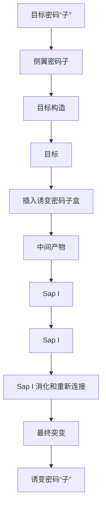

## 材料

为正确使用本方案中的器材和危险试剂，必须查阅相应的材料安全数据表并咨询所在机构的环境卫生和安全办公室。

本方案的专用试剂标注&lt;R&gt;，配方在本方案末提供。常用储备溶液、缓冲液和试剂标注&lt;A&gt;，配方见附录1。储备溶液应稀释至适用浓度后使用。

## 试剂

▲ BMH71-18 mutS 和 JM109 大肠杆菌感受态细胞储存于 -70°C，使用时取出融化。其他感受态使用前冻存于 -20°C。筛选用抗生素冻融不得超过 5 次。

琼脂糖凝胶（1%）（第2章）

乙酸铵（2mol/L，pH 4.6）

氨苄青霉素溶液（100mg/mL；过滤除菌）

复性缓冲液（10×）&lt;R&gt;

抗生素的选择混合物 [5mg/mL 氨苄青霉素，25μg/mL 头孢噻肟，25mg/mL 头孢曲松（Sigma-Aldrich 公司），100mmol/L 磷酸钾（pH 6.0）]

氯仿:异戊醇（24:1）＜A＞

dsDNA 模板质粒

待诱变的候选基因（基因 X）应克隆至 pGEM-11Z（+）质粒（Promega 公司）。

大肠杆菌 BMH71-18 mutS 株

其他几个大肠杆菌菌株都能与BMH81-18 mutS共存，包括BJ5183、JM107、SK1590、DH1、JM108、SK2287、DH5a、JM109、TB1、JM103、MC1061、TG1、JM105、MM294、XL1-blue、JM106、Q358和Y1088。选择BMH71-18 mutS是因为它可以抑制体内错配修复。

大肠杆菌 JM109 菌株

乙醇（70%和100%）

LB 培养基 &lt;R&gt;

含氨苄青霉素的 LB 培养基 &lt;R&gt;

NaOH (2mol/L) /EDTA (2mmol/L)

pGEM-11Zf (+) (Promega 公司)

常规微量质粒小提试剂盒（QIAprep Spin Miniprep Kit）

引物:

筛选用抗生素寡核苷酸引物序列是

GATAAATCTGGAGCCTCCAAGGGTGGGTCTCGCGGT；加粗和下划线可替换。

诱变寡核苷酸引物（磷酸化的）合成信息，请参阅步骤 2。

合成缓冲液（10×）&lt;R&gt;

T4 DNA 连接酶（5U/μL）（NEB 公司）

T4 DNA 聚合酶（10U/μL）（NEB 公司）

TE 缓冲液 &lt;R&gt;

## 设备

琼脂糖凝胶电泳设备

细胞培养板

加热块

培养摇床

聚丙烯管（17mm×100mm），无菌

真空干燥机

水浴锅（42℃）

## 方法

# 双链 DNA 质粒模板制备

1. 将待诱变基因 $X$ 克隆到质粒 pGEM-11Zf（+）中（Promega 公司），该质粒中包含一个 TEM-1 $\beta$-内酰胺酶基因。转入该质粒的大肠杆菌具有氨苄青霉素抗性。

## 诱变和抗生素选择寡核苷酸制备

2. 合成包含有所需突变的诱变寡核苷酸引物。

寡核苷酸和其互补 DNA 链之间形成的杂合双链的稳定性取决于许多因素，其中包括寡核苷酸引物的长度和 G+C 含量，以及复性条件。更多详细信息，见第 13 章。一般来说，要将诱变寡核苷酸的不匹配碱基设计在寡核苷酸中间 17～20 碱基的位置（详见本章其他方案的详细描述）。如果要构建含有两个或更多位点的突变，则寡核苷酸长度需要 25 个或更多碱基数，以便在错配位置的两端均有 12～15 个完全匹配的序列。

然后合成抗生素筛选的寡核苷酸引物序列（序列 GATAAATCTGGAGCCTCCAAGGGT-GGGTCTCGCGGT；粗体和下划线部分为可替换的野生型β-内酰胺酶基因序列）。

为了能用抗生素筛选出含双重突变的突变体，诱变寡核苷酸和抗生素筛选用寡核酸序列必须与质粒 DNA 的同一碱基链互补。

## 双链 DNA 模板的变性

3. 将 $2\mu \mathrm{g}$ 带有 $X$ 基因的双链 DNA 质粒进行碱变性。这个反应将产生足够可用于 10 个诱变反应的变性 DNA。将反应混合物在室温孵育 $5\mathrm{min}$ 。

| dsDNA 模板 | 0.5pmol (2μg) |
| --- | --- |
| NaOH(2mol/L), EDTA(2mmol/L) | 2μL |
| 无菌的去离子水 | 加至总体积 20μL |

注:通常，ng 级 dsDNA=pmol 的 dsDNA×0.66×N，N 表示 dsDNA 的碱基长度。

4. 向反应混合物中添加 $2\mu \mathrm{L}$ 的 $2\mathrm{mol} / \mathrm{L}$ 乙酸铵（$\mathrm{pH}4.6$）和 $75\mu \mathrm{L}$ 的 $100\%$ 乙醇（$4^{\circ}\mathrm{C}$）沉淀 DNA。

5. 将以上混合物在  $-70^{\circ}C$  放置 30min。

6. 最高转速（约 13 000 r/min），4°C 离心 15min 收集 DNA。

7. 用 $200\mu \mathrm{L}$ 乙醇（$4^{\circ} \mathrm{C}$）浸洗 DNA 沉淀，用步骤 6 条件再次离心，并真空抽干 DNA 沉淀。

8. 用  $100 \mu L$  的 TE 缓冲液（pH 8.0）重悬 DNA。

## 诱变引物的复性

9. 按下述体系制备引物复性反应混合物:

| 变性的模板 DNA(从步骤8获得) | 10μL(0.05pmol) |
| --- | --- |
| 选择寡核苷酸(2.9ng/μL),按步骤1方法磷酸化 | 1μL(0.25pmol) |
| 诱变寡核苷酸,按步骤1方法磷酸化 | 1.25pmol |
| 复性缓冲液(10×) | 2μL |
| 无菌去离子水 | 加至总体积20μL |

加热复性反应混合物到  $75^{\circ}$ C 复性 5min，然后缓慢地自然冷却到  $37^{\circ}$ C。缓慢的冷却过程有助于使这两种诱变和筛选抗生素的引物非特异性复性最小化。建议冷却速率约  $1.5^{\circ}$ C/min。

最佳复性温度和时间可能取决于使用的诱变寡核苷酸组成。有必要尝试几个复性温度，以优化寡核苷酸的诱变效率。

见“疑难解答”。

## 突变链的合成与连接

10. 当复性反应混合物冷却到 $37^{\circ}\mathrm{C}$ 之后，短暂离心反应混合物将成分收集到离心管底部，之后按照以下体系配置反应混合物，以进行突变体的合成和连接反应。

| 无菌去离子水 | 5μL |
| --- | --- |
| 合成缓冲液(10×) | 3μL |
| T4 DNA 聚合酶(5~10U) | 1μL |
| T4 DNA 连接酶(1~3U) | 1μL |
| 终体积 | 30μL |

在这个反应中使用了 T4 DNA 聚合酶，因为它是一种高保真 DNA 聚合酶，不会引起杂合寡核苷酸的错配。因此，可以通过在一个插入 DNA 的多个不同位点与诱变寡核苷酸复性结合，来实现在同一个反应体系中对多个位点进行定点突变。

11. 在 $37^{\circ}\mathrm{C}$ 孵育反应体系 $90\mathrm{min}$，以合成突变链，并完成连接反应。此时突变 DNA 可以用来转化 BMH71-18 mutS 突变株感受态。

采用 BMH71-18 mutS 是因为它可以抑制体内的错配修复。

## BMH71-18 mutS 菌株感受态细胞的转化

12. 将  $17mm \times 100mm$  聚丙烯管在冰上预冷。

13. 解冻 $100 \mu \mathrm{L}$ 的 BMH71-18 mutS 感受态大肠杆菌细胞, 放入无菌聚丙烯管中, 并将其置于冰上。添加 $1.5 \mu \mathrm{L}$ 步骤 11 中获得的诱变反应混合物到感受态细胞中。轻轻混匀。

14. 将感受态细胞与 DNA 的混合物在冰上孵育 10min。

15. 在  $42^{\circ}$ C 水浴中热激感受态细胞  $45 \sim 50$ s。

16. 将热激后的细胞放回冰上静置 2min。

17. 向步骤 13～步骤 16 处理的 BMH71-18 mutS 细胞中加入 900μL 室温的 LB 培养基（不添加抗生素），并在 37°C 振荡 60min。

18. 准备过夜培养物。向步骤 17 中的细胞加入 $4 \mathrm{~mL}$ LB 培养基, 然后向培养基中添加 $100 \mathrm{mg} / \mathrm{mL}$ 的氨苄青霉素 $100 \mu \mathrm{L}$ 。

19. 37℃剧烈振荡孵育过夜。

见“疑难解答”。

20. 提取少量质粒 DNA。依照常规方案（第 1 章）提取和纯化质粒 DNA。

## 转化 JM109 细胞和克隆分离

21. 在转化前, 将含有 $7.5 \mathrm{~mL} / \mathrm{L}$ 筛选用抗生素混合物 (含头孢菌素) 和熔化的 LB 培养基倒入培养板中, 且每 1L 培养基中含有 $1 \mathrm{~mL} 100 \mathrm{mg} / \mathrm{mL}$ 的氨苄青霉素溶液。

22. 将  $17mm \times 100mm$  聚丙烯管在冰上预冷。

23. 将 $100 \mu \mathrm{L}$ 的JM109感受态细胞置于冰上，然后加入 $1.5 \mu \mathrm{L}$ 从步骤20的BMH71-18 mutS突变感受态细胞中纯化获得的质粒DNA到JM109感受态细胞中。轻轻混匀。

24. 将感受态细胞与 DNA 的混合物在冰上孵育 10min。

25. 在  $42^{\circ}$ C 水浴中热激感受态细胞  $45 \sim 50$ s。

26. 将热激后的细胞放回冰上静置 2min。

27. 向转化后的 JM109 感受态细胞中加入  $900 \mu L$  室温的 LB 培养基（不添加抗生素），并在  $37^{\circ} C$  振荡 60min。

28. 从步骤 27 中取出  $100 \mu L$  转化产物涂布到含筛选抗生素混合物和氨苄青霉素的 LB 琼脂平板上（步骤 21 准备的）。同时涂布无抗生素的 LB 琼脂平板作为对照。将平板在  $37^{\circ} C$  孵育  $12 \sim 14 h$ 。

29. 经过培养后，鉴定平板上的白色克隆。挑取至少 5 个克隆直接测序进行鉴定。

## 疑难解答

问题（步骤 9）:模板降解。

解决方案:聚合酶过量同时 dNTP 混合物不足可能影响聚合酶的外切酶活性，因此需要严格按照建议的体系配置反应混合物。

问题（步骤 19）:BMH mutS 过夜培养，平板中未长出克隆。

解决方案:减少培养基中的抗生素含量，同时仅使用高效率的感受态细胞。

## 配方

为正确使用本方案中的器材和危险试剂，必须查阅相应的材料安全数据表并咨询所在机构的环境卫生和安全办公室。

复性缓冲液（10×）

| 试剂 | 终浓度 |
| --- | --- |
| Tris-HCl (pH 7.5) | 200mmol/L |
| MgCl2 | 100mmol/L |
| NaCl | 500mmol/L |

LB 培养基

| 试剂 | 含量 |
| --- | --- |
| 蛋白胨 | 10g/L |
| 细菌用酵母提取物 | 5g/L |
| NaCl | 10g/L |

用 1L 蒸馏水溶解，用 5 mol/L NaOH 调节 pH 至 7.5，高压灭菌。

## 含有氨苄青霉素的LB平板

按前述方法配置 LB 培养基，在灭菌前加入 15g/L 的细菌蛋白胨，灭菌后在铺板前每毫升培养基中加入 125μg 的氨苄青霉素。

合成缓冲液（10×）

| 试剂 | 终浓度 |
| --- | --- |
| Tris-HCl (pH 7.5) | 100mmol/L |
| dNTP | 5mmol/L |
| ATP | 10mmol/L |
| DTT | 20mmol/L |

Tris-EDTA（TE）缓冲液（1×）

| 试剂 | 终浓度 |
| --- | --- |
| Tris-HCl (pH 8.0) | 10mmol/L |
| EDTA | 1mmol/L |

## 参考文献

Andrews CA, Lesley SA. 2002. Site-directed mutagenesis using altered β-lactamase specificity. Methods Mol Biol 182: 7–17.
Cantu C III, Huang W, Palzkill T. 1996. Selection and characterization of amino acid substitutions at residues 237–240 of TEM-1 β-lactamase

with altered substrate specificity for aztreonam and ceftazidime. J Biol Chem 271: 22538–22545.
Lewis MK, Thompson DV. 1990. Efficient site directed in vitro mutagenesis using ampicillin selection. Nucleic Acids Res 18: 3439–3443.

## 方案 5 通过单一限制性位点消除进行寡核苷酸指导的诱变（USE 诱变）

本方案中，两条寡核苷酸引物杂交到变性重组质粒 DNA 双链的同一条链上。一条引物（诱变引物）携带一个拟引入 DNA 序列的突变，第二条引物携带一个能破坏质粒单一限制酶位点的突变（称为单一限制性位点消除，unique site elimination，USE）（图 14-7）。两条引物的延伸反应由噬菌体 T4 或 T7 DNA 聚合酶催化。新合成 DNA 链上的缺口由噬菌体 T4 DNA 连接酶封口。该方法的第一阶段产生了由野生型亲本 DNA 链和携带预定突变且不含单一限制性位点的全长新 DNA 链组成的异源双链质粒。因此，反应后获得的质粒群体包括:①野生型质粒，在反应中它们从未被用作两条寡核苷酸引物的模板；②丢失了单一限制性位点并获得预定突变的异源双链质粒。

本方法的第二阶段，将混合质粒与切割单一位点的限制酶一起孵育。野生型分子被线性化，突变质粒则不被限制酶消化。用环形异源双链DNA和线性野生型DNA的混合物转化碱基错配修复功能缺陷的大肠杆菌菌株。因为线性DNA转化效率要比环型DNA低$10\sim 1000$ 倍（Conley and Saunders 1984），许多野生型分子不能重新进入大肠杆菌。而环形异源双链分子开始在大肠杆菌中复制。因为错配碱基不能被修复，第一轮复制产生了携带原始限制酶位点的野生型质粒和不带原始限制酶位点的突变质粒。收集从第一组转化子获得的DNA，用同一种限制酶再次消化，使野生型分子线性化，再转化至标准的实验用大肠杆菌菌株中。该种生物化学方法具有足够强大的选择能力，保证绝大部分转化子携带预定的突变（Deng and Nickoloff 1992；Zhu 1996）。

flowchart

图 14-7 通过单一限制性位点消除进行寡核苷酸指导的诱变（USE 诱变）。用选择引物和诱变引物扩增目的质粒。如图所示，PCR 产物用于转化。本方案产生的定点突变效率约 90%（摘自 Braman et al. 2000）。

## 单一限制性位点消除（USE）

理论上，采用本方案描述的单一限制性位点消除（USE）标准方案形成突变体的最大产率是50%。然而，大多数实验室获得的突变频率为5%\~30%，这取决于突变的复杂性和限制酶切割效率。如果需要，结合USE和Kunkel对含尿嘧啶模板DNA选择方法（Markvardsen et al. 1995），或将突变引物的浓度增加到10:1使反应有利于诱变引物，可使突变体回收率大大增加。

原则上，含单一限制酶位点和选择标记（如抗生素抗性基因）的双链环状载体上携带的基因都可以用 USE 方法进行诱变。几家公司销售 USE 诱变所需要的选择引物和含有 USE 诱变所需试剂的试剂盒（如 Clontech 公司销售的转换基因定点诱变试剂盒）。这些试剂盒能够成功地应用于多种广泛使用的载体。存在的问题见本节后面的“疑难解答”。

## 材料

为正确使用本方案中的器材和危险试剂，必须查阅相应的材料安全数据表并咨询所在机构的环境卫生和安全办公室。

本方案的专用试剂标注&lt;R&gt;，配方在本方案末提供。常用储备溶液、缓冲液和试剂标注&lt;A&gt;，配方见附录1。储备溶液应稀释至适用浓度后使用。

## 试剂

1%的琼脂糖凝胶（含0.5μg/mL溴化乙锭）

复性缓冲液(10×)&lt;R&gt;

噬菌体 T4 DNA 连接酶

噬菌体 T4 DNA 聚合酶或测序酶

噬菌体 T4 编码的天然 DNA 聚合酶不能从模板 DNA 上置换寡核苷酸引物（Nossal 1974；Kunkel 1985；Bebenek and Kunkel 1989；Schena 1989）。

带 mutS 基因型（如 BMH71-18）的大肠杆菌，制备成感受态用于转化

带 $mut^{+}$ 基因型的大肠杆菌，制备成感受态用于转化（步骤14）

LB琼脂平板&lt;R&gt;

含合适抗生素的LB培养基&lt;R&gt;

质粒 DNA

通过商品化销售的树脂柱层析或碱裂解法纯化闭合环状质粒 DNA（第 1 章，方案 1 或方案 2）。

引物（诱变引物和选择引物）

诱变引物和选择引物一定要能复性到靶 DNA 的同一条链上，每条引物的 5' 端一定要磷酸化。突变应位于引物的中间，突变位点两侧带有 10～15 个能与模板 DNA 完全配对的碱基。寡核苷酸引物在使用前用快速高效液相层析法（FPLC）或聚丙烯酰胺凝胶电泳（PAGE）纯化（第 2 章方案 3）。

单一位点的限制性内切核酸酶

10×合成缓冲液 &lt;R&gt;

## 附加材料

用于转化大肠杆菌的试剂和设备（步骤7和步骤14；第3章）

用于小量制备质粒 DNA 的试剂和设备（步骤 10 和步骤 16；第 1 章，方案 1 和方案 2）

## 设备

细胞培养箱

凝胶电泳仪

水浴箱（煮沸、预调至  $70^{\circ}$ C 或限制性内切核酸酶消化的合适温度）

## 方法

## 突变 DNA 链的合成

1. 在微量离心管中混合以下成分:

| 10×复性缓冲液 | 2μL |
| --- | --- |
| 质粒 DNA | 0.025~0.25pmol |
| 选择引物 | 25pmol |
| 突变引物 | 25pmol |
| 加水至 | 20μL |

离心管在沸水中孵育 5min。

本方案允许引物和质粒 DNA 浓度在一个较宽的范围内。必要时以经验为主优化各试剂的量。

2. 将离心管立即置于冰上冷却 $5\mathrm{min}$ 。微型离心机上离心 $5\mathrm{s}$，使液体沉积到离心管底层。

3. 将以下成分加入到含复性引物和质粒 DNA 的离心管中:

| 10×合成缓冲液 | 3μL |
| --- | --- |
| 噬菌体T4 DNA聚合酶(2~4U/μL) | 1μL |
| 噬菌体T4 DNA连接酶(4~6U/μL) | 1μL |
| $H_2O$ | 5μL |

用移液器轻轻地上下吹打几次将试剂混匀。微型离心机上离心 5s，使液体沉积到离心管底层。37℃孵育反应 1～2h。

4. $37^{\circ}\mathrm{C}$ 加热离心管至少 $5\mathrm{min}$，灭活酶并终止反应。将离心管放置在实验台上冷却至室温。

## 通过限制性内切核酸酶消化进行初筛

5. 将 NaCl 的浓度调节到适合单一限制酶反应的浓度。使用  $10 \times$  复性缓冲液、NaCl 储存液或限制酶提供的  $10 \times$  缓冲液。

在总体积为  $30 \mu L$  的合成或连接混合物中，NaCl 浓度为 37.5 mmol/L。如果限制消化反应不需要 NaCl 或需要低于上述浓度的 NaCl，可用乙醇沉淀合成连接缓冲液中的 DNA 混合物，或将 DNA 混合物通过一个离心柱，重悬在合适限制酶缓冲液中。

6. 将 20U 应用于选择性筛选的限制性内切核酸酶加入到反应混合物中。在合适的温度下消化至少 1h。

▲反应中酶体积（包括聚合酶和连接酶）不应超过总反应体积的10%。应按照以上比例相应地调节反应体积。

## 突变质粒的第一轮转化与富集

7. 按照第 3 章描述的转化方案之一，用消化混合物中包含的质粒 DNA 转化 mutS 大肠杆菌菌株（如 BMH71-18）。

8. 分别用 $10\mu \mathrm{L}$ 、 $50\mu \mathrm{L}$ 和 $250\mu \mathrm{L}$ 转化混合物涂布含抗生素的LB琼脂平板。 $37^{\circ}C$ 过夜孵育平板。在平板孵育期间进行步骤9。

这些培养皿用于测定第一轮转化子的数量。每 $50\mu \mathrm{L}$ 转化混合物涂布的平板上应产生 $100\sim 300$ 个克隆。

9. 加入 3mL 含适当抗生素的 LB 培养液至剩余的转化混合物中以扩增质粒。37℃振荡培养过夜。

10. 第 2 天从大约 $2.5 \mathrm{~mL}$ 的过夜培养物中制备质粒 DNA（第 1 章）。

11. 用选择性筛选的限制酶消化步骤 10 制备的质粒 DNA。如下:

| 质粒 DNA | 500ng |
| --- | --- |
| 10×限制酶缓冲液 | 2μL |
| 单一位点的限制性内切核酸酶 | 20U |
| 加水至 | 20μL |

在适当温度中孵育反应 2h。

12. 再加入 10U 的限制酶，继续孵育至少 1h。

13. 取 5～10μL 质粒 DNA 经 1% 的琼脂糖凝胶（含 0.5μg/mL 溴化乙锭）电泳来评估 DNA 消化程度（第 3 章，方案 1 和方案 2）。

线性化质粒 DNA 经电泳分离应为一条带。未消化的（环状）DNA 经电泳分离为两条带，它们分别对应松弛的环状形式或超螺旋结构形式 DNA。然而，由于亲本质粒占总质粒 DNA 的绝大多数，未被消化的突变体质粒的条带与被消化的亲本质粒 DNA 条带相比可能相当微弱。

## 最后一步转化

14. 取 2～4μL 经消化的质粒 DNA（50～100ng），转化化学感受态大肠杆菌 $mutS^{+}$ 菌，或用灭菌水 5 倍稀释质粒 DNA（约 5ng），电击法转化大肠杆菌 $mutS^{+}$ 菌株（第 3 章，方案 4）。

15. 分别取 $10\mu \mathrm{L}$ 、 $50\mu \mathrm{L}$ 和 $250\mu \mathrm{L}$ 转化混合物涂布含抗生素的LB琼脂平板。 $37^{\circ}C$ 孵育培养皿过夜。

16. 第 2 天，至少挑取 12 个单克隆进行小量质粒 DNA 制备，用限制性内切核酸酶消化，琼脂糖凝胶电泳鉴定不被限制性内切核酸酶消化的质粒。

17. 通过 DNA 序列测定确定含预定突变的质粒。

## 疑难解答

问题:突变体回收率低。

解决方案:尝试一种或多种下面的方法:

\- 结合 USE 和 Kunkel 对含尿嘧啶模板 DNA 选择的方法（Markvardsen et al. 1995）。

\- 增加诱变引物浓度，使两种引物的物质的量比达到 10:1，使反应有利于诱变引物（Hutchinson and Allen 1997）。

\- T4 DNA 聚合酶催化的延伸反应温度由 37°C 改为 42°C（Pharmacia Instruction Booklet）。

问题:据报道，用 pBluescript 家族载体产生非常低的突变率，可能是因为它们二级结构含有一个结节(knotty)区域，它妨碍了 DNA 聚合酶在体外引物延伸反应中的向前移动。

解决方案:使用 pBluescript 家族载体以外的质粒载体，或使用热稳定 DNA 聚合酶和 DNA 连接酶在高温下孵育延伸反应可完全避免这一问题（Wong and Komaromy 1995）。

## 配方

为正确使用本方案中的器材和危险试剂，必须查阅相应的材料安全数据表并咨询所在机构的环境卫生和安全办公室。

10×复性缓冲液

| 试剂 | 终浓度 |
| --- | --- |
| Tris-HCl (pH 7.5) | 200mmol/L |
| MgCl2 | 100mmol/L |
| NaCl | 500mmol/L |

LB 培养基

| 试剂 | 质量(1L) |
| --- | --- |
| 细菌用胰蛋白胨 | 10g/L |
| 酵母提取物 | 5g/L |
| NaCl | 5g/L |

溶入 1L 的蒸馏水中。用 5mol/L NaOH 调 pH 至 7.5。高压灭菌。

## 含氨苄青霉素的 LB 平板

按上述配方配制液体 LB 培养基，高压灭菌前加入终浓度 15g/L 的琼脂。高压灭菌后倒平板前加入终浓度 125μg/mL 的氨苄青霉素。

10×合成缓冲液

| 试剂 | 终浓度 |
| --- | --- |
| Tris-HCl (pH 7.5) | 100mmol/L |
| dNTP(dTTP, dATP, dCTP 和 dGTP) | 各 5mmol/L |
| ATP | 10mmol/L |
| DTT | 20mmol/L |

## 参考文献

Bebenek K, Kunkel TA. 1989. The use of native T7 DNA polymerase for site-directed mutagenesis. Nucleic Acids Res 17: 5408.

Braman J, Papworth C, Greener A. 2000. Site-directed mutagenesis using double-stranded DNA templates. In The nucleic acid protocols handbook (ed Rapley R), pp. 835–844. Humana, Totowa, NJ.

Conley EC, Saunders JR. 1984. Recombination-dependent recircularization of linearized pBR322 plasmid DNA following transformation of Escherichia coli. Mol Gen Genet 194: 211–218.

Deng WP, Nickoloff JA. 1992. Site-directed mutagenesis of virtually any plasmid by eliminating a unique site. Anal Biochem 200: 81–88.

Hutchinson MJ, Allen JM. 1997. Improved efficiency of two-primer mutagenesis. Elsevier Trends Journals Technical Tips Online (#40072).

Kunkel TA. 1985. Rapid and efficient site-specific mutagenesis without phenotypic selection. Proc Natl Acad Sci 82: 488–492.

Markvardsen P, Lassen SF, Borchert V, Clausen IG. 1995. Uracil-USE, an improved method for site-directed mutagenesis on double-stranded plasmid DNA. BioTechniques 18: 370–372.

Nossal NG. 1974. DNA synthesis on a double-stranded DNA template by the T4 bacteriophage DNA polymerase and the T4 gene 32 DNA unwinding protein. J Biol Chem 249: 5668–5676.

Schena M. 1989. High efficiency oligonucleotide-directed mutagenesis using Sequenase. Comments (US Biochemical Corp) 15: 23.

Wong F, Komaromy M. 1995. Site-directed mutagenesis using thermostable enzymes. BioTechniques 18: 1034–1038.

Zhu L. 1996. In vitro site-directed mutagenesis using the unique restriction site elimination (USE) method. Methods Mol Biol 57: 13–29.

## 方案 6 利用密码子盒插入进行饱和诱变

通过盒式插入的饱和诱变向靶基因中引入一个文库，这个文库中基因的特定位点突变成某个特定的 DNA 序列，这一策略在研究一个蛋白质的某个特定氨基酸残基在整个蛋白质结构中的功能时十分有效。一般来说，盒式插入诱变的含义是将目标区域用限制性内切核酸酶从两侧切除，并插入一个合成特定突变序列的寡核苷酸。当将某一特定位点替换时，这个策略十分有效；但是，当需要插入的突变文库在某些特定位点需要包含所有可能的氨基酸种类时，这一策略则捉襟见肘，因为合成所有种类突变的寡核苷酸序列十分昂贵。

本方案则可以克服这些问题并能达到这一目的（图 14-8）。这里将一套包含 11 种通用寡核苷酸盒用于构建突变体。这一方法的主要优点是，一套诱变密码子盒可以将所有可能种类的氨基酸插入一个基因中所有预先确定的位点。这 11 个寡核苷酸盒中的每一个都含有 2 个 Sap I 识别位点，可以用酶将密码子盒从两侧切下（图 14-9）。这两个 Sap I 的识别序列互为反向，由中心密码子隔开。在每个盒结构的末端，紧挨着 Sap I 位点，是一段 3 个碱基对的直接重复序列，即 Sap I 可以从这个序列中间切开。Sap I 酶切将导致在盒结构的两端生成 3 个碱基的单链黏末端。这 3 个碱基的单链黏末端可以自行连接成环，从而缺失盒式结构。而这 3 个重复的碱基最终将掺入模板。将图 14-9 中所示的所有盒结构中均存在的  $(5' - \mathrm{CAG} \cdots \mathrm{CAG}-3')$  3 碱基重复序列替换为其他序列，则可完成对所有可能氨基酸的置换。表 14-4 列出了该研究中建立的所有用于置换的全套 11 个通用寡核苷酸盒结构。

flowchart

图14-8 通过盒式法插入饱和突变。黑框表示用于突变的目标密码子；空白框表示邻近目标密码子的“侧翼密码子”；水平箭头表示SapI切割位点（经Science+Business Media许可，改编于Kegler-Ebo et al.1996）。

整个步骤需要构建的密码子置换盒如图 14-8 所示。图 14-9 中所示的平末端诱变盒则是通过在平末端位点连接插入目标分子中，构建一个中间产物，这个“中间产物”之后被 Sap I 消化。最后 Sap I 酶切消化后的双链尾巴连接到一起生成了诱变分子。这样可以将 1 个拷贝的含 3 碱基重复从盒结构中转移到目标分子中，从而产生最终的诱变产物。这个方案来自 Kegler-Ebo 等（1994，1996）的方法。

flowchart

This diagram illustrates the genetic sequence and regulatory interactions between a central region containing genes such as CAG-A, GAAGAGC, GCTCTTC, and A-CAG, along with their respective regulatory elements like Sap I position and密码子重复.

图 14-9 通用密码子盒的结构。方框表示 Sap I 识别序列；水平箭头表示 Sap I 酶切位点；垂直箭头表示 Sap I 切割位置。两端重复序列和中间区之间的区域为 2 个 Sap I 识别序列。盒结构表示插入编码 CAG（谷氨酰胺）和 CUG（亮氨酸）的密码子（经 Science+Business Media 许可，改编自 Kegler-Ebo et al. 1996）。

表 14-4 通用密码子盒设计

| 诱变盒a | 插入氨基酸b |
| --- | --- |
| ATG···ATGTAC···TAC | 甲硫氨酸组氨酸 |
| TGG···TGGACC···ACC | 色氨酸脯氨酸 |
| CAG···CAGGTC···GTC | 谷氨酰胺亮氨酸 |
| GAC···GACCTG···CTG | 天冬氨酸缬氨酸 |
| AAC···AACTTG···TTG | 天冬酰胺缬氨酸 |
| TAT···TATAA···ATA | 酪氨酸异亮氨酸 |
| GGC···GGCCCG···CCG | 甘氨酸丙氨酸 |
| AAA···AAATTT···TTT | 赖氨酸苯丙氨酸 |
| TTC···TTCAAG···AAG | 苯丙氨酸谷氨酸 |
| AGA···AGATCT···TCT | 精氨酸丝氨酸 |
| ACA···ACATGT···TGT | 苏氨酸半胱氨酸 |

由 Oxford University Press 授权，重印自 Kegler-Ebo 等 1994。

a. 表示通用密码子盒及其末端重复序列。第一行显示  $5' \rightarrow 3'$  方向，第二行显示  $3' \rightarrow 5'$  方向。

b. 第一列密码子盒所对应的氨基酸。对于每一个密码子盒，第一行表示按照第一列第一行方向插入时翻译的氨基酸，第二行表示按照第一列第二行方向插入时翻译的氨基酸。

## 材料

为正确使用本方案中的器材和危险试剂，必须查阅相应的材料安全数据表并咨询所在机构的环境卫生和安全办公室。

本方案的专用试剂标注&lt;R&gt;，配方在本方案末提供。常用储备溶液、缓冲液和试剂标注&lt;A&gt;，配方见附录1。储备溶液应稀释至适用浓度后使用。

## 试剂

乙酸铵（3.75mol/L，pH 5.0）

用于 Klenow 反应的 dNTP 混合液（10×）

在 TE 缓冲液中，4 种 NTP 均为 500mmol/L；保存于 -20℃。

大肠杆菌 DH5α

乙醇（100% 和 70%）

保存于-20℃。

DNA 聚合酶 I 的 Klenow 片段（5U/mL）

Klenow 反应缓冲液（10×）&lt;R&gt;

连接酶反应缓液（10×）&lt;R&gt;

酚:氯仿:异戊醇（PCA 溶液，为 25:24:1 TE 溶解的饱和苯酚、氯仿和异戊醇的混合物）

保存于  $4^{\circ}$ C。

来源于牛胰脏的核糖核酸酶 A（RNase A）

Sap I 反应缓冲液（10×） &lt;R&gt;

Sap I 限制性内切核酸酶（IU/μL）

乙酸钠（3mol/L，pH 5.2）

氢氧化钠（NaOH，1mol/L）

目标 DNA 分子

请参阅下面构建平末端靶 DNA 分子的方法。

T4 DNA 连接酶（400U/μL）TE 缓冲液 &lt;R&gt;

tRNA（10mg/mL 酵母 tRNA；Sigma-Aldrich）

保存于 $-20^{\circ}C$ 。

通用密码子盒

从 New England Biolabs 公司获得，并用 TE 缓冲液稀释至 10ng/mL &lt;R&gt;。

## 设备

凝胶电泳设备

QIAGEN 质粒小提试剂盒

分光光度计

热循环仪

涡旋振荡器

## 方法

## 构建平末端目标 DNA 分子

若要进行密码子盒式诱变，必须构造一个符合以下要求的目标 DNA 分子:①不包含任何内源性 Sap I 限制酶切割位点；②在待突变位点通过双链断裂，能生成线性的平末端。若要获得目标 DNA 分子，必须考虑以下原则和注意事项。

- 待突变目标 DNA 必须包含限制酶切割位点，以便在正确的位点获得平末端并将密码子替换或插入。
- 待突变目标 DNA 必须不含有任何内源性 Sap I 限制酶切割位点。

在密码子盒诱变构建之前，必须去除目标 DNA 上的所有 Sap I 限制酶切割位点。虽然 Sap I 识别序列只有 7 个碱基对，且在 DNA 序列中很少出现，但仍要仔细检查是否有此位点的出现，并用替换技术或者标准诱变技术（重叠诱变技术）将其进行修正。

设计待突变目标 DNA 时，在正确的位点设计一个可以产生平末端的策略十分重要，构建待突变目标 DNA 的一般策略包括在预替换的密码子区域设置 Sap I 位点，以及用 Klenow 片段填充单链末端，最终在适当位置获得平末端。这一步骤可以用于任意氨基酸序列，因为 Sap I 位点已经去除，并且位于突变两侧的野生型密码子均已重新生成。

1. 将 $2 \mu \mathrm{L} 10 \times \text {Sap I 反应缓冲液、} 5 \mu \mathrm{L} (5 \mu \mathrm{g})$ 的待突变目标 DNA、$5 \mu \mathrm{L} \text {Sap I 混合}$, 加水至总体积 $20 \mu \mathrm{L}$, 在 $37^{\circ} \mathrm{C}$ 孵育 $4 \mathrm{~h}$。
2. 在反应体系中加入 $3 \mu \mathrm{L}$ TE缓冲液, 之后加入 $50 \mu \mathrm{L}$ 酚: 氯仿: 异戊醇 (PCA) 抽提液, 涡旋振荡混匀, 在微型离心机中短暂离心。将含有 DNA 的上层溶液转移到一个新 Eppendorf 管中, 向管中加入 $5 \mu \mathrm{L}$ 乙酸钠溶液, 涡旋振荡, 加入 $100 \mu \mathrm{L}$ 乙醇, 涡旋振荡, 然后将离心管在 $-20^{\circ} \mathrm{C}$ 储存 $2 \mathrm{~h}$ 或在干冰上放置 $15 \mathrm{~min}$ 。然后, 离心法收集沉淀的 DNA, 用 $70 \%$ 乙醇洗涤, 风干 $5 \mathrm{~min}$, 用 $20 \mu \mathrm{L}$ 的 TE 缓冲液溶解 DNA 沉淀。用分光光度计测定 $260 \mathrm{~nm}$ 处吸光度, 以确定 DNA 含量。
3. 在 $7 \mu \mathrm{L}$ 沉淀后的 Sap I 酶切产物中, 添加 $1 \mu \mathrm{L} 10 \times$ Klenow 反应缓冲液、$1 \mu \mathrm{L} 10 \times$ dNTP 混合液, 并加入 $1 \mu \mathrm{L}$ Klenow 合成酶。混匀后, 在 $22^{\circ} \mathrm{C}$ 孵育 $15 \mathrm{~min}$ 。
4. 按照步骤 2 纯化 DNA，并用  $20 \mu L$  的 TE 缓冲液溶解 DNA 沉淀。

## 插入密码子盒生成中间分子

5. 在获得带有平末端的目标 DNA 后，即可进行 11 个密码子盒的连接反应。在每个反应中，平末端目标 DNA 与密码子盒的物质的量比约为 $1:25$ 。按照下面的配方配制反应混合液，并过夜反应 $16\mathrm{h}$ 。

| 连接酶反应缓冲液(10×) | 1μL |
| --- | --- |
| 平末端目标DNA分子 | 1μL |
| 双链密码子盒 | 2.5μL |
| ${\mathrm{H}}_{2}\mathrm{O}$ | 4.5μL |
| T4 DNA 连接酶 | 1μL |

6. 在每个反应中加入 $40\mu \mathrm{L}$ TE缓冲液和 $2\mu \mathrm{L}$ 酵母tRNA载体，按照步骤2的方法再次抽提一遍，乙醇沉淀DNA，离心，并将产物DNA沉淀溶解于 $10\mu \mathrm{L}$ TE缓冲液中。

7. 将 11 种反应的混合物（步骤 6）各取 2.5μL 分别转化感受态 DH5α大肠杆菌（第 3 章），涂布到含有适当抗生素的 LB 琼脂平板上。

8. 使用商品化试剂盒从各个单克隆菌落中提取微量 DNA。将 DNA 溶解于含有  $100 \mu g/mL$  RNase A 的  $20 \mu L$  TE 缓冲液中（pH 8.0），储存于  $-20^{\circ}C$ 。

## 测序确认密码子的插入

9. 在（步骤 8 中获得的）16μL 微量 DNA 中加入 4μL 1mol/L NaOH 溶液，室温孵育 10min 使其变性。

10. 加入  $2.5 \mu L$  乙酸铵并涡旋振荡混匀。加入  $100 \mu L$  乙醇使 DNA 沉淀，并将 DNA 置于  $-70^{\circ} C$  20min 或  $-20^{\circ} C$  2h 将其制冷。

11. 用微型离心机离心 DNA 使其沉淀，用冷的 $70\%$ 乙醇洗涤一次，弃去乙醇后晾干 DNA 沉淀。

12. 用 $7\mu \mathrm{L}$ 纯水溶解沉淀，按照Sequenase Version 2.0使用手册（United States Biochemical [1994] Step-by-Step Protocols for DNA Sequencing with Sequenase Version 2.0 T7 DNA Polymerase, 8th ed.)的方法进行引物复性并测序。

## 消化中间分子获得终产物

13. 为获得最终的突变产物，每一个分子都要经过一个独立的酶切反应。在每个试管中混合以下成分，并在 $37^{\circ}\mathrm{C}$ 孵育至少 $4\mathrm{h}$ 。

| Sap I 反应缓冲液(10×) | 2μL |
| --- | --- |
| 制备微量的 DNA 中间产物(来自步骤 6) | 5μL |
| $H_2O$ | 11μL |
| Sap I | 2μL |

14. 利用凝胶电泳鉴定每个样品是否消化完全。

15. 按以下配方配制反应体系，将酶切获得的中间分子环化。

| T4 DNA 连接酶缓冲液(10×) | 5μL |
| --- | --- |
| Sap I 消化的中间 DNA(来自步骤 13) | 10μL |
| $H_2O$ | 34μL |
| T4 DNA 连接酶 | 1μL |

室温孵育至少 1h。

16. 使用酚:氯仿:异戊醇溶液抽提上述溶液，乙醇沉淀 DNA，用  $10 \mu L$  的 TE 缓冲液溶解 DNA 沉淀。这个溶液即含有最后的突变产物。

17. 将每个反应产生的 DNA 溶液各取 2～4μL 分别转化活化 DH5α 大肠杆菌，并涂布到含有适当抗生素 LB 琼脂平板上，培养过夜。第二天挑取克隆至液体培养基中，小量提取 DNA，Sap I 酶切鉴定是否已插入所需突变盒，并且不含有线性化 DNA。

见“疑难解答”。

18. 为检测缺少盒式插入突变的克隆，可通过克隆杂交实验进行筛选。有关详细信息请参阅 Kegler-Ebo（1994）的克隆杂交方法。或者，也可以使用 Sap I 消化筛选克隆（已插入突变盒的质粒不能被 Sap I 所消化）。

## 疑难解答

问题（步骤 17）:涂板后未长出阳性克隆。

解决方案:延长步骤 13 中 Sap I 消化时间，以确保酶切完全。

问题（步骤 17）:Sap I 消化线性质粒。

解决方案:如果步骤 13 中使用 Sap I 消化密码子盒成功，则获得的质粒应该不能被该酶消化，如果插入的不是所需密码子盒，那么需确认密码子盒是否构建正确以及步骤 5 中的连接反应是否成功。

## 配方

为正确使用本方案中的器材和危险试剂，必须查阅相应的材料安全数据表并咨询所在机构的环境卫生和安全办公室。

Klenow 反应缓冲液（10×）

| 试剂 | 终浓度 |
| --- | --- |
| Tris-HCl (pH 7.5) | 100mmol/L |
| MgCl2 | 50mmol/L |
| 二硫苏糖醇 | 75mmol/L |

连接酶反应缓冲液（10×）

| 试剂 | 终浓度 |
| --- | --- |
| Tris-HCl (pH 7.8) | 500mmol/L |
| MgCl2 | 100mmol/L |
| 二硫苏糖醇 | 100mmol/L |
| ATP | 10mmol/L |
| 牛血清白蛋白 | 250μg/mL |

Sap I 反应缓冲液（10×）

| 试剂 | 终浓度 |
| --- | --- |
| 乙酸钾 | 500mmol/L |
| Tris 乙酸 | 200mmol/L |
| 乙酸镁 | 100mmol/L |
| 二硫苏糖醇 | 10mmol/L |

调 pH 至 7.9。

TE缓冲液

| 试剂 | 终浓度 |
| --- | --- |
| Tris-HCl (pH 8.0) | 10mmol/L |
| EDTA | 1mmol/L |

## 参考文献