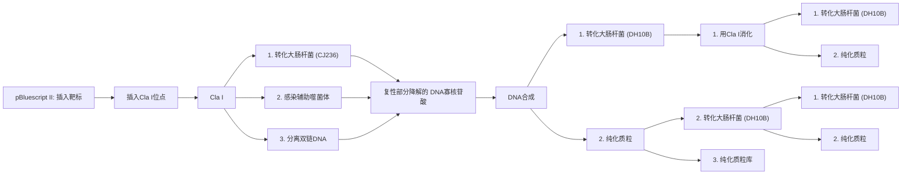
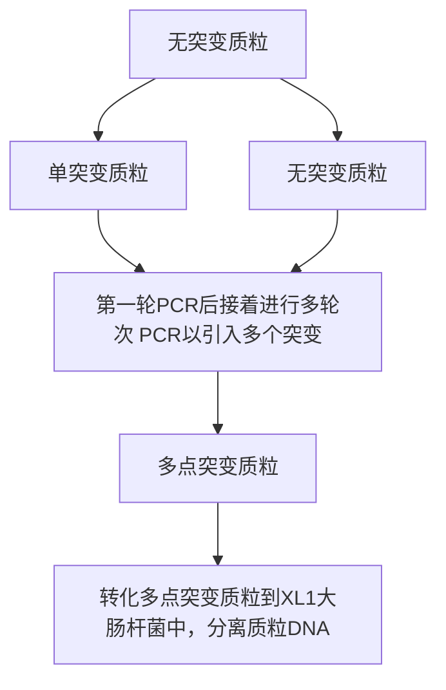
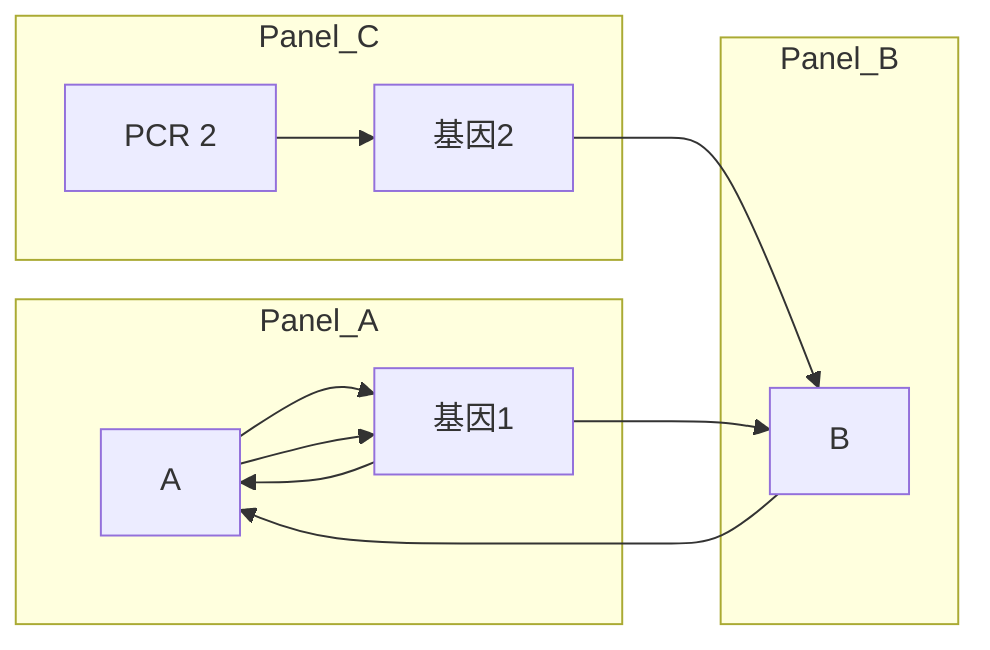
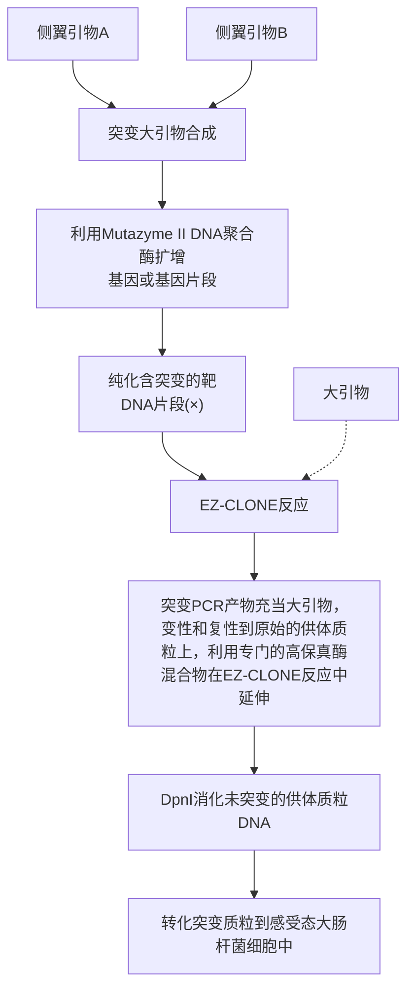

## 方案7 随机扫描诱变

体外寡核苷酸诱变和基于PCR的诱变技术的主要用途是通过改变基因的核苷酸序列研究其功能的重要性及其编码产物（Hutchison et al. 1978；Botstein and Shortle 1985；Kunkel 1985；Higuchi et al. 1988）。针对该问题的解决办法是系统地依次将该蛋白质上每一个氨基酸残基替换为丙氨酸（丙氨酸扫描诱变）或替换为一定数量的其他替代氨基酸（Cunningham and Wells 1989）。虽然这些策略可以提供有用信息，然而有时人们亟须检测目标位置上更广泛的氨基酸改变。近期，Smith及其同事发展了一种被称为随机扫描诱变的方案，用来检测某个氨基酸残基在人类免疫缺陷病毒（HIV）反转录酶保守结构域中的功能重要性，本方案即来自该方法（Smith et al. 2004，2006）。这一策略是一种基于寡核苷酸在蛋白质某一特定氨基酸位点生成所有19种可能替代氨基酸的方法（图14-10）。

flowchart

图 14-10 随机扫描诱变方案。在此示例中，在靶区域中引入了一个 Cla I 限制酶切割位点。突变后的质粒作为模板合成含有尿嘧啶的单链 DNA。之后采用寡核苷酸引物库进行体外 DNA 合成，将质粒转染 dUTPase $^{+}$ UNG $^{+}$ 大肠杆菌感受态细胞，筛选出不含尿嘧啶的模板 DNA。为进一步富集突变体库、质粒用 Cla I 消化后再次转化大肠杆菌，由此产生的质粒文库极大地富集了在靶位点含有氨基酸替换突变的质粒。星号表示突变位点（经 Springer Science + Business Media 许可，改编自 Smith 2010）。

## 材料

为正确使用本方案中的器材和危险试剂，必须查阅相应的材料安全数据表并咨询所在机构的环境卫生和安全办公室。

本方案的专用试剂标注&lt;R&gt;，配方在本方案末提供。常用储备溶液、缓冲液和试剂标注&lt;A&gt;，配方见附录1。储备溶液应稀释至适用浓度后使用。

## 试剂

氨苄青霉素（100mg/mL）

复性缓冲液（10×）&lt;R&gt;

氯霉素（15μg/mL）

大肠杆菌株 DH10B（Life Technologies 公司）及 CJ236（Takara Bio Inc 公司）

乙醇（100%）

基因片段或待研究的可读框（ORF）

卡那霉素（70μg/mL）

LB-氨苄青霉素（100μg/mL）琼脂平板

LB-氨苄青霉素-氯霉素琼脂平板

LB 培养基 &lt;R&gt;

pBluescript II KS（-）载体（Agilent 公司）

PEG/NaOAc 溶液[20%（m/V）聚乙二醇 8000 溶于 2.5mol/L 乙酸钠]

酚:氯仿:异戊醇（25:24:1）

质粒 DNA 纯化试剂盒

RNase A (25mg/mL), 无 DNA 酶

SOC 培养基 &lt;A&gt;

合成缓冲液（10×）&lt;R&gt;

T4 DNA 连接酶（New England Biolabs 公司）

T7 DNA 聚合酶（New England Biolabs 公司）

VCSM13 耐干扰辅助噬菌体（Agilent 公司）

酵母蛋白胨肉汤（YT broth）（2×）&lt;R&gt;

## 设备

离心机

DNA 测序仪

培养箱

培养皿

分光光度计

热循环仪

水浴箱或加热板

## 方法

1. 通过寡核苷酸指导的诱变（方案 5）或者通过基于 PCR 的策略（方案 2），向目标 DNA 片段中引入单一的限制性内切核酸酶位点。

切记应通过扰乱聚合酶的可阅读框避免目标蛋白的表达。

# 制备含有尿嘧啶的 ssDNA

2. 将修饰后的质粒转化到脱氧尿苷三磷酸酶（dUTPase）和尿嘧啶DNA糖苷酶（UDG）活性缺陷的（第3章）化学感受态大肠杆菌宿主CJ236S。从而将尿嘧啶掺入质粒DNA。

## 诱变引物设计

诱变寡核苷酸应该足够长，以保证当与 ssDNA 模板发生复性时，该引物可以与两端 20～25 个碱基相配对。此外，最重要的是需确认寡核苷酸携带了 5' 磷酸基团。这可以通过化学合成引物时引入该诱变寡核苷酸，或者将寡核苷酸与 T4 多聚核苷酸激酶（T4 polynucleotide kinase）共同孵育获得该诱变寡核苷酸（第 13 章）。

## 其他重要因素

- 由于本方案需要获得单链 DNA (ssDNA)，质粒中必须含有 f1 复制起始位点。例如，pBluescript II KS (-)、pGEM-3Zf 和 pTZ18U 等质粒，均可生产足够数量 ssDNA 用于辅助噬菌体感染。
- 如果对象是一个单一的密码子，引入的限制性酶切位点需要位于目标密码子处；相反，如果是随机的多个密码子，限制性酶切位点应该在目标区域的中间部位。
- 通过体外 DNA 合成进行诱变而产生的质粒文库会出现替代氨基酸在目标区域的不均匀分布，这是因为文库中的寡核苷酸引物存在遗传密码不对称性和复性能力不同。要克服这个问题，再合成寡核苷酸时应将稀有氨基酸分开，并以特定比例将它们混合后再在文库中进行反应。孵育感染噬菌体的培养物不要超过 12h，否则，在最终的 ssDNA 产物中将会污染大量大肠杆菌基因组 DNA 和 RNA。

3. 将转化后的细菌接种在 SOC 培养基中，37℃孵育 1h 进行活化。
4. 将细菌涂布于 LB-氨苄青霉素-氯霉素平板，37℃孵育过夜。
5. 从平板中挑取一个克隆，接种于 2mL 含氨苄青霉素（50～100μg/mL）和氯霉素（15μg/mL）的 2×YT 培养基中，37℃孵育 12h。
6. 将 2mL 混合物转移到三角烧瓶中含有氨苄青霉素（50～100μg/mL）和氯霉素（15μg/mL）的 300mL 2×YT 培养基，并加入 VCSM13 辅助噬菌体至终浓度为  $2 \times 10^{8}$ pfu/mL。
7. 将三角烧瓶在  $37^{\circ}$ C 培养 2h，然后加入卡那霉素（70mg/mL），继续培养 12h。
8. 培养产物于 $7000 \mathrm{~g} 4^{\circ} \mathrm{C}$ 离心 $15 \mathrm{~min}$ 。小心移出含有噬菌体颗粒的上清液，放入一个新离心管中。
9. 将上清液转移到新离心管后，重复上述离心步骤。
10. 将 80% 的上清液转移到新离心管后，每管加入 1/4 体积的 PEG/NaOAc 溶液，混合以上液体并在冰上放置 1h 或者 4℃ 放置过夜。噬菌体颗粒在此过程中发生沉淀。
11. 将上述溶液于  $9000 \, g \, 4^{\circ}C$  离心 25min。
12. 弃上清，用 2mL TE 缓冲液（pH 8）重悬包含有噬菌体颗粒的沉淀物。
13. 将噬菌体悬液分成两管（每个 1mL），每管加入 2μL 无 DNA 酶的 RNase A (25mg/mL)。37℃孵育 1h。
14. 将上述产物于 $15000\mathrm{g}$ 离心 $5\mathrm{min}$，这一步是为了消除细胞或细胞碎片。将上清液转移到新离心管中，并向每管添加 $250\mu \mathrm{L}$ PEG/NaOAc，并将离心管在冰上静置 $15\mathrm{min}$ 重新沉淀噬菌体颗粒，然后在 $14000\mathrm{r / min} 4^{\circ}\mathrm{C}$ 离心 $5\mathrm{min}$。
15. 弃上清，用  $300 \mu L$  的 TE 缓冲液（pH 8）重悬噬菌体颗粒。

16. 先用酚:氯仿（1:1）溶液，再用酚:氯仿:异戊醇（25:24:1）溶液抽提 ssDNA。

17. 添加 1/10 体积 3mol/L NaOAc（pH 5）和 2 倍体积的 100%乙醇沉淀 ssDNA，冰上孵育 30min，之后于 14 000r/min 离心 15min。

18. 弃上清，晾干 DNA 沉淀，用  $500 \mu L$  TE 缓冲液（pH 8）重悬，使用分光光度计测定 DNA 浓度，DNA 的  $OD_{260}/OD_{280}$  值应在 1.8 左右为宜。

## 诱变反应

19. 后述步骤均应在冰上进行，并同时设立一个阴性对照（无引物）。每管加入 0.6pmol ssDNA 模板，然后加入 6.6pmol 寡核苷酸随机引物库，用双蒸水将体积调至  $9 \mu L$ 。

20. 每管加入  $1 \mu L$   $10 \times$  复性缓冲液。通过复性过程使引物结合到 ssDNA 上，在水浴锅中先将反应物温度升至  $80^{\circ}C$ ，并自然冷却到  $30^{\circ}C$ ，之后将离心管至于冰上冷却即可。

21. 每管加入 $1 \mu \mathrm{L} 10 \times$ 合成缓冲液、6个 Weiss 单位的 T4 DNA 连接酶和 T7 DNA 合成酶。吹打混匀后，在 $37^{\circ} \mathrm{C}$ 孵育 $2 \mathrm{~h}$ 。

22. 将 $1 \mu \mathrm{L}$ 反应液接种到大肠杆菌中, 宿主菌株必须同时含有脱氧尿苷三磷酸 (dUTPase) 和尿嘧啶 DNA 糖苷酶 (UDG) 活性, 用来筛选具有尿嘧啶抗性的质粒。

23. 复苏细胞，将细胞接种在 SOC 培养基中，37℃孵育 1h 进行活化。然后将 100μL 细胞涂布在 LB-氨苄青霉素琼脂平板上，37℃孵育过夜。同时，转移 200μL 细胞到一个三角瓶中含有氨苄青霉素（50～100mg/mL）的 100mL LB 培养基，37℃培养过夜。

24. 将步骤 23 中收获的细菌培养物于 6000g 4℃ 条件下离心 15min。

25. 对步骤 23 中氨苄青霉素平板上的菌落数量进行统计。如果诱变反应所得产物在平板上的菌落数量是阴性对照组平板上菌落数量的 3 倍以上，则说明诱变成功。从步骤 24 获得细菌沉淀中纯化质粒 DNA（第 1 章方案，或使用商品化提取试剂盒）。将纯化后的 DNA 储存于 -20℃。

## 限制酶消化

26. 用可以识别限制酶切割序列的酶消化 DNA 文库。

27. 转化一整份的酶切产物到大肠杆菌菌株中（第3章），然后操作步骤23。

28. 使用 DNA 测序方法鉴定质粒文库中的每一个单克隆，并将其用于后续功能分析。

## 配方

为正确使用本方案中的器材和危险试剂，必须查阅相应的材料安全数据表并咨询所在机构的环境卫生和安全办公室。

复性缓冲液（10×）

| 试剂 | 终浓度 |
| --- | --- |
| Tris-HCl (pH 7.4) | 200mmol/L |
| MgCl2 | 20nmol/L |
| NaCl | 500mmol/L |

高压灭菌并保存于 $-20^{\circ}C$ 。

LB 培养基

| 试剂 | 质量(1L) |
| --- | --- |
| 细菌用胰蛋白胨 | 10g |
| 细菌用酵母提取物 | 5g |
| NaCl | 10g |

溶于 1L 蒸馏水中。用 5 mol/L NaOH 调 pH 至 7.5。高压蒸汽灭菌。

合成缓冲液（10×）

| 试剂 | 终浓度 |
| --- | --- |
| Tris-HCl (pH 7.4) | 100mmol/L |
| dNTP 混合物(dTTP、dATP、dCTP 和 dGTP) | 各 5mmol/L |
| ATP | 10mmol/L |
| $MgCl_2$ | 50mmol/L |
| DTT | 20mmol/L |

分装并保存于-80℃。

酵母胰蛋白胨（YT）液体培养基（2×）

| 试剂 | 质量(1L) |
| --- | --- |
| 细菌用胰蛋白胨 | 16g |
| 细菌用酵母提取物 | 10g |
| NaCl | 5g |

溶于 1L 蒸馏水中。用 5 mol/L NaOH 调节 pH 至 7.0。高压蒸汽灭菌。

## 参考文献

- Botstein D, Shortle D. 1985. Strategies and applications of in vitro mutagenesis. Science 229: 1193–1201.
- Cunningham BC, Wells JA. 1989. High-resolution epitope mapping of hGH-receptor interactions by alanine-scanning mutagenesis. Science 244: 1081–1085.
- Higuchi R, Krummel B, Saiki RK. 1988. A general method of in vitro preparation and specific mutagenesis of DNA fragments: Study of protein and DNA interactions. Nucleic Acids Res 16: 7351–7367.
- Hutchison CA III, Phillips S, Edgell MH, Gillam S, Jahnke P, Smith M. 1978. Mutagenesis at a specific position in a DNA sequence. J Biol Chem 253: 6551–6560.
- Kunkel TA. 1985. The mutational specificity of DNA polymerase- $\beta$ during in vitro DNA synthesis. Production of frameshift, base substitution, and deletion mutations. J Biol Chem 260: 5787–5796.
- Smith RA. 2010. Random-scanning mutagenesis. Methods Mol Biol 634:387–397.
- Smith RA, Anderson DJ, Preston BD. 2004. Purifying selection masks the mutational flexibility of HIV-1 reverse transcriptase. J Biol Chem 279:26726–26734.
- Smith RA, Anderson DJ, Preston BD. 2006. Hypersusceptibility to substrate analogs conferred by mutations in human immunodeficiency virus type 1 reverse transcriptase. J Virol 80: 7169–7178.

## 方案 8 多位点定向诱变

目前使用的绝大多数以 PCR 为基础的诱变方法是热稳定酶引入 PCR 后不久，直接从 20 世纪 80 年代后期描述的技术基础上衍生而来的（Higuchi et al. 1988；Ho et al. 1989；Vallette et al. 1989）。PCR 介导的定点诱变（SDM）方法已广泛地应用于分子生物学选择性地改变基因序列，探究它们的功能。早期方案允许一次仅引入一个或两个点突变（方案 2），但最近，已发展的几个诱变方案能够高效率地产生多个独立突变（Mikaelian and Sergeant 1992；Ishii et al. 1998；Kim and Maas 2000），并且现在已有几个商品化试剂盒可供使用。它们大多数不适合普通的多位点定向和靠近位点的诱变。一些方法要求引物 5' 端进行磷酸化，其他的则要求比引入突变数更多轮次的 PCR 反应。

最近，Tian 等（2010）发展了一个有效的方法，仅通过一次克隆步骤就可引入多个独立突变，此处描述的方案摘自 Tian 等（2010）。该方法适合一般的多位点定向突变和靠近位点的诱变，是一个组合了 PCR、Dpn I 消化和重叠延伸的简单快速方案。该方法的关键点是使用重叠延伸形成一个环状 DNA 质粒，不需要引物磷酸化和连接反应。原则上，第一轮 PCR 中，新合成的 DNA 链中 3' 端与第一对引物 5' 端之间有缺口（图 14-11）。在随后轮次的 PCR 中，一对新的突变寡核苷酸产生的两条 DNA 片段通过两条引物内的重叠序列复性在一起。这个新的突变分子也含有与第一轮 PCR 中形成的位置不同的缺口，但它们通过重叠延伸已被 “修复”。通过这种方法能够成功地引入突变。最后，环状 DNA 转化到大肠杆菌细胞中，缺口被连接形成环状质粒。一个重要的必要条件是含有靶基因的亲本质粒需要被 Dam 甲基化酶甲基化，或从 Dam $^{+}$ 大肠杆菌（DH5α）中提取该质粒。

flowchart

图14-11 多位点定向诱变。含目标突变点和重叠序列的引物产生第一轮环状DNA分子。用DpnI酶消化亲本模板DNA富集突变DNA，用不同突变引物进行随后轮次的PCR。最后，含预定突变的DNA转化到感受态细菌中，分离和测序鉴定。黑色的圆圈表示突变（经Elsevier许可，摘自Tian et al.2010）。

## 优缺点

本方法的主要优点:

- 目标突变点之间能够相近或分开很远。
- 本方法仅仅需要一次克隆步骤。
- 本方法总成本低于商品化试剂盒。
- 不需要对引物磷酸化或 DNA 连接。

本方法的主要缺点:

- 在一个 4kb 质粒上完成的 3 个点突变效率约为 36.4%，低于商品化试剂盒的效率（大于 50% 效率的 QuikChange 多位点定向诱变试剂盒，Agilent 公司）（Tian et al. 2010）。
- 本方法需要进行目标突变点数一样多轮次的 PCR。
- 产生3个以上点突变需要的时间多于商品化试剂盒的时间。

## 材料

为正确使用本方案中的器材和危险试剂，必须查阅相应的材料安全数据表并咨询所在机构的环境卫生和安全办公室。本方案的专用试剂标注&lt;R&gt;，配方在本方案末提供。常用储备溶液、缓冲液和试剂标注&lt;A&gt;，配方见附录1。储备溶液应稀释至适用浓度后使用。

## 试剂

琼脂糖凝胶电泳试剂

与菌株相配的抗生素

含拟突变克隆基因的 DNA 模板

dNTP 混合物

Dpn I (10U/μL)

大肠杆菌 XL-Blue 感受态细胞

LB 琼脂平板 &lt;R&gt;

LB 培养基 &lt;R&gt;

PCR 缓冲液（依照所使用的 DNA 聚合酶）

正向和反向突变引物

两条突变引物必须含预定突变，能够复性到质粒相对链的相同序列上。它们可以根据需要设计成含一个点的突变、插入或缺失。引物长度为25～45个碱基，在突变部位上应该至少有10～15个碱基互补。当多碱基错配出现时，这一点是特别重要的。

热稳定 DNA 聚合酶

## 设备

离心机

凝胶电泳仪

培养箱

培养皿

质粒 DNA 纯化试剂盒

热循环仪

水浴箱或加热板

## 方法

1. 使用下面试剂进行 PCR 反应（同时见第 7 章）:

| 正向和反向突变引物 | 终浓度 0.4μmol/L |
| --- | --- |
| dNTP 混合物 | 每种终浓度 0.2mmol/L |
| DNA 模板 | 100ng |

按下面的条件进行热循环 PCR:

| 循环数 | 变性 | 复性 | 聚合反应 |
| --- | --- | --- | --- |
| 1 | 94°C,5min |  |  |
| 30~40 | 94°C,30s | 55~62°C,30s | 68°C,2min |
| 1 |  |  | 68°C,5min |

2. 直接加  $1 \mu L$  Dpn I（ $10 U/\mu L$ ）限制酶到各自扩增反应中。

3. 通过来回地吸液几次轻轻充分混合各自反应混合液。微量离心机上离心反应混合液，然后立即 $37^{\circ} \mathrm{C}$ 孵育各自反应 $1 \mathrm{~h}$ 以消化亲代 DNA。

4. 使用第一轮 PCR 产物和另一对拟引入不同突变点的突变引物进行另一轮 PCR。程序同步骤 1。

5. 引入所有的预定突变点后，用 $10 \mu \mathrm{L}$ 最终PCR产物转化 $50 \sim 100 \mu \mathrm{L}$ 的大肠杆菌XL-Blue1感受态细胞（第3章）。冰上孵育细胞 $15 \sim 30 \mathrm{~min}$，然后 $42^{\circ} \mathrm{C}$ 热激90s。使细菌在 $1 \mathrm{~mL}$ LB培养基里 $37^{\circ} \mathrm{C}$ 培养恢复 $1 \mathrm{~h}$ 。将转化大肠杆菌细胞涂布含适当抗生素的琼脂平板，平板 $37^{\circ} \mathrm{C}$ 孵育过夜。

6. 随机挑取 12 个克隆，在含适当抗生素的 2\~3mL LB 培养基中孵育过夜。

7. 用商品化试剂盒提取和纯化质粒 DNA。通过序列测定筛选含全部预定突变的质粒。

## 配方

为正确使用本方案中的器材和危险试剂，必须查阅相应的材料安全数据表并咨询所在机构的环境卫生和安全办公室。

## LB 琼脂平板

按上述配方配制液体 LB 培养基，高压灭菌前加入终浓度 15g/L 的琼脂。高压灭菌后，倒平板前加入终浓度 125μg/mL 的氨苄青霉素。

LB 培养基

| 试剂 | 质量(1L) |
| --- | --- |
| 细菌用胰蛋白胨 | 10g |
| 酵母提取物 | 5g |
| NaCl | 5g |

溶入 1L 蒸馏水中。用 5mol/L NaOH 调 pH 至 7.5。高压灭菌。

## 参考文献

<small>Higuchi R, Krummel B, Saiki RK. 1988. A general method of in vitro preparation and specific mutagenesis of DNA fragments: Study of protein and DNA interactions. Nucleic Acids Res 16: 7351–7367.</small>

<small>Ho SN, Hunt HD, Horton RM, Pullen JK, Pease LR. 1989. Site-directed mutagenesis by overlap extension using the polymerase chain reaction. Gene 77: 51–59.</small>

<small>Ishii TM, Zerr P, Xia XM, Bond CT, Maylie J, Adelman JP. 1998. Site-directed mutagenesis. Methods Enzymol 293: 53–71.</small>

<small>Kim YG, Maas S. 2000. Multiple site mutagenesis with high targeting efficiency in one cloning step. BioTechniques 28: 196–198.</small>

<small>Mikaelian I, Sergeant A. 1992. A general and fast method to generate multiple site directed mutations. Nucleic Acids Res 20: 376.</small>

<small>Tian J, Liu Q, Dong S, Qiao X, Ni J. 2010. A new method for multi-site-directed mutagenesis. Anal Biochem 406: 83–85.</small>

<small>Vallette F, Mege E, Reiss A, Adesnik M. 1989. Construction of mutant and chimeric genes using the polymerase chain reaction. Nucleic Acids Res 17: 723–733.</small>

## 方案 9 基于 PCR 的大引物诱变

大引物诱变是一种简单通用的方法，能够用于在特定靶区域内产生单一突变，也能够产生定点插入、缺失和基因融合（图 14-12）。该方法使用 3 条寡核苷酸引物、两轮 PCR 和一个含有预定突变基因的 DNA 模板。如图 14-12 所示，A 和 B 是两条侧翼引物，M 是一条携带预定突变的引物，含一个拟引进 DNA 序列的突变；在第一轮 PCR 中用一条侧翼引物（如 A）和突变引物（M）扩增出一条含有突变的 DNA 片段。第二轮 PCR 采用这个扩增片段（大引物）与另一条侧翼引物（如 B）扩增出一条较长的 DNA 模板片段。最后的产物经纯化后克隆至适当的载体中。通过设计含有与选择载体一致的通用限制酶位点序列的侧翼引物，仅改变突变引物就可以产生不同的突变克隆。最近建立了改良的大引物方法，主要是使用具有显著不同解链温度的正向和反向侧翼引物。这种方案可以使研究人员在同一试管中执行两轮 PCR（Ke and Madison 1997）。本方案描述的方案摘自 Brons-Poulsen 等（1998，2002）的方案。该方案已成功地应用于低或高 G+C 含量的模板扩增出 71～800 个碱基对长的大引物，最后的产物大小为 400～2500 个碱基对。此外，研究人员能够引入单碱基对突变，也能够进行长 24 个碱基对序列的缺失和替换。

flowchart

含突变的基因嵌合体

图14-12 使用大引物方法产生插入、缺失和基因融合的步骤。（A）表示插入（A，上）和缺失（A，下）诱变的第一轮PCR；随后如上面描述的一样，使用第一轮PCR产生的大引物、引物B和第一轮的DNA模板进行第二轮PCR扩增产生突变DNA片段。（B）表示基因融合，使用两个不同基因（分别为灰色和黑色线）进行第一轮和第二轮PCR。在第一轮PCR（PCR1）中的M引物必须有一段与第二个基因互补的序列，以允许大引物在第二轮PCR（PCR2）中能够复性到该DNA模板上。M引物上的蓝点表示拟引入到嵌合基因中的预定突变（经Springer Science + Business Media许可，摘自Barik 1997）。（彩图请扫书后二维码）。

## 材料

为正确使用本方案中的器材和危险试剂，必须查阅相应的材料安全数据表并咨询所在机构的环境卫生和安全办公室。

本方案的专用试剂标注&lt;R&gt;，配方在本方案末提供。常用储备溶液、缓冲液和试剂标注&lt;A&gt;，配方见附录1。储备溶液应稀释至适用浓度后使用。

## 试剂

琼脂糖凝胶

含拟突变克隆基因的 DNA 模板

dNTP 混合物

寡核苷酸引物 A、B 和 M（关于引物设计见下面说明）

PCR 缓冲液（含酶）

模板和 PCR 产物纯化试剂

几个商品化试剂盒可用，但标准的酚:氯仿抽提也可行

热稳定 DNA 聚合酶

## 设备

PCR 产物的琼脂糖凝胶电泳设备（第 2 章，方案 1 和方案 2）

凝胶提取试剂盒

长波 UV 透射仪

热循环仪

## 引物设计

设计引物时，首先注意的是，由第二轮 PCR 产生的 PCR 产物长度必须与大引物不同。这确保凝胶电泳能够适当地分离两个片段。其次，M 引物的突变应该位于引物的中心。接近突变 5' 端的突变能够削弱第二轮突变反应效率。突变位于 3' 端能够抑制大引物的得率。突变位于引物中间影响解链温度。因此，为了确保有效的复性，引物长度需要调整。最后，A 和 B 引物应该包含特定限制性位点，以便最后的产物能够克隆至所选择的载体中。

当设计插入、缺失和基因融合的引物时，这些因素也适用。此外，通过在 M 引物中加入预定突变，基因融合能够与诱变相结合。

## 方法

## 大引物合成

1. 在无菌 0.5mL 微量离心管中混合以下成分进行第一轮 PCR:

| 10×扩增缓冲液 | 10μL |
| --- | --- |
| 质粒模板 DNA | 50~200ng |
| dNTP 混合物 | 200μmol/L(每一种 dNTP) |
| 突变/侧翼引物 | 100pmol(每种引物) |
| 热稳定 DNA 聚合酶 | 2.5U |
| 加水至 | 100μL |

循环程序:

| 循环数 | 变性 | 复性 | 聚合反应 |
| --- | --- | --- | --- |
| 1 | 94°C, 2min |  |  |
| 10~25 | 94°C, 20~45s | 50~60°C, 30~120s | 72°C, 30~90s |
| 1 |  |  | 72°C, 10min |

2. 取 PCR 反应产物进行琼脂糖凝胶电泳分离纯化（第 2 章，方案 1 和方案 2）。

3. 切取含大引物的条带, 使用琼脂糖凝胶提取试剂盒纯化该 DNA。

## 大引物第二轮 PCR

加第一轮 PCR 产生的大引物和引物 B 到 DNA 模板中进行第二轮 PCR。该步骤的关键点是引物的浓度。虽然这种现象具体的原因仍然不清楚，推测很可能与相当大的单链 DNA 到达临界浓度时形成的二级和三级结构有关。有些研究人员发现大引物浓度高于 0.01mmol/L 抑制反应。相反，其他的研究则显示，与 0.01mmol/L 及更低浓度的大引物相比，大引物浓度在 0.02～0.04mmol/L 是有利的。对于某一个大引物，可能会发生完全抑制反应。在这种情况下，引物的浓度应该降到一个绝对极小值。注意两条引物的浓度应该是相等的，以避免不对称扩增形成单链 DNA 产物。

4. 在无菌 $0.5 \mathrm{~mL}$ 微量离心管中混合以下成分进行最后一轮 PCR:

| 10×扩增缓冲液 | 10μL |
| --- | --- |
| 质粒模板 DNA | 50~200ng |
| dNTP 混合物 | 200μmol/L(每一种 dNTP) |
| 突变/侧翼引物 | 100pmol(每种引物) |
| 热稳定 DNA 聚合酶 | 2.5U |
| 加水至 | 100μL |

使用下面的 PCR 条件进行最后突变产物的合成:

| 循环数 | 变性 | 复性 | 聚合反应 |
| --- | --- | --- | --- |
| 1 | 94°C, 2min |  |  |
| 10~25 | 94°C, 20~45s | 50~60°C, 120s | 72°C, 30~90s |
| 1 |  |  | 72°C, 10min |

5. 琼脂糖凝胶电泳分析 PCR 产物，回收较大分子质量的 DNA 带。

6. 使用琼脂糖凝胶提取试剂盒纯化该 DNA 片段，并克隆至选择的载体中（第 3 章）。如果得率低，使用引物 A 和 B 以及标准的 PCR 方法对突变产物进行再次扩增。

## 参考文献

Barik S. 1997. Mutagenesis and gene fusion by megaprimer PCR. Methods Mol Biol 67: 173–182.

Brons-Poulsen J, Petersen NE, Horder M, Kristiansen K. 1998. An improved PCR-based method for site directed mutagenesis using megaprimers. Mol Cell Probes 12: 345–348.

Brons-Poulsen J, Nohr J, Larsen LK. 2002. Megaprimer method for polymerase chain reaction-mediated generation of specific mutations in DNA. Methods Mol Biol 182: 71–76.

Ke SH, Madison EL. 1997. Rapid and efficient site-directed mutagenesis by single-tube 'megaprimer' PCR method. Nucleic Acids Res 25: 3371–3372.

## 信息栏

## 区域诱变

区域诱变用于在克隆 DNA 的确定区域中引入多个突变。易错 PCR 方法（本章方案 1）是用于在蛋白质结构域和启动子元件中引入随机突变最有效的工具之一。GeneMorph II EZClone 区域诱变试剂盒（Agilent 公司）提供一个简单快速系统，用于在蛋白质结构域上进行定向随机诱变。该试剂盒需要一个含突变基因区域的双链 DNA 载体，诱变反应中产生的大引物，以及一个限制酶 Dpn I 消除未突变亲本质粒 DNA 的消化步骤。最后，突变文库转化到感受态大肠杆菌细胞中。与其他易错 PCR 酶相比，试剂盒中提供的 Mutazyme II DNA 聚合酶能引起更加一致的突变谱，产生最小限度的突变偏性，以便在碱基 A 和 T 以及 G 和 C 上产生的突变发生频率相同（图 1）。

flowchart

图 1 区域诱变。利用靶区域外部的引物对和易错 Mutazyme II DNA 聚合酶进行第一轮 PCR（突变大引物合成）。纯化的突变 PCR 产物充当第二轮 PCR（EZ-CLONE 反应）的大引物。该步骤采用第一轮 PCR 的同一模板，但使用高保真 DNA 聚合酶。最后，通过 Dpn I 消化除去亲本模板并转化大肠杆菌细胞以便富集突变载体。中间蓝色长方形示靶区域。黑色十字叉示突变碱基对[来自 GeneMorph II EZ-CLONE 区域诱变试剂盒说明书(Agilent Technologies, Stratagene Products Division)方案 1 中图 14-1，并进行修改。© Agilent Technologies, Inc. 经 Agilent Technologies, Inc. 许可复制]。

## 质粒 DNA 高通量定点诱变

本信息栏简要介绍一个有效应用于体外高通量定点诱变的方法。本方案能够用于从任何来源 DNA 制备高达 21 个核苷酸长的插入、缺失和置换。不像其他许多方法，本方案不需要专门的载体、宿主菌株或限制性位点。仅需一对诱变寡核苷酸引物就能够产生需要的突变。Life Technologies 公司提供能够完成这种诱变的一个商品化试剂盒（GeneTailor 定点诱变系统）。

本方法是一个简单的三步方案，能够很容易地放大到在一个特定 DNA 序列上产生 96 个突变。首先，设计长度至少 30 个核苷酸的正向和反向引物，诱变引物上不能含有突变点。正向和反向引物在 5' 端应该有 15～20 个核苷酸长的重叠区域，以便有效地进行末端连接诱变产物。突变位点应该仅仅位于其中的一条引物上，长达 21 个碱基。设计引物之后，甲基化处理模板质粒。为了完成模板质粒甲基化，在甲基化反应缓冲液将模板质粒和 DNA 甲基化酶 37℃ 孵育 1h。DNA 甲基化酶对双链 DNA 中各处特定序列内的胞嘧啶残基进行甲基化。因此，正如 Bandaru 等（1995）和 Wyszynski 等（1994）描述的，甲基化 DNA 易受大肠杆菌中的 Mcr 和 Mrr 限制系统影响。

然后，甲基化质粒用于进行诱变反应，加入突变引物和互补引物，并加入热稳定酶、dNTP、 $MgSO_{4}$  和 PCR 缓冲液。反应混合物执行 20 轮次的热循环反应。PCR 产物是含有目标突变的线性双链 DNA。最后，诱变混合物转化野生型大肠杆菌细胞。宿主细胞对线性突变 DNA 进行环化，内源宿主 McrBC 内切核酸酶消化除去原始甲基化模板，仅仅留住未甲基化的突变产物。然后，通过常规方法从大肠杆菌细胞中纯化突变质粒。

## 参考文献

Bandaru B, Wyszynski M, Bhagwat AS. 1995. HpaII methyltransferase is mutagenic in Escherichia coli. J Bacteriol 177: 2950–2952.

Wyszynski M, Gabbara S, Bhagwat AS. 1994. Cytosine deaminations catalyzed by DNA cytosine methyltransferases are unlikely to be the major cause of mutational hot spots at sites of cytosine methylation in Escherichia coli. Proc Natl Acad Sci 91: 1574–1578.

## $N^{6}$ -甲基化腺嘌呤、DAM 甲基化酶和甲基化敏感限制酶

Dam 甲基化酶对腺嘌呤残基的甲基化作用

在大肠杆菌细胞的  $5^{\prime\cdots}$ GATC…3' DNA 序列中，腺嘌呤的  $N^{6}$  原子上携带一个甲基基团（Hattman et al. 1978）。在双链 DNA 的回文识别序列中，99%以上这种修饰的腺嘌呤是由 DNA 腺嘌呤甲基化酶（Dam）作用形成的。该酶是一种单亚基非核苷酸依赖型（II型）甲基转移酶，它将 S-腺苷甲硫氨酸的甲基基团转移到识别序列中的腺嘌呤残基上（Geier and Modrich 1979；综述见 Marinus 1987；Palmer and Marinus 1994）。

几种限制酶的识别位点（包括 Pvu I、BamH I、Bcl I、Bgl II、Xho II、Mbo I 和 Sau3A I）含有 5'…GATC…3' 序列，有一部分位点是能够被某些限制酶所识别，如 Cla I（约 1/4）、Xba I（1/16）、Mbo II（1/16）、Taq I（1/16）和 Hph I（1/16）。甲基基团转移到腺嘌呤 N$^{6}$ 原子时能够在 B 型 DNA 的大沟中置入一个大的烷基取代基，可完全阻止一些限制酶的体外裂解（如 Mbo I）（Dreiseikelmann et al. 1979）。其他限制酶最多也只是裂解它们识别位点的一个亚型，如 Cla I 识别 5'ATCGAT 3' 序列。如果该序列前面是 G 后面是 C，或两者都是，其中一个或两个腺嘌呤（A）残基将被甲基化，该位点则免遭切割。但是，甲基化并非绝对使 GATC 序列免于被所有限制酶切割。例如，限制酶 Sau3AI（Mbo I 的同裂酶）无论腺嘌呤是否甲基化都能够切割…GATC…，而 Dpn I 酶可完全切割甲基化的…G $^{me6}$ ATC…序列（Lacks and Greenberg 1975，1977；Geier and Modrich 1979）。Dam 甲基化酶体外修饰的 DNA 仍保持对大肠杆菌 Mcr 和 Mrr 系统限制作用的敏感性。哺乳类动物 DNA 不在腺嘌呤 N $^{6}$ 位置上发生甲基化，因而能被对原核 DNA 的 Dam 甲基化敏感的限制酶完全切割。

Kessler 和 Manta（1990）以及 McClelland 和 Nelson （1988）汇编了切割模式受 Dam 甲基化影响的限制酶表。进一步的信息可在大多数酶供应商的手册及限制和修饰酶数据库中查到。限制和修饰酶数据库（REBASE）的数据库网址为 http://rebase.neb.com/rebase/rebase.html。

当必须用 Dam 甲基化敏感的限制酶切割原核 DNA 的每一个可能位点时，DNA 必须从大肠杆菌 Dam⁻菌株中分离（Marinus 1973；Backman 1980；Roberts et al. 1980；McClelland and Nelson 1988）。这些菌株（如 GM2163 可从 New England Biolabs 获取，JM110 从 ATCC 得到）显示一种奇异的表型，包括自发突变率和重组率提高、对紫外线的敏感性增加、重组效率提高，以及溶原性噬菌体的诱导效率增加（讨论见 Marinus 1987；Palmer and Marinus 1994）。因为 Dam 缺陷损害了错配修复系统，而不能纠正新生子链中的错误，所以 Dam⁻菌株通常不如野生型 K-12 菌株生长得好（Lu et al. 1983；Pukkila et al. 1983；综述见 Modrich 1989；Palmer and Marinus 1994）。Dam 甲基化作用的缺乏导致自发突变率增加。Dam⁻菌株还显示一类基因的异常调控和 DNA 复制起始效率的下降。由于这些问题，Dam⁻菌株不应长期连续培养或在平板上保存或长期穿刺培养，而应分装成小份保存于 -70℃。一些大肠杆菌通过在氯霉素或卡那霉素存在下生长，保持其 dam 突变性状得以增强。这些菌株，dam 基因是通过插入编码氯霉素抗性的转座子 Tn9 而灭活的（Marinus et al. 1983），或用携带卡那霉素抗性标记的 DNA 片段替换 dam 基因中的部分片段而灭活 dam 基因（Parker and Marinus 1988）。Palmer 和 Marinus（1994）已列出常用的 Dam⁻菌株目录。

## GATC 中未甲基化和半甲基化腺嘌呤

在一些大肠杆菌菌株中，估计 18 000 个 5'…GATC…3' 序列中的一小部分（约 0.2% 或更少）没有被甲基化（Ringquist and Smith 1992）。这些非修饰位点更趋向位于复制起始区附近或由体内 DNA 结合蛋白（如 cAMP 受体蛋白）保护而免受 Dam 甲基化修饰作用的基因组 DNA 区域（Ringquist and Smith 1992；Wang and Church 1992；Hale et al. 1994）。

大肠杆菌染色体唯一复制起始点（oriC）富含 GATC 序列。DNA 合成的起始时间受一些因子控制，包括这些序列的甲基化状态（综述见 Crooke 1995）。准时和及时的复制起始需要 oriC 近端的 GATC 序列完全被 Dam 核酸酶甲基化。半保留复制产生半甲基化 GATC 序列，该序列结合在细胞膜上而不再受 Dam 甲基化酶影响。在下一轮 DNA 合成起始前，oriC 区从膜上释放出来，此位置的 GATC 位点再一次被完全甲基化。这些过程是如何协调的还完全不清楚。

## 参考文献

- Backman K. 1980. A cautionary note on the use of certain restriction endonucleases with methylated substrates. Gene 11: 169–171.
- Crooke E. 1995. Regulation of chromosomal replication in E. coli: Sequestration and beyond. Cell 82: 877–880.
- Dreiseikelmann B, Eichenlaub R, Wackernagel W. 1979. The effect of differential methylation by Escherichia coli of plasmid DNA and phage T7 and λ DNA on the cleavage by restriction endonuclease MboI from Moraxella bovis. Biochim Biophys Acta 562: 418–428.
- Geier GE, Modrich P. 1979. Recognition sequence of the dam methylase of Escherichia coli K12 and mode of cleavage of Dpn I endonuclease. J Biol Chem 254: 1408–1413.
- Hale WB, van der Woude MW, Low DA. 1994. Analysis of nonmethylated GATC sites in the Escherichia coli chromosome and identification of sites that are differentially methylated in response to environmental stimuli. J Bacteriol 176: 3438–3441.
- Hattman S, van Ormondt H, de Waard A. 1978. Sequence specificity of the wild-type (dam $^{+}$ ) and mutant (dam $^{h}$ ) forms of bacteriophage T2 DNA adenine methylase. J Mol Biol 119: 361–376.
- Kessler C, Manta V. 1990. Specificity of restriction endonucleases and DNA modification methyltransferases (review, edition 3). Gene 92: 1–248.
- Lacks S, Greenberg B. 1975. A deoxyribonuclease of Diplococcus pneumoniae specific for methylated DNA. J Biol Chem 250: 4060–4066.
- Lacks S, Greenberg B. 1977. Complementary specificity of restriction endonucleases of Diplococcus pneumoniae with respect to DNA methylation. J Mol Biol 114: 153–168.
- Lu AL, Clark S, Modrich P. 1983. Methyl-directed repair of DNA base-pair mismatches in vitro. Proc Natl Acad Sci 80: 4639–4643.
- Marinus MG. 1973. Location of DNA methylation genes on the Escherichia coli K-12 genetic map. Mol Gen Genet 127: 47–55.
- Marinus MG. 1987. Methylation of DNA. In Escherichia coli and Salmonella typhimurium: Cellular and molecular biology (ed Neidhardt FC, et al.), Vol. 1, pp. 697–702. American Society for Microbiology, Washington, DC.
- Marinus MG, Carraway M, Frey AZ, Brown L, Arraj JA. 1983. Insertion mutations in the dam gene of Escherichia coli K-12. Mol Gen Genet 192: 288–289.
- McClelland M, Nelson M. 1988. The effect of site-specific DNA methylation on restriction endonucleases and DNA modification methyltransferases—A review. Gene 74: 291–304.
- Modrich P. 1989. Methyl-directed DNA mismatch correction. J Biol Chem 264: 6597–6600.
- Palmer BR, Marinus MG. 1994. The dam and dcm strains of Escherichia coli—A review. Gene 143: 1–12.
- Parker B, Marinus MG. 1988. A simple and rapid method to obtain substitution mutations in Escherichia coli: Isolation of a dam deletion/insertion mutation. Gene 73: 531–535.
- Pukkila PJ, Peterson J, Herman G, Modrich P, Meselson M. 1983. Effects of high levels of DNA adenine methylation on methyl-directed mismatch repair in Escherichia coli. Genetics 104: 571–582.
- Ringquist S, Smith CL. 1992. The Escherichia coli chromosome contains specific, unmethylated dam and dcm sites. Proc Natl Acad Sci 89:4539–3543.
- Roberts TM, Swanberg SL, Poteete A, Riedel G, Backman K. 1980. A plasmid cloning vehicle allowing a positive selection for inserted fragments. Gene 12: 123–127.
- Wang MX, Church GM. 1992. A whole genome approach to in vivo DNA–protein interactions in E. coli. Nature 360: 606–610.

(余云舟 仇玮祎 译，陈忠斌 校)

## 第 15 章 向培养的哺乳动物细胞中导入基因

<table><tr><td rowspan="3">导言</td><td>瞬时转染与稳定转染</td><td>938</td><td>优化和特殊注意事项</td><td>940</td></tr><tr><td>转染方法</td><td>939</td><td>评价转染细胞系的细胞活力</td><td>941</td></tr><tr><td>转染的对照</td><td>940</td><td></td><td></td></tr></table>

<table><tr><td rowspan="7">方案</td><td>1 阳离子脂质试剂介导的 DNA 转染</td><td>942</td><td>● 替代方案 磷酸钙介导的悬浮生长细胞的转染</td><td>963</td></tr><tr><td>● 替代方案 采用 DOTMA 和 DOGS进行转染</td><td>948</td><td>4 DEAE-葡聚糖介导的转染:高效率的转染方法</td><td>964</td></tr><tr><td>● 附加方案 单层细胞组织化学染色检测β-半乳糖苷酶</td><td>950</td><td>● 替代方案 DEAE-葡聚糖介导的转染:提高细胞活力的方案</td><td>966</td></tr><tr><td>2 磷酸钙介导的质粒 DNA 转染真核细胞</td><td>952</td><td>5 电穿孔转染 DNA</td><td>968</td></tr><tr><td>● 替代方案 磷酸钙介导的质粒 DNA高效转染真核细胞</td><td>956</td><td>6 通过 alamarBlue 法分析细胞活力</td><td>972</td></tr><tr><td>3 磷酸钙介导的高分子质量基因组 DNA转染细胞</td><td>959</td><td>7 通过乳酸脱氢酶法分析细胞活力</td><td>974</td></tr><tr><td>● 替代方案 磷酸钙介导的贴壁细胞的转染</td><td>962</td><td>8 通过 MTT 法分析细胞活力</td><td>977</td></tr></table>

<table><tr><td rowspan="5">信息栏</td><td>光学转染</td><td>980</td><td>用磷酸钙-DNA共沉淀转染哺乳动物</td><td></td></tr><tr><td>共转化</td><td>981</td><td>细胞</td><td>988</td></tr><tr><td>用于稳定转化的筛选试剂</td><td>982</td><td>二磷酸氯喹</td><td>989</td></tr><tr><td>脂质体转染</td><td>985</td><td>DEAE-葡聚糖转染</td><td>990</td></tr><tr><td>转染前的质粒线性化</td><td>987</td><td>电穿孔</td><td>992</td></tr></table>