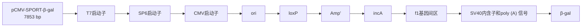
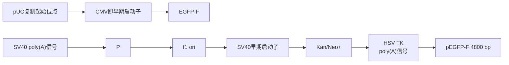

## 导言

将基因导入真核细胞的方法可分为三类:生化方法转染、物理方法转染、病毒介导的转导。本章介绍前两类，病毒介导的转导将在第16章详述。

转染方法的选择取决于下列几个实验要素:

- 最终目的是基因表达还是蛋白质生产
- 采用的细胞类型（贴壁细胞或悬浮细胞，适应培养的细胞或原代细胞）
- 细胞系抵抗转染压力的能力
- 采用的筛选方法的类型
- 培养条件
- 转染的核酸种类（DNA、RNA、siRNA 或寡核苷酸）
- 系统所要求的效率
- 通量要求，低、中或高

商业化的转染试剂通常都针对多种细胞类型、不同的核酸和各种特定的用途进行了检验。在开始实验之前，建议查询转染试剂生产厂商网站上提供的选择指南，如果时间和条件允许，还可以对不同转染试剂的效率进行比较。

生化方法转染包括磷酸钙介导的转染和二乙氨乙基（DEAE）-葡聚糖介导的转染，此类方法应用于将核酸导入培养的细胞已有超过45年的历史。Graham和van der Eb（1973）在磷酸钙存在下用病毒DNA转化哺乳动物细胞，这一工作为用克隆的DNA对遗传标记的小鼠细胞进行生化转化（Maitland and McDougall 1977; Wigler et al. 1977），为克隆的基因在多种哺乳动物细胞中进行瞬时表达（如见Gorman et al. 1983b），以及为细胞癌基因、抑癌基因及其他单拷贝哺乳动物基因进行分离和鉴定（如见Wigler et al. 1978; Perucho and Wigler 1981; Weinberg 1985; Friend et al. 1988）奠定了基础。近年来，阳性/中性脂质（脂质体）试剂最为常用，因为其可将基因高效地导入多种细胞类型。在这种情况下，化学试剂与DNA形成复合物，中和或掩盖DNA分子上的负电荷（有时甚至呈现正电荷），从而使该复合物可与带负电荷的细胞质膜相互作用，便于被细胞内吞。

除了生化方法，一种物理转染方法——电穿孔法也被广泛采用。电穿孔是使用短暂的电脉冲在细胞膜上产生能够使核酸进入细胞质的瞬时小孔。核转染（nucleofection）是由Amaxa公司开发的一种改进的电穿孔技术，通过优化电转参数、结合细胞类型特异性的转染试剂，可将核酸直接导入细胞核内。最后，光学转染利用的是光线可在哺乳动物细胞质膜上产生瞬时小孔的能力（见信息栏“光学转染”）。

## 瞬时转染与稳定转染

将 DNA 导入真核细胞有两种不同的方法:瞬时转染与稳定转染。在瞬时转染中，重组 DNA 导入易感的细胞系，目的基因产生短暂但高水平的表达，转染的 DNA 不一定整合进入宿主染色体。当需要在短时间内分析大量的样品时，瞬时转染是优先选择的方式。通常情况下，在转染后 1～4 天收获细胞，得到的细胞裂解物用于检测目的基因表达。

稳定或永久的转染用于建立克隆细胞系，此时转染的目的基因整合进入染色体 DNA 并指导目的蛋白的合成，表达量通常为中等。一般而言（取决于细胞类型），形成稳定转染细胞的效率比瞬时转染要低 1～2 个数量级。采用可选择的遗传标记有利于从大量未转染的细胞中分离出少数的稳定转染体。该标记基因可存在于携带目的基因的重组质粒上，也可以在另一个单独的载体上，通过共转染与重组质粒一起导入到所需细胞系中（说明详见信息栏“共转化”和“用于稳定转化的筛选试剂”）。一般情况下，下面介绍的方法对于分析瞬时转染和获得稳定转染体均适用。

## 转染方法

在过去，克隆的 DNA 主要通过借助磷酸钙或 DEAE-葡聚糖的生化方法导入培养的真核细胞中。现在，脂质成为首选的试剂，因其可获得很高的转染效率，且这类试剂能够介导所有类型的核酸转染进入各种类型的细胞。此外，脂质试剂的优点还包括易于使用、重复性好、低毒性和能够高效转染悬浮培养体系。其他方法无法转染的细胞系可以考虑选择物理方法，如电穿孔和核转染。表 15-1 对各种转染方法给出了简单的总结。

表 15-1 转染方法

<table><tr><td rowspan="2">方法</td><td colspan="2">表达</td><td rowspan="2">细胞毒性</td><td rowspan="2">细胞类型</td><td rowspan="2">注释</td><td rowspan="2">优势</td><td rowspan="2">劣势</td></tr><tr><td>瞬时</td><td>稳定</td></tr><tr><td>脂质体介导方案1</td><td>可</td><td>可</td><td>可变</td><td>贴壁细胞,原代细胞系,悬浮培养体系</td><td>阳离子脂质与带负电荷的DNA结合,有的形成人工膜囊泡(脂质体)。产生的稳定阳离子复合物吸附并融合于带负电荷的细胞膜(Felgner et al. 1987, 1994)</td><td>免疫原性和细胞毒性低;可使用大质粒;安全风险低,操作程序简单、快速;对所有核酸(DNA、mRNA、siRNA等)操作方案相同;相对低成本,适用于高通量系统</td><td>在原代和悬浮细胞中效率低且易变</td></tr><tr><td>磷酸钙介导方案2和方案3</td><td>可</td><td>可</td><td>无</td><td>贴壁细胞(CHO、293);悬浮培养体系</td><td>磷酸钙与DNA形成不可溶的共沉淀并吸附于细胞表面,通过内吞作用或吞噬作用被吸收(Graham and van der Eb 1973)</td><td>细胞毒性低,可使用大质粒,安全风险低,操作程序简单,非常廉价</td><td>试剂的一致性是获得高转染效率的关键;pH(±0.1)的微小变化即可对转染效率造成巨大影响;沉淀物的大小和质量至关重要;有时表现出免疫原性;对于不同的核酸需要调整方案,可能导致效率各异,贴壁细胞和悬浮细胞效率不同;对原代细胞无效;因细胞培养基中含有高浓度磷酸盐,所以不能在培养基中制备转染复合物</td></tr><tr><td>DEAE-葡聚糖介导方案4</td><td>可</td><td>否</td><td>有</td><td>BSC-1、CV-1和COS</td><td>带正电荷的DEAE-葡聚糖与DNA上带负电荷的磷酸基团结合,形成的聚合物结合带负电荷的质膜,可能通过内吞作用进入细胞,渗透性休克可增强内吞作用(Vaheri and Pagano 1965)</td><td>可使用大质粒,安全风险低,操作程序简单,廉价</td><td>具有免疫原性和细胞毒性;只能用于瞬时转染;对不同核酸可能需要调整方案,造成效率变化非常大,贴壁细胞和悬浮细胞效率不同;对原代细胞无效</td></tr><tr><td>电穿孔方案5</td><td>可</td><td>可</td><td>有</td><td>多种;包括脂质体转染很难的细胞</td><td>应用短暂的高压电脉冲在多种哺乳动物和植物细胞质膜上形成纳米级微孔(Neumann et al. 1982;Zimmermann 1982)。DNA直接通过这些微孔或者因微孔闭合伴随的细胞膜组分重分布而进入胞浆</td><td>可使用大质粒;安全风险低;操作程序较简单、快速;对所有核酸(DNA、mRNA、siRNA等)操作方案相同;非化学方法,不改变细胞的生物结构或功能</td><td>对悬浮细胞和原代细胞毒性强、效率低;花费中等,需要专门的设备;根据使用的细胞类型要进行不同的实验设置</td></tr><tr><td>核转染在方案5中讨论</td><td>可</td><td>可</td><td>可变</td><td>多种;包括脂质体转染很难的细胞</td><td>核转染建立在电穿孔的物理方法基础上,将称为核转染仪(Nucleofector)的设备产生的电参数与细胞类型特异性试剂相结合,直接将核酸转移至细胞核和细胞质内(Greiner et al. 2004;Johnson et al. 2005)</td><td>对许多细胞类型毒性较低;可使用大质粒;安全风险低;对贴壁、悬浮和原代细胞均具有较好效率;操作程序较简单、快速;对所有核酸(DNA、mRNA、siRNA等)操作方案相同</td><td>花费中等,需要专门的设备,且需要同一生产商提供的专用缓冲液;根据使用的细胞类型要进行不同的实验设置</td></tr></table>

## 转染的对照

所有的转染实验均应包括对照，以检验各个试剂和制备的质粒 DNA，以及检测将要引入的基因或构建体的毒性。

## 瞬时表达的对照

## 阴性对照

在瞬时转染实验中，需要用载体 DNA 和/或用于稀释待测质粒或基因的缓冲液转染一两个培养皿的细胞。通常采用鲑鱼精 DNA 或用于构建重组体的空载体等其他惰性载体代替待测基因转染贴壁细胞。转染后，培养的细胞不应从培养皿上脱落，外观上也不应变圆、变透明。

## 阳性对照

用编码一种易于检测的基因产物的质粒转染一两个培养皿的细胞，如氯霉素乙酰基转移酶、萤光素酶（第17章，方案2和方案3）、大肠杆菌β-半乳糖苷酶（第17章，方案1）或荧光蛋白如绿色荧光蛋白（GFP）及其衍生物（第17章，方案4），这些基因的表达由通用启动子驱动，如人巨细胞病毒即早期基因区启动子及相应增强子。这种示踪质粒可从出售含有用于检测编码蛋白的酶和试剂的试剂盒的供应商处获得。由于这些报道基因的内源活性通常很低，酶活性或荧光强度的增加可直接反映转染效率及实验所用试剂的质量情况。在比较不同批次转染实验的结果时，阳性对照尤其重要。将报道基因质粒与待测质粒或基因组DNA共转染，还可以为转染全程非特异性毒性提供对照。关于这些报道系统的更多信息，见第17章及其信息栏。

## 稳定表达的对照

## 阴性对照

用鲑鱼精 DNA 等惰性核酸代替选择性标记基因转染一两个培养皿的细胞。在适宜的筛选试剂（如 G418、潮霉素、霉酚酸）存在下培养 2～3 周后，应无细胞集落出现。

## 阳性对照

用编码选择性标记的空质粒转染一两个培养皿的细胞。筛选2～3周后存活的克隆数目可衡量转染/筛选过程的效率。在同时导入选择性标记和待测质粒或基因的细胞培养皿中应出现数量接近的克隆。如果待测培养皿克隆数目与阳性对照培养皿出现明显差异，则可能提示基因产物有毒性（极少情况下，基因产物可能增强转染细胞的存活力）。如果证明一种cDNA或基因对受体细胞有毒性，那么可以考虑采用调控型启动子，如金属硫蛋白启动子（一种应答于 $Zn^{2+}$ 或 $Cd^{2+}$ 的DNA）、小鼠乳腺瘤病毒长末端重复启动子（一种应答于糖皮质激素的DNA），或者四环素调控启动子（第17章，方案5）（Gossen and Bujard 1992; Gossen et al. 1995; Shockett et al. 1995）。

## 优化和特殊注意事项

无论采用何种方法将 DNA 导入细胞，瞬时转染或稳定转染的效率很大程度上取决于采用的细胞类型（见表 15-1）。不同系的培养细胞摄取和表达外源 DNA 的能力可相差几个数量级。此外，对一种类型的培养细胞效果很好的方法可能对另一种细胞行不通。本章所介绍的许多方案已采用标准的培养细胞系进行优化。当采用其他细胞系时，应注意比较几种不同方法的转染效率。方案1～5介绍了常用的转染技术，以及用标准技术难以转染的细胞系中获得成功的方法。商业化试剂盒可提供多种转染方法所需的成套试剂（表15-2）。

表 15-2 用于转染的商品化试剂盒和试剂

<table><tr><td>厂家</td><td>网址</td><td>方法或试剂</td><td>试剂盒/产品</td></tr><tr><td>Bio-Rad</td><td>www.bio-rad.com</td><td>非脂质体型阳离子脂质</td><td>Transfectin</td></tr><tr><td>Clontech</td><td>www.clontech.com</td><td>非脂质体型聚合物</td><td>Xfect</td></tr><tr><td>GE Healthcare Life Sciences</td><td>www.gelifesciences.com</td><td>DEAE-葡聚糖</td><td>CellPhect Transfection Kit</td></tr><tr><td rowspan="3">Life Technologies</td><td rowspan="3">www.invitrogen.com</td><td>磷酸钙</td><td>Calcium phosphate transfection kit</td></tr><tr><td>脂质体型阳离子脂质</td><td>Lipofectamine 2000</td></tr><tr><td>脂质体型阳离子脂质</td><td>Lipofectamine LTX</td></tr><tr><td rowspan="2">Mirus Bio</td><td rowspan="2">www.mirusbio.com</td><td>非脂质体型阳离子脂质</td><td>TransIT-2020</td></tr><tr><td>非脂质体型阳离子脂质</td><td>TransIT-LT1</td></tr><tr><td>Polyplus Transfection</td><td>www.polyplus-transfection.com</td><td>非脂质</td><td>jetPRIME, jetPEI</td></tr><tr><td rowspan="4">Promega</td><td rowspan="4">www.promega.com</td><td>磷酸钙</td><td>ProFection Mammalian Transfection System</td></tr><tr><td>非脂质体型阳离子脂质</td><td>FuGENE HD Transfection System</td></tr><tr><td>非脂质体型阳离子脂质</td><td>TransFast Transfection Reagent</td></tr><tr><td>非脂质体型阳离子脂质</td><td>FuGENE 6 Transfection Reagent</td></tr><tr><td rowspan="4">QIAGEN</td><td rowspan="4">www.qiangen.com</td><td>非脂质体型阳离子脂质</td><td>Effectene Transfection Reagent</td></tr><tr><td>非脂质体型阳离子脂质</td><td>Attractene Transfection Reagent</td></tr><tr><td>活化的树状聚合物</td><td>SuperFect Transfection Reagent</td></tr><tr><td>活化的树状聚合物</td><td>PolyFect Transfection Reagent</td></tr><tr><td rowspan="4">Roche Applied Science Sigma-Aldrich</td><td>www.roche-applied-science.com</td><td>脂质体型阳离子脂质</td><td>DOTAP Transfection Reagent</td></tr><tr><td rowspan="3">www.sigmaaldrich.com</td><td>磷酸钙</td><td>Calcium phosphate transfection</td></tr><tr><td>DEAE-葡聚糖</td><td>DEAE-dextran transfection kit</td></tr><tr><td>非脂质体型阳离子脂质</td><td>Escort, DOTAP, DOPE</td></tr></table>

## 评价转染细胞系的细胞活力

在确定针对某一特定细胞系的最佳转染方法时，有必要评价转染对细胞活力的影响。对细胞状态的评价需要在一段时间内进行准确的定量和定性检测。可通过实验检测多种不同的标记物，这些标记物可反映死细胞数量（细胞毒性检测）、活细胞数量（细胞活力检测）、总细胞数量或细胞的死亡机制（如凋亡还是坏死）。DNA 含量、细胞内酶活性存在与否、细胞内 ATP 的数量、细胞膜完整性及代谢活性均是细胞完整性的指标。能够迅速获得可检测信号的方法（如 ATP 定量或 LDH 释放测定）与需要孵育几小时才能获得信号的方法 [MTT 或刃天青（resazurin）] 相比具有速度方面的优势。后者在对需经过几小时或数天才能作出反应的不同步、非均一性的细胞群体进行检测时非常有用。

检测灵敏度在评价药物毒性时是一个具有重要意义的参数，但在优化转染试剂时受到的关注有限，因为此时需要检测的是一个细胞群体的活力变化。此外，检测大量样品需要采用简单、稳定、非放射性且与自动化操作兼容的试剂的高通量方法。该方法还必须相对廉价、省力，且能够测定多种类型细胞的细胞生长动力学而不影响细胞的基本功能。正是基于以上原因，当处理大量样品时，经典的用于估算死细胞数目的台盼蓝拒染法不适宜应用，可采用其他易于操作、能够准确定量和定性指示细胞活力的检测方法。

方案 6～8 详述了三种试剂的使用:alamarBlue、乳酸脱氢酶（LDH）和 MTT [3-(4,5-二甲基噻唑-2)-2,5-二苯基四氮唑溴盐，一种黄色四唑盐]。alamarBlue 法和 MTT 法直接检测细胞活力，而 LDH 法检测细胞死亡，因而是一种细胞毒性检测方法。此外，尽管所有三种检测方法均能够对细胞死亡机制（即凋亡或坏死）进行时间相关性的定量，但只有 LDH 法能够在单一时间点的检测中区分出两种机制。LDH 法检测细胞质中一种酶的释放，该过程只在细胞坏死导致细胞膜完整性丧失之时发生。由于所有三种方法均适于高通量检测，所以它们已很大程度上代替旧有的放射性方法，如  $[^{3}H]$  胸苷整合入细胞 DNA。

## 致谢

感谢 Bio-Rad 公司的 Michelle Collins Life Technologies 公司的 Kevin Smoker 和 Lonza Cologne AG 公司的 Daniela Bruell 在技术和编辑方面的帮助。

## 参考文献

- Felgner PL, Gadek TR, Holm M, Roman R, Chan HW, Wenz M, Northrop JP, Ringold GM, Danielsen M. 1987. Lipofection: A highly efficient, lipid-mediated DNA-transfection procedure. Proc Natl Acad Sci 84:7413–7417.
- Felgner JH, Kumar R, Sridhar CN, Wheeler CJ, Tsai YJ, Border R, Ramsey P, Martin M, Felgner PL. 1994. Enhanced gene delivery and mechanism studies with a novel series of cationic lipid formulations. J Biol Chem 269: 2550–2561.
- Friend SH, Dryja TP, Weinberg RA. 1988. Oncogenes and tumor-suppressing genes. N Engl J Med 318: 618–622.
- Gorman C, Padmanabhan R, Howard BH. 1983. High efficiency DNA-mediated transformation of primate cells. Science 221: 551–553.
- Gossen M, Bujard H. 1992. Tight control of gene expression in mammalian cells by tetracycline-responsive promoters. Proc Natl Acad Sci 89:5547–5551.
- Gossen M, Freundlieb S, Bender G, Müller G, Hillen W, Bujard H. 1995. Transcriptional activation by tetracyclines in mammalian cells. Science 268: 1766–1769.
- Graham FL, van der Eb AJ. 1973. A new technique for the assay of infectivity of human adenovirus 5 DNA. Virology 52: 456–467.
- Greiner J, Wiehe J, Wiesneth M, Zwaka TP, Prill T, Schwarz K, Bienek-Ziolkowski M, Schmitt M, Döhner H, Hombach V, et al. 2004. Transient genetic labeling of human CD34 positive hematopoietic stem cells using nucleofection. Transfus Med Hemother 31: 136–141.
- Johnson BD, Gershan JA, Natalia N, Zujewski H, Weber JJ, Yan X, Orentas RJ. 2005. Neuroblastoma cells transiently transfected to simultaneously

express the co-stimulatory molecules CD54, CD80, CD86, and CD137L generate antitumor immunity in mice. J Immunother 28:449–460.

Maitland NJ, McDougall JK. 1977. Biochemical transformation of mouse cells by fragments of herpes simplex DNA. Cell 11: 233–241.

Neumann E, Schaefer-Ridder M, Wang Y, Hofschneider PH. 1982. Gene transfer into mouse lyoma cells by electroporation in high electric fields. EMBO J 1: 841–845.

Perucho M, Wigler M. 1981. Linkage and expression of foreign DNA in cultured animal cells. Cold Spring Harb Symp Quant Biol 45: 829–838.

Shockett P, Difilippantonio M, Hellman N, Schatz D. 1995. A modified tetracycline-regulated system provides autoregulatory, inducible gene expression in cultured cells and transgenic mice. Proc Natl Acad Sci 92: 6522–6526.

Vaheri A, Pagano JS. 1965. Infectious poliovirus RNA: A sensitive method of assay. Virology 27: 434–436.

Weinberg RA. 1985. Oncogenes and the molecular basis of cancer. Harvey Lect 80: 29–136.

Wigler M, Pellicer A, Silverstein S, Axel R. 1978. Biochemical transfer of single-copy eukaryotic genes using total cellular DNA as a donor. Cell 14: 725–731.

Wigler M, Silverstein S, Lee LS, Pellicer A, Cheng VC, Axel R. 1977. Transfer of purified herpes virus thymidine kinase gene to cultured mouse cells. Cell 11: 223–232.

Zimmermann U. 1982. Electric field-mediated fusion and related electrical phenomena. Biochim Biophys Acta 694: 227–277.

## 方案 1 阳离子脂质试剂介导的 DNA 转染

不同的脂质体转染试剂在高效转染细胞系的能力方面存在差异，有些是通用型的，而有些对特定细胞类型效果最佳。非脂质体型 FuGENE 6 和阳离子脂质体 Lipofectamine 2000能够成功转染大多数贴壁和悬浮细胞类型（包括几种原代细胞和难以转染的细胞类型），毒性极低，操作步骤少，是转染试剂的典型。很重要的一点是，两种试剂均能够于血清存在的条件下转染细胞，减少了转染过程的操作步骤。下面的主要方案中使用了这两个试剂，该方案已经过厂家（Roche Applied Science 公司和 Life Technologies 公司）许可，在原有形式上进行了修改。这里还给出了采用阳离子脂质试剂 Lipofectin 和 Transfectam 的替代方案。

由于多种可变因素影响脂质体转染的效率，建议以下面方案中列举的条件作为对转染系统进行系统性优化的起始条件（说明详见信息栏“脂质体转染”）。携带标准报道基因的质粒获得阳性信号后，可对信息栏“脂质体转染”中讨论的每个参数进行系统性的改变，以期达到最高信号背景比及减少重复试验间的变异。根据以上结果，即可形成检测目的基因表达的最优方案。

## 材料

为正确使用本方案中的器材和危险试剂，必须查阅相应的材料安全数据表并咨询所在机构的环境卫生和安全办公室。

## 试剂

细胞生长培养基（完全培养基、无血清培养基和选择性培养基[可选]）

指数生长期的哺乳动物细胞

FuGENE $6^{1}$ (Promega 公司)

Giemsa 染液（10%）

Giemsa 染液须在使用前用磷酸盐缓冲液或水新鲜配制，通过 Whatman 1 号滤纸过滤。

Lipofectamine 2000 $^{2}$ （Life Technologies 公司）

脂质体转染试剂

甲醇，预冷

质粒 DNA

如果是首次进行脂质体转染操作或使用一种不熟悉的细胞系，需要一个编码大肠杆菌β-半乳糖苷酶或绿色荧光蛋白的表达质粒（见第17章信息栏“β-半乳糖苷酶”和“荧光蛋白”），可从Addgene（一个非盈利性质粒库）或几个生产商处购买（例如，Life Technologies公司的pCMV-SPORT-β-gal，或Clontech公司的pEGFP-F，见图15-1和图15-2）。

用能够有效去除细菌内毒素的转染级质粒DNA制备试剂盒（如QIAGEN公司的EndoFree Plasmid MaxiKit）纯化闭合环状质粒DNA。此外，还可以通过柱层析或溴化乙锭-CsCl梯度离心纯化DNA。用无菌Tris-EDTA缓冲液或无菌水以 $0.2\sim 2\mu \mathrm{g} / \mu \mathrm{L}$ 的浓度溶解DNA，用 $260\mathrm{nm} / 280\mathrm{nm}$ 比值检测DNA纯度，该比值应为1.8。

一般情况下，尤其目的是获得稳定转染体时，更倾向于使用线性DNA，即用限制酶进行DNA线性化（见信息栏“转染前的质粒线性化”）。

<small>1. https://www.promega.com/de-de/aboutus/press-releases/2011/20110202-fugene6/.</small>

<small>2. http://www.invitrogen.com/site/us/en/home/Global/trademark-information/life-technologies-trademarks-list.html.</small>

flowchart

图 15-1 pCMV-SPORT- $\beta$ -gal。pCMV-SPORT- $\beta$ -gal 是一个可用于监测转染效率的报道载体。该载体携带 CMV（巨细胞病毒）即早期启动子驱动的大肠杆菌 $\beta$ -半乳糖苷酶基因，CMV 启动子可在哺乳动物细胞中驱动高水平的转录。 $\beta$ -半乳糖苷酶序列下游的 SV40 多腺苷酸化信号在真核细胞中指导 mRNA 3' 端的正确加工（此图经 Life Technologies 公司许可复制）。

flowchart

图 15-2 pEGFP-F。pEGFP-F 是一个可用于监测转染效率和作为共转染标记的报道载体。该载体编码经改良的绿色荧光蛋白，即法尼基化的增强型 GFP（EGFP-F），EGFP-F 仍可与活细胞或固定细胞的质膜结合。该质粒携带使质粒能够在原核细胞（pUC ori）和真核细胞（SV40 ori）中复制的序列及便于质粒在原核细胞（卡那霉素）和真核细胞（新霉素）中进行筛选的标记基因。可借助荧光显微镜检测 EGFP-F 的存在（此图经 Clontech 公司许可改动）。

## 设备

微量离心管，聚丙烯（无菌）

多孔组织培养板（6 孔）或培养皿（35mm）

本方案为生长于 6 孔组织培养板或 35mm 培养皿的细胞而设计。如果采用其他直径大小的多孔板或培养皿，则可根据表 15-3 按比例调整细胞密度和接种体积。相应的转染试剂的起始体积和 DNA 用量根据生产商的说明书按比例调整。

表 15-3 用于细胞培养的平板直径

| 平板大小 | 生长面积/cm2 | 相对面积a | 建议体积 |
| --- | --- | --- | --- |
| 96孔 | 0.32 | 0.04× | 200μL |
| 24孔 | 1.88 | 0.25× | 500μL |
| 12孔 | 3.83 | 0.5× | 1.0mL |
| 6孔 | 9.4 | 1.2× | 2.0mL |
| 35mm | 8.0 | 1.0× | 2.0mL |
| 60mm | 21 | 2.6× | 5.0mL |
| 10cm | 55 | 7.0× | 10.0mL |
| 培养瓶 | 25 | 3.0× | 5.0mL |
| 培养瓶 | 75 | 9.0× | 12.0mL |

a. 相对面积表述为相当于 35mm 培养皿生长面积的倍数。

## 方法

## 用于转染的生长细胞的准备

1. 脂质体转染前 24h，通过胰酶消化收集指数生长期的哺乳动物细胞，并将其按转染试剂所需的密度重新接种于 6 孔板或 35mm 培养皿（见下表）。加入 2mL 生长培养基，于含 5%～7% CO₂ 的 37℃ 湿润温箱中培养 20～24h。

如果转染前培养时间少于 12h，细胞不能很好地贴附于基质，可能会在接触脂质过程中脱落。

对于悬浮细胞，使用下表所示的适当密度的新鲜传代细胞（35mm 培养皿或 6 孔板使用 2mL）。

| 转染试剂 | 贴壁细胞密度/(细胞/孔) | 悬浮细胞密度/(细胞/mL) | 转染时汇合度 |
| --- | --- | --- | --- |
| FuGENE 6 | $1 \times 10^{5} \sim 3 \times 10^{5}$ | $5 \times 10^{4} \sim 1 \times 10^{6}$ | 50%~80% |
| Lipofectamine 2000 | $2 \times 10^{5} \sim 8 \times 10^{5}$ | $2 \times 10^{5} \sim 3 \times 10^{6}$ | 90%~95% |
| DOTMA | $1 \times 10^{5} \sim 3 \times 10^{5}$ | $5 \times 10^{4} \sim 1 \times 10^{6}$ | 75% |
| DOGS | $1 \times 10^{5} \sim 3 \times 10^{5}$ | $5 \times 10^{4} \sim 1 \times 10^{6}$ | 75% |

## FuGENE 6-DNA 复合物的制备

优化起始条件时，转染试剂（ $\mu L$ ）与 DNA（ $\mu g$ ）用量比例采用 3:1、3:2 和 6:1。这种比例对于常用的贴壁和悬浮细胞可达到良好的转染效率。

2. 将 FuGENE 6 试剂置于室温并于使用前通过漩涡振荡 1s 或翻转容器使其混匀。用不含抗生素或杀菌剂的无血清培养基稀释转染试剂，将 3 个小无菌管分别标记上 “3:1”、“3:2” 和 “6:1”。向前两个管中各加入 97μL 无血清培养基，后一个加入 94μL。将 FuGENE 6 直接加入到培养基中，前两管各加入 3μL，标记 “6:1” 的管加入 6μL，加液时注意不要接触管壁。漩涡振荡 1s 或轻弹管体混匀，室温孵育 5min。

▲转染试剂-DNA 复合物必须用无血清培养基制备，而细胞转染可以在血清存在下进行。构成转染复合物的组分的加入顺序和方式是至关重要的。必须首先加入无血清培养基，未经稀释的 FuGENE 6 不能直接接触除吸头外的任何塑料表面（如盛有无血清培养基的管壁）。

3. 向步骤 2 稀释的转染试剂中加入 $50 \mu \mathrm{L}$ DNA。标记 “3:1” 和 “6:1” 的管中各加入 $1 \mu \mathrm{g}$ 质粒 DNA，标记 “3:2” 的管中加入 $2 \mu \mathrm{g}$ DNA（总体积同样为 $50 \mu \mathrm{L}$）。
4. 轻弹管壁或漩涡振荡 1s 以混匀内容物，室温孵育 15～45min。
5. 继续进行步骤 10。

## Lipofectamine 2000-DNA 复合物的制备

优化起始条件时，用于制备复合物的 Lipofectamine 2000（μL）与 DNA（μg）用量比例为 2:1～3:1。

6. 温和混匀 Lipofectamine 2000，取出 $10\mu \mathrm{L}$ 用 $250\mu \mathrm{L}$ 无血清培养基稀释，室温孵育 $5\mathrm{min}$。

▲在 25min 内进行步骤 8。

7. 用 $250 \mu \mathrm{L}$ 无血清培养基稀释 $4 \mu \mathrm{g} \mathrm{DNA}$, 温和混匀。

8. 将稀释的 Lipofectamine 2000 与稀释的 DNA 混合（总体积为 $500\mu \mathrm{L}$），温和混匀，室温孵育 $20\mathrm{min}$（溶液可能呈混浊状）。

复合物在室温下 6h 内稳定。

9. 继续进行步骤 10。

## 细胞的转染

10. 向 6 孔板或 35mm 培养皿中培养于生长培养基的细胞（来自步骤 1）逐滴加入上述复合物，晃动培养板或培养皿以保证分布至整个表面。将细胞放回含 5%\~7% CO₂ 的 37℃ 湿润保温箱。

不必更换新鲜的生长培养基。但是，如果 Lipofectamine 2000 可能带来毒性，可在 4～6h 后更换生长培养基。

11. 转染后 6～24h 可用台盼蓝拒染法（见第 17 章）分析细胞活力，或采用借助 alamarBlue、乳酸脱氢酶或 MTT 的细胞毒性检测定量细胞活力（分别见方案 6～8）。

见“疑难解答”。

12. 如果目的是获得稳定转化的细胞株，进行步骤 13。若分析瞬时转染，脂质体转染后 24～96 h 用下述方法之一对细胞进行检测:

i. 如果使用表达大肠杆菌β-半乳糖苷酶的质粒 DNA，按照第 17 章，方案 1 所述步骤检测细胞裂解物中的酶活性；或者依照附加方案“单层细胞组织化学染色检测β-半乳糖苷酶”中所述进行组织化学染色检测。
ii. 如果使用荧光蛋白表达载体，使用荧光显微镜在适宜的激发条件下观察细胞（绿色荧光蛋白表达可在 450～490nm 下观察到）。或者，可取出少量细胞用流式细胞仪进行分析，以估计转染效率和细胞活力，该方法在第 17 章信息栏“荧光蛋白”中介绍。
iii. 对于其他基因产物，可以通过体内代谢标记进行放射性免疫测定、免疫印迹、免疫沉淀，或者通过检测细胞抽提物的酶活性分析新合成的蛋白质。

为尽可能地减小各培养皿间转染效率的差异，最好:①每个构建体转染数个培养皿；②在培养24h后再用胰酶消化细胞；③将细胞汇集起来；④将它们重新接种于数个培养皿。

见“疑难解答”。

13. 分离稳定转染体。

i. 将细胞在完全培养基中孵育 48～72h，以使导入的基因有表达的时间。

ii. 胰酶消化细胞，将其接种至合适的选择性培养基中。
iii. 每 2\~4 天更换培养基，持续 2\~3 周，以除去死细胞碎片，促进抗性细胞生长。
iv. 克隆、扩增独立的细胞集落以用于分析（方法见 Jakoby and Pastan 1979, Spector et al. 1998）。
v. 将余下的细胞用预冷甲醇固定 15min，然后室温下用 10% Giemsa 染液染色 15min，流水冲洗，这样可以获得细胞克隆数目的永久记录。

## 疑难解答

问题（步骤 11）:细胞状态不佳。

解决方案:原因在于所使用的抗生素。建议使用以下办法:

- 转染 24～48h 后再加入筛选抗生素。
- 使用较低浓度（或一个浓度范围）的筛选抗生素。

问题（步骤 11）:细胞状态不佳。

解决方案:表达的蛋白质具有细胞毒性，或者表达水平过高。建议使用以下办法:

- 通过下列实验对照分析细胞毒性:未转染细胞、只用 DNA 处理而不加入转染试剂的细胞，以及只用转染试剂处理的细胞。将实验构建体转染的细胞与这些实验对照细胞进行比较。
- 建议用分泌型报道基因检测，如分泌型碱性磷酸酶（SEAP）或人生长激素（hGH）重复该实验。分泌型报道基因的细胞应表现极低的或完全没有细胞毒性。

问题（步骤 11）:细胞状态不佳。

解决方案:培养体系被支原体污染。建议使用以下办法:

- 采用商业化支原体检测试剂盒来确定是否被污染。
- 用 BM-Cyclin（Roche Applied Sciences 公司）之类的抗生素处理细胞以去除支原体，或者用全新的、干净的培养物重新开始。

问题（步骤 11）:细胞状态不佳。

解决方案:如果上述对策均无效，那么建议采用以下办法:

- 含高水平内毒素的 DNA 可能对某些敏感细胞系如 Huh-7 和原代细胞系等造成细胞毒性。使用内毒素清除试剂盒，或用有去除内毒素步骤的质粒制备试剂盒重新开始。
- 在极少情况下，转染试剂可能对所用的细胞系有毒性。可尝试改变条件重复实验，如在有胎牛血清存在下，减少转染试剂的接触时间，采用更高的细胞密度，以及改变脂质/DNA的比例。

问题（步骤 12）:转染效率低。

解决方案:可能是核酸质量不好或数量不足。建议使用以下办法:

- 只采用高质量制备的质粒并使用推荐的浓度。
- 用含有 GFP 等标记基因的商业化转染级质粒进行对照转染实验。
- 含高水平内毒素的 DNA 可能对某些敏感细胞系如 Huh-7 和原代细胞系等造成细胞毒性。使用内毒素清除试剂盒，或用有去除内毒素步骤的质粒制备试剂盒重新开始。

问题（步骤 12）:转染效率低。

解决方案:转染试剂没有按要求存储。建议使用以下办法:

\- 在厂家提供的初始容器中保存试剂，不要分装。

\- 不要冷冻脂质转染试剂。

问题（步骤 12）:转染效率低。

解决方案:脂质/DNA 比例不够理想。有必要通过实验确定脂质转染试剂与用于转染的 DNA 的比例，该操作可在多孔板中进行，然后进行相应的放大。

问题（步骤 12）:转染效率低。

解决方案:如果上述对策均无效，那么建议采用以下办法:

- 有些脂质体转染试剂对接触塑料制品是高度敏感的，尤其是 FuGENE 6。应确保将试剂直接加入到培养基中。
- 在某些情况下，培养基中的血清和其他添加物能够抑制复合物形成。应在不含添加物（如血清、抗生素、促生长因子）的培养基中制备复合物。

## 替代方案 采用 DOTMA 和 DOGS 进行转染

下文详述了采用 DOTMA（Lipofectin $^{1}$ ）和 DOGS（Transfectam $^{2}$ ）在 60mm 组织培养皿中转染细胞的方案，与以上方案的主要差别在于，该转染需要在血清存在下进行（见信息栏 “DOTMA 和 DOGS”）。

## 附加材料

为正确使用本方案中的器材和危险试剂，必须查阅相应的材料安全数据表并咨询所在机构的环境卫生和安全办公室。

## 试剂

脂质体转染试剂

Lipofectin（Life Technology 公司）

Transfectam（Promega 公司）

氯化钠（300mmol/L）

用作 DOGS 的稀释液。

柠檬酸钠（20mmol/L，pH 5.5），含150mmol/L氯化钠

当使用 DOGS 脂质体转染试剂时，用来取代无菌水作为质粒 DNA 的稀释液。

## 设备

试管，聚乙烯或聚苯乙烯

见步骤 2 的说明。

组织培养皿（60mm）

## 方法

1. 按照方案 1 的步骤 1 所述在 $60 \mathrm{~mm}$ 培养皿中培养细胞。

<small>1. http://www.invitrogen.com/site/us/en/home/Global/trademark-information/life-technologies-trademarks-list.html. 2. http://www.promega.com/aboutus/corporate/trademarks/.</small>

2. 对于每个 $60\mathrm{mm}$ 培养皿的待转染细胞，用 $100\mu \mathrm{L}$ 无菌去离子水（用Lipofectin时）或含 $150\mathrm{mmol / L}$ 氯化钠的 $20\mathrm{mmol / L}$ 柠檬酸钠（$\mathrm{pH}5.5$）（用Transfectam时）在聚乙烯或聚苯乙烯试管中稀释 $1\sim 10\mu \mathrm{g}$ 质粒DNA。在另一个试管中用无菌去离子水或 $300\mathrm{mmol / L}$ 氯化钠将 $2\sim 50\mu \mathrm{L}$ 脂质稀释至终体积 $100\mu \mathrm{L}$ 。将这些试管置室温孵育 $10\mathrm{min}$ 。

▲当用 Lipofectin 进行转染时，使用聚苯乙烯试管，因为阳离子脂质 DOTMA 会与聚丙烯发生非特异性结合。

3. 将脂质溶液加入到 DNA 中，反复吹打几次使溶液混匀。将混合物于室温孵育 $10\mathrm{min}$ 。

4. 在孵育 DNA-脂质溶液的同时，将待转染细胞用无血清培养基洗涤三次。第三次冲洗后，向每个 60mm 培养皿中加入 0.5mL 无血清培养基，然后将细胞放回至含 5%\~7% CO₂ 的 37℃ 湿润温箱中。

▲在加入脂质-DNA 脂质体之前用无血清培养基冲洗细胞。在某些情况下，血清是转染过程强有力的抑制剂（Felgner and Holm 1989）。类似地，细胞外基质组分如硫酸蛋白聚糖也能够抑制脂质体转染，推测是通过结合 DNA-脂质复合物并阻断其与受体细胞质膜的相互作用。

5. 向每管中加入 $900\mu \mathrm{L}$ 无血清培养基，反复吹打几次使溶液混匀。再次室温孵育 $10\mathrm{min}$ 。

6. 将每管中的 DNA-脂质-培养基溶液转移至 60mm 培养皿的细胞中。在含 5%\~7% CO₂ 的 37℃ 湿润温箱中孵育细胞 1\~24h。

7. 在细胞与 DNA 接触达到适当时间后，用无血清培养基洗涤 3 次。向细胞加入完全培养基，放回至温箱中。分析细胞活力和转染效率，并/或按照方案 1 步骤 11～13 所述继续获得稳定转染体。

## DOTMA 和 DOGS

尽管现在普遍采用由专利脂质混合物组成的商业化转染试剂，但也可以借助脂质制备自己的转染试剂；这里列举两个可能用到的脂质。

- Lipofectin（氯化三甲基-2,3-二油酰丙基铵，DOTMA，图1）。购买的该单价阳离子脂质通常与一种辅助脂质混合，浓度为 $1\mathrm{mg / mL}$ 。DOTMA还可以在有机化学研究人员的帮助下进行合成（Felgner et al. 1987）。如果是自己合成的，在聚苯乙烯管中（不能使用聚丙烯管）将干粉DOTMA和辅助脂质二油酰基磷脂酰乙醇胺（DOPE，可从Sigma-Aldrich购买）各 $10\mathrm{mg}$ 分别溶于 $2\mathrm{mL}$ 无菌去离子水。超声处理该混浊液以形成脂质体，然后稀释至终浓度 $1\mathrm{mg / mL}$ 。溶液储存于 $4^{\circ}\mathrm{C}$ 。
- Transfectam（精胺-5-羧基-双十八烷基甘氨酰胺，DOGS，图1）。依下述方法制备阳离子脂质 DOGS 的储备溶液:用 40μL 96%（V/V）乙醇溶解 1mg 该聚胺，室温频繁振荡 5min 溶解。加入 360μL 无菌水，溶液储存于 4℃。使用前振荡该溶液。聚胺类，如 DOGS，无需使用聚苯乙烯管，这些试剂使用聚丙烯管（即标准微量离心管）也是安全的。

尽管自制这两种脂质试剂可能确实节约成本（Loeffler and Behr 1993），但其缺点在于细胞毒性较高、只能转染少数细胞类型和转染过程中需要大量操作，因为血清的存在严重影响转染效率。

chemical

Chemical structures of DOTMA and DOGS polymers showing repeating units with labeled functional groups

图 1 脂质体转染中使用的脂质的结构。

## 附加方案 单层细胞组织化学染色检测β-半乳糖苷酶

有几种用于分析瞬时转染成功与否的方法。如果使用表达大肠杆菌β-半乳糖苷酶的质粒，那么组织化学染色程序易于操作、结果可靠。下面的方法是为生长于60mm培养皿中的细胞而设计的，是对Sanes等（1986）建立的方法的改进。含有免疫组织化学检测β-半乳糖苷酶所有必需试剂的试剂盒可从几个厂商购买到。

## 附加材料

为正确使用本方案中的器材和危险试剂，必须查阅相应的材料安全数据表并咨询所在机构的环境卫生和安全办公室。本方案的专用试剂标注&lt;R&gt;，配方在本方案未提供。常用储备溶液、缓冲液和试剂标注&lt;A&gt;，配方见附录1。储备溶液应稀释至适用浓度后使用。

## 试剂

细胞固定剂 &lt;R&gt;

组织化学染色液 &lt;R&gt;

磷酸盐缓冲液 &lt;A&gt;

## 方法

1. 室温下用 2\~3mL 磷酸盐缓冲液洗涤细胞两次。

2. 向细胞中加入 5mL 细胞固定剂。

3. 用磷酸盐缓冲液洗涤细胞一次。

4. 向细胞中加入 3\~5mL 组织化学染色液。

5.  $37^{\circ}$ C 孵育细胞 14～24h。

6. 用磷酸盐缓冲液洗涤单层细胞几次。

7. 用少量磷酸盐缓冲液覆盖单层细胞，然后在光学显微镜下观察。

表达了β-半乳糖苷酶表达载体的细胞应呈亮蓝色。可通过计数染色和未染色细胞的相对数目来估计成功转染的比例。

## 配方

为正确使用本方案中的器材和危险试剂，必须查阅相应的材料安全数据表并咨询所在机构的环境卫生和安全办公室。

细胞固定剂

| 试剂 | 终浓度 |
| --- | --- |
| 甲醛 | 2% (V/V) |
| 戊二醛 | 0.2% (V/V) |
| 磷酸盐缓冲液 | 1× |

细胞固定剂需在化学通风橱中配置，储存于室温。

组织化学染色液

| 试剂 | 终浓度 |
| --- | --- |
| 铁氰化钾($K_3Fe[CN]_6$) | 5mmol/L |
| 亚铁氰化钾($K_4Fe[CN]_6$) | 5mmol/L |
| $MgCl_2$ | 2mmol/L |
| 磷酸盐缓冲液 | 1× |
| X-Gal(5-溴-4-氯-3-吲哚-β-半乳糖苷) | 1mg/mL |

## 参考文献

- Felgner PL, Holm M. 1989. Cationic liposome-mediated transfection. Focus 11: 21–25.
- Felgner PL, Gadek TR, Holm M, Roman R, Chan HW, Wenz M, Northrop JP, Ringold GM, Danielsen M. 1987. Lipofection: A highly efficient, lipid-mediated DNA-transfection procedure. Proc Natl Acad Sci 84:7413–7417.
- Jakoby WB, Pastan IH., eds. 1979. Cell culture. Methods in Enzymology, Vol. 58. Academic, New York.
- Kichler A, Zauner W, Ogris M, Wagner E. 1998. Influence of the DNA complexation medium on the transfection efficiency of lipospermine/
- DNA particles. Gene Ther 5: 855–860.
- Loeffler J-P, Behr J-P. 1993. Gene transfer into primary and established mammalian cell lines with lipopolyamine-coated DNA. Methods Enzymol 217: 599–618.
- Sanes J, Rubinstein JL, Nicolas JF. 1986. Use of recombinant retroviruses to study post-implantation cell lineages in mouse embryos. EMBO J 5:3133–3142.
- Spector DL, Goldman RD, Leinwand LA. 1998. Cells: A laboratory manual, Vol. 2: Light microscopy and cell structure. Cold Spring Harbor Laboratory Press, Cold Spring Harbor, NY.

## 方案 2 磷酸钙介导的质粒 DNA 转染真核细胞

本方案介绍磷酸钙介导的质粒 DNA 转染贴壁细胞的方法是对 Jordan 等（1996）建立的方法的改进。Jordan 等大大优化了适用于中国仓鼠卵巢细胞和人胚肾 293 细胞的磷酸钙介导的转染方法。在本方案之后列举了一些在基本方法上的变化。

- 高效获得稳定转染体的方法见本方案后面的替代方案。
- 采用高分子质量基因组 DNA 见方案 3；采用胰酶消化从基质上脱离的贴壁细胞见方案 3 后面的替代方案。
- 采用非贴壁细胞见方案3后面的替代方案。

## 增加转染效率

当核酸以与磷酸钙和 DNA 共沉淀的形式转染培养细胞时，细胞对 DNA 的摄取明显增加。Graham 和 van der Eb（1973）首次阐述了该方法，他们的工作为将 DNA 导入哺乳动物细胞奠定了基础，并建立了用于细胞稳定转化和克隆 DNA 瞬时表达的可靠方法。关于这一过程的说明详见信息栏“用磷酸钙-DNA 共沉淀转染哺乳动物细胞”。

自该方法首次发表以来，通过结合运用甘油休克（Parker and Stark 1979）和/或氯喹处理（Luthman and Magnusson 1983）等辅助步骤，增加了转染效率。已证明丁酸钠处理能够促进猿类和人类细胞内含有SV40早期启动子/增强子的质粒的表达（Gorman et al. 1983a,b）。许多公司提供包含了对原始方案作出上述或其他改进的转染试剂盒（见导言中的表15-2）。

## 材料

为正确使用本方案中的器材和危险试剂，必须查阅相应的材料安全数据表并咨询所在机构的环境卫生和安全办公室。本方案的专用试剂标注&lt;R&gt;，配方在本方案未提供。常用储备溶液、缓冲液和试剂标注&lt;A&gt;，配方见附录1。储备溶液应稀释至适用浓度后使用。

## 试剂

氯化钙（CaCl₂）（2.5mol/L）&lt;A&gt;

细胞生长培养基（完全培养基和选择性培养基[可选]）

二磷酸氯喹（100mmol/L）（可选）&lt;R&gt;

Giemsa 染液（10%）

Giemsa 染液须在使用前用磷酸盐缓冲液或水新鲜配制，用 Whatman 1 号滤纸过滤。

甘油（15%，V/V），溶于  $1 \times$  HEPES 盐缓冲液（可选）

HEPES 盐缓冲液过滤除菌，使用前向其中加入 15%（V/V）的高压灭菌的甘油。见步骤 5。

HEPES 盐缓冲液 (2×) &lt;A&gt;

指数生长的哺乳动物细胞

甲醇，冰冷的

磷酸盐缓冲液 &lt;A&gt;

溶液应在使用前过滤除菌，室温保存。

## 质粒 DNA

用 $0.1 \times \mathrm{TE}$ （pH7.6）溶解DNA至浓度为 $25\mu \mathrm{g} / \mathrm{mL}$，每毫升培养基需要 $50\mu \mathrm{L}$ 质粒溶液。DNA溶液的 $\mathrm{A}_{260} / \mathrm{A}_{280}$ 比值大于或等于1.8比较理想。待转染的质粒DNA应无蛋白质、RNA、化学和内毒素污染，可使用任何标准的DNA纯化试剂盒进行纯化。或者，DNA还可用柱层析或溴化乙锭-CsCl梯度离心进行纯化。如果质粒DNA的起始量有限，则加入运载DNA以调整终浓度至 $25\mu \mathrm{g} / \mathrm{mL}$ 。实验室制备的真核运载DNA一般比商业化DNA（如小牛胸腺或鲑鱼精DNA）的转染效率要高。使用前通过乙醇沉淀或氯仿抽提对运载DNA进行除菌。

丁酸钠（500mmol/L）（可选）&lt;R&gt;

TE (0.1×, pH 7.6) &lt;A&gt;

## 设备

组织培养皿（60mm）或组织培养板（12孔）

## 方法

本方法为生长于 60mm 培养皿或 12 孔培养板中的细胞而设计。如果使用其他多孔板、细胞瓶或不同直径的培养皿，需要按相应比例调整细胞密度和试剂体积（见方案 1 中的表 15-3）。

1. 转染前 24h，通过胰酶消化收集指数生长的细胞，将其重新接种以使转染当天细胞达到 30%～60% 汇合度。一般来说，在适宜的完全培养基中，60mm 组织培养皿或 12 孔培养板细胞密度保持在  $1 \times 10^{5} \sim 4 \times 10^{5}$  细胞/cm²。细胞在含 5%～7% CO₂ 的 37℃ 湿润保温箱中培养 20～24h，在转染前 1～3h 更换培养基。

为获得最佳转染效率，应使用指数生长的细胞。用于转染的细胞系汇合度不能超过80%。

2. 按照下列方法制备磷酸钙-DNA 共沉淀:

i. 于 5mL 无菌塑料管中混合  $100\mu L$   $2.5mol/L CaCl_{2}$  和  $25\mu g$  质粒 DNA。如有必要，用  $0.1\times TE$ （pH 7.6）将终体积补足至 1mL。
ii. 室温下将以上  $2 \times CaCl_{2}/DNA$  混合物用移液管逐滴加入到等体积的  $2 \times HEPES$  盐缓冲液，加入过程中温和混匀。DNA 添加完毕后，因细小的磷酸钙-DNA 共沉淀的形成，溶液应呈现轻微不透明状。
iii. 溶液于室温孵育 30min。

如果需要转染更多的细胞，可将沉淀反应混合物体积扩大至2倍或4倍。通常，培养皿、孔或细胞瓶中每1mL培养基需加入0.1mL磷酸钙-DNA共沉淀。但是，由于在较小体积的反应混合物中DNA共沉淀效率较高，因此转染较大培养皿时建议DNA浓度采用0.2～1mg/mL。

3. 立即将磷酸钙-DNA 悬液加入到上述单层细胞的培养基中。每孔或 60 mm 培养皿中 1 mL 培养基加入 0.1 mL 悬液，温和摇动平板以混匀培养基，培养基将变为混浊的橙黄色。一旦形成 DNA 沉淀，转染效率会迅速降低，因此此步骤应尽可能地迅速完成。如果细胞需要用氯喹、甘油和/或丁酸钠进行处理，直接进行步骤 5。

在某些情况下，先除去培养基再向细胞中直接加入磷酸钙-DNA 悬液可以获得更高的转染效率。然后，室温下孵育细胞 15min，再加入培养基。

4. 如果转染的细胞不用转染促进剂进行处理，则将其置于含 $5\% \sim 7\%$ $\mathrm{CO}_{2}$ 的 $37^{\circ} \mathrm{C}$ 湿润保温箱中孵育。$2 \sim 6 \mathrm{~h}$ 后，吸出培养基及DNA沉淀物。加入 $5 \mathrm{~mL} 37^{\circ} \mathrm{C}$ 预热的完全生长培养基，将细胞放回保温箱培养 $1 \sim 6$ 天。如分析转染DNA的瞬时表达，则进行步骤6；如目的是细胞的稳定转化，则进行步骤7。
5. 将细胞在磷酸钙-DNA 沉淀存在下用氯喹处理，或者除去沉淀物后用甘油和丁酸钠处理，均能够促进细胞吸收 DNA。