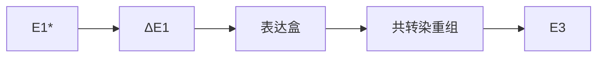
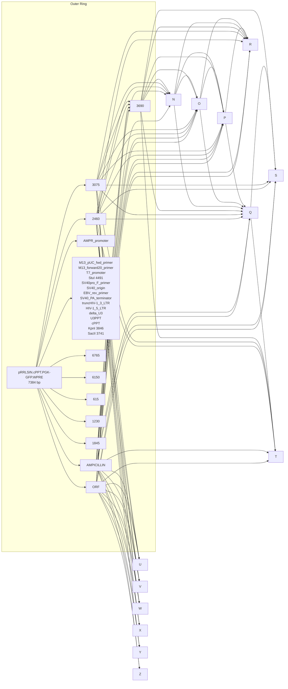
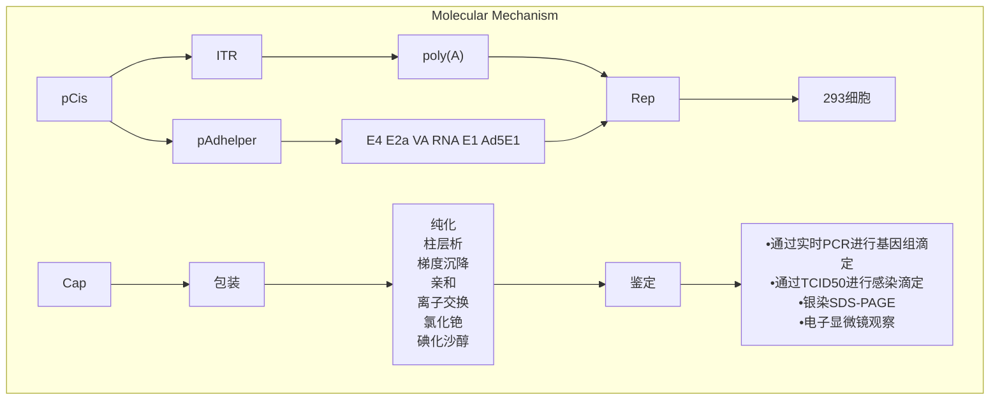
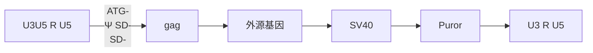
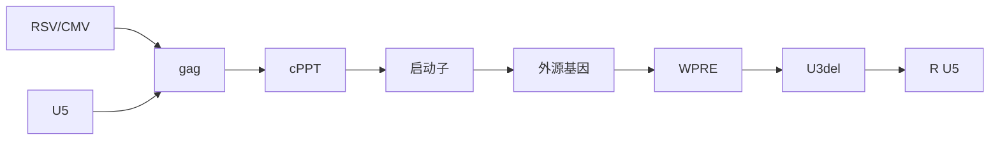

<details>
<summary>flowchart</summary>

This diagram illustrates the genetic differentiation pathways of a plant stem cell (likely a transgenic embryo) from the intratumoral (ITR) to the endoplasmic reticulum, showing downstream gene expression changes.
</details>

图 16-1 2 型和 5 型人类腺病毒的转录图谱。（上）病毒基因组（约 36kb）以带有图距单位（m.u.）的水平线表示。转录单元如箭头所示方向转录。图中有 4 个早期转录单元（E1～E4）和 5 个晚期 RNA 家族（L1～L5），是单个主要晚期启动子（MLP）表达的通用前体选择性剪接的产物。双链基因组末端包含参与病毒 DNA 复制的 103bp 反向重复序列（ITR）。病毒 DNA 在病毒颗粒装配期间的衣壳包装信号位于病毒基因组左端 190～380 核苷酸。（下）三代腺病毒载体（第一、第二和无肠）的结构示意图。（向下箭头）第一和第二代载体中被删除的病毒区域。所有第二代载体都缺少早期 E1 和 E3 区；一些载体也缺少早期 E2A 和 E4 区。无肠腺病毒载体中唯一保留的是 ITR 和包装信号（重画自 Wu et al. 2001，得到 Bentham Science Publishers Ltd. 的许可）。

## 第一代重组腺病毒载体

2型和5型腺病毒颗粒最多可以携带约37kb的双链DNA（dsDNA）。E3区域（78.5～84.3m.u.）对于病毒在培养细胞中生长是非必需的。去除E3的突变体可以存活，并且能接受多达4.4kb长度的DNA片段，对于容纳小表达盒来说足够了，但是对多数克隆实验来说又太小了。然而C型腺病毒的克隆能力可以通过同时删除非必需的E3区域和必需的E1A区域来提高，E1A区域编码了一套能够激活三个其他早期区域（E2～E4，见图16-1）转录的早期蛋白。缺失E1的突变体在标准培养细胞系中生长状况很差或根本不生长，表现出病毒复制的缺陷。然而，当病毒在293或911辅助人类细胞系中扩增，E1区就不再是必需，因为这些细胞系已经被改造成能够稳定表达E1区域的细胞株。E1/E3双缺失的重组腺病毒可以承载多达6.5kb长度的外源基因，对于一般尺寸的表达盒来说足够了。虽然在E1/E3缺失突变体中构建的重组子不像野生型腺病毒生长得那么好，它们通常也可以在适合的细胞系中增殖达到 $10^{8}\sim10^{9}pfu/mL$ 。E1/E3缺失突变体的病毒颗粒足够经受标准纯化步骤[如通过氯化铯（CsCl）密度梯度离心（Gerard 1995）]。E1/E3缺失突变体已经成为制备许多重组蛋白首选的腺病毒载体，因为它们操作简单且有合理的克隆能力。许多在细节之处有差异的第一代载体已经在近年来的学术文献中被描述过，还有一些已经商业化（综述请见Danthinne and Imperiale 2000）。

## 第二代和第三代（无肠）重组腺病毒载体

第二代载体缺失 3 个（E1、E2 和 E3 或 E1、E3 和 E4）在感染后早期表达的区域（见

Gao et al. 1996; Amalfitano et al. 1998; Lusky et al. 1998; Moorhead et al. 1999)。虽然这些突变体较第一代载体能携带更多外源基因，但它们仍具有引起炎症和细胞毒性反应的能力，这会导致身体清除被病毒感染的细胞。为了缓解这个问题，人们构建了缺失所有病毒基因的重组腺病毒载体，这些载体在体内能够高水平表达外源基因，持续时间更长，且克隆容量大大扩增（约36kb），对免疫系统的刺激大大降低（Schiedner et al. 1998; Kochanek et al. 2001）。然而制备这种不需要辅助病毒的无肠载体比早期腺病毒载体更富挑战。构建和使用这些无肠腺病毒载体的更多信息请见:Parks et al. 1996; Kochanek et al. 2001; Alba et al. 2005; Palmer and Ng 2008。

表达盒可以通过直接连入携带 E1 缺失载体全长拷贝的质粒（如见 He et al. 1998; Mizuguchi et al. 2001）或黏粒（Giampaoli et al. 2002）的方法克隆进第一代腺病毒载体的 DNA（见方案 1）。

表达盒也可以通过在哺乳动物细胞或 E. coli 中进行重组来引入腺病毒载体的骨架，表达整合的腺病毒 E1 区的细胞可以产生重组体，并让病毒生长（表 16-1）。这些辅助细胞用以下二者进行共转染:①E1/E3 缺失的腺病毒基因组 DNA；②携带有与 E1 缺失片段的上游和下游病毒 DNA 同源序列的表达质粒。转染进入辅助细胞系的质粒和病毒 DNA 之间发生同源重组，产生 E1 区被表达盒替换的重组体（图 16-2）。

表 16-1 支持 E1 突变腺病毒生长的辅助细胞系

| 细胞系 | 描述 | 参考文献 |
| --- | --- | --- |
| 293 | 用剪切的5型腺病毒的DNA片段转化正常的人胚肾细胞系而获得。转化的细胞包含5型腺病毒基因组左端4.5kb序列整合在HEK细胞的19号染色体中 | Graham et al. 1977;Louis et al. 1997 |
| 911 | 用含有5型腺病毒左端序列(Ad5基因组79~5789bp)的质粒转化人类胚胎视网膜母细胞而获得。据称比293细胞更好(更快形成噬菌斑[4~5天,而非5~8天],更高病毒得率) | Fallaux et al. 1996 |
| N52.E6 | 用5型腺病毒E1 DNA转化原代人羊水细胞而获得 | Schiedner et al. 2000 |
| PER.C6 | 包含在人磷酸甘油激酶启动子驱动下的5型腺病毒的E1A和E1B基因。重复感染的腺病毒得率与911细胞相当 | Fallaux et al. 1998 |


<details>
<summary>flowchart</summary>


</details>

图 16-2 构建第一代重组腺病毒载体。用含有两端有来自腺病毒基因组“左端”序列的外源基因表达盒的穿梭质粒和腺病毒基因组 DNA 共转染能补偿 E1 功能的细胞（如 293 细胞）。基因组 DNA 的 E1 区（“E1”）既可以是来自病毒，也可以是来自质粒，应当经过修改以减少亲本基因组的感染性。穿梭载体和基因组序列之间同源重组会得到第一代载体，带有取代 E1 的表达盒。灰框代表腺病毒序列；蓝框代表异源 DNA；白框代表对在代偿 E1 的细胞系中构建第一代载体非必需的腺病毒基因组序列（重新绘图自 Hitt and Graham 2000，经 Elsevier 公司许可）。

通过表达质粒中的 E1 序列与载体 DNA 之间的同源重组，将表达盒整合进病毒载体的 E1 区。这样重组获得的病毒颗粒可以感染辅助细胞，而单个噬菌斑内的病毒 DNA 可以通过聚合酶链反应（PCR）和/或限制酶切割来筛选。不过由载体和整合入辅助细胞基因组中的病毒 DNA 序列重组而成的野生型腺病毒也会掺杂在获得的病毒中。从重组体中去除野生型腺病毒的污染需要至少两轮噬菌斑纯化和筛选。通过使用携带比 293 细胞更小的腺病毒基因组的 911 等细胞系，也可以减少野生型污染的比例，但是不能完全消除。

通过直接将表达盒体外插入到第二代载体或者通过体内重组来构建、纯化和产生高滴度的重组腺病毒储液的实验周期较长，即便对有经验的实验者来说也要用数周完成。如果只需要一个或两个重组病毒，借助中心实验室或公司提供的病毒服务或使用商业化试剂盒会更便宜高效。商业化重组系统可以从 Clontech 公司（AdenoX system, http://www.clontech.com/images/pt/PT3674-1.pdf）和 Qbiogene 公司（AdEasy system, http://www.qbiogene.com/products/adenovirus/adeasy.shtml）购得。

如果您的实验室需要经常制备重组腺病毒，最好选择建立一个先进的体外重组系统，或基于连接的直接克隆体系来降低野生型腺病毒的污染，如可以用 $E.$ coli或cre-loxP重组系统（Chartier et al. 1996; He et al. 1998; Luo et al. 2007; Reddy et al. 2007）或用标准分子克隆技术直接将外源基因表达盒插入到重组腺病毒基因组的缺失E1的位点（Mizuguchi et al. 1998, 2001; Gao et al. 2003）。后者将在本章的方案1中详细描述。

## 腺相关病毒载体

乍看上去AAV几乎不具备好载体所需的性质。它们的单链DNA基因组较小（4.7kb），复制需要依赖与辅助病毒（如腺病毒、单纯疱疹病毒、乳头状瘤病毒）共转染细胞。在缺乏那些由早期E1、E2a、VARNA和E4区编码的腺病毒蛋白等提供的辅助病毒功能的情况下，野生型AAV基因组会在培养的人类细胞基因组的特定基因座（19q13.3-qter）发生整合而进入潜伏状态。但是，重组AAV载体能够在靶组织中高水平表达外源基因，持续时间更长，在某些情况下超过10年保持不变。其他的优势包括:没有致病性、能感染多种细胞类型（增殖中或静息状态中均可），以及能通过用辅助病毒进行重复感染或共转染辅助质粒载体使其从整合状态中回复（综述请见Buning et al. 2008; Daya and Berns 2008）。

大多数AAV重组病毒是由2型AAV得到的，它的线性基因组长度为4675个核苷酸（Srivastava et al. 1983），由一个长单链编码区及其两边的145bp末端反向重复组成。每个重复可折叠成T形的、朝向内部的发夹样结构，包含了起始合成互补DNA链的必需信息。其产物是单体长度的二倍体，一端共价闭合。这种交联结构产生出复制起始位点，当被病毒Rep蛋白激活后即产生滚动的发夹结构，使复制叉可以在病毒基因组中上下滑动。通过在闭合的环状病毒DNA末端引入特定的缺口可以将子代基因组游离出来，然后正义和反义的单链病毒DNA都会高效地包装到病毒颗粒中。更多信息请见Cotmore和Tattersall（1996）。

病毒基因组编码区包括两个可读框（rep 和 cap）。rep 编码 4 个蛋白质:①Rep 78；②它的剪接体 Rep 40；③Rep 68；④它的剪接体 Rep 52（图 16-3）。cap 编码三个病毒衣壳蛋白 VP1、VP 和 V3，它们的氨基酸序列仅仅在氨基端有差异。衣壳蛋白的氨基酸序列的差异会导致不同血清型 AAV 不同的组织嗜性，也构成了被宿主免疫系统识别的表位。

rAAV 载体可在标准质粒中用简单的分子克隆方法构建得到。rAAV 载体不编码整合必需的 Rep 蛋白，因此长期表达外源基因依赖于载体基因组的染色体外串联体的持续存在。关于 AAV 载体体内应用的讨论请见“体内表达”部分。


<details>
<summary>flowchart</summary>

```mermaid
graph TD
  subgraph TopGroup["新生型AAV基因组"]
    direction TB
  ITR["ITR"] --> rep["rep"]
  rep --> cap["cap"]
  cap --> poly(A)["poly(A)"]
  poly(A) --> ITR
  end

  subgraph MiddleGroup["p5 & p19 & p40 Region Details"]
    direction TB
    Rep78["Rep78"] -.-> Rep68["Rep68"]
    Rep68 -.-> Rep52["Rep52"]
    Rep40["Rep40"] -.-> Rep52
    Rep52 -.-> Rep40
    Rep40 -.-> Rep68
    Rep68 -.-> Rep78
    Rep68 -.-> Rep68
    Rep68 -.-> Rep78
    Rep68 -.-> Rep68
    Rep68 -.-> Rep78
    Rep68 -.-> Rep68
    Rep68 -.-> Rep78
    Rep68 -.-> Rep68
  end

  subgraph BottomGroup["rAAV 质粒"]
    direction TB
  VP1["VP1"] --> VP2["VP2, VP3"]
  VP2 --> VP1
  VP1 --> VP2
  VP2 --> VP1
  VP1 --> VP2
  VP2 --> VP1
  VP1 --> VP2
  VP2 --> VP1
  VP1 --> VP2
  VP2 --> VP1
  VP1 --> VP2
  VP2 --> VP1
  end

  ITR --> "启动子" --> "外源基因" --> "pA"
  "pA" --> "ITR"
```
</details>

图 16-3 腺相关病毒（AAV）载体结构。野生型 AAV 由编码不同的 rep（Rep78、Rep68、Rep52、Rep42）和 cap（VP1、VP2、VP3）蛋白的病毒基因 rep 和 cap、AAV 启动子（p5、p19、p40）、多聚腺苷酸位点（pA）和反向末端重复序列（ITR）组成。在 rAAV 载体中，病毒 rep 和 cap 基因由携带启动子、外源基因和 pA 位点的外源基因盒所取代（重绘自 Walther and Stein 2000，经 Wolters Kluwer Pharma Solutions 公司许可）。

## 反转录病毒

用反转录病毒将外源表达基因导入培养的哺乳动物细胞中并进行基因治疗的探索已经有很长的历史。在反转录病毒颗粒中，病毒基因组与核衣壳蛋白在脂类外壳内形成复合物，病毒糖蛋白镶嵌其中。病毒糖蛋白和细胞表面受体的相互作用决定了病毒的嗜性。病毒基因组包括两个相同的单链RNA（ssRNA）拷贝，长度为8～10kb。病毒RNA复制通过稳定整合在被感染细胞基因组中，DNA的重组反应由病毒编码的整合酶所催化。制造子代病毒颗粒需要在宿主编码的RNA聚合酶II（PoI II）作用下转录整合的病毒DNA。产生的mRNA会被进一步处理、转运并在宿主细胞的翻译装置中翻译。子代病毒颗粒会在细胞表面装配并出芽。

所有的反转录基因组都至少包括 3 个基因（图 16-4）。在小鼠反转录病毒中，这 3 个基因分别是:gag 基因，它编码 Gag 聚合蛋白，最终被剪切成为病毒基质、衣壳和核衣壳蛋白；pol 基因，它编码蛋白酶、反转录酶和整合酶；env 基因，它编码一种聚合蛋白，会被病毒蛋白酶剪切成表面糖蛋白（gp70）和跨膜蛋白（p15E）。

病毒基因组调节 DNA 合成和转录的区域集中在 2 个 LTR，由 3 个功能区组成，具体见表 16-2。5'-LTR 下游的区域包括一个转运 RNA 的结合位点，可以作为反转录酶介导起始 DNA 合成的引物。最后，包装病毒 RNA 所需的序列位于引物结合位点和 gag 可读框之间。

表 16-2 LTR 调节 DNA 合成和转录的病毒基因组区域包含 3 个功能区域

|  | LTR区域 | 功能 |
| --- | --- | --- |
| U3 (unique-3') |  | 转录的启动子和增强子 |
| R (repeat) |  | 反转录和复制;多聚腺苷酸化 |
| U5 (unique-5') |  | 起始反转录 |

注:LTR（long terminal repeat），长末端重复。


图 16-4 反转录病毒颗粒和基因组结构。（A）展示了反转录病毒颗粒各元件的大体位置，反转录病毒蛋白用标准双字母法命名。（B）一个简单反转录病毒的基因组结构和基因表达模式示例，展示了一个整合的原病毒与宿主细胞 DNA 在其 LTR 序列（U3-R-U5）末端的两翼相连，作为基因组 RNA，以及用于将 gag 和 pol 可读框（ORF）翻译成聚合蛋白的 mRNA 的全长 RNA。env 的 mRNA 通过剪切得到，编码一个 Env 前体糖蛋白。LTR，对于原病毒 DNA 是（U3-R-U5），是来自基因组 RNA 中 5' cap 下游的 R-U5 和 3' poly（A）上游的 U3-R；PBS，引物结合位点；Ψ，包装信号；PPT，多嘌呤序列；SD，剪接供体位点；SA，剪接受体位点（重绘自 Pedersen and Duch 2003，经 John Wiley & Sons 公司许可）。

目前使用的大多数反转录病毒载体来源于莫罗尼氏鼠白血病病毒（Mo-MLV），它是一种双嗜性病毒，能够感染小鼠和人类细胞。重组病毒是通过在克隆的载体基因组中用经适当设计的外源基因置换病毒的 gag、pol 和 env 基因而获得的。能够有效克隆到反转录载体中的外源基因的最大尺寸约为 6.5kb。外源基因的表达是由位于 LTR 上游的天然的 Mo-MLV 控制元件或与外源基因一起克隆的启动子（如 CMV 启动子）所驱动的。

为了生产重组病毒，将体外构建的重组反转录病毒 DNA 转染进入包装细胞系，该包装细胞表达三个颗粒形成和复制所必需的病毒基因:gag、pol 和 env。载体骨架提供了将重组基因组包装成病毒颗粒所需的顺式信号（ψ）。由包装细胞系表达的病毒 Env 蛋白决定了子代病毒颗粒的宿主范围。例如，Clontech 公司出售的 EcoPack 2-293 细胞系会产生只能感染鼠细胞的亲嗜性重组病毒。而其他的细胞系，如 AmphoPack-293 和 RetroPack PT67 细胞（均来自 Clontech 公司）分别产生双嗜性（amphotropic）和兼嗜性（dual-tropic）病毒，能够感染多种类型的哺乳动物细胞系。如果必要，通过使用表达水疱性口炎病毒（VSV）的 G 糖蛋白的包装细胞系（如 Clontech 公司的 GP2-293）进行生产能够进一步扩展重组病毒的宿主范围，G 糖蛋白可以介导病毒以与脂类结合并与质膜融合的方式进入细胞，而不是和特定的细胞表面受体结合。

包装细胞产生的反转录病毒可以用于感染分裂活跃的靶细胞。与慢病毒（见后）不同的是，重组的小鼠反转录病毒只能转导分裂活跃的细胞。因为小鼠病毒的整合前复合物不能进入非分裂中细胞的核。一旦重组的原病毒穿过细胞核，病毒基因组会整合到细胞基因组中，使得外源基因能够长期表达。每个被转导的细胞都携带整合在不同染色体位点的外源基因，整合不是位点或序列特异性的。重组的小鼠病毒基因组整合到靠近细胞癌基因的染色体位点上（Montini et al. 2009）会导致接受基因治疗的 X-连锁严重联合免疫缺陷患者（SCID-XI; Hacein-bey et al. 2001）的 T 细胞克隆增殖，这一点给人们使用重组小鼠反转录病毒进行治疗带来了很大的阻碍。

慢病毒作为反转录病毒家族的一份子，远比小鼠反转录病毒复杂。除了3个经典基因（gag、pol和env），它们的基因组还编码至少6个其他蛋白质（tat、rev、vpr、vpu、nef和vif)，这些蛋白质以不同方式参与调节病毒致病性。不过与小鼠反转录病毒载体相比，来源于1型人免疫缺陷病毒（HIV-1）的慢病毒有两个优势:①慢病毒基因组可以稳定整合在分裂和非分裂的细胞基因组中（Naldini et al. 1996a,b)；②慢病毒的基因毒性似乎比小鼠反转录病毒低得多（Montini et al. 2009）。

慢病毒载体可以作为简单的表达质粒瞬时转染培养细胞，或者它们也可以包装成高滴度的病毒储液用于培养中或体内细胞的遗传修饰。另外，慢病毒可以用来制备转基因动物，通过转导培养的小鼠胚胎干（ES）细胞（Pfeifer et al. 2002），或者通过将载体储液注射到小鼠单细胞期胚胎的卵周间隙中（Lois et al. 2002）来实现。

对研究基因功能和调控非常有用的文库已经在慢病毒载体中构建出来:

- RNAi Consortium 的小发夹 RNA（shRNA）文库，shRNA 用 U6 启动子表达，靶向大多数的小鼠和人类基因（由 Sigma-Aldrich 公司和 Open Biosystems 公司商品化）；
- microRNA（miRNA）-adapted shRNA（shRNAmir）文库，shRNA 由 RNA 聚合酶 II 启动子从 miRNA 前体中表达（Open Biosystems 公司）；
- miRNA 前体文库（Open Biosystems 公司）或 cDNA 文库（Open Biosystems 公司；GeneCopoeia 公司）。

基于慢病毒的文库的巨大优势是它们可以显著提高对神经元等一些用传统方法很难转染的原代培养细胞进行基因组范围高通量筛选的能力。重要的是，慢病毒载体介导的转导看上去不会显著改变靶细胞的基因表达模式（Cassani et al. 2009）。

用于不同目的的慢病毒表达系统的例子:

- 双顺反子载体，在这个系统中，外源基因与药物筛选基因或荧光蛋白（或两者兼有）共表达，使得能够对转导的细胞进行筛选和容易鉴定（综述请见 Felipe 2002）；
- 多顺抗子载体，它编码了 4 个将体细胞诱导成多能干（iPS）细胞必需的转录因子及绿色荧光蛋白（GFP）（Carey et al. 2009）（Cell Bio-systems 公司）；
- 能够以受药物调控的方式表达 cDNA（Pluta et al. 2005）、shRNA（Szulc et al. 2006; Wiznerowicz et al. 2006）（Open Bio-Systems 公司；Addgene 公司）和 shRNAmir（Stemeier et al. 2005）（Open Bio-Systems 公司）的载体。

许多慢病毒载体可从 Life Tehchnologies、Open Biosystems、Cell Biolabs 和 GeneCopoeia 等公司购得，或从 Addgene.org 获得，质粒寄存于此为其他研究机构使用。图 16-5 展示了存在 Addgene 的一个基本慢病毒骨架例子，包含了所有对培养细胞或体内进行高效转染必需的元件。展示的载体是 pPRLSIN. cPPT.PGK-GFP. WPRE，该载体是最早整合了能增强慢病毒载体转导和安全性的慢病毒载体之一（Follenzi et al. 2000）。许多其他携带多种不同启动子的慢病毒载体也可以从 Addgene 获得。


<details>
<summary>flowchart</summary>


</details>

图 16-5 pPRLSIN. cPPT.PGK-GFP. WPRE 载体。包含在培养细胞或体内高效表达外源基因所需的全部元件的慢病毒载体基因组示例。（重绘自 Addgene 的质粒 12252，http://www.addgene.org/pgvec1?f=c&cmd=findpl&identifier=12252, and Follenzi et al. 2000）（彩图请扫封底二维码）。

慢病毒载体可以用来获得能产生高水平重组哺乳动物蛋白的哺乳动物细胞系。因为慢病毒载体稳定转导靶细胞，可以通过连续几轮转导和筛选增强重组蛋白表达水平。将 GFP（或任何其他荧光标记蛋白）与目的外源基因置于相同启动子控制下的双顺反子载体，可以通过荧光细胞分选筛选最明亮的细胞，以及通过重复感染等方法获得所需表达水平。

对许多实验室来说，慢病毒载体是最佳哺乳动物载体。它们能够通过标准重组 DNA 技术来操作，可以用作简单的表达质粒，载体储液的制备快速直接，只需要简单地与包装质粒共转染 293 细胞，几天后就可从上清液中收获重组病毒。正因如此，慢病毒载体可能是快速表达和筛选大量突变重组蛋白的最佳系统。


## 体内表达

尽管用慢病毒来完成对培养细胞和体内的遗传修饰的方法被越来越多地采用，使用这些载体仍有很多限制条件，包括它们的整体外源基因容量（约 $8\mathrm{kb}$ ）和有限的体内转导能力。大容量的载体系统（如大容量腺病毒载体[Schiedner et al. 1998]和1型单纯疱疹扩增子[高达约 $150\mathrm{kb}$，Geller and Breakfield 1998]）已经可以将整个基因组座位递送到靶细胞来调节基因表达（Wade-Martins et al. 2001）。然而这些载体很难制备出高滴度的储液，也很难进行长效的目的基因的表达。

rAAV 载体与慢病毒载体有很多共性; AAV 质粒可以很容易地通过标准重组 DNA 技术获得, 可以作为传统的表达质粒来使用。然而 AAV 载体最有用的特性是它们在体内表达外源基因的效率格外高, 时间很长, 在很多情况下甚至能持续在实验动物整个生存时期表达。在用编码一个灵长类外源基因的 AAV 载体进行肌肉注射的恒河猴中, 11 年后表达仍不见减弱 (G Gao, pers. comm.)。而且, AAV 载体的体内基因递送效率非常高, 对成年动物进行单次静脉注射即可几乎完全实现对肝、心脏、骨骼肌和中枢神经系统 (CNS) 的转导 (Gregorevic et al. 2004; Wang et al. 2005; Inagaki et al. 2006; Duque et al. 2009; Foust et al. 2009; Hester et al. 2009)。尽管具有这些突出的特性, 但 AAV 载体对培养中的分裂细胞的转导来说不是最佳选择, 因为它们不能整合到靶细胞基因组, 会随着时间慢慢丢失。


## 腺病毒载体

重组腺病毒是将目的基因插入携带复制缺陷的腺病毒基因组中获得的。这种方法由Mizuguchi和Kay（1998）开发成为一个简单高效的、基于连接的平台，并且已经商品化，商标是Adeno-X Expression System（Clontech公司）。Gao及其同事（2003）进一步完善了系统，加入了方便的绿-白筛选特征，便于分离外源基因阳性的重组腺病毒克隆。利用基于连接的直接克隆系统，借助同源重组获得重组腺病毒比传统方法更快速、高效。直接连接虽然更快速高效，但技术上难度更大，需要有熟练操作大质粒（>36kb）的技巧。同源重组通常会产生一个重组体的混合物，包括了有复制能力的腺病毒（RCA），清除它们需要费时的多轮噬菌斑纯化和鉴定。

生产重组腺病毒仅仅需要将具有感染能力的克隆通过限制酶 PacI 酶切线性化，然后转染到人胚肾 293 细胞或其他能够补充载体骨架构建过程中缺失的病毒基因的包装细胞系中（见表 16-1）。图 16-6 描述了用具有绿-白筛选的直接克隆方法生产重组腺病毒载体的全部流程。该流程最初是将目的基因克隆到穿梭质粒 pShuttle-pk-GFP（pSh-pkGFP）中，然后通过另一次克隆将外源基因表达盒从穿梭质粒转移到腺病毒克隆 pAd-pkGFP 中。pSh-pkGFP 和 pAd-pkGFP 质粒均携带原核绿色荧光蛋白（GFP）表达盒，很容易筛选外源基因阳性/GFP 阴性的细菌克隆。下一步就是将重组腺病毒质粒用 PacI 线性化以暴露反向末端重复（ITR），接下来将其转染 293 细胞来扩增。最后，通过氯化铯（CsCl）梯度沉降制备高滴度重组腺病毒储液，鉴定载体基因组结构、载体颗粒滴度和感染滴度，以及检测 RCA 的存在。

方案 1 提供了用这种方法制备重组腺病毒的逐步说明。方案 2 描述了病毒挽救和扩增的过程。方案 3 描述了通过梯度沉降方法纯化腺病毒载体的方法。最后一套方案（方案 4～6）是一系列用于详细鉴定重组腺病毒储液的辅助方案。

## 策略规划

## 载体骨架和相应包装细胞系的选择

选择载体时需要考虑一些重要因素，包括实验的对象（如培养细胞或动物的组织/器官）、载体的免疫原性对基因传递的影响、载体毒性、外源基因大小，以及所需的外源基因表达水平（表16-3）。对于需要外源基因瞬时高表达的简单的培养细胞基因传递实验，具有E1或E1/E3缺失的骨架是理想的选择（见信息栏“病毒载体的基本元件”）。然而，如果用重组腺病毒进行全身给药，肝脏毒性和T细胞对病毒和靶细胞表达的外源基因产物产生的强烈反应会限制对基因传递数据的解释，或者当需要更长时间的外源基因表达时，E1/E4双缺失的载体骨架是更恰当的选择。


<details>
<summary>flowchart</summary>

This flowchart illustrates the molecular signaling pathway of pAd-transgene (E1/E3-) in cancer cells, showing how various proteins and their interactions lead to viral replication, gene expression, and final purification.
</details>

图 16-6 直接克隆制备腺病毒载体的流程图（方案 1）。

表 16-3 四种常用 RNA 和 DNA 病毒载体的主要特征

| 载体 | 转基因能力 | 滴度 | 可否扩增 | 效率/稳定性 | 偏嗜性和主要应用 | 宿主反应性 | 遗传学命运(基因毒性) | 生物安全 |
| --- | --- | --- | --- | --- | --- | --- | --- | --- |
| Retro- | 最大7kb | $10^6 \sim 10^8 IU/mL$ | 难 | 低/稳定 | 体外、半体外的分裂细胞 | 低具免疫原性有毒 | 整合a | BSL-II |
| Lenti- | 最大7.5kb | $10^6 \sim 10^{10}IU/mL$ | 难 | 中-高/稳定 | 分裂/非分裂中细胞,衣壳/假型依赖的组织偏嗜性/体外和体内 | 低具免疫原性有毒 | 整合a | BSL-II |
| Adeno- | 最大35kb | $10^{12} \sim 10^{13}病毒颗粒/mL$ | 可扩增 | 高/瞬时 | 体外和体内广泛 | 高具免疫原性有毒 | 不整合 | BSL-II |
| AAV | 最大4.5kb | $10^{12} \sim 10^{13}GC/mL$ | 可扩增 | 高/瞬时 | 体内广泛 | 低具免疫原性有毒 | 不整合 | BSL-I |

a 详见慢病毒载体信息栏。

对于需要表达较大外源基因的实验，可以使用两种类型的骨架。一种是E1/E3/E4三区域缺失载体骨架，其外源基因容量高达8kb；此时，需要用E1/E4双互补细胞系进行包装，如10-3细胞。因为持续高水平表达E4对293细胞会产生毒性，10-3细胞携带一个由金属硫蛋白启动子驱动的E4 orf6表达盒，可以由重金属诱导表达（表16-4）。或者，也可以去除E1/E3双缺失载体骨架上除orf6以外的大部分E4区域，以此来增加其外源基因容量。因为E4 orf6足以提供E4基因的主要功能，E1/E3完整而E4部分缺失的腺病毒骨架可以在常规的293细胞中被挽救并生长，外源基因容量高达7kb（表16-4）。

表 16-4 克隆腺病毒载体的骨架的选择

<table><tr><td rowspan="3">载体骨架</td><td rowspan="3">病毒基因表达</td><td rowspan="3">基因容量/表达</td><td rowspan="3">包装细胞系</td><td rowspan="3">载体得率</td><td colspan="3">免疫原性</td><td rowspan="3">载体毒性</td></tr><tr><td rowspan="2">先天(细胞因子)</td><td colspan="2">T细胞</td></tr><tr><td>病毒</td><td>外源基因</td></tr><tr><td>ΔE1</td><td>可检测</td><td>4kb/强</td><td>293细胞</td><td>高</td><td>IL6和IL10升高</td><td>强</td><td>强</td><td>高</td></tr><tr><td>ΔE1+E3</td><td>相同</td><td>6kb/强</td><td>293细胞</td><td>相同</td><td>相同</td><td>相同</td><td>相同</td><td>相同</td></tr><tr><td>ΔE1+E3+E4</td><td>微弱</td><td>8kb/弱</td><td>10-3细胞</td><td>低</td><td>相同</td><td>弱</td><td>弱</td><td>弱</td></tr></table>

## 用于外源基因表达的启动子的选择

对表16-4所列的大多数载体骨架来说，巨细胞病毒（CMV）早期即刻启动子等强病毒启动子均能够在细胞和体内驱动高水平外源基因表达。然而，CMV启动子会在E4缺失的腺病毒重组子全身注射到动物体内一段时间后关闭(Armentano et al. 1997)。在这种情况下，载体设计时应考虑使用强的组成型启动子。此外，当腺病毒载体携带调节细胞周期或有细胞毒性的外源基因时，在载体制备时要考虑使用可调控表达的策略。否则表达产物表达会引起转染或感染的细胞损失，显著减少载体得率或完全阻止病毒挽救和感染（Bruder et al. 2000）。


## 腺相关病毒载体

到目前为止，至少已经有 5 种不同方法被开发出来制备重组腺相关病毒（rAAV）载体

(Zhang et al. 2009)。其中包括:①不需要辅助细胞的 293 细胞三重转染；②用 Ad-AAV 杂合子感染稳定的 rep/cap 细胞系；③用野生型辅助腺病毒感染产生 rAAV 细胞系；④两个重组单纯疱疹病毒（rHSV）载体共感染 293 细胞；⑤基于杆状病毒的重组系统。其中不需要辅助细胞的 293 三重转染方法是实验室最常用的制备 rAAV 载体的方法（Grieger et al. 2006）。本章所述的方法简单通用且能被大多数实验室采用。这种方法简便灵活，使实验者可以同时生产携带不同外源基因、具有相同或不同衣壳的 rAAV。它的两个缺陷是量产困难和载体制备过程中可能产生少量能够复制的 AAV（rcAAV）。

使用无辅助细胞的三重转染 293 细胞来制备 rAAV 的方法概览可见图 16-7。在这个系统中，病毒包装所需的元件由三个质粒提供:①携带目的基因表达盒的载体质粒或 pCis，该表达盒两侧为 ITR，这是唯一的 AAV 来源的病毒元件（<4% 的 AAV 基因组）；②表达 AAV Rep 和 Cap 蛋白的包装质粒或 pTrans，可以挽救和包装载体基因组；③腺病毒辅助质粒，提供了必需的 E2a、E4 和 VA RNA 基因，但没有 E1 基因，E1 基因可以由表达 E1 的 293 细胞来提供。


<details>
<summary>flowchart</summary>


</details>

图 16-7 三重转染 293 细胞制备和纯化重组腺相关病毒的方法流程图（方案 7）。

制备 AAV 重组病毒的第一步是得到携带目的基因表达盒的 pCis 质粒。这是通过将 cDNA、小发夹 RNA（shRNA）或人工合成的 miRNA 形式的目的基因亚克隆到 pCis 载体质粒中，该质粒包含侧翼为 AAV ITR 的所选转录元件（启动子和多聚腺苷酸信号）（图 16-7）。大部分 AAV 载体制备的第二步是选择特定 AAV 亚型的衣壳表达质粒（pTrans）。第三步是将 pCis、pTrans 和 pAd 包装质粒共转到 293 细胞来进行 AAV 载体基因组挽救和包装（方案 7）。最后一步是纯化从转染细胞中获得的病毒颗粒粗产物。

## 梯度沉降

最初的纯化方法是在氯化铯（CsCl）或碘化沙醇形成的浓度梯度中通过超速离心纯化rAAV（方案8或方案9）（Grieger et al. 2006）。基于梯度离心的方法的主要优势是可以把携带载体基因组的病毒和空病毒颗粒分离开来。CsCl梯度离心是实验室最常用的纯化AAV载体的方法，这种方法费时且很难用于量产。另外，它需要去除在梯度沉降过程中掺入的有毒化合物，需要在生理缓冲液中重建病毒。

## 基于柱层析的纯化方法

纯化病毒的第二类方法基于柱层析，包括亲和层析（方案10）和离子交换柱层析（方案11）（Grieger et al. 2006）。总的说来，基于柱层析的方法要更快速，去除细胞和病毒杂质更高效。然而它们也有缺陷，包括对所有亚型不能区分，以及不能分离空载体。一种高效的富集完全包装病毒的策略是将梯度离心和柱层析结合起来，这将在方案11中具体描述。

最后，经过纯化的 rAAV 基因组需要用 real-time PCR 定量（方案 12）；rAAV 的感染能力需要用感染 rep-cap 细胞系和 real-time PCR 来测定（方案 13）。rAAV 的形态可以用电子显微镜来观察（方案 14），它的纯度可以用 SDS-PAGE 和银染法来测定（方案 15）。

## 策略规划

## 设计外源基因表达盒

大多数AAV病毒颗粒能进行有效包装的基因组最大尺寸是 $4.7\sim 4.8\mathrm{kb}$ 。对载体尺寸的限制决定了在设计rAAV载体时需要采取表达元件最小化原则，只选择表达所需的关键转录元件（使用最小尺寸的启动子和多聚腺苷酸信号）。启动子的选择需要考虑是想要广泛表达还是组织特异性表达等（Le Bec and Douar 2006）。如果是前者，可以选择杂交的启动子如CBA（也叫CAG或CB)，是由CMV增强子和鸡 $\beta$ -actin启动子融合而成的，该启动子可以在大多数培养的细胞中或体内驱动靶基因的稳定。强病毒启动子如CMV能够驱动靶基因在肝脏以外的大多数组织器官表达，而在肝脏中CMV启动外源基因表达会很快关闭。选用组织或细胞类型特异性的启动子可以让外源基因仅局限表达在想让它们表达的靶细胞中。组织特异性的表达可以通过在载体中克隆入在靶组织（无）和非靶组织（有）中差异表达的miRNA所能识别的目的mRNA序列来实现。最后，药物调节的rAAV介导的外源基因表达可以通过将转录调节元件和外源基因框分到两个载体基因组中，分别包装，共同注射到靶组织中来实现（Rivera et al. 1999; Ye et al. 1999）。

## 亚型选择

重组 AAV 携带相同的外源基因组（相同的 AAV2 ITR 旁的特定外源基因表达盒），但是从不同 AAV 亚型中得到的衣壳是不同的，展现了显著的体内转化特性的差异（Gao et al. 2005）。AAV 衣壳决定了 AAV 载体的细胞/组织嗜性和其他生物学特征。为某一特定实验选择 AAV 衣壳，应该根据它所用的递送方法和所要转化的靶组织来选择（Gao et al. 2005）。表 16-5 列出了主要的 AAV 亚型及它们的细胞受体，靶组织和转化培养细胞（293 细胞）及体内转化的相对效率。具有不同衣壳的 AAV 载体产物可以由以下部分组成:①通过独立表达的衣壳蛋白包装相同的 AAV2 基因组（位于两个 ITR 之间的序列）；②衣壳蛋白由携带 AAV2 的 rep 基因的嵌合包装质粒表达（对于包装过程中 AAV2 ITR 侧基因组复制是必需）；③所选 AAV 亚型的 cap 基因。

表 16-5 选择靶组织特异的 AAV 衣壳

<table><tr><td>衣壳</td><td>受体</td><td>可选靶组织</td><td>转化能力(293细胞/体内)</td></tr><tr><td>AAV1</td><td>N-linked sialic acid</td><td>骨骼肌,CNS</td><td>一般/好</td></tr><tr><td rowspan="4">AAV2</td><td>HSPG</td><td>骨骼肌,CNS</td><td>好/差</td></tr><tr><td>aVb5 integrin</td><td></td><td></td></tr><tr><td>FGFR1</td><td></td><td></td></tr><tr><td>Laminin</td><td></td><td></td></tr><tr><td>AAV4</td><td>O-linked sialic acid</td><td>CNS,眼睛/视网膜上皮</td><td>差/一般</td></tr><tr><td>AAV5</td><td>N-linked sialic acid PDGFR</td><td>CNS,肺,眼睛/RPE</td><td>差/一般</td></tr><tr><td>AAV6</td><td>N-linked sialic acid</td><td>骨骼肌、心脏</td><td>差/好</td></tr><tr><td>AAV7</td><td>未知</td><td>骨骼肌、胰腺、肝脏</td><td>差/好</td></tr><tr><td>AAV8</td><td>Laminin</td><td>肝脏、骨骼肌、胰腺</td><td>差/好</td></tr><tr><td>AAV9</td><td>Laminin</td><td>肝脏、肺、骨骼肌、心脏、CNS</td><td>差/好</td></tr><tr><td>rh.10</td><td>未知</td><td>肺、CNS</td><td>差/好</td></tr></table>

AAV重组子的一个比较矛盾的特性就是它们对培养细胞来说递送基因的效率较低，但体内转化效率非常好。不考虑衣壳类型来说这些载体对培养细胞的转化效率，比腺病毒或慢病毒载体低得多。有趣的是，AAV2重组子对培养细胞的基因递送效率是最高的，但是在体内基因递送实验中效率最低。


## 反转录病毒和慢病毒载体

反转录病毒载体是最早被科研界广泛接受，并用于在细胞工程中递送目的基因的载体工具之一。大多数反转录病毒载体是从莫罗尼氏鼠白血病病毒（Mo-MLV）产生，这些年来人们也对它做了一些设计改进。最快速和高效的产生反转录病毒载体储液的方法就是通过瞬时转染基于293的包装细胞系如Phoenix-ECO和Phoenix-AMPHO（Dr. Gary P. Nolan, Stanford University）或其他商业化的细胞系如Plat-A、Plat-E、Plat-GP（Cell Biolabs），以及AmphoPak-293、EcoPak2-293、RetroPack PT67（Clontech）。对使用其他包装蛋白如疱疹性口炎病毒糖蛋白（VSV-G）的假型反转录病毒载体，可以使用只表达Mo-MLV gag-pol基因的细胞系（Plat-GP细胞，Cell Biolabs; GP2-293细胞，Clontech)，将载体质粒和表达感兴趣的包膜蛋白的质粒一起共转细胞。另一种方法是将反转录病毒载体质粒和两个分别编码Mo-MLV gag-pol基因和包膜蛋白的表达质粒共转染293细胞。生产和滴定反转录病毒的方案与慢病毒相同。

最有效的生产高滴度慢病毒载体的方法是将转运载体质粒、包装质粒和包膜表达质粒瞬时共转染人胚肾293T细胞。令人吃惊的是慢病毒能够接受其他病毒来源的包膜蛋白，这被称为假型。因此VSV-G成为制备重组慢病毒载体最常用的包膜蛋白。这主要是因为VSV-G假型慢病毒载体具有广泛的嗜性，可以感染各种组织来源的细胞类型，体内、体外均可。另外，这些载体可以通过超速离心富集到超过 $10^{10}\mathrm{TU / mL}$ 的滴度，对体内的基因递送实验来说非常有用（图16-8）。本章包含了描述产生通过携带VSV-G包膜假型化的HIV-1来源的慢病毒的实验方案，这些载体已经成为这一类别中应用最广泛的。慢病毒载体对分裂中和非分裂细胞都有很高的感染效率，因此它们大大地取代了基于Mo-MLV的反转录病毒载体，后者需要细胞处于分裂中，成为研究基因功能和调节的工具选择。另外，基因递送系统已经发展出基于其他慢病毒如马传染性贫血病毒（EIAV）、猿猴免疫缺陷病毒（SIV）和猫免疫缺陷病毒（FIV）的系统。这里所描述的方法很容易改造制备任何反转录病毒/慢病毒载体，只需要变换转运载体和编码包装功能的质粒。


<details>
<summary>flowchart</summary>

```mermaid
graph LR
  subgraph Packaging Cell
  A["Packaging Cells"] --> B["Culture Medium"]
  C["Packaging Cells"] --> D["Culture Medium"]
  E["Packaging Cells"] --> F["Culture Medium"]
  G["Packaging Cells"] --> H["Culture Medium"]
  I["Packaging Cells"] --> J["Culture Medium"]
  K["Packaging Cells"] --> L["Culture Medium"]
  M["Packaging Cells"] --> N["Culture Medium"]
  O["Packaging Cells"] --> P["Culture Medium"]
  Q["Packaging Cells"] --> R["Culture Medium"]
  S["Packaging Cells"] --> T["Culture Medium"]
  U["Packaging Cells"] --> V["Culture Medium"]
  W["Packaging Cells"] --> X["Culture Medium"]
  Y["Packaging Cells"] --> Z["Culture Medium"]
  AA["Packaging Cells"] --> AB["Culture Medium"]
  AC["Packaging Cells"] --> AD["Culture Medium"]
  AE["Packaging Cells"] --> AF["Culture Medium"]
  AG["Packaging Cells"] --> AH["Culture Medium"]
  AI["Packaging Cells"] --> AJ["Culture Medium"]
  AK["Packaging Cells"] --> AL["Culture Medium"]
  AM["Packaging Cells"] --> AN["Culture Medium"]
  AO["Packaging Cells"] --> AP["Culture Medium"]
  AQ["Packaging Cells"] --> AR["Culture Medium"]
  AS["Packaging Cells"] --> AT["Culture Medium"]
  AU["Packaging Cells"] --> AV["Culture Medium"]
  AW["Packaging Cells"] --> AX["Culture Medium"]
  AY["Packaging Cells"] --> AZ["Culture Medium"]
  BA["Packaging Cells"] --> BB["Culture Medium"]
  BC["Packaging Cells"] --> BD["Culture Medium"]
  BE["Packaging Cells"] --> BF["Culture Medium"]
  BG["Packaging Cells"] --> BH["Culture Medium"]
  BI["Packaging Cells"] --> BJ["Culture Medium"]
  BK["Packaging Cells"] --> BL["Culture Medium"]
  BM["Packaging Cells"] --> BN["Culture Medium"]
  BO["Packaging Cells"] --> BP["Culture Medium"]
  BR["Packaging Cells"] --> BS["Culture Medium"]
  BT["Packaging Cells"] --> BU["Culture Medium"]
  BV["Packaging Cells"] --> BW["Culture Medium"]
  BX["Packaging Cells"] --> BYD["Culture Medium"]
  BW --> BYD
  BX --> BYD
  BYD --> BYE["Culture Medium"]
  BYF["Packaging Cells"] --> BYG["Culture Medium"]
  BYH["Packaging Cells"] --> BYI["Culture Medium"]
  BYJ["Packaging Cells"] --> BYK["Culture Medium"]
  BYL["Packaging Cells"] --> BYM["Culture Medium"]
  BYN["Packaging Cells"] --> BYO["Culture Medium"]
  BYP["Packaging Cells"] --> BYQ["Culture Medium"]
  BYR["Packaging Cells"] --> BYS["Culture Medium"]
  BYT["Packaging Cells"] --> BYU["Culture Medium"]
  BYV["Packaging Cells"] --> BYW["Culture Medium"]
  BYX["Packaging Cells"] --> BYY["Culture Medium"]
  BYZ["Packaging Cells"] --> BYW
  BYW --> BYX
  BYX --> BYY
  BYY --> BYZ
  BYZ --> BYW
  BYW --> BYX
  BYX --> BYY
  BYY --> BYZ
  end

  subgraph Target Cell
    A1["Pol"] -- Pol- / Enzyme/Enzyme mixture
    B1["Env"] -- Enzyme mixture
    C2["Gag"] -- Bagasse mixture
  end

  subgraph Packaging Cell
    A1 -- Packaging Cell
    A2 -- Packaging Cell
    A3 -- Packaging Cell
    A4 -- Packaging Cell
    A5 -- Packaging Cell
    A6 -- Packaging Cell
    A7 -- Packaging Cell
    A8 -- Packaging Cell
    A9 -- Packaging Cell
    A10 -- Packaging Cell
    A11 -- Packaging Cell
    A12 -- Packaging Cell
    A13 -- Packaging Cell
    A14 -- Packaging Cell
    A15 -- Packaging Cell
    A16 -- Packaging Cell
    A17 -- Packaging Cell
    A18 -- Packaging Cell
    A19 -- Packaging Cell
    A20 -- Packaging Cell
    A21 -- Packaging Cell
    A22 -- Packaging Cell
    A23 -- Packaging Cell
    A24 -- Packaging Cell
    A25 -- Packaging Cell
    A26 -- Packaging Cell
    A27 -- Packaging Cell
    A28 -- Packaging Cell
    A29 -- Packaging Cell
    A30 -- Packaging Cell
  end

  subgraph Target Cell
    A3 -- Target Cell
    A4 -- Target Cell
    A5 -- Target Cell
    A6 -- Target Cell
    A7 -- Target Cell
    A8 -- Target Cell
    A9 -- Target Cell
    A10 -- Target Cell
    A11 -- Target Cell
    A12 -- Target Cell
    A13 -- Target Cell
    A14 -- Target Cell
    A15 -- Target Cell
    A16 -- Target Cell
    A17 -- Target Cell
    A18 -- Target Cell
    A19 -- Target Cell
    A20 -- Target Cell
    A21 -- Target Cell
    A22 -- Target Cell
    A23 -- Target Cell
    A24 -- Target Cell
    A25 -- Target Cell
    A26 -- Target Cell
    A27 -- Target Cell
    A28 -- Target Cell
    A29 -- Target Cell
  end

  subgraph Target Cell
```
</details>

图 16-8 慢病毒载体的包装和感染。在生产慢病毒的过程中，慢病毒载体质粒所产生的基因组RNA被转运到细胞质里，在细胞膜上与由包装质粒编码的结构蛋白组装（左图）。在完全进入靶细胞后，慢病毒基因组在预整合复合体中进行反转录，转运到分裂和非分裂中的细胞核内。一旦到达细胞核，病毒整合酶（预整合复合体的一部分）就会介导载体基因组和宿主细胞基因组整合。整合到宿主细胞基因组中对慢病毒介导的外源基因表达来说不是必需的，整合酶缺失的载体同样可以介导稳定的表达。

在制备方法（方案16）之后，我们描述了测定慢病毒载体滴度的不同方法（方案17），最后还提供了一个筛选具有复制能力慢病毒（RCL）的方法（方案18）。这些实验方案也适用于其他反转录病毒/慢病毒载体系统。

## 设计策略

## 反转录病毒载体设计

反转录病毒载体可以容纳多达 7～8kb 外源序列。Babe-Puro 反转录病毒载体（Morgenstern and Land 1990）是至今仍在使用的经典设计。在这个载体中，感兴趣的基因由 Mo-MLV LTR 启动子介导表达，SV40 早期即刻启动子驱动一个抗药标记（puromycin, neomycin 或 hygromycin）的表达（图 16-9）。这些载体经过一些修饰以减少其在包装过程中产生具有复制能力的反转录病毒（RCR）的风险。新一代的反转录病毒载体（图 16-9B）携带内部哺乳动物或病毒启动子，并设计了自失活机制以防止 5'-LTR 和内部启动子之间发生冲突。在反转录病毒反转录的时候，基因组 RNA 3' 端的 U3 区域复制到病毒前体的 5'-LTR 中。因此缺失反转录病毒（或慢病毒）3'-LTR 的 U3 增强元件会导致病毒前体中整合的 5'-和 3'-LTR 失去转录活性。有趣的是，Mo-MLV 反转录载体的 3'-LTR 是决定它们基因毒性的关键因素（Montini et al. 2009）。为了减少通过重组产生 RCR 的风险，5'-LTR 中的 U3 启动子被其他病毒启动子如 CMV 或劳斯肉瘤病毒（RSV）启动子替换。另外，在表达盒的 3'端加入一些转录后调节元件，如土拨鼠肝炎病毒转录后调节元件（WPRE）或来自 Mason-Pfizer 猴病毒的持续转运元件（CTE），可以非常有效地增强外源基因的表达。Mo-MLV 反转录病毒载体的一个缺点就是它们不能转化（感染）非分裂细胞。这是因为它们的预整合复合体只能在有丝分裂核丧失核膜完整性的时候进入宿主细胞基因组。多数最初为反转录病毒载体设计的功能也适用于慢病毒载体。

## 反转录病毒载体


<details>
<summary>flowchart</summary>


</details>

B. 新一代载体


<details>
<summary>flowchart</summary>


</details>

## 慢病毒载体

C. 最新一代载体


<details>
<summary>flowchart</summary>


</details>

图 16-9 反转录病毒和 HIV-1 慢病毒载体的基本结构。（A）Babe-Puro 反转录病毒载体是沿用至今的经典设计。经由上一代载体优化，减少了包装过程中产生具复制能力反转录病毒（RCRs）的风险。由莫洛尼病毒 LTR 启动子控制目的基因的表达。载体还携带了 SV-40 启动子控制下的抗药基因如嘌呤霉素（其他版本带有新霉素或潮霉素基因），可以用以培养下转化细胞的筛选。（B）新一代反转录病毒载体携带具自失活机制（SIN）设计的哺乳动物内部或病毒启动子，即启动子 3′LTR 的元件（U3 区）被删除，导致整合后的病毒基因组所有 LTR 元件的失活。许多此类载体也携带土拨鼠肝炎病毒转录后调节元件（WPRE）以提高转基因表达水平，也可以用 CMV 或 RSV 启动子替换 5′LTR 中的 U3 启动子元件。（C）慢病毒载体设计与新一代反转录病毒载体的设计相同。多数基于 HIV-1 的慢病毒载体能实现自失活，5′LTR 中 HIV-L 的 U3 启动子元件由 CMV 或 RSV 启动子替换，这些载体进行包装是 Tat 非依赖的，可以与第三代包装系统兼容。5′LTR 之后即是包装信号（ψ），所有载体都有部分 gag 基因。另外，所有载体都带有 Rev 响应元件（RRE），它是载体 RNA 基因组转运出核包装或病毒颗粒所必需。加入中心多嘌呤序列（cPPT）可以显著增强转化效率。WPRE 也常被加入慢病毒载体。控制转基因表达的内部启动子的选择取决于实验目的。

## 慢病毒载体设计

慢病毒载体可以容纳多达 $7.5\sim 8\mathrm{kb}$ 的外源基因序列，因此适用于许多不同实验目的的设计选择。其基本组成可以在安全性、递送基因、使外源基因表达有效性等多方面进行增强（图16-9）:①5'-LTR的U3启动子区可以由RSV或CMV启动子替换，使这些载体可以独立于Tat表达包装；②缺失3'-UTR的U3启动子元件会在整合到宿主基因组后另LTR元件丧失转录活性。这些载体被叫做SIN，最近一些证据提示这是降低病毒载体基因毒性的一个重要因素（见信息栏“慢病毒载体”）；③在载体基因组中加入第二个多嘌呤序列，中心多嘌呤序列或中心flap对于预整合复合物的核转运及显著增加感染效率来说非常重要（Follenzi et al. 2000; Sirven et al. 2000）；④加入一个WPRE来源的转录后调节元件可以增强外源基因表达（Zufferey et al. 1999）。一些慢病毒载体经设计开发可达到以下目的:

- 通过引入组织特异性启动子和/或 miRNA 靶基因实现组织特异性表达, 消除脱靶效应;
- 用单个载体表达多个蛋白质可以通过使用 IRES、双向启动子或由自切割的 2A 多肽分开的多可读框实现；
- shRNA 和 miRNA 表达;
- 生成 cDNA、shRNA（Moffat et al. 2006）和 miRNA（Open Biosystems, Inc.）文库；
- 由药物调节的基因表达。

## 包膜的选择

由 HIV-1 改造而来的慢病毒载体可以包装在不同包膜蛋白中。VSV-G 假型化的慢病毒载体在体内、体外基因递送中都有很高的效率。用其他病毒或靶向细胞表面受体的包膜蛋白假型化慢病毒的方法，已经成功地增加了对特定细胞系的基因递送和转导效率（Cockrell and Kafri 2007）。


## 致谢

感谢 University of Massachusetts Medical School 的 Qin Su 与 Ran He 提供技术支持，以及 University of Pennsylvania 的 Julio Sanmiguel 和 Michael Korn 对本章写作的帮助。

## 参考文献

- Alba R, Bosch A, Chillon M. 2005. Gutless adenovirus: Last-generation adenovirus for gene therapy. Gene Ther 12: S18–S27.
- Amalfitano A, Hauser MA, Hu H, Serra D, Begy CR, Chamberlain JS. 1998. Production and characterization of improved adenovirus vectors with the E1, E2b, and E3 genes deleted. J Virol 72: 926–933.
- Armentano D, Zabner J, Sacks C, Sookdeo CC, Smith MP, St George JA, Wadsworth SC, Smith AE, Gregory RJ. 1997. Effect of the E4 region on the persistence of transgene expression from adenovirus vectors. J Virol 71: 2408–2416.
- Bruder JT, Appiah A, Kirkman WM III, Chen P, Tian J, Reddy D, Brough DE, Lizonova A, Kovesdi I. 2000. Improved production of adenovirus vectors expressing apoptotic transgenes. Hum Gene Ther 11:139–149.
- Büning H, Perabo L, Coutelle O, Quadt-Humme S, Hallek M. 2008. Recent developments in adeno-associated virus vector technology. J Gene Med 10: 717–733.
- Carey BW, Markoulaki S, Hanna J, Saha K, Gao Q, Mitalipova M, Jaenisch R. 2009. Reprogramming of murine and human somatic cells using a single polycistronic vector. Proc Natl Acad Sci 106: 157–162.
- Cassani B, Montini E, Maruggi G, Ambrosi A, Mirolo M, Selleri S, Biral E, Frugnoli I, Hernandez-Trujillo V, Di Serio C, et al. 2009. Integration of retroviral vectors induces minor changes in the transcriptional activity of T cells from ADA-SCID patients treated with gene therapy. Blood 114: 3546–3556.
- Chartier C, Degryse E, Gantzer M, Dieterle A, Pavirani A, Mehtali M. 1996. Efficient generation of recombinant adenovirus vectors by homologous recombination in Escherichia coli. J Virol 70: 4805–4810.
- Cockrell AS, Kafri T. 2007. Gene delivery by lentivirus vectors. Mol Biotechnol 36: 184–204.
- Cotmore SF, Tattersall P. 1996. Parvovirus DNA replication. In DNA replication in eukaryotic cells, p. 799–813. Cold Spring Harbor Laboratory Press, Cold Spring Harbor, NY.