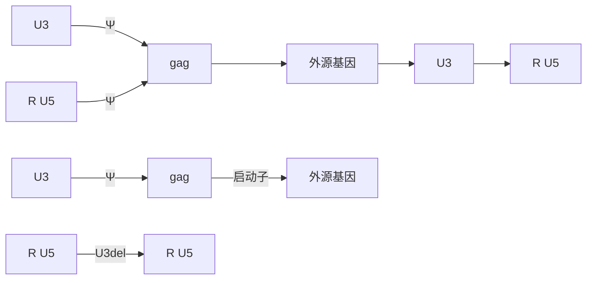

见“疑难解答”。

13.  $4^{\circ}$ C、500g 离心 50mL 锥底管 10min，弃细胞。

14. 将上清液转移到  $150 \, mL$ 、 $0.45 \, \mu m$  孔径的 PVDF 过滤装置中，并与抽真空装置连接。收集病毒滤液（约  $70 \, mL$ ），冰上放置。

15. 此刻，慢病毒载体上清的滴度应为  $10^{6} \sim 10^{8}$  个转导单位（TU）/mL，这取决于载体和转入基因。如果滴度满足所需，则可分装慢病毒载体上清液并储存于-80℃。否则立即继续浓缩步骤。

反复冻融能显著降低慢病毒载体储备溶液的滴度。

分装体积应适于每个分装样品仅使用一次。

## 超速离心浓缩慢病毒载体上清

16. 打开 SW32 桶，桶置于管架上，盖内侧朝上，以确保其充分暴露在紫外线下。在生物安全柜中用紫外线照射桶和盖 10～20min，或者使用 70%乙醇处理桶和盖 20～30min。风干桶和盖，除去乙醇。

17. 将 2 个  $25mm \times 89mm$  超离心管放置架上，加满 70% 乙醇，处理 20～30min。

18. 倒出 70%乙醇。用连接抽真空装置的无菌巴斯德移液管尽可能去除乙醇。用无菌 PBS 洗涤离心管 2 次。

19. 将步骤 14 得到的 70mL 过滤的慢病毒上清平均分配在 SW32 桶中，盖紧后从生物安全柜中取出。桶在冰上放置 10min。此外，浓缩慢病毒载体上清的前一天晚上，将 SW32（或 SW28）转子 4℃ 放置。否则，超速离心机需要相当长的时间使巨大的转子降温。

20. 使用 SW32 或 SW28 转子，离心管在  $4^{\circ}$ C 下、28 000r/min 离心 75min。

21. 从转子中取出筒，并将其放置在冰上。70%乙醇喷洒桶，然后转移到生物安全柜中。在生物安全柜中打开筒，用干净的镊子从筒中取出离心管，将上清液倾倒于1个瓶中，然后加入1/6体积14%的漂白剂处理1h后丢弃。在纸巾上倒置超离心管，用连接抽真空装置的无菌巴斯德移液管尽可能吸除管壁上的培养基，避免接触管的圆底。

22. 使用  $200 \mu L$  带无菌滤芯吸头的微量移液器，加  $50 \sim 100 \mu L$  的 OptiMEM（无 P/S）至每个试管的圆底中心，室温下静置  $5 \sim 10 min$ 。也可用  $50 \sim 100 \mu L$  的 PBS 重悬慢病毒载体。吸头轻轻吹打重悬慢病毒载体病毒颗粒，避免产生气泡。另一种方法是在生物安全柜中将管放置在冰上 2h，然后轻轻吹打。

慢病毒载体颗粒是透明的，在管底很难辨认。但经小心重悬后，浓缩的慢病毒载体储备液比 OptiMEM 稍微混浊。

23. 将慢病毒悬液转移到一个 0.65mL 无菌管中并混匀。10μL 分装，储存于-80℃。


## 疑难解答

问题:扩增 pCMVdR8.91 质粒困难。

解决方案:在大肠杆菌 HB101 中扩增质粒。

问题:慢病毒编码的转基因在靶细胞中不表达，或没有观察到预期的生物效应。

## 解决方案:

\- 明确问题出在制备阶段还是滴定/感染阶段。使用编码 GFP 的慢病毒来测试。试验期间，监测转染 293T 细胞中 GFP 的表达，第 4 天的 GFP 阳性细胞应>90%。进行感染测试:向 293T 细胞加入逐渐增量的上清液，在感染后 2～3 天用荧光显微镜分析 GFP 表达。使用有限稀释滴定法（方案 17）进行滴定。如果以上试验表明有转染效率，但没有转导效果，可从公司或学术核心机构获得编码 GFP 慢病毒载体测试上清，进行感染测试，若没有问题，则表明用于共转染 293T 细胞的某一质粒有问题。理想的情况是，研究人员应该在着手制备慢病毒前，准备足够量的基因组包装质粒和包膜表达质粒，以便明确导致包装效率变化的一个或两个因素，如慢病毒载体质粒的结构，包装过程中 293T 细胞中转基因过表达产生的潜在毒性。

- 通过分析限制性内切核酸酶酶切图谱来鉴定所有质粒。
- 使用商业化包装混合物测试慢病毒制备。
- 测试不同的质粒制备方法/试剂盒。

问题:制备的病毒滴度低。

解决方案:磷酸钙沉淀法的转染效率高度依赖于许多参数，应在初步试验中，利用强功能启动子下（如 CMV 立即早期启动子）编码 GFP 的慢病毒质粒在 293T 细胞中进行转染效率的优化。转染后第 3 天，达到 70% 以上转染效率，对于获得滴度高于  $1 \times 10^{7}$ TU/mL 的慢病毒载体储备液是至关重要的。以下为影响转染效率的几个参数。

- $2 \times$ HBS 溶液的 pH。制备慢病毒载体前，通过测试缓冲液优化 $2 \times$ HBS 溶液的 pH，通过几批测试缓冲液，将室温条件下 pH 调整为 6.95～7.05，优化缓冲液组分以用于特定条件。使用参比溶液精确校准的 pH 计至关重要。或者使用商业化的试剂盒。
- 胎牛血清（FBS）。转染过程中胎牛血清的来源和批次可显著影响转染效率。我们建议测试不同批次和不同供应商提供的胎牛血清，保证高转染效率。
- 细胞密度。如果在该方案的试验条件下，没有产生预期的转染效率，则测试不同的细胞密度。
- 质粒质量。DNA 质量对转染效率至关重要。柱纯化的质粒与氯化铯超速离心纯化的质粒效果相当。然而，部分通过柱层析纯化的质粒试剂盒中的树脂残留可能严重干扰转染效率。可用 TE 缓冲液重悬乙醇沉淀的质粒，在室温下利用台式离心机 15 000g 离心 5min 沉淀树脂。转移不含树脂的上清液即可。

问题（步骤 10～12）:在慢病毒载体制备过程中有异常大量的细胞死亡/脱落。

## 解决方案:

- 使用 VSV-G 包膜包装慢病毒载体，会导致一定程度的细胞融合和细胞脱落，尤其在第 4 天。细胞脱落大多发生于无血清培养基培养 293T 细胞。因此，在使用移液管更换培养基时要特别小心，防止细胞从培养板上脱落。
- 检查培养板是否有某个区域的细胞损失。若出现此情况，则表明培养箱和/或支架不是水平的，导致培养基分布不均匀。在慢病毒制备过程中水平放置培养箱和/或支架，或多加 OptiMEM 培养基（20mL 而非 15mL）到细胞板中。
- 在编码 GFP 的慢病毒载体制备过程中检查是否仍然存在细胞脱落。如果仍然存在，可增加细胞密度，并比较实验室配制的相关试剂与商业化试剂盒。如果问题仍存在，试用其他方法或试剂盒制备质粒。
- 某个转基因的过量表达对于转染的 293T 细胞可能有毒性。如果是这种情况，可以考虑使用药物调控的慢病毒载体。

问题:利用 VSV-G 包膜包装的慢病毒载体能有效转导 293T 细胞，但转导靶细胞无效。

## 解决方案:

- 用编码 GFP 的相同慢病毒载体转染靶细胞，测试病毒载体中启动子的功能。如果 GFP 基因表达量低，则寻找在靶细胞中有更好活性的启动子。
- 查阅文献，确定一个已被用于有效转导靶细胞的假慢病毒载体的包膜蛋白。获取相应的包膜蛋白表达质粒，并重复实验。Addgene.com 提供多种包膜蛋白表达质粒。需要注意的是，在超速离心时其他假慢病毒比 VSV-G 稳定性差（即在离心过程中功能慢病毒载体有相当大的损失)。可以使用替代方法，如更长时间的低速离心。此外，其他假慢病毒的制备可能需经优化，才能获得高滴度的病毒。实验开始时就要设计转染混合物中包膜蛋白表达质粒的不同转染量。最后，由于有的包膜蛋白转染293T细胞（或常用于滴定的其他细胞）效率较差，导致滴度低估，可能需要使用其他滴定方案。

问题:高滴度慢病毒储备液对某种特定类型的靶细胞（如原代培养的神经元细胞）有毒性。

## 解决方案:

- 进行超速离心时，在慢病毒载体上清液下方加入 4mL 20%蔗糖缓冲液[20%蔗糖，100mmol/L NaCl，20mmol/L HEPES（pH 7.4），1mmol/L EDTA]。
- 增加使用 Mustang Q 盘的阴离子交换层析纯化步骤，Kutner 等描述（2009）。


## 讨论

这是一个高效的、重现性好的方案，按照该方案生产的未浓缩上清液中慢病毒载体滴度为 $10^{7} \sim 10^{8} \mathrm{TU} / \mathrm{mL}$，超速离心浓缩上清液中为 $10^{9} \sim 10^{10} \mathrm{TU} / \mathrm{mL}$。该瞬时转染方案还非常经典，几乎适用于任何慢病毒与很多构建载体共转染。制备可知滴度的慢病毒载体储备液可在1周内完成。需要注意的是，慢病毒载体储备液反复冻融可导致滴度明显下降，因此慢病毒载体应按一次用量分装，并储存于-80℃。目前，对于在-80℃条件下长期保存慢病毒载体储备液的稳定性还不明确。

在 293T 细胞中确定的转导滴度可能有一定误导性，因为这种细胞很容易用 VSV-G 假慢病毒载体转导。对于测试新的细胞系，较好的起始，感染复数（MOI；每个靶细胞的 TU 数目）为 5、10、20、50、100。重要的是，尽可能减少感染体积，以提高转导概率。在培养液中加聚凝胺（4～16μg/mL）或硫酸鱼精蛋白（5μg/mL）可以提高转导效率。此外，也可以试用一些商业化的转导增强剂。但是，这些试剂对某些细胞系或原代细胞会产生不利影响。例如，小鼠原代神经元细胞对聚凝胺高度敏感，没有它才能完成转导。使用了转导增强剂，MOI 值为 10、50 和 100，就能得到接近 100% 的转导。尽管 VSV-G 包膜具有广泛的嗜细胞性，但是许多类型的细胞对于这个包膜蛋白假型慢病毒载体的转导是耐受的。例如，人骨髓间充质干细胞和静止的 T 细胞分别被带有 RD114（Zhang et al. 2004）和麻疹病毒糖蛋白的假型慢病毒载体（Frecha et al. 2008）有效地转导。对于那些已经被证明难以用 VSV-G 假型慢病毒载体转导的细胞，可以测试其他包膜糖蛋白的假慢病毒载体的转导效率。


## 配方

为正确使用本方案中的器材和危险试剂，必须查阅相应的材料安全数据表并咨询所在机构的环境卫生和安全办公室。

## 氯化钙溶液（2mol/L）

溶解 147.02g 二水合物氯化钙（ $CaCl_{2} \cdot 2H_{2}O$ ）在 500mL 水中。利用 0.22μm 的过滤器除菌后室温储存。

完全培养基

| 试剂 | 体积(1L中含) | 终浓度 |
| --- | --- | --- |
| DMEM | 890mL |  |
| FBS | 100mL | 10% |
| P/S溶液(100倍) | 10mL | 1倍 |

HBS (2×)

| 试剂 | 质量(1L中含) | 终浓度 |
| --- | --- | --- |
| 氯化钠 | 16.4g | 280mmol/L |
| HEPES($C_8H_{18}N_2O_4S$) | 11.9g | 50mmol/L |
| $Na_2HPO_4 \cdot 7H_2O$ | 0.38g | 1.42mmol/L |
| $H_2O$ | 至1L |  |

用 10mol/L NaOH 调节 pH 至 7.05。通过 0.22μm 过滤器除菌后室温储存。

## 参考文献

Frecha C, Costa C, Negre D, Gauthier E, Russell SJ, Cosset FL, Verhoeyen E. 2008. Stable transduction of quiescent T cells without induction of cycle progression by a novel lentiviral vector pseudotyped with measles virus glycoproteins. Blood 112: 4843–4852.

Kutner RH, Zhang XY, Reiser J. 2009. Production, concentration and titration of pseudotyped HIV-1-based lentiviral vectors. Nature Protocols 4:495–505.

Zhang XY, La Russa VF, Reiser J. 2004. Transduction of bone-marrow-derived mesenchymal stem cells by using lentivirus vectors pseudotyped with modified RD114 envelope glycoproteins. J Virol 78:1219–1229.

## 方案 17 慢病毒载体的滴定

慢病毒载体的滴度常用转导单位/mL 表示，它是一个功能滴度，反映在特定条件下慢病毒转导特定细胞系的能力。对于其他细胞系的转导能力可能不同，需要优化。绝大多数的慢病毒载体都由 VSV-G 包膜蛋白包装，可以适用于各种常用的细胞系，如 293、293T、HT-1080、HeLa 细胞。除了 VSV-G，慢病毒载体还被来自其他病毒的各种包膜蛋白假型毒化（携带不同于天然 HIV-1 包膜的包膜蛋白），赋予假型慢病毒转导其他一些特定靶细胞的能力（Cockrell and Kafri 2007）。然而，由于转导的参考细胞系表面可能低表达或根本没有特殊包膜蛋白的受体，可能会测得不准确的低滴度。在这种情况下，用酶联免疫吸附试验（ELISA）测定 p24 浓度就能计算出滴度，然而需要谨记这不是一个功能滴度。

293T 细胞用于制备慢病毒储备液，它们很容易被 VSV-G 假型慢病毒载体转导，因此该细胞系常用于测定 VSV-G 包膜制备的慢病毒载体储备液功能滴度。对于在 293T 细胞中可发挥功能的启动子下的编码荧光蛋白的慢病毒载体，用有限稀释法或流式细胞仪测定滴度。对于缺乏荧光标记物或携带非 293T 细胞功能启动子的慢病毒载体，可通过对转导细胞基因组 DNA 上病毒基因组进行实时定量 PCR 或者利用 ELISA 方法检测 p24 浓度来测定滴度。

## 生物安全

《NIH 重组 DNA 分子相关研究指南》未直接提及慢病毒载体相关工作。因此，重组DNA 咨询委员会（RAC）发布了如何进行慢病毒载体研究风险评估的指南。慢病毒载体研究的主要风险是可能产生复制型慢病毒（RCL）和致癌。在实验室环境中，BL2 或加强 BL2 防护规程能够满足大多数不涉及高致癌潜力的转基因操作。本单位生物安全委员会（IBC）根据慢病毒载体设计和包装系统、插入的外源基因的性质、载体滴度和制备载体的总量、动物宿主的固有生物防护和阴性 RCL 检测所做出的风险评估将决定适用的操作规程。必须由本单位 IBC 审核批准才能启动有关慢病毒载体的工作。


## 材料

为正确使用本方案中的器材和危险试剂，必须查阅相应的材料安全数据表并咨询所在机构的环境卫生和安全办公室。

本方案的专用试剂标注&lt;R&gt;，配方在本方案末提供。常用储备溶液、缓冲液和试剂标注&lt;A&gt;，配方见附录1。储备溶液应稀释至适用浓度后使用。

## 试剂

完全培养基&lt;R&gt;

DMEM 培养基

胎牛血清（FBS）

慢病毒载体储备液

多聚甲醛（4%）（可选；见步骤15）

青霉素/慢病毒滴定试剂盒链霉素溶液（P/S）（100×）

磷酸盐缓冲盐水（PBS）

聚凝胺（海美溴铵）（8mg/mL）&lt;R&gt;

QuickTiter（慢病毒相关的 HIV p24）（Cell Biolabs 公司）

293T 细胞

胰蛋白酶-EDTA（0.05%）

UltraRapid 慢病毒滴度测定试剂盒（System Biosciences 公司）（可选；见步骤 23）

## 设备

12 孔培养板

流式细胞仪

血细胞计数器

恒湿细胞培养箱（37℃，5% CO₂）

配备观察荧光蛋白滤光片的倒置荧光显微镜

微量移液器

可读 450nm 的微孔板酶标仪

带有无菌滤芯的移液器吸头（20μL、200μL 和 1000μL）

无菌试管（1.5mL）

## 有限稀释法测定病毒滴度

该方案仅适用于 293T 细胞功能启动子下表达绿色荧光蛋白的慢病毒。

1. 滴定实验前 1 天，向 12 孔板上含 1mL 完全培养基的每孔中接种  $3 \times 10^{5}$  个 293T 细胞。轻轻来回晃动倾斜平板确保细胞均匀分布。一块板上只能有一种慢病毒载体储备液。 $37^{\circ}C$ 、 $5\% CO_{2}$  细胞培养箱中培养过夜。

2. 第 1 天，用 0.5mL 37℃预热的、含 8μg/mL 聚凝胺（1:1000 稀释 8mg/mL 的聚凝胺储备液）的完全培养基更换孔中的完全培养基。

3. 用完全培养基连续稀释慢病毒载体:对于非浓缩储备液，进行 $1:10$、$1:10^{2}$ 和 $1:10^{3}$ 稀释；对于浓缩储备液，进行 $1:10^{2}$、$1:10^{3}$、$1:10^{4}$ 和 $1:10^{5}$ 稀释。每孔加 $5\mu L$ 载体稀释液，重复 3 次（每个稀释度 3 孔）。对于非浓缩储备液，还包括一组 $5\mu L$ 原液孔。$37^{\circ}C$ 培养箱进行培养。

4. 第 2 天，加入  $37^{\circ}$ C 预热的 0.5mL 完全培养基。在细胞培养箱中培养 2 天。

5. 第 4 天，小心地移除每孔中的完全培养基，加入 1mL PBS。

6. 使用配备观察绿色荧光蛋白滤光片的倒置荧光显微镜，在 10 倍物镜下计数每个视野的克隆数目。选择在每个视野中有 1～20 个克隆的稀释度。该稀释度每孔随机计数 5 个视野（3 孔×5 视野/孔=15 个观察视野）计数。计算出平均克隆数/观察视野后，根据如下公式计算滴度

$$
\text {滴度（TU/mL）} = (N \times C \times D) / 0. 0 0 5
$$

式中，N 为平均克隆数/观察视野；C 为孔面积除以视野面积；D 为载体储备液的稀释倍数。先确定观察视野的直径（ $FOV_{0}$ ），即目镜的视野数（该数值一般写在目镜一侧，例如，22 对应 22mm）除以物镜放大倍数（如 10），然后使用公式，面积= $\pi\times(FOV_{0}/2)^{2}$ ，计算观察视野面积。

## 流式细胞仪测定滴度

7. 准备滴定用 293T 细胞，具体见步骤 1。在 12 孔板上除了准备必要数目的孔，还要再增加 3 个孔。

8. 第 1 天，对 3 个孔进行细胞计数。弃去完全培养基，用 1mL PBS 洗涤细胞，加入 0.5mL 0.05% 胰蛋白酶-EDTA，室温下孵育 5min。加 0.5mL 完全培养基充分混匀细胞后转移细胞悬液到 1.5mL 试管中，利用血细胞计数器确定细胞浓度。计算出每孔细胞的平均数。

9. 按照步骤 2\~4 进行滴定。

10. 在第4天，弃去完全培养基，用 $1\mathrm{mL}$ PBS洗涤细胞，加入 $0.5\mathrm{mL}0.05\%$ 胰蛋白酶-EDTA，并在室温下孵育 $5\mathrm{min}$。

11. 每孔加 0.5mL 完全培养基充分混匀细胞，转移细胞悬液至 1.5mL 试管中。

12. 室温下以 500g 离心细胞 5min。吸弃完全培养基后用 1mL PBS 重悬细胞。

13. 再次在室温下以 500g 离心细胞 5min。弃去完全培养基，用 1\~2mL PBS 重悬细胞。

14. 使用流式细胞仪确定荧光阳性细胞的百分比。

如果 1h 内不进行分析，用 4% 多聚甲醛-PBS 固定细胞 30min，再用 PBS 洗涤，在 PBS 中 4℃ 储存。

15. 根据如下公式计算滴度（TU/mL）

$$
\text {滴度} (\mathrm{TU/mL}) = (N \times F \times D) / 0. 0 0 5
$$

式中，N 为第 1 天每孔细胞平均数；F 是荧光细胞的百分比；D 为载体储备液的稀释倍数。

滴度的准确度取决于落在载体流与荧光细胞百分比呈线性相关的范围内的载体量，如果百分比>40%，用其他的稀释度重复测定。

## 对转导细胞基因组 DNA 上的载体基因组进行 PCR 定量以测定滴度

16. 按步骤 1\~4 进行。

一些方案中还包括在第2天用DNaseI消化可能存在于慢病毒载体上清中的质粒DNA这一步骤（Kutner et al. 2009）。

17. 第 4 天，弃完全培养基，每孔用 1mL 的 PBS 洗涤细胞，每孔加入 0.5mL 的 0.05% 胰蛋白酶-EDTA，室温孵育 5min。

18. 每孔加 0.5mL 完全培养基，重悬细胞。将细胞悬液转移至 1.5mL 试管中。

19. 在室温下以 500g 离心细胞 5min。弃培养基，用 1mL 的 PBS 重悬细胞。

20. 在室温下再次 500g 离心细胞 5min。

21. 用商业化试剂盒（例如，DNeasy 组织试剂盒，QIAGEN 公司）从转导细胞分离基因组 DNA，测定基因组 DNA 浓度。

22. 利用定量 PCR 确定每个靶细胞二倍体基因组上慢病毒载体的拷贝数（Kutner et al. 2009），也可以按照使用说明书（省略步骤 18～24），使用基于定量 PCR 的 UltraRapid 慢病毒滴定试剂盒（System Biosciences 公司，Mountain View，CA）。

## 23. 根据如下公式计算慢病毒载体滴度

$$
\text {滴度（TU/mL）} = (N \times C \times D) / 0. 0 0 5
$$

式中， $N$ 是第1天每孔细胞平均数； $C$ 是每个二倍体基因组中慢病毒载体拷贝数； $D$ 为载体储备液的稀释倍数。

## ELISA 测定 p24 浓度从而确定滴度

另一种基于转导试验的方法是利用 ELISA 测定慢病毒载体储备液中 HIV-1 p24 的浓度。该方法的局限是慢病毒载体上清液被制备过程中转染细胞产生的游离 p24 所污染。大多数 ELISA 试剂盒能定量上清液中 p24 抗原总量。QuickTiter 慢病毒滴定 ELISA 试剂盒（Cell Biolabs 公司）利用专有试剂分离游离 p24 与慢病毒颗粒，从而定量慢病毒颗粒上的 p24。

24. 对于非浓缩慢病毒载体储备液，利用 OptiMEM 进行 1:10 和  $1:10^{2}$  稀释，每个稀释度重复测定 3 次。对于浓缩慢病毒载体储备液，利用 OptiMEM 进行  $1:10^{2}$ 、 $1:10^{3}$  和  $1:10^{4}$  稀释，每个稀释度重复测定 3 次。

25. 按照使用说明书，使用 QuickTiter 慢病毒滴定 ELISA 试剂盒测定慢病毒载体储备液中病毒颗粒上 p24 的浓度。

根据使用说明书，每个慢病毒颗粒（LP）有2000个p24分子，1ng的p24对应 $1.25\times10^{7}$ LP。


## 讨论

对靶细胞中载体基因组的实时定量PCR法是测定慢病毒样本滴度最准确但也是最耗时的方法，该方法不依赖用于测定滴度的细胞中的启动子功能，但是该方法仅用于表达其他假型慢病毒载体的包膜糖蛋白的必要表面受体的细胞。在这种情况下，还有两个可供选择的方法。一个是基于慢病毒粒子相关的p24水平来确定滴度，另一个方法是改造细胞系，使其过表达适用的细胞表面受体。重要的是，要考虑到慢病毒滴度是在特定条件下使用特定细胞系测定的功能滴度（转导单位/mL）。靶细胞类型和转导条件的变化对转导效率有显著影响。因此，对于新细胞系、原代细胞和体内基因递送，慢病毒载体滴度应该是设计经验性转导实验的指南。


## 配方

为正确使用本方案中的器材和危险试剂，必须查阅相应的材料安全数据表并咨询所在机构的环境卫生和安全办公室。

完全培养基

| 试剂 | 体积(1L中含) | 终浓度 |
| --- | --- | --- |
| DMEM | 890mL |  |
| FBS | 100mL | 10% |
| P/S溶液(100×) | 10mL | 1× |

聚凝胺（海美溴铵）（8mg/mL）

溶解 100mg 的聚凝胺（海美溴铵）于 12.5mL 水中。用 0.22μm 过滤器除菌，4℃储存。

## 参考文献

## 方案 18 监测慢病毒载体储备液中的可复制型病毒

在载体制备过程中有可能生成 RCL，生物安全风险极大，这促使慢病毒载体制备系统开发至今，已将生成 RCL 风险降至最低。第二代和第三代慢病毒载体生产系统似乎是安全的，因为没有在这些系统中生成 RCL 的报道。筛选含 RCL 载体储备液需要转导细胞传代 30 天，每周用 ELISA 试剂盒监测上清液中 p24 浓度。

## 生物安全

《NIH 重组 DNA 分子相关研究指南》未直接提及慢病毒载体相关工作。因此，重组DNA 咨询委员会（RAC）发布了如何进行慢病毒载体研究风险评估的指南。慢病毒载体研究的主要风险是可能产生复制型慢病毒（RCL）和致癌。在实验室环境中，BL2 或加强 BL2 防护规程能够满足大多数不涉及高致癌潜力的转基因操作。本单位生物安全委员会（IBC）根据慢病毒载体设计和包装系统、插入的外源基因的性质、载体滴度和制备载体的总量、动物宿主的固有生物防护和阴性 RCL 检测所做出的风险评估将决定适用的操作规程。必须由本单位 IBC 审核批准才能启动有关慢病毒载体的工作。


## 材料

为正确使用本方案中的器材和危险试剂，必须查阅相应的材料安全数据表并咨询所在机构的环境卫生和安全办公室。

本方案的专用试剂标注&lt;R&gt;，配方在本方案末提供。常用储备溶液、缓冲液和试剂标注&lt;A&gt;，配方见附录1。储备溶液应稀释至适用浓度后使用。

## 试剂

完全培养基&lt;R&gt;

DMEM 培养基

胎牛血清（FBS）

慢病毒载体储备液

OptiMEM-I

青霉素/链霉素（P/S）溶液（100×）

磷酸盐缓冲盐水（PBS）

聚凝胺（海美溴铵）（8mg/mL）&lt;R&gt;

QuickTiter 慢病毒滴定试剂盒（慢病毒相关的 HIV p24）（Cell Biolabs 公司）

293T 细胞

胰蛋白酶-EDTA（0.05%）

## 设备

培养板（12孔）

恒湿细胞培养箱（37℃，5%CO₂）

血细胞计数器

微量移液器

450nm 可读微孔板酶标仪

带有无菌滤芯的移液器吸头（20μL、200μL 和 1000μL）

注射器式 PVDF 膜过滤器（0.45μm）

T-25 培养瓶

试管，无菌（1.5mL）


## 方法

1. 在转导前 1 天，向 12 孔板上含 1mL 完全培养基的每个孔中接种  $3 \times 10^{5}$  个 293T 细胞。 $37^{\circ}C$ 、 $5\% CO_{2}$  细胞培养箱培养过夜。

2. 第 1 天，将  $250 \mu L$  未浓缩载体储备液与含有  $16 \mu g/mL$  聚凝胺（1:500 稀释 8 mg/mL 聚凝胺储备液）的  $250 \mu L$  完全培养基混合。对于浓缩慢病毒载体储备液，加  $5 \mu L$  至含有  $8 \mu g/mL$  聚凝胺的 0.5 mL 完全培养基中。重复制备 3 次。准备含有等体积 OptiMEM-I 的试管，作为慢病毒载体储备液空白转导对照。

3. 吸弃一个孔中的完全培养基, 更换为含终浓度 $8 \mu \mathrm{g} / \mathrm{mL}$ 聚凝胺的 $0.5 \mathrm{~mL}$ 载体稀释液, 重复该操作, 载体储备液和空白对照各 3 个复孔。在细胞培养箱中, $37^{\circ} \mathrm{C} 、 5 \% \mathrm{CO}_{2}$ 培养过夜。

4. 次日，将转染孔（载体储备液和空白对照）中的上清移至无菌 1.5mL 管中，再加入  $37^{\circ}$ C 预热的 1mL 完全培养基。

5. 在室温下以 500g 离心第 1 天的上清液 10min。将上清液转移到 1 个新的试管中，标记为 “第 1 天”，标明载体或空白对照。-80℃储存。

6. 第 4 天，弃慢病毒和对照转染孔中的上清液，用 1mL 的 PBS 洗涤细胞。弃 PBS，加入 0.5mL 0.05% 胰酶-EDTA，室温孵育 5min。加入 0.5mL 完全培养基，并通过反复吹打悬浮细胞。分别转移每孔中所有细胞至含 5mL 完全培养基的 T-25 培养瓶中（载体储备液和空白对照各需 3 个培养瓶），在培养箱中继续培养。

7. 第 7 天，将培养上清液利用  $0.45 \mu m$  注射器式过滤器过滤到新的 1.5 mL 试管中，载体或对照均标记 “第 7 天”。-80℃ 储存。按照 1:10 传代细胞，每周 2 次。

8. 在第 15、21 和 30 天重复步骤 7。

9. 使用 QuickTiter 慢病毒滴定 ELISA 试剂盒测定所有上清液。对照包括载体储备液和 293T 细胞上清液。第 1 天的上清液中应含有来自慢病毒载体储备液的 p24，但它应该逐渐消失，在之后的时间点检测不到，与空白转导上清液水平相当。


## 配方

为正确使用本方案中的器材和危险试剂，必须查阅相应的材料安全数据表并咨询所在机构的环境卫生和安全办公室。

完全培养基

| 试剂 | 体积(1L中含) | 终浓度 |
| --- | --- | --- |
| DMEM | 890mL |  |
| FBS | 100mL | 10% |
| P/S溶液(100×) | 10mL | 1× |

聚凝胺（海美溴铵）（8mg/mL）

溶解 100mg 的凝聚胺（海美溴铵）于 12.5mL 水中。利用 0.22μm 过滤器除菌并存储在 4℃

# 信息栏


## 腺病毒载体

腺病毒属于腺病毒科，分为两个属:禽腺病毒属（鸟腺病毒）和哺乳动物腺病毒属（人、猴、牛、马、猪、羊、犬和负鼠腺病毒）。这些病毒均携带一个线性双链DNA基因组，由直径为70～100mm的二十面体衣壳蛋白包裹。约36kb的基因组包括4个提供调控和复制功能的早期转录单位（E1、E2、E3、E4）、2个延迟早期单位（IX和IVa2）和1个指导包括衣壳蛋白在内的蛋白合成的主要晚期转录单位（Wold and Horwitz 2007）。人类感染腺病毒的主要临床后遗症为急性发热性呼吸道综合征（Wold and Horwitz 2007）。

来自于人类腺病毒血清 2 型和 5 型的腺病毒载体具有广泛的转导细胞类型和组织嗜性，以及对培养物和体内的高效基因转导，因此在实验室中被最广泛使用。事实上，它们也是双链 DNA 病毒载体中最有效的基因转导工具（Amalfitano 2004）。为了容纳外源基因表达盒，大多数腺病毒载体 E1 区被删除从而复制缺陷。这些载体在稳定整合血清 5 型腺病毒 E1 区的 293 细胞内进行常规包装，能够反式互补载体基因组复制和包装必需的 E1 功能。在大多靶细胞内，腺病毒载体基因组为非复制游离体（Wold and Horwitz 2007）。

利用腺病毒载体在体内进行体细胞基因转导的主要缺点是它们会诱导针对病毒蛋白和外源基因产物（Jooss and Chirmmle 2003）的强烈细胞免疫反应。腺病毒载体诱导的宿主强烈的免疫反应有两个层面:针对病毒衣壳蛋白的先天免疫反应，以及载体基因组上的其他病毒基因和外源基因的从头合成表达引发的获得性T细胞免疫。病毒衣壳蛋白激发的先天性免疫反应导致炎性细胞因子，如IL-6和IL-10的短暂升高，而获得性T细胞免疫会导致特异性针对病毒和外源基因蛋白的毒性T细胞清除转导细胞（Jooss and Chirmmle 2003）。

在过去的十年中，对删除载体基因组中其他早期基因以减少 T 细胞免疫原性的新一代腺病毒载体的研发已取得了重大进步。最先进的一代是无肠腺病毒载体，其中所有的病毒基因均被去除。无肠腺病毒载体不仅消除了针对从头合成病毒蛋白的细胞免疫反应，还显著增强其外源基因盒的容纳能力。因为无肠腺病毒的制备需要共感染 E1 缺失的腺病毒的辅助功能，所以从无肠载体样本中有效清除辅助病毒至关重要（Altaras et al. 2005）。值得关注的是，解决慢病毒载体介导的体内基因递送后针对病毒包膜蛋白的先天性免疫反应的进展甚微。

## 参考文献

- Altaras NE, Aunins JG, Evans RK, Kamen A, Konz JO, Wolf JJ. 2005. Production and formulation of adenovirus vectors. Adv Biochem Eng Biotechnol 99: 193–260.
- Amalfitano A. 2004. Utilization of adenovirus vectors for multiple gene transfer applications. Methods 33: 173–178.

Jooss K, Chirmule N. 2003. Immunity to adenovirus and adeno-associated viral vectors: Implications for gene therapy. Gene Ther 10: 955–963.
Wold WSM, Horwitz MS. 2007. Adenoviruses. In Fields virology (ed Knipe D. et al.), pp. 2395–2436. Wolters Kluwer Health/Lippincott Williams & Wilkins, Philadelphia.


## AAV 载体

腺相关病毒（AAV）是第一个也是唯一的改造用于基因递送的 ssDNA 病毒，无包膜，直径 20～26nm 的二十面体核衣壳包裹着一条 4.7kb 线性 ssDNA 基因组。腺相关病毒是已知最小的哺乳动物病毒，因最早发现为腺病毒样本中的一个病毒污染成分而得名。没有辅助病毒，如腺病毒共感染时，它的天然复制能力缺失，与任何人类疾病不相关（Daya and Berns 2008）。

在 20 世纪 80 年代后期，腺相关病毒最先经基因工程改造为基因递送载体。此后，因其临床用于慢性疾病的基因治疗具有效性和安全性，已成为最有前途的基因递送工具（Daya and Berns 2008）。广泛研究已经表明，腺相关病毒载体非常高效地转导许多活体组织，包括肌肉、肝脏、心脏、CNS 中的分裂和非分裂/静止细胞。更重要的是，腺相关病毒介导的活体基因递送似乎不发生组织病理改变或载体相关毒性（Daya and Berns 2008）。

与腺病毒载体不同，小型和大型动物模型接种腺相关病毒载体通常不会引起宿主对于转导细胞的免疫反应，因而转入基因（治疗基因）在体内长期表达（Jooss and Chirmmle 2003）。腺相关病毒载体通过形成环状单体和多价体在宿主细胞中持久游离存在，介导基因的稳定表达（McCarty et al. 2004）。腺相关病毒的一个主要缺点是它最多仅可以容纳约5kb载体基因组（Daya and Berns 2008）。

最近的研究发现了由 120 多个新的灵长类动物腺相关病毒组成的另一科具有独特的组织和细胞类型噬性以及高效的基因转移能力（Gao et al. 2002, 2003, 2004, 2005），这一重大进展显著扩大了腺相关病毒载体的潜在应用范围。另一个载体基因组设计的重大进展是引入了野生型 ITR 元件和改构的 ITR 元件，使得双链或自身互补基因组被包装（McCarty 2008）。自身互补的腺相关病毒（scAAV）载体能够在靶细胞核中脱核衣壳后立即启动转基因的表达，这个巧妙的载体基因组设计绕过了转导过程中 AAV 载体加工的限速步骤，即第二链合成（SSS）。该设计显著提高了 AAV 载体的培养物和体内转导效率。然而，scAAV 载体基因组设计将转基因容量减少到 2.5kb，限制了其潜在应用。目前，Zhong 和他的同事对 AAV2 衣壳上表面暴露的关键酪氨酸残基进行突变，避免了泛素化降解，因而避免了蛋白酶体介导的降解，这一简单的改良使这些载体在体外人类细胞和活体小鼠肝细胞内得到高效转导（Zhong et al. 2008）。

## 参考文献

- Daya S, Berns KI. 2008. Gene therapy using adeno-associated virus vectors. Clin Microbiol Rev 21: 583–593.
- Gao GP, Alvira MR, Wang L, Calcedo R, Johnston J, Wilson JM. 2002. Novel adeno-associated viruses from rhesus monkeys as vectors for human gene therapy. Proc Natl Acad Sci 99: 11854–11859.
- Gao G, Zhou X, Alvira MR, Tran P, Marsh J, Lynd K, Xiao W, Wilson JM. 2003. High throughput creation of recombinant adenovirus vectors=by direct cloning, green-white selection and I-Sce I-mediated rescue of circular adenovirus plasmids in 293 cells. Gene Ther 10: 1926–1930.
- Gao G, Vandenberghe LH, Alvira MR, Lu Y, Calcedo R, Zhou X, Wilson JM, 2004. Clades of adeno-associated viruses are widely disseminated in human tissues. J Virol 78: 6381–6388.
- Gao G, Vandenberghe LH, Wilson JM. 2005. New recombinant serotypes of AAV vectors. Curr Gene Ther 5: 285–297.
- Jooss K, Chirmule N. 2003. Immunity to adenovirus and adeno-associated viral vectors: Implications for gene therapy. Gene Ther 10: 955–963.
- McCarty DM. 2008. Self-complementary AAV vectors: Advances and applications. Mol Ther 16: 1648–1656.
- McCarty DM, Young SM Jr, Samulski RJ. 2004. Integration of adeno-associated virus (AAV) and recombinant AAV vectors. Ann Rev Genet 38:819–845.
- Zhong L, Li B, Mah CS, Govindasamy L, Agbandje-McKenna M, Cooper M, Herzog RW, Zolotukhin I, Warrington KH Jr, Weigel-Van Aken KA, et al. 2008. Next generation of adeno-associated virus 2 vectors: Point mutations in tyrosines lead to high-efficiency transduction at lower doses. Proc Natl Acad Sci 105: 7827–7832.


## 慢病毒载体

慢病毒属于反转录病毒科，与该科其他病毒一样，病毒粒子携带 ssRNA，必须反转录并整合至宿主细胞基因组（原病毒）产生有效感染。慢病毒的显著特点是其基因组复杂、圆柱形或圆锥形的核衣壳携带病毒基因组。核衣壳被携带包膜糖蛋白的双层膜包裹，包膜糖蛋白负责与细胞表面受体进行相互作用及进入宿主细胞。反转录病毒是几乎所有脊椎动物的主要病原体。人类免疫缺陷病毒 1 型（HIV -1）感染人类，导致获得性免疫缺陷综合征（AIDS）。

基于 HIV-1 的慢病毒载体最早被设计为基因递送工具，对于分化和未分化细胞具有很高的转导效率（Cockrell and Kafri 2007）。原因很明显，HIV-1 来源的慢病毒载体包装系统（图 1）经过多年的发展，将辅助质粒中 HIV 基因的数量减至最少，从而降低了制备过程中产生可复制型慢病毒（RCL）的概率。第一代包装系统基于携带 HIV-1 基因组的一个表达质粒，其删除了包装信号（Ψ）和 env 基因，LTR 元件由 CMV 即早期启动子和多聚腺苷酸化信号所替换（Cockrell and Kafri 2007）。第二代包装系统中的互补质粒携带 4 个 HIV 基因:gag、pol（结构）、tat 和 rev（调控）。而在第三代包装系统中，将 gag、pol 和 rev 分配给了 2 个质粒。第三代系统仅用于制备携带嵌合 5'-LTR 的慢病毒载体，其中 HIV-1 的启动子被替换为 CMV 或 RSV 启动子，启动包装所需的载体基因组 RNA 的合成不依赖于 Tat（第三代包装系统中缺失）。目前使用的大多数慢病毒载体均携带嵌合的 5'-LTR 元件（Cockrell and Kafri 2007）。


图 1 基于 HIV-1 的慢病毒载体包装系统。（上两个结构来自于 Dull et al. 1998。下两个结构来自于 Zufferey et al. 1997）。

反转录病毒和慢病毒载体整合到宿主细胞基因组是一个优点，能够获得永久遗传修饰的靶细胞，但是，这也引起了对插入突变的潜在致癌性的安全担忧。这个问题显现在严重联合免疫缺陷病（SCID）临床试验，一些接受反转录病毒载体改造的造血干/祖细胞的患者罹患了白血病。显然，基于MLV的反转录病毒载体易于整合到启动子区域，导致癌基因的转录。有趣的是，慢病毒载体的整合模式并没有显示此偏好。最近的研究表明，反转录病毒或慢病毒载体体外修饰的造血干/祖细胞致癌和异常转录活性与载体原病毒（即载体整合在宿主基因组上）上的转录活性LTR元件有关。但是，携带转录活性LTR元件的慢病毒载体比相似的基于MLV反转录病毒载体诱发肿瘤的可能性小10倍。自失活的反转录病毒或慢病毒载体的LTR元件在整合到宿主基因组后失活，致癌潜力明显减少/不存在（Montini et al. 2009）。

## 参考文献

Cockrell AS, Kafri T. 2007. Gene delivery by lentivirus vectors. Mol Biotechnol 36: 184–204.

Dull T, Zufferey R, Kelly M, Mandel RJ, Nguyen M, Trono D, Naldini L. 1998. A third-generation lentivirus vector with a conditional packaging system. J Virol 72: 8463–8471.

Montini E, Cesana D, Schmidt M, Sanvito F, Bartholomae CC, Ranzani M, Benedicenti F, Sergi LS, Ambrosi A, Ponzoni M, et al. 2009. The genotoxic potential of retroviral vectors is strongly modulated by vector design and integration site selection in a mouse model of HSC gene therapy. J Clin Invest 119: 964–975.

Zufferey R, Nagy D, Mandel RJ, Naldini L, Trono D. 1997. Multiply attenuated lentiviral vector achieves efficient gene delivery in vivo. Nat Biotechnol 15: 871–875.


## 病毒载体的基本元件

## 反转录病毒载体

最常用的反转录病毒载体基于 Mo-MLV。第一代载体所携带的转基因的两侧是 2 个完整的 LTR，由增强子（U3）、R 区（即转录起始区，在病毒颗粒中的载体基因组两端均存在）及 U5 区构成。病毒载体的包装主要由包装信号序列（Ψ）介导，而邻近的 gag 序列能够显著提高其包装效率。所有反转录病毒载体均携带一个由 Ψ 序列和部分 gag 序列组成的扩展包装信号序列，经改造去除了起始密码子。第一代载体由 LTR 启动子起始转录（图中第一个载体）。这些载体的问题之一是在体内经过一段时间后，启动子关闭，这就促使了新一代 SIN 反转录病毒载体应运而生，它们携带几乎彻底去除了 U3 增强子序列的 3'-LTR，内含起始转录的哺乳动物启动子。在反转录过程中，去除 U3 区的基因组载体的 3'端复制成 5'-LTR 区，从而产生一个无活性 LTR 启动子。


<details>
<summary>flowchart</summary>


</details>

## 慢病毒载体


<details>
<summary>flowchart</summary>


</details>

目前，人类基因治疗和实验室应用的慢病毒载体绝大多数来源于 HIV-1，因此，该类载体的设计都考虑到了安全性。这类载体包含一个与反转录病毒相同的扩展包装信号序列（Ψ +gag），可以自失活（删除 U3 的 3'-LTR），还携带一个嵌合的 5'-LTR 区域，该区域包含源于 RSV 或 CMV 早期基因启动子的增强序列。这种设计似乎可以显著增加病毒滴度，因此在反转录病毒中也有应用。此外，HIV-1 慢病毒需要 RRE 的存在，该序列对于病毒基因组有效运输到细胞质并高效包装是必需的。如同反转录病毒，慢病毒在其 3'-LTR 附近也包含一个多嘌呤序列（PPT），该位点对于反转录过程中正链 DNA 合成的起始是必需的。对携带一个 PPT 序列的第一代慢病毒载体的困惑之一是观察到对成人大脑中有丝分裂期后神经细胞的转导要比成人非分裂的肝细胞中高效得多（Park et al. 2000）。不久后发现在慢病毒载体中心区引入的第二个 PPT 序列对于有丝分裂后细胞中的前整合复合物的核转位至关重要（Follenzi et al. 2000; Zennou et al. 2000）。中心区 PPT（cPPT）或中心区 DNA “瓣”（flap）的引入使慢病毒载体在分裂细胞和非分裂细胞中均可以高效转导遗传信息。目前多数慢病毒载体的另一个元件是肝炎病毒土拨鼠转录后调控元件（WPRE），该元件如果置于转基因序列的正义方向下游，能使表达效率提高 5～8 倍（Zufferey et al. 1999）。

AAV 载体


<details>
<summary>flowchart</summary>


</details>

大多数 AAV 载体的转基因表达盒的两侧是 AAV2 ITR，在这些载体上没有源于野生型病毒的其他基因组元件。来自其他血清型 AAV 的 ITR 元件也很常见（Desmaris et al. 2004; Hewitt et al. 2009）。用 ssAAV 载体转导的最大问题是它在转导细胞中转变为有转录活性的 dsDNA。自身互补或 dsAAV 载体携带了一个去除末端解离位点的 ITR，使双链基因组包装，快速介导转导后转基因的表达。双链 AAV 载体最大可包装约 2.4kb，而传统的单链 AAV 载体则可达到 4.7～4.8kb。这些载体显示了体内基因表达的高效性和稳定性，而在体外培养的细胞中其作用效果远不及其他载体。

腺病毒载体


<details>
<summary>flowchart</summary>

```mermaid
graph LR
  subgraph StandardAd["StandardAd载体"]
  A["标准Ad载体\nITR"] --> B["启动子"]
  B --> C["外源基因"]
  C --> D["Poly(A)"]
  end

  subgraph HighVolume (HC)Ad载体
  E["高容量 (HC) Ad载体\nITR"] --> F["启动子"]
  F --> G["外源基因"]
  G --> H["Poly(A)"]
  end

  D --> I["腺病毒基因组上删除了不同基因\nITR"]

  style A fill:#fff,stroke:#333
  style B fill:#fff,stroke:#333
  style C fill:#fff,stroke:#333
  style D fill:#fff,stroke:#333
  style E fill:#fff,stroke:#333
  style F fill:#fff,stroke:#333
  style G fill:#fff,stroke:#333
  style H fill:#fff,stroke:#333
  style I fill:#fff,stroke:#333
  style J fill:#fff,stroke:#333
  style K fill:#fff,stroke:#333
  style L fill:#fff,stroke:#333
  style M fill:#fff,stroke:#333
  style N fill:#fff,stroke:#333
  style O fill:#fff,stroke:#333
  style P fill:#fff,stroke:#333
  style Q fill:#fff,stroke:#333
  style R fill:#fff,stroke:#333
  style S fill:#fff,stroke:#333
  style T fill:#fff,stroke:#333
  style U fill:#fff,stroke:#333
  style V fill:#fff,stroke:#333
  style W fill:#fff,stroke:#333
  style X fill:#fff,stroke:#333
  style Y fill:#fff,stroke:#333
  style Z fill:#fff,stroke:#333
  style AA fill:#fff,stroke:#333
  style AB fill:#fff,stroke:#333
  style AC fill:#fff,stroke:#333
  style AD fill:#fff,stroke:#333
  style AE fill:#fff,stroke:#333
  style AF fill:#fff,stroke:#333
  style AG fill:#fff,stroke:#333
  style AH fill:#fff,stroke:#333
  style AI fill:#fff,stroke:#333
  style AJ fill:#fff,stroke:#333
  style AK fill:#fff,stroke:#333
  style AL fill:#fff,stroke:#333
  style AM fill:#fff,stroke:#333
  style AN fill:#fff,stroke:#333
  style AO fill:#fff,stroke:#333
  style AP fill:#fff,stroke:#333
  style AQ fill:#fff,stroke:#333
  style AR fill:#fff,stroke:#333
  style AS fill:#fff,stroke:#333
  style AT fill:#fff,stroke:#333
  style AU fill:#fff,stroke:#333
  style AV fill:#fff,stroke:#333
  style AW fill:#fff,stroke:#333
  style AX fill:#fff,stroke:#333
  style AY fill:#fff,stroke:#333
  style AZ fill:#fff,stroke:#333
  style AL fill:#fff,stroke:#333
  style AM fill:#fff,stroke:#333
  style AN fill:#fff,stroke:#333
  style AO fill:#fff,stroke:#333
  style AQ fill:#fff,stroke:#333
  style AR fill:#fff,stroke:#333
  style AS fill:#fff,stroke:#333
  style AT fill:#fff,stroke:#333
  style AU fill:#fff,stroke:#333
  style AX fill:#fff,stroke:#333
  style AZ fill:#fff,stroke:#333
  style AL fill:#fff,stroke:#333
  style AM fill:#fff,stroke:#333
  style AN fill:#fff,stroke:#333
  style AO fill:#fff,stroke:#333
  style AQ fill:#fff,stroke:#333
  style AR fill:#fff,stroke:#33<nl>
```
</details>

多数腺病毒载体基于 Ad5，携带的转基因表达盒插入 E1 早期转录单元中，载体上保留了大部分野生型基因组，仅删除了一个或多个早期转录单元（见下文）。大容量腺病毒载体(HC-Ad)通常只含有腺病毒 ITR、一个转基因表达盒和填充 DNA，使载体约 35kb。HC-Ad 载体不包含任何源于野生腺病毒基因组的其他遗传元件，不会像 Ad 介导的体内基因递送一样，因获得性免疫造成免疫并发症。病毒衣壳激活的先天性免疫仍有待解决。

## 参考文献

Desmaris N, Verot L, Puech JP, Caillaud C, Vanier MT, Heard JM. 2004. Prevention of neuropathology in the mouse model of Hurler syndrome. Ann Neurol 56: 68–76.

Follenzi A, Ailles LE, Bakovic S, Geuna M, Naldini L. 2000. Gene transfer by lentiviral vectors is limited by nuclear translocation and rescued by HIV-1 pol sequences. Nat Genet 25: 217–222.

Hewitt FC, Li C, Gray SJ, Cockrell S, Washburn M, Samulski RJ. 2009. Reducing the risk of adeno-associated virus (AAV) vector mobilization with AAV type 5 vectors. J Virol 83: 3919–3929.

Park F, Ohashi K, Chiu W, Naldini L, Kay MA. 2000. Efficient lentiviral transduction of liver requires cell cycling in vivo. Nat Genet 24: 49–52.

Zennou V, Petit C, Guetard D, Nerhbass U, Montagnier L, Charneau P. 2000. HIV-1 genome nuclear import is mediated by a central DNA flap. Cell 101: 173–185.

Zufferey R, Donello JE, Trono D, Hope TJ. 1999. Woodchuck hepatitis virus posttranscriptional regulatory element enhances expression of transgenes delivered by retroviral vectors. J Virol 73: 2886–2892.


## 转导细胞的检测分析

1. 制备载体储备液。
2. 以每个靶细胞不同的 MOI 或载体剂量转导靶细胞。

腺病毒载体:100～10 000 个病毒颗粒/靶细胞。

腺相关病毒载体:10 000～100 000 个病毒基因组/靶细胞。

慢病毒载体:MOI 5～500。

3. 在转导后 3\~5 天对转入基因的表达进行评价。

对于载体编码蛋白质，有多种方法可用来评价转导细胞中转入基因的表达，这取决于转基因的类型、亚细胞定位、可用的抗体或生物检测方法。

- 如果载体编码了荧光标记蛋白, 可以使用配有适用滤光器的荧光显微镜来评价转导。继续下一步。
- 提取总细胞蛋白，通过免疫印迹法或 ELISA 定量分析转基因表达。
- 使用荧光激活细胞分选术（FACS）分析转入基因的表达，此方法可定量阳性细胞百分比和转入基因表达强度。
- 使用免疫荧光和免疫细胞化学法分析表达及亚细胞定位。

i. 为了区别于内源蛋白，或者在免疫沉淀实验中缺乏有效目的蛋白的一抗时，引入了载体编码的蛋白质 N 端或者 C 端的蛋白质标签（表 1）。此外，含有 4 个半胱氨酸的小肽可用于活细胞成像分析蛋白质表达和定位，当二亚砷酸盐化合物存在时，可与带有此标签的蛋白质发生特异结合而发出荧光（Griffin et al.1998）。

表 1 表位标签的氨基酸序列

<table><tr><td colspan="2">标签名称</td><td>氨基酸序列</td></tr><tr><td>HA</td><td></td><td>YPYDVPDYA</td></tr><tr><td>c-MYC</td><td></td><td>EQKLISEEDL</td></tr><tr><td> $His_6$ </td><td></td><td>HHHHHH</td></tr><tr><td>FLAG</td><td></td><td>DYKDDDDK</td></tr><tr><td>AU1</td><td></td><td>DTYRYI</td></tr><tr><td>EE (Glu-Glu)</td><td></td><td>EYMPME</td></tr><tr><td>IRS</td><td></td><td>RYIRS</td></tr><tr><td>半胱氨酸短肽</td><td></td><td>CCPGCC $^a$ </td></tr><tr><td>GFP</td><td></td><td>—</td></tr></table>

注:在目的蛋白和标签之间加入几个甘氨酸残基是非常重要的。

HA，血凝素；IRS，胰岛素受体底物；GFP，绿色荧光蛋白。

a. 此标签使活细胞中特定标记的重组蛋白与二亚砷酸盐化合物共孵育时，发出荧光。注意由 Life Technologies 公司商业化的载体中这个标签插入蛋白羧基端时，前后有序列 GAGGCCPGCCGGG。

ii. 这些标签对于蛋白质的生物化学和功能的潜在影响值得慎重考虑和分析。另一种方法是将载体转导至不表达特定蛋白质的细胞中，实验从而在空白背景下进行。
iii. 检测培养细胞或体内载体编码蛋白的生物学效应[例如，使用转基因特异性酶学检测、监测离子通道（如囊性纤维化跨膜传导调节因子）转导细胞的电流调节的变化]。

对于载体编码的 shRNA/miRNA 的检测可使用以下方法。

- 提取总细胞蛋白，通过免疫印迹法、ELISA 法、FACS 或免疫染色法对转基因的细胞或空载体对照细胞进行分析。
- 缺乏抗体时，提取总 RNA，应用实时 PCR 测定天然细胞和载体转导细胞中靶基因 mRNA 水平，持家基因（GAPDH、β-actin 或 18S rRNA）作为内参。
- 靶基因下调的生物学效应。

## 参考文献

Griffin BA, Adams SR, Tsien RY. 1998. Specific covalent labeling of recombinant protein molecules inside live cells. Science 281: 269–272.


## 转基因表达盒


<details>
<summary>flowchart</summary>


</details>

病毒载体最常用的有遍在启动子（ubiquitous promoters）、细胞类型特异性启动子和多聚腺苷酸化信号。

## 遍在启动子

- 人类 CMV 立即早期启动子
- 小鼠干细胞病毒（MSCV）启动子
- CMV 增强子与鸡 $\beta$-actin 启动子融合的 CAG 杂合启动子（也称为 CGA、CBA 或 CB；在不同版本中的长度不同）
- 人类 EF-1α
- 人类磷酸甘油酸激酶1（PGK1）启动子
- 泛素启动子

## 细胞类型特异性启动子

- 用于肝特异表达的 $\alpha 1$ 抗胰蛋白酶启动子
- 用于骨骼肌特异表达的肌肉肌酸激酶（MCK）启动子
- 用于神经元细胞特异表达的人类突触蛋白-1（SYN-1）或大鼠神经元特异性烯醇化酶（NSE）启动子
- 用于肺特异表达的人类 Clara 细胞 10kDa 蛋白（CC10）启动子
- 用于视网膜特异表达的人类视黄醇类结合蛋白（IRBP）启动子

## 病毒载体中常用的多聚腺苷酸化信号

- 牛生长激素（BGH）
- 兔β球蛋白（RBG）
- SV40
- 存在于反转录病毒和慢病毒载体 LTR 元件上的天然信号