# 第3章 基因组编辑

原始 PDF 第 69–92 页。

第 3 章

基因组编辑

3

认识生命、改造生命是生命科学研究的终极目标。任何生命活动本质上都是基因及其直接或间接产物相互作用的体现，或者说是基因组协调作用的结果。因此，直接修饰基因组才能在根本上实现对生物体稳定且可控的改造。通过改变核苷酸序列对基因组DNA进行遗传修饰称为基因组编辑(genome editing)。虽然DNA仅由A、T、C、G四种简单的核苷酸构成，但是由于其序列较长且多变，靶向改造基因组这一梦想并不容易实现。多年来，仅有寥寥可数的几个物种能够进行这种遗传操作，并且效率不高，方法也没有普适性。可喜的是，近年来，受益于转录因子以及细菌免疫防御系统等其他领域基础理论研究的突破与深入，基因组靶向诱变技术迎来了一系列的革命，得到了飞速发展，形成了以人工内切核酸酶(engineered endonuclease, EEN)为基础的新一代基因组编辑技术，成了改造基因组最为有力的工具。基因组编辑技术的基本原理是针对目标位点（即基因组上特定的DNA靶序列）设计并通过基因工程的方法构建特定的内切核酸酶，使其能够特异识别、结合并切割靶序列，从而在基因组的特定位点造成DNA双链断裂(double strand break, DSB)，最终利用细胞自身的DNA损伤-修复机制的容错性造成靶位点序列突变，或提供经过设计的外源DNA供体序列，通过DNA损伤修复在目标位点插入特定的序列，实现目的基因的荧光表达标记、点突变或条件性敲除等复杂的基因组修饰效果。新型基因组编辑技术的核心是寻找和构建能够特异性切割DNA靶序列的内切核酸酶。近年来，人们巧妙地利用细菌的一些特殊的基因表达调控机制与免疫机制，以及多年来对转录因子作用机制的研究成果，逐步创建出能够根据人们的意愿特异切割DNA靶序列的内切核酸酶，并广泛运用于培养细胞以及小鼠、果蝇、斑马鱼、拟南芥等多种模式生物的基因组编辑中。目前人工内切核酸酶主要包括锌指核酸酶(zinc finger nuclease, ZFN)、类转录激活因子效应物核酸酶(transcription activator-like effector nuclease, TALEN)、规律性成簇间隔的短回文重复序列(clustered regularly interspaced short palindromic repeat, CRISPR)及相关蛋白(CRISPR-associated, Cas)系统(CRISPR/Cas系统)等3种类型。本章首先对这类基因组编辑技术的基本原理进行整体介绍，然后分别介绍上述三种人工内切核酸酶的发展、作用机制和构建方法，比较它们的优劣，并举例说明其在当代生物学研究，特别是细胞生物学和遗传发育研究中的应用。

56

第3章 基因组编辑

---

## 3.1 基因组编辑技术简介与历史沿革

## 3.1.1 基因组编辑的定义与原理

基因组编辑技术，特指利用DNA的重组或损伤-修复机制，在基因组上特定位置实现DNA序列的插入、删除或替换的技术。通过基因组编辑来改变生物体或细胞的DNA序列（即基因型），然后观察这一基因型改变所导致的表型变化，研究相关的分子机制，是生物学中常用的从基因型到表型的反向遗传学研究策略。正向遗传学则首先通过大规模诱变与筛选获得突变体与表型，再定位突变的基因，进而研究导致表型的机制。利用细胞固有的DNA双链断裂损伤-修复机制改造基因组序列，是近几年新兴的人工内切核酸酶实现基因组编辑的基本原理。

一般而言，生物体主要通过两种途径修复DNA双链断裂:一种是非同源末端连接（non-homologous end joining, NHEJ），另一种是同源重组介导的精确修复（homology-directed repair, HDR）（图3-1，详见第4章）。HDR需要利用含有与DNA断裂处两侧相同的同源序列的另一个DNA分子（称为供体）作为模板，正常情况下通常是利用处于细胞周期中S期与 $G_{2}$ 期的姐妹染色单体；NHEJ则不依赖任何DNA模板，能够直接将两个断裂的DNA末端连接在一起，因而可以在细胞周期中的任意时刻发生，机制也相对简单，因此是高等生物中DNA双链断裂修复的主要途径。但是，NHEJ途径的修复往往并不精确，DNA断裂处经常伴随有少量碱基的插入和/或缺失，造成插入/缺失(insertion/deletion, indel)突变。基于上述特性，只要获得能够定点识别并切割DNA双链的内切酶，理论上就能够对基因组进行多种多样的靶向修饰，从而永久改变生物体的遗传特征。

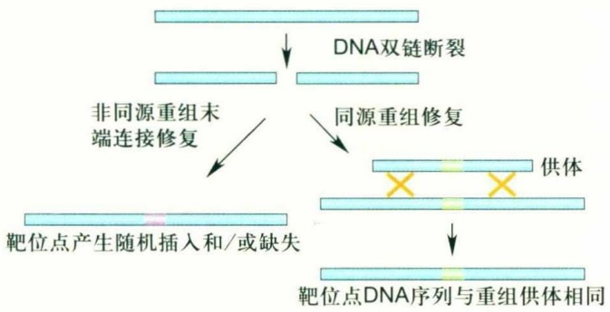

flowchart

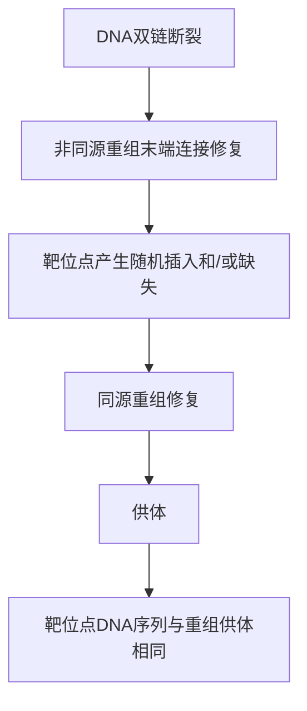

图 3-1 DNA 双链断裂修复的两种机制

## 3.1.2 基因组编辑技术的发展简史

基因组靶向编辑技术诞生于20世纪80年代，最初是利用细胞自身偶然发生的同源重组事件完成精确的基因突变。研究者以小鼠胚胎干细胞（embryonic stem cell, ESC或ES细胞）为实验材料，选取CFTR基因的第一个外显子及其两端的部分内含子序列构建质粒DNA，并在该外显子内加入新霉素抗性基因(neo)，用于抗性筛选（正筛选），同时又可破坏内源基因的表达与功能。同时，在一侧同源的内含子序列外连接一个胸腺核苷激酶基因(TK)，该酶能够将无毒的丙氧鸟苷转化为有毒的核苷，从而起到负筛选子的作用。将上述载体转染到体外培养的小鼠ES细胞中，由于细胞内可随机发生DNA双链断裂损伤，该载体就有可能被随机整合到基因组DNA的任意位点中(概率很小)，或通过同源重组整合进入CFTR位于第一个外显子的靶点中(概率极小)(图3-2)。如图所示，没有载体插入的细胞不携带neo，在新霉素处理条件下无法存活；载体随机整合的细胞一般会同时携带neo和TK，在丙氧鸟苷处理条件下也无法存活。在培养基中加入新霉素和丙氧鸟苷，这一正负双向筛选系统（positive and negative selection, PNS）使只有发生同源重组并完成精确基因替换的细胞才可存活下来。随后，研究者将经鉴定含有正确修饰的ES细胞移植到小鼠囊胚中，借助于ES细胞的多能性，这些细胞可参与胚胎发育，如果恰巧分化为新生小鼠的生殖细胞，则这个经过人工改造的基因就可以被固定下来，稳定遗传给后代，实现对生命的永久改变。人类利用ES细胞和同源重组第一次实现了个体水平的基因组编辑，因此，该项技术获得了2007年诺贝尔生理学或医学奖。不过，这一技术始终存在很多限制和不足:①基因组编辑的效率极低，一般仅有非常少的ES细胞能够被精确编辑；②成本昂贵，需要大量培养ES细胞，同时需要小鼠胚胎细胞移植以及至少3代的繁育配种，需要耗费大量的人力、财力和时间；③技术门槛高，很难掌握，无法普及；④只能通过ES细胞途径实现基因组编辑，这是由于同源重组的效率极低，必

3.1 基因组编辑技术简介与历史沿革

57

---

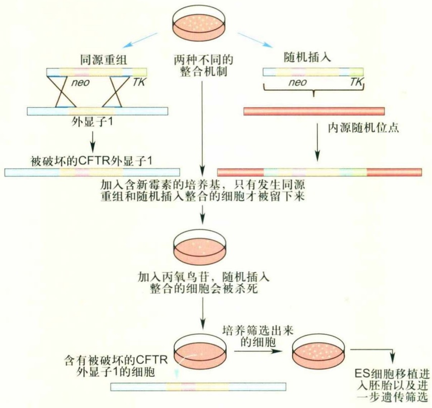

flowchart

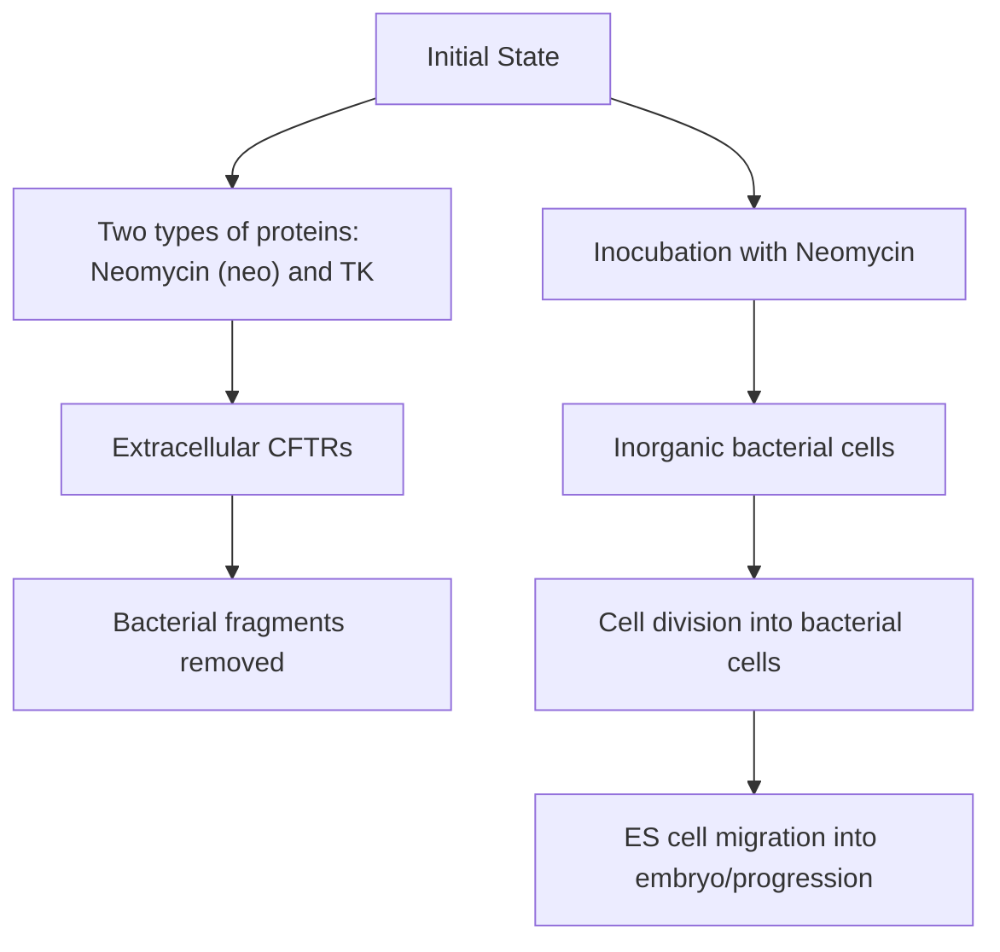

图3-2 基于同源重组和小鼠ES细胞的基因敲除/敲入方法

须通过大规模双向筛选才能得到所需的细胞。但是，能够实现ES细胞培养的物种非常少，导致这一方法长期以来仅能应用于小鼠。因此，人们一直在不懈地努力拓展思路、打破常规，开发出高效、普适、简单且成本低的新型基因组编辑技术。

与此同时，分子生物学的发展让人们逐渐了解到DNA双链断裂修复的机制。NHEJ的不精确性使研究者可以利用它在DSB位点附近实现突变，而双链断裂诱导的HDR修复效率相比偶发的同源重组可提升几个数量级。因此，只要找到能够识别特定DNA序列并进行定点切割的核酸酶，理论上就能够实现基因组靶向突变。20世纪80年代末，兆核酸酶(meganuclease)，也称为归位内切核酸酶或归巢内切核酸酶(homing endonuclease)，开始进入人们的视野。这类内切核酸酶天然识别12～40 bp的特异DNA序列，在许多物种的基因组中通常可保证仅存在几个甚至唯一一个切割位点，因此能够满足靶点特异识别的需求。其中，含有“LAGLIDADG”这一序列基序的酶家族被较多地用于基因组编辑。这一家族的酶一般以同源二聚体（如I-CreI）或单体（如I-SceI）的形式工作，可直接使用其野生型形式，或通过突变筛选获得识别序列不同的变体，以及将不同的野生型或变体组装使用（如将I-CreI和I-DmoI的单体结合为DmoCre），可以识别多种多样的DNA特异序列，从而拓展其应用范围。然而，并不是所有的目的基因都能找到可用的归巢内切核酸酶或保证该酶切位点在该物种基因组中的唯一性，因此这类核酸酶距离人们对任意物种的任意基因进行编辑的目标还相差甚远。幸运的是，随着ZFN、TALEN和CRISPR/Cas系统等技术的出现和发展使实现这一目标具有了可能（图3-3）。由于这些技术工具需要人们根据靶点序列进行蛋白质或核酸的设计、合成或组装，因此统称为人工内切核酸酶。人工内切核酸酶有两个重要功能域，即能识别特定核酸序列的DNA结合结构域和具有核酸酶活性的DNA切割结构域。以下集中介绍这几种人工内切核酸酶，特别是CRISPR/Cas系统的原理、发展与构建方法，以及它们在基因组编辑中的应用。

58

第3章 基因组编辑

---

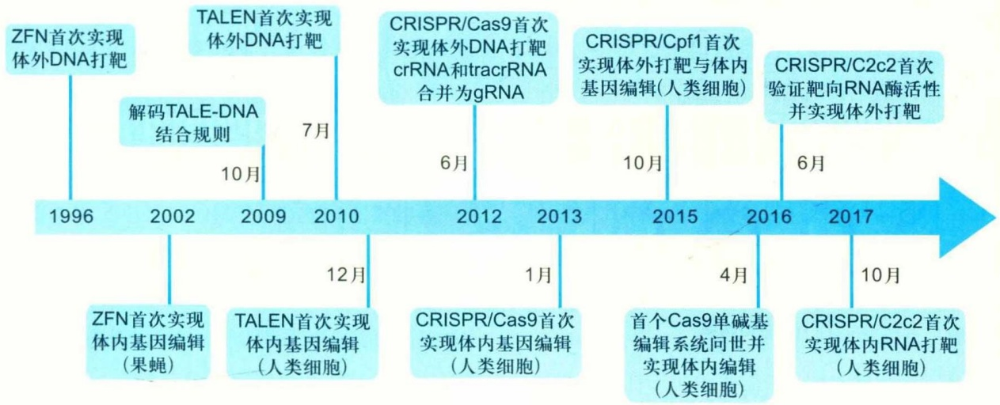

state_timeline

| Year | Milestone |
| --- | --- |
| 1996 | ZFN首次实现体外DNA打靶 |
| 2002 | 解码TALE-DNA结合规则 |
| 2002 | ZFN首次实现体内基因编辑(果蝇) |
| 2009 | TALEN首次实现体外DNA打靶 |
| 2009 | TALEN首次实现体内基因编辑(人类细胞) |
| 2010 | 7月 |
| 2010 | 12月 |
| 2012 | CRISPR/Cas9首次实现体外DNA打靶crRNA和tracrRNA合并为gRNA |
| 2013 | 6月 |
| 2013 | 1月 |
| 2015 | CRISPR/Cpf1首次实现体外打靶与体内基因编辑(人类细胞) |
| 2015 | 10月 |
| 2016 | 首个Cas9单碱基编辑系统问世并实现体内编辑(人类细胞) |
| 2016 | 4月 |
| 2016 | CRISPR/C2c2首次验证靶向RNA酶活性并实现体外打靶 |
| 2017 | 6月 |
| 2017 | 10月 |
| 2017 | CRISPR/C2c2首次实现体内RNA打靶(人类细胞) |

图3-3 基于人工内切核酸酶的基因组编辑技术的简要发展历程

## 3.2 ZFN 与 TALEN——通过蛋白质特异识别靶序列的人工内切核酸酶

## 3.2.1 ZFN的起源与发展

人们很早就发现生物体中存在多种锌指蛋白(zinc finger protein, ZFP)，它们能够介导蛋白质与核酸、小分子或其他蛋白质之间的特异相互作用。这些ZFP的共同特点是包含数量不等（通常为3～7）的串联锌指基序(zinc finger motif)，相当一部分ZFP能够特异识别并结合基因组DNA上特定长度序列的靶位点，从而作为转录因子调控基因表达。自从发现ZFP能够特异识别并结合特定的DNA序列，人们就开始尝试利用这一特性来改造基因组。1996年，约翰·霍普金斯大学的一个课题组将源自小鼠的锌指蛋白Zif268与来自海床黄杆菌(Flavobacterium okeanokoites)的Fok I内切核酸酶融合，构建了第一例人工锌指核酸酶(图3-4)，并报道可在体外实现对靶序列的切割。2002年，美国犹他大学D. Carroll实验室利用果蝇首次实现了在体内用ZFN定点突变基因。随后，该技术逐步被扩展应用于多种生物体和体外培养细胞。

在ZFN中，ZFP起识别DNA靶序列的作用，又称为ZFN结合结构域。该结构域通常由3～6个 $C_{2}H_{2}$ 类型的锌指重复单元串联而成，每个ZFP可直接特异识别DNA双链中某一条单链上3个连续的核苷酸靶点（称为三联子)。每个锌指约由30个氨基酸残基组成，折叠形成 $\alpha-\beta-\beta$ （C端→N端）类型的二级结构，其中的 $\alpha$ 螺旋可插入到DNA双螺旋的大沟中，直接同碱基发生作用。 $\alpha$ 螺旋的第-1～+6位氨基酸残基起到识别碱基的功能，尤其是第-1、+3、+6位氨基酸残基直接同三联子DNA序列中的3个碱基相互作用。在这7个氨基酸残基中，第4位是固定不变的亮氨酸，其他6个氨基酸残基可以进行改变，使其能够识别特定的DNA序列。此外，3个锌指之间也存在一定的上下文依赖效应(context effect)。其中， $\alpha$ 螺旋的第+2位氨基酸残基与上一个(N端)锌指所识别的三联子最后一个（在DNA上则是5'端）碱基的互补碱基之间存在相互作用。

ZFN的切割功能由IIS型限制性内切酶Fok I完成，该蛋白需要以二聚体的方式发挥功能，因此ZFN需要成对使用。通常的做法是在切割位点的上、下游各设计一个ZFN，分别靶向DNA的正义链和反义链。同时，在一对ZFN识别序列之间需要为Fok I二聚体留出足够的作用空间，长度通常为5～7bp，称为间隔区(spacer)，便于Fok I对DNA双链进行切割，产生DSB。早期主要使用野生型的Fok I，以同源二聚体的形式起作用。不过，Fok I在细胞内可以自身二聚化，对DNA进行非靶向性切割，造成非常高的脱靶效应(off-targeting effect)，极大地影响了ZFN的效率和突变体的创建。为此，人们对Fok I内切酶进行了改造，降低其同源二聚化的活性，使其主要以异源二聚体的形式起作用。同时还对Fok I进行了多个位点

3.2 ZFN与 TALEN——通过蛋白质特异识别靶序列的人工内切核酸酶

59

---

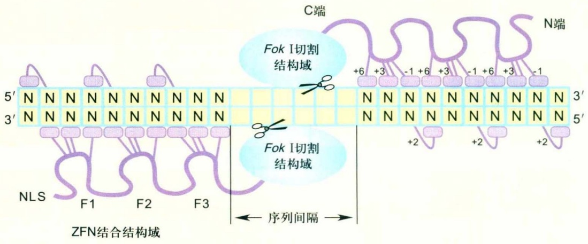

text_image

C端
N端
Fok I切割
结构域
+6 +3 -1 +6 +3 -1 +6 +3 -1
5' N N N N N N N N N
3' N N N N N N N N N
Fok I切割
结构域
N N N N N N N N N N 3'
N N N N N N N N N N 5'
NLS F1 F2 F3
序列间隔
+2 +2 +2

图3-4 ZFN与靶序列结合并实现DNA定点切割的示意图

的随机突变，筛选到一些切割活性较高的突变形式，称为Sharkey form。将这些不同形式的改造结合在一起，使Fok I结构域的切割活性和特异性都得到了很大程度的提升，并且在提高靶向效率的同时显著降低了脱靶效应。

应用该项技术的难点和瓶颈在于筛选效率高和特异性好的ZFP，为此人们付出了很多努力来试图攻克这一难题，遗憾的是进展一直不够理想。不过，由于EEN技术的飞速发展与迭代，随着相对简单的TALEN和CRISPR/Cas技术的相继崛起，人们在目前的科研实践中已很少使用ZFN，相应地，对这项技术的深度开发也基本停滞。但是，作为第一个被成功开发的EEN，ZFN在理论上能够用于靶向突变任意物种的个体或培养细胞的任意基因组序列，打破了靶向改造基因组的物种限制，为基因组编辑技术开辟了一个全新的思路和领域。这无疑为反向遗传学技术带来了革命性的改变，基因组编辑从此进入了一个新时代。

## 3.2.2 ZFN/ZFP的构建与筛选

ZFN应用过程中最关键的步骤是筛选有效且特异的ZFP。目前只有少量已知能够同特定DNA序列结合的ZFP，可以用于直接构建ZFN，而大多数DNA序列尚无法直接得知何种ZFP能与之有效结合，因此需要根据已知的ZFP与其靶位点的对应规律，选择合适的靶位点、构建ZFP或ZFP文库，通过DNA结合活性或切割活性检测体系筛选具有高活性和特异性的ZFP。

新的ZFN/ZFP的构建与筛选策略主要分为两类。第一类是直接组装的策略，主要思路是提取已知的ZFP中锌指与三联子靶点的对应信息，根据靶位点的序列，选取对应的锌指直接组装成新的ZFP或ZFN，再验证其整体的结合或切割活性。这类策略主要包括模块组装（modular assembly，MA）和上下文依赖组装（context-dependent assembly，CoDA）两种方案，实验方法相对比较简单。MA是选择单个锌指直接组装，完全不考虑上下文依赖效应，组装出来的ZFN活性与靶点中GNN的数量有关，打靶成功率随着靶点中GNN的数量减少而显著降低。CoDA方案则是在寡聚文库构建（oligomerized pool engineering，OPEN）方案所获结果的基础上选择靶点序列和对应的锌指，从而尽量避免上下文依赖效应的影响。第二类是基于筛选的策略，主要思路是预先合成一个ZFP文库，通过各种筛选体系寻找结合力最强的ZFP。这类策略主要包括OPEN和Wolfe's两种方案。这两种方案相对于直接组装策略在实验步骤上较为烦琐，但成功率相对较高。

OPEN是J. K. Joung等于2008年提出的一套ZFP构建与筛选方案。OPEN同时也有“开源”、“自由使用”之意。该方案主要分为两步:①合成锌指序列库，将直接参与识别的特征氨基酸残基的位置设为随机化残基（即将α螺旋-1～+6位大体设为XXXXLXX）。根据每个锌指在ZFP中所处的位置（F1、F2或F3），将相应的序列库连接到一个另外2个锌指已固定、并且同转录激活结构域融合的锌指激活因子（zinc finger activator，ZFA）骨架中。通过较低的筛选压，在噬菌体-大肠杆菌表达体系中筛选得到相应位置的锌指预筛库，其中含有与目标三联子具有一定结合力的锌指群。②选取与3个目标三联子的序列及位置相符的3个预筛锌指库，组装为针对3个三联子靶位点的完整ZFP混合库，并进一步建立ZFA

60

第3章 基因组编辑

---

库，在较高筛选压下进行第二轮筛选，得到与9-bp靶序列（即3个目标三联子）结合效率较高的ZFA，并据此构建ZFN。OPEN方案的优势在于，通过第一步预筛选，富集了与目标序列具有一定结合能力的单个锌指；同时保持一定规模的预筛库，可避免每个三联子靶点上锌指的选择过于单一，从而降低了因上下文依赖效应干扰而使三锌指组合而成的ZFP无效的风险。OPEN方案的另一优势在于其信息完全公开，并且可以向作者索取已建好的预筛库。但是，OPEN方案仍存在一定的缺陷:它严重依赖于目前所构建的锌指预筛库，其目标序列的覆盖范围远不够全面。此外，在第二轮筛选中是否一定能够得到高效并且特异性结合目标序列的ZFP还有待验证。

以上所有方案的共同限制是都只能针对部分三联子序列进行靶点设计及建库筛选，无法涵盖所有的DNA序列，为了获取一对能够有效工作的ZFN，往往需要测试或筛选数量非常可观的锌指序列组合库，不但需要消耗相当大的人力物力，而且最终的成功率也不高。此外，ZFN的诱变效率整体而言比较低（多数情况下不超过10%），ZFN还存在较高的脱靶效应。尽管不少研究组开发了多种ZFN/ZFP构建与筛选方案，以期能够解决这些问题，但是这一技术的应用门槛始终相当高。随着简单易用的TALEN和CRISPR/Cas系统的出现与普及，目前在科研实验室中已很难再见到ZFN的身影。

## 3.2.3 TALEN的起源与发展

类转录激活因子效应物（transcription activator-like effector，TALE）发现于一类特殊的植物病原体——黄单胞菌（Xanthomonas）。TALE蛋白类似于真核生物的转录因子，能够通过识别并结合特异的DNA序列调控宿主植物内源基因的表达，从而为病原体侵染宿主细胞创造有利条件。人们早在1989年就克隆了TALE家族的第一个成员avrBs3。然而，20年后，人们才真正揭开了TALE蛋白特异性识别并结合特定DNA靶序列的奥秘。

TALE蛋白由多个结构域组成，包括N端的转运信号(translocation signal)、C端的核定位信号(nuclear localization signal, NLS)和转录激活结构域(activation domain, AD)，以及中部与DNA特异识别并结合的结构域。中部结合结构域是TALE蛋白的核心，它由若干个（一般为1～33个）长度为33～35个氨基酸残基的重复单元串联结构和末端20个氨基酸残基的半重复单元共同构成。每个重复单元和末端的半个重复单元可以特异识别并结合DNA靶序列中的一个核苷酸。在每个重复单元中，第12位和13位的氨基酸残基是实现靶向识别特异碱基的关键位点，随靶点核苷酸序列的不同而异，称为重复可变双残基(repeat variable diresidue, RVD)；其他位置的氨基酸残基则相对固定。目前发现存在近20种RVD，其中HD(His Asp)、NG(Asn Gly)、NI(Asn Ile)和NN(Asn Asn)最常见，结合对应碱基的特异性和效率也较高。它们与碱基之间的对应关系分别为HD对应C、NG对应T、NI对应A、NN对应G。事实上，NN不仅对G的识别效率较高，对A的识别效率也较高，因此其特异性不强，有可能导致脱靶效应。不过，由于已知的对G特异性较强的RVD的结合效率均比较低，因此综合而言，NN仍是最好的对应G的RVD。由于存在如此简单的一一对应关系，在靶向突变基因组的应用上，TALE相对于ZFP的优势不言而喻。理论上，人们只需按照DNA靶点中的碱基序列将含有相对应的RVD的TALE重复单元依次组装在一起，所得到的TALE蛋白就应该可以特异识别并结合该靶序列。类似于ZFN，人们把TALE中的AD替换成内切核酸酶Fok I的切割结构域，便可构建出TALE核酸酶(TALE nuclease, TALEN)(图3-5)，从而实现对特定的DNA靶序列进行切割。由于Fok I是以二聚体的形式起作用，因此，TALEN也需要成对发挥功能。显然，相比于ZFN，TALEN的设计难度大大降低，无需再进行庞大的文库构建与筛选工作。同时，由于RVD与碱基之间具有相对良好的对应关系，并且似乎并没有明显的上下文依赖效应，因此，TALEN表现出了较好的靶向突变成功率和效率，以及较低的脱靶效应（一般G含量较低的靶点脱靶率更低）。

2010年，人们成功构建出第一对TALEN，随后又很快利用TALEN在体外培养的人类细胞中成功实现了基因组靶向编辑，并在短短的2年时间内，相继在线虫、斑马鱼、果蝇、小鼠、大鼠、水稻等诸多物种中的个体水平得到成功应用。TALEN一经问世便迅速成为当时最热门的反向遗传学工具，入选了美国Science杂志“2012年度十大科学进展”，被称为基因组的“巡航导弹”。TALEN技术的飞速发展得益于TALE重复单元与核苷酸靶点之间简单、明确、特异的一一对应关系，使基于蛋白质特异识别靶序列的EEN技术变得简单易行，使TALEN成为第一个真正意义上普适的、大众化的基因组编辑工具。

3.2 ZFN与 TALEN——通过蛋白质特异识别靶序列的人工内切核酸酶

61

---

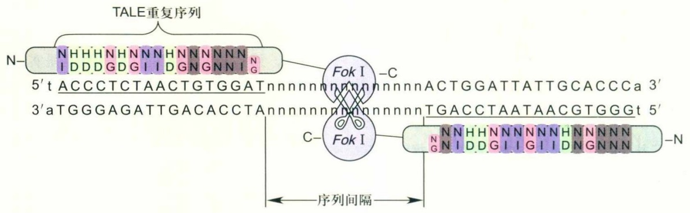

text_image

TALE重复序列
N-N-H-H-H-N-N-N-N-N-N-N-N-N-G
I-DDD-GD-G-I-D-G-N-G-N-N-G
5't ACCCTCTAACTGTGGATnnnnnnnnnnnnnnnnnactGGATTATTGCACCCCa 3'
3'aTGGGAGATTGACACCTAnnnnnnnnnnnnnnnttGACCTAATAACGTGGGt 5'
C-Fok I
-N-N-N-H-H-N-N-N-N-N-N-N-N-N-N-N-N-N-N-N-N-N-N-N-N-N-N-N-N-N-N-N-N-N-N-N-N-N-N-N-N-N-N-N-N-N-N-N-N-N-N-N-N-N-N-N-N-N-N-N-N-N-N-N-N-N-N-N-N-N-N-N-N-N-N-N-N-N-N-N-N-N-N-N-N-N-N-N-N-N-N-N-N-N-N-N-N-N-N-N-N-N-N-N-N-
序列间隔

图3-5 TALEN与靶序列结合并实现DNA定点切割的原理示意图

CRISPR/Cas系统与TALEN技术在靶点偏好性、靶向诱变成功率、效率与特异性等方面各有优劣，在某些方面TALEN仍有优越之处。理论上TALEN的特异性优于CRISPR/Cas系统，具有较低的脱靶效应。因此，直至今日，仍然有一些研究人员致力于改进TALEN的适用范围和构建技巧，以及将其运用于不同模式系统的科学研究中。例如，北京大学魏文胜与伊成器两个研究组通过构建TALE文库，筛选出能够特异识别5-mC和5-羟甲基胞嘧啶（5-hmC）等常见DNA表观遗传修饰的新型RVD，并借此在体外实现了单碱基分辨率的DNA 5-hmC修饰的检测。这一研究成果证明TALE重复序列一对一识别单个碱基的特性不仅对于基因组编辑具有独特的应用价值，有待研究者们进一步深度挖掘。

## 3.2.4 TALEN的构建与筛选

当破解TALE与DNA特异识别的分子密码后，研究人员首先想到的是如何借鉴ZFN的策略，把天然的TALE加以改造，使其成为能够对特定的基因组位点进行靶向突变和修饰的工具。为了保证靶点在整个基因组中存在的唯一性或特异性，靶序列一般选择大于10个碱基对。这就要求TALE需要含有至少9.5个重复单元，编码这一重复结构的核苷酸长度就会大于1000个碱基对，并且具有很强的序列重复性，无法采用常规的分子克隆方法进行载体构建。因此，构建识别特定DNA序列的TALE就成为这一技术中的关键步骤和TALE应用的主要瓶颈。目前通过分子克隆途径人工构建TALE的方法主要包括四大类（图3-6）:①基于Golden cate（GG）克隆的方法，根据TALE单体（重复单元）的来源可分为基于PCR的GG法（GG-PCR）和传统的基于质粒载体的GG法（GG-vector）；②基于连续克隆组装的方法，包括限制性酶切-连接法(restriction enzyme and ligation, REAL) 和单元组装法(unit assembly, UA); ③ 基于固相合成的高通量组装方法，包括FLASH (fast ligation-based automatable solid-phase high-throughput) 和ICA (iterative capped assembly); ④ 基于长黏末端的LIC (ligation-independent cloning) 组装方法等。其中，北京大学张博实验室开发的单元组装法利用氨基酸密码的简并性设计了一种“替代重复单元”(alternative repeat unit, 或称“旁重复单元”)，使这种重复单元的两端为一对同尾酶（5'端Spe I和3'端Nbe I）的酶切位点；同时，在载体骨架上再设计一个辅助性的Hind III位点，这样就可以利用简单、可靠的常规限制性内切酶，采用相同的酶切策略，通过“酶切-连接”的循环操作构建任意长度的TALE重复序列。该方法在保证载体构建精确性和简便性的同时，也比较容易掌握，仅仅利用4个初始质粒、3种常用的内切酶和基本的分子克隆技术就可以合成任意长度的TALE单元，同时每一步骤的中间载体都可以编号储存作为文库，从而反复用于之后的构建。运用这一方法，该实验室率先在斑马鱼中成功实现了可遗传的TALEN打靶。其余各类TALE重复单元构建方法的技术原理简述和优缺点分析见表3-1。

由于针对每一个靶点都需要构建新的TALEN，因此，对于常规的科研实验室而言，大规模构建和使用TALEN仍然存在一定的难度。2013年初CRISPR/Cas技术问世后，TALEN的这一缺点就更加明显，导致使用TALEN的热度逐渐降低。不过，由于TALEN在某些方面仍然具有独特优势，依然有研究人员坚持开发能够快速、准确地大量构建TALEN的方法。例如，北京大学魏文胜实验室建立并优化了一种称为ULtiMATE（USER based ligation mediated assembly of TAL effector）的规模化

62

第3章 基因组编辑

---

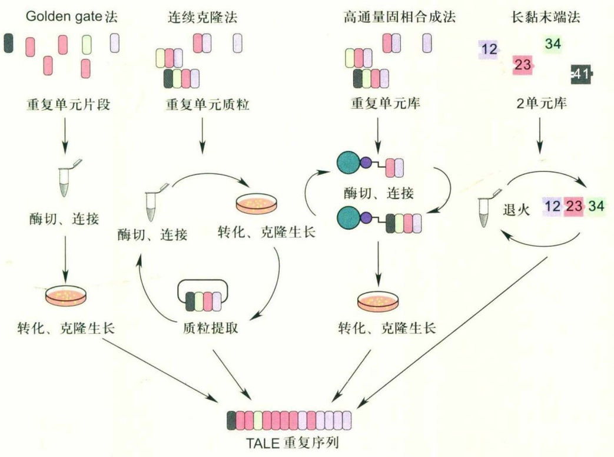

flowchart

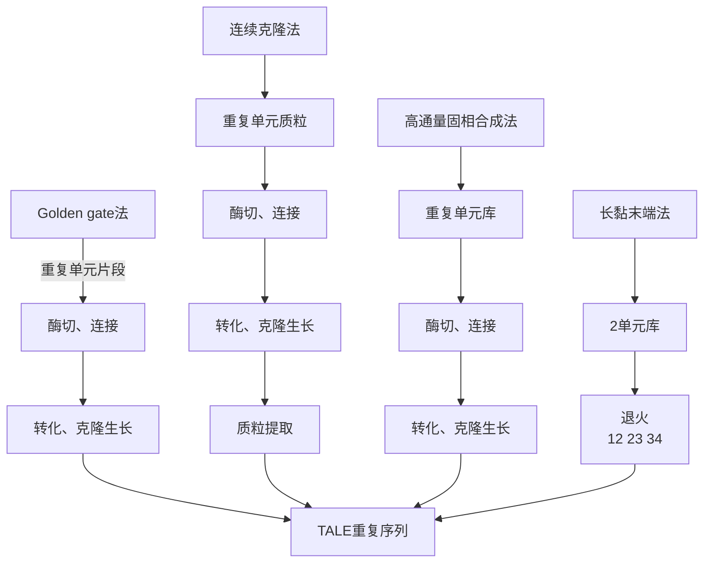

图3-6 四类 TALE 重复单元构建方法的示意图

表 3-1 TALE 重复单元构建方法比较

<table><tr><td>分类</td><td>名称</td><td>简述</td><td>优点与不足</td></tr><tr><td rowspan="3">基于Golden gate的方法</td><td>GG-PCR</td><td>通过PCR扩增TALE重复单元,用IIS型内切酶产生多种一一特异匹配的黏性末端对,一次可连接4~6个TALE单元</td><td>优点:两轮酶切-连接,速度快。不足:需要24种PCR扩增引物,易混淆;若连接失败则难以进行错误排查</td></tr><tr><td>GG-vector</td><td>基于质粒载体,用IIS型内切酶产生多种一一对应、特异匹配的黏性末端对,一次可以连接8~10个TALE单元</td><td>优点:两轮酶切-连接,速度快。不足:需准备多种骨架载体,消耗大量昂贵的IIS内切酶;建库困难,难以大量构建</td></tr><tr><td>ULtiMATE</td><td>先利用USER酶构建出512个TALE四联子文库,再利用USER或Golden gate酶构建长度为14~20个氨基酸残基的TALE重复序列</td><td>优点:能够快速完成大量TALEN构建,相对不易混淆。不足:需要预构建或获得文库,只有拥有文库才能发挥该方法的优势</td></tr><tr><td rowspan="2">基于连续克隆组装的方法</td><td>UA</td><td>用同尾酶切割产生相同的末端,逐步连接不同的重复单元</td><td>优点:易于掌握,成本低廉;中间载体可重复使用不足:构建慢,难以大量构建</td></tr><tr><td>REAL</td><td>普通的限制性内切酶与IIS型内切酶结合的逐步连接策略</td><td>优点:易于掌握,已完成建库。不足:需要预构或获得文库;IIS型内切酶导致高成本</td></tr><tr><td rowspan="2">基于固相合成的高通量组装方法</td><td>FLASH</td><td>基于磁珠和REAL方法的高通量固相合成策略</td><td>优点:省略转化和细菌生长的时间,可以快速高通量构建。不足:需要昂贵的特殊仪器与试剂;反应正确率低,需要大量测序获得正确产物</td></tr><tr><td>ICA</td><td>基于固体表面的循环合成策略。采用寡核苷酸发夹封闭未合成完整的TALE链,使完整的TALE链得到富集</td><td>优点:包含FLASH的优点,同时极大地降低了反应错误率。不足:需要昂贵的特殊仪器与试剂,每一反应需要多种反应物参与且必须相互对应</td></tr><tr><td>基于长黏末端的组装方法</td><td>LIC</td><td>不依赖连接的组装方法,在TALE双单元的两端设计不同的长单链末端(如14、22、15和10个碱基),利用不同片段末端之间的序列互补性组装所需的TALE重复序列</td><td>优点:两步反应,且不需要DNA连接酶参与,速度最快。不足:需同时用到多种长单链末端的多个单元才能实现一步反应,文库构建烦琐,序列复杂且成功率不高</td></tr></table>

3.2 ZFN与TALEN——通过蛋白质特异识别靶序列的人工内切核酸酶

63

---

TALE构建方法。他们首先利用USER酶特异切割DNA序列中的尿嘧啶位点的特性，构建出含有512个载体的TALE重复单元四联子文库；在此基础上，设计与黏性末端相匹配的特异引物，根据靶点序列选取合适的四联子载体作为模板，PCR扩增重复序列；再利用USER酶或Golden gate系统切割产生一一对应的黏性末端，然后按顺序连接至带有TALE的N、C两端以及Fok I的骨架载体中，最终即可得到所需的TALEN载体。利用已有的文库，这一方案仅需要一次常规的PCR和酶切-连接反应就可完成载体构建，因此能够以较低的成本快速地大量构建TALEN。通常熟练的研究者3天即可得到5对甚至更多经测序确认的TALEN质粒。此外，这一方法相对容易在实验失败时排查错误原因。总体而言，ULtiMATE是目前能够兼顾准确与高效的一种TALEN组装方法。

## 3.2.5 ZFN和TALEN的比较与小结

作为通过蛋白质特异识别靶序列的EEN，ZFN与TALEN都是用Fok I作为EEN的切割结构域，两者的主要区别在于DNA结合结构域。锌指基序和TALE重复单元在识别并结合DNA靶点的原理上具有很大的差异，相应地，两者的差异也体现在靶点识别和结合的准确性与特异性、潜在的脱靶效应、EEN筛选/构建方法与难度等诸多方面。总体而言，虽然TALE重复单元的复杂性高于锌指，其载体的构建过程也较为烦琐，但是，由于TALEN结合靶序列的特异性和效率均高于锌指，并且识别靶点的规则简单，只需根据靶点序列直接设计、组装，不需要像ZFN那样进行文库构建与筛选，因此，TALEN在应用的便利性和成功率上远胜ZFN。可以说，TALEN技术的诞生，真正开启了基因组编辑的“黄金时代”，使人们随意改造任意基因组的梦想成真。然而，CRISPR/Cas系统是否确实在各个方面都优于TALEN，是否能够完全取代TALEN？这仍是一个值得思考的问题。

## 3.3 CRISPR/Cas 系统——通过 RNA 特异识别靶序列的人工内切核酸酶

## 3.3.1 CRISPR/Cas系统的来源与作用原理

与起源于锌指转录因子或 TALE、以蛋白质与核酸的特异相互作用为基础实现靶向识别 DNA 的 ZFN 和 TALEN 技术不同，CRISPR/Cas 系统以核酸之间的相互作用为基础，通过简单的碱基互补配对实现对 DNA 序列的靶向识别与结合。该系统广泛存在于细菌和古菌中，是原核生物特有的一种由小 RNA 介导的获得性免疫系统，用来特异识别和沉默外源入侵的核酸。该系统在遗传上由一组 cas 基因和 CRISPR 基因座构成。cas 基因编码 CRISPR 相关蛋白 (Cas 蛋白)，CRISPR 基因座则包含一段高度串联重复并带有特定回文结构的区域，因而又称为 CRISPR array。细菌能够捕获入侵的病毒、质粒等外来核酸中特定的 DNA 序列片段——前间区序列 (protospacer)，将它们整合到 CRISPR 区域，相当于产生了免疫记忆。CRISPR 区域可转录生成一个 crRNA 前体 (precursor CRISPR RNA, pre-crRNA) 分子，然后经 Cas 蛋白或 RNase III 加工处理，形成多个成熟的 crRNA (CRISPR RNA)；每个 crRNA 的长度为 42 nt，在 CRISPR/Cas 系统中负责直接识别靶序列。这些 crRNA 可在一个或多个 Cas 蛋白和其他 RNA（如 tracrRNA）的辅助下，以碱基配对的方式特异性识别外源入侵序列，并通过各种不同的作用机制组装形成核酸酶切割复合物，降解入侵的核酸。

目前发现的CRISPR/Cas系统可分为两大类共6种类型。第一大类包括I型、Ⅲ型和IV型CRISPR/Cas系统，它们的crRNA都是由专门的Cas蛋白加工pre-crRNA形成，成熟的crRNA需要与多种Cas蛋白共同形成核糖核酸蛋白复合体，才能识别并切断与crRNA互补的核酸序列。第二大类包含其余的所有亚型（Ⅱ型、V型和VI型），其crRNA的形成同样依赖于Cas蛋白，但是Ⅱ型与部分V型还需要结合一个能与crRNA重复回文序列互补配对的反式激活crRNA(trans-activating crRNA, tracrRNA)后，才能启动对前体crRNA的加工。成熟的crRNA只需要与一个多结构域的核酸酶结合，即可形成有活性的内切酶复合体，完成切割核酸靶序列的功能。Cas9就是一种Ⅱ

64

第3章 基因组编辑

---

型CRISPR/Cas系统特有的DNA内切核酸酶。tracrRNA通过碱基互补配对与crRNA形成部分双链，引导Cas9蛋白靶向切割DNA，使靶点产生DSB。其中，crRNA通过碱基互补配对特异识别DNA上20-bp的靶序列，Cas9蛋白HNH结构域切割互补链，RuvC结构域切割反向互补链。此外，在与被捕获的外源protospacer毗邻的区域有一个重要的元件PAM（protospacer adjacent motif）。对于最为常用的化脓性链球菌（Streptococcus pyogenes）的Cas9（称为SpCas9；后文若无特殊说明，则Cas9核酸酶一般是指SpCas9），PAM由NGG三个碱基构成，是CRISPR/Cas9系统识别protospacer、定向切割靶DNA序列的必要条件。因此，Ⅱ型CRISPR/Cas免疫系统切割DNA仅需要成熟的crRNA、tracrRNA和Cas9蛋白3个组分。利用这一特性，2012年，美国加州大学伯克利分校J.A.Doudna研究组与瑞典于默奥大学E.Charpentier研究组对该系统进行了改造，并在体外成功实现了对DNA双链靶位点的特异切割。同时，她们还进一步简化了该系统，截短了上述两个RNA分子，在不影响效率的前提下鉴定出了最短的crRNA与tracrRNA，并通过一段连接序列将其合并，设计出一个长102 nt的RNA分子，称为向导RNA（guide RNA，gRNA），也有文献称为单一向导RNA（single guide RNA，sgRNA），并证明Cas9/gRNA同样也能够实现对DNA的靶向切割（图3-7）。因此，这种经人工改造的CRISPR/Cas系统又称为Cas9/gRNA系统。仅半年之后，2013年初，陆续有研究组报道，利用Cas9/gRNA系统在体外培养的哺乳动物细胞系中可成功实现基因组的靶向切割与突变，其中包括上述两位女科学家率领的研究团队，也包括华裔科学家、美国麻省理工学院博德研究所张锋率领的团队。随后，就像当年的TALEN一样，这项新技术被迅速应用到个体水平的研究，斑马鱼、小鼠等多个物种的内源基因相继被Cas9/gRNA系统成功突变。TALEN技术建立仅仅两年之后，Cas9/gRNA系统便横空出世。从此，基因组编辑领域开始取得突飞猛进的发展，并迅速带动生命科学基础理论研究、作物改良、基因治疗等诸多领域产生了革命性的飞跃，至今仍方兴未艾。

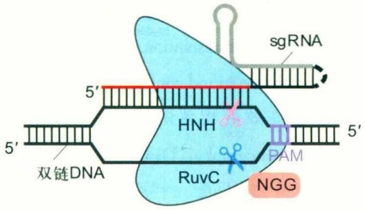

text_image

sgRNA
5'
HNR
RuvC
PAM
5'
双链DNA
NGG

值得一提的是，虽然Cas9/gRNA系统应用非常简单，但是将其用于靶向诱变真核生物基因组也并非易事。这主要是由于Cas9是由原核基因编码且在原核生物中起作用，自身并不具备自主进入细胞核的能力；此外，原核生物与真核生物虽然共享同一套核苷酸密码子，但是两者在密码子的使用上存在不同的偏好性。为此，需要在Cas9编码序列的合适位置添加核定位信号，并且进行密码子优化，Cas9/gRNA系统才能在真核生物中最大限度地发挥其功能。并且，即便同为真核生物，不同的物种对密码子的偏好性也存在一定的差异。因此，针对不同物种构建特异的密码子优化的Cas9编码序列往往会有效地提高Cas9/gRNA系统的基因组编辑效率。例如，经人类密码子优化的Cas9（hCas9）mRNA能够在斑马鱼中有效地诱导靶基因突变，而根据斑马鱼密码子偏好性优化的Cas9（zCas9）mRNA在斑马鱼中能够表现出比hCas9更高的诱变活性。Cas9/gRNA系统不是通过蛋白质与核酸的相互作用，而是通过核酸与核酸之间的碱基互补配对作用来识别并结合靶序列，与gRNA配对识别的DNA靶序列仅为20 bp，靶点识别区域3'端下游的3个碱基要求必须为NGG。可以说简单的靶点识别机制是Cas9/gRNA系统的最为优越之处。在实际应用中，对于不同的靶位点，只需改变gRNA中20 nt的靶点识别序列，而Cas9蛋白则对所有的靶点都是通用的，无需多次设计和构建；gRNA的长度仅为102 nt，可以通过多种方式在体外快速合成，或快速构建体内表达系统。由此可见，与ZFN和TALEN相比，Cas9/gRNA系统在应用的简便性

图3-7 Cas9/gRNA系统与靶序列结合并实现DNA靶向切割的原理示意图

Cas9核酸酶与crRNA-tracrRNA或单一的sgRNA形成复合物，通过碱基互补配对原则识别并结合20 bp的DNA靶序列，通过HNH与RuvC两个核酸酶结构域切割双链，造成DSB，形成平末端。

3.3 CRISPR/Cas系统——通过 RNA特异识别靶序列的人工内切核酸酶

65

---

上具有巨大优势，这极大地降低了基因组编辑技术的门槛，使得人们能够以低廉的成本快速，有效、高通量地进行基因组靶向诱变。正因如此，Cas9/gRNA系统被誉为“大众化的基因组微型手术刀”与“基因魔剪”。以下分别介绍CRISPR/Cas系统在不同研究对象中的应用策略以及近年来的改进、优化与拓展。

## 3.3.2 Cas9/gRNA系统的应用方法与效率检测

Cas9/gRNA系统与ZFN、TALEN技术的最终目的都是发挥其特异性内切核酸酶的作用，在细胞或生物体内完成对基因组的定向切割，在靶位点造成损伤，从而激活细胞固有的DNA损伤修复系统，利用不同的修复机制对靶位点实现所需的修饰。因此，应用这些系统的几个关键步骤包括系统的构建、向实验对象的导入，以及靶点诱变效率的检测与突变的筛选。Cas9/gRNA系统的构建相对简单，下面简单介绍导入方法和靶点诱变效率的检测方法。

对ZFN和TALEN而言，不同靶点对应的DNA识别结构域的蛋白质序列都不同，每个靶点都要构建新的ZFN或TALEN。通常的做法是将ZFN或TALEN的编码序列克隆至携带真核生物启动子的质粒载体上，然后成对转染到体外培养细胞中，或显微注射到生物体的雌性生殖腺（如线虫、果蝇）或受精卵中（如小鼠、斑马鱼）。对于某些卵裂较快的生物（如斑马鱼），若导入表达载体，由于通过转录和翻译积累到足够的蛋白质产物需要较长的时间，往往导致靶点切割发生得较晚，从而影响突变效率，因此对于这类实验材料，往往将ZFN或TALEN编码序列克隆至体外转录载体（携带T7、T3、SP6等原核启动子），通过体外转录获得mRNA，再将其导入生物体内，可获得更高的效率。

对Cas9/gRNA系统而言，其一大优势为核酸酶是固定不变的，与靶点序列无关。无论是体外转录获得的Cas9 mRNA或表达纯化的Cas9蛋白，对任意靶点均可通用，因此，一般体外培养细胞仍然通过转染导入Cas9表达载体，而个体水平的研究则多采用导入Cas9 mRNA或蛋白质的方法进行基因组编辑工作。对于不同物种，将Cas9的密码子进行优化，可提高Cas9 mRNA的翻译效率。同时，通过构建稳定表达Cas9的细胞系或携带Cas9转基因的生物体，可以省略导入Cas9的步骤，不仅便于实验操作，而且理论上还能够提高靶点突变效率，甚至通过不同的启动子实现时空特异性的Cas9表达，进而实现更为复杂的基因组靶向修饰。gRNA的准备相对比较简单。gRNA中除了20 nt的靶点识别序列，其余序列是固定的，因此，可以将带有这部分序列的载体作为模板，设计带有靶序列的引物通过PCR扩增模板，将产物克隆至真核表达载体中转染，在细胞内转录出gRNA；或在引物前再加上T7等原核启动子，即可将PCR扩增产物直接用于体外转录，获得gRNA。此外，还可以在体外将gRNA与Cas9蛋白共孵育，获得RNA-蛋白质复合物(RNP)，将该复合物导入细胞或个体，完成基因组编辑。将该复合物直接导入细胞或胚胎能更快地起到切割靶DNA的作用，这在需要高效切割或细胞分裂旺盛的实验中尤为重要。不过，目前RNA或蛋白质对于体外培养细胞的转染效率都较低，这在一定程度上限制了Cas9蛋白或RNP在培养细胞中的应用。

在导入人工内切核酸酶后，DNA靶序列就有可能产生DSB，并且绝大多数情况下会通过NHEJ的方式进行修复，造成DNA靶序列发生indel突变。据此，可以通过以下方法评估靶点的突变效率。

一是限制性内切核酸酶(restriction endonuclease, RE)检测法(图3-8)。若ZFN或TALEN靶点的Spacer或Cas9靶点靠近PAM的protospacer附近存在单一的限制性内切酶识别位点，则可以通过PCR扩增周围的基因组序列，用此内切酶对PCR产物进行消化。若靶点产生了indel突变，则有可能破坏该酶的识别序列，导致其PCR产物无法被酶切，因此可以通过PCR产物中未被酶切的片段比例估计靶点效率。RE检测法是一种简单、高效且相对准确的检测方法，缺点在于不是所有的靶点都能找到合适的内切酶位点，或酶的成本较高、不宜使用。此外，此方法需要严格设置阴性对照，否则很容易导致假阳性。

二是基于DNA变性以及错误配对的检测方法，包括T7内切核酸酶I法（T7 endonuclease I，T7E1）（图3-8）、高分辨率熔解法(high-resolution melting, HRM)、单链构象多态性法(single strand conformational polymorphism, SSCP)和变性高效液相色谱法(denaturing high performance liquid chromatography, DHPLC)等。T7E1能够特异性识别错配、不完全匹配、十字结构或Holliday junction结构并对其进行切割。DNA靶序列发生indel突变后与野

66

第3章 基因组编辑

---

生型序列之间或不同的indel序列之间会产生差异，通过PCR扩增靶点及附近序列，并通过变性-梯度退火使得不同的DNA单链进行匹配，再用T7E1处理退火后的DNA产物，能被T7E1切割的序列的比例即可间接反映靶点的效率。此外，从芹菜中提取的CEL I内切酶（现在常用的Surveyor酶即为其中的一种）也可以通过类似的原理检测靶点效率，但成本更高。HRM依赖于错配或不完全匹配的PCR产物的熔解温度与熔解曲线和野生型PCR产物不同，通过饱和的DNA染料进行qPCR实验，之后测定熔解曲线，能够以极高的分辨率区分不同的PCR产物，并通过软件分析靶点效率与indel的大致形式，是一种非常快捷且准确的方法，但是需要特殊的仪器，软件以及耗材的成本也较高。此外，错配或不完全匹配的双链DNA产物在色谱中的迁移速率会发生变化，可以通过高效液相色谱区分出携带突变的PCR产物，并估算其比例，反映靶点的突变效率，此即DHPLC法。同样地，携带突变的DNA单链相比于野生型单链产物，其构象发生改变，在非变性凝胶中的迁移速率会发生变化，通过非变性聚丙烯酰胺凝胶可以区分野生型与突变单链，并得到突变条带相对于野生型条带的比例，据此估算靶点的突变效率，此为SSCP法。

三是测序类方法，包括克隆测序法、直接测序法、软件分解分析法（tracking of indels by decomposition, TIDE）和深度测序法等（图3-8）。克隆测序法一般是对基因组的靶点区域进行PCR扩增，然后将PCR产物连接至测序载体中进行单克隆测序，通过逐条分析、比对测序结果计算靶点的突变效率。这种方法可以获得比较准确的序列与效率信息，但是实验过程较为烦琐、周期较长。TIDE法通过混合不同细胞或个体的基因组，对靶点区域进行PCR扩增，然后直接进行Sanger测序。如果产生DSB的效率较高，则切割位点及其下游的序列会由于序列不单一而呈现“乱峰”，而上游序列则不受影响，通过TIDE软件上传实验组与对照组的测序峰图，可以分析出靶点的突变效率以及主要的indel形式。TIDE法简便快捷，但难以测定效率较低的靶点；此外，此方法中如果希望得到准确的分析结果，需要提供信号强度尽可能大且高质量的Sanger测序结果。深度测序法可以视为不需要克隆的“单克隆测序法”，并且能提供更多的测序片段，结果更准确，但成本高昂。许多研究组与公司开发了在线的EEN基因组深度测序分析软件，例如，CRISPR-GA与crispRVariants等，除了能分析靶点效率与插入/缺失形式外，也能够检测大片段删除、基因敲入以及脱靶等。

## 3.3.3 Cas9/gRNA基因组编辑系统的优化

## (1) Cas9核酸酶特异性的优化

Cas9/gRNA基因组编辑系统问世仅一年后，多个团队便发表了多个关于其特异性和脱靶率的研究结果，发现Cas9/gRNA存在一定的脱靶效应。从理论上讲，一方

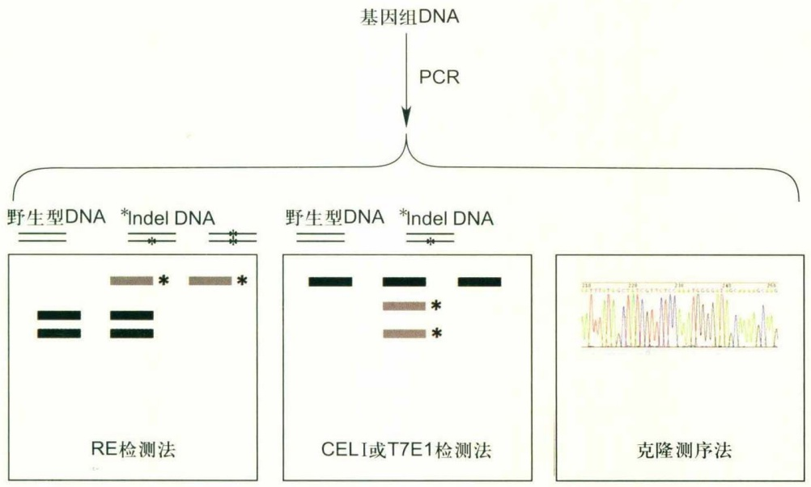

flowchart

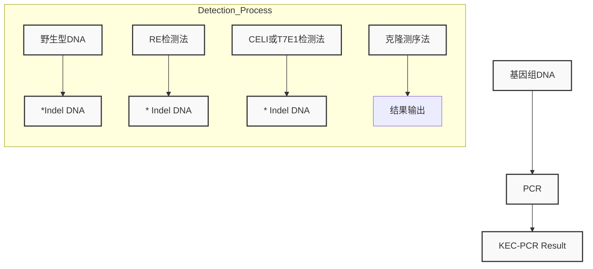

图3-8 几种人工内切核酸酶效率检测方法示意图

3.3 CRISPR/Cas系统——通过 RNA特异识别靶序列的人工内切核酸酶

67

---

面Cas9/gRNA识别的DNA序列长度为20 bp，而相比之下，一对TALEN识别的碱基序列长度往往可达到30 bp或更长，因此Cas9/gRNA更有可能产生脱靶；另一方面，gRNA与靶点序列的匹配并非完全精确，有可能匹配到相似的非靶位点区域，从而提升了脱靶率；此外，除了识别传统的PAM序列NGG外，Cas9也能较弱地识别NAG或NGA等非经典PAM，也可能导致脱靶。对基因组编辑系统而言，无论是科学研究需要，还是农业生产或临床应用，都需要严格控制脱靶效应。因此，对Cas9/优化gRNA系统，降低其脱靶效应非常重要。

首先做出改进的研究者借鉴了ZFN和TALEN的思路，对Cas9核酸酶的RuvC和HNH结构域分别进行突变，将其从切割双链的酶变为切口酶(nickase)，通过设计两个相近的Cas9靶点，利用切口酶分别切割两条双链，从而形成DSB。或将上述两个结构域全部突变成无切割活性的Cas9(dead Cas9或deactivated Cas9, dCas9)，再与Fok I切割结构域融合，同样可以将Cas9改造为成对切割DNA双链的体系。由于上述系统必须在两个靶点同时精确识别的情况下才能产生DSB，因此在理论上能够极大地减少脱靶效应。然而，对于特定的靶基因，同时找到两个相近且具有PAM序列的靶点往往比较困难，并且同时使用2个Cas9/gRNA的效率一般会比针对单独靶点的系统靶向效率更低，因而进一步限制了上述思路在实际研究中的应用。值得一提的是，切口酶和dCas9除了融合Fok I外，还能与其他蛋白的功能结构域相融合，从而帮助这些蛋白质结合到DNA的特定序列实现对基因组的其他修饰与操作（详见本节后文与3.4.5）。

随着Cas9结构和作用机制的逐步解析，多个研究组分别发现了Cas9上可能存在与DNA骨架发生非特异性相互作用的氨基酸残基，以及非特异性匹配也有可能激活HNH结构域，并借此通过在不同的位点进行突变，获得了一系列高特异性的Cas9核酸酶变体（表3-2）。这一系列变体都能有效地降低脱靶率，但它们的靶向突变效率也同时有所降低。中国科学院遗传与发育生物学研究所高彩霞研究组和韩国首尔大学Jin Soo Kim研究组分别发现gRNA 5'端由于启动子转录需要人为添加的多余序列影响了一些高特异性变体的活性，并分别利用tRNA和核酸酶的序列特性，将其添加在gRNA的5'端，并通过剪切去除这些多余序列，从而将变体的靶向突变效率提高到与野生型相当的水平。

## (2) Cas9核酸酶应用的拓展

虽然Cas9核酸酶已经是非常强大、便利的基因组编辑工具，但是在应用上仍存在一些局限性，仍有改进的空间。例如，SpCas9编码序列较长、分子量较大，通过病毒载体向细胞中导入较为困难；PAM序列的必要性则限制了靶点序列的选择；精确编辑基因组序列（如单碱基突变）难以实现等。针对这些问题，研究者已给出了一些改进方案，拓展了Cas9在基因组编辑中的应用范围。

2013年，张锋团队首次报道SpCas9在细胞内可实现基因组编辑时，也报道了来源于嗜热链球菌的St1Cas9能够在体外切割基因组DNA，并且具有较小的分子量。然而，St1Cas9的PAM序列非常复杂，为NNAGAAW，这大大限制了其应用。2015年，张锋团队筛选了6种分子量小于SpCas9的Cas9核酸酶，发现来自金黄色葡萄

表 3-2 高特异性 Cas9 核酸酶变体的突变形式与作用原理

<table><tr><td>名称</td><td>氨基酸突变位点及形式</td><td>提高特异性的原理</td></tr><tr><td>Cas9 切口酶</td><td>D10A (RuvC突变)H840A或N863A (HNH突变)</td><td rowspan="2">Cas9必须成对工作才能够产生DSB,增加了识别序列的总碱基数</td></tr><tr><td>dCas9-FokI</td><td>RuvC、HNH均突变,并融合了Fok I切割结构域</td></tr><tr><td>D1135E</td><td>D1135E</td><td>减少了Cas9对非经典PAM序列,尤其是NGA的识别</td></tr><tr><td>eSpCas9 (1.1)</td><td>K848A/K1003A/R1060A</td><td rowspan="3">通过突变防止碱性氨基酸R、K、H和极性不带电荷氨基酸N、Q与DNA骨架的非特异性相互作用</td></tr><tr><td>SpCas9-HF1</td><td>N497A/R661A/Q695A/Q926A</td></tr><tr><td>HeFSpCas9</td><td>eSpCas9与SpCas9-HF1的结合</td></tr><tr><td>HypaCas9</td><td>N692A/M694A/Q695A/H698A</td><td>提高HNH构象变化的激活阈值</td></tr></table>

68

第3章 基因组编辑

---

球菌的SaCas9具有与SpCas9相当的活性，而其编码序列较SpCas9短约1 kb，并且拥有相对简单的PAM序列NNGRR。由于编码序列较短，SaCas9可以和gRNA表达序列一起克隆至腺相关病毒（AAV）载体中，应用于成体小鼠的体内打靶。较小的Cas9有利于构建带有多个调控元件的复杂载体，因此，SaCas9已成为一些研究团队的新工具或新的研究对象，致力于将其改造为更“袖珍”、更精准的“魔剪”，以开发其在临床和其他领域的应用潜力。

尽管Cas9的经典PAM序列NGG理论上在基因组每8个碱基就出现一次（包含互补的CCN），但事实上在需要对特定区域进行编辑时，Cas9靶点的选择仍会遇到困难。2015年，美国麻省总医院的J. K. Joung实验室在分析Cas9结构的基础上，对PAM区域进行了突变与筛选，获得了VQR（PAM序列为NGAN或NGCG）与VRER（PAM序列为NGCG）两种能够在哺乳动物细胞和斑马鱼胚胎中保持基因组编辑活性的Cas9变体，同时验证了St1Cas9与SaCas9的体内编辑活性。这些变体与同源蛋白扩展了Cas9靶点的多样性，使其能够更加灵活地运用于基因组修饰中。

由于大部分人类遗传病的病因为点突变，因此无论是构建疾病动物模型，还是临床应用基因疗法，单碱基突变都是重要的技术手段。然而Cas9造成的DSB对细胞而言是严重的DNA损伤，其修复的不精确性也在一定程度上限制了其应用。因此，美国哈佛大学华裔科学家刘如谦率领的研究组以及另外几个研究组在2016年分别独立报道了基于Cas9的单碱基编辑系统，能够特异地将靶点区域的C转变为T或其他碱基，并对这一系统做出了改进与拓展(图3-9)。

最初报道的对C的单碱基编辑是利用融合在Cas9蛋白上的胞嘧啶脱氨酶，可脱去靶点附近C的氨基使其转变为U，形成U:G配对，之后有3种可能的方式对U:G配对进行修复，产生不同的结果:碱基切除修复有可能将U修复为C，因而复原成原有的序列；错配修复会切除一段带有U的DNA单链，并通过一种会造成一定错误修复的DNA聚合酶进行修复；不修复，直接进入DNA复制，U被T替换。D. Liu研究组最初设计的BE1仅仅将脱氨酶rAPOBEC1与dCas9融合，能够实现C→T转换，但是效率较低。随后，他们在BE1上融合了尿嘧啶糖苷酶抑制蛋白(uracil DNA glycosylase inhibitor, UGI)

并命名为BE2，通过抑制U的碱基切除修复提高了3倍效率。最终，他们用Cas9切口酶代替了BE2的dCas9，使切口酶在编辑链的反义链上切割，使得碱基切除修复时更倾向认为与U匹配的G是错配的成因，从而将其切除并替换为A，完成单碱基编辑。同时，将rAPOBEC1替换为作用区域更小的突变蛋白（见YEE-BE3），能够缩小其可编辑区域，使基因编辑更精确。新系统BE3的效率是BE2的6倍，但是由于切口酶的引入，有极小的概率在切口处形成indel，造成非特异性编辑。为此，2017年，他们又推出了BE4，在延长接头序列与增加一分子UGI以增加可编辑范围的基础上，添加了能够结合DSB末端并抑制其修复的DNA结合蛋白GAM，使得产生DSB的细胞因无法被修复而凋亡，起到自动筛选的作用。同时，BE4也被证明适用于其他的同源Cas9或Cas9变体，如SaCas9的切口酶（SaBE4-GAM）。迄今为止，BE系统及其变体已经成功应用于多种体外培养的人类细胞和小鼠、斑马鱼、水稻、玉米等模式生物中，证明了这一系统具有广泛的适用性。

2016年，日本神户大学的研究人员利用另一家族的胞嘧啶脱氨酶AID构建了另一套C单碱基编辑系统。其中，Target-AID系统利用了与BE系统类似的原理，只不过将脱氨酶换成了七鳃鳗中的AID酶PmCDA1，且融合蛋白的位置也有所不同。Target-AID系统也经历了类似BE系统的改进过程，最终实现了在酵母和人类细胞中较为高效的基因组编辑，其可编辑碱基的范围由于接头序列与脱氨酶的不同而有所不同。上海交通大学常兴研究组则利用人源的AID与dCas9融合，创建了TAM系统，以实现碱基的随机突变，即将C:G碱基对转变为另外3种碱基对。之后利用删除了C端序列的更加高效的AID（AIDx）取代了野生型AID以提高效率，并运用于细胞耐药性筛选中。TAM本身仅有极小的C->T偏好性，但若将TAM与UGI共表达，则在提升效率的同时可显著增加C->T偏好性，而几乎不会出现其他编辑类型。这也从侧面说明了UGI在BE系统中的重要作用。CRISPR-X系统是更加广泛的随机突变系统，在利用突变型的人源AID的基础上，在gRNA的骨架上加入了可被MS2蛋白识别的RNA发夹结构，通过MS2蛋白融合AID起到编辑作用。由于gRNA骨架和MS2蛋白的空间效应，CRISPR-X能够编辑靶点附近较大范围的碱基，因此更加适用于筛选。此外，D. Liu实验室的最新成果使单碱基

3.3 CRISPR/Cas系统——通过 RNA特异识别靶序列的人工内切核酸酶

69

---

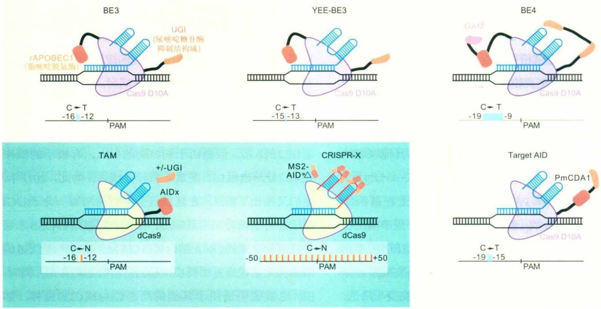

图3-9 单碱基编辑系统的构成和原理示意图

图中米色背景显示将C特异突变为T的系统，蓝色背景显示将C突变为其他碱基的系统；对于高效的编辑碱基C的系统而言，胞嘧啶脱氢酶结构和尿嘧啶糖苷酶抑制结构是必不可少的。

编辑系统不再只能编辑碱基C，并且能够将A转变为G。这一名为ABE的系统利用DNA聚合酶能够将tRNA特有的次黄嘌呤碱基I识别为G且I可以由A脱氨得到的特性，将大肠杆菌tRNA腺嘌呤脱氨酶TadA进行突变筛选与二聚体组合，获得了一种高效的异源TadA二聚体，将其与Cas9切口酶融合，成为ABE7，从而高效地完成A->G转变。至此，目前已经能够实现将C或A编辑为其他碱基，然而如何将T或G编辑为其他碱基，以及如何实现碳骨架不同碱基的颠换（transversion）编辑，则有待突破。相信不久的将来这些问题都能得以解决，我们也会拥有完整的单碱基编辑工具箱，用于DNA的精确修饰。

## (3) Cas9 编辑效率的提高

一般而言，Cas9的基因组编辑效率已经比较可观，然而如果对靶序列范围的要求比较严苛或需要进行基因敲入、精确替换等较为复杂的编辑，则靶点效率的提升就显得尤为重要。目前尚缺乏较为普适的提高基因组编辑效率的手段，已有的报道主要通过以下思路提高Cas9编辑效率:一是延长Cas9的表达时间以及促进Cas9与gRNA在空间上的接近，如构建Cas9转基因动植物，将Cas9/gRNA复合物导入细胞中发挥作用等；二是贴近Cas9的自然工作条件，化脓链球菌的最适生活温度约为37℃，因此将一些正常生长状态不在37℃的物种进行热处理，有可能提高Cas9/gRNA系统的编辑效率，这种方法已经在体外培养细胞、拟南芥和斑马鱼中有成功报道；三是借助于提高RNAi效率的思路，通过改造gRNA，设计更加稳定的二级结构，或在gRNA两端引入能够抵抗RNA酶降解的化学基团修饰，以提高其稳定性。虽然上述这些策略在一定程度上都能够提高编辑效率，但并不能保证适用于任何实验体系的任何靶点。

## 3.3.4 其他CRISPR/Cas基因组编辑系统

第二大类CRISPR/Cas系统中的Ⅱ型已经发展为如今的Cas9/gRNA系统，不难设想，其他类型也可能被开发为基因组编辑工具。张锋团队通过生物信息学分析，筛选出了新的潜在的CRISPR/Cas基因组编辑工具，并逐一将其进行体外与体内的活性验证，创造了多种可用的新的基因组编辑系统。以下简单介绍V型和VI型的CRISPR/Cas系统以及它们衍生出的基因编辑类技术（图3-10）。

V型Cas核酸酶的特征在于均包含RuvC结构域而没有HNH结构域，天然切割位点远离PAM，并且其PAM序列通常含有多个T，而非Ⅱ型的富含G。V型Cas核酸酶是一种庞大的类型，可分为多个亚型，如今对其结构和功能有一定了解的有5个亚型，分别为Cas12a(Cpf1)、Cas12b(C2c1)、Cas12c(C2c3)、Cas12d(CasX)和Cas12e(CasY)。C2c3目前仍未检测到有任何功能；CasX和CasY在体内起到结合靶位点、抑制基因表达的作用

70

第3章 基因组编辑

---

(阻止DNA双链的打开和转录)，但并没有检测到DNA切割的活性；而Cpf1和C2c1则被证实具有DNA切割活性，并且进行了较为详细的结构和功能研究。

Cpf1核酸酶的特殊之处在于其crRNA不依赖于tracrRNA，而是依赖自身进行成熟并起作用（图3-10）。有研究组指出，Cpf1还可能具有一种在其他蛋白中从未发现的Nuc核酸酶结构域，但是RuvC结构域的突变会造成双链均不能被切割，因而也有研究者认为Nuc只是一个辅助性的结构域而自身并不具备切割活性。目前最常用于体内实验的Cpf1来自弗朗西斯氏菌（FnCpf1）和酸性氨球菌（AsCpf1），其PAM序列分别为TTN和TTTN，在切割靶DNA后形成一个5个核苷酸的黏性末端。Cpf1由于PAM序列的不同以及切割位置的不同，恰好能够弥补Cas9的不足，并且其crRNA可以单独起到gRNA的作用，且长度仅为44 nt，更便于使用。此外，由于切割后会产生黏性末端，有利于与其他片段重组或通过碱基配对插入切割位点，提高复杂基因组编辑的效率。Cpf1已被成功应用于体外培养细胞（包括原代细胞）、多种细菌、酿酒酵母、水稻、烟草与小鼠中，其结构解析和脱靶评估也已完成；通过突变其RuvC结构域，也获得了无活性的Cpf1。然而，从目前来看，Cpf1的普适性和靶点效率相比于Cas9还存在一定差距，结构解析表明这可能是由于Cpf1的DNA结合能力比Cas9弱，并且RuvC切割双链依赖于三维结构的变化，相比Cas9利用两个结构域分别切割双链更加困难。相信将来通过对

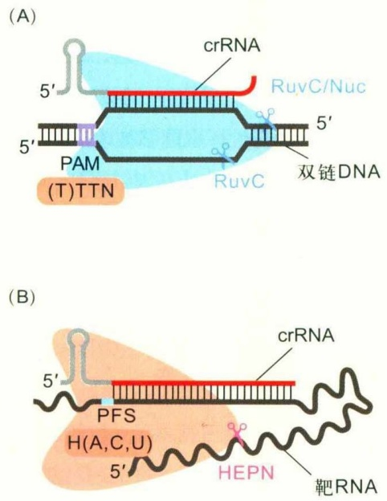

Cpf1蛋白的突变筛选或其他改造，能够获得高效且普适的Cpf1，作为基因组编辑工具箱中的有力武器，更广泛地运用于各个领域研究中。

相比于更早应用于体内编辑，并且具有更多与Cas9不同的鲜明特征的Cpf1，C2c1显然没有得到研究者过多的青睐。张锋团队发现，嗜酸芽孢杆菌的C2c1(AacC2c1)，其PAM序列为TTN，利用41 nt的crRNA与78 nt的tracrRNA，或两者融合为110 nt的gRNA，都能够在体外表现出DNA切割的活性，并产生黏性末端。目前C2c1及其RNA复合物的结构解析已经完成，然而尚没有关于C2c1体内实验结果发表，有可能是由于Cpf1基本能够替代C2c1的可用范围，并且使用更加简单，研究得更加透彻。C2c1究竟能否成为基因组编辑工具中不可或缺的一员，目前尚不清楚。

VI型CRISPR/Cas系统与其他第二大类系统最大的区别在于，其核酸酶与其他成员的相似度较低，且不具备RuvC结构域，而是含有2个HEPN RNA酶结构域。活性检测结果表明，VI型中目前研究得最透彻的C2c2（Cas13a）可识别与切割单链RNA（图3-10）。C2c2的crRNA成熟同样依赖于C2c2的核酸酶活性，在C2c2加工其pre-crRNA后，成熟的crRNA即与C2c2核酸酶结合，一旦C2c2-crRNA复合物结合到靶序列，C2c2即被激活。由于靶RNA为单链结构，C2c2并不需要用于识别和结合的PAM序列，但其靶向效率依赖于protospacer相邻位点（protospacer flanking site，PFS）。如图3-10所示，靶位点的下游是H（或U、C或A）时的效率远远高于G，这可能是由于C2c2 crRNA骨架序列的末端碱基（即靶点识别序列上游的第一个碱基）是C，必须确保该碱基不与靶点配对才能维持较高的靶向效率。C2c2与其他CRISPR核酸酶的不同点还在于其酶切位点的不固定性，其他核酸酶的切割位点都在protospacer内部或旁侧的固

## 图3-10 CRISPR/Cpf1与CRISPR/C2c2系统原理示意图

(A) Cpf1基因编辑系统示意图，Cpf1通过单一的crRNA识别靶DNA序列，并通过RuvC结构域切割靶DNA(Nuc结构起核酸酶或辅助作用)，形成黏性末端，长度为5 nt；(B) C2c2 RNA编辑系统示意图，C2c2通过单一的crRNA识别互补的RNA序列，通过HEPN结构域实现其旁系切割的活性。

3.3 CRISPR/Cas系统——通过RNA特异识别靶序列的人工内切核酸酶

71

---

定位置，而C2c2则会切割protospacer外的不确定区域，通常是一个富含U的区域，被称为“旁系”（collateral）切割活性。这意味着C2c2不仅仅是在靶RNA上的切割位点不固定，甚至有可能反式切割相邻的其他RNA，造成“脱靶”。体外RNA切割与大肠杆菌中的实验也证实了这一可能性。严格来说，C2c2只能编辑RNA，并且切割序列不精确，不属于基因组编辑的范畴，然而这并不代表C2c2不能助力基因功能的研究。张锋团队于2017年10月报道，在植物原生质体与哺乳动物培养细胞中，C2c2可实现与RNAi相当的基因敲减效率；此外，将HEPN结构域突变成dCas13a，并融合腺嘌呤脱氨酶后，可实现靶向的RNA单碱基编辑。如果C2c2在真核细胞中不存在脱靶效应，这一系统就比RNAi更有优势。同时，dCas13a结合荧光报告基团能够在细胞中动态追踪靶RNA的亚细胞定位，结合目前发展的利用C2c2在体外灵敏识别和检测核酸的技术，就可以将C2c2应用于病毒等病原体RNA的检测中。C2c2对于今后核酸生物学的研究有可能也会成为一项不可或缺的技术。

## 3.3.5 CRISPR/Cas系统小结

相比于TALEN，CRISPR/Cas系统简单易用，关于其结构、原理、改进、拓展和应用的文献不胜枚举，日新月异，且增长速度丝毫没有减缓之势。其中一个重要原因在于，这一系统中核酸识别和切割的两个功能可以分离，这样对于核酸酶的任何改造都可以通用化。此外，由于CRISPR/Cas系统的靶点识别元件RNA通常较短，相比于TALEN更便于开展大规模、高通量的筛选与应用，因此不仅受到有基因编辑需求的研究者的关注，也获得了许多研究DNA和RNA其他性质的科学家的青睐。同时，随着Cas9核酸酶的不断改进和优化，可逐步克服其在脱靶效应等方面的一些缺陷，使得基因组编辑更为精确和高效；多种变体和其他类型核酸酶的开发和运用，使得靶点的选择变得越来越自由；研究者根据需求不断尝试和推广，使得能实现基因组编辑的细胞和物种越来越多。得益于CRISPR/Cas系统，如今敲除一个基因的难度，甚至已经和分子克隆相去不远；进行序列敲入或精确修饰等复杂的基因组编辑，也在许多系统中得以实现；再加上由CRISPR/Cas系统衍生出的不属于基因组编辑范畴的诸多应用，包括核酸的检测、标记、定点修饰和基因的过表达（/敲除）技术，都极大地推动了生命科学研究的进展，也为一些科学理论和技术应用于生产和生活开创了不可估量的前景。直至今日它仍在不断进步，毫无疑问，它对于生命科学研究的影响力还会更加深远。表3-3列出目前常用的人工内切核酸酶系统的特征总结与对比。

表3-3 三类人工内切核酸酶系统的特征比较（以Cas9/gRNA代表CRISPR/Cas系统）

| EEN类型 | ZFN | TALEN | CRISPR/Cas9 |
| --- | --- | --- | --- |
| DNA结合元件 | 锌指蛋白基序 | TALE重复单元 | gRNA或crRNA |
| DNA切割元件 | FokI二聚体 | FokI二聚体 | Cas9-RNA复合物 |
| 是否需要筛选特异有效的DNA结合元件 | 是 | 否 | 否 |
| EEN载体的构建 | 简单 | 复杂 | 极简单 |
| 靶向效率 | 低 | 高 | 野生型:高;变体:可能降低 |
| 靶向特异性 | 低 | 很高 | 野生型:较高;变体:很高 |
| 改造为核酸酶以外的研究工具的难易程度 | 较难,且少用 | 较难,但应用多样 | 容易,应用最多样 |

## 3.4 人工内切核酸酶在基因组编辑中的应用

不同人工内切核酸酶在作用原理上的共同特征是能够在基因组的特定位点产生DSB。之后，研究者可以根据自身需要，进行特定的操作与筛选，最终获得自己需要的基因修饰类型。同时，人工内切核酸酶能够识别并结合特定DNA序列的特性，也能够被改造并应用于特异性修饰和标记基因组，而不改变基因组序列。以下介绍几种常见的基因组编辑修饰类型以及其实现方法，讨论其效果和实现的难易程度，并简要介绍一些人工内切核酸酶在基因组编辑范畴之外的一些应用。

## 3.4.1 插入/缺失突变

在高等动物细胞内，占据主导地位的DNA双链断裂修复机制是NHEJ，但是NHEJ可快速修复DNA损伤的代价是其修复的结果并不精确，往往伴随着若干个碱基

72

第3章 基因组编辑

---

的随机插入和/或缺失。因此，在人工内切核酸酶切割靶点之后无需加以任何操作，细胞自身的修复就会造成若干个碱基的插入和/或缺失，即插入/缺失（indel）突变。插入/缺失突变是最基本和最简单的基因组编辑类型，只需要人工内切核酸酶自身就可以实现，并且与其他类型的基因组修饰相比，通常效率较高。靶序列经酶切后产生插入/缺失突变的效率，一般也用来表征该人工内切核酸酶在该位点的突变效率。

插入/缺失突变的最大用途是在特定基因上制造移码突变(frame-shift mutation)。将靶点选择在靶基因的编码区，经插入/缺失突变就有可能引入非3的整倍数的碱基插入和/或缺失，从而改变靶点之后的阅读框；在改变氨基酸序列的同时，更重要的是很容易出现提前终止密码子(pre-mature stop codon)，导致基因突变或称为基因敲除(gene knock out)。利用插入/缺失突变敲除靶基因时，一般应尽量保证靶基因的功能完全丧失，以便更准确地进行基因功能研究。具体需要注意以下几点:①靶点尽量选择在编码序列的上游(但要在起始密码子下游)，使得编辑之后靶基因的翻译尽早终止，从而保证完全破坏基因产物的功能；②注意避免在靶点下游出现与原阅读框同框的起始密码子，以免在编辑之后出现新的翻译起始位点，形成与野生型差别不大的(仅N端部分氨基酸残基缺失)、仍有功能的基因产物；③检测筛选到的突变体中基因产物的水平是否下降，包括含有提前终止密码子的mRNA的水平(通常会由于无义突变介导的RNA降解而下降)与蛋白质产物的水平，确认基因的表达受到了影响。事实上，某些情况下插入/缺失突变由于其随机性以及改变的DNA序列较少，难以达到使目的基因完全失活的效果。此外，人们发现，在多种模式生物中通过插入/缺失突变获得的许多基因的纯合突变体检测不到突变表型，而通过其他手段敲减(knock down)这些基因后却会出现发育异常的表型。针对这一现象，德国的D.Stainier研究组以斑马鱼egf17突变体作为研究对象，提出敲除某一基因可能导致其他功能相似的同源或非同源基因的表达水平上调，形成补偿效应(compensation effect)，从而弥补了这一基因缺失所造成的后果，因而无法检测到应有的表型。通过反义核酸类似物morpholino敲减这些基因则不会引起补偿，反而能检测到表型。补偿现象很可能与无义突变介导的mRNA降解相关。因此，简单的插入/缺失突变在很多情况下难以满足科学研究的需要，研究者需要更有力的造成靶基因完全失活的技术（如基因的整体删除），或能够实现靶基因表达的精确时空调控与追踪的基因组修饰（如条件性基因敲除）。

## 3.4.2 片段删除

插入/缺失突变策略只能应用于单个蛋白质编码基因，对于破坏非编码RNA基因、基因组调控序列以及多个基因、转录物或剪接变体等情况，或期望去除某些特定的功能结构域等，插入/缺失突变往往难以达到预期目的，而大片段的DNA删除则可以满足这些要求。使用两个人工内切核酸酶靶点，同时作用于同一条DNA序列，产生两个具有一定间隔的DSB，则在通过NHEJ途径进行DSB修复时，还有可能将原本并不相邻的两个DNA末端连接在一起，从而导致两个靶点之间的序列丢失，造成DNA片段的删除。删除片段可长可短，有时可达到百万个碱基对。片段删除的应用范围十分广泛，可以用于破坏大段基因结构，或直接删除整个基因，或从基因组中去除具有调控功能的基因片段。通常而言，删除的片段长度越小，且用于删除的两个靶点的效率越高，则基因删除的效率越高，但仍然显著低于单个位点造成的插入/缺失突变效率。近期，中国科学院神经科学研究所杨辉课题组在敲除小鼠Y染色体上的多拷贝基因时发现，由于多个位点的存在，Y染色体在小鼠中整体丢失。说明利用片段删除的思路，制造多个DSB会导致NHEJ修复的紊乱甚至失效，产生的染色体的大小有可能远小于原来有功能的染色体，由于Y染色体非常小，因此可以造成其多位点片段删除的产物无法参与到正常染色质的生理活动中，从而实现染色体的整体敲除。那么，针对较大的染色体，利用重复序列设计靶点或使用多个已知的高效靶点，理论上也应该可以实现整个染色体的敲除。

结合插入/缺失突变与片段删除技术，可以在细胞水平上大规模、高通量地敲除一系列蛋白质编码基因或其他基因进行表型分析。北京大学魏文胜实验室构建了针对291个基因的靶向文库，并利用慢病毒侵染导入细胞，筛选炭疽毒素和白喉毒素细胞毒性宿主基因，通过高通量测序寻找被编辑的基因，并通过单一gRNA敲除验证新发现参与细胞毒性过程的基因，发现了其他有关毒素毒性作用的宿主基因。同时，由于lncRNA无法通过插入/缺失突变使其完全失活，他们构建了针对lncRNA的成对gRNA（paired gRNA，pgRNA）文库，通过侵染细

3.4 人工内切核酸酶在基因组编辑中的应用

73

---

胞导致lncRNA的长片段删除，在多个癌细胞系中筛选并验证得到了多个抑癌或促癌lncRNA。这些方法可以被推广应用于不同细胞系、不同类型的蛋白质编码基因，或miRNA和调控元件的敲除筛选，对于以细胞为模式系统研究基因功能是一种非常有效的工具。

## 3.4.3 同源重组介导的基因组精确修饰

插入/缺失突变和大片段删除造成的基因组突变在序列上存在随机性，都无法精确控制突变的最终结果。然而，在许多情况下，人们需要对基因组序列进行精确修饰，这往往需要通过同源重组来实现。体细胞中发生同源重组的效率非常低，无法直接用于进行基因组精确修饰。在靶位点附近造成DNA双链断裂或单链缺口可极大地提高同源重组的效率，即同源重组介导的双链断裂修复。因此，人工内切核酸酶技术出现后，人们便开始尝试利用它提高同源重组的效率，以便在细胞中获得比传统正负筛选方法更高的同源重组效率，或在整体动物水平实现对基因组的精确修饰。结果表明，在同源重组的目标序列附近设计人工内切核酸酶造成DSB后，能将细胞中的重组效率提高3～4个数量级，极大地方便了筛选工作。同时，在很多传统上无法实现同源重组进行基因组编辑的物种中，使用人工内切核酸酶定点切割也顺利实现了外源序列的精确整合。以斑马鱼为例，在人工内切核酸酶出现之前无法通过同源重组实现基因组修饰，2012年，先后有两篇论文报道了TALEN介导的斑马鱼同源重组修饰，其中美国梅奥医学中心S.Ekker实验室以短单链DNA作为重组模板，将外源酶切位点和loxP序列成功引入斑马鱼基因组指定位点并检测到种系传递；北京大学张博实验室与美国加州大学洛杉矶分校林硕实验室合作，以质粒作为重组模板成功在斑马鱼tb基因中敲入外源报告基因，并检测到种系传递。同样，CRISPR/Cas系统也被运用于细胞、小鼠等多种系统中，实现同源重组介导的基因组精确修饰。

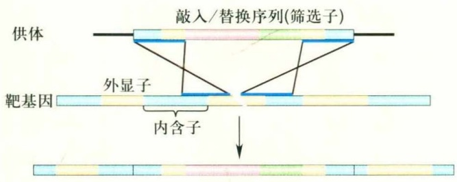

flowchart

同源介导修复技术的最大特点是需要提供含有同源序列的外源DNA供体，通过供体两侧同源臂内部的序列重组进入人工内切核酸酶的切割位点（相当于“替代”了基因组同源区域内部的序列）。可以通过设计具有不同序列与功能的供体序列，精确地操控和编辑基因组，借此可以实现精确的点突变、基因修复、基因敲入、基因替换和条件性等位基因构建等（图3-11），从而在疾病治疗、基因标记、特殊突变体构建等研究中发挥重要作用。需要注意的是，人工内切核酸酶介导的同源重组效率仍然大大低于插入/缺失突变效率以及大多数其他由NHEJ介导的修复效率，在重组的过程中存在很大的竞争，并且严重依赖于同源臂的精确程度，这就要求供体DNA的同源臂序列与内源序列完全一致，因此需要提前对实验材料进行测序以确认两者的一致性。对供体而言，短DNA单链常用于制造单点突变（在单碱基编辑系统问世前最为有效的一种获得点突变的方法）或短序列（如loxP）的插入，相比质粒载体通常效率稍高。长片段的插入由于需要较长的同源臂，因而通常使用质粒载体作为供体。有研究组发现质粒供体在体内线性化，其重组效率要高于体外线性化或不进行线性化的供体，但机制不详。总之，同源重组介导的基因组精确修饰，是目前最精确、用途最广泛，并且造成目标序列以外的变化最少以及最被科研工作者青睐的基因组编辑方式，然而，即使在应用人工内切核酸酶后，同源重组修复的效率仍然很低，并且极大地依赖于高效的靶点，因此其实际应用受到很大限制。如何提高同源重组介导的基因修饰效率，尤其是长片段插入-替换的效率，是亟待解决的一个重要问题。

## 3.4.4 靶向插入

同源重组介导的基因敲入效率整体偏低，对感兴趣的基因进行精确插入，需要进行大数量的筛选，并且不

图3-11 同源重组介导的基因组修饰示意图

图中的淡粉色序列为功能序列，可以用感兴趣的序列，如点突变、结构域缺失或标记基因替换内源基因原本的序列。一般设计时还可以同时提供筛选子，便于对成功插入/替换的细胞或个体进行筛选，筛选成功后可以利用Cre/loxP等重组系统从基因组中删除，避免对功能序列造成影响。

74

第3章 基因组编辑

---

能保证每个基因都能成功。由于NHEJ在细胞内发生的概率远高于HDR，如果能够基于NHEJ实现DNA序列的定点插入，其效率一定会高于同源重组介导的修复。目前实现NHEJ介导的DNA靶向插入的原理是:利用高效的人工内切核酸酶位点在基因组上产生DSB，同时外源提供一个（体内或体外）线性化的DNA供体，在DSB修复过程中就有可能将供体DNA插入基因组的DSB位点。在最初发表的靶向插入论文中，研究者将靶点设计在转基因斑马鱼的EGFP编码区，在线性化载体的端口设计红色荧光蛋白（RFP）的编码序列，通过定点靶向插入，将转基因动物的绿色荧光部分转变为红色荧光表达，并且遗传给后代，其效率高于同源重组介导的精确插入。由于插入位点位于EGFP基因的编码区，且供体提供的RFP自身不具有启动子和增强子，因此RFP整合后需要与EGFP基因处于相同的阅读框才能表达，而由于NHEJ修复的不精确性，导致供体插入后，只有1/3的可能性满足这一要求，从而降低了有效插入的效率。更为关键的是，这一策略会破坏内源基因的表达和功能。

为了避免上述策略的缺陷和不足，中国科学院神经科学研究所杜久林研究组改进原有方案，在内含子区域进行载体的靶向插入（图3-12）。这样，通过mRNA的剪接，剩余的编码序列和外源基因能够被整合到内源mRNA，既可避免外源基因与内源基因阅读框不同的问题，又可避免破坏内源基因。这一设计方案不仅能够避免阅读框导致的效率降低以及内源基因的插入/缺失突变，同时还可以通过在插入的载体上添加其他的功能元件，实现更加复杂多样的功能，如单点突变或结构域缺失突变以及表达标记的构建（只需在载体剩余编码序列部分人为制造点突变或某一结构域编码序列的缺失），或使荧光报告基因以外的其他蛋白质按照靶基因的内源表达谱进行表达等。虽然内含子靶点的靶向敲入具有众多优势，但仍然存在一些问题，例如供体中不具备完整的原基因内含子，可能会造成部分调控序列的缺失，从而导致内源基因的表达还原度不高；也有可能导致剪接复合体的调控序列缺失或增加，使得供体不能按照设想完成剪接，甚至整个供体被当作内含子剪切掉，达不到预期目的；最为重要的是，长片段供体通常以质粒载体的形式提供，在基因组中引入庞大的载体骨架有可能导致一些未知的影响。有研究组在大鼠和小鼠中尝试将质粒的两端线性化并利用微同源末端互补排除供体骨架，成功插入了无骨架的供体序列，但效率有一定下降。我们认为，今后的研究中可以尝试在骨架的两端设计诸如Cre/

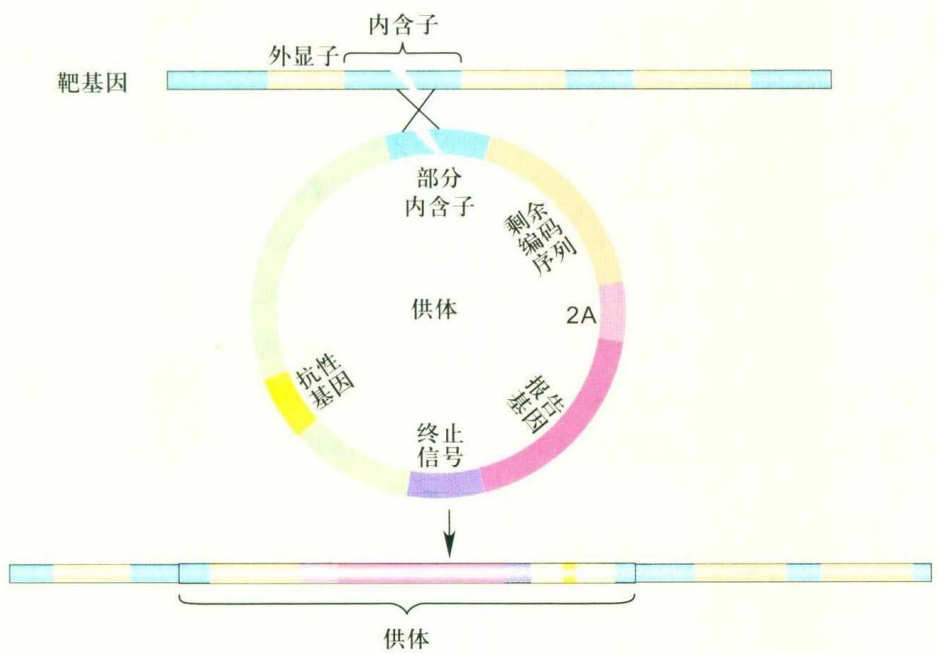

flowchart

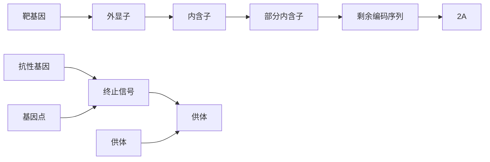

图3-12 内含子靶向的供体插入示意图

当内含子产生DSB时，线性的DNA供体就可能正向插入靶点区域。之后，当靶基因通过内源的启动子转录时，终止信号会使得载体骨架序列以及下游的内源基因序列无法转录。在mRNA的剪接过程中，剩余的编码序列与标记基因进入成熟的mRNA，从而还原内源基因的表达，同时对其表达进行时空标记。对供体的剩余编码序列进行更改，如引入点突变或片段缺失，或将报告基因更换为Gal4或Cre等其他功能性蛋白质编码序列，能够满足不同的实验需求。

3.4 人工内切核酸酶在基因组编辑中的应用

75

---

loxP一类的重组系统，在靶向敲入后通过重组酶在基因组中去除载体骨架，以尽量去除无用序列。总之，靶向插入是一种较为高效的基因敲入方式，但同样依赖于高效率靶点，且在修复的精确性以及对内源序列的还原程度方面不如同源重组介导的敲入。这一技术的进一步改进，将和同源重组介导的基因修饰一起，帮助科学家在未来实现更多种多样、复杂的基因组修饰。

## 3.4.5 人工内切核酸酶的扩展应用

利用人工内切核酸酶，特别是TALEN和Cas9/gRNA的DNA靶向性，并将其DNA切割结构域替换成其他功能基团，可以定向地对基因组DNA进行不同形式的修饰，如单碱基编辑、转录激活或抑制、染色质修饰、组蛋白修饰以及染色体可视化等，极大地丰富了人们对基因功能研究的手段和策略。

DNA的甲基化和去甲基化修饰对于基因表达具有非常重要的调控作用。2013年就有研究组利用TALE实现了DNA定向去甲基化技术。其策略是将TET1（ten-eleven translocation）羟化酶与TALE融合构成TALE-TET1，从而实现基因的定向去甲基化。通过这一技术，该课题组在人类培养细胞内，对靶基因启动子中一些重要的被甲基化的CpG岛成功进行了定向修饰，从而显著地提高了靶基因的表达。随后也有课题组利用TALE融合甲基转移酶DNMT3a，对在前列腺中表达的转移抑制基因CRMP4启动子中的CpG岛进行了甲基化修饰。同样，基于Cas9/gRNA系统的DNA定向甲基化和去甲基化修饰也被建立，通过将dCas9与甲基化酶或者去甲基化酶融合，就可实现对基因的定向修饰。正如Cas9蛋白相对于TALEN的优势一样，dCas9融合系统应用的灵活性和简便性也优于TALE。此外，除了DNA的甲基转移酶和去甲基化酶类，与组蛋白的甲基化、乙酰化相关的酶结构域也能够与TALE或dCas9融合，实现特定DNA序列附近组蛋白修饰的改变。

利用TALE或dCas9与疱疹病毒的转录激活因子VP16融合形成人工转录激活因子，靶向目的基因的启动子部分，可以对靶基因进行定向激活，实现靶基因的过表达。虽然这一策略可以实现转录激活，但是单个靶点诱导的内源基因转录激活水平往往不高，甚至不能起到转录激活的作用。但是如果对同一基因的启动子区设计多个靶向激活位点，则可以检测到较强的转录激活作用。

或将多个转录激活区域融合，使用串联的VP16（如4倍串联的VP64甚至10倍串联的VP160），也可以明显提高转录激活水平，并且已经成功运用于培养细胞以及线虫和斑马鱼等模式生物中。同样，dCas9/gRNA复合物本身结合在基因转录起始区域，就能够在细菌和培养细胞中实现靶基因的表达抑制，而如果将KRAB转录抑制结构域融合于dCas9，并针对靶基因设计多个靶向抑制位点，就能更好地抑制靶基因的转录，在真核生物系统如酵母、线虫和斑马鱼中也能够起到靶基因敲减的作用。

对染色体进行时空动力学分析，如染色质形成染色体、染色体的分离等，就需要对染色体的一些特殊区域进行可视化标记。荧光原位杂交（fluorescence in situ hybridization, FISH）是常用的技术，但是该技术需要对细胞进行固定，因此无法对活体细胞进行动态成像。而利用TALE或dCas9与荧光蛋白融合，对染色体的特定序列进行靶向结合，对该区域实现荧光蛋白的富集，则可显示出染色体的结构，并进行时空动态分析。有课题组报道了基于TALE的基因组成像技术（TAL-mediated genome visualization, TGV），利用该技术在小鼠胚胎干细胞内通过对一些特殊区域的重复序列进行靶向结合，例如着丝粒、中心体周围以及端粒区域。同样地，利用dCas9与绿色荧光蛋白（GFP）融合，对端粒区域的重复序列进行靶向结合，可使荧光信号特异地在该区域富集。对于非重复序列区域，由于单个GFP分子荧光信号太低而无法被检测到，因此可以设计多个靶点对该区域进行结合。北京大学生物动态光学成像中心魏文胜等多个课题组在推动Cas9介导的染色质成像技术上做出了贡献，他们利用多种不同荧光标记同样的基因座，或通过多个靶点“染色”一整条特定的染色体，使染色体标记技术更加精确，使用范围更广，能够运用于更多科学问题的研究中。

总之，以TALEN和Cas9/gRNA系统为代表的人工内切核酸酶技术给基因组编辑领域带来了一场又一场颠覆性的革命，实现了反向遗传学技术的平民化，开启了基因组编辑技术应用的无限可能性。可以预见，这一系列的新一代基因组靶向诱变技术与其他技术（如干细胞技术）相结合，更是会激发出不可估量的应用前景。最后，TALEN和Cas9/gRNA系统对于生命科学研究的贡献不仅仅局限于对基因组序列的靶向编辑，基于基因组编辑系统发展起来的其他新技术和新策略也为各领域的研究提供了重要的技术支持，也留下了丰富的发挥与想象的空间。

76

第3章 基因组编辑

---

## □ 小结

基因组编辑技术自20世纪80年代开始发展至今，理论上能够在任意物种和体外培养细胞中实现多种多样的基因组修饰或其他的调控和标记，可谓是现代生物学研究中不可或缺的重要工具，特别是解析细胞中染色质行为，进行基因功能以及研究基因之间相互作用的利器。除了在基础理论研究中的广泛应用外，基因组编辑技术在其他与生产、生活紧密结合的多个方面也具有良好的发展与应用前景。例如，通过特异性编辑和调控与家畜、作物重要性状相关的基因，可实现对抗病、抗逆、产量、品质、生长条件等的性状改良，有可能大大缩短育种周期，并且实现精准育种，这些在猪、牛等家畜与玉米、烟草等作物中都已有初步尝试；同时也可以用于改造宠物的形态、行为等特征，使其更贴近人类的需求。更重要的是，通过特异性修饰人类细胞，例如使用ZFN破坏T细胞内HIV入侵至关重要的受体蛋白CCR5、使用TALEN介导的HDR原位修复镰刀形红细胞贫血症、地中海贫血症等致病基因，结合iPS细胞或体内细胞移植技术，都有可能用于疾病的基因治疗。例如，接受基因组改造T细胞的CAR-T治疗的白血病小女孩，已经多年没有出现癌症症状。不久前，一位IDS酶缺乏的亨特综合征患者布莱恩，接受了世界上第一例个体水平的基因治疗，利用ZFN和正常IDS编码序列，通过包裹和静脉注射进入体内对靶基因进行编辑。由于ZFN发展历史较长，对其细胞毒性、脱靶活性等方面的研究也较为充分，能够找到几乎无脱靶风险的锌指结构域，因此目前在基因治疗领域暂时走在前面。现在，随着对TALEN和CRISPR/Cas系统的效率改进与脱靶研究日臻完善，并且出现了多种提高Cas9准确性（/特异性）的变体，相信不久的将来，它们也会在这一领域大显身手。在本章最后，笔者提出一个悬念:TALEN在问世两年后就被新出现的CRISPR/Cas9超越，而CRISPR/Cas系统经过6年多的发展已经变得越来越成熟，但是这会是基因组编辑技术的最终版本吗？还会有更简便的工具或方法出现，使我们遗留的问题迎刃而解吗？从TALEN到CRISPR/Cas系统，微生物的世界不断颠覆我们的想象，给基因组编辑领域带来一次又一次的惊喜。我们有理由相信，这应该不是基因组编辑技术的终极版本。令人兴奋的是，2018年伊始，来自以色列的遗传学研究团队从细菌中筛选出了10种新的免疫防御系统，为开发新的基因组编辑利器带来了新的希望。神奇的细菌这次又会如何给我们奉献出什么样的意外之喜？让我们拭目以待。

## □ 思考题

1. 结合你个人的研究兴趣或实验室的科研方向,如何将本章介绍的基因组编辑技术运用于你的研究课题中?
2. 你认为现有的基因组编辑技术存在哪些待解决的重要问题和挑战？未来基因组编辑技术发展的趋势是什么？
3. 在许多研究模式中，基因组编辑技术能够替代一些传统的研究技术，如 RNAi、基于胚胎干细胞的基因敲除技术等，你认为基因组编辑与这些技术手段相比，有哪些优势和不足？
4. 将基因组编辑技术运用于人类疾病的治疗，你认为能够通过哪些方式？需要与哪些方面的知识和技术手段相结合？选取某一种你感兴趣的、有可能利用基因组编辑技术治疗的疾病，想一想在这一疾病的治疗中，运用基因组编辑技术的障碍和挑战是什么。
5. 人工内切核酸酶的一个重要特性是能够识别并结合特定的核苷酸序列，利用这一特性，人们通过将内切酶结构域替换成其他蛋白结构域，或将内切酶结构域突变失活后与其他蛋白结构域融合，改造成能够实现其他功能的工程蛋白，从而达到新的研究目的。例如，将内切酶结构域替换成转录激活结构域，靶向激活特定基因的转录。结合你自己的知识与研究兴趣，想一想是否还可以将人工内切核酸酶加以改造、

思考题

77

---

与具有其他功能的蛋白结构域相结合，以解决新的科学问题。

(张博 韩冰舟 张亚鸽 北京大学生命科学学院)

致谢:感谢北京大学魏文胜老师慷慨提供相关学术资料

## □ 参考文献

1 李君，张毅，陈坤玲，等. CRISPR/Cas系统:RNA靶向的基因组定向编辑新技术. 遗传，2013，35(11):1265-1273.
2 沈延，肖安，黄鹏，等.类转录激活因子效应物核酸酶（TALEN）介导的基因组定点修饰技术.遗传,2013,35(4):395-409.
3 肖安，张博. 人工核酸内切酶介导的新一代基因组编辑技术进展. 生物工程学报，2015，31(6):917-928.
4 肖安，胡莹莹，王唯晔，等.人工锌指核酸酶介导的基因组定点修饰技术.遗传，2011，33(7):665-683.
5 Abudayyeh O O, Gootenberg J S, Konermann S, et al. C2c2 is a single-component programmable RNA-guided RNA-targeting CRISPR effector. Science, 2016, 353(6299): aaf5573.
6 Abudayyeh O O, Gootenberg J S, Essletzbichler P, et al. RNA targeting with CRISPR-Cas13. Nature, 2017, 550(7675): 280-284.
7 Auer T O, Duroure K, De C A, et al. Highly efficient CRISPR/Cas9-mediated knock-in in zebrafish by homology-independent DNA repair. Genome Res, 2014, 24(1):142-153.
8 Barrangou R, Fremaux C, Deveau H, et al. CRISPR provides acquired resistance against viruses in prokaryotes. Science, 2007, 315(5819):1709–1712.
9 Bibikova M, Golic M, Golic K G, et al. Targeted chromosomal cleavage and mutagenesis in Drosophila using zinc-finger nucleases. Genetics, 2002, 161:1169–1175.
10 Boch J, Scholze H, Schornack S, et al. Breaking the code of DNA binding specificity of TAL-Type III effectors. Science, 2009, 326:1509–1512.
11 Bonas U, Stall R E, Staskawicz B. Genetic and structural characterization of the avirulence gene Avrbs3 from Xanthomonas–campestris pv. vesicatoria. Mol Gen Genet, 1989, 218:127–136.
12 Cong L, Ran F A, Cox D, et al. Multiplex genome engineering using CRISPR/Cas systems. Science, 2013, 339: 819–823.
13 Dekelver R C, Choi V M, Moehle E A, et al. Functional genomics, proteomics, and regulatory DNA analysis in isogenic settings using zinc finger nuclease-driven transgenesis into a safe harbor locus in the human genome. Genome Res, 2010, 20(8):1133–1142.
14 Doron S, Melamed S, Ofir G, et al. Systematic discovery of antiphage defense systems in the microbial pangenome. Science, 2018, 10.1126/science.aar4120.
15 Gaudelli N M, Komor A C, Rees H A,
et al. Programmable base editing of A.T to G.C in genomic DNA without DNA cleavage. Nature, 2017, 551: 464–471.
16 Germini D, Tsfasman T, Zakharova V V, et al. A comparison of techniques to evaluate the effectiveness of genome editing. Trends Biotechnol, 2018, 36(2):147–159.
17 Gootenberg J S, Abudayyeh O O, Lee J W, et al. Nucleic acid detection with CRISPR-Cas13a/C2c2. Science, 2017, 356: 438–442.
18 Guilinger J P, Thompson D B, Liu D R. Fusion of catalytically inactive Cas9 to FokI nuclease improves the specificity of genome modification. Nat Biotechnol, 2014, 32: 577–582.
19 Hess G T, Tycko J, Yao D, et al. Methods and applications of CRISPR-mediated base editing in eukaryotic genomes. Mol Cell, 2017, 68: 26–43.
20 Hoshijima K, Jurynec M J, Grunwald D J. Precise editing of the zebrafish genome made simple and efficient. Dev Cell, 2016, 36: 654–667.
21 Huang P, Xiao A, Zhou M, et al. Heritable gene targeting in zebrafish using customized TALENs. Nat Biotechnol, 2011, 29(8): 699–700.
22 Jinek M, Chylinski K, Fonfara I, et al. A programmable dual-RNA-guided DNA endonuclease in adaptive bacterial immunity. Science, 2012, 337: 816–821.
23 Kim H J, Lee H J, Kim H, et al. Targeted genome editing in human cells with zinc finger nucleases constructed via modular assembly. Genome Res, 2009, 19:1279–1288.
24 Kim Y G, Cha J, Chandrasegaran S. Hybrid restriction enzymes: Zinc finger fusions to Fok I cleavage domain. Proc Natl Acad Sci U S A, 1996, 93: 1156–1160.
25 Kleinstiver B P, Prew M S, Tsai S Q, et al. Engineered CRISPR-Cas9 nucleases with altered PAM specificities. Nature, 2015, 523: 481-U249.
26 Kleinstiver B P, Pattanayak V, Prew M S, et al. High-fidelity CRISPR-Cas9 nucleases with no detectable genome-wide off-target effects. Nature, 2016, 529: 490–495.
27 Komor A C, Kim Y B, Packer M S, et al. Programmable editing of a target base in genomic DNA without double-stranded DNA cleavage. Nature, 2016, 533: 420–424.
28 Li J, Zhang B B, Ren Y G, et al. Intron targeting-mediated and endogenous gene integrity-maintaining knockin in zebrafish using the CRISPR/Cas9
system. Cell Res, 2015, 25: 634–637.
29 Maeder M L, Thibodeau-Beganny S A, Wright D, et al. Rapid "Open-Source" engineering of customized zinc-finger nucleases for highly efficient gene modification. Mol Cell, 2008, 31: 294–301.
30 Mali P, Aach J, Stranges P B, et al. CAS9 transcriptional activators for target specificity screening and paired nickases for cooperative genome engineering. Nat Biotechnol, 2013, 31: 833–838.
31 Miller J C, Tan S, Qiao G, et al. A TALE nuclease architecture for efficient genome editing. Nat Biotechnol, 2011, 29: 143–148.
32 Miller J, Mclachlan A D, Klug A. Repetitive zinc-binding domains in the protein transcription factor III A from Xenopus oocytes. EMBO J, 1985, 4:1609–1614.
33 Moscou M J, Bogdanove A J. A simple cipher governs DNA recognition by TAL effectors. Science, 2009, 326:1501.
34 Murugan K, Babu K, Sundaresan R, et al. The revolution continues: Newly discovered systems expand the CRISPR-Cas toolkit. Mol Cell, 2017, 68: 15–25.
35 Perez E E, Wang J, Miller J C, et al. Establishment of HIV-1 resistance in CD4+ T cells by genome editing using zinc–finger nucleases. Nat Biotechnol, 2008, 26: 808–816.
36 Ran F A, Hsu P D, Lin C Y, et al. Double nicking by RNA-guided CRISPR Cas9 for enhanced genome editing specificity. Cell, 2013, 154: 1380–1389.
37 Redondo P, Prieto J, Muñoz I G, et al. Molecular basis of xeroderma pigmentosum group C DNA recognition by engineered meganucleases. Nature, 2008, 456: 107–U108.
38 Reyon D, Tsai S Q, Khayter C, et al. FLASH assembly of TALENs for high-throughput genome editing. Nat Biotechnol, 2012, 30: 460–465.
39 Sander J D, Cade L, Khayter C, et al. Targeted gene disruption in somatic zebrafish cells using engineered TALENs. Nat Biotechnol, 2011, 29: 697–698.
40 Shao S P, Zhang W, Hu H, et al. Long-term dual-color tracking of genomic loci by modified sgRNAs of the CRISPR/Cas9 system. Nucleic Acids Res, 2016, 44: e86.
41 Slaymaker I M, Gao L, Zetsche B, et al. Rationally engineered Cas9 nucleases with improved specificity. Science, 2016, 351: 84–88.
42 Szczepek M, Brondani V, Büchel J, et al. Structure-based redesign of the

78

第3章 基因组编辑

---

dimerization interface reduces the toxicity of zinc–finger nucleases. Nat Biotechnol, 2007, 25: 786–793.
43 Thomas K R, Capecchi M R. Site-directed mutagenesis by gene targeting in mouse embryo-derived stem-cells. Cell, 1987, 51: 503–512.
44 Urnov F D, Miller J C, Lee Y L, et al. Highly efficient endogenous human gene correction using designed zinc–finger nucleases. Nature, 2005, 435: 646–651.
45 Xiao A, Wang Z, Hu Y, et al. Chromosomal deletions and inversions mediated by TALENs and CRISPR/Cas in zebrafish. Nucleic Acids Res, 2013, 41: e141.
46 Yang H, Gao P, Rajashankar K R,
et al. PAM-dependent target DNA recognition and cleavage by C2c1 CRISPR-Cas endonuclease. Cell, 2016, 167: 1814–1828.
47 Yang J J, Yuan P, Wen D, et al. ULtiMATE system for rapid assembly of customized TAL effectors. PloS One, 2013, 8: e75649.
48 Yang J, Guo S, Yuan P, et al. Assembly of customized TAL effectors through advanced ultimate system. Methods Mol Biol, 2016, 1338: 49–60.
49 Zetsche B, Gootenberg J S, Abudayyeh O O, et al. Cpf1 is a single RNA-guided endonuclease of a Class 2 CRISPR-Cas system. Cell, 2015, 163: 759-771.
50 Zhang Y, Liu L, Guo S J, et al.

Deciphering TAL effectors for 5-methylcytosine and 5-hydroxymethylcytosine recognition. Nat Commun, 2017, 8: 901.

51 Zhou Y, Zhu S, Cai C, et al. High-throughput screening of a CRISPR/Cas9 library for functional genomics in human cells. Nature, 2014, 509: 487–491.

52 Zhu S, Li W, Liu J, et al. Genome-scale deletion screening of human long non-coding RNAs using a paired-guide RNA CRISPR-Cas9 library. Nat Biotechnol, 2016, 34: 1279–1286.

53 Zu Y, Tong X, Wang Z, et al. TALEN-mediated precise genome modification by homologous recombination in zebrafish. Nat Methods, 2013, 10: 329–331.

参考文献

79
