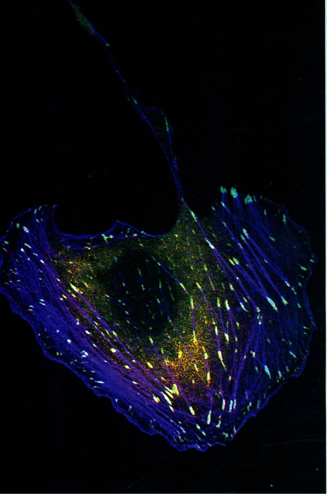

# II 细胞物质运输和细胞运动·分部扉页

原始 PDF 第 110–111 页。

## 细胞物质运输和

## II

## 细胞运动

---

natural_image

Fluorescent microscopy image of a biological tissue sample showing cellular structures with blue and green staining (no text or symbols)

迁移细胞:正在迁移的ECV304细胞，显示微丝骨架和黏着斑

(中国科学院生物化学与细胞生物学研究所朱学良组提供)
