# 第8章 微管与细胞内物质运输

原始 PDF 第 160–187 页。

第8章

## 微管与细胞内物质运输

8

细胞骨架是真核细胞内由蛋白质组装而成的纤维状网架结构，包括肌动蛋白丝(actin filament，也称微丝)、中间丝(intermediate filament)和微管(microtubule)三种类型。这些骨架组分与细胞结构的组织、形状变化、细胞运动和细胞周期运行等过程密切相关。从最简单的原生生物到真菌，以及高度复杂的植物和动物，所有真核细胞中都存在微管。电镜图像显示，微管是中空的管状结构，其外径约为24 nm，内径约为15 nm。微管还是动物细胞中心体(centrosome)、纤毛和鞭毛的核心组分。中心体是动物细胞内主要的微管组织中心，也是纺锤体结构的组织者，还在胞质分裂过程中起主导作用。纤毛及鞭毛与细胞运动和信号转导等过程相关。细胞内微管网络的结构是高度动态的，处于不断的变化之中，如间期细胞中起源于中心体的微管、有丝分裂期的纺锤体微管等。微管的稳定性与细胞的状态和所处的区域相关，如神经元的轴突微管、中心粒微管、纤毛或鞭毛的基体和轴丝的微管都是比较稳定的结构。细胞分化过程涉及细胞结构的重组，以及细胞形态和功能的变化，微管在这些过程中发挥了关键性作用，如神经元和上皮细胞等的极性化结构的形成过程是体现微管与细胞分化相关性的最好例证。

在体和体外实验的结果都显示，微管在长度和动力学方面都表现出高度的不均一性。在体外，微管的组装和去组装在其两端都可能发生，并且不同步。在细胞质内，大部分微管都在经历组装和去组装的快速循环过程。有些微管相对稳定，另一些则时而伸长、时而缩短。这种现象在细胞边缘更容易被观察到，被称为微管的“动态不稳定性”（dynamic instability），这种特性对微管功能至关重要。微管组装的动力学性质和功能是通过微管与多种微管结合蛋白（microtubule associated protein，MAP）相互作用的结果来体现的。广义的微管结合蛋白包括所有与微管相互作用的蛋白，如传统意义上结合在微管表面或两端的 MAP（也称非马达类微管结合蛋白，即本书中的 MAP）和马达蛋白（motor protein）。MAP 与微管相互作用以调节微管的稳定性和微管网络的结构、细胞形态，为细胞运动和物质运输等生命活动过程提供结构基础；马达蛋白是微管功能的执行者，其马达结构域通过水解 ATP 产生的能量沿微管运动，而其货物结合结构域则与细胞器或生物大分子复合物等相结合。马达蛋白与微管的相互作用与细胞内物质运输、细胞结构的重建、信号转导及细胞运动等事件相关联。一些马达蛋白，如 kinesin 13 家族的成员还结合在微管的正极，参与微管结构的解聚。

第 8 章 微管与细胞内物质运输

147

---

## 8.1 微管的结构与动态 不稳定性

## 8.1.1 微管的结构组分与极性

## (1) 微管蛋白的多样性

尽管微管在结构和功能上显示出复杂的多样性，但所有的微管都是由α-微管蛋白(α-tubulin)和β-微管蛋白(β-tubulin)结合而成的异二聚体(α/β-微管蛋白二聚体)组装而成的。这两种微管蛋白的序列和结构都非常相似，并在所有的真核生物中高度保守。在一些单细胞生物如四膜虫、酿酒酵母和裂殖酵母等的基因组中，编码α-微管蛋白和β-微管蛋白的基因只有1～2个；而在脊椎动物和昆虫的基因组中，编码微管蛋白的基因多得令人惊讶。如在人类基因组中，有23个微管蛋白基因和至少48个假基因。根据基因序列在一级结构上的相似性，可将微管蛋白分为α、β、γ、δ和ε5个不同的亚家族，这些基因的表达产物尽管都能参与微管的组装，但在细胞内具有不同的定位和功能。此外，在细菌和古细菌中也发现了序列和功能与微管蛋白相似的蛋白种类，如FtsZ和TubZ等。微管蛋白在一级结构上的保守性对微管组装非常重要，尤其是在其肽链的折叠部位，而组装以后位于微管表面，富含酸性氨基酸残基的C端则具有一定的发散性，并且常有多种翻译后修饰(post-translational modification, PTM)，这使组装后的微管表面带有更多的负电荷。而一些微管结合蛋白（如tau和MAP2）的微管结合结构域却带正电荷，正负电荷分子间的相互作用使MAP结合在微管表面。不同基因编码的微管蛋白在试管中能混合组装成微管，但在生物体内，不同的细胞在表达微管蛋白基因方面却具有选择性，如在神经细胞内特异表达的β-微管蛋白类型是β3。

γ-微管蛋白（γ-tubulin）是中心体的主要结构组分，也是细胞内微管组装的成核位点。动物细胞内微管的组装主要在中心体上起始，先由13个γ-微管蛋白及相关的组分组装成一个γ-微管蛋白环状复合体（γ-tubulin ring complex, γ-TuRC），由此决定了微管的横切面上共有13个微管蛋白亚基。γ-TuRC作为微管组装的起始位点，微管蛋白亚基与微管蛋白二聚体中的α-微管蛋白相结合，从而确定了微管的极性。δ-微管蛋白和ε-微管蛋白主要定位于中心粒和纤毛的基体等部位，与三联体微管的B管和C管的组装相关。 $\zeta$ -微管蛋白仅存在于一些原生动物细胞中。FtsZ在细菌细胞分裂时形成类似于动物细胞分裂时由肌动蛋白/肌球蛋白形成的收缩环的结构，促进细菌细胞的分裂。

## (2) 微管的结构

从结构上看，细胞内有3种不同类型的微管，它们是通常所指的直径为24 nm的微管（如来自中心体的微管或纺锤体微管）、二联管（如纤毛或鞭毛中的轴丝微管）和三联管（如中心粒微管、纤毛或鞭毛的基体微管）。细胞质微管横截面上有13个球状的微管蛋白亚基，在电镜下也能清楚地观察到体外组装的微管是由 $\alpha/\beta-$ 微管蛋白二聚体纵向排列而成的原丝（protofilament）构成，13根原丝合拢后构成微管的管壁。由于相邻的原丝之间在排列上存在1 nm左右的交错，以致微管蛋白沿微管的圆周呈螺旋状排列，在微管合拢的位置这种结构被终止，出现 $\alpha-$ 微管蛋白和 $\beta-$ 微管蛋白之间的横向结合，并产生纵贯微管长轴的“接缝”。由于微管组装的基本结构单位是 $\alpha/\beta-$ 微管蛋白二聚体，每一根原丝都是由这些二聚体有规律地排列而成，因而这样每一根原丝的两端都是不对称的，它们的一端是 $\alpha-$ 微管蛋白（负极），而在另一端是 $\beta-$ 微管蛋白（正极），整根微管在结构上呈极性状态。

在二联管和三联管的横切面上，A管有13个蛋白亚基，而B管和C管的13个微管蛋白亚基中有3个是与相邻的微管，如A管或B管所共有的。至于B管和C管是如何组装成的目前还不清楚，但似乎是δ-微管蛋白和ε-微管蛋白在这两个不完全微管的组装过程中发挥了作用。

## 8.1.2 微管的动力学性质

## (1) 微管的组装

关于微管组装方面的资料主要来源于体外实验的结果。首次在试管内成功进行微管组装实验的是Temple大学Richard Weisenberg的研究组。他们以动物脑组织的匀浆物为材料，并加入适当浓度的 $Mg^{2+}$ 、GTP和EDTA，利用大部分微管具有在低温下解聚而在生理温度（37℃）下可以重新组装的特点，成功地实现了微管的体外组装。通过调节缓冲液的温度和组分，并经过组装/去组装和差速离心等多轮循环，可以得到微管蛋白和微管结合蛋白的混合物。再经层析处理可以得到纯的、能用于体外组装实验的微管蛋白。

微管在体外的组装过程可以分为成核(nucleation)

148

第8章 微管与细胞内物质运输

---

和延伸（elongation）两个阶段，但在细胞内，微管的成核通常是从中心体的γ-TuRC开始，并随着结合GTP的α/β-微管蛋白二聚体的不断加入而延长。在这种情况下，微管的负极端被固定在中心体或其他细胞结构上，而正极端游离在细胞质中。也有一些微管在中心体上起始组装达到一定的长度时被微管切割蛋白katanin或spastin切断，然后转运至适当的亚细胞区域，如神经细胞的轴突中，继续添加α/β-微管蛋白二聚体而向轴突的顶端方向延长。在体外条件下，由于缺乏γ-TuRC，微管的组装过程有些特殊。首先是微管蛋白纵向聚合形成一段短的原丝，即所谓的成核反应，然后是α/β-微管蛋白在两端及侧面聚合而扩展成片状，当片状聚合物加宽到大约13根原丝时，即合拢成为一段微管。新的微管蛋白不断地组装到这段微管的两端，使之延长。由于微管的一端是α-微管蛋白，而另一端是β-微管蛋白，这种结构上的差异导致α/β-微管蛋白二聚体在两端装配时的平衡常数和组装速度都不相同。通常持有α-微管蛋白的一端（负极）组装较慢，而持有β-微管蛋白的一端（正极）组装较快。有时候能见到微管的负极端因为发生去组装而缩短，而正极端仍在不断地组装而延伸。在细胞内，微管的负极端通常是固定在中心体或上皮细胞顶端面胞质一侧的蛋白质复合物上，所以微管的解聚和组装一般都在正极端进行。细胞内微管结构的组装（去组装）除与游离的α/β-微管蛋白二聚体的浓度有关外，还与周围的微管结合蛋白的种类和浓度、微管蛋白亚基的修饰状态等相关。

## (2) 微管动力学性质的调节

① 微管蛋白有效浓度的调节 微管的体外组装可以控制在只有少数几个因子参与的条件下进行，而细胞内的情况会复杂得多，游离的 $\alpha / \beta-$ 微管蛋白二聚体的浓度远高于微管组装所需的临界浓度，并且游离的微管蛋白更倾向于与GTP结合。在这些未组装的微管蛋白中，有相当一部分是与一种被称为磷蛋白的stathmin结合在一起，一个stathmin分子可以结合两个 $\alpha / \beta-$ 微管蛋白二聚体，这种结合态的微管蛋白不能参与微管的组装。stathmin与微管蛋白的结合受其自身磷酸化状态的调控。磷酸化的stathmin释放出微管蛋白，使细胞内能用于组装的微管蛋白的有效浓度提高，从而加快了微管的组装速度，降低了微管的动态不稳定性；相反，stathmin的表达量提高，或去磷酸化将降低微管蛋白的有效浓度，使微管组装速度降低。细胞可以通过调节局部stathmin的浓度或磷酸化状态来调控微管的组装。除了stathmin外，类似的蛋白还包括SCG10（superior cervical ganglion 10、stathmin-like 2）、SCLIP以及具有三种剪接体的Rb3（Rb3', Rb3''), 它们都是stathmin家族的成员。stathmin存在于各种组织细胞中，而其余的成员则主要在神经系统中表达，并且紧密结合于反面高尔基网、分泌泡等细胞器的胞质面。该家族成员均能通过与游离的微管蛋白结合从而调节微管的组装，并促进分泌泡从反面高尔基网向细胞膜转运。

② 微管的动态不稳定性 微管的稳定性与其所结合的细胞结构组分以及细胞的生理状态相关。正如荧光显微镜观察体外培养细胞时所观察到的那样，细胞内的微管通常与某些特殊位点相连，如中心体或上皮细胞的顶端面。微管也是从这些部位开始组装，并随着微管蛋白亚基的不断加入而延伸，但并非所有的微管都能持续不断地进行组装。在同一细胞内总能观察到一些微管在延伸，而另一些微管在缩短，甚至全部解聚（图8-1）。微管所表现的这种动力学不稳定性通常都发生在其游离的正极端。有时微管的游离端会与某些蛋白或细胞结构结合而处于相对稳定的状态。在有丝分裂开始时，微管的组装受到一些因子的调控，使微管网络的组织结构发生显著变化，细胞质微管解聚，游离的微管蛋白被用于组装纺锤体微管。在有丝分裂的末期，这一过程又发生逆转。

无论是在体内还是体外，微管在长度和动力学方面都表现出高度的不均一性，经历组装和快速解聚的循环。这种“动态不稳定性”受到多种因素的调控，并对微管的功能至关重要。用药物人为地抑制微管的组装或解聚都会影响细胞的行为，甚至导致细胞死亡。

## (3) 微管蛋白的翻译后修饰

在细胞内，微管网络的结构和功能受一组高度复杂且多样化的微管结合蛋白来调节。考虑到细胞内不同区域的微管在结合蛋白的种类和功能方面的差异，似乎是不同的微管都具有明确的身份标志，由此来确定与哪些蛋白或细胞结构相作用，进而从时空的角度确定微管的性质和功能。能作为身份标志的，除了微管蛋白基因的多样性以及这些基因所编码的多肽链在一级结构上微细的差异以外，微管蛋白的翻译后修饰（post-translational modification，PTM）也是调控微管动态性质和功能的关键因素。不同的修饰所产生的结构和化学性质上的差异，足以成为调控微管功能多样性的基础。迄今为止，了解

8.1 微管的结构与动态不稳定性

149

---

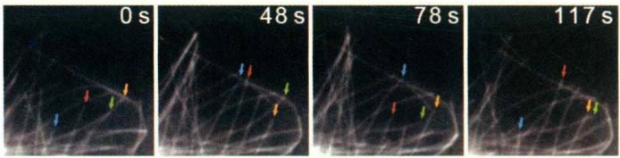

text_image

0 s
48 s
78 s
117 s

较为清楚的微管蛋白亚基PTM有去酪氨酸化、 $\Delta2-$ 微管蛋白生成、多聚谷氨酰化、多聚甘氨酰化和乙酰化（图8-2）。

① 微管蛋白去酪氨酸化和 $\Delta2-$ 微管蛋白生成发生在 $\alpha-$ 微管蛋白C端的去酪氨酸化（酪氨酸残基被去除）和酪氨酸化（重新添加酪氨酸）反应是可逆的。 $\alpha-$ 微管蛋白在去酪氨酸化后倒数第2位的谷氨酸残基被暴露，有人称之为Glu-微管蛋白。催化 $\alpha-$ 微管蛋白去酪氨酸化的羧肽酶是vasohibin（VASHs），而参与逆反应的是微管蛋白酪氨酸连接酶（tubulin tyrosine ligase，TTL）。去酪氨酸反应通常是在组装好的微管蛋白亚基上发生，而TTL则只在可溶性的微管蛋白二聚体上失去酪氨酸的 $\alpha-$ 微管蛋白起作用。TTL可高效、快速地对所有失去酪氨酸的可溶性微管蛋白二聚体重新酪氨酸化（图8-2），这使得用于组装微管的 $\alpha-$ 微管蛋白的C端都带有酪氨酸残基。

图8-1 细胞内微管的动态不稳定性（图像由清华大学欧光朔教授提供）将GFP-tubulin转染S2细胞，显微图像显示微管长度的变化。从左到右每幅图片显示不同时间微管的动态行为，不同颜色的箭头示所指向的微管随着时间的推移而组装（伸长）或解聚（缩短）。

去掉酪氨酸的α-微管蛋白可以进一步去除C端的Glu残基而转化为Δ2-微管蛋白，该反应由细胞质羧肽酶（cytosolic carboxypeptidase，CCP）家族的脱谷氨酶催化。Δ2-微管蛋白的生成是不可逆转的，TTL在体外对Δ2-微管蛋白也没有活性。

② 微管蛋白乙酰化作用 乙酰化主要发生在α-微管蛋白的第40位赖氨酸残基上(Lys40)，该反应仅发生在已经组装好的微管上，由乙酰转移酶催化。因此，一些比较稳定的微管通常有较高的乙酰化修饰水平，如神经元轴突微管、中心粒微管、纤毛或鞭毛的基体和轴丝微管等。催化微管蛋白亚基去乙酰化的酶是组蛋白去乙酰化酶6(HDAC6)和Sirtuin 2(SIRT2)。

③ 微管蛋白多聚谷氨酰化和多聚甘氨酰化 微管蛋白亚基的多聚谷氨酰化作用是在对从哺乳动物大脑纯化得到的微管蛋白进行二维电泳和质谱分析时发现的，这

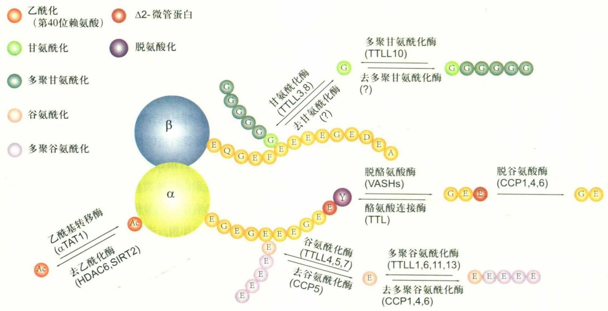

flowchart

This diagram illustrates the biochemical pathway of β-acyltransferase (β-acyltransferase), showing how various enzymes and enzymes interact with a beta complex to form alpha-amino acids, which then undergoes subsequent enzymatic reactions.

图8-2 微管蛋白翻译后修饰的类型及其修饰酶类

微管蛋白在参与组装之后，其多个氨基酸残基发生了修饰，特别是在 $\alpha/\beta$ 微管蛋白的C端发生了去酪氨酸化、 $\Delta2-$ 微管蛋白生成、多聚谷氨酰化、多聚甘氨酰化等。乙酰化修饰仅仅发生在 $\alpha-$ 微管蛋白的第40位赖基酸残基上。

150

第 8 章 微管与细胞内物质运输

---

些微管蛋白C端的1个或多个谷氨酸残基的γ羧基上存在谷氨酸侧链，该反应由谷氨酰化酶催化，可以添加1个谷氨酸，也可以是加上多个谷氨酸而使之成为一串多聚谷氨酸的侧链（图8-2）。多聚甘氨酰化最初是在草履虫的纤毛微管蛋白的C端发现的，多聚甘氨酸侧链也是连接在微管蛋白亚基靠近C端的谷氨酸残基上，催化该反应的微管蛋白甘氨酰化酶与催化谷氨酰化的酶都是TTLL酶家族的成员。去谷氨酰化酶是CCP家族的成员。与谷氨酰化酶相似，去谷氨酰化酶可以通过它们的反应偏好来区分。也就是说，一种去谷氨酰化酶可以从微管蛋白的肽链上去除它的谷氨酸侧链，或水解在微管蛋白肽链上的谷氨酸残基相关的肽键，如生成Δ2-微管蛋白。

与其他已知的PTMs相比，这两种修饰更具有异质性，因为它们既可以发生在α-微管蛋白上，也可以发生在β-微管蛋白上，在谷氨酸残基的γ羧基上形成的侧链也长短有别，甚至只有一个氨基酸。目前还很难区分在什么情况下进行何种长度的侧链修饰，而且一些不同类型的谷氨酰化酶往往是竞争使用类似或同样的修饰位点。因此，想要根据质谱分析的数据将侧链的长度与功能一一对应还有很大的难度。

④ 微管的稳定性 微管的寿命不仅受温度、流体压力、 $Ca^{2+}$ 浓度等理化因素的影响，而且还与微管蛋白亚基的修饰状态和所结合MAP的种类相关。在许多细胞类型中，存在时间较长的微管上的α-微管蛋白亚基通常是去酪氨酸化的；然而，难以理解的是，kinesin13家族的成员却优先结合在末端有去酪氨酸化微管蛋白亚基的微管上，促进微管的解聚。在缺乏TTL的小鼠体细胞内，微管过度组装，去酪氨酸化和Δ2-微管蛋白水平升高，这可能是由于MCAK或KIF2A失活而无法解聚去酪氨酸化的微管。因为Δ2-微管蛋白亚基的C端也缺乏酪氨酸。这些发现也解释了微管蛋白的Δ2修饰会不可逆地将微管锁定在去酪氨酸状态，有助于稳定微管。与此观点一致的是，Δ2-微管蛋白通常发生在细胞分化的最后阶段，这种细胞内的微管通常是比较稳定的。

乙酰化微管常被作为“稳定微管”的代名词，抗乙酰化微管蛋白的抗体被广泛用于标记稳定性较强的微管。在神经元的轴突内部、中心粒和纤毛的轴丝等较稳定的微管结构上也确实检测到α-微管蛋白的乙酰化修饰，乙酰化修饰可稳定微管的说法可能就是这样来的。然而，在乙酰化作用下微管稳定的实验证据少之又少。显然还有许多其他的因素没有考虑到，如α-微管蛋白Lys40乙酰化以后微管结合蛋白的种类和结合强度是否有变化，是否引起微管蛋白亚基构象的改变从而影响微管的结构与功能等。因此，目前还不清楚乙酰化是否会影响微管的稳定性。

在HeLa细胞中表达多聚谷氨酰化酶TTLL6时，微管蛋白的C端会生产较长的多聚谷氨酸侧链，使细胞内微管的总量减少。相比之下，催化生成较短的多聚谷氨酸链对微管没有任何影响。这些结果在体外实验中也得到了证实，即较长的谷氨酰化侧链在激活spastin介导的微管切割中特别有效。然而，在细胞内似乎存在一种机制可以保护多聚谷氨酰化的微管免受katanin或spastin的切割。例如，轴突内部的多聚谷氨酰化修饰增加了微管表面的负电荷，更有利于tau和其他种类MAP结合到微管表面，从而起到保护性屏障作用。

## (4) 微管结合蛋白

如前所述，利用微管对温度的敏感性，再结合差速离心技术可以将动物脑组织中微管蛋白纯化。但即使是进行多次组装/去组装的循环，仍然有一些蛋白始终伴随着微管的组装而存在于该体系中，这类蛋白被称为微管结合蛋白(MAP)。根据MAP在电泳时所显示分子量的不同，依次命名为MAP1、MAP2、MAP3、MAP4和tau等。也有人将依赖微管的分子马达也划归到微管结合蛋白中去，而将传统意义上与微管表面结合、调节微管网络空间结构和稳定性的MAP称为非马达MAP。由于类似的研究大多以神经组织为对象，因此在已经鉴定的MAP中，有些仅在神经系统中表达，后来也陆续鉴定出许多在其他的组织细胞内与微管相互作用的蛋白。微管结合蛋白通常都是单基因编码的，并且这些蛋白的多肽链上通常具有数个带正电荷的微管结合结构域(microtubule binding domain)，如tau、MAP2和MAP4等。该结构域与带负电荷，特别是被多聚谷氨酰化的微管表面相互作用。一个MAP分子上成线性排列的微管结合结构域可分别结合原丝上相邻的微管蛋白亚基，以增加微管的稳定性。微管结合蛋白其余的结构域突出于微管表面，并与相邻的微管或细胞结构相结合，调节微管网络的结构和功能。

MAP2、tau 和 MAP1B 是研究得较为清楚的组分，将编码这些蛋白的 cDNA 转染细胞，能促进微管的组装，并使相邻的微管排列成束。在神经细胞中，MAP2

8.1 微管的结构与动态不稳定性

151

---

定位于神经元的胞体和树突，而tau则大量存在于轴突，MAP1B在树突和轴突内部都有分布。在MAP2和tau的C端均有3～4个由18个氨基酸残基构成的微管结合结构域。与微管结合后，其N端突出于微管表面，并在相邻的微管之间形成横桥。由于这两种蛋白N端突出区域（在相邻微管间所形成的横桥）的长度不同，诱导产生的微管束的结构也不一样。由此，MAP2和tau在神经细胞中的极性化定位使树突和轴突内部微管网络的结构产生了差异。在树突中，相邻微管之间的距离较长，而轴突中相邻微管靠得较近(图8-3)。

MAP2或tau基因敲除小鼠的树突或轴突内部相邻微管间的横桥明显减少，虽然对神经元突起生长的影响并不是很大，但MAP1B/MAP2或MAP1B/tau双基因敲除的小鼠在发育过程中出现明显的大脑组织结构异常，神经纤维生长受阻，幼鼠在出生后不久死亡。表明MAP1B与MAP2/tau之间在维持神经细胞微管网络的结构和功能上有互补作用。

在有丝分裂细胞中，微管网络的结构和稳定性同样受微管结合蛋白的调控。如CEP57可依赖其N端的卷曲螺旋结构域形成二聚体，并与中心体的γ-微管蛋白环状复合体的组分相结合，而其C端则分别作用于相邻的微管，以维持纺锤体微管结构的稳定。NuMA也是定位于纺锤体微管负极端的交联蛋白，在维护纺锤体结构的稳定方面发挥作用，而katanin等蛋白对微管进行切割，游离下来的微管可能会锚定到其他的细胞结构上发挥作用。

微管正端示踪蛋白(microtubule-plus-end tracking protein, +TIP)是一类进化上保守、特异性结合在微管正极端的蛋白，并在调控微管组装、微管与其他细胞结构的相互作用方面发挥作用，如末端结合蛋白(end-binding protein, EB)、CAP-Gly蛋白(cytoskeleton-associated protein Gly-rich protein)及一些对微管具有解聚作用的kinesin 13家族的成员等。CAP-Gly蛋白，如CLIPs (cytoplasmic linker protein) 和 $\mathrm{p150}^{\mathrm{glued}}$ ，结合在生长中的微管的正极端，而这种结合需要 $\alpha-$ 微管蛋白的C端有酪氨酸。结构分析揭示，在 $\alpha-$ 微管蛋白的C端，酪氨酸化的尾巴与动力蛋白激活蛋白，带有CAP-Gly结构域的 $\mathrm{p150}^{\mathrm{glued}}$ 等亚基间存在相互作用。CLIP170 (CLIP1)与微管正极端的结合同样需要 $\alpha-$ 微管蛋白C端的酪氨酸残基。

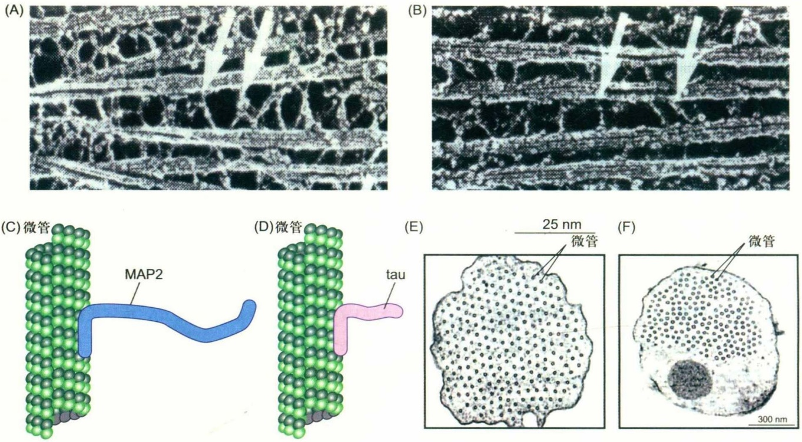

图8-3 MAP2和tau蛋白诱导产生的微管束结构

(A) 和 (B) 深度冷冻蚀刻电镜图像显示MAP2 (A) 和 tau (B) 的 N 端突出结构域在相邻微管之间形成横桥；(C) 和 (D) MAP2 和 tau 与微管表面结合的模式图，这两个蛋白的 C 端具有微管结合结构域，可与微管表面结合，其 N 端突出于微管表面；(E) 由 MAP2 诱导产生的细胞突起内的微管束结构，相邻微管之间的距离为 60～70 nm；(F) 由 tau 蛋白诱导产生的细胞突起内的微管束结构，相邻微管之间的距离为 20～30 nm。

152

第8章 微管与细胞内物质运输

---

不同类型的+TIP对微管产生不同的影响，如EB蛋白能促进微管的组装，而kinesin 13家族的成员与微管的正极端结合后使微管更容易解聚。在酿酒酵母中，动力蛋白与CLIP170、LIS1的同源物一起，在纺锤体的定位过程中发挥作用。微管的末端还可以通过+TIP（如酿酒酵母中EB1的同源物Bim1、Kar9）间接地与依赖微丝的分子马达（如Myo2）相互作用，这一过程与纺锤体的定位密切相关。

## 8.2 依赖微管的分子马达与细胞内物质运输

与原核细胞相比，真核细胞的体积要大得多。一些细胞突起，如神经细胞轴突的长度往往可以用厘米甚至是米来计算。很显然，要通过简单扩散的方式使在细胞体内合成的蛋白质定向进入轴突，并到达突触部位的概率实在太低。应用快速冷冻-深度蚀刻（quick freezing-deep etching）技术在电镜下观察轴突内部的结构，发现在微管与膜性细胞器之间有一些横桥相连（图8-4）。利用微分干涉—录像增强反差显微镜观察活细胞，可见在微管表面有一些膜泡向微管的一端运动，而另一些则向相反的方向移动。用药物抑制细胞内ATP酶的活性可使这种依赖微管的膜泡运输过程终止。可见这种依赖微管的膜泡运输不同于自由扩散，是需要能量的定向运输。显然在微管和膜泡之间存在一些既能与微管结合、又能

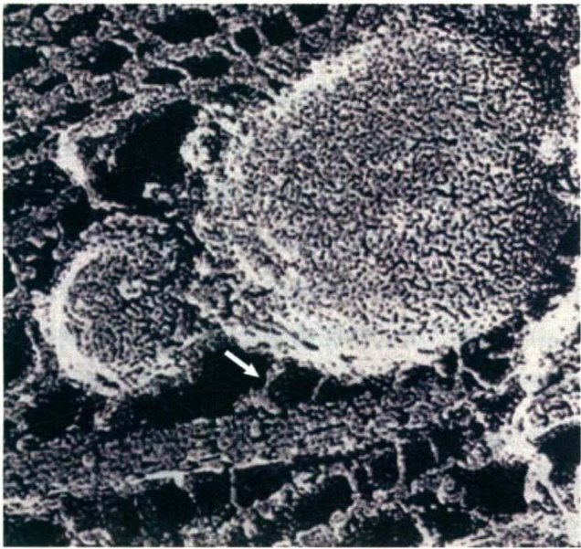

natural_image

Microscopic tissue section showing cellular structures with a white arrow pointing to a specific region (no text or symbols present)

与膜泡特异性结合的蛋白分子，该蛋白利用水解 ATP 产生的能量沿微管移动。通常将这些能携带货物，并利用 ATP 将化学能转变成机械能，有规律地沿微管或微丝等细胞骨架纤维移动的蛋白称为分子马达（molecular motor）。

按分子马达所结合的细胞骨架的不同，可将其分为依赖微管的驱动蛋白（kinesin）和动力蛋白（dynein），以及依赖微丝的肌球蛋白（myosin）。以下主要讨论依赖微管的物质运输。

## 8.2.1 驱动蛋白

## (1) 驱动蛋白的结构与功能

驱动蛋白是R. D. Vale（1985）等在鱿鱼神经元巨大的轴突内分离到的分子马达，能沿微管移动，但不同于肌球蛋白和动力蛋白。该蛋白能运载膜性细胞器沿微管向轴突末梢移动。驱动蛋白在结构上由2条具有马达结构域的重链（kinesin heavy chain, KHC），2条与重链的尾部结合、具有货物结合功能的轻链（kinesin light chain, KLC）所组成。低角度旋转金属投影（low angle rotary metal shadowing）电镜图像显示，驱动蛋白分子是一条长80 nm的杆状结构，头部有两个外观呈球状、直径约10 nm的马达结构域。另一端是重链和轻链组成的扇形尾部，中间是重链杆状区（图8-5）。球状的头部具有ATP结合位点和微管结合位点。随后，多个实验室在其他种类的生物如酵母、昆虫、小鼠和人类细胞中也陆续发现了编码类似驱动蛋白的基因及表达产物。人类基因组中有45个驱动蛋白基因，形成一个庞大的驱动蛋白基因超家族。马达结构域是该家族成员的一个共有元件，结构非常保守，而其他结构域相似度很低。

驱动蛋白的行为与其马达结构域在多肽链中的位置有关，大部分成员的马达结构域在肽链的N端（N-驱动蛋白），如驱动蛋白1～12（图8-6），它们能从微管的负极向正极移动。另外一些成员的马达结构域位于多肽链的中部（M-驱动蛋白），如驱动蛋白13家族的3个成员，它们结合在微管的正极端或负极端，使微管处于不稳定状态。有丝分裂时后期，染色体向两极移动时动粒部位

## 图8-4 快速冷冻-深度蚀刻电镜图像 (Hirokawa 教授惠赠)

显示在轴突内部的微管和膜性细胞器之间有马达蛋白构成的横桥相连（箭头）。

8.2 依赖微管的分子马达与细胞内物质运输

153

---

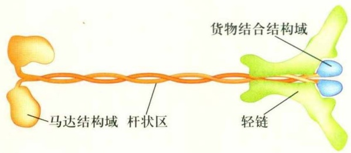

text_image

货物结合结构域
轻链
马达结构域 杆状区

微管的解聚就与这些蛋白相关。还有一些驱动蛋白的马达结构域位于肽链的C端（C-驱动蛋白），如驱动蛋白14的4个成员，这类驱动蛋白的运动方向与N-驱动蛋白相反，从微管的正极向负极移动。驱动蛋白8和驱动蛋白13家族的成员既能向微管的正极端移动，还具有调节微管解聚的能力。大部分驱动蛋白是通过多肽链中部的一段卷曲螺旋相互作用而形成同型二聚体（如驱动蛋白4、6、7、8、10、12、13和14家族）。驱动蛋白1除了有两条重链（KHC）以外，在C端还有2条轻链（KLC）共同构成货物结合结构域。驱动蛋白2的KIF3的2个成员可与1个结合蛋白一起构成异三聚体（KIF3A-KIF3B-KAP3）。驱动蛋白3以单体或同源二聚体的形成存在。驱动蛋白5可以通过其杆状区形成反向四聚体，在极性相反的两根相邻的微管（如纺锤体极间微管）之间滑动介导中心体向两极移动。驱动蛋白1～3家族的成员主要与膜性细胞器和大分子复合物的运输相关，而其他家族的成员主要作用在于调节微管的动态不稳定性以及微管网络的结构。

## (2) 驱动蛋白的分类和命名

由于历史的原因，驱动蛋白的分类和命名存在多种方式。有按其功能特征命名的，也有研究者以各自的研究体系命名的。其中值得一提的是按马达结构域在重链上的位置和其进化关系进行的命名法则，将迄今为止在人类及小鼠细胞内发现的45种KIFs按驱动蛋白的马达结构域在重链上位置的不同分为N-驱动蛋白、M-驱动蛋白和C-驱动蛋白3大类型（图8-5）。在目前所鉴定的驱动蛋白分子中，N-驱动蛋白占大多数。根据N-驱动蛋白各自的特征，可以将其进一步分为11种类型。M-驱动蛋白目前仅发现1种类型，C-驱动蛋白有2种类型。

为了便于交流，在2003年美国细胞生物学大会期间举行了一个有关驱动蛋白的组会。会上，根据基于分子保守区域系统进化方面的信息，同时考虑到以往的名称或已知的功能特征，将现有的驱动蛋白超家族分成14个

## 图8-5 驱动蛋白分子结构模式图

传统类型的驱动蛋白是由2条重链和2条轻链构成的异源四聚体。球状的马达结构域位于重链的N端（左侧），从左向右分别是连接马达结构域的颈部、杆状区和由重链的C端及轻链构成的扇形尾部。

蛋白家族和一个暂时未成组的“orphan kinesin”，用阿拉伯数字1～14分别标记各个蛋白家族。各个蛋白家族中的亚家族则用附加的大写英文字母表示如kinesin 14A和kinesin 14B，但为了减少不必要的混乱还保留其原有的序列名字。

## (3) 驱动蛋白沿微管运动的分子机制

驱动蛋白的马达结构域有2个重要的功能位点，即ATP结合位点和微管结合位点。组成这两个位点的肽段在一级结构上非常保守，可以作为鉴定驱动蛋白分子的依据。在结合或水解ATP时，马达结构域的构象发生变化，从而引发与微管之间的周期性相互作用，其结果是沿微管移动一步。

关于驱动蛋白的运动机制，过去近30多年的研究积累了大量生物化学和结构生物学的证据，特别是近年来发展起来的单分子行为分析为研究驱动蛋白两个马达结构域是如何协调向前运动提供了有效的方法，但是针对不同的驱动蛋白得到的实验结果不尽相同。根据这些实验结果，归纳起来有两种主要的分子模型:一种是步行（hand-over-hand）模型，另一种是尺蠖（inchworm）模型。

步行模型认为驱动蛋白的两个球状头部与微管表面结合，一前一后相差2个微管蛋白亚基。每水解一个ATP，落在后面的那个马达结构域向前跨一步，即4个微管蛋白亚基（16 nm），前后2个马达结构域交换位置。尺蠖模型则认为驱动蛋白两个头部中的一个始终在前，另一个永远在后，每步向前移动2个微管蛋白亚基（8 nm）。虽然，有些研究结果支持步行模型，另一些与尺蠖模型相吻合，这里着重介绍被大多数学者认可的步行模型（图8-7）。在驱动蛋白移动过程中，马达结构域自身的构象变化及与微管蛋白亚基之间的相互作用与ATP结合、水解和ADP释放等过程相偶联。在持续的运动过程中，两个马达结构域循环交替向前运动。循环开始时，

154

第 8 章 微管与细胞内物质运输

---

(A)

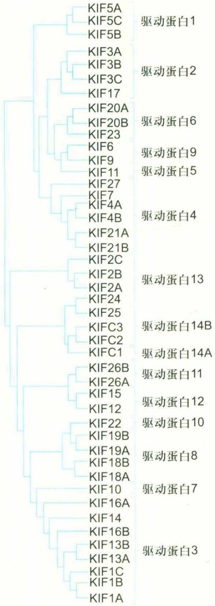

dendrogram

| Protein ID | Motivation |
| --- | --- |
| KIF5A | 驱动蛋白1 |
| KIF5C | 驱动蛋白2 |
| KIF5B | 驱动蛋白2 |
| KIF3A | 驱动蛋白6 |
| KIF3B | 驱动蛋白9 |
| KIF3C | 驱动蛋白5 |
| KIF17 | 驱动蛋白4 |
| KIF20A | 驱动蛋白13 |
| KIF20B | 驱动蛋白13 |
| KIF23 | 驱动蛋白13 |
| KIF6 | 驱动蛋白14B |
| KIF9 | 驱动蛋白14B |
| KIF11 | 驱动蛋白14A |
| KIF27 | 驱动蛋白11 |
| KIF7 | 驱动蛋白12 |
| KIF4A | 驱动蛋白10 |
| KIF4B | 驱动蛋白8 |
| KIF21A | 驱动蛋白7 |
| KIF21B | 驱动蛋白3 |
| KIF2C | 驱动蛋白3 |
| KIF2B | 驱动蛋白3 |
| KIF2A | 驱动蛋白3 |
| KIF24 | 驱动蛋白3 |
| KIF25 | 驱动蛋白3 |
| KIFC3 | 驱动蛋白3 |
| KIFC2 | 驱动蛋白3 |
| KIFC1 | 驱动蛋白3 |
| KIF26B | 驱动蛋白3 |
| KIF26A | 驱动蛋白3 |
| KIF15 | 驱动蛋白3 |
| KIF12 | 驱动蛋白3 |
| KIF22 | 驱动蛋白3 |
| KIF19B | 驱动蛋白3 |
| KIF19A | 驱动蛋白3 |
| KIF18B | 驱动蛋白3 |
| KIF18A | 驱动蛋白3 |
| KIF10 | 驱动蛋白3 |
| KIF16A | 驱动蛋白3 |
| KIF14 | 驱动蛋白3 |
| KIF16B | 驱动蛋白3 |
| KIF13B | 驱动蛋白3 |
| KIF13A | 驱动蛋白3 |
| KIF1C | 驱动蛋白3 |
| KIF1B | 驱动蛋白3 |
| KIF1A | 驱动蛋白3 |

(B)

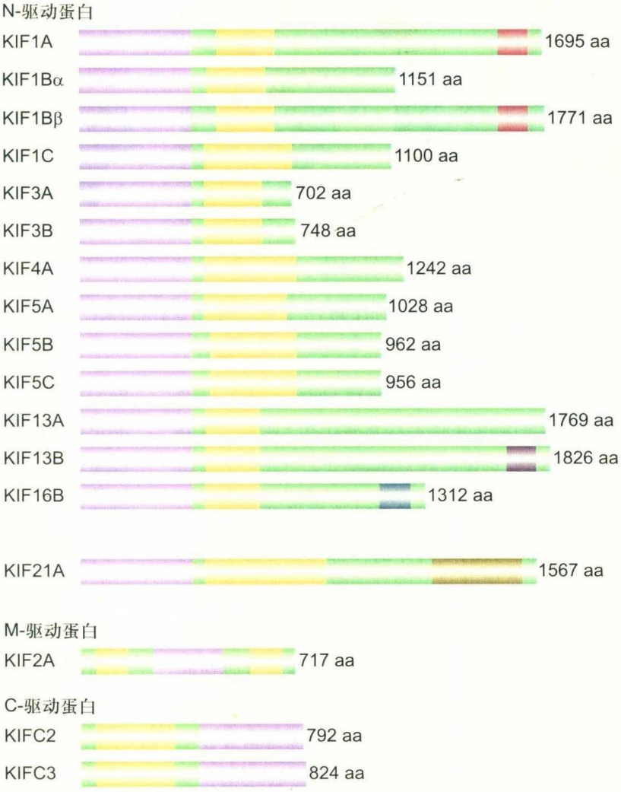

bar_stacked

| Category | Length (aa) |
| :--- | :--- |
| KIF1A | 1695 |
| \(KIF1B\alpha\) | 1151 |
| \(KIF1B\beta\) | 1771 |
| KIF1C | 1100 |
| KIF3A | 702 |
| KIF3B | 748 |
| KIF4A | 1242 |
| KIF5A | 1028 |
| KIF5B | 962 |
| KIF5C | 956 |
| KIF13A | 1769 |
| KIF13B | 1826 |
| KIF16B | 1312 |
| KIF21A | 1567 |
| KIF2A | 717 |
| C-驱动蛋白::KIFC2 | 792 |
| C-驱动蛋白::KIFC3 | 824 |

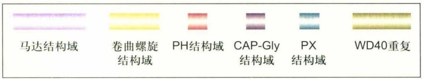

text_image

马达结构域
卷曲螺旋
结构域
PH结构域
CAP-Gly
结构域
PX
结构域
WD40重复

图8-6 小鼠驱动蛋白的结构和系统发生（仿自Hirokawa等，2009）

（A）小鼠基因组中驱动蛋白超家族（KIF）45个成员的系统发生树，按命名法则分成15个家族；（B）小鼠主要驱动蛋白的功能结构域示意图。

假定驱动蛋白分子的两个马达结构域中位于前面的一个（L）与微管结合，后面的一个（T）结合着一个ADP，但与微管处于分离状态。当L与ATP结合时驱动蛋白发生构象变化，后面的马达结构域向前移动，并越过L在微管上的结合位点，移动到位于微管正极一侧的另一个新的结合位点。此时，已经位于前面的T（原来位于后面的那个）释放ADP，处于后面的L（原来处于前的）水解ATP，使驱动蛋白二聚体处于开始时的状态，但L和T互换了位置，整个分子则向微管的正极端移动了相当于两个微管蛋白亚基的长度。在这一循环的运行过程中，每个马达结构域有一半以上的时间与微管处于结合状态。在驱动蛋白分子沿微管持续移动过程中，两个马达结构域相互协调，使驱动蛋白分子以及所携带的货物始终附着在微管表面，而不会掉下来。相反，在骨骼肌细胞内，Ⅱ型肌球蛋白沿微丝运动时，同样是ATP的水解与马达结构域的构象变化相偶联，但在每个循环中，肌球蛋白的头部与微丝结合的时间仅占循环所需总时间的5%，Ⅱ型肌球蛋白只能沿微丝前进一步或少数几步便离开微丝，不能持续向前运动。这些差异对于不同的马达分子行使其功能极其重要。在神经细胞内，一些驱动蛋白分子担

8.2 依赖微管的分子马达与细胞内物质运输

155

---

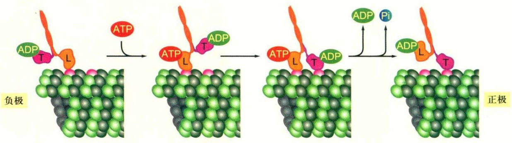

flowchart

图8-7 驱动蛋白沿微管运动的步行模型

驱动蛋白-1有两条重链，其头部结构域（用L和T分别表示它们开始时所处的位置）伴随着ATP的结合、水解、Pi及ADP的释放而在微管表面运动。在整个过程中，两个头部至少有一个与微管处于结合状态。

负着向轴突或树突的末端运输细胞器（如线粒体）以及在胞体内合成的蛋白质等生物大分子的任务，因此，驱动蛋白分子必须以较高的速率持续向前运动。而在骨骼肌细胞内，肌球蛋白从不以单个分子的形式发挥作用，每个分子仅仅是作为巨大的复合体的一部分。在这个复合体内部，任何一个单体持续向前运动将影响整体功能的发挥，因为有效的肌肉收缩需要每个肌球蛋白的头部在履行它的马达功能之后便快速从纤维上解离，以避免妨碍另外的肌球蛋白头部与该位点的结合。

与驱动蛋白的球状头部相连的重链铰链区似乎具有调整驱动蛋白重链二聚体两个头部的机械化学循环和决定驱动蛋白的运动方向的功能。驱动蛋白超家族大部分成员的马达结构域位于重链的N端，能携带货物朝微管的正极移动，只有少数的成员的马达结构域位于重链的C端，这些马达蛋白的运动方向是微管的负极。这两种驱动蛋白的马达结构域在本质上是相同的，那么是什么因素决定了C-驱动蛋白向相反的方向运动呢？答案似乎在于其头部的连接方式。高分辨率图像分析结果表明，沿微管向正极或负极移动的驱动蛋白分子的头部附着在微管上的方式并没有差别，但是第二个未附着的头部的定位却非常不同。对于N-驱动蛋白，当第一个马达结构域结合在微管表面，并有ATP存在时，另一个没有与微管结合的马达结构域位于微管的正极一侧。而对于C-驱动蛋白，其第二个头部的趋向与上述N-驱动蛋白的状态相反。这种差异显然会影响接下来的结合位点，从而决定分子马达的运动方向。

引发驱动蛋白沿微管持续移动的原因有两个:第一，在驱动蛋白分子中两个马达结构域的化学-机械循环是互相协调的，其中一个马达结构域还没有与微管结合之前，另一个马达结构域则不会从微管上掉下来，从而保证了步行的连续性，即马达分子和所运送的“货物”或细胞器不会脱离微管。第二，驱动蛋白的马达结构域在ATP酶循环的大部分时间里都与微管紧密结合。

肌球蛋白不具备沿微丝持续向前运动的能力，但多个肌球蛋白组装而成的巨大复合物（如粗肌丝）的协同作用却能提高其整体移动的速度。如在骨骼肌细胞中，大量规则排列的肌球蛋白头部与同一根微丝相互作用，复合物中肌球蛋白头部的协同作用使在单一循环时间内，能将微丝移动相当于20步的总距离，而驱动蛋白只能沿微管移动2步。这样，即便是两者的水解ATP速度和分子步距相当，但肌球蛋白却能以比驱动蛋白更快的速度沿细胞骨架移动。

## (4) 驱动蛋白的功能

物质运输对于维持细胞形态和功能是必不可少的。蛋白质、脂质以及mRNA在细胞内合成后，要转运到确定的部位发挥作用，这在极性化的神经细胞和上皮细胞中尤为重要。膜性细胞器或大分子的运输大部分是由沿微管移动的驱动蛋白和细胞质动力蛋白来完成。

在驱动蛋白的成员之间，一级结构上差异较大的部分是与货物结合以及与调节和定位相关的结构域。货物结合结构域通常由重链的C端和轻链所组成，该结构域决定与哪种货物结合，而货物转运方向的决定和定位的机制尚不清楚，除了驱动蛋白和货物本身的定位信息以外，可能还与微管蛋白亚基的翻译后修饰状态以及微管结合蛋白的种类相关。以下主要介绍一些目前已较为清楚的驱动蛋白的功能。

① 驱动蛋白-1 驱动蛋白-1（kinesin，conventional kinesin，KIF5）即通常所称的驱动蛋白，又称为kinesin

156

第8章 微管与细胞内物质运输

---

重链(KHC)，是第一个被鉴定的驱动蛋白分子。在KHC分子的N端是由ATP结合位点和微管结合位点构成的马达结构域，中间是杆状螺旋区，C端与轻链(KLC)构成货物结合结构域(cargo binding domain, CBD)，能选择性地与货物结合。在细胞中，驱动蛋白-1由2条重链(KHC)和2条轻链(KLC)组装而成。KLC的N端为卷曲螺旋区，负责与KHC结合，C端包含由30～40个氨基酸组成的介导蛋白质-蛋白质相互作用的结构基序TPR(tetratricopeptide repeat)。货物可以与KLC的C端结构域结合，也可以直接与KHC的货物结合结构域结合。

哺乳动物的KIF5有A、B和C三种类型，其中KIF5B几乎存在于所有的细胞中，而KIF5A和KIF5C仅在神经细胞中表达。KIF5的KLC也有多种不同的类型，这可能与转运不同的货物相关。KIF5主要参与一些细胞器和膜泡的转运，其货物种类有线粒体、溶酶体、分泌泡、膜蛋白、神经丝蛋白和核蛋白体等。这些货物有些直接与KIF5的CBD结合（如DISC、SAP25、GRIP1和p120 catenin等），另外一些则通过KLC的TPR结构域结合（如neurofibromin、β-dystrobrevin、torsin A、JIPs、APP和huntingtin-associated protein等），如在小鼠神经细胞中，KLC的TPR结构域与β-淀粉样蛋白前体（β-amyloid precursor protein，APP）的胞内结构域相结合。在KLC的基因敲除小鼠中，APP沿轴突正向运输的量较正常的大为减少。

② kinesin 2 在哺乳动物细胞中，kinesin 2 家族的成员主要包括 KIF3 和 KIF17，它们都是参与微管正向运输的 N-驱动蛋白。

KIF3是由KIF3A、3B和KAP3（kinesin superfamily-associated protein 3）或KIF3A、3C和KAP3三个亚基组装而成的异型三聚体，在各组织细胞中广泛表达，在脑组织中尤为丰富，其同源物种在各种生物中普遍存在。KIF3参与视蛋白(opsin)、N-钙黏着蛋白(N-cadherin)、β-联蛋白(β-catenin)和APC蛋白(adenomatous polyposis coli protein)等的运输，其中KAP3负责与所运输的货物结合。

由于KIF3A基因敲除小鼠在胚胎期死亡，从而限制了相关的研究，为此，Marszalek等（2000年）利用Cre/loxP条件性基因剔除技术制作了特异敲除视网膜光感受器中KIF3A的突变小鼠。由于缺乏KIF3A，小鼠视蛋白和视紫红质抑制蛋白(arrestin)从光感受器内段(the inner segment)到外段(the outer segment)的运输受阻，引起光感受器内段视蛋白和视紫红质抑制蛋白的大量积聚，最终导致视网膜光感受器细胞的凋亡，其症状与色素性视网膜炎（retinitis pigmentosa）非常相似。

Hirokawa N实验室（2005年）利用条件性基因打靶技术建立了神经丝蛋白启动子带动的KAP3条件性基因剔除小鼠，以研究妊娠中期以后KAP3在神经系统发育和分化过程中的功能。KAP3的缺失，导致N-钙黏着蛋白和β-catenin不能被运输到细胞表面，由此通过相应的信号传导系统影响下游的基因表达（如cyclin D1等），引起细胞的异常分裂以及大脑皮层组织出现室管膜瘤样病变；另一方面由于细胞表面缺乏N-钙黏着蛋白和β-catenin，导致细胞间的黏连受影响，细胞迁移更容易发生。因此，KIF3具有促进N-钙黏着蛋白和β-catenin的细胞膜定位，限制β-catenin进核以及抑制肿瘤形成的能力。

鞭毛内运输（intraflagellar transport，IFT）最初在莱茵衣藻（C. reinhardtii）的鞭毛中发现，IFT颗粒包含了纤毛或鞭毛组装和维持所必需的结构组分。KIF3沿轴丝微管移动将纤毛或鞭毛组装所需的材料从其基部运输到顶端。

KIF3A 和 KIF3B 基因敲除小鼠的表型非常相似，出现胚胎发育迟缓、围心囊庞大、神经管紊乱等现象，大概在胚胎发育到第 12.5 d 前死亡。其最明显的特征是发育过程中左右体轴形成不完全。正常野生型小鼠的心襻（cardiac looping）呈 L-型（L-loop），心脏位于左侧；而基因敲除小鼠中 L-型和 D-型（D-loop）的心襻随机出现，心脏在左侧或右侧形成的概率相同，即左-右决定随机获得。在 KIF3A 或 KIF3B 基因敲除小鼠胚胎第 8d 对 lefty-2 进行全胚原位杂交的结果显示该蛋白在个体左右两侧都有表达；而在野生型小鼠中，lefty-2 仅在左侧表达。其原因是胚胎发育过程中称为胚胎节（node）的结构发育不完全。胚胎节是原肠胚期胚胎表面腹部中线上的一个三角形或略显长形的凹陷结构，对胚胎发育和体态构建起着关键性作用。在组成胚胎节细胞的表面长有纤毛，称为节纤毛（nodal cilia）。KIF3 基因敲除小鼠节纤毛生长受到影响，缺乏完整的纤毛结构。野生型小鼠节纤毛及其基体横切面中微管的排列方式分别是 “9+2” 和 “9+0” 模式，KIF3A 和 KIF3B 基因敲除小鼠中节纤毛缺失，但基体仍然存在。

对小鼠胚胎节纤毛的显微观察结果显示，每根纤毛都呈顺时针方向漩涡运动，从而在胚胎节处形成从右向左的液流。即在胚胎节处由于纤毛的顺时针方向漩涡

8.2 依赖微管的分子马达与细胞内物质运输

157

---

运动，使外胚液产生一个稳定向左的液流，这个液流称为“节流（nodal flow）”。由于节流的存在，打破了小鼠胚胎发育过程中的信号分子分布的对称性，使胚胎左侧的SHH（sonic hedgehog）、RA（retinoic acid）等信号分子的浓度相对较高。这样胚胎节左右两边的细胞受信号分子的影响就不同，导致了基因表达和细胞分化方向的差异，从而使个体器官发育的左右不对称性发生变化。KIF3A或KIF3B基因敲除的小鼠细胞内，节纤毛组装所必需的结构组分不能被运输到纤毛顶部，引起纤毛发育不全，不能进行顺时针方向漩涡运动，失去了左右体轴形成必需的信号分子的浓度差，最终导致左右体轴形成障碍。

KIF17是kinesin 2家族的另一个成员，在中枢神经系统中大量表达，组装成同型二聚体。与KIF3不同，KIF17主要存在于胞体和树突中，通过与Mint1（mLin10）、CASK 和 Velis 等构成的蛋白复合体相互作用，特异性地从胞体运送含有NMDA（N-methyl-D-aspartate）受体的NR2B亚基的小泡到树突的突触后膜。CaMK II（Ca $^{2+}$ /calmodulin-dependent protein kinase II）启动子驱动的KIF17转基因小鼠在Morris水迷宫（water maze task）等行为试验中都表现出比野生型更强的工作记忆（working memory）和空间记忆（spatial memory）能力，表明KIF17运输NMDA受体对学习和记忆具有极其重要的生理学意义。

③ kinesin 3 (KIF1、KIF13、KIF14、KIF16、Unc104) kinesin 3 是向微管正极运动的 N-驱动蛋白，其中研究较为清楚的是 KIF1A、KIF1B 和 KIF13。

通常认为KIF1A和KIF1B是向微管正极运输货物的单体驱动蛋白（monomeric kinesin）家族的成员。对于单体驱动蛋白持续沿微管移动的机制并不清楚。也有一些学者提出KIF1沿微管移动的机制依赖于二聚体，而不是通常所认为的单体。KIF1B在mRNA水平上由于不同的剪接方式而形成KIF1Bα和KIF1Bβ。KIF1Bα可能与线粒体的运输有关。KIF1A和KIF1Bβ在神经细胞的轴突中转运突触小泡。KIF1A和KIF1B基因敲除小鼠在出生后24 h内死亡，细胞水平上的分析结果显示，神经细胞的轴突末端突触小泡的数量减少，造成运动神经和感觉神经系统功能障碍。同样，KIF1A和KIF1Bβ在C. elegans中的同源物Unc104也是运输突触小泡前体所必需的。KIF1/Unc104驱动蛋白的C端都有一个PH结构域，介导与蛋白质和脂质的相互作用，从而实现与货物间的结合。体外实验已证实PH结构域与脂质体（liposome）

的PtdIn(4, 5)P₂[phosphatidylinositol (4, 5)bisphosphate]相互结合。这种结合促使脂质体沿微管移动，而脂质成分的改变可以调节脂质体的运输状况。此外，位于KIF1A和KIF1Bβ的马达结构域和PH结构域间的杆状区也具有识别特异货物的功能。它可以直接与DENN/MADD(differentially expressed in normal and neoplastic cell/MAP kinase activating death domain)结合，由此“选择”与小分子GTP酶的GTP-Rap3的形式相互作用，运输Rab3小泡。因此，KIF1A和KIF1Bβ对Rab3小泡在神经轴突中的运输起重要作用。

人类的KIF1C与PTPD1(protein tyrosin phosphatase)的ezrin结构域结合，曾被认为参与高尔基体与内质网之间的膜泡运输，可能与内质网逃逸蛋白的回收相关。但出乎意料的是KIF1C基因敲除小鼠表型正常。基因敲除细胞和野生型细胞相比，无论是高尔基体的形态和分布，还是从高尔基体到内质网之间的运输均没有受到明显影响。

KIF13A运输6-磷酸甘露糖受体。KIF13A与网格蛋白相关的衔接复合体AP-1（clathrin-associated adaptor complex AP-1）的亚基β1-衔接蛋白（β1-adaptin）相结合，参与AP-1和6-磷酸甘露糖受体（mannose-6-phosphate receptor，M6PR）的转运。过表达KIF13A使AP-1和M6PR在细胞核周围的定位消失，取而代之的是极强的细胞边缘定位；而如果阻断KIF13A的功能，抑制M6PR到细胞表面的运输，导致细胞表面M6PR的水平降低。

KIF13B又称GAKIN (guanylate kinase-associated kinesin)，在脑和肾组织中高表达，因该蛋白是利用hDlg (human discs large) 肿瘤抑制因子的GUK (guanylate kinase-like) 结构域与GST的融合蛋白通过亲和柱层析分离结合蛋白时发现而得其名。黑腹果蝇 (D. melanogaster) 中KIF13B的同源物为Khc-73。在果蝇的成神经干细胞中，细胞皮层极性的形成是细胞不对称分裂以及实现两个子细胞不同命运决定所必需的。免疫共沉淀证实Dlg/Khc-73和Dlg/Pins的相互作用，而Khc-73定位于星体微管的正极。因此，通过Dlg和Khc-73的相互作用，诱导Pins/Gai形成细胞皮层部位物质的极性分布。

Centaurin-α1(又称p42IP4BP或PIP3BP)是3,4,5-三磷脂酰肌醇磷酸[phosphatidylinositol 3,4,5-trisphosphate, PtdIns(3,4,5)或PIP₃]的结合蛋白，也是小GTP酶ADP-核糖基化因子(ADP-ribosylation factor, ARF)家族的GTP酶激活蛋白(GTPase activating protein, GAP)。

158

第8章 微管与细胞内物质运输

---

用 centaurin- $\alpha$ 1 作为诱饵进行酵母双杂交，从大鼠脑 cDNA 文库中得到了 KIF13B。KIF13B 的杆状结构域与 centaurin- $\alpha$ 1 的 GAP 结构域直接结合，并定位于细胞的突出前端，同时通过抑制 centaurin- $\alpha$ 1 的 ARF6 GAP 活性来调控 ARF6 的功能。另一方面，在神经细胞中 KIF13B 通过与 centaurin- $\alpha$ 1 结合运输含有 PIP3 的小泡到神经轴突的顶端，调节神经细胞极性形成。

④ kinesin 4 kinesin 4在哺乳动物细胞中广泛表达，其成员主要包括KIF4、KIF21和XKLP等。

kinesin 4 家族的成员，如鸟类的 CHRKIN (chromokinesin)、非洲爪蟾 (X. laevis) 的 XKLP1、人类的 hKIF4A 等均参与有丝分裂过程中纺锤体结构和染色体行为的调节。小鼠 KIF4 在细胞有丝分裂期定位于纺锤体尚未完全分化成熟的神经细胞的核内和生长锥部位也有较多的分布，且与膜结构共定位，揭示它在膜泡运输方面也具有重要功能。在神经细胞中用反义寡核苷酸 (antisense oligonucleotide) 抑制 KIF4 的表达，引起神经轴突伸长所必需的细胞黏连分子 L1 的运输受阻。

KIF4基因敲除的ES细胞诱导分化产生的神经细胞对凋亡(apoptosis)表现出极强的抵抗能力。进一步的研究显示，KIF4的尾部结构域能与未成年小鼠的脑组织中的核酶PARP-1(poly-ADP ribose polymerase-1)相结合，抑制PARP-1的酶活性。当DNA损伤或死亡信号存在时，细胞通过激活作为转录调节因子的PARP-1修复DNA，控制能量平衡，以维持细胞的稳态(homeostasis)。用高钾处理或电刺激降低膜的极性化状态，CaMK IIα磷酸化KIF4，磷酸化形式的KIF4从PARP-1上释放进入细胞质。失去KIF4的PARP-1活性上调，从而阻止了细胞凋亡。在处于发育过程中的脑组织中KIF4通过磷酸化修饰而改变与PARP-1的结合状态，调节PARP-1的活性，从而调控未成熟神经细胞的凋死亡，确保发育过程中脑神经细胞的数量，对神经系统的正常发育具有重要作用。

⑤ kinesin 13 调节微管的解聚 kinesin 13（KIF2）的马达结构域位于重链的中央区域，主要成员包括 KIF2A、KIF2B 和 KIF2C。这类驱动蛋白具有解聚微管的活性，参与微管网络结构的动态调控，并与多种细胞结构的组装和细胞行为相关。

KIF2A 在未成熟的神经细胞，特别是生长锥中大量存在。KIF2A 基因敲除小鼠由于神经元迁移障碍，大脑皮层形成受损，在出生1d之内死亡。与正常的神经细胞相比，KIF2A缺失使生长锥处一些该解聚的微管不能正常解聚，导致神经突起上侧枝的数目明显增多。在体外培养的细胞中用荧光标记的微管蛋白，或转染能表达GFP-微管蛋白的质粒可以观察到细胞边缘微管的解聚现象；而在缺失KIF2A的细胞中，微管到达细胞边缘后不再解聚，而是继续生长。在神经突起中，朝向这个方向的微管能继续组装，而朝其他方向的微管都会解聚。因此，KIF2A能通过调节生长锥微管的动态来控制细胞突起上侧枝的数目。KIF4的这种功能也是神经细胞的迁移所必需的，对建立正常连接的神经网络具有重要的作用。

驱动蛋白的解聚微管活性也是有丝分裂过程中姐妹染色体分离所必需的。在D. melanogaster细胞中kinesin 13家族的成员KLP10A为动粒微管负极的解聚所必需，而KLP59C是微管正极端的解聚必不可少的，此两者相互协作，调控有丝分裂过程中纺锤体微管的动态变化。酪蛋白激酶1α（casein kinase 1α，CK1α）可以通过将KLP10A马达结构域S573位点磷酸化来降低该马达分子解聚微管的能力，从而实现对微管结构的动态调节。

⑥ kinesin 14 该家族的成员包括KIFC1、KIFC2/3等，其马达结构域位于重链的C端，在细胞内携带货物从微管的正极向负极移动。

KIFC3在上皮细胞的顶端部大量存在，与血凝素（hemagglutinin，HA）和膜联蛋白XⅢb等向质膜的转运相关。在个体水平上，虽然KIFC3基因敲除小鼠未观察到明显的表型异常，但在缺乏胆固醇时，体外培养的突变体小鼠副肾皮质细胞的高尔基体膜囊呈分散状态。如果在缺失KIFC3的副肾皮质细胞中过表达组成dynactin复合体的成分dynamitin来抑制细胞质动力蛋白的功能，发现即使在胆固醇存在的条件下，高尔基体也易呈分散状态。因此认为KIFC3和细胞质动力蛋白共同作用决定高尔基体的结构和细胞定位。

## (5) 驱动蛋白与蛋白质的极性化定位

驱动蛋白是如何将各种货物正确无误地运输到目的地的？是驱动蛋白自身能辨认不同货物的运输途径，还是微管上具有不同的路标能引导驱动蛋白选择正确的路径？是驱动蛋白与货物间的接头蛋白（adaptor）或支架蛋白（scaffolding）指导驱动蛋白的分选和转运，还是它们中的两者或两者以上共同作用的结果？这些都是研究者感兴趣，也是探讨蛋白分选机制所必须回答的问题。虽然

8.2 依赖微管的分子马达与细胞内物质运输

159

---

目前谜底尚未完全揭开，但是越来越多的研究结果表明蛋白的极性化分选、运输是一个复杂的过程，存在多条调控途径。

① 驱动蛋白与微管的相互作用及其调控 在神经细胞的轴突和树突中，细胞骨架的组织结构有很大的差异。在轴突中，大量纵向平行排列成束的直径为10 nm的神经丝几乎充满轴突内部空间，一些呈小束状排列的微管（通常是2～5根）夹在神经丝中，其正极均指向突起的顶端。微管与微管间的距离为20～30 nm。而在树突中神经丝较少，大量的微管呈束状排列，但是微管的极性指向并非一致，大约有一半微管的正极指向细胞体。树突中微管与微管间的距离比轴突中的要大一些，一般在60 nm左右。轴突和树突内部细胞骨架组织结构及组分上的差异，可能与驱动蛋白有选择性地与进入轴突或树突相关。例如，KIF5头部马达结构域本身具有区分轴突微管和树突微管的能力，优先选择结合轴突微管。用低剂量的紫杉醇（paclitaxel）处理体外培养的神经细胞，会引起KIF5的方向性错误，将轴突的膜蛋白运输到树突的前端。这可能是紫杉醇影响轴突起始部分微管的动态变化。

那么，驱动蛋白能够正确区分轴突微管和树突微管的分子机制究竟是什么？轴突和树突中的微管除了组织结构有所不同外，微管蛋白的修饰也同样存在差异。一些微管蛋白在C端结构域发生酪氨酸化、多聚甘氨酰化或多聚谷氨酸化等翻译后修饰。在神经细胞的胞体-树突部位含有丰富的酪氨酸化微管蛋白，KIF5头部的β5-L8(β5-loop8)区域可以通过与这种酪氨酸修饰的微管蛋白相互作用而阻止其进一步与微管结合，使KIF5将货物运往轴突。如果替换β5-L8部分的氨基酸，破坏它与酪氨酸化微管蛋白的结合，那么KIF5轴突特异性的运输方式将不再发生，取而代之的是轴突和树突双向运输。因此，在神经细胞中微管蛋白修饰和极性运输之间存在相关性。

② 驱动蛋白与接头蛋白和货物间结合的调控 某些驱动蛋白可以运输不同种类的货物。在这种情况下，驱动蛋白除了直接和货物结合外，经常是通过一个或数个接头蛋白再与各自的货物结合。由接头蛋白种类来决定运输哪种货物以及运输的目的地。例如，KIF5在树突和轴突中都能被检测到，它的目的地是树突还是轴突，取决于它的尾部结构域所结合的接头蛋白和货物，如果KIF5和GRIP-1结合，最终将货物AMPA受体亚基GluR2运往树突，而与JIP-1相互作用，KIF5会将JIP-1运往轴突。

目前还不清楚 GRIP-1 是能避开酪氨酸化的微管，还是可以使 KIF5 免受微管蛋白亚基酪氨酸化的影响。

驱动蛋白与货物之间的亲和力还受其本身磷酸化修饰状态的调控。如KIF5与所运输膜泡之间亲和力便受到GSK3β对KLC磷酸化的调节，当KLC被磷酸化后KIF5便与货物分离。JNK也能够磷酸化KIF5，使马达结构域与微管的结合能力减弱。而CAMKⅡ通过对KIF17的尾部结构域中第1029位Ser的磷酸化修饰来掌控CBD与接头蛋白Mint1/mLIN-10之间的结合。相反，货物的磷酸化也同样可以决定它们是否与运输工具相结合。

③ 其他方面的调控 在体外培养的海马神经细胞的轴突起始段（AIS），还存在一个依赖锚蛋白G(ankyrinG)和F-肌动蛋白的结构，该结构相当于一个过滤器，只允许某些特定的驱动蛋白运载轴突定位的膜蛋白通过，选择性地限制细胞质中的其他蛋白或膜泡进入轴突。如KIF5可以携带VAMP2进入轴突，而KIF17与树突靶向的NR2B，以及KIF5与树突定位的GluR2复合体则不能进入轴突。

## 8.2.2 细胞胞质动力蛋白及其功能

动力蛋白是另一类沿微管运动的分子马达，也是马达蛋白中分子量最大、运动速度最快的成员。在体外，轴丝动力蛋白在ATP存在时可以 $14\mu \mathrm{m / s}$ 的速度移动，相比之下，驱动蛋白的移动速度只有 $2\sim 3\mu \mathrm{m / s}$ 。细胞质动力蛋白的运动方向与N-驱动蛋白和M-驱动蛋白相反，而与C-驱动蛋白相同，从微管的正极指向负极端。尽管动力蛋白在起源上与驱动蛋白无关，但该马达分子沿微管的“行走”方式与驱动蛋白的步行模型非常相似，通过2个头部（马达）结构域交替“跨步”向前运动。虽然，它的“步长”和大多数驱动蛋白相同（$8\mathrm{nm}$），但并非如驱动蛋白般整齐划一，偶尔可达到 $32\mathrm{nm}$，并且经常可以观察到其在运动过程中向微管正极方向倒退一到数步，或侧向运动到邻近的原丝上。

## (1) 动力蛋白的分子结构和种类

根据动力蛋白在重链一级结构上的差异可以将其成员分成4个功能组:① 轴丝外臂动力蛋白 [axonemal (ciliary 或 flagellar) out arm dynein]；② 轴丝内臂动力蛋白 (axonemal inner arm dynein)；③ 细胞质动力蛋白-1 (cytoplasmic dynein-1) 也称非轴丝动力蛋白-1 (non axonemal dynein-1, cDHC)；④ 细胞质动力蛋白-2

160

第8章 微管与细胞内物质运输

---

(cytoplasmic dynein-2)。前两种与纤毛及鞭毛的运动相关，而细胞质动力蛋白是在各种生物中存在最为普遍的动力蛋白，与细胞质内的物质运输和有丝分裂相关。

细胞质动力蛋白的马达结构域位于重链的C端，呈圆环型，能与微管结合，并具ATP酶活性；而尾部结构域介导同源二聚体的形成，并与中间链和轻链等相结合。细胞质动力蛋白通过膜受体、锚蛋白、血影蛋白、肌动蛋白相关蛋白-微丝、dynamitin、p150 $^{Glued}$ 和分子量为 $7.4\times10^{4}$ 的中间链与货物结合（图8-8）。细胞质动力蛋白由两条重链（dynein heavy chain）、数条中间链（intermediate chain）、轻中间链（light intermediate chain）和轻链（light chain）组成。重链由单基因编码，中间链、轻中间链和轻链由多个基因编码。细胞质动力蛋白的马达结构域包含6个AAA结构域。从AAA结构域延伸出卷曲螺旋状的微管结合结构域，它们一起构成动力蛋白的马达结构域。重链的N端是它的易变区，该区域构成动力蛋白的杆状结构域的尾部，负责同源二聚体的形成，并为中间链和轻链的组装提供支架。中间链和轻链的功能是维持复合体的稳定性、调节马达结构域的活性、并与其他蛋白结合帮助动力蛋白在细胞内的正确定位及功能的发挥，这些组分也是动力蛋白与货物相结合的重要位点(图8-8)。

轴丝动力蛋白的种类远多于细胞质动力蛋白，结构和组成成分也相当复杂。不同类型的轴丝动力蛋白所含的重链（马达结构域）数量也不同，外臂动力蛋白具有2个或3个马达结构域（图8-9），而在7个已知的内臂动力蛋白成员中，有1个含有2个马达结构域，其他6个只有一个马达结构域。

## (2) 细胞质动力蛋白的功能

轴丝动力蛋白主要与纤毛和鞭毛的运动相关。细胞质动力蛋白沿微管运动，在膜泡和细胞器的运输过程中发挥作用，并与中心体、细胞核和高尔基体的定位，动粒微管的行为等过程密切相关。如果向处于有丝分裂期的细胞内注射抗细胞质动力蛋白的抗体，可导致纺锤体结构的崩溃。在神经细胞中，细胞质动力蛋白在神经细胞的迁移、神经突起的生长、发育以及细胞器在轴突内

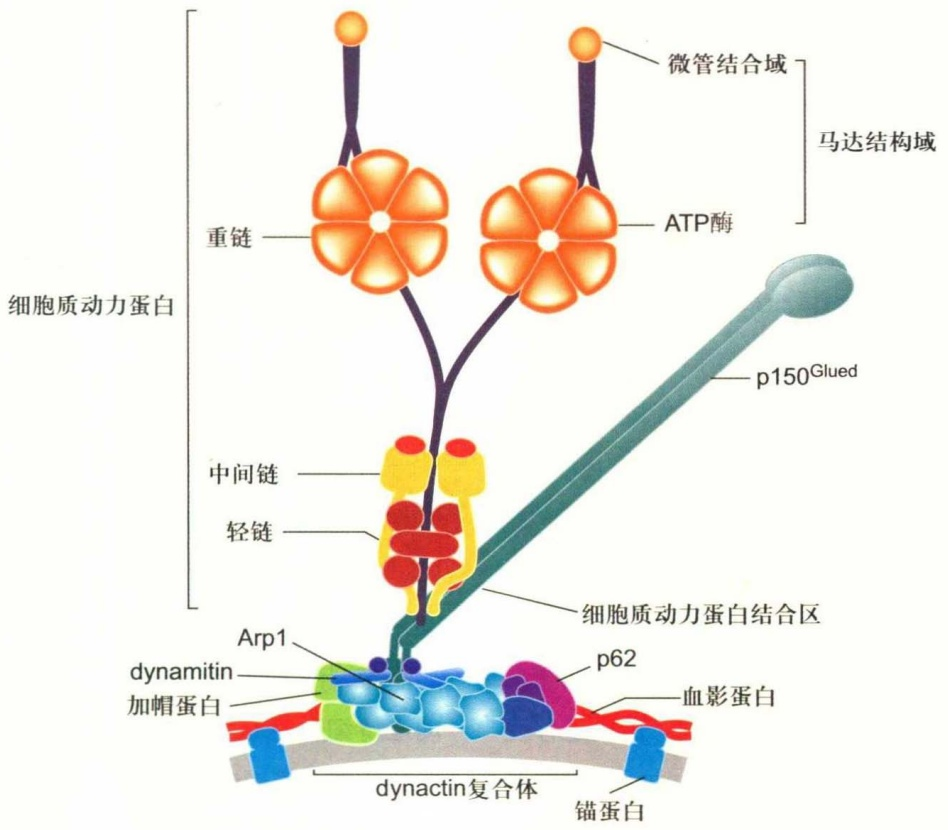

text_image

微管结合域
马达结构域
重链
ATP酶
p150Glued
细胞质动力蛋白
中间链
轻链
细胞质动力蛋白结合区
Arp1
dynamin
加帽蛋白
p62
血影蛋白
dynactin复合体
锚蛋白

图 8-8 细胞质动力蛋白结构示意图

细胞质动力蛋白由2条重链、数条中间链、轻中间链、轻链以及一些其他的蛋白亚基组装而成，2条重链的N端相互作用形成二聚体，并招募其他结构组分与所转运的货物结合，其C端形成具有ATP酶活性和微管结合功能的马达结构域。

8.2 依赖微管的分子马达与细胞内物质运输

161

---

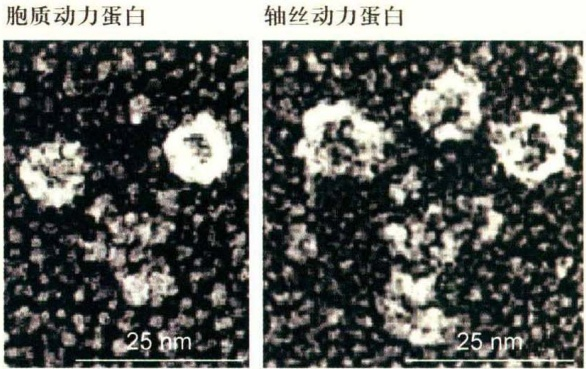

部逆向运输等过程中发挥作用。

细胞质动力蛋白基因突变的果蝇通常个体无法存活，基因敲除的小鼠（ $cDHC^{-/-}$ ）死于胚胎早期。可见cDHC是高等真核生物个体发育和生长所必需的。 $cDHC^{-/-}$ 小鼠胚泡细胞的高尔基体膜囊碎片化，并且均匀分散在整个细胞质中；dynactin复合体中的Arp1和p150 $^{Glued}$ 以及内吞体、溶酶体等细胞器都分散在整个细胞质中，与正常细胞内的分布状况形成鲜明对比。表明cDHC是高尔基复合体的形成和正常定位所必需的，同时也是内吞体、溶酶体等细胞器的正常分布所不可缺少的。有趣的是，在 $cDHC^{-/-}$ 细胞中碎片化的高尔基体膜囊以及溶酶体仍附着在微管上。因此，除cDHC外，还存在其他的蛋白质分子参与高尔基体、溶酶体等细胞器与微管之间的相互作用。

动力蛋白激活蛋白（dynactin）是与细胞质动力蛋白相结合的重要接头蛋白复合物，它包含肌动蛋白相关蛋白 Arp1（actin-related protein1）、p150 $^{Glued}$ 和dynamitin等十几种蛋白质。该复合物介导分子马达的细胞定位、与货物之间的结合，以及沿微管持续运动。

LIS1 (lissencephaly-1 protein) 是细胞质动力蛋白的相互作用蛋白，也与人类I型缺脑回疾病密切相关。该疾病表现为严重的大脑发育障碍，患者幼年时由于神经细胞迁移障碍而引起大脑皮层组织形成不全。LIS1在进化上非常保守。在构巢曲霉(A. nidulans)细胞中，LIS1的同源基因nudF发生突变所产生的表型与细胞质动力蛋白或dynactin复合物基因突变体表型相似，都是核迁移受抑制。在酿酒酵母(S. cerevisiae)细胞中，LIS1的同源基因PAC1突变体核定位异常。在哺乳动物细胞中LIS1与cDHC、中链及dynactin的亚基p150 $^{Glued}$ 、p62和Arp1等相结合，并共定位于细胞皮层以及染色体的动粒结构域。降低LIS1的表达水平将会干扰细胞分裂过程，导致纺锤图8-9 金属投影电镜图像显示细胞质动力蛋白（2个头部）和轴丝动力蛋白（3个头部）分子的马达结构域(John Heusr博士惠赠)

体的定向错误，影响染色体的附着。在MDCK细胞中过表达LIS1蛋白将导致dynamitin表达量增加、微管正极的p150 $^{Glued}$ 消失以及dynactin的定位错误，产生多极纺锤体和非正常排列的染色体。因此，LIS1与细胞质动力蛋白的功能关系密切。

## (3) 动力蛋白与逆向信号运输

神经营养因子（neurotrophin，NGF）及其受体Trks是神经系统发育所必需的。神经营养因子与Trks受体结合可使Trks受体二聚化，并激活其内在的酪氨酸激酶活性。而这个活化的Trks信号位于轴突末梢，必须经轴突转运到胞体，并选择性地激活MAPK、ERK5和PI3K，最终促进相关基因的表达，以维持细胞生存、分化和突起的生长。虽然这个信号的传递机制尚不完全清楚，但一些实验结果显示逆向信号传递依赖信号内吞体（signal endosomes）的形成。活化的Trks能诱导受体-配体复合物的内吞，形成信号内吞体小泡，该小泡从神经轴突的末端沿微管转运到胞体。动力蛋白便是负责运输的分子马达。酵母双杂交实验已经证明Trk受体和细胞质动力蛋白的轻链直接结合，免疫共沉淀进一步证实了Trk受体和细胞质动力蛋白的轻链以及中间链存在于同一蛋白复合物中。

注射神经生长因子到DRG神经细胞的轴突末梢所在区域可以增加p-ERK1/2、p-p38和pAkt的逆向运输。相反，如果注射抗NGF的抗体，则导致这些蛋白进入胞体的量减少。因此，NGF信号是通过包含NGF、TrkA和活化信号蛋白的早期内吞体的逆向运输传递的。利用体外培养交感神经细胞同样也证明了胞体和轴突末梢的TrkA激酶活性与NGF有关。

用神经营养因子刺激在体外培养的感觉神经细胞轴突末梢，导致Trks受体活化，受体-配体复合物内化形成小泡，然后迅速被细胞质动力蛋白运输到胞体，并启动维持细胞生存所需要的信号通路。破坏细胞质动力蛋白的功能，将影响活化Trks的运输，阻碍由神经营养因子对细胞生存的刺激作用。因此，依赖于细胞质动力蛋白的神经信号逆向运输对于维持神经细胞的生存是至关重要的。

162

第8章 微管与细胞内物质运输

---

## 8.2.3 纺锤体与染色体运动

当细胞从间期进入有丝分裂期（M期），细胞内原有的微管网络解聚，然后组装形成纺锤体微管，介导染色体的运动；分裂结束后，纺锤体微管解聚，又组装形成细胞胞质微管网络。

纺锤体微管包括动粒微管、极微管和星体微管。动粒微管连接染色体动粒与位于两极的中心体。极微管分别从两极发出，在纺锤体中部赤道板相互交错重叠。而星体微管从中心体向周围呈辐射状分布，与细胞膜内侧的结构组分相互作用。

有丝分裂过程中染色体的运动依赖于纺锤体微管的组装和去组装。在这一过程中，微管与动粒之间的相互作用主要是由驱动蛋白-7、驱动蛋白-13和细胞质动力蛋白来完成。当来自两极的微管与动粒结合以后，细胞需要调节微管的长度而使染色体排列在赤道板上。驱动蛋白-13使较长的动粒微管的正极端解聚，细胞质动力蛋白与微管的正极端结合，利用水解ATP产生的能量带着染色体沿微管向负极移动；而另一侧的动粒微管因微管蛋白二聚体在正极端的加入而延长，同时，定位于该侧动粒部位的驱动蛋白-7的马达结构域沿微管向正极移动，双侧分子马达与微管的相互作用使染色体定位到纺锤体的赤道板上。有丝分裂后期，驱动蛋白-13作用于动粒微管的正极端使微管缩短，定位于染色体两侧动粒上的动力蛋白携带染色体分别沿微管向两极移动，使遗传物质分离。极微管在纺锤体的中部交错重叠，分布在该区域的驱动蛋白-5由4条重链组成，每一端有两个马达结构域。其中两个马达结构域与来自纺锤体一极的微管结合，另一端的两个马达结构域与来自相反方向的微管相互作用。由于来自两个方向的微管的极性相反，故当双极驱动蛋白四聚体沿微管向正极运动时，纺锤体两极间的距离变长（图8-10）。

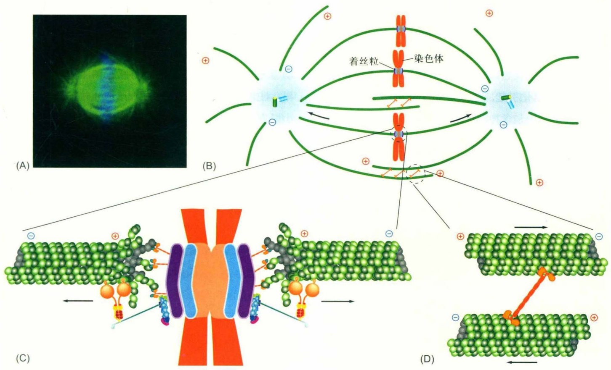

text_image

(A)
(B)
着丝粒
染色体
(C)
(D)

图8-10 马达蛋白介导的纺锤体的行为

(A) 免疫荧光染色显示有丝分裂中期纺锤体的微管和染色体的排列方式；(B) 有丝分裂中期纺锤体的结构模式图，显示动粒微管与染色体之间的联结，极微管之间通过驱动蛋白相互作用；(C) 显示动粒结构域与微管之间通过细胞质动力蛋白和驱动蛋白-13家族的成员相互作用。此时，姐妹染色体即将分离，细胞质动力蛋白将向微管的负极端运动，而驱动蛋白-13作用于动粒微管的正极端，导致此处微管的解聚；(D) 显示驱动蛋白-5作用于来自纺锤体两极的微管，并通过两端的马达结构域向微管的正极运动，这一过程将导致纺锤体两极间的距离伸长。

8.2 依赖微管的分子马达与细胞内物质运输

163

---

## 8.2.4 马达蛋白与人类疾病

越来越多的证据表明，马达蛋白的突变或功能缺失会引起细胞内运输系统障碍，并导致人类疾病。这方面的信息主要来自对马达蛋白突变体以及基因敲除动物的研究。

## (1) KIF1B与2A型腓骨肌萎缩症

2A型腓骨肌萎缩症(Charcot-Marie-Tooth disease type 2A, CMT2A) 是Ⅱ型CMT染色体显性遗传疾病的一种亚型，定位于染色体的1p35-36区域，与KIF1B基因的位点非常接近。在一个患有CMT2A的家系中发现KIF1Bβ基因发生了一个A→T的点突变，使Gln98转变成亮氨酸(Q98L)。体外实验表明KIF1Bβ的Q98L突变体极大地降低了其ATP酶和马达活性。KIF1B基因敲除 $\left(\mathrm{KIF1B}^{-/-}\right)$ 小鼠在出生后不久便死亡，野生型杂合小鼠 $\left(\mathrm{KIF1B}^{+/-}\right)$ 出生时表现正常，而在随后的发育过程出现感觉神经和运动神经功能低下，突触和突触小泡密度减少，类似人类进行性神经性肌肉萎缩症。因此，KIF1Bβ的Q98L突变被认为是导致驱动蛋白马达活性功能丧失、引起CMT2A疾病的直接原因。

## (2) KIF5A与遗传性痉挛性截瘫

遗传性痉挛性截瘫(hereditary spastic paraplegia, HSP)是一种常染色体显性遗传的神经退行性疾病，由运动神经元退化引起，至少与30个基因座有关，其中SPG10基因座中包含神经细胞中特异表达的KIF5A。在患有HSP的家族中，编码KIF5A马达结构域或中间杆状螺旋区的DNA发生了一个错义突变，如N256S、R280C和A361V。体外实验表明单个错义突变（如N256S）就可以降低KIF5A对微管的亲和力和滑行速率，从而影响KIF5A以微管为轨道的运输活性。神经细胞中，KIF5A与神经丝蛋白的转运相关，这也许可以很好地解释KIF5A的基因变异与HSP的关系。KIF5A突变导致神经丝蛋白（或许还有其他蛋白）不能向轴突运输，是神经细胞退行性病变的原因。

## (3) KIF3A与多囊肾病

多囊肾病（polycystic kidney disease，PKD）是常见的遗传性疾病。尽管确切的发病机制尚不清楚，但一些证据表明与多囊肾病有关的基因表达产物均存在于肾小管上皮细胞的纤毛中。基于KIF3与纤毛发生的关系，利用条件性基因敲除技术特异性地去除肾管状上皮细胞内的KIF3，结果发现小鼠在出生后5天便出现肾囊肿，从第21天起发生肾衰，且囊肿上皮细胞缺乏纤毛结构，细胞分裂旺盛，但容易发生凋亡。KIF3A基因敲除还导致细胞表皮生长因子受体（epidermal growth factor receptor）错误定位，同时 $\beta$ -catenin和c-Myc的表达量升高，而p21CP1的表达则受到抑制。可见KIF3A是维持初级纤毛所必需的，KIF3A的基因敲除使肾上皮细胞的纤毛发生受阻，产生与人类多囊肾病非常相似的肾囊肿特征。

## (4) 细胞质动力蛋白与神经退行性疾病

一般认为，肌萎缩侧索硬化(amyotrophic lateral sclerosis, ALS)是由于运动神经细胞损伤或死亡造成的神经退行性疾病。细胞质动力蛋白重链的温和错义点突变将影响动力蛋白的功能，携带突变体基因的杂合体小鼠发生进行性运动神经元变性疾病，而纯合突变体小鼠则形成具有ALS及相关疾病关键特征的雷维小体（Lewy body-like inclusion body）。用化学诱变剂(ENU)诱发产生的细胞质动力蛋白重链杆状结构域单个氨基酸替换的小鼠突变体（Legs at odd angles, Loa）和（Cramping 1, Cra 1）的杂合体小鼠的脊髓中也都可以观察到进行性运动神经元受损的现象。而另一个由辐射诱变产生的细胞质动力蛋白重链杆状结构域缺失(9 bp)突变小鼠（Sprawling, Swl）表现出感觉神经的病变，暗示细胞质动力蛋白重链在哺乳动物感觉神经元中也发挥重要的作用。过表达动力蛋白激活蛋白亚单位dynamitin的转基因小鼠表现出动力蛋白激活蛋白复合物的去组装，影响神经细胞中细胞质动力蛋白介导的轴突逆向运输，并导致运动神经元退行性病变。细胞质动力蛋白与ALS的直接证据来自对编码动力蛋白激活蛋白最大亚基p150基因突变体的发现，在微管结合结构域中由于单个碱基替换引起氨基酸突变，突变体与微管结合能力下降，动力蛋白激活蛋白介导的转运功能受损，引发缓慢进行性运动神经元疾病。

## 8.3 中心粒和基体

## 8.3.1 中心粒

在动物细胞的核附近，有一个由蛋白质组装而成的细胞器，由于在显微观察时总觉得该细胞器位于细胞的中心，故称为中心体。动物细胞内的微管大多是从中心

164

第 8 章 微管与细胞内物质运输

---

体开始组装，并呈发散状向细胞的周围延伸，所以中心体也称为微管组织中心（microtubule organizing center, MTOC）。电镜和超高分辨率显微镜图像显示，中心体的内部有一对桶状的中心粒，彼此呈大致垂直的状态排列。中心粒的外围由中心粒外周物质组装而成。

## (1) 中心粒的结构与组成

中心粒(centriole) 是一个直径约200 nm，长150～500 nm的桶状结构，其外壁是9组等间距的三联体微管。在每组三联体微管中，只有一根微管在结构上是完整的，含有13根原丝，称为A管；另外的两根微管为不完整微管，依次称为B管和C管（图8-11）。中心粒微管蛋白亚基常被乙酰化、多聚谷氨酰化和多聚甘氨酰化等多种形式的修饰，并且有多种结合蛋白与微管蛋白亚基相互作用，因而结构非常稳定。用电镜观察中心粒外围的致密物质，发现微管并不是直接起源于中心粒，而是在外周物质区域成核，有部分微管锚定在母中心粒的亚远端附属结构上（图8-11）。参与中心粒组装的微管蛋白除了 $\alpha-/ \beta-$ 微管蛋白以外，还有 $\delta-$ 微管蛋白和 $\varepsilon-$ 微管蛋白，目前还不知道这两种微管蛋白是如何组装到中心粒结构上，也不知道它们发挥何种作用，但是 $\delta-$ 微管蛋白和 $\varepsilon-$ 微管蛋白的缺失将影响B管和C管的组装。

中心体内的两个中心粒在相互位置上接近于垂直，它们相互靠近的一端，即中心粒微管的负极端被称为中心粒的近端（proximal end）；而两个中心粒相距较远的一端（正极端）则称为中心粒的远端（distal end）。间期细胞的两个中心粒由于发育阶段的不同，在形态和结构也有区别。较早存在的结构比较完整，被称作母中心粒（mother centriole），而在上一个细胞周期的S期才组装产生的被称为子中心粒（daughter centriole）。母中心粒的远端和亚远端具有突起状的结构，分别称为远端附属结构（distal appendage）和亚远端附属结构（subdistal appendage）。子中心粒一开始没有这些附属结构，但在大致经历了一个细胞周期以后也渐趋成熟。在一些 $G_{0}$ 期细胞和终末分化细胞中，母中心粒远端附属结构可将来自高尔基体的膜泡招募至母中心粒/基体（basal body）的顶端，开始纤毛的组装，而亚远端附属结构则与间期细胞中微管的锚定相关。

细胞内的微管并不都与中心体相连，如在神经细胞轴突内，尽管微管的正极都指向轴突的顶端，但大部分微管的另一端也在轴突内部，推测这些微管是从中心体上被切断，并转运至轴突适当的区域定位后继续组装而成。在树突内约有50%的微管的正极指向胞体，它们显然也不可能与中心体相连。另外一个特殊的例子是小鼠卵母细胞，该细胞内并没有中心体，但仍然能组织像减数分裂纺锤体那样复杂的微管结构。高等植物细胞没有中心粒，与微管组织中心相关的物质似乎存在于细胞核的周围，如在植物胚乳细胞中，微管好像源于核膜的外表面。植物细胞有丝分裂纺锤体的微管从细胞的两极开始组装，然而，那里也没有中心体存在。

## (2) 中心粒的组装与调控

① 中心粒的组装 中心体复制其实就是子中心粒的组装、成熟和中心粒外周物质招募的过程。以下重点介绍中心粒的组装和成熟。中心体的复制周期大体分为4个过程:母子中心粒垂直定位的解除、子中心粒的组装、中心粒的成熟和细胞分裂前中心体分离。虽然中心体周期的每个过程早就被描述清楚，但与此相对应的分子机制却知之甚少。

中心粒的组装习惯上也称复制，其过程与DNA的复制基本同步。所不同的是中心粒的复制过程并没有模板，是一个蛋白质亚基的自组装过程，尽管现在仍然不知道到底有多少种蛋白参与其中，以及如何进行组装。当细胞进入S期后，在两个中心粒近端的一侧都会形成一个新的中心粒，称为原中心粒。一系列的分析结果表明，定位于母中心粒近端的PLK4招募了与子中心粒发生直接相关的SAS-6/Bld12，然后开始了车轮状结构（cartwheel formation）的组装。车轮状结构定位于原中心粒的底部，在脊椎动物细胞中该结构在原中心粒组装完成后消失。车轮状结构由中心的轮轴和从轮轴发出的九条呈辐射状均匀分布的轮辐构成，在轮辐末端是另一种结构非常保守的蛋白CEP135/Bld10形成的针头状结构，该结构可以附着三联体微管。在细胞中过表达PLK4将导致中心粒的过度复制，敲除四膜虫的Bld10导致基体完全缺失。

原中心粒形成以后，在S和 $G_{2}$ 期会因为添加微管蛋白和其他结构蛋白而延伸。如果用药物将哺乳动物细胞停滞在S期，则原中心粒只能生长到全长的70%，提示 $G_{2}$ 期环境对于中心粒组装也非常重要。中心粒的延伸受SAS-4（也称为CPAP或CENPJ）、POC5、OFD1和CP110等蛋白的调控。SAS-4通过其结合微管蛋白二聚体来促进中心粒微管的组装，而CP110和CEP97定位于中心粒远端，起着“帽子”的作用，限制中心粒微管的过度延伸。另一个保守的中心粒蛋白OFD1也参与调节中心

8.3 中心粒和基体

165

---

(A)

chemical

Diagram of a molecular structure with labeled pipes A, B, and C

(B)

natural_image

Microscopic view of cellular structures with visible nuclei and cytoplasm (no text or labels)

(D)

chemical

Molecular structure diagram showing a layered compound with MTOC label

text_image

远端附属结构
亚远端附属结构
PCM

(C)

natural_image

Microscopic view of a biological tissue sample showing cellular structures (no text or labels visible)

图8-11 中心体的结构及微管的组装（电镜照片由伍启熹、滕俊琳提供）

(A) 中心体结构示意图，显示成对的中心粒以及外周物质 (PCM); (B) 中心粒横切面的电镜照片，显示9组微管三联体结构呈风车状排列; (C) 显示一对垂直分布的中心粒及其起源于外周物质的微管; (D) 大部分中心体微管的组装起始于PCM上的 $\gamma$-微管蛋白环状复合物。

粒延伸的调节，缺失OFD1导致母中心粒变长。至于三联体微管是如何延伸的，为什么到特定长度就不再伸长？仍是有待解答的问题。

除了三联体微管的伸长，中心粒的组装还包括在三联体微管所包围的腔内结构的装配。目前对于这些结构的功能和分子组成不甚清楚。在哺乳动物细胞中，中心粒末端的空腔被一堆倾斜的盘状物质填满。在草履虫的中心粒末端空腔中含有螺旋状结构，而在四膜虫细胞内，可以观察到一个圆柱状电子致密结构，而衣藻中心粒的空腔中填满了与三联体微管相连的纤维。虽然空腔内部的结构有所不同，但都存在一些共同的特点，如都存在centrin。centrin是钙结合蛋白，存在于所有装配动纤毛的物种基因组中。人源centrin可以与hPOC5和中心粒组分hSfi1直接结合，也与CP110存在相互作用。

原中心粒在经历有丝分裂后逐渐成长为子中心粒。此时，原中心粒车轮结构中的轮轴消失，即HsSAS-6不再与子中心粒的近端部分结合。虽然这样的中心粒在S期可以作为亲本起始新中心粒的复制，但是还没有完全成熟。中心粒最终成熟的标志是远端和亚远端附属结构的获得，这一过程发生在随后 $G_{2}$ 的晚期或M期早期。以此推算，一个中心粒从组装到完全成熟大概要经历1.5个细胞周期。中心粒的成熟与否直接反映在它们功能上的差异，至少在某些细胞中，成熟的中心粒具有锚定微管的能力，并可作为基体参与纤毛的形成。

在细胞周期的不同时期，中心体的母子中心粒之间由不同类型连接复合体相连（图8-12）。一种是S-M连接体（S-M linker，SML），它形成于S期，将新生的原中心粒与其邻近的母中心粒紧密连接在一起，持续到细胞分裂末期才解开。母子中心粒间紧密连接的解除也称为中心粒的解离（centriole disengagement），这一过程依赖于PLK1激酶和分离酶(separase)。由于PLK1和分离酶通常只在有丝分裂期被激活，因此这个假说（又称许可证模型）为中心粒复制和细胞周期转变的偶联提供了一个很好的解释。cohesin蛋白复合体的解体与有丝分裂过程中期向后期转变过程中姐妹染色单体的分离相关，对于中心粒的解离也是必需的，提示cohesin可能是SML的组分。

中心粒间的另一种类型的连接是“ $G_{1}-G_{2}$ 栓”（ $G_{1}-G_{2}$ tether，GGT），此种连接相对松散，主要作用是使间期细胞中心体的微管组织能力更加集中。GGT的组装与SML的解除同时进行或稍晚一些。由此推测GGT的装

166

第 8 章 微管与细胞内物质运输

---

flowchart

配很可能依赖中心粒的解离。实时动态观察显示两个中心粒的运动通常是协调一致的，但也会暂时相离较远的距离。GGT的解聚发生在 $G_{2}$ 期。此时，两对中心粒各自招募了一定量的外周物质而具备了组织微管组装的能力，中心体（每个中心体由一对相互连接的中心粒组成）开始分离，并向两极移动，开始纺锤体的组装。与GGT功能相关的蛋白包括C-Nap1、rootletin、LRRC45、CEP68和CEP215/CDK5RAP2等。其中C-Nap1定位于间期细胞两个中心粒近端底部，在 $G_{2}$ 晚期时会从中心粒上解离下来。Rootletin和LRRC45在间期细胞的两个中心粒之间组装成纤维状结构，并在近端的底部与C-Nap1相互作用，从而形成GGT。敲减C-Nap1、rootletin或LRRC45都会导致中心体提前分离。此外，还有CEP68和CEP215也参与了GGT的组装。GGT的解体主要受Nek2A（NIMA家族成员NIMA-related kinase 2A）和PP1α的调控。在 $G_{2}/M$ 期时，Nek2A的活性增加，而PP1α被CDK1磷酸化而失活，C-Nap1、rootletin和LRRC45等蛋白被磷酸化，导致GGT结构解体（图8-12），并开始纺锤体微管的组装。

② 中心粒组装的调控 细胞内中心粒数目的稳定是确保细胞分裂正常进行的关键。通常认为中心体的复制受两方面的调控:一是细胞周期调控，即在一个细胞周期中只复制一次；二是数量控制，即每次复制在每个已经存在的中心粒近端长出一个新的中心粒。

中心体复制与DNA复制有一些共同的特征。它们都发生在S期，并且在每个细胞周期中只进行一次。将处于细胞周期不同时段的细胞融合，发现S期和 $G_{2}$ 期的细胞质都能让 $G_{1}$ 期的中心体提前复制，而将 $G_{2}$ 期的中心体置于S期的细胞质中则不能再次复制。说明中心粒一旦已经在S期复制，在下一个S期之前将不再复制，即使是将其图8-12 中心粒连接在细胞周期中的变化（仿自He等，2013）

母子中心粒间的连接，也称S-M连接体(SML)。SML发生在母中心粒和刚刚组装的子中心粒之间，结构紧凑。在有丝分裂末期解体，取而代之的是较为宽松的 $G_{1}-G_{2}$ 栓(GGT)。GGT是间期细胞内连接两亲本中心粒的纽带，在两亲本中心粒近端的底部，与C-Nap1相连。在 $G_{2}$ 期的晚期，GGT的结构组分因Nek2A的活性升高而被磷酸化，GGT解体，两对中心粒带着各自的外周结合蛋白在Eg5的作用下移向细胞的两极，进行纺锤体的组装。

置于一个适合中心粒复制的细胞质环境中(如S期)。很显然，中心体复制也存在一个与DNA复制相似的认证过程。中心粒复制（原中心粒的装配）发生在S期，而中心粒复制许可推测发生在有丝分裂末期，因为那时CDK活性较低，中心体再复制的条件不成熟。母子中心粒在有丝分裂末期发生解离是中心粒复制的前提条件，这一过程使新中心粒组装位点暴露，为下一轮复制消除阻碍。事实上，将S期母中心粒侧面的原中心粒用激光去掉后，在相同的位置又能形成一个新的原中心粒。

中心体复制与DNA复制密切相关。当染色体复制停止时，中心体复制也会随之停止。在许多不同物种的细胞中，CDK2都被认为是促进中心粒和DNA在S期复制的重要激酶。CDK2的一些底物如nucleophosmin/B23、MPS1等与中心粒复制相关。Nucleophosmin/B23定位于核仁和中心体。在 $G_{1}/S$ 期，nucleophosmin/B23被CDK2/cyclin E磷酸化，并从中心体上脱落，直到有丝分裂开始后才再重新定位于中心体。抑制nucleophosmin/B23的磷酸化会阻碍中心体复制的起始。此外，DNA复制认证相关蛋白Orc1(origin-recognition complex 1)和geminin也参与中心体复制的调控，敲除这些蛋白会导致中心体的过度复制。这也进一步说明DNA和中心体复制的起始可能依赖于相同的调控机制。

当细胞中缺乏p53时，过表达DNA复制认证因子CDT1会使DNA异常复制。在细胞周期的各个时期，中心体上都有p53定位。在细胞核内，p53促进p21的表达水平升高，并通过p21抑制CDK2/cyclin E的活性，从而抑制中心体的过度复制。而在p53失活的情况下，p21的表达水平下降，CDK2的活性不受抑制，从而导致中心体过度扩增，说明DNA复制检验点的主要调控者p53也参

8.3 中心粒和基体

167

---

与调控中心体的复制。

中心粒数量异常会影响有丝分裂纺锤体的正常组装。正常情况下，在一个细胞周期内，每个母中心粒附近只能复制出一个子中心粒，表明细胞中存在一种调控中心粒组装成核的机制。PLK4被认为是中心粒数量控制的一个主要调控者。PLK4又称为SAK，是Polo激酶家族成员，在中心体复制过程中始终定位于母中心粒的近端，并对于原中心粒的组装至关重要。在缺失PLK4的细胞中，原中心粒不能进行装配。而过表达PLK4会导致每个母中心粒周边同时形成多个原中心粒。虽然有多个激酶影响中心粒的复制，但只有PLK4在形成原中心粒过程中具有剂量效应。推测PLK4自身的磷酸化并促进其泛素降解可能是数量调节的一个重要方面。此外，过表达SAS-6、CPAP/SAS-4或SAS-5/Ana2也会导致中心粒过度复制。SAS-6和CPAP蛋白的表达量从有丝分裂结束到 $G_{1}$ 期一直较低，其中与 $APC^{Cdh1}$ 相关的泛素化降解也在数量调节上发挥作用。

有些动物（如小鼠）的受精卵在早期卵裂过程中没有中心粒，它们的中心体是在经过几次卵裂之后才产生。破坏或去除体细胞的中心体后，细胞还会产生新的中心体。在这些细胞中，中心体的产生是从无到有的，没有预先存在的中心粒作模板。因此，母中心粒对于新中心粒的形成很可能并不是一个严格必需的条件。但细胞通常都会采用“经典”途径（即依赖现有中心粒为模板）生成新中心体，而不用de novo装配途径。在衣藻中，只有在缺少内源中心粒的情况下，装配途径才会变得活跃。在HeLa细胞中，当所有内源中心粒被激光破坏后，虽然细胞可以通过de novo途径生成中心粒，但是只要有一个内源的中心粒存在就会抑制这种“非经典”途径的中心粒装配。为什么细胞会优先选择“经典”装配途径呢？最近的研究发现“经典”装配途径与de novo装配途径都需要如SAK/PLK4、SAS-6或SAS-4/CPAP等中心粒装配的关键因子参与，提示这两种装配途径所介导的中心粒装配过程可能类似，只是装配速率不同。有一种观点认为预先存在的中心粒是通过捕获和聚集中心粒装配蛋白对中心粒复制施加空间上的调控。中心粒可以在它们的近端招募和组织中心粒周围物质（PCM），而PCM对于中心粒的形成十分重要，一些中心粒装配的关键蛋白会定位在PCM区域。在哺乳动物细胞中过表达pericentrin时，围绕在母中心粒周围的PCM增大，导致在母中心粒周围形成过量的子中心粒。值得注意的是，pericentrin本身并不直接参与子中心粒的形成，敲除pericentrin也并不抑制中心粒的复制。因此，很可能是由于PCM增大而导致过量中心粒的形成。在有中心粒存在的情况下，大量的PCM都会被募集到中心粒周围，从而抑制胞质中的de novo装配途径。同样地，一个母中心粒周围可能会生成很多原中心粒的“种子”，但是由于装配因子是有限的，最终只有一个能“发芽”，形成新中心粒。

## 8.3.2 基体和轴丝微管

## (1) 纤毛与细胞周期

鞭毛和纤毛内部的微管源自基体，而基体通常是由母中心粒转化而来，因而在结构上，基体与中心粒基本一致，其外围由9组三联体微管构成。在纤毛组装时，A管和B管由于微管蛋白的不断加入而跨过纤毛板，形成纤毛的轴丝微管，C管终止于纤毛板或基板附近，因此轴丝微管在结构上与中心粒或基体不同，其外围是9组二联管结构（图8-13）。在纤毛的中央常有一对由中央鞘所包围的中央微管，即“9+2”型；有些类型的纤毛中，轴丝中央有四根单体微管，即“9+4”型；也有一些纤毛没有中央微管，为“9+0”型。轴丝微管外侧的膜在组分上有别于细胞膜，但彼此相连。纤毛与其他细胞质组分之间由转换区域相互隔开，形成一个相对独立的纤毛内环境。纤毛组装需要的蛋白组分由马达蛋白KIF3运入，而物质从纤毛输出则由动力蛋白担当。当细胞从 $G_{1}$ 期进入S期时，轴丝微管解聚，纤毛结构消失，基体转化成中心粒。又如精子鞭毛内部的微管起源于从中心粒衍生而来的基体。中心粒和基体都具有自我复制的性质。

根据纤毛是否能够运动可以将其分为动纤毛(motile cilia)和初级纤毛(primary cilia，也称原纤毛)。通常，动纤毛有一对中央微管，而初级纤毛没有，但并不是绝对的。如斑马鱼的脊髓中央管中就存在“9+0”型的运动性室管膜纤毛，而蛙嗅觉上皮细胞上“9+2”型纤毛却是不动纤毛。所以，纤毛的中央微管与运动之间的关系还有待阐明。

初级纤毛如同“天线”一样突出在细胞表面，用来感知多种外界信号。纤毛在形成、维持和功能方面的缺陷会导致多囊肾病、视网膜退化、脑发育畸形、肥胖以及糖尿病等人类疾病，它们被统称为纤毛疾病（ciliopathy）。此外，纤毛的缺陷往往还与肿瘤的发生有关。在多囊肾

168

第8章 微管与细胞内物质运输

---

text_image

B管
A管
中央单微管
放射辐
外侧臂
内侧臂
C管
B管
A管
1
2
3
基体
中央微管
中央鞘
放射辐条
二联体
纤毛

图8-13 基体及轴丝的结构和示意图（电镜图像由丁明孝教授提供）

左侧为四膜虫纤毛和基体横切面的电镜图像。中间和右侧为轴丝微管及其附属结构示意图。其中:1. 轴丝的横切面示意图，其外围是9组相互联系的微管二联体，中央是由中央鞘包围的两根微管；2. 纤毛转换器微管的结构示意图；3. 基体横切面示意图，其外围是9组相互联系的微管三联体。

natural_image

Fluorescent microscopy image showing two red-stained cellular structures against a dark background, with a 0.2 μm scale bar (no text or symbols beyond scale indicator)

病的病理检查也常发现细胞过度增殖和极性消失等表型，这正是肿瘤形成的两个重要特征。

## (2) 基体和轴丝微管的翻译后修饰

在组成基体及纤毛轴丝微管的微管蛋白亚基上发生多种类型的PTM。其实，与微管PTM相关的酶类在具有纤毛或鞭毛的原始真核生物中就存在。在脊椎动物中，初级纤毛被认为是细胞信号转导的重要参与者，而动纤图8-14 纤毛轴丝和基体微管蛋白的乙酰化修饰（图片由黄宁博士提供）

对体外培养细胞用抗乙酰化α-微管蛋白的抗体进行免疫荧光染色，在超高分辨率显微镜下显示基体、轴丝微管和一侧的子中心粒被标记。从侧面观察纤毛的基体和轴丝显示轴丝微管所围绕的腔（中间无荧光部分），从子中心粒的一端正面观察显示三联体微管所围绕的中心粒的腔。

毛对于细胞运动尤其重要。在众多的PTM类别中， $\alpha$ -微管蛋白的乙酰化修饰是标志性的，用特异性抗体可将乙酰化修饰的微管标记，如纤毛的基体和轴丝微管（图8-14）。

令人惊讶的是一些微管蛋白的PTM在纤毛中并不均匀。如轴丝微管富含去酪氨酸化的微管蛋白，而组成中央微管的 $\alpha-$ 微管蛋白的C端大多是保留酪氨酸。在外侧的二联体微管中，B管上 $\alpha-$ 微管蛋白的去酪氨酸化修饰要比A管多得多。推测有更多的 $\Delta2-$ 微管蛋白在轴丝的B管上积累，这是一种不可逆转的去酪氨酸的手段。目前尚不清楚轴丝微管上存在的这种修饰差异是否与轴丝结构的组装及分子马达的运动相关。

8.3 中心粒和基体

169

---

微管蛋白的多聚谷氨酰化和多聚甘氨酰化修饰在纤毛中也很丰富。将四膜虫（T. thermophila）微管蛋白上潜在的修饰位点突变可导致纤毛中央微管缺失，显然，这种修饰对于维持轴丝结构是必需的。将基因组中负责微管甘氨酰化修饰的酶敲除导致四膜虫纤毛缩短，斑马鱼体轴产生随机的不对称性。果蝇甘氨酰化酶的消失对精子发生的早期阶段影响不大，但会导致精子轴丝完全去组装和不育。可见，轴丝微管的PTM在维持纤毛的结构和功能方面是相当重要的。

## (3) 纤毛的发生

对纤毛发生（ciliogenesis）过程的认识大多是基于对体外培养细胞的研究结果。当细胞退出细胞周期时，中心体向细胞表面迁移，与此同时母中心粒逐渐转化为基体，母中心粒远端的一些蛋白，如CP110和CEP97等被移除，并招募来源于高尔基体的纤毛膜泡（ciliary vesicle, CV），而后轴丝微管开始组装（图8-15），在这一过程中，纤毛组装所需要的材料要通过位于基部的转换区域的筛选以及IFT（intraflagellar transport）转运等多个过程协同完成。IFT运输货物量的调控以及轴丝微管组装与去组装的动态平衡决定了纤毛的长度（图8-16）。当细胞将要重新进入细胞周期时，纤毛组装与去组装之间的平衡开始向去组装方向倾斜，纤毛回缩。血清饥饿使一些细胞进入 $G_{0}$ 期，并诱导长出纤毛，重新加入血清或生长因子使细胞重新回到分裂周期，基体转变成中心体。

尽管调节纤毛生长的机制还远没有被阐明，但众多的实验结果表明，定位于母中心粒的远端附属结构蛋白(distal appendage protein, DAP) 和中心粒微管正极端的蛋白复合物在这一过程中发挥了重要作用。

① 远端附属结构蛋白 来自高尔基体的膜泡在母中心粒上的锚定，对于纤毛生长起始至关重要。最先发现的母中心粒远端附属结构组分是CEP164，该蛋白可直接与鸟嘌呤核苷酸交换因子（GEF）Rabin8相互作用，促进GTP酶Rab8在中心体上的激活，帮助膜泡的锚定。CEP164的蛋白水平在间期或血清饥饿期增多，在有丝分裂期有所下降，这与纤毛的生长期间相一致。敲减CEP164会加快细胞周期进程，并影响细胞的凋亡和上皮细胞-间充质细胞转换(epithelial-mesenchymal transition, EMT)。随后，CEP89（CCDC123）、CEP83（CCDC41）、SCLT1和FBF1/Albatross四个远端附属结构蛋白相继被鉴定。最先被招募到远端附属结构上的CEP83蛋白是膜泡在母中心粒的远端锚定所必需，也与TTBK2的招募以及CP110的去除相关，还在IFT20的招募过程中发挥作用。

② OFD1 I型口-面-指综合征（oral-facial-digital syndrome type 1, OFD1）蛋白定位于远端附属结构和中心体卫星结构（pericentriolar satellite）。前者在远端附属结构的组装以及初级纤毛的形成等方面发挥作用。后者与中心体卫星蛋白PCM1、CEP290和BBS4等相互作用，对初级纤毛的形成起抑制作用。当细胞处于血清饥饿状态时，中心体卫星结构上的OFD1经由细胞自噬降解，从而促进了纤毛生长的起始。

③ CP110-CEP97-KIF24复合体 该复合物定位于基体微管的正极端，是纤毛组装的负调控因子。CP110和

flowchart

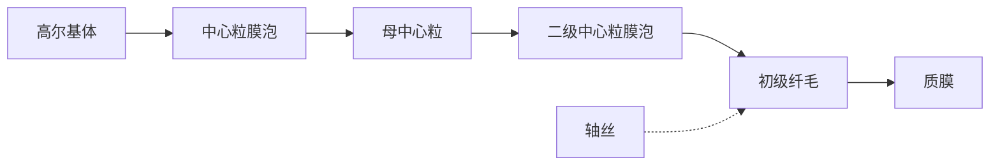

图8-15 初级纤毛的形成过程

170

第8章 微管与细胞内物质运输

---

flowchart

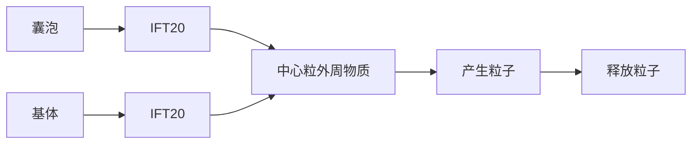

驱动蛋白-2 +IFT复合物B

动力蛋白
+IFT 复合物 A

CEP97是最早发现的两个抑制中心粒微管延伸的蛋白，而KIF24是驱动蛋白-13家族的成员，该复合物定位于中心粒微管的正极端，可抑制中心粒/基体微管的延伸。在母中心粒的远端，KIF24招募CP110和CEP97，后者覆盖在中心粒微管的正极端，阻止了微管的组装。而在间期细胞中，纤毛的发生有赖于这个复合物的移除。处于增殖周期中的细胞如缺失它们当中的任何一个都有可能导致中心粒的延伸或长出未成熟的纤毛。相反，当它们过表达时也会抑制正常的纤毛生长。有趣的是，KIF24对于CP110在母中心粒上的招募以及调节母中心粒微管延伸的能力只在RPE-1、3T3等可以诱导出纤毛的细胞中出现，而在U2OS等细胞中完全没有。这些蛋白的异常表达将导致与纤毛异常相关的疾病，如动纤毛缺失或功能异常所导致的慢性鼻窦炎患者细胞中，CP110的蛋白水平异常升高。

关于 CP110-CEP97 是如何从母中心粒远端移除这个问题，目前了解还很有限，只有在 miRNA 和磷酸化调节

## 图8-16 鞭毛内运输

驱动蛋白-2从鞭毛（或纤毛）的基部运送IFT复合物B至顶端，动力蛋白将IFT复合物A从鞭毛的顶端运向基部。

方面有一点线索。有报道认为mir-129-3p的含量在血清饥饿后升高，可特异识别并降低CP110的mRNA水平，从而间接地调控CP110的蛋白量。mir-34/449也是通过调节CP110的mRNA水平从而影响动纤毛的生长。相比之下，蛋白磷酸化的调节似乎更加直接。在血清饥饿诱导纤毛生长的过程中，TTBK2受CEP164的招募而定位于母中心粒远端，敲减TTBK2将导致CP110无法从母中心粒远端移除，并影响纤毛的生长。Ttbk2基因突变导致11型脊髓小脑共济失调（spinocerebellar ataxia type 11, SCA11）。MARK4的缺失同样会导致血清饥饿后CP110无法从母中心粒顶端移除。

CEP104也与CEP97以及CP110结合，但不同的是，CEP104具有促进纤毛轴丝的生长的功能。CEP290（又名BBS14、NPHP6、JBTS5、SLSN6、MKS4或LCA10）同样是一个具有调节纤毛生长功能的CP110结合蛋白，之所以出现诸多不同的名称是因为CEP290基因的突变会导致Bardet-Biedl综合征(BBS)、肾消耗性疾病(nephronophthisis, NPHP)、Joubert综合征、Senior-Loken综合征、Meckel-Gruber综合征以及先天性黑矇症(Leber's congenital amaurosis, LCA)等多种人类遗传疾病。虽然在CEP290基因中目前已经发现了超过100种不同的突变，但该基因的突变与疾病表征之间的关联尚不知晓。CEP290可与纤毛膜泡组分Rab8a相互作用，促进母中心粒/基体在细胞膜上锚定。此外，CEP290与CP110的功能相互拮抗，当过表达不能结合CEP290的CP110突变体后，CP110原本对于纤毛生长的阻滞作用消除，这从一定程度上证明了CP110是通过抑制CEP290来阻碍纤毛的生长。

④鞭毛内运输 IFT是位于二联体微管和纤毛膜之间的双向运输系统。纤毛的延伸和维持依赖于鞭毛内运输。kinesin 2将IFT复合物B（含纤毛组装所需的轴丝前体组分）从纤毛基部运送到顶部，IFT复合物A将需要回收的物质由dynein 2运回胞体。IFT复合物A包含6种纤毛组分，而复合物B包含10种纤毛组分（图8-15）。这些编码IFT组分的基因在真核生物中高度保守，几乎对于所有真核细胞的纤毛或鞭毛的组装都是必需的。BBsome蛋白复合体是纤毛膜蛋白转运的转接器，通过IFT在纤毛内循环。

8.3 中心粒和基体

171

---

## (4) 纤毛运动

纤毛和鞭毛是突出于细胞表面的、高度特化的细胞结构。精子和原生动物通过鞭毛的波状摆动使细胞在液体介质中游动。纤毛与鞭毛的结构相似，但较短。纤毛是一些原生动物（如草履虫）的运动装置。在一些高等动物体内，纤毛存在于多种组织（如输卵管、呼吸道上皮组织等）的细胞表面。相邻的纤毛可以几乎同步运动，使组织表面的液体定向流动。在人体呼吸道，数量众多的纤毛可以清除进入气管的异物，输卵管中的纤毛可以使卵细胞向子宫方向移动。近年来，随着鞭毛内转运机制的发现以及一些纤毛相关蛋白缺失后引起的一系列在细胞水平、组织水平乃至个体水平上的表型变化，使人们认识到这种细胞结构还与细胞信号转导、细胞增殖与分化、组织与个体的发育等过程密切相关。

纤毛运动的本质是由轴丝动力蛋白所介导的相邻二联体微管之间的滑动。然而，在纤毛或鞭毛内部，组成轴丝的9组二联体微管之间、外周微管与中央鞘之间都有许多辅助蛋白将微管横向连成一个整体。在相邻二联体微管之间，一个外周二联体微管的A管伸出的动力蛋白的马达结构域会利用水解ATP产生的能量在相邻二联体的B管上“行走”，由于受到轴丝结构“整体性”的阻碍，纤毛动力蛋白“行走”时所产生的力便会使纤毛的局部弯曲。在纤毛或鞭毛的运动协调过程中，轴丝微管的弯曲首先发生在其基部，因为这里的动力蛋白首先被活化。随着轴丝上动力蛋白依次被特异活化或失活，这种弯曲有规律地沿着轴丝向顶端传播，于是就产生了纤毛运动。动力蛋白的活化受中央微管和放射辐的调控，缺少这些结构的突变体纤毛没有运动能力。在纤毛或鞭毛的运动过程中，内侧的动力蛋白臂主要与纤毛弯曲相关，决定纤毛弯曲波形的大小和形态，外侧的动力蛋白臂则与拍打的力量和频率相关。

## □ 小结

微管通常起源于中心体，向细胞边缘呈放射状伸展。微管的组装通常是从中心体上的γ-微管蛋白环状复合体开始，通过添加α/β-微管蛋白二聚体不断延伸，也可以因为末端的解聚而缩短，因而表现出高度的动态不稳定性。Stathmin家族的成员能与游离的α/β-微管蛋白二聚体结合，从而调控细胞质内可溶性微管蛋白的有效浓度以及微管的组装。微管的直径为24 nm，通常是负极端与中心体相连，正极端游离在细胞质中，或与其他亚细胞结构相互作用。纤毛的轴丝微管以及中心粒和纤毛基体的微管则以二联体或三联体形式存在。微管蛋白的翻译后修饰为微管表面增加了多种结构和化学标签，为数目众多的微管结合蛋白提供了特异的结合位点，而微管结合蛋白是调节微管稳定性和微管网络结构的关键因子，特别是在高度极性化的细胞中。微管还能与其他蛋白共同组装成中心粒、纺锤体、鞭毛或纤毛的基体和轴丝等结构。驱动蛋白和动力蛋白是依赖微管的分子马达，它们可以携带多种细胞器和大分子复合物沿微管运动，在细胞形态的发生和维持、细胞内物质运输、细胞运动和细胞分裂等过程中发挥重要作用。鞭毛和纤毛是特化的细胞表面结构，除参与细胞运动，纤毛还与信号转导、细胞分化和个体发育等过程相关。一些与微管相关的蛋白在表达量上的变化或基因突变与多种人类疾病息息相关。

## □ 思考题

1. 如何理解微管对细胞结构和功能的组织作用？细胞内一些细胞器和生物大分子的不对称分布有什么意义？
2. 如何理解微管的动态不稳定性？这一现象受哪些因素的调控？与细胞生命活动过程有什么关系？
3. 以中心体为例，简述细胞结构的组装与蛋白质相互作用的关系。

(陈建国 滕俊琳 北京大学生命科学学院)

172

第 8 章 微管与细胞内物质运输

---

## □ 参考文献

1 Asbury C L, Fehr A N, Block S M. Kinesin moves by an asymmetric hand-over-hand mechanism. Science, 2003, 302: 2130–2134.
2 Azimzadeh J, Marshall W F. Building the centriole. Curr Biol, 2010, 20: R816–825.
3 Bahe S, Stierhof Y D, Wilkinson C J, et al. Rootletin forms centriole-associated filaments and functions in centrosome cohesion. J Cell Biol, 2005, 171: 27–33.
4 Banks G T, Fisher E M. Cytoplasmic dynein could be key to understanding neurodegeneration. Genome Biol, 2008, 9:214. doi: 10.1186/gb-2008-9-3-214.
5 Basto R, Brunk K, Vinadogrova T, et al. Centrosome amplification can initiate tumorigenesis in flies. Cell, 2008, 133: 1032–1042.
6 Bettencourt-Dias M, Glover D M. SnapShot: centriole biogenesis. Cell, 2009, 136: 188, e181.
7 Brendza R P, Serbus L R, Duffy J B, et al. A function for kinesin I in the posterior transport of oskar mRNA and Staufen protein. Science, 2000, 289: 2120–2122.
8 Bowman A B, Kamal A, Ritchings B W, et al. Kinesin-dependent axonal transport is mediated by the sunday driver (SYD) protein. Cell, 2000, 103: 583–594.
9 Chen J, Kanai Y, Cowan N J, et al. Projection domains of MAP2 and tau determine spacings between microtubules in dendrites and axons. Nature, 1992, 360: 674–677.
10 Cunha-Ferreira I, Rodrigues-Martins A, Bento I, et al. The SCF/Slimb ubiquitin ligase limits centrosome amplification through degradation of SAK/PLK4. Curr Biol, 2009, 19: 43–49.
11 Dzhindzhev N S, Yu Q D, Weiskopf K, et al. Asterless is a scaffold for the onset of centriole assembly. Nature, 2010, 467: 714–718.
12 Ebbing B, Mann K, Starosta A, et al. Effect of spastic paraplegia mutations in KIF5A kinesin on transport activity. Hum Mol Genet, 2008, 17:1245–1252.
13 Efimov A, Kharitonov A, Efimova N, et al. Asymmetric CLASP-dependent nucleation of noncentrosomal microtubules at the trans-Golgi network. Dev Cell, 2007, 12:917-930.
14 Gu C, Zhou W, Puthenveedu M A, et al. The microtubule plus-end tracking protein EB1 is required for Kv1 voltage-gated K+ channel axonal targeting. Neuron, 2006, 52:803–816.
15 Guillaud L, Setou M, Hirokawa N. KIF17 dynamics and regulation of NR2B trafficking in hippocampal neurons. J Neurosci, 2003, 23: 131–140.
16 Habedanck R, Stierhof Y D, Wilkinson CJ, et al. The Polo kinase Plk4 functions in centriole duplication. Nat Cell Biol, 2005, 7: 1140–1146.
17 Harada A, Takei Y, Kanai Y, et al. Golgi vesiculation and lysosome dispersion in cells lacking cytoplasmic dynein. J Cell Biol, 1998, 141: 51–59.
18 He Runsheng, Huang Ning, Bao Yitian, et al. LRRC45 is a centrosome linker component required for centrosome cohesion. Cell Reports, 2013, 4:1100–1107.
19 Hirokawa N. Kinesin and dynein superfamily proteins and the mechanism of organelle transport. Science, 1998, 279: 519–526.
20 Hirokawa N, Takemura R. Molecular motors and mechanisms of directional transport in neurons. Nat Rev Neurosci, 2005, 6:201–214.
21 Hirokawa N, Noda Y. Intracellular transport and kinesin superfamily proteins, KIFs: structure, function, and dynamics. Physiol Rev, 2008, 88:1089–1118.
22 Hirokawa N, Noda Y, Tanaka Y, et al. Kinesin superfamily motor proteins and intracellular transport. Nat Rev Mol Cell Biol, 2009, 10(10): 682–696.
23 Homma N, Takei Y, Tanaka Y, et al. Kinesin superfamily protein 2A (KIF2A) functions in suppression of collateral branch extension. Cell, 2003, 114: 229–239.
24 Horiguchi K, Hanada T, Fukui Y, et al. Transport of PIP3 by GAKIN, a kinesin-3 family protein, regulates neuronal cell polarity. J Cell Biol, 2006, 174:425–436.
25 Hua W, Chung J, Gelles J. Distinguishing inchworm and hand-over-hand processive kinesin movement by neck rotation measurements. Science, 2002, 295: 844–848.
26 Huang N, Xia Y, Zhang D, et al. Hierarchical assembly of centriole subdistal appendages via centrosome binding proteins CCDC120 and CCDC68. Nat Commun, 2017, 8:15057.
27 Janke C, Bulinski J C. Post-translational regulation of the microtubule cytoskeleton: mechanisms and functions. Nat Rev Mol Cell Biol, 2011,12(12): 773–786.
28 Jimbo T, Kawasaki Y, Koyama R, et al. Identification of a link between the tumour suppressor APC and the kinesin superfamily. Nat Cell Biol, 2002, 4: 323–327.
29 Kamal A, Almenar Queralt A, LeBlanc J F, et al. Kinesin-mediated axonal transport of a membrane compartment containing  $\beta$ -secretase and presenilin 1 requires APP. Nature, 2001, 414: 643–648.
30 Kanai Y, Dohmae N, Hirokawa N. Kinesin transports RNA: isolation and characterization of an RNA–transporting granule. Neuron, 2004, 43: 513–525.
31 Kardon J R, Vale R D. Regulators of the cytoplasmic dynein motor. Nat Rev Mol Cell Biol, 2009, 10:854–865.
32 Kirkham M, Muller-Reichert T, Oegema K, et al. SAS-4 is a C. elegans centriolar protein that controls centrosome size. Cell, 2003, 112: 575–587.
33 Kitagawa D, Busso C, Fluckiger I, et al. Phosphorylation of SAS-6 by ZYG-1 is critical for centriole formation in C. elegans embryos. Dev Cell, 2009, 17: 900–907.
34 Kleylein–Sohn J, Westendorf J, Le Clech M, et al. Plk4-induced centriole biogenesis in human cells. Dev Cell, 2007, 13: 190–202.
35 Klopfenstein D R, Tomishige M, Stuurman N, et al. Role of phosphatidylinositol (4, 5) bisphosphate organization in membrane transport by the Unc104 kinesin motor. Cell, 2002, 109: 347–358.
36 Kobayashi T, Kim S, Lin Y C, Inoue T, et al. The CP110-interacting proteins Talpid3 and Cep290 play overlapping and distinct roles in cilia assembly. J Cell Biol, 2014, 204: 215–229.
37 Kobayashi T, Tsang W Y, Li J, et al. Centriolar kinesin Kif24 interacts with CP110 to remodel microtubules and regulate ciliogenesis. Cell, 2011, 145: 914–925.
38 Kodani A, Salome Sirerol-Piquer M, Seol A, et al. Kif3a interacts with Dynactin subunit p150 $^{Glued}$ to organize centriole subdistal appendages. EMBO J, 2013, 32: 597–607.
39 Konishi Y, Setou M. Tubulin tyrosination navigates the kinesin-1 motor domain to axons. Nat Neurosci, 2009, 12:559–567.
40 Lawrence CJ, Dawe R K, Christie K R, et al. A standardized kinesin nomenclature. J Cell Biol, 2004, 167: 19–22.
41 Lin F, Hiesberger T, Cordes K, et al. Kidney specific inactivation of the KIF3A subunit of Kinesin II inhibits renal ciliogenesis and produces polycystic kidney disease. Proc Natl Acad Sci U S A, 2003, 100: 5286–5291.
42 Ling S C, Fahrner P S, Greenough W T, et al. Transport of Drosophila fragile X mental retardation protein-containing ribonucleoprotein granules by kinesin-1 and cytoplasmic dynein. Proc Natl Acad Sci U S A, 2004, 101: 17428-17433.
43 Luders J, Patel U K, Stearns T. GCP-WD is a  $\gamma$ -tubulin targeting factor required for centrosomal and chromatin-mediated microtubule nucleation. Nat Cell Biol, 2006, 8: 137–147.
44 Macho B, Brancorsini S, Fimia GM, et al. CREM dependent transcription in male germ cells controlled by a kinesin. Science, 2002, 298: 2388–2390.
45 Mahjoub M R, Xie Z, Stearns T. Cep120 is asymmetrically localized to the daughter centriole and is essential for centriole assembly. J Cell Biol, 2010, 191: 331–346.
46 Marszalek J R, Liu X, Roberts E A, et al. Genetic evidence for selective transport of opsin and arrestin by Kinesin II in mammalian photoreceptors. Cell, 2000, 102: 175–187.
47 Mayor T, Stierhof Y D, Tanaka K, et al. The centrosomal protein C-Nap1

参考文献

173

---

is required for cell cycle-regulated centrosome cohesion. J Cell Biol, 2000, 151: 837–846.
48 Meraldi P, LukasJ, Fry A M, et al. Centrosome duplication in mammalian somatic cells requires E2F and Cdk2-cyclin A. Nat Cell Biol, 1999, 1: 88–93.
49 Mennella V, Tan D Y, Buster D W, et al. Motor domain phosphorylation and regulation of the Drosophila kinesin 13, KLP10A. J Cell Biol, 2009, 186:481–490.
50 Midorikawa R, Takei Y, Hirokawa N. KIF4 motor regulates activity-dependent neuronal survival by suppressing PARP-1 enzymatic activity. Cell, 2006, 125: 371–383.
51 Miki H, Setou M, Kaneshiro K, et al. All kinesin superfamily protein, KIF, genes in mouse and human. Proc Natl Acad Sci U S A, 2001, 98: 7004–7011.
52 Mitchison T, Kirschner M. Dynamic instability of microtubule growth. Nature, 1984, 312: 237–242.
53 Nakagawa T, Setou M, Seog D, et al. A novel motor, KIF13A, transports mannose-6-phosphate receptor to plasma membrane through direct interaction with AP-1 complex. Cell, 2000, 103: 569–581.
54 Nakata T, Hirokawa N. Point mutation of adenosine triphosphate-binding motif generated rigor kinesin that selectively blocks anterograde lysosome membrane transport. J Cell Biol, 1995, 131: 1039–1053.
55 Nakata T, Hirokawa N. Microtubules provide directional cues for polarized axonal transport through interaction with kinesin motor head. J Cell Biol, 2003, 162: 1045–1055.
56 Nigg E A, Stearns T. The centrosome cycle: centriole biogenesis, duplication and inherent asymmetries. Nat Cell Biol, 2011, 13: 1154–1160.
57 Nishimura T, Kato K, Yamaguchi T, et al. Role of the PAR-3-KIF3 complex in the establishment of neuronal polarity. Nat Cell Biol, 2004, 6: 328–334.
58 Niwa S, Tanaka Y, Hirokawa N. KIF1Bβ- and KIF1A-mediated axonal transport of presynaptic regulator Rab3 occurs in a GTP-dependent manner through DENN/MADD. Nat Cell Biol, 2008, 10: 1269–1279.
59 Noda Y, Okada Y, Saito N, et al. KIFC3, a microtubule minus end-directed motor for the apical transport of annexin X III b-associated Triton-insoluble membranes. J Cell Biol, 2001, 155: 77–88.
60 Nonaka S, Tanaka Y, Okada Y, et al. Randomization of left–right asymmetry due to loss of nodal cilia generating leftward flow of extraembryonic fluid in mice lacking KIF3B motor protein. Cell, 1998, 95: 829–837.
61 Reid E, Kloos M, Ashley-Koch A, et al.
A kinesin heavy chain (KIF5A) mutation in hereditary spastic paraplegia (SPG10). Am J Hum Genet, 2002, 71:1189–1194.
62 Rogers G C, Rogers S, Schwimme T A, et al. Identification and characterization of three Kin I family members in Drosophila: evidence that mitosis in this system involves the coordinated action of functionally distinct classes of Kin I motors. Nature, 2004, 427: 364–370.
63 Rogowski K, Dijk JV, Magiera M M, et al. A family of protein-deglutamylating enzymes associated with neurodegeneration. Cell, 2010, 143:564–578.
64 Setou M, Nakagawa T, Seog D H, et al. Kinesin superfamily motor protein KIF17 and mLin-10 in NMDA receptor-containing vesicle transport. Science, 2000, 288: 1796–1802.
65 Setou M, Seog D H, Tanaka Y, et al. Glutamate-receptor-interacting protein GRIP1 directly steers kinesin to dendrites. Nature, 2002, 417: 83–87.
66 Siegrist S E, Doe C Q. Microtubule-induced Pins/Galphai cortical polarity in Drosophila neuroblasts. Cell, 2005, 123: 1323-1335.
67 Song A H, Wang D, Chen G, et al. A selective filter for cytoplasmic transport at the axon initial segment. Cell, 2009, 136:1148–1160.
68 Spektor A, Tsang W Y, Khoo D, et al. Cep97 and CP110 suppress a cilia assembly program. Cell, 2007, 130: 678–690.
69 Surrey T, Nedelec F, Leibler S, et al. Physical properties determining self-organization of motors and microtubules. Science, 2001, 292: 1167–1171.
70 Tan D, Asenjo A B, Mennella V, et al. Kinesin-13s form rings around microtubules. J Cell Biol, 2006, 1751:25-31.
71 Tanaka Y, Kanai Y, Okada Y, et al. Targeted disruption of mouse conventional kinesin heavy chain, kif5B, results in abnormal perinuclear clustering of mitochondria. Cell, 1998, 93: 1147–1158.
72 Takeda S, Yonekawa Y, Tanaka Y, et al. Left–right asymmetry and kinesin superfamily protein KIF3A: new insights in determination of laterality and mesoderm induction by kif3A $^{-/-}$ mice analysis. J Cell Biol, 1999, 145: 825–836.
73 Takeda S, amazaki H, Seog D H, et al. Kinesin superfamily protein 3 (KIF3) motor transports fodrin–associating vesicles important for neurite building. J Cell Biol, 2000, 148: 1255–1265.
74 Terada S, Kinjo M, Hirokawa N. Oligomeric tubulin in large transporting complex is transported via kinesin in squid giant axons. Cell, 2000, 103: 141–155.
75 Teng J, Rai T, Tanaka Y, et al. The
KIF3 motor transports N-cadherin and organizes the developing neuroepithelium. Nat Cell Biol, 2005, 7: 474–482.
76 Valenzuela P, Quiroga M, Zaldivar J., Nucleotide and corresponding amino acid sequences encoded by  $\alpha$ -and  $\beta$ -tubulin mRNAs. Nature, 1981, 289: 650–655.
77 Vale R D, Reese T S, Sheetz M P. Identification of a novel force-generating protein, kinesin, involved in microtubule-based motility. Cell, 1985, 42: 39-50.
78 Venkateswarlu K, Hanada T, Chishti A H. Centaurin- $\alpha$ 1 interacts directly with kinesin motor protein KIF13B. J Cell Sci, 2005, 118:2471–2484.
79 Verhey K J, Hammond J W. Traffic control: regulation of kinesin motors. Nature Reviews, 2009, 10: 765–777.
80 Wang Q, Teng J, Shen B, et al. Characterization of kinesin-like proteins in silkworm posterior silkgland cells. Cell Res, 2010, 20: 713–727.
81 Wong R W, Setou M, Teng J, et al. Overexpression of motor protein KIF17 enhances spatial and working memory in transgenic mice. Proc Natl Acad Sci U S Å, 2002, 99: 14500–14505.
82 Wu Q, He R, Zhou H, et al. Cep57, a NEDD1-binding pericentriolar material component, is essential for spindle pole integrity. Cell Res, 2012, 22(9): 1390–1401.
83 Xia C H, Roberts E A, Her L S, et al. Abnormal neurofilament transport caused by targeted disruption of neuronal kinesin heavy chain KIF5A. J Cell Biol, 2003, 161:55–66.
84 Xu Y, Takeda S, Nakata T, et al. Role of KIFC3 motor protein in Golgi positioning and integration. J Cell Biol, 2002, 158: 293–303.
85 Yamazaki H, Nakata T, Okada Y, et al. KIF3A/B: a heterodimeric kinesin superfamily protein that works as a microtubule plus end-directed motor for membrane organelle transport. J Cell Biol, 1995, 130: 1387–1399.
86 Yang Z, Roberts E A, Goldstein L S. Functional analysis of mouse kinesin motor Kif3C. Mol Cell Biol, 2001, 21: 5306–5311.
87 Yildiz A, Tomishige M, Vale R D, et al. Kinesin walks hand-over-hand. Science, 2004, 303: 676–678.
88 Zhao C, Takita J, anaka Y, et al. Charcot-Marie-Tooth disease type 2A caused by mutation in a microtubule motor KIF1Bβ. Cell, 2001, 105: 587-597.
89 Zhou H, Wang T, Zheng T, et al. Cep57 is a Mis12-interacting kinetochore protein involved in kinetochore targeting of Mad1–Mad2. Nat Commun, 2016, 7.
90 Zimyanin V L, Belaya K, Pecreaux J, et al. In vivo imaging of oskar mRNA transport reveals the mechanism of posterior localization. Cell, 2008, 134: 843–853.

174

第 8 章 微管与细胞内物质运输
