# 第13章 TGF-β信号转导

原始 PDF 第 262–281 页。

第13章

TGF-β 信号转导

13

TGF-β超家族广泛参与调控细胞增殖和分化、形态建成、组织自稳态和重建等生物学过程。经典TGF-β信号传递是由Smad蛋白介导:TGF-β配体结合细胞膜上的Ⅱ型受体后，导致它们与I型受体形成复合体并通过磷酸化激活I型受体；后者进一步磷酸化细胞质中的Smad蛋白，激活的Smad蛋白复合体在细胞核内结合DNA并调控靶基因的表达。除此之外，TGF-β还能激活包括MAPK通路在内的多种其他信号通路。为保证细胞对TGF-β信号的正确应答，细胞中存在对该信号通路各个环节的精密调控机制，包括配体活性、受体活性、Smad活性以及转录因子水平的调节。此外，TGF-β通过调控细胞周期、细胞凋亡、细胞外基质蛋白分泌以及EMT，广泛影响生理和病理过程，参与调控免疫反应、血管形成、创伤愈合等生理过程，并与组织纤维化、癌症等疾病的发生发展密切相关。对TGF-β信号通路的深入研究，有助于进一步理解其广泛的生理功能，并为疾病的治疗提供指导。

## 13.1 TGF- $\beta$ 超家族概述

转化生长因子- $\beta$ (transforming growth factor- $\beta$, TGF- $\beta$) 超家族是一类结构相关的分泌型多肽细胞因子。在哺乳动物中，包括转化生长因子- $\beta$ (TGF- $\beta$)、活化素(activin)、抑制素(inhibin)、骨形态形成蛋白(bone morphogenetic protein, BMP)、Nodal、生长分化因子(growth and differentiation factor, GDF)、抗穆勒氏管激素(anti-Mullerian hormone, AMH)等至少30种蛋白。类似蛋白也在包括爪蟾、线虫及果蝇等多种生物中被发现，表明了该蛋白家族在进化上的保守性。在功能方面，这些生长因子参与的生物学过程十分广泛，包括调节细胞增殖、分化和死亡，控制胚胎发育、组织分化和成体内组织器官的稳态平衡（homeostasis）。

TGF- $\beta$ 超家族成员虽然具有相似的序列和结构特征，但是引发的生物效应却各不相同。根据序列相似性和功能差异，TGF- $\beta$ 超家族又分为多个亚家族（表13-1）。

表13-1 TGF-β超家族主要成员及功能

<table><tr><td>亚家族</td><td>成员</td><td>功能</td></tr><tr><td>TGF-β</td><td>TGF-β1、TGF-β2、TGF-β3</td><td>抑制多种细胞生长;刺激细胞外基质生成;诱导上皮细胞-间充质细胞转换;诱导细胞凋亡;刺激血管生成等</td></tr><tr><td>activin</td><td>activin A、activin B、activin C</td><td>刺激垂体释放促卵泡激素 (follicle-stimulating hormone, FSH);诱导造血细胞分化;在早期胚胎生成中诱导中胚层背部化</td></tr><tr><td rowspan="2">BMP</td><td>BMP2、BMP4</td><td>在早期胚胎生成中抑制神经外胚层分化并诱导中胚层腹部化;诱导骨和软骨组织形成</td></tr><tr><td>BMP7</td><td>参与多种器官发育和神经生成</td></tr><tr><td>GDF</td><td>GDF5、GDF6</td><td>参与四肢发育中的软骨形成</td></tr><tr><td rowspan="4">其他</td><td>AMH</td><td>在胚胎发育中诱导穆勒氏管退化</td></tr><tr><td>inhibin</td><td>拮抗活化素的活性</td></tr><tr><td>Nodal</td><td>中胚层轴向诱导,左右不对称诱导</td></tr><tr><td>GDF8/Myostatin</td><td>抑制骨骼肌生长</td></tr></table>

13.1 TGF- $\beta$ 超家族概述

249

---

TGF- $\beta$ 超家族因子的发现可以追溯到20世纪80年代早期，最初发现TGF- $\beta$ 1可以将一些非肿瘤细胞“转化”(transformation)，形成失去接触抑制并可无限增殖的肿瘤样细胞。同时发现的另一个因子也具有转化活性，它们分别命名为TGF- $\alpha$ 和TGF- $\beta$ 。但是，TGF- $\alpha$ 属于表皮生长因子(EGF)家族。后续的研究发现TGF- $\beta$ 的功能十分复杂，不仅可以“转化”一些非肿瘤细胞，而且能抑制多种细胞增殖，并且其功能随着细胞类型和培养体系的不同有着显著的差别。随后在多个物种里都发现了TGF- $\beta$ 1的类似蛋白，进一步丰富了TGF- $\beta$ 超家族，这些生长因子调控着非常复杂的生物学过程，具有重要的生理和病理作用。

随着 TGF-β1 基因于 1985 年被成功克隆，对该家族信号通路的分子生物学研究也蓬勃开展起来。通过借助生物化学、分子克隆的手段，并结合线虫、果蝇及爪蟾等生物中的突变体研究，TGF-β 家族受体、Smad 等信号传递因子相继被发现，一个从胞外配体（TGF-β）到膜上受体（TGF-β 受体）再到胞内信号转导因子（Smad），并最终入核调控靶基因表达（Smad 及其辅因子）的信号传递通路展现在了人们面前。近年来的研究不仅鉴定了大量的该通路调控因子，而且在功能上对 TGF-β 信号通路做了更为详尽的研究。目前认为，TGF-β 超家族信号可以通过调控细胞增殖、分化、迁移及凋亡等生物学过程，从而在胚胎发育、组织器官形成及内稳态维持等方面发挥重要功能。此外，该家族信号与肿瘤发生和转移（metastasis）、组织纤维化（fibrosis）等病理过程具有密切联系。因此，对于该家族信号通路的研究具有非常重要的意义，近年来一直是生物学家和临床医学界关注的热点之一。

本章重点介绍最具代表性的TGF-β亚家族，包括该亚家族的成员组成、信号传递机制、在细胞和生物体内的一些重要生理功能以及在疾病发生防治中的作用。

## 13.2 TGF- $\beta$  信号转导通路

尽管 TGF- $\beta$  超家族不同成员的生物学功能不同，但其信号传递途径基本符合同一模式，即胞外配体与细胞膜上的Ⅱ型、Ⅰ型受体相结合，形成配体-受体复合物，配体-受体复合物进而在胞内磷酸化 Smad 分子，被磷酸化的Smad转运至细胞核内发挥转录因子的作用，调控相关靶基因表达（图13-1）。

## 13.2.1 TGF-β配体

人类基因组中含有3个TGF-β基因——TGF-β1、TGF-β2和TGF-β3，分别定位于染色体19q13、1q41和14q24，均含有7个外显子，核苷酸序列有高度同源性，所编码的前体分子C端都有9个保守的半胱氨酸残基。在氨基酸水平上，TGF-β1与TGF-β2有71%的同源性，TGF-β1与TGF-β3有77%的同源性，TGF-β2与TGF-β3有80%的同源性，人与小鼠TGF-β1的同源性高达99%。哺乳动物体内T淋巴细胞、单核细胞、内皮细胞、成纤维细胞等正常细胞以及多种肿瘤细胞都能分泌TGF-β。在鸟类和两栖类动物中还分别存在着TGF-β4和TGF-β5，但两者的生物学作用尚不清楚。

TGF-β在细胞内以前体形式合成，TGF-β前体由390～412个氨基酸残基组成，N端含有一个信号肽。TGF-β前体在分泌到胞外前需经历一系列切割。以TGF-β1为例，TGF-β1前体的第1～29位氨基酸构成的信号肽被水解，最后生成分子量为 $6.5\times10^{4}\sim7.5\times10^{4}$ 的无活性肽（latency associated peptide，LAP）和C端成熟的TGF-β1。这种活性形式的TGF-β与LAP之间以非共价键相连，形成非活性状态的TGF-β（latent TGF-β，L-TGF-β）并分泌到细胞外。

L-TGF-β不能结合细胞表面的TGF-β受体，故L-TGF-β在发挥作用前需要激活。在体外，酸、碱、高温处理，改变离子强度，以及蛋白酶水解都能够使LAP从L-TGF-β上解离，使TGF-β被活化。在体内，由血纤维蛋白溶酶原(plasminogen)产生的血纤维蛋白溶酶(plasmin)能够作用于L-TGF-β，释放出活性形式的TGF-β。存在于骨折处和正在愈合的伤口处的酸性环境也有利于释放TGF-β活性形式。另外，L-TGF-β也可在不释放LAP条件下被激活。例如，凝血栓蛋白-1(thrombospondin 1, TSP-1)能够与L-TGF-β1的LAP结合，引起分子构象改变，使TGF-β1在不释放LAP情况下与细胞膜上的TGF-β受体结合，引起TGF-β信号传递。L-TGF-β1的LAP上的RGD序列还能够与上皮细胞表面的整联蛋白(integrin)αvβ6结合，引起L-TGF-β1分子构象的改变，使TGF-β与受体相互作用。活化的TGF-β以同源二聚体形式存在，二聚体分子量为

250

第 13章 TGF-β信号转导

---

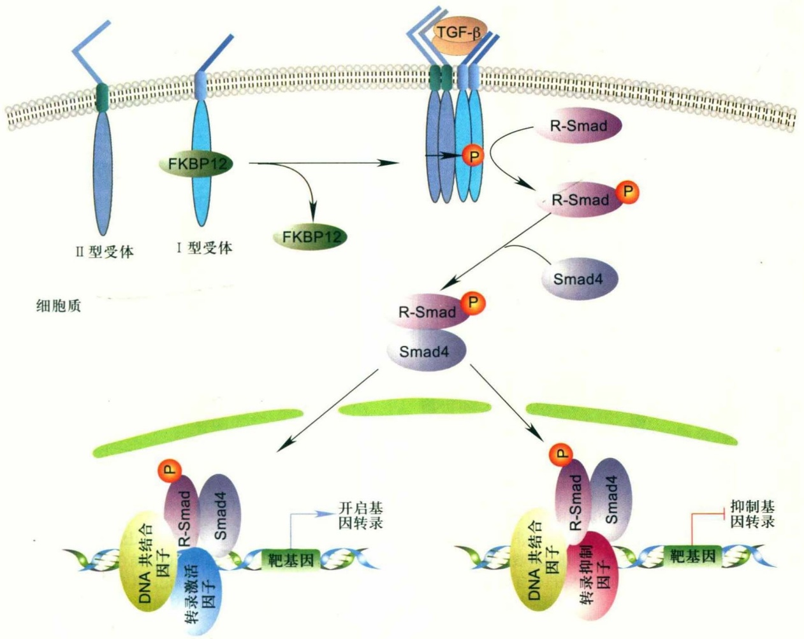

<details>
<summary>flowchart</summary>

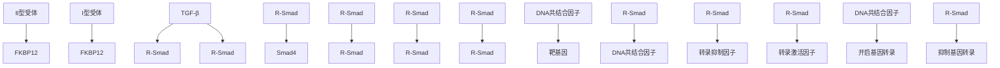
</details>

图13-1 TGF-β/Smads信号传递通路

TGF-β存在时，先与Ⅱ型受体结合，促使受体抑制蛋白FKBP12从I型受体上解离下来，I型受体进而可以与TGF-β配体和Ⅱ型受体结合形成配体-受体复合物。Ⅱ型受体磷酸化I型受体，进而招募R-Smad与受体复合物结合。R-Smad被I型受体磷酸化后从受体复合物上解离，磷酸化的R-Smad与Smad4（co-Smad）结合。R-Smad与Smad4在细胞核内直接或在其他DNA共结合因子的辅助下结合DNA，进而招募转录激活因子或转录抑制因子，调控靶基因的转录。

$2.5 \times 10^{4}$ ，每个单体由112个氨基酸组成，单体间由两个二硫键相连。

## 13.2.2 TGF- $\beta$ 受体类型、结构及功能

TGF-β受体是通过核素I $^{125}$ 标记的TGF-β与细胞表面结合蛋白进行化学交联，经电泳检测而被发现和鉴定的。根据其不同的电泳能力，TGF-β受体被划分为I型、II型和III型受体3类。其中I型和II型受体直接参与信号传递，是TGF-β信号传递所必需的。I型和II型受体也是目前唯一发现的具有丝氨酸/苏氨酸激酶活性的跨膜受体。III型受体是分子量最大的受体，对TGF-β，特别是TGF-β2的信号传递起促进作用。

## (1) TGF- $\beta$  I型和Ⅱ型受体

TβR II是迄今为止发现的传递TGF-β信号的唯一II型受体。TβRⅡ受体分子由567个氨基酸组成，分子量约为 $7\times10^{4}$ ，包括由136个氨基酸残基组成的N-糖基化且富含半胱氨酸的胞外区、单跨膜区和具有丝氨酸/苏氨酸激酶活性的胞内激酶区。在没有TGF-β信号存在时，TβRⅡ主要以单体形式分布在质膜上。在缺乏TGF-β的I型受体参与时，TβRⅡ与TGF-β1、TGF-β3有很高的亲和力但不与TGF-β2结合。

Ⅱ型受体能够磷酸化自身的丝氨酸(Ser)、苏氨酸(Thr)残基，因而有自磷酸化活性(autophosphorylation)。在TβRⅡ分子中，胞质内近质膜区的第213位Ser残基的自磷酸化，以及在激酶区具有底物识别功能的T-环(T-loop)结构中的第409位Ser残基的自磷酸化是激活TβRⅡ的激酶活性所必需的。Ⅱ型受体在激酶区后延伸出一段很短的C端尾。TβRⅡ的C端尾是可被磷酸化的，

13.2 TGF- $\beta$ 信号转导通路

251

---

(A)

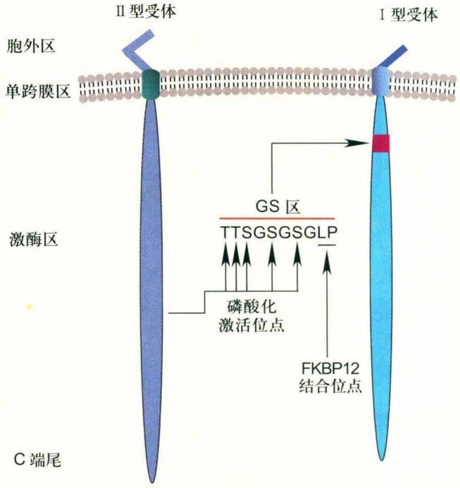

<details>
<summary>flowchart</summary>

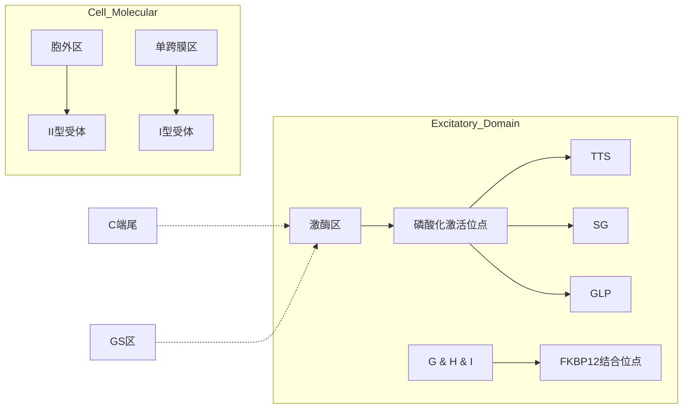
</details>

(B)

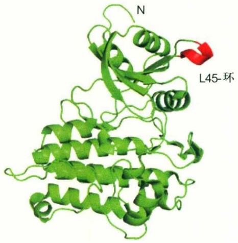

<details>
<summary>text_image</summary>

N
L45-环
</details>

图13-2 TGF- $\beta$ 的I型、II型受体结构示意图及TGF- $\beta$ I型受体胞内端结构图

(A) I型受体与II型受体分子结构相似，由胞外区、单跨膜区、激酶区和很短的C端尾组成。I型受体激酶区上游的特征性结构——GS区是I型受体激酶活性的关键调节区。II型受体通过磷酸化I型受体的GS区激活I型受体。FKBP12与I型受体的结合能够影响GS区的磷酸化。(B) TGF-βI型受体的胞内端结构域的结构图（仿自PDB蛋白质数据库），受体激酶区的L45环用红色标记，具有底物识别功能。

但缺失C端尾序列不会影响TβRⅡ传递TGF-β信号的功能。响应不同TGF-β超家族配体的不同Ⅱ型受体之间，胞内激酶区具有一定的序列保守性。但胞外区序列保守性低，胞内邻近跨膜区和C端尾也缺乏序列保守性，这一特征可能与Ⅱ型受体选择与相应的TGF-β超家族配体结合，从而特异性传递信号有关。

TGF-β的I型受体在对不同TGF-β超家族的II型受体的响应上存在很大程度的交迭。就TGF-β信号传递而言，在TβRII存在下，已发现至少有两种I型受体结合TβRII，参与TGF-β信号传递。TβRI又称ALK5(activin receptor like kinase 5)，在大多数细胞中广泛表达，特异性响应TGF-β信号。人的TβRI蛋白由503个氨基酸组成，分子量约为 $5.5\times10^{4}$ 。TβRI通过磷酸化下游分子Smad2/3传递信号。另一个传递TGF-β信号的I型受体ALK1，主要在内皮细胞中高表达。人的ALK1蛋白由503个氨基酸组成，分子量约为 $5.7\times10^{4}$ 。ALK1通过磷酸化Smad1/5传递信号。

I型受体与II型受体同属于糖蛋白，具有与II型受体相似的分子结构，一样具有N-糖基化且富含半胱氨酸的胞外区、单跨膜区和具有丝氨酸/苏氨酸激酶活性的胞内激酶区，I型受体的激酶区具有高度的序列保守性（图13-2）。

I型受体与II型受体在序列和结构上的不同之处在于:I型受体在激酶区上游具有一段由约30个氨基酸残基组成的高保守的Gly（甘氨酸）-Ser（GS）结构域，该结构域以包含特征序列“SGSGSG”而得名。GS区是I型受体激酶活性的关键调节区域（图13-2）。TGF-β诱导TβRI和TβRII形成受体复合体，在此复合体内，TβRII磷酸化TβRI在GS结构域“TTSGSGSG”片段中的Ser、Thr残基，引起TβRI构象发生变化从而激活TβRI的激酶活性。单独使GS区的某个Ser或Thr突变为Ala（丙氨酸）或Val（缬氨酸），不会影响其他位点的磷酸化和受体激活；若将GS区的3个以上的Ser、Thr残基突变为Ala、Val或酸性氨基酸残基，则会阻止TβRI的激活，抑制信号传递。I型受体GS结构域的倒数第2个氨基酸残基一般为Thr或Gln（谷氨酰胺），该残基突变为Asp（天冬氨酸）或Glu（谷氨酸）可以提高包括TβRI在内的许多I型受体的激酶活性，使I型受体可以不依赖于配体和II型受体而激活，但是其激活机制尚不清楚。在所有TGF-β家族I型受体的“SGSGSG”序列之后，紧接着

252

第 13章 TGF-β 信号转导

---

一个“Leu-Pro”基序，这个基序是胞质蛋白FKBP12结合并调节I型受体活性的重要位点（见本章13.3）。I型受体激酶区还包括了另一段重要结构——L45-环（L45-loop），该结构的功能与TGF-β信号传递的特异性有关。

TGF-β超家族配体通过与Ⅱ型受体、I型受体结合起始信号传递，目前认为主要存在两种配体-受体结合模式。第一种是顺序结合模式，即配体先与Ⅱ型受体结合，而后招募I型受体参与结合。TGF-β及activin与受体的结合主要是按照顺序模式。第二种是同步结合模式，主要发生在BMP信号通路中。在BMP信号传递过程中，只有在Ⅱ型受体和I型受体同时存在下受体才对BMP配体有较高的亲和力；任意一种受体单独表达时都能与配体结合，但亲和力较弱。因此，在BMP信号通路中，配体与两种受体的结合是同时发生的。

## (2) TGF- $\beta$  III型受体

TGF-β的Ⅲ型受体属于TGF-β的附属受体，最为典型的Ⅲ型受体为β蛋白聚糖（betaglycan）。β蛋白聚糖是蛋白多糖分子，在多种细胞中都有表达。β蛋白聚糖的核心多肽分子量大小仅为 $1\times10^{5}\sim1.1\times10^{5}$ ，由于侧链N-糖基化、肝素和硫酸软骨素修饰的差异，导致β蛋白聚糖电泳迁移速度不同，在分子量为 $2.8\times10^{5}\sim3.3\times10^{5}$ 处都有分布。β蛋白聚糖与TGF-β1、TGF-β2、TGF-β3三种亚型都有结合能力，其中与TGF-β2的结合力最强，能够促进TGF-β尤其是TGF-β2与I型、Ⅱ型受体的结合，从而促进TGF-β信号传递。β蛋白聚糖与TGF-β的结合能力是由β蛋白聚糖的多肽骨架决定的。目前仅发现β蛋白聚糖与TβRII有直接结合，而未发现与TβRI有结合。β蛋白聚糖的多肽编码序列由853个氨基酸组成，包括N端信号肽、很大的胞外结构域、单跨膜区和很短的C端胞内区。胞外区有6个N-糖基化位点、16个Cys和6个黏多糖黏附位点。C端胞内区由41个氨基酸组成，富含Ser和Thr，没有任何酶活性结构域，功能未知。研究表明，β蛋白聚糖胞外区的N端和C端都有TGF-β结合活性。β蛋白聚糖的跨膜区上游还存在一个“Lys-Lys”蛋白酶切割位点，能够被蛋白酶切割，使其胞外区以可溶形式分泌于胞外。这种形式的β蛋白聚糖能够与受体竞争结合TGF-β，对信号传递起拮抗作用。

内皮联蛋白(endoglin) 是另一种 TGF- $\beta$  的附属受体，属于膜糖蛋白，主要在血管内皮细胞和造血细胞中高水平表达。内皮联蛋白分子由信号肽和具有 4 个 N-糖基化接、多个O-糖基化位点的胞外区、跨膜区以及胞质区组成。内皮联蛋白和β蛋白聚糖的跨膜区序列相似性高达71%，胞内区序列相似性达63%。内皮联蛋白的功能最初认为与细胞间识别有关。与β蛋白聚糖对TGF-β的结合能力不同，内皮联蛋白主要和TGF-β1、TGF-β3结合，而不结合TGF-β2。人的内皮联蛋白有两种剪切形式，分别产生由625和658个氨基酸残基组成的分子，其区别在于胞内区的长短，两种分子都能形成以二硫键连接的二聚体。内皮联蛋白和β蛋白聚糖都可以与多种I、Ⅱ型受体相互作用，但其对下游TGF-β信号转导的作用却不尽相同，根据受体组合及下游R-Smad的不同，表现出促进或抑制作用。其具体的作用机制尚不十分清楚。

除了β蛋白聚糖和内皮联蛋白之外，一个EGF-CFC家族的胞外膜蛋白——cripto也被认为可作为TGF-β家族信号的附属受体。cripto可以通过结合ALK4和ALK7两个I型受体，从而促进另一个TGF-β超家族的配体——Nodal信号的转导。此外，cripto本身还具有其他一些不依赖于Nodal信号的功能，表明其作用机制不仅仅局限于作为一个TGF-β家族信号的附属受体，更多的作用机制仍有待进一步阐明。

## 13.2.3 Smad蛋白的结构与功能

Smad家族蛋白是TGF-β超家族信号在细胞内的信号传递分子。Smad家族蛋白的最早成员是分别在果蝇和线虫中发现的Mad和Sma，而后其同源蛋白在爪蟾、小鼠、大鼠、人中陆续被发现，整个家族成员以Sma和Mad的简并写法Smad命名。

根据功能差异，Smad蛋白分为三类亚家族:受体调控的Smad（receptor regulated Smad、R-Smad）、通用Smad（common Smad，Co-Smad）以及抑制型Smad（inhibitory Smad，I-Smad）。三类Smad蛋白在TGF-β超家族信号通路中分别发挥不同作用，每一类亚家族成员间在进化上具有很强的序列保守性。R-Smad是I型受体激酶的直接作用底物，其C端保守序列“SSXS”的后两个Ser能够被I型受体激酶磷酸化。R-Smad接收不同TGF-β超家族信号受体作用，决定生物信号传递的特异性:Smad2和Smad3能够被TGF-β和Activin的I型受体磷酸化，特异转导TGF-β/activin/Nodal信号；Smad1、Smad5和Smad8被BMP或GDF的I型受体磷酸化，介导BMP/GDF信号传递。另外，Smad1和Smad5还能被

13.2 TGF-β信号转导通路

253

---

在内皮细胞特异表达的响应TGF-β的I型受体ALK1磷酸化，传递TGF-β信号。Co-Smad目前在哺乳动物细胞中仅有Smad4被确认，其功能是与磷酸化的R-Smad结合并共同转运至细胞核，在其他转录因子共同作用下特异性调控靶基因的转录。I-Smad在哺乳动物细胞中包括Smad6和Smad7两种，它们通过与激活的I型受体结合，从而竞争性抑制R-Smad的磷酸化，导致信号通路被阻断。另外，Smad6除了能够与激活的I型受体结合之外，还可以干扰Smad1-Smad4复合物的形成，并且它还可以在细胞核内作为转录抑制因子抑制信号通路的靶基因的转录。而Smad7还能够招募E3泛素连接酶家族成员Smurf到I型受体，从而介导激活受体的泛素化，最终促进它们的降解；Smad7还能与Smad2/3结合，从而阻止Smad2/3-Smad4复合体的形成并促进Smad2/3的降解；此外，Smad7在细胞核内也可干扰Smad2/3-Smad4复合体与DNA结合从而抑制信号。目前认为Smad6主要抑制BMP信号转导，Smad7对TGF-β、activin和BMP信号均有抑制作用。有趣的是，TGF-β和BMP信号可以刺激I-Smad基因的表达，因此I-Smad对整个通路起负反馈调控的作用。

Smad蛋白分子由400～500个氨基酸残基构成，在Smad蛋白家族的各个亚型之间甚至不同物种间都具有较高的序列保守性。从结构上看，大多数Smad是由一段氨基酸序列低保守的衔接区(linker region)以及由它分别连接的N端约140个氨基酸残基的MH1结构域和C端约200个氨基酸残基的MH2结构域构成。

MH1结构域在R-Smad和Co-Smad蛋白分子中高度保守，而I-Smad的N端序列与R-Smad和Co-Smad的MH1结构域序列相似性很低。Smad3的MH1结构域是由4个α螺旋、6个短的β链和5个环结构折叠而成的一个紧密的球状结构。在所有R-Smad和Smad4的MH1结构域中，有一段由11个氨基酸残基组成的、序列高度保守的β发夹结构。该发夹结构能够与特定的DNA序列直接结合，赋予MH1结构域结合DNA的能力。与其他Smad分子相比，Smad2分子的β发夹结构前多出一段由30个氨基酸残基组成的插入序列，该插入序列导致Smad2丧失了直接结合DNA的能力。MH1结构域还参与和Sp1、Jun、TFE3等转录调控因子的相互作用。另外，MH1结构域也参与了R-Smad与Smad4的核质转运。在Smad3的MH1结构域中包含着一段典型的核定位信号“KKLKK”，该序列是Smad3分子由细胞质向细胞核内运输所必需的。在未被激活的状态下，R-Smad的MH1和MH2结构域可能相互作用，从而抑制彼此的活性，这种相互作用在R-Smad经受体磷酸化后被破坏。

MH2结构域在所有Smad蛋白中高度保守，R-Smad的MH2结构域与受体结合、R-Smad蛋白磷酸化以及Smad蛋白分子的寡聚化有关。Smad4的MH2结构域是由5个α螺旋、3个环围绕而成的β“三明治”型结构。Smad在细胞质中主要以单体或三聚体形式存在，MH2结构域是参与Smad分子寡聚化的关键结构域。Smad2和Smad3的MH2结构域还可与SARA（Smad anchor for receptor activation）以及其他一些衔接蛋白结合，定位于早期内吞体膜上。MH2结构域也是R-Smad与I型受体直接结合的区域。R-Smad与不同受体间相互作用的特异性是由位于R-Smad的MH2结构域的L3环和I型受体的L45-环共同决定的:I型受体的L45-环能够与R-Smad分子的L3环选择性结合，该结合决定了TGF-β信号与BMP信号通过不同受体分子传递给不同R-Smad分子，从而产生信号传递的特异性。与Smad4的MH2结构域相比，R-Smad在MH2结构域表面邻近L3环处有一个碱性口袋结构，这个带正电的碱性口袋结构能够识别激活的I型受体上由于磷酸化而带负电的GS区，促使R-Smad与激活的I型受体结合。除此之外，MH2结构域也是细胞核内的某些重要转录因子结合的区域。

Smad连接MH1和MH2的衔接区上有很多重要基序。已知具有重要功能的基序包括:促分裂原活化的蛋白激酶（MAPK）的作用位点，在R-Smad分子中，该位点的磷酸化可影响R-Smad的活性、稳定性以及在细胞核内外的分布；Smad4的衔接区上一段特殊的Smad激活区（Smad activation domain, SAD），SAD在空间结构上与Smad4的MH2结构域上的一段特异的序列相连接，形成Smad4具有转录活性所必需的结构；Smad4的衔接区上一段核输出信号（nuclear export signal, NES）；在R-Smad和I-Smad的衔接区中的一段高保守的“PY”基序。该基序具有与E3泛素连接酶Smurf1、Smurf2的WW结构域结合的功能（图13-3）。

在没有配体刺激的基础状态下，R-Smad主要存在于细胞质基质中，Smad4在细胞核与细胞质中都有分布。R-Smad的入核行为依赖于配体刺激，但不依赖于与Smad4的结合。在细胞核内，R-Smad被去磷酸化，导致

254

第 13章 TGF- $\beta$  信号转导

---

(A)

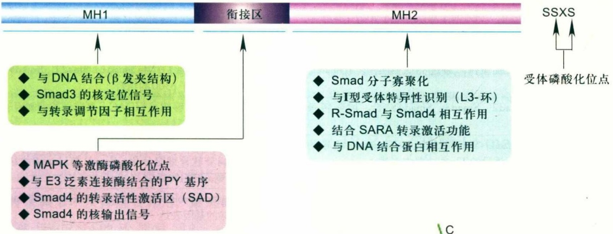

<details>
<summary>flowchart</summary>

```mermaid
graph LR
  subgraph MH1 ["MH1"]
    direction TB
  A["与DNA结合(β发夹结构)\nSmad3的核定位信号\n与转录调节因子相互作用"] --> B["MAPK等激酶磷酸化位点\n与E3泛素连接酶结合的PY基序\nSmad4的转录活性激活区(SAD)\nSmad4的核输出信号"]
  end

  subgraph衔接区["衔接区"]
    direction TB
  C["Smad分子寡聚化\n与I型受体特异性识别(L3-环)\nR-Smad与Smad4相互作用\n结合SARA转录激活功能\n与DNA结合蛋白相互作用"] --> D["SMAD分子寡聚化\n与I型受体特异性识别(L3-环)\nR-Smad与Smad4相互作用\n结合SARA转录激活功能\n与DNA结合蛋白相互作用"]
  end

  subgraph MH2 ["MH2"]
    direction TB
  E["受体磷酸化位点"] --> F["SSXS"]
  end

  A -.-> C
  B -.-> C
  C -.-> E
```
</details>

(B)

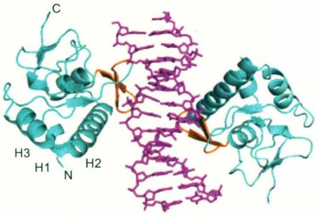

<details>
<summary>chemical</summary>

3D protein structure diagram showing helices H1, H2, H3 and a central alpha helix with labeled termini C, N
</details>

(C)

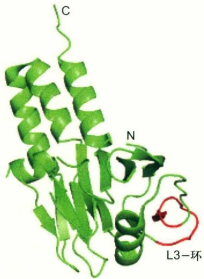

<details>
<summary>text_image</summary>

C
N
L3-环
</details>

图13-3 Smad3 MH1和Smad3 MH2结构图/Smad结构域及功能（结构图仿自PDB蛋白质数据库）

(A) R-Smad 和 Smad4 蛋白分子由 MH1、MH2 结构域及其衔接区组成，结构高度相似。基础状态下，Smad 蛋白呈单聚体或三聚体存在，MH1 和 MH2 结合并相互拮抗。R-Smad 在 C 端特有一段高度保守的受体磷酸化序列 “SSXS”。R-Smad 被受体磷酸化后，MH1 和 MH2 间的结合被破坏，通过 MH2 与 Smad4 结合，进入细胞核结合 DNA 及其 DNA 结合蛋白、转录调节因子，发挥共转录因子活性。衔接区是重要的 Smad 活性调节区，MAPK 信号通路可通过磷酸化衔接区的多个位点影响 Smad 活性；E3 泛素连接酶 Smurf 也通过衔接区的 PY 基序与 Smad 结合，影响其降解。(B) Smad3 的 MH1 结构域与 DNA 上的 Smad 结合元件 (SBE) 结合的结构图。回文状的 DNA 和 MH1 结构域分别用紫色和蓝绿色标记，DNA 结合域用橙色标记。(C) Smad3 MH2 结构域的结构图，L3 环用红色标记。

R-Smad-Smad4复合物发生解离，去磷酸化的R-Smad被运送回细胞质基质。与R-Smad不同，Smad4持续穿梭于细胞质与细胞核之间。

在大多数细胞中，Smad6、Smad7在没有配体刺激时定位于细胞核内，有TGF-β信号刺激时出核进入细胞质，行使抑制TGF-β信号的功能。TGF-β诱导的Smad7的出核需要Smad7与Smurf-1、Smurf-2的结合；BMP诱导的Smad6于细胞质基质的定位与Smad6和细胞质基质蛋白的结合有关。

## 13.2.4 Smad 蛋白的 DNA 结合活性和转录调节功能

Smad4以及除了Smad2的所有R-Smad都能够以序列特异性的方式与DNA结合。经典的DNA上最小的Smad结合元件（Smad binding element，SBE）是一段以5'-CAGA-3'或5'-AGAC-3'DNA序列为核心的区域。SBE广泛存在于Smad7等多种受TGF-β、activin以及BMP信号调控的基因的启动子区。从Smad3的MH1结构域与SBE形成复合物的晶体结构上看，两分子的Smad3通过MH1上的11个氨基酸残基构成的β发夹结构分别且独立地与一分子的5'-AGAC-3'序列上的碱基和磷酸二酯骨架形成特异的氢键连接。MH1结构域上的另一段序列α螺旋2（α-helix 2）也有助于Smad3与SBE序列的结合。在

13.2 TGF- $\beta$ 信号转导通路

255

---

表13-2 与Smad结合的DNA结合蛋白、转录调节因子

| 与Smad结合的转录增强因子 | Smad结合的转录抑制因子 |
| --- | --- |
| AP-1:由Fos(分子量$5.5 \times 10^4$)和Jun(分子量$3.9 \times 10^4$)组成的异二聚体转录因子,通过亮氨酸拉链与DNA结合,与Smad3、Smad4结合 | Androgen受体:与Smad3结合,但不与Smad2、Smad4结合,其配体结合区抑制Smad3与DNA的结合 |
| ATF-2:属于ATF/CREB家族蛋白,通过亮氨酸拉链与Smad3、Smad4的MH1结构域结合 | E1A:腺病毒肿瘤蛋白,与Smad1、Smad2、Smad3结合,干扰Smad与转录激活因子p300的结合 |
| CBP/p300:与Smad1、Smad2、Smad3、Smad4结合,增强转录活性 | Evi-1:锌指蛋白,能够招募HDAC,是转录共抑制因子。与Smad3结合,抑制TGF-β信号 |
| FAST-1,2:与Smad2、Smad3、Smad4结合,促进activin诱导的Mix2在爪蟾的表达和activin诱导的Tlx在小鼠中表达 | Hoxc-8:包含一个homeodomain的DNA结合蛋白,有抑制转录的功能,参与调节软骨细胞分化。Smad1与Hoxc-8的结合使Hoxc-8从DNA上解离,开启转录 |
| LEF1 (lymphoid enhancer binding factor1):T细胞特异性表达,含有HMG box的转录因子,参与Wnt信号。与Smad2、Smad3、Smad4结合 | PPAR (peroxisome proliferator activated receptor):与Smad3结合,干扰TGF-β诱导的基因表达 |
| MSG-1:转录激活因子,自身缺乏DNA结合活性,与Smad4(MH2)结合 | SIP1 (Smad interacting protein):包含一个锌指结构和一个homeodomain,是有抑制转录功能的DNA结合蛋白,与Smad1、Smad2、Smad3、Smad5(MH2)结合,SIP1与Smad的结合能使SIP1从DNA上解离,从而解除SIP1对转录的抑制作用 |
| OAZ:锌指蛋白,与Smad1结合 | Ski and SnoN:作为核肿瘤蛋白被发现,有招募HDAC的功能,是转录抑制因子。与Smad2、Smad3、Smad4(MH2)结合,抑制TGF-β诱导的转录 |
| SP1:与Smad2、Smad3、Smad4结合,增强Sp1对p15启动子的DNA结合和转录活性 | SNIP1 (Smad nuclear interacting protein 1):转录抑制因子,与Smad4和CBP/p300结合,过表达干扰p300与Smad4的结合 |
| TFE3:通过亮氨酸拉链与DNA结合,与Smad2、Smad3、Smad4结合 | TGIF (TGT-interacting factor):常规转录抑制因子,包含一个homeodomain,能够招募组蛋白去乙酰化酶HDAC,与Smad2、Smad3结合 |
| 维生素D受体:与Smad3(MH1)结合 | ATF3:属于ATF/CREB家族成员,ATF3可以结合Smad3从而介导对ID1基因的转录抑制 |

Smad2的MH1结构域上，参与DNA结合的β发夹及α螺旋2之间多出一段30个氨基酸残基组成的插入序列，使Smad2失去直接结合DNA的能力。SBE在基因组中出现的概率很高，而且单个SBE与Smad的结合亲和力低，不足以引起Smad诱导的转录，仅靠Smad与DNA的直接结合不足以满足Smad调节其靶基因的选择性和亲和力的要求，因此Smad主要是作为转录共调节因子影响靶基因转录。除SBE之外，Smad1、Smad3和Smad4的MH1结构域与一些富含GC碱基的基因启动子区也有特异性结合。

在细胞核中，Smad在DNA结合蛋白协助下接近靶基因，同时招募其他转录调节因子参与靶基因转录调节（表13-2）。不同的DNA结合蛋白与Smad结合，直接影响着Smad靶基因的选择。核内的转录激活或转录抑制因子种类、浓度影响Smad对靶基因转录促进或抑制的最终效果。由于细胞核内的DNA结合蛋白和转录调节因子的表达水平受到其他多种信号通路调控，并在不同类型细胞中具有特异性表达，因此，Smad对响应TGF-β信号的靶基因的选择和转录调节功能也呈现出细胞类型的特异性，不同的细胞类型中可能有不同的TGF- $\beta$ 信号靶基因。

目前已知的Smad影响转录调节的一个重要机制是Smad直接或间接招募能够影响染色质上组蛋白的乙酰化状态的转录调节因子，通过引起靶基因转录调控区染色质结构的改变，开启或关闭基因转录。R-Smad与Smad4形成的复合物能够通过MH2结构域直接招募常规转录激活因子CBP/p300。CBP/p300蛋白具有组蛋白乙酰转移酶活性，并促进Smads与其他基础转录因子结合，开启转录。Smad还能与TGIF、Ski/SnoN结合，通过它们间接招募组蛋白去乙酰化酶（HDAC），抑制靶基因转录。

R-Smad也可不依赖于Smad4发挥转录调控功能。在严重急性呼吸系统综合征(severe acute respiratory syndrome, SARS)中，SARS冠状病毒的核衣壳蛋白(nucleocapsid protein, NP)可调控TGF-β信号，这一过程不依赖于Smad4。一方面，NP可增强TGF-β的转录反应，促进胞外基质蛋白PAI-1的表达，促进肺纤维化；另一方面，NP可结合Smad3的MH2结构域，促进

256

第13章 TGF- $\beta$ 信号转导

---

Smad3-p300复合体的形成，并干扰Smad3与Smad4的结合，从而抑制Smad3/Smad4调控的受冠状病毒感染的宿主细胞的凋亡，进一步加重组织的纤维化。此外，在造血过程中，除了经典的Smad信号通路，TGF-β还可通过不依赖于Smad4的途径发挥调控功能。转录辅因子TRIM33/TIF1γ与Smad4竞争结合受体激活的Smad2/3。TGF-β诱导的Smad2/3-TIF1γ与Smad2/3-Smad4复合体共存，前者可促进红系分化，而后者则介导TGF-β的抗增殖作用，从而进一步促进组织自稳态的维持。

除了在转录调节中发挥重要作用，最近的研究发现R-Smad还参与miRNA的转录后调控。miRNA是21～24 nt的非编码RNA，调控mRNA的水平和翻译。研究发现miR-21在TGF-β和BMP信号诱导的血管平滑肌细胞收缩过程中发挥关键作用，TGF-β可上调miR-21的量，这一过程不依赖于转录。R-Smad与RNA核酸内切酶Drosha复合体成员之一p68蛋白结合在pri-miR-21上，这一过程依赖于配体的刺激，但不需要Smad4。响应TGF-β和BMP信号的miRNA的中间序列包含保守的R-Smad识别序列5'-CAGAC-3'，这段序列又被命名为RNA-Smad结合元件(RNA-Smad binding element,

R-SBE)，是Smad调控的miRNA加工过程中的关键序列元件，TGF-β和BMP刺激能增强R-Smad与Drosha在pri-miRNA（primary miRNA transcript）上的结合，加快其切割速率。虽然双链DNA和双链RNA在二级结构上存在很大差异，但R-Smad既可与DNA结合调控转录过程，又可与RNA结合调控miRNA的生物合成。

## 13.2.5 不依赖于Smad的TGF- $\beta$ 信号

除了 Smad 介导的转录，TGF- $\beta$  还能激活包括 MAPK 通路在内的多种其他信号通路 (non-Smad pathway)。其中一部分通过激酶调节 Smad 活性来控制转录 (见本章 13.3)；另一部分则不通过 Smad 的信号传递引发细胞效应 (图 13-4)。

TGF-β刺激能够在极短时间（15 min内）迅速激活细胞中的ERK、JNK和p38 MAPK通路，在Smad4缺失或表达显性抑制（dominant negative）型Smad的细胞中，TGF-β也仍然能够迅速激活ERK、JNK以及p38 MAPK激酶通路，这些说明细胞中存在着不依赖于Smad的TGF-β对MAPK的激活途径。TGF-β刺激能够磷酸化TAK1（TGF-β-activated kinase 1）和MAPKKK家族成员

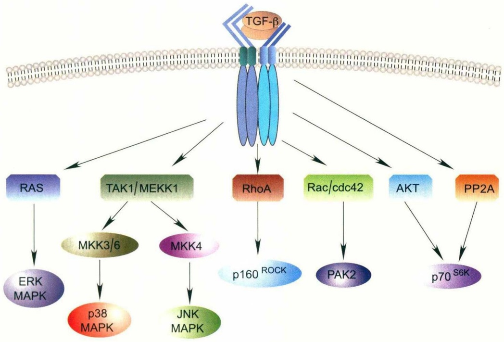

<details>
<summary>flowchart</summary>

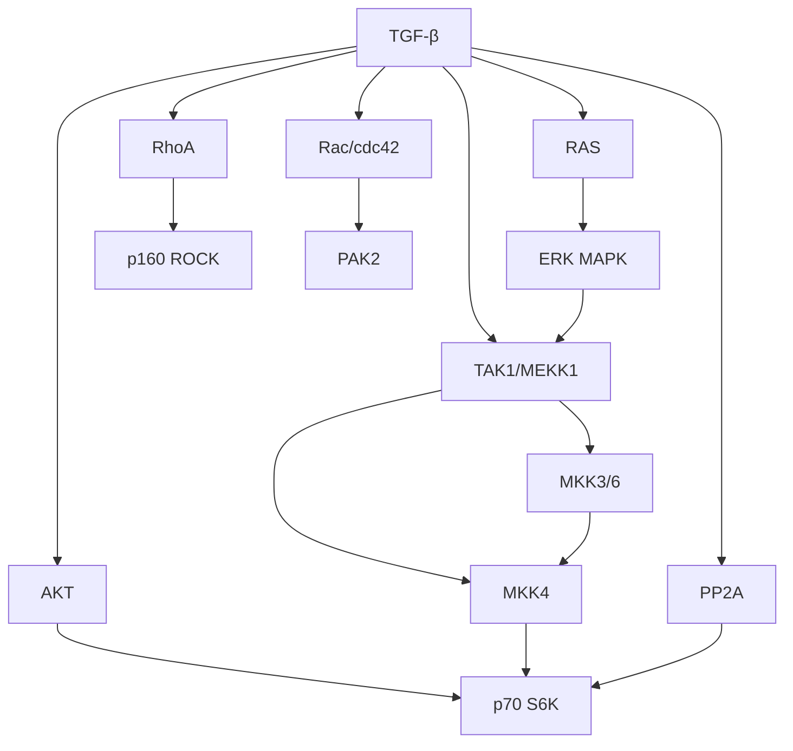
</details>

图13-4 细胞内存在的不依赖于Smad的TGF- $\beta$ 信号通路

在一些特定类型细胞中，TGF- $\beta$ 刺激能够直接激活RAS、TAK1、GTP结合蛋白、AKT、蛋白磷酸酶PP2A等蛋白，引发一系列不依赖于Smad传递的细胞效应（如图中箭头所示）。

13.2 TGF- $\beta$ 信号转导通路

257

---

MEKK1，经由MKK4（MAPK kinase 4）激活JNK通路，或通过MKK3（或MKK6）激活p38途径。TGF-β还可以通过Ras激活ERK通路。TGF-β引起的MAPK途径的激活与TGF-β通过Smad途径对细胞的效应之间既具协同作用又存在拮抗作用，在不同种类的细胞中表现不同。TAK1还磷酸化IκB因子，因此TGF-β信号也能够通过TAK1影响NF-κB信号通路。

TGF-β刺激能够迅速激活RhoA、Rac和cdc42等GTP结合蛋白。Rac和cdc42也能够激活JNK和p38MAPK途径。TGF-β对GTP结合蛋白的激活参与TGF-β引起的细胞骨架重塑、上皮细胞—间充质细胞转换等生物过程。TGF-β还可激活蛋白磷酸酶PP2A，导致p70 $^{S6K}$ 去磷酸化而失去活性，参与TGF-β引起的细胞生长抑制过程。TGF-β能够以不依赖于Smad的方式激活磷脂酰肌醇3-激酶途径(phosphatidylinositol-3-kinase, PI3K)和AKT。在一些细胞系中，TGF-β也通过RhoA磷酸化AKT。此外，TGF-β还能够活化PAK2(p21-activated kinase 2)，该过程也不依赖于Smad，但受到Rac1和cdc42的调节。TGF-β对PAK2的激活作用特异地发生于成纤维细胞，在上皮细胞中并不存在，这可能与TGF-β对成纤维细胞的生长刺激功能有关。

需要提到的是，Smad蛋白一直认为只介导或调控TGF- $\beta$ 家族信号，但最近有证据显示，Smad还可以参与非TGF- $\beta$ 信号。例如，Smad7与gp130结合，促进LIF介导的STAT3激活、参与胚胎干细胞多能性的维持。

## 13.3 TGF- $\beta$  信号转导的调控

TGF- $\beta$ 超家族信号在胚胎发育、细胞分化及疾病发生等生理、病理过程中具有多方面的作用，调节的基因十分广泛，而传递TGF- $\beta$ 超家族信号的经典通路——Smad通路却相对简单。因此，细胞中存在对TGF- $\beta$ 信号通路各个环节的精密的调控机制，这些调控对于细胞对TGF- $\beta$ 信号的正确应答发挥着关键作用。

## 13.3.1 配体活性的调节

多种结合TGF-β的蛋白参与调控TGF-β活性。前面提到，生物体内多种细胞均分泌非活性状态的L-TGF-β，水解L-TGF-β的N端无活性肽（LAP）的纤维蛋白溶酶具有调节TGF-β活性的作用。无活性的TGF-β的结合蛋白（LTBP）属于分泌型糖蛋白家族，能够与LAP通过二硫键连接。LTBP可能有利于TGF-β的分泌、储存或激活LAP-TGF-β复合物，起到协助调节TGF-β活性的作用。饰胶蛋白聚糖（decorin）属于小分子富含亮氨酸的蛋白多糖家族（small leucine-rich proteoglycan，SLRP），由一个核心蛋白和一个共价连接的黏多糖链组成。饰胶蛋白聚糖能够直接与活性形式的TGF-β结合，并抑制其功能。

## 13.3.2 受体活性的调节

FKBP12是高度保守的胞质细胞因子，在大多数细胞中广泛存在，能够抑制TGF-β的I型受体的激活。FKBP12的主要功能是与I型受体在基础状态下结合，防止无配体存在时由于受体之间的相互作用而引起的非特异性的信号渗漏。在无TGF-β存在时，FKBP12通过疏水力与紧接I型受体GS结构域之后的“LP”基序结合，使I型受体GS结构域被遮盖，从而不能被II型受体磷酸化。当存在TGF-β时，TGF-β能够诱导II型受体与I型受体形成复合物，导致FKBP12与I型受体解离，I型受体的GS区重新暴露，能够被II型受体激活。

除了磷酸化调控之外，TGF-β受体还受到泛素化（ubiquitination）、neddylation修饰以及SUMO化（sumoylation）的调控。Smad7可以募集泛素化酶Smurf1、Smurf2以及WWP1/Tiul1、NEDD4-2到TGF-β的I型受体，从而导致后者的泛素化降解。neddylation修饰和SUMO化是形式上类似于泛素化的一类由E1、E2和E3 NEDD8连接酶或SUMO连接酶催化的级联反应，进而影响被修饰蛋白的定位或功能。近期的研究表明，E3泛素连接酶c-Cbl蛋白可通过促进TGF-βⅡ型受体的neddylation修饰，促进其通过网格蛋白调控的内吞方式进入EEA1阳性的早期内吞体中。由于neddylation修饰会拮抗泛素化，从而稳定TβRII，进而促进TGF-β信号的传递。TβRI是目前已知的唯一能够被SUMO化修饰的跨膜受体激酶。当存在TGF-β时，SUMO修饰发生在TβRI胞内段的第389位赖氨酸（Lys389）上，该修饰可以促进TβRI对Smad2和Smad3的招募，从而促进TGF-β信号转导。

近期的研究表明，跨膜金属蛋白酶TACE（tumor necrosis factor- $\alpha$  converting enzyme，即TNF- $\alpha$ 转化酶，也称为ADAM17）能够特异性切除T $\beta$ RI受体，产生一

258

第 13 章 TGF- $\beta$  信号转导

---

条分子量约 $4.0 \times 10^{4}$ 的胞内端和剩余的跨膜区连胞外端，导致TβRI失活，但不影响TGF-β配体结合TβRII。生长因子诱导的ERK/MAPK信号以及炎症刺激诱导的p38/MAPK信号均能促进TACE调控的TβRI的剪切，从而降低细胞膜上TβRI的数量、抑制TGF-β通过Smad通路进行的信号转导。但是，另一研究人员发现TACE介导的TβRI的切割会导致其胞内段转运至核内，作为转录调控因子发挥功能，这一过程有泛素连接酶肿瘤坏死因子受体相关因子6（TRAF6）参与。TRAF6能够与TβRI结合，导致TβRI的Lys63多聚泛素化，进而促进TβRI被TACE酶切割，而后其胞内段在核内与转录调控因子p300协同激活肿瘤侵袭相关的基因，如Snail、MMP2等。除TβRI外，TβRII型受体的活性也受到另一个金属蛋白酶ADAM12（a disintegrin and metalloprotease）的调控。与上文的调控方式不同，ADAM12通过与TβRII的胞外结构域结合，在质膜上共定位，促进TβRII通过网格蛋白介导的内吞进入早期内吞体，稳定TβRII，促进TGF-β通过Smad通路进行的信号转导。

一些具有WD-40重复基序的蛋白也能够与TGF-β受体相互结合进而调控受体活性。例如，STRAP蛋白能够与TβRII、TβRI、Smad2、Smad3以及Smad7结合。STRAP能够抑制TGF-β引起的转录，并稳定Smad7与受体的结合；TGF-β受体结合蛋白-1（TGF-β-receptor interacting protein 1, TRIP-1）可以与配体结合的TβRII结合并被磷酸化，增加细胞内TRIP-1的蛋白水平会抑制TGF-β诱导的转录，TRIP-1的一些突变则能够提高细胞对TGF-β的响应；蛋白磷酸酶PP2A的Bα调节亚基也是具有WD-40重复基序的蛋白，能够直接与I型TGF-β受体结合，并增强TGF-β信号抑制细胞增殖的功能。

除此之外，受体的活性还受到其他方面的调控，如受体可通过胞吞作用到溶酶体降解，从而控制细胞膜上受体的数量。

## 13.3.3 Smad活性的调节

TGF- $\beta$ 与受体结合诱导的受体内吞过程直接影响TGF- $\beta$ 信号的传递效率。一些受体结合蛋白在促进TGF- $\beta$ 诱导的受体内吞、囊泡运输、招募R-Smad到内吞体或质膜上与受体结合中发挥重要作用。在受体激活R-Smad过程中，SARA蛋白参与促进Smad2/3与受体的结合和活化。SARA是具有FYVE结构域的蛋白，通过FYVE结构域与早期内吞体膜上的磷脂酰肌醇-3-磷酸（PI3P）相结合，使SARA主要定位于早期内吞体膜上。SARA具有Smad结合结构域(Smad-binding domain, SBD)，可以选择性地与Smad2/3的MH2结构域结合，因此在细胞中过表达SARA，可导致Smad2/3从弥散状分布变为点状分布在内吞体膜上。受体对Smad2/3磷酸化后，磷酸化的Smad2/3从SARA上脱离并运送入细胞核内。SARA的C端还可以与激活的受体复合物结合。另有研究报道，SARA能够把蛋白磷酸酶1(protein phosphatase 1, PP1)招募到I型受体上，通过PP1对基础状态下的I型受体去磷酸化，抑制I型受体的基础活性。SARA还能结合未被磷酸化的Smad2，抑制Smad2固有的入核活性，防止Smad2在无TGF-β信号时入核。另一个具有FYVE结构域的蛋白——肝生长因子调节的酪氨酸激酶底物(hepatic growth factor-regulated tyrosine kinase substrate, Hrs)，也参与调节TGF-β信号。最初研究认为，在受体复合物与Smad2的结合过程中，Hrs能够与SARA蛋白协同促进TGF-β和activin信号的传递。另外，具有FYVE结构域的endofin蛋白也能与Smad4结合，并促进R-Smad-Smad4复合体的形成。

一些细胞骨架蛋白也参与了Smad在细胞中的定位和信号传递，这对Smad的激活及信号传递具有重要作用。未被磷酸化的Smad2/3与微管蛋白微丝相结合，TGF-β信号诱导它们之间发生解离，破坏微管蛋白可以增加Smad2的磷酸化和活性。Smad还和与肌动蛋白交联的细丝蛋白结合，细胞中细丝蛋白缺失将削弱Smad2的磷酸化和TGF-β的信号传递能力。ELF（embryonic liver fodrin）是一种细胞骨架蛋白，属于β-血影蛋白(β-spectrin)家族成员。有研究报道，TGF-β刺激可诱导ELF磷酸化，使ELF脱离与锚蛋白B(ankyrin)、原肌球蛋白(tropomyosin)的结合，转而结合Smad3和Smad4，ELF可能是通过促进Smad3的磷酸化以及Smad4的核转运来促进TGF-β信号传递。

R-Smad蛋白C端SXS位点的磷酸化是其激活的直接表征，I型受体介导的磷酸化激活它们的活性，而去磷酸化有相反作用。PPM1A/PP2Cα可以特异性地催化Smad2/3 C端SXS位点的去磷酸化，从而负调控TGF-β信号。另外，PPM1A不仅可以去磷酸化Smad2/3，还可以介导Smad1 C端SXS位点的去磷酸化。除PPM1A外，SCP（small C-terminal domain phosphatase）和PDP

13.3 TGF-β信号转导的调控

259

---

(pyruvate dehydrogenase phosphatase) 也被认为能够催化 Smad1 的 C 端 SXS 位点的去磷酸化。

除C端SXS位点外，R-Smad在其他区域也能被磷酸化。例如，MAPK(ERK、JNK、p38)、ROCK、GRK2、SCP及CaMK II等多种激酶可以对衔接区的不同位点进行磷酸化修饰。不同位点的磷酸化对于R-Smad的活性有着多种不同的影响，如影响定位、蛋白稳定性或转录活性等。比如，HGF、EGF等生长因子刺激细胞时激活MAPK激酶通路，激活的ERK通过磷酸化Smad2的MH1结构域以及Smad2和Smad3的衔接区，抑制R-Smad的核转运，调节TGF-β信号转导通路；而JNK能够对Smad3的衔接区磷酸化，增强它的转录功能。依赖钙调蛋白的蛋白激酶II（CaMK II）能够磷酸化Smad2衔接区的Ser240、Ser260和MH1结构域的Ser110，抑制TGF-β诱导的Smad2的核转运；PKC可以磷酸化Smad2MH1结构域的Ser47和Ser110以及Smad3 MH1结构域的Ser37和Ser70，PKC对Smad3的磷酸化会阻断Smad3与DNA结合从而抑制Smad3的转录调节活性。衔接区磷酸化的调控十分复杂，这也体现了TGF-β/Smad信号通路与其他信号通路之间存在着广泛的“交叉对话”（crosstalk）效应。随着更多的激酶及相应磷酸化位点的被发现，对R-Smad活性调控的理解也将更加深入。

如前所述，Smad6和Smad7除干扰受体对R-Smad的激活外，它们还能与R-Smad蛋白形成无活性的复合物，抑制R-Smad-Smad4复合物的形成。另外，它们还可以在细胞核内抑制R-Smad-Smad4复合物的转录功能。

Smad蛋白水平的调节是控制Smad活性的另一种重要方式。在细胞质中，Smad蛋白水平受到E3泛素连接酶Smurf-1和Smurf-2的调控。Smurf-1的WW结构域可以识别并结合Smad1/5衔接区的PY基序，导致Smad1/5迅速被泛素化和降解。这种结合不依赖于BMP信号存在，有效地降低了细胞质内Smad1/5的基础水平。受体激活的Smad2入核行使调节靶基因转录的功能之后，在细胞核内经历由Smurf-2介导的泛素化并降解；受体激活的Smad3在完成转录后由SCF/Roc1 E3泛素连接酶介导其泛素化，泛素化的Smad3先经历一个出核过程，最终在细胞质基质的蛋白酶体中被降解。此外，最新研究还表明，TGF-β刺激可促进Smad3衔接区Thr179的磷酸化，促进Smurf-2与Smad3的结合，进而导致Smad3 MH2结构域的单泛素化。Smad3的单泛素化抑制了Smad3-

Smad4复合物的形成，干扰Smad3的转录活性。

Smad4也可由多聚泛素化介导的方式降解，而单泛素化会促进它的转录活性。另外SUMO化修饰能够增强Smad4的稳定性。

## 13.3.4 转录因子水平的调节

TGF-β信号对基因转录的调节是通过Smad与特定细胞内存在的多种转录因子或共激活因子(coactivator)共同作用的结果。TGF-β诱导的MAPK途径可通过影响其转录因子底物（如JNK对c-Jun、p38对ATF-2等）与Smad相互结合，达到对TGF-β与MAPK途径的整合作用。调节细胞核内某些转录共抑制因子(corepressor)的水平也可以影响Smad对靶基因的转录调控。转录共抑制因子c-Ski、SnoN能够以不依赖于TGF-β信号刺激的方式结合Smad3，该结合能够抑制基础状态下Smad引起的基因转录。有配体刺激时，TGF-β刺激导致Smad2/3磷酸化并转运至细胞核内，激活的Smad2/3在细胞核内经由与Smurf-2或APC(anaphase promoting complex)E3泛素连接酶的结合，使SnoN发生泛素化并迅速降解，从而解除SnoN对Smad2/3的抑制，使Smad2/3能开启转录。同时，TGF-β能上调Ski和SnoN的表达，使它们在细胞核内的水平重新回升。对细胞核内Ski、SnoN水平的调节对于开启和终止Smad调控的靶基因的转录起着重要作用。另一类转录抑制因子TGIF在有TGF-β刺激下可以与转录激活因子p300竞争结合Smad2/3，并募集HDAC到转录调节复合物上，因而抑制TGF-β诱导表达基因的转录。对于这类基因而言，细胞内TGIF与p300之间的相对蛋白水平往往决定了细胞内该基因响应TGF-β刺激的最高转录水平。越来越多的Smad共结合转录调控因子的发现，进一步丰富了人们对于TGF-β信号调控靶基因表达机制的认识。

## 13.4 TGF- $\beta$  信号对细胞行为的调控

## 13.4.1 TGF- $\beta$ 对细胞周期的调控

细胞周期调控主要受细胞周期蛋白(cyclin)以及周期蛋白依赖性激酶(cyclin-dependent kinase, CDK)的

260

第 13 章 TGF- $\beta$  信号转导

---

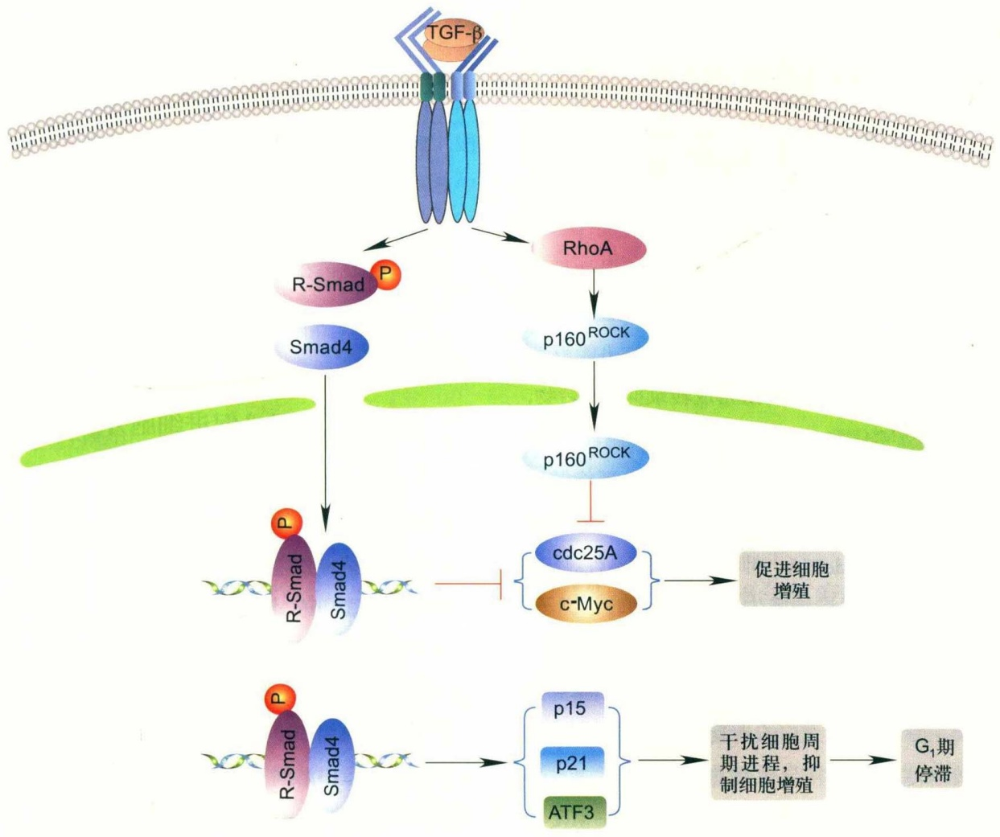

<details>
<summary>flowchart</summary>

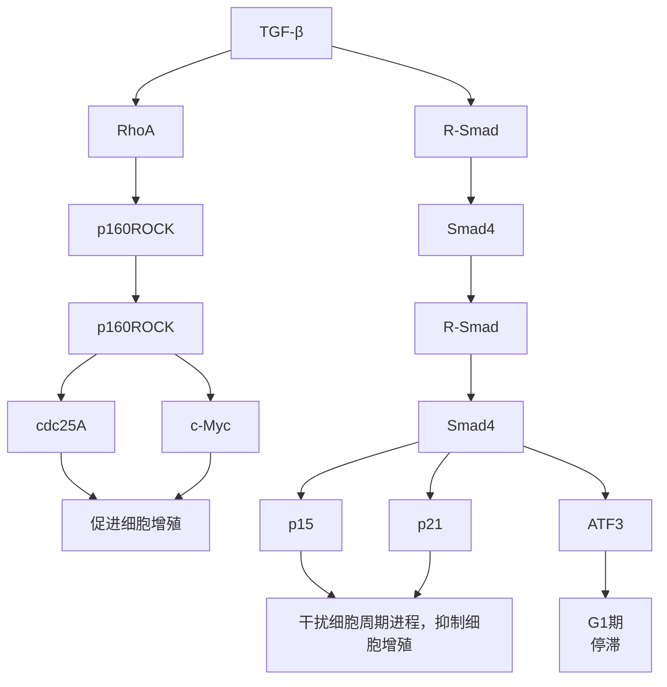
</details>

图13-5 TGF- $\beta$ 诱导的 $\mathrm{G}_{1}$ 期停滞

TGF-β通过依赖Smad传递的转录调控及直接激活RhoA的方式诱导细胞发生 $G_{1}$ 期停滞。TGF-β刺激导致Smad入核，一方面促进CDK抑制因子p15、p21及转录因子ATF3的表达，抑制推动细胞周期进程的cdc25A和c-Myc的表达，从而使细胞进入生长停滞。另一方面，TGF-β还可以不依赖Smad的方式直接激活RhoA来间接抑制cdc25A的活性，从而抑制细胞周期进程。

表达水平和活性的影响（见第16章）。CDK只有与周期蛋白特异性结合才具有激酶活性，不同类型周期蛋白水平受到细胞周期的严密调控。在细胞中，CDK除需要与周期蛋白结合激活外，其激酶活性还受到其他蛋白因子的调节:CDK需要cdc25的去磷酸化作用来活化；CDK抑制因子（CDK inhibitor，CKI）也能够负调控CDK活性，抑制细胞周期进程。

在 $G_{C}$ 期，细胞在生长因子的刺激下表达cyclin D，与CDK4、CDK6结合形成cyclin D-CDK4/6复合物。cyclin D-CDK4/6磷酸化成视网膜细胞瘤蛋白(retinoblastoma protein, Rb)，使Rb释放出与之结合的转录因子E2F。E2F是多种基因的重要转录调节因子，释放E2F促使许多进入S期所必需的基因的转录，如cyclin E、cyclin A等。新合成的cyclin E与CDK2形成cyclin E-CDK2复合物，是细胞通过 $G_{1}/S$ 期检控点( $G_{1}/S$ checkpoint)，由 $G_{1}$ 期进入S期所必需的。

TGF-β能够诱导上皮细胞、内皮细胞、造血细胞、神经细胞、间质细胞等多种类型细胞发生可逆的G₁期停滞（G₁ arrest）（图13-5）。TGF-β诱导G₁期停滞的方式之一是诱导CKI基因的表达，对CKI的诱导因细胞类型的不同而有差异。p15 $^{Ink4b}$ 是CKI家族Ink4b的成员，特异性抑制cyclin D依赖的激酶CDK4和CDK6的催化活性，并能阻止新的cyclin D-CDK4/6复合物形成。p21 $^{Cip1}$ 、p27 $^{Kip1}$ 是另一CKI家族Cip/Kip的成员，能够与cyclin D-CDK4/6、cyclin E-CDK2以及cyclin A-CDK2复合物结合。当p21、p27与cyclin E/A-CDK2结合时，能够抑制cyclin E/A-CDK2活性。p21和p27能够与cyclin D-CDK4/6结合，却不能抑制其活性，TGF-β可以

13.4 TGF- $\beta$ 信号对细胞行为的调控

261

---

迅速诱导p15高度表达，p15不仅能够直接抑制cyclin D-CDK4/6活性，还能够通过竞争性结合取代p27与cyclin D-CDK4/6的结合，释放出的p27再与cyclin E/A-CDK2复合物结合，从而起到抑制cyclin E/A-CDK2活性的作用。在多种细胞中，TGF-β能够诱导p21表达，直接抑制cyclin E/A-CDK2作用，从而诱导细胞发生G₁期停滞。

cdc25A是cdc25蛋白家族成员，属于双特异性磷酸酶（dual-specificity phosphatase），能够作用于CDK4/6和CDK2，通过去磷酸化激活CDK活性。TGF-β能够刺激Smad与E2F、p130以及HDAC1形成转录抑制复合物，该转录抑制复合物与cdc25A的启动子结合，抑制其转录，从而间接降低CDK4/6和CDK2活性。TGF-β还能够以不依赖Smad的方式激活RhoA，RhoA刺激p160 $^{ROCK}$ 核转运，p160 $^{ROCK}$ 磷酸化cdc25A，抑制其磷酸酶活性。

c-Myc是一类广泛促进细胞生长和增殖的转录因子，根据与c-Myc结合因子的不同特性，c-Myc对基因具有转录激活或转录抑制的活性。TGF-β能够在多种细胞中抑制c-Myc转录。由于c-Myc蛋白的半衰期很短，TGF-β诱导的c-Myc转录水平下调将导致细胞内c-Myc蛋白水平迅速下降，导致细胞进入G₁期停滞。除了下调c-Myc转录水平外，TGF-β还通过抑制ID的表达来抑制细胞增殖。ID蛋白属于螺旋-环-螺旋家族蛋白，缺乏DNA结合区，能够抑制细胞分化中重要的转录因子bHLH（basic helix-loop-helix）的活性，ID蛋白还能够与Rb结合促进细胞增殖。TGF-β能够诱导转录因子ATF3表达，ATF3与Smad3/4共同作用来抑制ID1转录。

## 13.4.2 TGF-β对细胞凋亡的调控

细胞凋亡(apoptosis)是由基因控制的细胞主动死亡过程，在多细胞生物胚胎发育、器官形成和稳态调控中起重要作用，也在维持淋巴系统的免疫自稳以及肿瘤发生等多种生理、病理现象中具有重要作用。

由外界信号刺激引发细胞凋亡的信号传递过程可分为:外界信号分子刺激的起始阶段、多条信号通路相互整合阶段以及由线粒体释放细胞色素c引发caspase级联反应的凋亡反应执行阶段三部分（见第25章）。TGF-β刺激能够广泛影响到参与凋亡信号传递过程三个阶段的蛋白分子。在外界信号刺激引发凋亡的起始阶段，TGF-β分别与Fas、TNFα及NGF协同刺激细胞凋亡。在多种信号途径整合阶段，TGF-β更是以多种方式影响细胞凋亡:TGF-β能够激活JNK级联反应诱导凋亡；TGF-β诱导转录因子TIEG1（TGF-β-inducible early-response gene 1）的表达，抑制细胞增殖并诱导凋亡。在细胞凋亡的执行阶段，TGF-β在肝上皮细胞、淋巴细胞等多种类型的细胞中下调抑制凋亡蛋白家族Bcl-xL/Bcl-2表达；在原代培养的肝细胞中通过激活钙激活性中性蛋白酶(calpain)，从而诱导细胞凋亡；在肝细胞、淋巴细胞、小脑神经粒细胞中通过激活caspase8、caspase9、caspase3和caspase1来诱导凋亡发生。

## 13.4.3 TGF-β促进细胞外基质蛋白分泌

细胞外基质蛋白参与细胞黏附、组织结构支撑等多项细胞生理功能。在生物体内不同组织中，外基质的组成具有组织特异性，这种特异性与不同组织的功能密切相关。正常组织中，外基质蛋白通过一些水解酶降解，外基质蛋白的合成与酶降解的速率保持稳定平衡。血纤维蛋白溶酶原（plasminogen）在肝、肾中合成，通过血液循环运送到其他组织，血纤维蛋白溶酶原激活后形成有活性的血纤维蛋白溶酶（plasmin），能够降解纤维蛋白、纤维结合素，并激活金属蛋白酶和胶原酶。基质金属蛋白酶（matrix metalloproteinase，MMP）是直接降解多种外基质蛋白的重要酶家族。TGF-β一方面直接促进如胶原蛋白（collagen）、纤连蛋白（fibronectin）、弹性蛋白、蛋白聚糖等多种基底膜与间隙基质成分的合成；另一方面诱导金属蛋白酶的抑制因子或诱导血纤维酶酶原激活物抑制因子（plasminogen activator inhibitor-1，PAI-1）表达，间接促进细胞外基质蛋白积聚。因此，TGF-β是生物体调节组织内细胞外基质蛋白水平的重要调节因子。

## 13.4.4 TGF- $\beta$ 刺激上皮细胞-间充质细胞转换

上皮细胞-间充质细胞转换(epithelial-mesenchymal transition, EMT)是指具有极性的上皮细胞转换成具有运动能力、能够在细胞基质间自由移动的间充质细胞特征的过程，在此过程中，细胞丧失上皮细胞特征和标志基因而获得间充质细胞特征。EMT过程涉及多种细胞因子、生长因子和黏连分子，在多种组织中活跃发生，参与正常胚胎发育并涉及如伤口愈合、肿瘤转移等某些病理过程。

TGF- $\beta$ 能够在多种正常组织中诱导EMT发生（图

262

第 13 章 TGF- $\beta$  信号转导

---

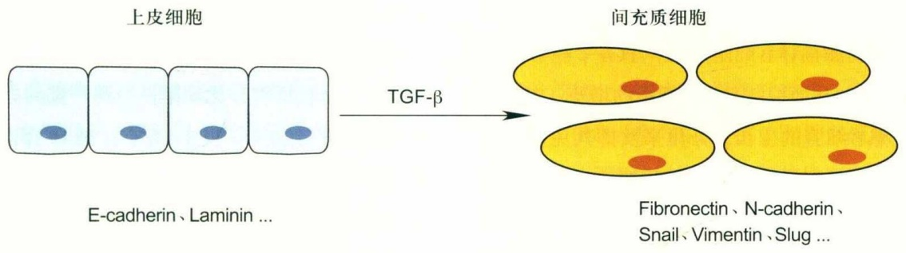

<details>
<summary>flowchart</summary>

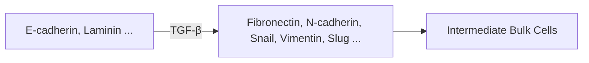
</details>

图13-6 TGF-β信号促进上皮细胞向间充质细胞转换（EMT）过程的发生

13-6)。颚融合过程中，中线边缘上皮细胞发生向间充质细胞的转换，TGF-β3是该转换过程必需的。在心脏发育中，心脏内腔里层的内皮细胞转换为间充质细胞后侵袭外基质导致心脏瓣膜形成。注射抑制TGF-β的I型受体或II型受体的抗体以及TGF-β3的反义寡核苷酸均能阻断该细胞转换过程。

EMT还参与肿瘤发生进程。转化的上皮细胞通过获得间充质细胞表型来增加入侵外基质的能力，从而促进肿瘤细胞向身体其他部位迁移。肿瘤从不同器官向其他器官的扩散过程与肿瘤细胞丢失其上皮细胞标志基因、发生EMT的过程相关。在鼠的皮肤癌中，TGF-β刺激是角质细胞转化为纺锤形细胞所必需的。TGF-β还可以诱导裸鼠的乳腺上皮NMuMG细胞向间充质细胞转换，TβRI诱导的Smad2/3磷酸化介导了TGF-β诱导的EMT过程。

TGF-β信号可以与RAS-RAF-MAPK信号协同促进EMT。EMT过程中，钙依赖的细胞黏附受体分子E-cadherin的下调是EMT发生的重要标志。TGF-β信号可以促进SNAIL、Fibronectin、N-cadherin、Vimentin和SLUG基因的表达，而这些基因恰恰是E-cadherin表达的抑制因子。此外，TGF-β信号还可以直接通过TβRII磷酸化激活Par6，Par6激活后可以打散细胞的紧密连接（tight junction）从而促进EMT进程。

## 13.5 TGF- $\beta$ 的正常生理功能及在疾病发生中的作用

## 13.5.1 TGF- $\beta$ 与免疫系统自稳

TGF- $\beta$ 影响免疫系统的多种细胞，对机体的细胞免疫及体液免疫具有广泛作用。淋巴细胞、巨噬细胞、树突细胞等所有白细胞均分泌TGF- $\beta$ 1。TGF- $\beta$ 以自分泌或旁分泌的方式负调控免疫细胞的生长和分化，并抑制抗原呈递诱导的淋巴细胞激活。

TGF-β对T淋巴细胞具有多方面的作用，不仅能够直接作用于T细胞，还能够通过作用抗原呈递细胞（antigen-presenting cell，APC）来调节T细胞功能，影响生物体的细胞免疫过程。T细胞分化成为效应细胞（CD8⁺）或辅助细胞（CD4⁺）。纤维肉瘤细胞能够分泌TGF-β并能够抵抗CD8⁺细胞的清除；在转基因小鼠体内的CD8⁺和CD4⁺细胞中表达显性抑制的突变型TβRII受体，有利于T细胞介导的肿瘤细胞清除。TGF-β能够诱导周边T细胞发生凋亡，抑制效应细胞、辅助细胞分化。在免疫反应中，树突细胞的成熟和获得激活T细胞的能力是免疫反应的重要过程。TGF-β可以阻断这一过程，从而积累大量未成熟的树突细胞，并导致T细胞失活。TGF-β在多种细胞内能够以依赖Smad3的机制抑制某些转录激活因子，从而抑制II型主要组织相容复合物的表达。在肿瘤发生中，TGF-β对T细胞的免疫抑制还可通过抑制自然杀伤细胞（natural killer cell）以及中性粒细胞等抗原呈递细胞的功能来实现。

TGF- $\beta$ 对淋巴B细胞的影响主要分为抑制前体B细胞增殖、成熟，抑制激活的B细胞增殖以及对激活的B

13.5 TGF- $\beta$ 的正常生理功能及在疾病发生中的作用

263

---

细胞所分泌的免疫球蛋白的亚型转换产生影响。骨髓中B细胞增殖依赖于前体B细胞和基质细胞间的相互作用。基质细胞产生IL-7刺激前体B细胞增殖，TGF-β能够抑制基质细胞产生IL-7，从而抑制前体B细胞的增殖。TGF-β也通过抑制成熟B细胞的生长、分化来发挥其免疫抑制因子的作用。TGF-β能够增加B细胞的凋亡比例，抑制由多种有丝分裂原刺激激活的B细胞的增殖，使激活的B细胞停滞在G₁期。此外，TGF-β还具有刺激激活的B细胞分泌免疫球蛋白亚型向IgA转换的作用，能够引起B细胞所分泌的IgA水平增长5～10倍，同时使B细胞分泌的其他亚型的免疫球蛋白减少。因此，TGF-β也是参与调节生物体体液免疫反应中免疫球蛋白的数量和亚型的重要细胞因子。

## 13.5.2 TGF- $\beta$ 与血管形成

血管生成(angiogenesis)过程分为活化期(activation phase)和决定期(resolution phase)。在活化期，血管渗透性增高，基质金属蛋白酶激活，血管基底膜(basement membrane，BM)降解，内皮细胞增殖并迁移出毛细血管壁，形成新的血管。在决定期，内皮细胞停止增殖和迁移，并释放血小板衍生生长因子(platelet derived growth factor-BB，PDGF-BB)，重新建立基底膜。PDGF-BB招募壁细胞聚集在新形成的血管周围，并分化为外膜细胞和平滑肌细胞。在平滑肌细胞影响下，内皮细胞的增殖和迁移被抑制，平滑肌细胞还起到维持内皮细胞存活的作用。

TGF- $\beta$  在血管形成过程具有双重作用。在血管形成的活化期，TGF- $\beta$  参与调节血管生成的激活、重塑以及已存在系统的扩充过程。此外，TGF- $\beta$  还诱导前体细胞分化为周细胞（pericyte）和平滑肌细胞，抑制内皮细胞的增殖，并诱导其沉积，因而也调控着血管形成的决定期。

激活状态的内皮细胞表达两种TGF-β的I型受体:ALK1和TβRI/ALK5。TGF-β刺激经由ALK1和TβRI两种受体传递，所调节基因的功能对血管生成的作用截然不同，但都影响着血管的正常形成。敲除TGF-β1基因的小鼠胚胎有50%呈现尿囊膜血管形成缺陷和造血作用缺陷，在胚胎发育的第9.5～11.5d即死亡；另外50%的胚胎可能得到来自母体的TGF-β1得以出生，但出现多发系统炎症和自体免疫混乱，在出生后3～4周死亡。

敲除TβRII基因与敲除TGF-β1基因的小鼠相似，同样呈现尿囊膜血管形成缺陷和造血作用缺陷，在胚胎发育第10d左右死亡；敲除ALK1基因的小鼠表现为血管生成和血管平滑肌细胞分化缺陷，呈现严重的血管形成异常，在胚胎发育第10.5～11.5d死亡。敲除TβRI基因的小鼠呈现尿囊膜血管形成缺陷，在胚胎发育的第10.5d死亡。以上现象说明，TGF-β信号是正常血管形成所必需的，而且TGF-β对血管形成的作用是两种I型受体介导的两条信号传递通路协调作用的结果。

ALK1途径能促进内皮细胞迁移、增殖和血管形成，在血管形成过程中的活化期发挥正调控作用。内皮联蛋白和ALK1等位基因之一缺失或突变可分别导致I型和II型遗传性毛细管扩张出血（hereditary hemorrhagic telangiectasia，HHT）疾病。在基因敲除的小鼠中，丧失内皮联蛋白和ALK1的小鼠具有相似的表型，表现为多系统的血管发育不良和复发性出血。TGF-β通过ALK1途径磷酸化Smad1/5，特异性诱导ID1、IL1RL1（interleukin 1 receptor-like 1）、c-Myc以及内皮联蛋白的表达，并抑制p21表达。ID1是内皮细胞增殖和入侵过程所必需的。在ID1/3双敲除的小鼠中，血管出现异常增大。外源表达ID1能够诱导内皮细胞迁移和血管形成，抑制凝血栓蛋白（thrombospondin 1，TSP-1）的表达。另一方面，TGF-β通过TβRI途径磷酸化Smad2/3，诱导PAI-1、纤连蛋白和TSP-1等特异靶基因的表达。PAI-1是内皮细胞迁移的抑制因子；纤连蛋白能促进内皮细胞沉积；TSP-1抑制新血管形成和肿瘤生成。因此，TβRI介导的信号主要起到抑制内皮细胞迁移、增殖和血管形成的作用，促使血管形成过程进入决定期。TGF-β信号还可通过TβRI/Smad3途径促进MCP-1（monocyte chemoattractant protein-1）的表达，招募壁细胞至内皮细胞进而促进新生血管成熟。

## 13.5.3 TGF- $\beta$ 与创伤愈合及组织纤维化

组织发生损伤后，成纤维细胞被激活、增殖并迁移到伤口处产生胶原蛋白、纤连蛋白等胞外基质蛋白，成纤维细胞特化为成肌纤维细胞（myofibroblast），高表达α-平滑肌肌动蛋白（α-smooth muscle actin），具有增强收缩细胞外基质的能力。伤口处形成肉芽组织后，大量的成肌纤维细胞在足够的细胞外基质帮助下收缩伤口面积，促进伤口愈合。

TGF- $\beta$ 在生物体的创伤愈合以及组织修复过程发挥

264

第 13 章 TGF- $\beta$  信号转导

---

重要作用。许多软组织细胞以及淋巴细胞、巨噬细胞、血小板等都分泌TGF-β，在创伤及炎症反应中，这些细胞是TGF-β的潜在来源。发生急性损伤时，血小板细胞中的TGF-β被迅速释放，释放出的TGF-β招募白细胞、巨噬细胞在趋化作用下迁移至创伤处释放更多的TGF-β。TGF-β具有促进伤口组织收缩和增加愈合伤口张力的作用，具体表现为:TGF-β能够促进细胞外基质基因表达，抑制细胞外基质降解酶的表达，增强基质金属蛋白酶抑制因子表达，从而导致伤口处细胞外基质的积聚；TGF-β能够诱导伤口处的成纤维细胞特化为成肌纤维细胞，并促进成纤维细胞增殖；TGF-β还能够诱导结缔组织生长因子（connective tissue growth factor, CTGF）表达，而CTGF是重要的促纤维化因子，促进成纤维细胞增殖、细胞外基质产生和肉芽组织形成的作用；在创伤及炎症反应中，高浓度的TGF-β还可以诱导原伤口处受损伤细胞发生凋亡，也起到促进创伤愈合的作用。

胚胎组织中的创伤愈合与成体动物显著不同。胚胎组织创伤愈合没有疤痕留下，即缺少炎症、伤口收缩和纤维化的过程。鼠早期胚胎成纤维细胞的TGF-β表达水平低于晚期胚胎成纤维细胞及成体成纤维细胞，较低的TGF-β表达水平是胚胎中无疤痕的伤口愈合的重要原因之一。在兔胚胎中皮下植入浸渗了TGF-β的纤维素片，伤口处胶原蛋白α1的表达上升，纤维化程度增加，并形成类似成体的创伤愈合结果。

纤维化疾病的特征是创伤愈合中产生过多的细胞外基质，积聚并收缩而导致疤痕过度形成。组织纤维化可在肺、肾、肝、心脏、动脉、关节等多种组织器官中发生，历经数月乃至数年时间，最终导致器官失去正常功能。正常情况下，当伤口处积聚有足够的细胞外基质后，细胞外基质的产生会被终止；形成肉芽组织之后，发生伤口收缩，以缩小创伤面积。如果细胞外基质的产生得不到正常终结或组织、器官受到长期的慢性损伤，将导致伤口处细胞外基质的过度积聚以及伤口组织的过度收缩形成疤痕，使组织进入病态的纤维化进程。

TGF- $\beta$ 是多种纤维化疾病的重要介质，高表达的TGF- $\beta$ 往往与多种器官组织纤维化的病理发生相关联。在肺、心脏、胰腺、肾的组织纤维化疾病，以及在原发性心肌病、肝硬化、肾小球硬化症、皮肤的肥大性瘢、瘢痕瘤、腹膜的术后黏连、肌营养不良等疾病中，都具有过度基质积聚的特征，并多伴随着显著的组织纤维化。TGF-β水平升高是导致纤维化的重要因素，TGF-β导致的组织纤维化还在一些疾病治疗中伴随发生，例如，放射疗法能够增加局部组织的TGF-β产生并激活TGF-β前体，往往导致组织纤维化。在多种纤维化疾病动物模型中，注射TGF-β抗体和反义核酸能够减少肾纤维化，注入可溶性的TβRII胞外段有利于治疗肝、肠的组织纤维化。

TGF-β介导的组织纤维化大多经由Smad3途径介导，受到MAPK等多种其他信号通路调节。显性抑制的Smad3突变体能够抑制由TGF-β1诱导的多种胶原蛋白的表达；TGF-β在真皮成纤维细胞中对MMP-1表达的抑制作用以及TGF-β对PAI-1的诱导作用也依赖于Smad3途径。重要的抗纤维化因子——干扰素γ(interferon-γ)能够抑制Smad3与p300/CBP的相互作用，干扰TGF-β的纤维化作用；另一重要的抗纤维化因子——肿瘤坏死因子-α(tumor necrosis factor-α)能够激活JNK途径进而阻断Smad3的信号传递，抑制纤维化发生。动物体内Smad3的功能缺失将影响TGF-β招募巨噬细胞、成纤维细胞的趋化反应以及影响TGF-β在创伤处的自诱导行为。敲除Smad3的小鼠在博莱霉素诱导的肺部纤维化中，纤维化损伤明显减少，I型胶原蛋白和纤连蛋白的mRNA水平和蛋白水平也显著低于野生型。

尽管人们早已知道 TGF- $\beta$  在诱导细胞外基质合成以及影响成纤维细胞对伤口收缩中的作用，但对于 TGF- $\beta$  在组织纤维化疾病中更精确的作用尚不十分清楚，对于在伤口愈合中由 TGF- $\beta$  在几分钟至数小时内引发的伤口愈合的早期事件与在数月乃至数年中发展的纤维化病变之间的关系尚无合理解释，有待于进一步研究。

## 13.5.4 TGF- $\beta$ 与肿瘤发生发展

TGF- $\beta$ 抑制多种细胞增殖，从而抑制肿瘤发生的早期，但是在肿瘤发展的晚期，TGF- $\beta$ 具有促进晚期肿瘤迁移扩散的作用。

在迅速增殖的组织，如快速更新的上皮细胞和血细胞中，生物体需要对细胞增殖和细胞凋亡进行精密的调控，以维持其平衡。TGF- $\beta$ 能够抑制多种细胞生长，是有效的细胞生长抑制因子和凋亡诱导因子。因此，TGF- $\beta$ 的抑瘤作用主要发生在肿瘤发生早期阶段，细胞内TGF- $\beta$ 信号传递通路成员的缺失或功能性突变是肿瘤细胞逃脱TGF- $\beta$ 信号抑制作用的重要方式之一。遗传性

13.5 TGF- $\beta$ 的正常生理功能及在疾病发生中的作用

265

---

非息肉结肠癌(hereditary non-polyposis colorectal cancer, HNPCC) 患者的体细胞具有染色体重组错误修复系统缺陷，导致 TβRII 基因序列的一段染色体有很高的突变率，因而不能表达具有正常功能的 TβRII。该基因突变赋予细胞生长优势，进而成瘤。除在结肠癌突变频繁外，TβRII 基因突变还发生于胃癌及神经胶质瘤细胞中；TβRI 受体基因在卵巢癌、乳腺癌、胰腺癌及 T 细胞淋巴瘤细胞中有突变，但概率较低。Smad4 基因在胰腺癌细胞中有很高的突变率，在结肠癌中也有发现。在直肠癌和肺癌细胞中，也发现有 Smad2 基因突变。将小鼠编码 TGF-β1 的两个等位基因其中之一失效，可导致杂合基因小鼠在受到致癌诱导处理时，体内肝、肺肿瘤的大小、数目、恶化程度明显高于野生型。

另一方面，TGF-β还具有促进转化细胞及肿瘤衍生细胞恶性化的作用。大多数肿瘤细胞保留完整的TGF-β信号通路并存在高于正常水平的TGF-β分泌。保留了完整的TGF-β信号通路的肿瘤细胞可能通过上调MAPK激酶途径等方式削弱或解除了TGF-β导致的抑制细胞生长作用，同时保留甚至加强了TGF-β在肿瘤形成期、恶化期起到的刺激肿瘤发展、入侵和转移的作用。过表达TGF-β1的肿瘤往往与肿瘤治疗预后不良相关联。TβRII受体缺失的HNPCC患者的痊愈比例明显高于具有功能性TGF-β受体的癌症患者。在受体缺陷型的肿瘤细胞中重新引入TβRII的cDNA虽然会降低这些细胞的生长速率，但可以显著增强肿瘤细胞的入侵和迁移能力。

TGF- $\beta$ 对肿瘤形成的促进作用主要通过以下4个方面来实现。

① TGF-β直接作用于肿瘤细胞，促进其入侵和转移，导致肿瘤恶性化。例如，在免疫缺陷小鼠体内注射A549腺癌细胞及环孢霉素能够增加A549细胞的迁移能力；注射TGF-β抗体则能够抑制环孢霉素的促迁移作用。由于免疫缺陷小鼠不具有T细胞和NK细胞，因此认为TGF-β与环孢霉素的促肿瘤细胞迁移作用是直接作用于细胞引起而非通过诱导免疫抑制产生的。TGF-β1也是乳腺癌细胞迁移的主要效应因子。乳腺癌细胞MDA-MB-231在体内多发生向骨的转移，在MDA-MB-231细胞中过表达TβRII的显性抑制突变体，能够降低免疫缺陷小鼠体内的乳腺癌细胞的成瘤能力、招募破骨细胞的能力以及在迁移位点的破骨能力，从而延长宿主的存活时间。该现象与TGF-β1能够诱导产生具有招募破骨细胞能力的甲状旁腺激素释放肽（parathyroid hormone-releasing peptide，PTHrP）的作用有关。

② TGF-β能够诱导EMT，从而促进肿瘤侵入和迁移。EMT是肿瘤细胞迁移中的重要事件之一，TGF-β通过增加瘤旁细胞的可塑性帮助癌细胞从组织进入循环系统。TGF-β诱导的EMT过程伴随着对钙黏素、黏着斑蛋白(vinculin)、角蛋白(keratin)等与细胞黏连、细胞骨架作用相关蛋白表达的下调以及对间充质细胞标志蛋白——波形蛋白(vimentin)的上调。由于大多数肿瘤细胞都分泌TGF-β，因此TGF-β诱导的EMT作用是一个细胞自发的过程。在肿瘤原灶位点，高浓度的TGF-β、TGF-α及FGF影响着EMT进程，导致癌细胞向组织入侵和向循环系统内渗。当癌细胞到达迁移位置后，由于微环境中这些细胞因子浓度的降低使癌细胞发生向上皮细胞的逆转性分化。EMT过程的可塑性解释了许多迁移的肿瘤呈现出高分化的组织学表型并表达大部分的上皮细胞标志基因的现象。

③ TGF-β还能够刺激血管生成来帮助肿瘤形成。肿瘤周围的血管为肿瘤细胞提供充足的养分以及通过循环系统向全身组织转移的途径，因而对肿瘤的生长、入侵十分重要。TGF-β是参与血管形成过程的重要细胞因子。肿瘤细胞通过分泌TGF-β诱导血管形成以促进肿瘤细胞的生长、转移。在乳腺癌的临床治疗中，患者体内高水平的TGF-β1表达往往与肿瘤组织中增多的微血管密度以及患者的预后不良相关联。在免疫缺陷型小鼠体内的转化细胞中增加TGF-β1表达能够促进肿瘤血管生成，局部注射TGF-β1抗体则强烈抑制肿瘤血管生成。TGF-β对血管生成的刺激作用是直接作用和间接作用的综合结果。TGF-β能够上调血管生成诱导因子VEGF的表达，可直接诱导在胶原上培养的内皮细胞形成管子。间接的血管生成刺激作用来自TGF-β对单核细胞的趋化作用，TGF-β招募来的单核细胞能够释放血管生成细胞因子，促进肿瘤血管生成。此外，TGF-β还能够在肿瘤细胞和内皮细胞中诱导金属蛋白酶MMP-2和MMP-9表达、下调金属蛋白酶组织抑制因子TIMP表达，提供一个有利于内皮细胞迁移和入侵生成血管的微环境。

④ TGF- $\beta$ 的免疫抑制功能有利于促进肿瘤发展。癌症患者血液中往往存在较高水平的TGF- $\beta$ 1。在肿瘤细胞中高表达TGF- $\beta$ 1，能够帮助其逃避宿主T细胞介导的

266

第 13 章 TGF- $\beta$  信号转导

---

细胞毒素对肿瘤细胞的杀伤作用。在缺乏T细胞的裸鼠中注射TGF- $\beta$ 抗体，可以抑制乳腺癌瘤的形成和向肺转移，而在同时缺乏T细胞和NK细胞的裸鼠中则无此作用，说明TGF- $\beta$ 能够通过影响NK细胞行为促进肿瘤形成过程。TGF- $\beta$ 同时也作用于免疫调节系统，通过下调主要组织相容性复合体（major histocompatibility complex, MHC）表达来间接影响宿主免疫系统。

## □ 小结

TGF- $\beta$ 是生物体内极为重要的细胞生长因子，在不同阶段、不同类型的细胞中特异调节多种靶基因转录，广泛影响着细胞生长、分化、死亡和细胞外基质分泌，参与调控生物体免疫调节、血管形成、创伤愈合等生理过程，并与组织纤维化、癌症等疾病的发生、发展相关联。TGF- $\beta$ 信号传递通路中的各个环节在生物体内受到严密、精确的调控，TGF- $\beta$ 对特定细胞转录行为的影响具有明显的细胞类型特异性，受到细胞内特异性表达的共转录因子、DNA结合蛋白等多因素的调节，同时存在着与MAPK等其他信号通路间的广泛的交互作用。对TGF- $\beta$ 在不同阶段、不同类型细胞中的特异性作用的深入研究，有助于进一步理解TGF- $\beta$ 广泛的生理功能并为TGF- $\beta$ 相关疾病的诊疗提供指导。

## □ 思考题

1. Smad 蛋白作为转录因子能直接结合 DNA (Smad2 除外), 但经典的结合元件 (SBE) 非常简单 (CAGA), 在基因组普遍存在。它们如何特异调控其靶基因的表达?
2. TGF- $\beta$ 信号与多种其他信号通路有交互作用。请简述 TGF- $\beta$ 信号与 MAPK 信号之间的关系。
3. 如何理解相对简单的 TGF- $\beta$ /Smad 信号通路对不同的细胞、组织有不同的作用？其作用的多样性和复杂性的基础是什么？
4. TGF- $\beta$ 如何抑制上皮细胞的增殖？但在一定条件下TGF- $\beta$ 又可促进间充质细胞的增殖，为什么？
5. TGF- $\beta$ 信号在肿瘤形成中具有两面性:在肿瘤发生早期，TGF- $\beta$ 抑制肿瘤形成；但在肿瘤发生晚期，TGF- $\beta$ 促进肿瘤转移。如何解释这种现象？其机制是什么？

(陈晔光 费腾 石巧妮 清华大学生命科学学院)

## □ 参考文献

1 Attisano L, Carcamo J, Ventura F, et al. Identification of human activin and TGF-β type I receptors that form heteromeric kinase complexes with type II receptors. Cell, 1993, 75: 671–680.
2 Branton M H, Kopp J B. TGF- $\beta$  and fibrosis. Microbes Infect, 1999, 1: 1349–1365.
3 Budi E H, Xu J, Derynck R. Regulation of TGF- $\beta$ receptors. Methods Mol Biol, 2016, 1344: 1–33.
4 Cerwenka A, Swain S L. TGF- $\beta$ 1: immunosuppressant and viability factor for T lymphocytes. Microbes Infect, 1999, 1: 1291–1296.
5 Chen Y G, Hata A, Lo R S, et al. Determinants of specificity in TGF- $\beta$ signal transduction. Genes Dev, 1998, 12: 2144–2152.
6 Chen Y G, Meng A M. Negative regulation of TGF- $\beta$ signaling in development. Cell Res, 2004, 14: 441–449.
7 Davis-Dusenbery B N, Hata A. Smad-mediated miRNA processing: a critical role for a conserved RNA sequence. RNA Biology, 2011, 8: 71–76.
8 de Caestecker M. The transforming growth factor- $\beta$ superfamily of receptors. Cytokine Growth Factor Rev, 2004, 15: 1–11.
9 Derynck R, Akhurst RJ, Balmain A. TGF- $\beta$ signaling in tumor suppression and cancer progression. Nat Genet, 2001, 29: 117–129.
10 Derynck R, Feng X H. TGF- $\beta$ receptor signaling. Biochim Biophys Acta, 1997, 1333: F105–150.
11 Derynck R, Zhang Y E. Smad-dependent and Smad-independent pathways in TGF- $\beta$ family signalling. Nature, 2003, 425: 577–584.
12 Goumans MJ, Lebrin F, Valdimarsdottir G. Controlling the angiogenic switch: a balance between two distinct TGF- $\beta$ receptor signaling pathways. Trends Cardiovasc Med, 2003, 13: 301–307.
13 Hata A, Chen Y G. TGF- $\beta$ signaling from receptors to smads. Cold Spring Harbor Perspectives in Biology, 2016, 8.
14 He W, Dorn D C, Erdjument-Bromage H, et al. Hematopoiesis controlled by distinct TIF1γ and Smad4 branches of the TGF-β pathway. Cell, 2006, 125: 929–941.
15 Heldin C H, Miyazono K, ten Dijke P. TGF-β signalling from cell membrane

参考文献

267

---

to nucleus through SMAD proteins.
Nature, 1997, 390: 465–471.
16 Kang J S, Liu C, Derynck R. New regulatory mechanisms of TGF- $\beta$ receptor function. Trends Cell Biol, 2009, 19: 385–394.
17 Liu C, Xu P, Lamouille S, et al. TACE-mediated ectodomain shedding of the type I TGF-β receptor downregulates TGF-β signaling. Mol Cell, 2009, 35: 26–36.
18 Lonn P, Moren A, Raja E, et al. Regulating the stability of TGF- $\beta$ receptors and Smads. Cell Res, 2009, 19: 21–35.
19 Ma J, Wang Q, Fei T, et al. MCP-1 mediates TGF- $\beta$ -induced angiogenesis by stimulating vascular smooth muscle cell migration. Blood, 2007, 109: 987–994.
20 Massague J, Blain SW, Lo R S. TGF- $\beta$ signaling in growth control, cancer, and heritable disorders. Cell, 2000, 103: 295–309.
21 Massague J, Chen Y G. Controlling TGF-β signaling. Genes Dev, 2000, 14: 627–644.
22 Massague J, Seoane J, Wotton D. Smad transcription factors. Genes Dev, 2005, 19: 2783–2810.
23 Massague J, Wotton D. Transcriptional control by the TGF- $\beta$ /Smad signaling system. EMBO J, 2000, 19: 1745–1754.
24 Massague J. Integration of Smad and
MAPK pathways: a link and a linker revisited. Genes Dev, 2003, 17: 2993–2997.
25 Massague J. TGF- $\beta$ signal transduction. Annu Rev Biochem, 1998, 67: 753–791.
26 Miyazono K. TGF- $\beta$ signaling by Smad proteins. Cytokine Growth Factor Rev, 2000, 11: 15–22.
27 Moustakas A, Pardali K, Gaal A, et al. Mechanisms of TGF- $\beta$ signaling in regulation of cell growth and differentiation. Immunol Lett, 2002, 82: 85–91.
28 Mu Y, Sundar R, Thakur N, et al. TRAF6 ubiquitinates TGF-β type I receptor to promote its cleavage and nuclear translocation in cancer. Nat Commun 2011, 2: 330.
29 Padua D, Massague J. Roles of TGF- $\beta$ in metastasis. Cell Res, 2009, 19: 89–102.
30 Schmierer B, Hill C S. TGF- $\beta$ -SMAD signal transduction: molecular specificity and functional flexibility. Nat Rev Mol Cell Biol, 2007, 8: 970–982.
31 Shi Y, Massague J. Mechanisms of TGF- $\beta$ signaling from cell membrane to the nucleus. Cell, 2003, 113: 685–700.
32 Siegel P M, Massague J. Cytostatic and apoptotic actions of TGF- $\beta$ in homeostasis and cancer. Nat Rev Cancer, 2003, 3: 807–821.
33 Stahl P J, Felsen D. Transforming growth factor- $\beta$ , basement membrane, and epithelial-mesenchymal
transdifferentiation: implications for fibrosis in kidney disease. Am J Pathol, 2001, 159: 1187–1192.
34 Tang L Y, Yamashita M, Coussens N P, et al. Ablation of Smurf2 reveals an inhibition in TGF-β signalling through multiple mono-ubiquitination of Smad3. EMBO J, 2011, 30: 4777–4789.
35 urst R J, Derynck R. TGF-β signaling in cancer-a double-edged sword. Trends Cell Biol, 2001, 11: S44–51.
36 Wrighton K H, Lin X, Feng X H. Phospho-control of TGF- $\beta$ superfamily signaling. Cell Res, 2009, 19: 8–20.
37 Wu M Y, Hill C S. TGF- $\beta$ superfamily signaling in embryonic development and homeostasis. Dev Cell, 2009, 16: 329–343.
38 Xu L, Massague J. Nucleocytoplasmic shuttling of signal transducers. Nat Rev Mol Cell Biol, 2004, 5: 209–219.
39 Zhao X, Nicholls J M, Chen Y G. Severe acute respiratory syndrome-associated coronavirus nucleocapsid protein interacts with Smad3 and modulates transforming growth factor- $\beta$ signaling. J Biol Chem, 2008, 283: 3272–3280.
40 Zuo W, Huang F, Fau-Chiang Y J, et al. c-Cbl-mediated neddylation antagonizes ubiquitination and degradation of the TGF-β type II receptor. Mol Cell, 49(3):499–510.

268

第 13 章 TGF- $\beta$  信号转导
