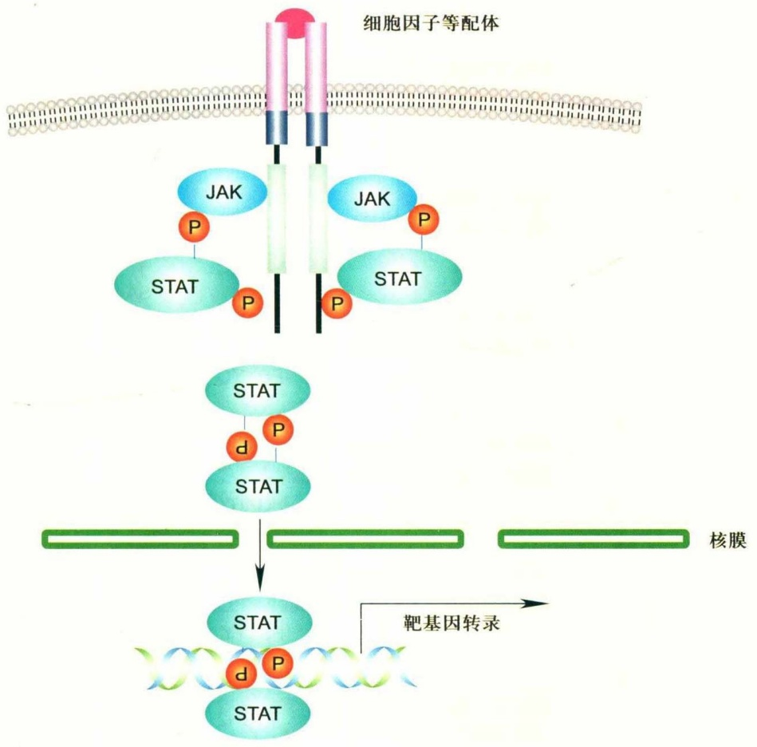
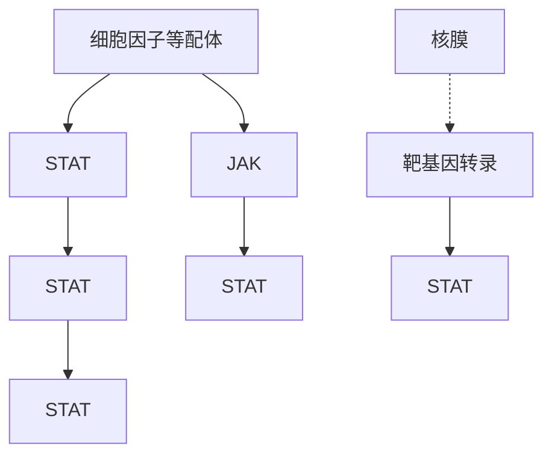
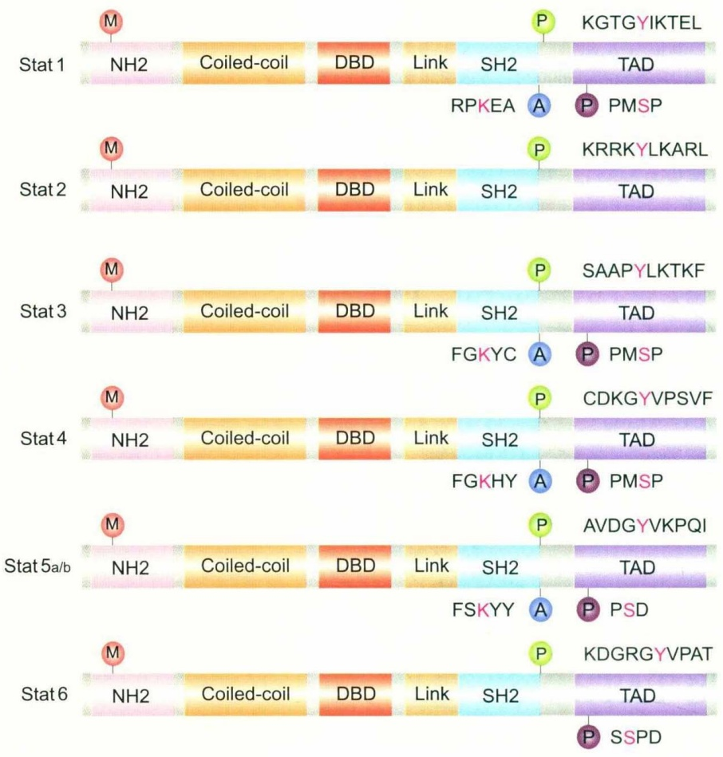
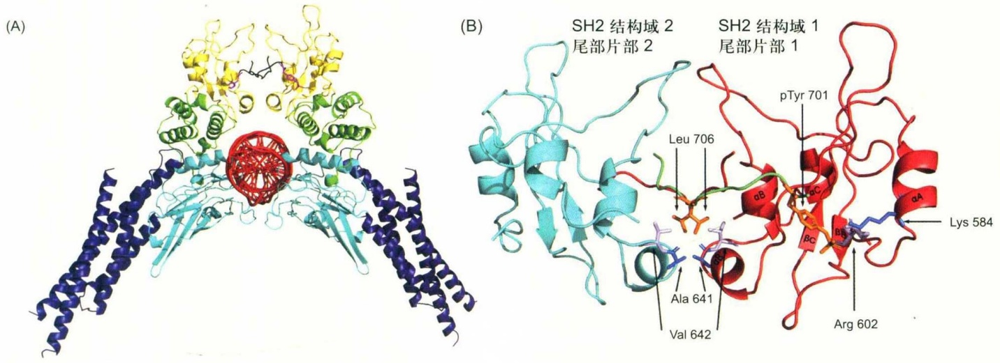
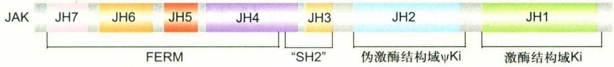
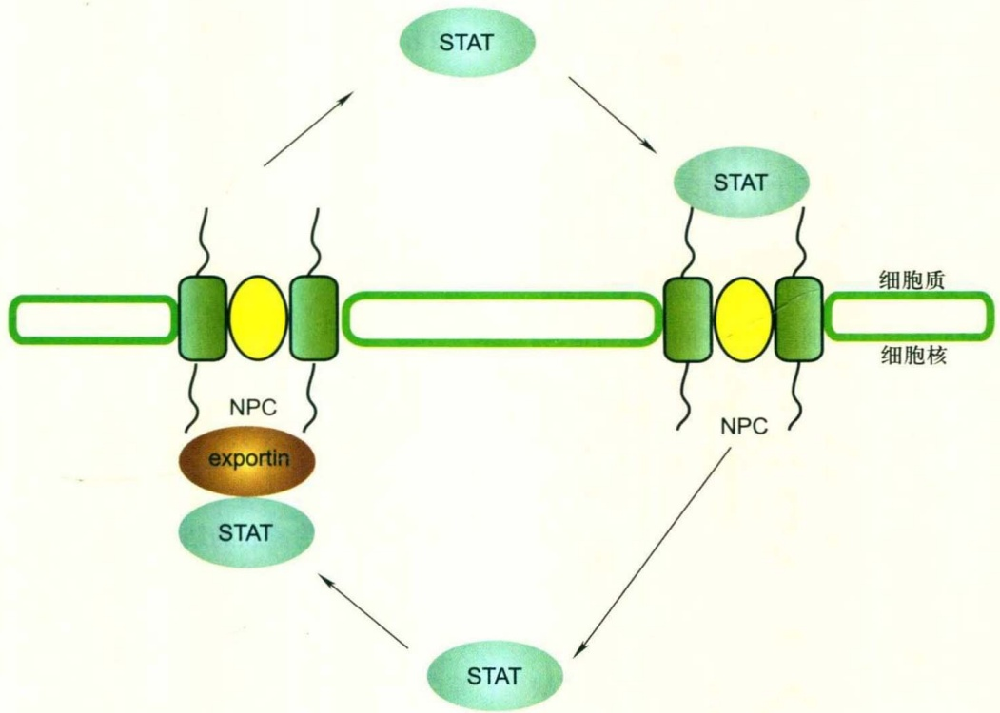
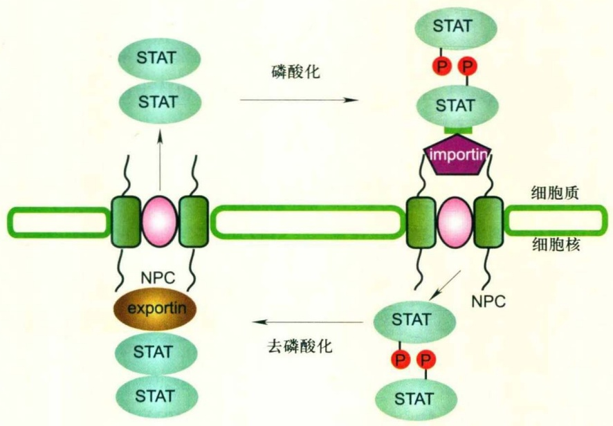
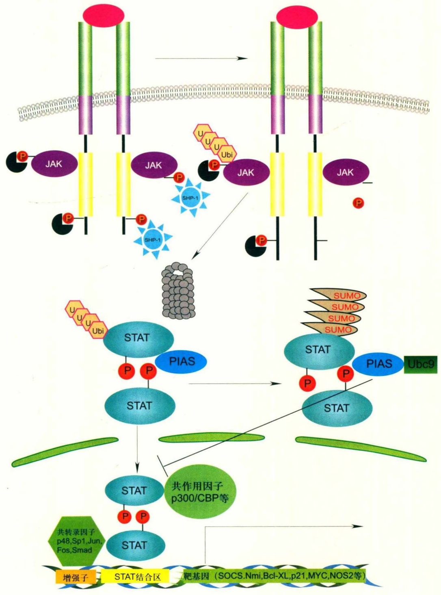

# 第14章 JAK-STAT信号转导

原始 PDF 第 282–310 页。

第 14 章

## JAK-STAT 信号转导

14

当有机体暴露于外源病原体刺激时，先天免疫反应被激活，启动机体防御机制。此时，细胞的信号传递必须简单、快捷、有效，使机体尽快做出反应，应对外界的刺激。JAK-STAT 信号通路的传递过程完全满足这一特点:STAT 既可以作为信号分子被 JAK 活化入核，也作为转录因子直接与 DNA 结合，快速地将胞外刺激信号传递入基因。

根据对不同结构域的进化起源分析，JAK-STAT 信号通路组分的大多数结构成分出现于真核细胞进化的早期，如单细胞的阿米巴，STAT 的 SH2 结构域也存在于真核细胞起源的早期阶段，如黏细菌。而完整的 JAK 分子最早发现于海绵动物，完整的 STAT 分子则发现于两侧对称生物的出现。这些进化保守的特性表明，JAK-STAT 信号通路不仅在机体应对外界刺激时至关重要，而且在细胞的生与死、生长与分化、变形与迁移等其他生物学过程中也发挥重要的调节作用。

本章将介绍这一系统的生物学基础，如 JAK-STAT 信号通路各个关键分子的结构与功能，信号通路活化的负调控分子，与其他信号通路相互作用，并讨论与人类疾病发生的关系，以及在医药开发方面可能的应用。

## 14.1 JAK-STAT 信号通路的发现

病原体感染人体时，免疫细胞在各种生长因子、细胞因子的刺激下增殖和分化，这个过程中细胞内信号传递至关重要。在研究干扰素（interferon，IFN）诱导细胞特定基因转录的调控作用时，挖掘出了JAK-STAT这条重要的信号通路。

20世纪80年代后期，美国洛克菲勒大学JE Darnell Jr.实验室的研究工作发现，IFN-α、IFN-γ可以诱导培养细胞一系列mRNA的转录，其中一部分mRNA的转录特异地被IFN-α诱导，而另一部分被IFN-γ诱导，还有一些可以被两者共同诱导。已知IFN-α、IFN-γ分别在细胞膜表面与不同的受体结合，因此两者在细胞内的信号传递通路可能既有不同的部分，也有相似之处。这些转录的mRNA可以快速地在15～30 min内被检测到，而且不需要新蛋白质的合成。同时，IFN-α、IFN-γ结合受体后也并不引起第二信使的改变，推测细胞内的信号分子通过与受体的相互作用直接将信号传递到细胞核中。通过缺失分析和点突变的方法，分析被诱导表达的mRNA对应的基因组DNA序列，发现IFN-α、IFN-γ诱导表达基因的5'端分别存在高度保守的区域。如在IFN-α诱导基因的5'端转录起始位点上游200 bp左右存在10～15 bp（AGTTTCNNTTTCNC/T）的干扰素刺激反应元件（IFN-α stimulated response element，ISRE）。在IFN-γ诱导基因的5'端也存在9 bp（TTNCNNNAA）的IFN-γ激活位点（IFN-γ activation site，GAS）。Darnell实验室的傅新元以ISRE为饵，采用亲和层析的方法从IFN-α、IFN-γ刺激的S3 HeLa细胞中纯化出ISGF3（interferon stimulated gene factor 3）。ISGF3由4个组分组成，分子量分别为 $4.8\times10^{4}$ 、 $8.4\times10^{4}$ 、 $9.1\times10^{4}$ 和 $1.13\times10^{5}$ 。根据这些蛋白的氨基酸序列，设计简并引物，克隆出了这些蛋白的基因。分析表明，分子量为 $4.8\times10^{4}$ 的蛋白属于一个功能未知的DNA结合蛋白家族，后来被鉴定为转录因子IRF（IFN-I反应因子）并被命名为IRF-9。其他3个蛋白由同一个基因家族编码，其中分子

14.1 JAK-STAT信号通路的发现

269

---

量为 $8.4 \times 10^{4}$ 和 $9.1 \times 10^{4}$ 的蛋白由同一个基因编码，是不同剪切形式mRNA翻译的产物，分子量为 $9.1 \times 10^{4}$ 蛋白的C端多出38个氨基酸；而分子量为 $1.13 \times 10^{5}$ 的蛋白与 $9.1 \times 10^{4}$ 和 $8.4 \times 10^{4}$ 蛋白在700个氨基酸的范围内约有$40\%$ 的相似性，由单独的基因编码。因为这些蛋白质具有信号转导和转录激活的双重功能，因此被命名为“信号转导及转录激活因子”（signal transducer and activator of transcription, STAT）。根据被发现的次序，分子量为 $9.1 \times 10^{4}$ （或 $8.4 \times 10^{4}$ ）的蛋白被命名为Stat1（$9.1 \times 10^{4}$:Stat1α；$8.4 \times 10^{4}$:Stat1β），分子量为 $1.13 \times 10^{5}$ 的蛋白被命名为Stat2。后来陆续发现了Stat3、Stat4、Stat5α、Stat5β和Stat6。这些信号分子介导的信号传递对细胞的增殖、分化、迁移以及凋亡等生物学功能都具有重要的调节作用。

JAK-STAT信号通路中另外一个重要分子是JAK蛋白酪氨酸激酶（Janus protein tyrosine kinase）。长期以来，人们在研究IFN信号通路中建立了一系列突变细胞系，这些细胞缺乏对IFN- $\alpha$ 、IFN- $\gamma$ 刺激的反应。通过克隆发生互补作用的cDNA，找到了一系列对应的蛋白质，如IFN- $\alpha$ 和IFN- $\gamma$ 的受体、受体偶联分子以及其他细胞内信号分子，其中就包括ISGF3的各个组分，以及在STAT激活过程中起重要作用的JAK。

与大多数具有酪氨酸激酶活性的生长因子受体不同，细胞因子受体通常在胞质区没有酪氨酸激酶活性结构域，因此在相应配体作用下，不能像生长因子受体那样利用自身的酪氨酸激酶活化其他信号蛋白分子。细胞因子作用的靶细胞中存在非跨膜型蛋白质酪氨酸激酶（non-transmembrane protein tyrosine kinase, NM-PTK），可以介导细胞因子与受体结合后信号蛋白分子的级联活化反应。JAK就是在细胞因子信号转导过程中起重要作用的NM-PTK。细胞因子受体与相应配体结合后被活化，激活偶联的JAK激酶，活化的JAK激酶引起相对应受体胞内区酪氨酸的磷酸化，为STAT蛋白提供结合位点。STAT蛋白与受体结合后，又被JAK蛋白酪氨酸激酶磷酸化，磷酸化后的STAT蛋白自发地从受体上解离并二聚化，然后转位至细胞核内，结合到靶基因的启动子特定区域，从而调控相应的基因表达。具体的信号转导过程如图14-1。

除被JAK蛋白酪氨酸激酶活化外，STAT还可被其他激酶激活。Src家族的Src、Lck、Hck、Lyn、Fyn和

Fgr等都可以激活STAT分子，但是这些激酶在细胞因子的信号传递过程中是直接激活STAT，还是通过活化JAK激活STAT，目前尚不清楚。其他与STAT活化相关的激酶还包括Tec家族酪氨酸激酶的Etk/Bmx和FAK，以及非受体型酪氨酸激酶Fes。PDGF、EGF、SCF、HGF、VEGF、IGF-1和胰岛素等生长因子受体蛋白酪氨酸激酶也可激活STAT。

与其他信号通路如Ras-MAPK不同，JAK-STAT信号通路是一条直通的信号通路，STAT分子被磷酸化激活，再经二聚化后直接入核，激活下游基因的表达，STAT兼具信号转导和转录激活的作用。而Ras-MAPK信号通路则要经过一系列信号分子磷酸化的级联放大反应才可进入细胞核激活下游基因的表达。因此JAK-STAT信号通路被认为是一条作用更直接、更快捷的信号转导途径。

## 14.2 JAK-STAT 蛋白家族的类别及分子结构

## 14.2.1 STAT蛋白家族

## (1) STAT 蛋白家族的类别

自1991年第一个STAT蛋白Stat1被纯化以后，STAT家族的其他成员被相继克隆出来。现在已知哺乳动物的STAT包括Stat1、Stat2、Stat3、Stat4、Stat5α、Stat5β和Stat6。其中Stat1和Stat3存在同一基因转录后不同的剪切形式，如Stat1通过RNA剪切的方式形成Stat1α和Stat1β；Stat3有Stat3α、Stat3β和Stat3γ三种异构体。而Stat5有Stat5α和Stat5β两种异构体，分别由两个串联在一起的不同基因编码。这些STAT的结构见图14-2。

其他低等生物中也能鉴定出STAT的同源类似物，如黏菌（Dictyostelium discoideum）、线虫（Caenorhabditis elegans）、果蝇（Drosophila melanogaster）、疟蚊（Anopheles gambiae）、蛙（Xenopus laevis）、斑马鱼（Danio rerio）和河豚（Tetraodon fluviatilis）。这些STAT同源物可能与个体发育过程中的信号调控相关，果蝇JAK-STAT途径就参与多种细胞的生长、发育和分化，如调控了胚胎的体节发生、性别决定和造血细胞、眼睛及气管的发生。

由于STAT主要在免疫系统中发挥调控作用，因而

270

第 14 章 JAK-STAT 信号转导

---



<details>
<summary>flowchart</summary>


</details>

图 14-1 JAK-STAT 信号通路

细胞因子结合其受体，活化JAK蛋白酪氨酸激酶，磷酸化激活的STAT形成二聚体入核，结合到特定启动子反应元件上，激活靶基因的转录。

人们认为STAT在进化上是一个相对“现代”的新分子。然而，随着在果蝇中鉴定出STAT，并发现STAT在早期和晚期发育过程中均发挥作用后，这种新分子的观点受到了挑战。不仅如此，在具备单细胞和多细胞特征的黏菌中也鉴定出了STAT。所以从进化的角度来看，STAT是随着细胞之间相互作用的增多逐渐出现的。STAT在最简单的多细胞生物中出现，与SH2结构域在多细胞动物中的出现时间相对应。

在哺乳动物的基因组中，7个Stat基因聚集成三簇，每一簇代表一个随机重复。小鼠中Stat1和Stat4定位在1号染色体，Stat2和Stat6定位在10号染色体，Stat3和Stat5定位在11号染色体。而Stat5基因多了一次重复，分别形成Stat5α和Stat5β基因。人的2号染色体的2q32.2—2q32.3对应于Stat1和Stat4，12号染色体的12q13对应于Stat6和Stat2，17号染色体的17q11.2，17q21对应于Stat5α、Stat5β和Stat3。

## (2) STAT 蛋白的分子结构

哺乳动物的Stat1～Stat6分子分别含有734～851个氨基酸，它们在结构上具有共同的特征，即所有的STAT蛋白分子都是由7个不同的功能域所组成，包括N端结构域(amino terminal domain, NH2)、螺旋结构域(coiled-coil domain)、DNA结合域(DNA binding domain, DBD)、连接区结构域(linker domain)、SH2结构域(SH2 domain)、SH3结构域(SH3 domain)和转录激活结构域(transcriptional activation domain, TAD)(图14-2)。

① N端结构域 N端结构域包括第1～125位氨基酸残基，是STAT蛋白家族中高度保守的结构域之一，微小缺失就会导致STAT的磷酸化完全丧失。结构和功能分析表明，N端结构域与DNA结合域相协同作用。蛋白晶体结构分析表明，Stat4的N端结构域可以促进两个StatN端的相互作用。N端结构域的相互作用促进了非磷酸化的STAT形成同源二聚体，这对于静息状态下保持STAT的关闭状态十分重要。同时这种同源二聚体也有利于STAT向受体的传送和相互作用。STAT蛋白的二聚体还可以通过N端结构域形成四聚体或高度有序

14.2 JAK-STAT蛋白家族的类别及分子结构

271

---



<details>
<summary>text_image</summary>

Stat 1
NH2
Coiled-coil
DBD
Link
SH2
RPKEA
A
P
TAD
KGTGYIKTEL
Stat 2
NH2
Coiled-coil
DBD
Link
SH2
P
KRRKYLKARL
TAD
Stat 3
NH2
Coiled-coil
DBD
Link
SH2
P
SAAPYLKTKF
TAD
FGKYC
A
P
PMSP
Stat 4
NH2
Coiled-coil
DBD
Link
SH2
P
CDKGYVPSVF
TAD
FGKHY
A
P
PMSP
Stat 5a/b
NH2
Coiled-coil
DBD
Link
SH2
P
AVDGYVKPQI
TAD
FSKYY
A
P
PSD
Stat 6
NH2
Coiled-coil
DBD
Link
SH2
P
KDGRGYVPAT
TAD
P
SSPD
</details>

图 14-2 STAT 蛋白分子结构比较

哺乳动物的Stat1～Stat6分子分别含734～851个氨基酸不等，所有的STAT蛋白分子都是由7个不同的功能域所组成，包括N端结构域(NH2)、螺旋结构域(Coiled-coil)、DNA结合域(DBD)、连接区结构域(Link)、SH2结构域、SH3结构域（未显示）和转录激活结构域(TAD)。图示的氨基酸序列蛋白质修饰基序。A:乙酰化；M:甲基化；P:磷酸化。

的多聚体，以增强STAT蛋白与所调控基因启动子的结合能力。Stat2的N端结构域还可促进与其他蛋白质如与活化STAT蛋白抑制因子(protein inhibitor of activated STAT, PIAS)家族蛋白、转录共激活分子CREB结合蛋白(CBP)/p300等的相互作用。此外，缺失和突变研究表明N端结构域还可能参与了STAT二聚体的入核调控。

② 螺旋结构域 螺旋结构域（图14-3A蓝色部分）位于第135～315位氨基酸残基之间，是一段由4个螺旋所组成的结构域，其主要功能是通过其亲水表面以正负电荷作用与其他蛋白发生相互作用。通过蛋白晶体结构分析发现，4个螺旋中的2个螺旋分别从STAT分子核心的两侧突出，参与介导STAT与DNA或其他蛋白的相互作用。ISGF3分子中的p48就是通过螺旋结构域与Stat1/Stat2二聚体相互作用。以螺旋结构域为饵，采用酵母双杂交的方法鉴定出了与STAT分子相互作用的蛋白，包括IRF-9、转录因子c-Jun、PIAS、N-myc作用子(N-myc interactor, Nmi) 和 Stat3 作用蛋白 (Stat3-interacting protein, StIP1)，这些蛋白均与 STAT 活性的调节有关。此外，螺旋结构域还可能参与 STAT 蛋白与膜受体结合、酪氨酸磷酸化以及细胞核输出等过程。

③ DNA 结合域 DNA 结合域（图14-3A青色部分）位于第320～490位氨基酸残基之间，含有几个β折叠结构。这些β折叠的方向与DNA双螺旋的中轴垂直，由此，β折叠DNA端的氨基酸片段直接面向DNA，并可与之结合。这个区域的主要功能是与靶基因的启动子结合，启动靶基因的转录。STAT分子的DNA结合区结构独特，与其他已知DNA结合蛋白相应区域的结构无同源性。不同的STAT蛋白具有不同的DNA结合特异性，其中Stat1、Stat3和Stat4所识别的DNA核心序列为“TTCC（C/G）GGAA”。所有STAT同源二聚体（以及一些异源二聚体）的结合保守序列均为“TTCN（2-4）GAA”。一些STAT的二聚体N=2，其他的N=3或N=4。保守序列

272

第14章 JAK-STAT信号转导

---



图14-3 STAT蛋白的三级结构

(A) STAT核心部分，包含4个串联的结构域，形成了一个疏水核心:螺旋结构域（蓝色）、DNA结合域（青色）、连接结构域（绿色，其序列预测包含一个SH3结构域，然而未形成SH3结构域所应有的各种β折叠）、SH2结构域（黄色）。SH2的C端尾部（黑色）的Tyr发生磷酸化，介导STAT的二聚化。紫色为Pi。两个二聚体STAT结合DNA后，两个单体之间仅在SH2结构域通过类似握手的方式相互接触结合。(B) STAT家族的SH2结构域虽然在序列上有所不同，然而它们识别磷酸化酪氨酸（L706）并与之结合的结构高度保守:两侧伴随着α螺旋的反向平行β折叠从核心伸出，并与另一单体的磷酸化酪氨酸（pY701）尾部正交结合。此结构的β折叠部分包含一核心序列“GTFLLRFS”在所有SH2结构域中高度保守，其中的Arg残基直接结合Pi。

的两个回文序列之间的距离对STAT的结合特异性十分重要。蛋白晶体结构分析证实，DNA结合域的主要结构特征类似于一个折叠的免疫球蛋白，与DNA结合的氨基酸残基高度保守。如图14-3A，Stat1与DNA的结合依赖于DNA结合域第327、328、340、378、413、427位的氨基酸残基，及连接结构域的第560位的氨基酸残基与DNA磷酸基团间的相互作用，而第336、421、460位的氨基酸残基则深入DNA与碱基相互作用。STAT与DNA结合还严格依赖于单体的二聚化和这些结构域之间的结合区序列。DNA结合结构域还可能调控STAT的细胞核输出。

④ 连接结构域 连接结构域（图14-3A绿色部分）位于第490～580位氨基酸残基之间，连接DNA结合结构域和SH2结构域，其序列高度保守，可能与转录调节有关，例如Stat1的560位赖氨酸（Lys）就直接结合于DNA骨架的Pi上。也有研究表明，连接结构域与静息状态下STAT的基础核输出有关。

⑤ SH2结构域 SH2结构域（图14-3A黄色部分）位于第585～685位氨基酸残基之间，是STAT分子之间最保守的结构域。它不仅具有与Src蛋白酪氨酸激酶的SH2结构域完全相同的保守核心序列“GTFLLRFSS”，而且其功能也与后者完全一致。这个核心序列中的精氨酸（Arg）残基可以直接结合另一个STAT分子上磷酸化的酪氨酸（Tyr）残基，从而介导两个分子之间的连接（图14-3B）。SH2结构域是信号分子的一个共同结构特征，通过与磷酸化的特定位点结合介导信号蛋白之间的相互作用。SH2结构域是STAT分子上最重要的功能区段:首先，SH2结构域决定了STAT分子与其相应的受体之间相互作用的特异性；其次，SH2结构域介导了STAT与活化的JAK之间的相互作用；第三，SH2结构域介导了STAT分子的二聚化，一个STAT蛋白的SH2结构域与另一个STAT蛋白磷酸化的Tyr相互作用形成二聚体，从而介导STAT蛋白的入核。

STAT家族SH2结构域中的Lys与另一STAT分子的磷酸化酪氨酸环相互作用。这一识别区域处于磷酸化酪氨酸尾部的远端，因此C端尾部必须穿越自身的长度到达另外一个STAT单体的磷酸化识别位点。而 $\alpha B$ 和 $\alpha B'$ 螺旋形成的管道使得两段C端尾部必须平行通过，形成反向平行的 $\beta$ 折叠，使得磷酸化酪氨酸位点前的7个氨基酸残基成为SH2结构域识别C端尾部并与之相互作用的特征位点。其中距离磷酸化酪氨酸+1、+3、+5位的氨基酸残基尤为重要。特别是+5位，在此处磷酸化酪氨酸尾部插入了两个SH2结构域形成的管道，并与第641、642位氨基酸残基相互作用（图14-3B）。

⑥ SH3结构域 SH3结构域位于第500～600位氨基酸之间，序列保守性较SH2差，能结合富含脯氨酸的

14.2 JAK-STAT蛋白家族的类别及分子结构

273

---

序列，目前尚未发现SH3结构域内有任何重要的氨基酸。

⑦ 酪氨酸激活基序 研究发现，Stat1和Stat2分子中1个Tyr残基的磷酸化对STAT的激活至关重要。这个Tyr残基及其周围的氨基酸残基被定义为酪氨酸激活基序。酪氨酸激活基序在7个STAT分子中均定位于靠近第700位氨基酸残基的位置，包含能被磷酸化的Tyr。这个Tyr残基C端的5～7个氨基酸序列对STAT的功能十分重要，它不仅可以阻止磷酸化的Tyr与自身的SH2结构域结合，还决定STAT分子与其相应受体相互作用的特异性，以及STAT分子之间二聚化的特异性。这个基序和其对应的SH2结构域一样，暴露在非活化的同源二聚体的表面，有利于被受体招募后为JAK磷酸化。

⑧ 转录激活结构域 STAT蛋白的C端定义为酪氨酸激活基序后的所有氨基酸残基区域。与其他结构域不同，它是STAT分子序列中保守性最小的区域。STAT分子的C端包括一个转录激活结构域，除了Stat2以外，其他STAT的转录激活结构域在人和小鼠之间高度保守。这个结构域的转录激活功能的发现是因为Stat1存在两种不同的形式:Stat1α和C端缺失38个氨基酸的Stat1β。Stat1α具有转录激活活性，而Stat1β则没有该功能。GAL4融合报告基因实验证明，最靠近C端的约50个氨基酸残基具有最大转录激活活性。

尽管在细胞内表达C端缺失的STAT可以显著拮抗STAT的信号传递，但自然存在的STAT缺失形式可能对STAT的信号起正调控作用。例如，Stat1β可以与Stat2形成二聚体，转导INF-α/β的信号。但是在INF-γ的信号转导过程中Stat1要形成同源二聚体，单独的Stat1β形成的二聚体则没有功能。同样，Stat3的C端缺失形式，可以与转录因子c-Jun结合形成有功能的转录激活复合体。

STAT 蛋白C端的转录激活结构域很可能受到翻译后调节，如丝氨酸（Ser）磷酸化。在这个功能域中有一个保守的Ser残基，该氨基酸的磷酸化与否直接影响STAT与其他共激活因子的相互作用，从而调控STAT蛋白的转录活性。STAT的TAD还可以招募polⅡ、HAT（如PCAF、GCN5和NcoA-1）、染色质修饰复合物（如BAF和SWI2-SNF2）以及HDAC。STAT的转录激活结构域还可能参与调控STAT的蛋白稳定性，Stat4、Stat5和Stat6泛素化后被降解，而Stat1、Stat2和Stat3则更为稳定。

## 14.2.2 JAK家族的结构与功能

## (1) JAK蛋白家族的类别

JAK是在20世纪90年代早期研究蛋白激酶鉴定出的一类新型非受体酪氨酸激酶家族，最早称为just another kinase (JAK)。一般认为，蛋白酪氨酸激酶的结构域在进化过程中具有保守性，因此可以用已知蛋白激酶结构域的核酸编码片段进行低严谨性杂交，或利用已知蛋白酪氨酸激酶的高度保守序列的引物进行PCR扩增，以分离鉴定出新的蛋白激酶。采用这样不同的两种策略鉴定出了JAK家族的第一个成员Jak1。

现已知的JAK家族是仅次于Src和Tec的第三大NM-PTK家族，共包括4个成员:Jak1、Jak2、Jak3和Tyk2。分子量在 $1.2\times10^{5}\sim1.4\times10^{5}$ 之间，序列同源性为40%～70%。目前已从人、小鼠、大鼠、鸡以及鱼等物种中成功分离出JAK家族各成员的cDNA，但在果蝇中仅分离出JAK家族的一种称为Hopscotch的同源物。在哺乳动物中，Tyk2、Jak1、Jak2几乎在所有的组织中表达，而Jak3仅在髓样组织、淋巴样组织、血管平滑肌细胞以及内皮组织中表达。

## (2) JAK蛋白的分子结构

与其他蛋白酪氨酸激酶不同，JAK蛋白具有两个同源激酶结构域，这也是该激酶被命名为Janus的原因。Janus为罗马神话掌管门户出入与水陆交通的门神，有相对朝向的两个头。JAK拥有两个几乎相同的酪氨酸激酶结构域:一个是位于C端的具有催化活性的激酶结构域；另一个是与之相邻，无激酶活性但负调控C端激酶结构域的伪激酶结构域。JAK激酶结构的另一个特点是没有典型的SH2结构域，只有一个SH2相关结构域，而SH2结构域是其他非受体型蛋白酪氨酸激酶的共同特征。JAK激酶分子的其余部分与其他已知的蛋白激酶没有同源性，然而JAK家族的成员之间却有着高度的相似性，包括相当长的等同区段（图14-4）。

JAK可大致分为N端、无催化活性的伪激酶结构域(pseudo-kinase-like domain)以及酪氨酸激酶结构域3部分(图14-4)。比较JAK家族成员之间的序列发现，JAK分子具有7个JAK同源序列，从C端到N端分别命名为JH1～JH7。JH3～JH7属于N端，N端的FERM结构域对于JAK与受体的识别与结合起重要作用，而JH1和JH2则分别为酪氨酸激酶结构域和伪激酶结构域。酪

274

第 14 章 JAK-STAT 信号转导

---



<details>
<summary>text_image</summary>

JAK JH7 JH6 JH5 JH4 JH3 JH2 JH1
FERM "SH2" 伪激酶结构域ψKi 激酶结构域Ki
</details>

图14-4 JAK激酶结构示意图

JAK具有7个同源序列，从C端到N端分别命名为JH1～JH7。JH1为酪氨酸激酶结构域，JH2为伪激酶结构域，JH3和部分JH4为SH2相关结构域，JH4-JH7组成FERM结构域。

氨酸激酶结构域具有催化活性，伪激酶结构域被认为具有一定的调节作用。

① 酪氨酸激酶结构域（Ki）C端的JH1编码酪氨酸激酶结构域，在激酶结构域活性部位内高度保守的8个氨基酸残基中存在一段Phe-Trp-Tyr-(FWY)序列，可能是蛋白酪氨酸激酶中JAK家族的特有序列。酪氨酸激酶结构域决定了JAK家族磷酸基团的转移活性。当JAK被受体活化时，磷酸化就发生在酪氨酸激酶结构域A环中的Tyr残基上。在JAK家族所有成员的A环结构中，均已发现两个磷酸化的Tyr残基。对这两个Tyr残基分别进行点突变，发现在不同的JAK分子中这两个Tyr残基的功能不同。Jak2的激酶活性主要依赖于第1个Tyr(Y1007)的磷酸化，而第2个Tyr(Y1008)的突变对Jak2的活性似乎没有影响。Jak3的第1个Tyr(Y980)是一个正调控位点，而第2个Tyr(Y981)却是一个负调控位点。Jak1的激活也严格依赖于第1个Tyr残基的磷酸化。

② 伪激酶结构域 JH2编码JAK的伪激酶结构域。伪激酶结构域与激酶结构域具有高度的相似性，但其缺少几个与催化磷酸化反应密切相关的氨基酸残基。通过点突变、缺失突变对伪激酶结构域进行突变失活，发现伪激酶结构域无激酶活性。但伪激酶结构域在稳定特异的受体-激酶复合物过程中起积极作用。越来越多的证据表明，伪激酶结构域不仅参与调节JAK的基础活性，还可能调节受体诱导的JAK催化功能的活化。此外，伪激酶结构域也可能在JAK激酶与其他信号蛋白质分子的偶联方面发挥作用，如伪激酶结构域可以作为STAT的结合位点。当受体上缺乏招募STAT蛋白的磷酸化的Tyr残基时，STAT蛋白仍可通过伪激酶结构域被招募至JAK附近，从而被JAK激活。另外，也不排除伪激酶结构域可能对某些未知底物具有催化活性。

③ N端FERM结构域 JAK的N端包含约550个氨基酸，包括JH3～JH7，共编码了该蛋白的一半。JH4～JH7区组成了FERM结构域（four-point one、ezrin、radixin、moesin, FERM), FERM结构域与JAK家族分子之间以及JAK和与他激酶的相互作用有关。Jak1的FERM结构域对Jak1与IFN-1和gp130受体的相互作用至关重要。而FERM结构域突变的JAK3蛋白，不仅缺乏激酶活性，也无法与受体结合。在细菌及哺乳动物细胞中表达JAK片段进行互补作用研究表明:JH7及JH6的部分区域约200个氨基酸残基形成了一个最小相互作用表面，这个表面对JAK与细胞因子受体的特异性结合起着关键作用。JH7与受体胞质端富含脯氨酸的box1保守区作用。JH3以及部分JH4区域具有一个类SH2的结构域，但没有结合磷酸化酪氨酸的功能，其功能尚不清楚。

## (3) JAK 家族受体及 JAK 介导的信号转导

JAK家族主要是由一些可溶性的细胞因子激活，这些细胞因子大多具有共同的α螺旋结构，并且都与一类结构相似的受体结合。这些受体属于细胞因子受体超家族，该家族可分为I型受体、Ⅱ型受体两类。I型受体包括IL-2、IL-3、EPO、G-CSF、GM-CSF等，受体的胞外部分含有4个保守的Cys和一个位于C端的WSXWS单元；Ⅱ型受体包括IFN-α/β、Tissue factor、Fibronectin III等，受体胞外部分N端和C端各有数对Cys。两类受体的胞质区均无酪氨酸激酶结构域，其催化活性依赖于与受体胞内区紧密结合的JAK激酶。如Jak1稳定结合IFNαR2和IFNγR1，Jak2稳定结合IFNγR2，而Tyk2稳定结合IFNαR1。

细胞因子受体结构与功能的研究表明，这些受体之间无明显的同源性，只在胞内近膜区有一段同源区，该区域是受体与JAK激酶结合的功能区段。这段同源区通常包括两个在各种细胞因子受体中都高度保守的结构，一个是富含脯氨酸的“box1”，另一个是在受体靠近细胞膜处的“box2”，它们是决定细胞因子受体与JAK激酶之间相互偶联的关键结构。此外，受体的胞质区还含有非常重要的正、负调控区，控制信号转导的专一性。

除了在细胞因子介导的信号通路中发挥重要作用外，

14.2 JAK-STAT蛋白家族的类别及分子结构

275

---

JAK还可能在其他信号通路中起到辅助作用。如集落刺激因子(CSF)、表皮生长因子(EGF)、血小板衍生生长因子(PDGF)、胰岛素、胰岛素样生长因子(IGF)、生长激素等配体所结合的受体，这些受体本身具有内源性蛋白酪氨酸激酶活性。当这类配体与受体相结合后，JAK被迅速磷酸化激活。JAK还参与了G蛋白偶联受体所介导的信号转导，如由血管紧张素、血液复合胺、α-黑素细胞刺激素等介导的信号转导。JAK-STAT通路同样可以被肿瘤坏死因子(TNF)、渗透压应激、MHC-I以及CD40等途径所激活。

JAK的激活发生在配体与受体结合后的数分钟内。配体的结合激活受体，受体发生二聚化或多聚化，使JAK激酶分子被牵引至足够近而发生相互磷酸化；或受体二聚化后发生构象改变而使JAK发生磷酸化，激活JAK的酪氨酸激酶活性。活化的JAK立刻将受体上某些特定的Tyr磷酸化，为含有SH2结构域的下游信号分子提供结合位点，吸引它们结合到受体-JAK复合物上，进而被JAK磷酸化。

受体的二聚化可以是同源的也可以是异源的。在受体发生同源二聚化时（如生长激素、Prolectin、TPO、EPO等的受体），只有Jak2可被激活；相反，由不同亚基组成的受体在进行异源二聚化时却可以激活多种JAK。JAK一旦被激活，便对受体的亚基以及其他底物分子进行磷酸化作用。

## 14.2.3 激活 JAK-STAT 的配体及下游信号分子

作为NM-RTK，除了与细胞因子受体结合被激活以外，JAK家族还能被生长因子、激素受体的RTK活化，介导了生长因子、激素的信号传递功能。另外，JAK还可以与多种胞内信号蛋白发生相互作用，包括酪氨酸磷酸酶、蛋白/脂类激酶、STAT家族以及其他调节分子等。这些蛋白大多都能发生酪氨酸磷酸化，因此可以看作是JAK的底物和效应因子。表14-1列出了不同的配体所激活的JAK激酶家族的不同成员及其激活的下游STAT分子。

## 14.2.4 非经典的JAK-STAT通路

一直以来广泛接受的观点是JAK-STAT信号通路依赖于STAT磷酸化，激活数百个基因表达从而发挥功能。然而近年来STAT的非经典和非基因组活性逐渐受到重视，其中研究最多的是Stat3。比较Stat3敲除细胞中表达Stat3野生型和Y705突变体后的基因表达谱发现，Stat3控制的基因只有2/3依赖于Stat3的磷酸化入核激活的转录活性，其余不依赖这种经典的入核方式。其他Stat入核的方式包括由其他分子夹带入核，如非磷酸化的Stat3与NFkB的p65和p50结合，形成Stat3/NFkB复合物入核，激活具有两者结合序列基因的表达。另外一种可能性是激活基因转录根本与Stat磷酸化无关。

另外，STAT还存在与核基因转录激活无关的非基因组活性。除细胞核外，Stat3还定位于细胞内的其他结

表 14-1 不同配体激活的 JAK 激酶家族成员及下游 STAT 分子

<table><tr><td>类别</td><td>配体</td><td>受体</td><td>JAK</td><td>STAT</td></tr><tr><td rowspan="9">IFN家族</td><td>Type I IFN (IFN-α, IFN-β, IFN-ε, -κ, -τ, -δ and -ζ, IFN-ω, IFN-ν)</td><td>IFN受体家族</td><td>Jak1,Tyk2</td><td>Stat1、Stat2、Stat3、Stat4、Stat5、Stat6、Stat1/Stat2、Stats2/Stat6</td></tr><tr><td>Type II IFN (IFN-γ)</td><td></td><td>Jak1,Jak2</td><td>Stat1、Stat1/Stat2</td></tr><tr><td>Type III IFN (IL-29,-28a,b也称 IFN-λ1, IFN-λ2 IFN-λ3)</td><td></td><td>Jak1,Tyk2</td><td>Stat1、Stat2、Stat3、Stat4、Stat5</td></tr><tr><td>IL-10</td><td>白介素受体家族</td><td>Jak1,Tyk2</td><td>Stat1、Stat3</td></tr><tr><td>IL-19</td><td></td><td>Jak1,Jak2</td><td>Stat3、Stat1</td></tr><tr><td>IL-20</td><td></td><td>Jak1,Jak2</td><td>Stat3、Stat1</td></tr><tr><td>IL-22 (IL-TIF)</td><td></td><td>Jak1,Jak2</td><td>Stat3、Stat1、Stat5</td></tr><tr><td>IL-24 (mda7)</td><td></td><td>Jak1,Jak2</td><td>Stat3、Stat1</td></tr><tr><td>IL-26 (AK155)</td><td></td><td>Jak1,Tyk2</td><td>Stat3、Stat1</td></tr></table>

276

第14章 JAK-STAT信号转导

---

续表

<table><tr><td>类别</td><td>配体</td><td>受体</td><td>JAK</td><td>STAT</td></tr><tr><td rowspan="15">gp130家族</td><td>IL-6</td><td rowspan="15">gp130偶联受体家族</td><td>Jak1, (Jak2)</td><td>Stat3、Stat1、Stat1/Stat3</td></tr><tr><td>IL-11</td><td>Jak1</td><td>Stat3、Stat1</td></tr><tr><td>LIF</td><td>Jak1, (Jak2)</td><td>Stat3、Stat1</td></tr><tr><td>CNTF</td><td>Jak1, (Jak2)</td><td>Stat3、Stat1</td></tr><tr><td>CLC/CLF2</td><td>Jak1, (Jak2)</td><td>Stat3、Stat1</td></tr><tr><td>NP</td><td>Jak1, (Jak2)</td><td>Stat3</td></tr><tr><td>CT-1</td><td>Jak1, (Jak2)</td><td>Stat3</td></tr><tr><td>OSM</td><td>Jak1, (Jak2)</td><td>Stat3、Stat1</td></tr><tr><td>IL-31</td><td>Jak1, (Jak2)</td><td>Stat3、Stat5、Stat1</td></tr><tr><td>G-CSF</td><td>Jak1, (Jak2)</td><td>Stat3、Stat3/Stat5</td></tr><tr><td>Leptin</td><td>Jak2</td><td>Stat3</td></tr><tr><td>IL-12 (p35+p40)</td><td>Tyk2, Jak2</td><td>Stat4</td></tr><tr><td>IL-23 (p19+p40)</td><td>Tyk2, Jak2</td><td>Stat3、Stat4、Stat1、Stat3/Stat4</td></tr><tr><td>IL-27 (p28/EBI3)</td><td>Jak1, Jak2, Tyk2</td><td>Stat1、Stat2、Stat3、Stat4、Stat5、Stat1/Stat3</td></tr><tr><td>IL-35 (p35+EBI3)</td><td>Jak1, Jak2, Tyk2</td><td>Stat1/Stat4</td></tr><tr><td rowspan="8">γ链族</td><td>IL-2</td><td rowspan="8">γ链族受体</td><td>Jak1, Jak3</td><td>Stat5、Stat3/Stat5</td></tr><tr><td>IL-7</td><td>Jak1, Jak3</td><td>Stat5、Stat3/Stat5</td></tr><tr><td>TSLP</td><td>Jak1</td><td>Stat3、Stat5</td></tr><tr><td>IL-9</td><td>Jak1, Jak3</td><td>Stat5、Stat3</td></tr><tr><td>IL-15</td><td>Jak1, Jak3</td><td>Stat5、Stat3</td></tr><tr><td>IL-21</td><td>Jak1, Jak3</td><td>Stat3、Stat5</td></tr><tr><td>IL-4</td><td>Jak1, Jak3</td><td>Stat6</td></tr><tr><td>IL-13</td><td>Jak1, Jak2</td><td>Stat6</td></tr><tr><td rowspan="3">IL-3家族</td><td>IL-3</td><td rowspan="3">β链族受体</td><td>Jak2</td><td>Stat5</td></tr><tr><td>IL-5</td><td>Jak2</td><td>Stat3、Stat5</td></tr><tr><td>GM-CSF</td><td>Jak2</td><td>Stat3、Stat5</td></tr><tr><td rowspan="9">单链家族</td><td>Epo</td><td rowspan="6">催乳素/生长激素受体家族</td><td>Jak2</td><td>Stat5</td></tr><tr><td>GH</td><td>Jak2</td><td>Stat5、Stat3</td></tr><tr><td>Prl</td><td>Jak2</td><td>Stat5</td></tr><tr><td>Tpo</td><td>Jak2</td><td>Stat5</td></tr><tr><td>EGF</td><td>Jak1</td><td>Stat3、Stat5、Stat1</td></tr><tr><td>PDGF</td><td>Jak1, Jak3</td><td>Stat3、Stat5、Stat1</td></tr><tr><td>Angiotensin</td><td rowspan="3">G蛋白偶联受体</td><td>Jak2, Tyk2</td><td>Stat1、Stat2、Stat3</td></tr><tr><td>Serotonin</td><td>Jak2</td><td>Stat3</td></tr><tr><td>α-Thrombin</td><td>Jak2</td><td>Stat1</td></tr></table>

构，如黏着斑、纺锤体、细胞膜脂筏、内吞体以及线粒体。细胞质中的Stat3在Hsp70和Hsp90的协助下，以依赖于PKC磷酸化的方式，被线粒体膜上的TOM蛋白识别转运入线粒体，最后定位于线粒体内膜和基质中。线粒体上的Stat3可以影响电子传递链复合物的活性促进ATP的产生，调节线粒体通透转运孔的开放，以及结合线粒体转录调节蛋白作用于D-loop抑制mtDNA的转录活性。线粒体上的Stat3无论是对生理条件下细胞稳态的维持，还是对病理条件下的应激反应都至关重要，如心脏特异敲入无核DNA结合特性的线粒体定位Stat3基因，小鼠具有抵御缺血再灌注损伤的特性。

14.2 JAK-STAT蛋白家族的类别及分子结构

277

---

## 14.3 JAK-STAT 信号通路的生物学功能

## 14.3.1 STAT蛋白的生物学功能

作为一个直通车式的转录因子家族，STAT发挥其信号传递和转录激活的独特功能，呈递细胞外信号刺激，激活下游基因转录，介导细胞的免疫、增殖、凋亡、分化等基本功能。根据STAT蛋白的生物学功能，可以将STAT蛋白分为两大类:第一类被少数细胞因子激活，主要在机体的免疫反应中发挥作用，包括Stat1、Stat2、Stat4和Stat6；另一类在不同的组织中被不同的细胞因子、生长因子以及激素活化，调控细胞发育、细胞周期，如胚胎发育、乳腺发育、肿瘤监督等，包括Stat3和Stat5。STAT家族各成员生理功能多种多样，其重要功能可以分别从相应的基因敲除小鼠的表型变化中得到认识。

## (1) Stat1与Stat2

Stat1与Stat2是最早被发现的STAT家族成员，在干扰素信号转导过程中发挥至关重要的作用。干扰素能调节细胞的抗病毒能力、抗增殖能力以及免疫应答反应。干扰素有3种类型:I型干扰素（IFN-α和IFN-β）、Ⅱ型干扰素（IFN-γ）和Ⅲ型干扰素（IFN-λ1、IFN-λ2和IFN-λ3）。不同类型的干扰素激活不同类型的STAT蛋白复合物。在IFN-α/β的刺激下，Stat1和Stat2被激活，可形成Stat1同源二聚体和Stat1/Stat2异源二聚体进入细胞核，在核内与p48蛋白结合形成转录因子复合体，启动由ISRE反应元件驱动的基因转录。而IFN-γ却不刺激Stat2的Tyr磷酸化，活化后的Stat1形成同源二聚体或与Stat3形成异源二聚体入核，在核内与启动子上含有IFN-γ激活元件GAS序列结合，启动这些基因的转录。

Stat1基因敲除后，小鼠的CD4 $^{+}$ 和CD25 $^{+}$ 调节性T细胞水平低下，对两种类型干扰素的刺激都表现出选择性的信号缺失。在针对病毒和细菌病原物的天然免疫系统中，由IFN- $\alpha$ 和IFN- $\gamma$ 诱导表达的主要组织相容性复合物Ⅱ类蛋白(MHCⅡ)、干扰素调节因子1(IRF-1)、鸟苷酸结合蛋白1(GBP-1)、MHCⅡ跨膜激活蛋白(CⅡTA)以及补体C3蛋白等的表达都有所降低甚至完全缺失，因此小鼠对于微生物病原体和病毒的感染都更加敏感。然而Stat1基因敲除小鼠对其他可激活Stat1的细胞因子的刺激能够产生正常应答，提示Stat1在由干扰素介导的生物学反应中起着重要且专一的作用。

Stat1基因敲除小鼠与野生型小鼠相比更容易发生肿瘤，因此Stat1也被认为是一个肿瘤抑制因子。激活Stat1具有抑制细胞生长和促进细胞凋亡的作用，这可以解释为什么体内缺失Stat1可导致肿瘤的生长。这些功能与被认为具有促增殖和抗炎症因子的Stat3的作用相反。因此Stat1和Stat3可能作为功能性的拮抗剂。

Stat2的序列和功能差异性最大，是唯一不形成同源二聚体结合GAS元件的STAT分子。在I型和III型干扰素的刺激下，Stat2和Stat1形成异源二聚体，与p48（IRF-9）形成ISGF-3复合物结合在ISRE上，激活依赖于Stat2转录激活结构域的基因转录，包括miRNAs的表达。与Stat1基因敲除小鼠类似，Stat2基因敲除小鼠可存活、生育且发育正常，但对于微生物病原体和病毒的感染更加敏感，缺失了对I型和III型干扰素的反应，如IFN-I自分泌活性的丧失、DC细胞成熟异常等。

## (2) Stat3

Stat3作为家族最古老的成员，对它的研究颇为深入。Stat3参与了机体内各种生理和病理过程，如介导肝细胞损伤修复、诱导Th7细胞生成分化、维持胚胎干细胞的自我更新和干性以及刺激T细胞增殖等。Stat3是在1994年作为IL-6信号转导中的急性期反应因子被纯化的，存在两个不同的剪切体:Stat3α（全长）和Stat3β（缺失TAD）。Stat3也可被其他细胞因子如IL-6家族（IL-6、IL-11、IL-31、LIF、CNTF、CLC/CLF、NP、CT1和OSM）、IL-10家族（IL-10、IL-19、IL-20、IL-22、IL-24和IL-26）以及G-CSF、瘦素、IL-21、IL-27和IFN-I等激活。Stat3广泛表达于不同类型的细胞和组织中，并于胚胎着床前开始表达。对Stat3缺陷小鼠的研究显示，Stat3在胚胎早期发育过程中发挥重要作用，敲除Stat3基因导致营养缺乏引起胚胎早期致死。组织特异性敲除小鼠表现出炎症反应增加、能量平衡改变、发育缺陷和肿瘤发生率降低等症状。相反，Stat3的过度活化则导致免疫抑制和肿瘤恶性转化的发生。对内皮细胞特异敲除Stat3的小鼠，溶血磷脂酸引起的致死效应更为明显。在溶血磷脂酸的刺激下，内皮细胞特异敲除Stat3的小鼠多个脏器中发生更为强烈的免疫反应和白细胞渗入；同时血液中天冬氨酸转氨酶活性升高，提示脏器受到损伤；并伴随长时间的炎症细胞因子的过度升高。上述研究结果表明

278

第 14 章 JAK-STAT 信号转导

---

Stat3在维持机体平衡过程中起着重要作用，参与细胞生长、恶性转化、增生、凋亡等生理功能的调控。最近研究发现，SARS病毒感染细胞可在Stat3组成性表达的VeroE6细胞引起第705位Tyr去磷酸化，使分布在细胞核内的Stat3消失，表明Stat3介导的基因转录可能与抗SARS感染有关。

Stat3的功能与细胞类型密切相关，在不同的细胞中，Stat3对细胞功能的调节有着不同甚至完全相反的作用:Stat3缺失导致乳腺在发育周期中细胞凋亡延迟；Stat3缺失的T细胞和肝细胞缺乏对IL-6的反应；而在Stat3缺失的巨噬细胞和中性粒细胞中却由于丧失对IL-10的反应，而表现出细胞因子的过度产生；在骨髓细胞中特异敲除Stat3可以导致先天免疫反应的过度激活，并通过抑制诱发抗原特异性的T细胞耐受而干扰获得性免疫反应。

近年来的研究表明，Stat3还具有与其转录活性无关的功能，如研究发现Stat3还存在于肝和心脏的线粒体中，并在线粒体中与电子传递链的复合物I的成分发生相互作用。在Stat3基因敲除细胞中，电子传递链的复合物I和复合物II的活性显著降低。Stat3的这个调控功能与它的转录活性无关，因为即使无转录活性的Stat3突变体也可以挽救Stat3基因敲除细胞的电子传递链功能。线粒体上的Stat3也参与Ras依赖的细胞转化。线粒体Stat3持久性地改变了肿瘤细胞的糖酵解和氧化磷酸化过程，介导了Ras依赖的恶性转化过程。

Stat3在中枢神经系统中广泛表达。神经细胞中敲除Stat3的小鼠，在幼年表现正常，但是成年后会表现出食欲过盛、肥胖、糖尿病及不育等症状。Stat3基因敲除小鼠还表现出能量代谢低下、在禁食和冷刺激下出现体温过低的现象，并发生其他与生长和生殖相关的神经内分泌的改变，与db/db和ob/ob肥胖模型小鼠具有相同的表型。以上结果表明，Stat3在中枢神经系统中发挥着调节能量代谢平衡和繁殖的重要作用。但是，无论在生精细胞还是卵母细胞敲除Stat3，对小鼠的生殖力都没有影响。

## (3) Stat4 和 Stat6 与 T 细胞分化

辅助性T细胞（Th）包括Th1和Th2两种（见第23章）。Th1细胞分泌IL-2和IFN-γ，促进细胞免疫；Th2细胞则分泌IL-4、IL-5、IL-10和IL-13，主要促进体液免疫。Th1和Th2细胞都是由共同的前体Th0细胞分化而来，这种分化受细胞因子的调控:IL-12刺激Th0细胞分化为Th1细胞，而IL-4刺激Th0细胞向Th2细胞分化。

这些细胞因子都是在感染的早期产生的，IL-12来源于受感染的巨噬细胞，而IL-4来源于嗜碱性粒细胞、杆状细胞以及 $CD4^{+}$ 和 $NK1.1^{+}$ T细胞。

Stat4和Stat6在Th1和Th2分化过程中发挥重要的调控作用。Stat4最早是作为Stat1和Stat2的同源物从cDNA文库和序列数据库中筛选出来的。Stat6最初被认为是STAT类似蛋白(IL-4 Stat)，它受IL-4诱导后与靶基因启动子的GAS序列结合。后来通过亲和层析纯化和氨基酸测序鉴定，发现IL-4 Stat就是STAT蛋白家族的成员，故被重命名为Stat6。与其他广泛分布的STAT分子不同，Stat4仅在NK细胞、树突细胞、T淋巴细胞以及睾丸中表达。Stat6在所有组织中均表达。

Stat4受IL-12专一性刺激后发生磷酸化（包括p40+p35亚基），在Th1细胞的发育过程中起着关键的调节作用。Stat4基因敲除小鼠虽然能够生长和繁殖，但受IL-12诱导产生的生物学效应有所削弱，如IFN-γ的表达量、细胞增殖以及Th1细胞的分化都受到抑制。Stat4基因敲除小鼠不会出现Th1反应相关的自身免疫疾病。另一方面，Stat4基因敲除小鼠更容易发生锥形虫的感染。Stat4还参与调节IL-23的信号传递（包含p19+p35亚基），在IL-23依赖的自然CD4 $^{+}$ T细胞向Th17细胞的极化过程中发挥重要的调控作用。

Stat6 可被 IL-4 和 IL-13 激活，主要调控 Th2 的分化，进而调节获得性免疫反应。Stat6 基因敲除小鼠表现出 IL-4 介导的功能缺失，如 CD23 和 MHC II 的表达、免疫球蛋白的类型转换、B 细胞和 T 细胞的增殖、Th2 细胞发育等功能缺失。Stat6 介导了 IL-4 依赖的与 Th2 细胞分化和 B 细胞增殖相关特定基因的表达。Stat6 基因敲除小鼠同时还具有 IL-13 介导的功能缺失，Stat6 敲除的巨噬细胞受 IL-13 刺激后，其形态学改变、MHC II 表达增加、NO 生成量降低等现象被抑制。Stat6 也可能与肿瘤免疫监督下调相关，Stat6 基因敲除后机体对原发肿瘤和转移肿瘤的免疫监督能力增强。

## (4) Stat5α与Stat5β

Stat5最早被认为是具有DNA结合活性的催乳素诱导的乳腺因子（mammary gland factor，MGF）。进一步的研究揭示Stat5包括两个高度相关的基因Stat5α和Stat5β。Stat5β与Stat5α在氨基酸序列有90%以上的同源，和Stat1α/β一样，两者只在C端不同。Stat5α与Stat5β在各种组织中均广泛表达，但表达谱却不完全相同。Stat5α主

14.3 JAK-STAT信号通路的生物学功能

279

---

要在乳腺组织中表达，而Stat5β更主要在肝内表达。

尽管Stat5α与Stat5β在结构和功能方面具有高度的相似性，分别单独敲除Stat5α与Stat5β却显示出完全不同的表型。Stat5α基因敲除小鼠对催乳素反应信号丧失，导致雌性小鼠乳腺发育不良。除此之外，其他表型均正常。然而Stat5β基因敲除小鼠则丧失对生长激素的反应，表现出生长迟滞的性别两态性。同时敲除Stat5α与Stat5β基因则表现出更为复杂的表型:大多数小鼠在出生几周内死亡，具有乳腺发育不良、体形瘦小、脂肪垫减小、IGF-1分泌水平下降、骨髓细胞减少、B细胞前体细胞和成熟的B细胞减少等症状，还易发生淋巴细胞减少症、中性粒细胞减少症、中度贫血和血小板减少症。此外，如果NK细胞缺失，但胸腺发育正常，外周T细胞可表现出正常的活化标志，但对T细胞受体（TCR）和IL-2刺激不发生应答反应。

不同 STAT 基因敲除小鼠的独特表型（表 14-2）反映出 STAT 蛋白生物学功能的重要性。

## 14.3.2 JAK蛋白的生物学功能

JAK的生理功能在基因靶向编辑的动物模型中得到了较好的验证。Jak1基因敲除小鼠和Lif敲除小鼠表现类似，因不能哺乳而在围产期死亡，这些小鼠的组织也缺乏对细胞因子IL-2、IL-6、IFN和IL-10家族刺激的应答。Jak2基因敲除小鼠表现出更早期的致死效应（胚胎期第12.5天），表明Jak2在红细胞生成决定中发挥重要作用。Jak2敲除小鼠的体内研究表明，Jak2介导了IFN-γ、IL-2以及IL-3受体家族的信号转导过程。值得注意的是，几种骨髓增生疾病，如大多数真性红细胞增多症、特发性血小板增多症和原发性骨髓纤维化，都是由于JAK的

JH2结构域发生V617F突变，从而导致Stat5β活化引起的。这些研究为相关疾病的治疗提供了很好的靶点。

Jak3 仅在淋巴组织中表达，并在淋巴细胞中与 IL-2 家族受体的 γ 链相结合。与此对应，Jak3 和 γ 链敲除的小鼠都表现出重症联合免疫缺陷（SCID）样的缺陷，表明 Jak3 在免疫调节反应中发挥重要作用。

Tyk2除在IFN-I反应中发挥作用外，还参与调控IL-12、IL-23以及IL-6和IL-10受体家族成员的信号转导。有趣的是，Tyk2的丢失在人和小鼠中表型不同。Tyk2敲除小鼠表现出中度的细胞因子缺陷和Ⅱ型T细胞反应（如过敏）的倾向；Tyk2缺陷的人表现出由于抗微生物反应受损而导致的严重过敏反应。

## 14.3.3 JAK-STAT与生殖细胞发育

在哺乳动物的生殖系统中，Stat3在处于发育时期的卵母细胞和生精细胞中均有表达，而在颗粒细胞和支持细胞中没有表达。在果蝇生殖系统中，Jak/Stat信号在配子发生过程中发挥关键作用，一旦信号缺失，生殖干细胞不能进行正常的自我更新而直接进入分化状态引起生殖干细胞的枯竭。在小鼠胚胎期的原始生殖细胞阶段，虽然Stat3信号对原始生殖细胞的命运调控的作用仍无定论，但是它对原始生殖细胞的迁移、增殖以及存活功能发挥了重要促进作用。原始生殖细胞在胚胎期第7.5天迁移到生殖嵴，之后被支持细胞包裹，随着小鼠发育，此结构形成生精小管，出生后原始生殖细胞进行有丝分裂以及减数分裂形成精细胞。JAK-STAT信号在生精过程中的作用仍有争议，虽然体外的研究表明Stat3信号有利于精原干细胞的自我更新，但是体内的实验并不支持这一观点，南京大学医学院李朝军课题组利用Cre-loxP系

表 14-2 全身性 STAT 基因敲除小鼠的表型

| 敲除基因 | 表型 |
| --- | --- |
| Stat1 | 可存活、可繁殖,对干扰素(IFN-α/β和IFN-γ)反应减弱,对肿瘤的易感性增强 |
| Stat2 | 可存活、可繁殖,对干扰素(IFN-α/β)反应减弱,在某些组织中的Stat1表达减少 |
| Stat3 | 具有胚胎致死效应,在成体组织中条件性敲除Stat3能产生多种生理缺陷,包括细胞生存能力下降、对病原体敏感性降低等 |
| Stat4 | 可存活、可繁殖,因缺失对IL-12的反应而导致Th1细胞分化能力减弱 |
| Stat5α | 可存活、可繁殖,因缺失对催乳素PRL的反应而导致乳腺发育异常 |
| Stat5β | 可存活、可繁殖,因缺失对生长激素的反应而生长受阻 |
| Stat5α/β | 可存活,雌性小鼠少毛,乳腺发育异常,雄鼠和雌鼠体重下降,T细胞增殖能力减弱 |
| Stat6 | 可存活、可繁殖,因缺失对IL-4的反应而导致Th2细胞分化减弱 |

280

第 14 章 JAK-STAT 信号转导

---

统在胚胎期的原始生殖细胞中敲除Stat3后，雄性生殖细胞的发育并没有发生明显的异常，敲除小鼠仍然能够产生有功能的精子，成年鼠的生殖能力也不受影响，能够产生正常后代。利用ZP3-Cre于小鼠卵泡发育时期敲除Stat3，也没有引起卵泡的发育异常，同样能够产生正常后代。所以在哺乳动物中的配子发生可能不依赖于JAK-STAT信号。

## 14.3.4 JAK-STAT与干细胞发育

作为IL-6家族的细胞因子，Leukemia inhibitory factor（LIF）对小鼠胚胎干细胞的自我更新和全能性的维持十分重要，因此介导LIF信号的Stat3对胚胎干细胞功能的维持必不可少。LIF活化的JAK1/STAT3可以激活Klf4的转录，而Klf4可以通过Sox2和Nanog维持Oct3/4的表达，这些Yamanaka因子在体外就可以诱导成纤维细胞脱分化成iPS，这也从侧面说明JAK-STAT在胚胎干细胞自我更新和全能性维持方面的重要性。进一步详细的体内外研究表明，JAK-STAT信号对早期胚胎发育过程中细胞全能性的建立没有作用，但是对全能性的维持至关重要，JAK-STAT信号作为缓冲剂，在胚胎发育早期保护全能细胞免受负选择信号或分化诱导信号的作用。

不仅如此，STAT信号对成体干细胞的维持、增殖和分化也至关重要。在果蝇小肠干细胞的更新过程中，除了Notch、Wg通路以外，JAK-STAT信号也参与调控干细胞的维持、增殖和分化。更重要的是JAK-STAT可通过对果蝇睾丸干细胞微环境的调控进而影响干细胞的行为。如JAK-STAT通过SOCS36E维持生殖干细胞的增殖，而SOCS36E在成体干细胞中抑制JAK-STAT信号，通过成体细胞干细胞和生殖干细胞之间的整合素的相应作用，阻止体细胞干细胞替代邻近的生殖干细胞，维持小肠干细胞微环境的稳定。

JAK-STAT在造血细胞的发育过程中也很重要，Stat3在Th细胞、B细胞的亚群和DC细胞的发育过程都发挥着关键作用。同时，Stat3也可能参与了中性粒细胞数量的控制，调节造血干细胞的生长。此外，对白血病干细胞的研究表明，在高表达MN1和HOX基因的双癌基因模型中，白血病起始细胞（Leukemia-initiating cell, LIC）数量比高表达MN1的单癌基因模型高132倍。双癌基因模型对GM-CSF超敏感，而这种超敏感在Stat5基因敲除的细胞中消失，LIC的扩增特性在Stat5基因敲除和Stat1基因敲除的细胞中分别下降了86和28倍。这些研究表明，STAT信号可能参与调控了肿瘤干细胞的维持生长和增殖。

## 14.3.5 JAK-STAT与代谢

JAK-STAT调控机体代谢最直接的证据是JAK2基因的单核苷酸多态性与人的中心肥胖和腰围正相关，PPARG3启动子上的STAT5b结合位点的多态性也对应于人血浆中LDL胆固醇的升高。对组织特异性基因敲除小鼠的深入研究表明，特定JAK-STAT蛋白对代谢的作用具有高度的细胞特异性。

在脂肪细胞中，Jak2、Stat3和Stat5介导瘦素的信号，通过调控脂解相关基因的表达，影响白色脂肪组织（WAT）的脂质积累。敲除这些基因将导致脂肪细胞对瘦素反应的丧失，甚至在正常食物喂食的情况下也能够导致体重增加和肥胖。在棕色脂肪组织（BAT）中，Jak2通过调节UCP1在肾上腺素刺激、冷刺激和高脂食物喂食情况下提高能量消耗。而TYK2直接影响BAT的谱系发育。同时肥胖个体的脂肪组织中存在慢性炎症，$\mathrm{CD4^{+}}$ 和 $\mathrm{CD8^{+}}$ 分泌的IFN-γ可激活脂肪细胞的Stat1，影响Akt的磷酸化，促进胰岛素抵抗。激活的Stat1还可结合到脂蛋白脂肪酶的启动子区影响其表达。

Stat3、Stat5和Stat6能够影响肝细胞的胰岛素敏感性和脂质积累。Stat3信号可以介导IL6信号抑制肝细胞糖异生相关基因的表达，Jak2/Stat5抑制脂质合成，而STAT6可能促进葡萄糖氧化。敲除这些基因导致肝细胞糖异生增加，葡萄糖氧化下降，脂质合成升高，因此降低了肝细胞胰岛素敏感性，促进脂质积累。肝中的Stat3磷酸化状态受到机体营养水平的调控。机体可以感知营养水平的改变，通过去乙酰化酶SIRT1激活PGC-1和FOXO1，促进肝细胞的糖异生。同时，SIRT1也在Stat3特定的赖氨酸位点去乙酰化，解除Stat3对糖异生的抑制作用。所以Stat3、PGC-1和FOXO1一起调控了肝的糖代谢。

JAK-STAT对代谢调控作用可能与其调控炎症反应直接相关。肥胖相关炎症导致全身性的胰岛素抵抗，特别是脂肪组织的巨噬细胞的极化在此过程中起关键作用。髓系细胞敲除Jak2抑制了肝和脂肪组织的炎症反应，即使在HFD喂食的情况下依然能提高胰岛素的敏感性。高脂食物诱导的肥胖小鼠移植了Stat4缺失的CD8 $^{+}$ 和CD4 $^{+}$ T细胞后，脂肪组织和胰岛的炎症被抑制，胰岛素

14.3 JAK-STAT信号通路的生物学功能

281

---

敏感性提高，糖耐量增强。

JAK-STAT也可以通过神经系统的作用直接调控全身性的代谢平衡。在胚胎和个体发育过程中，Stat3信号传递系统广泛存在于中枢神经系统中，Stat3在神经胶质细胞分化和瘦素调节的能量平衡中发挥重要作用。神经系统特异性缺失Stat3的小鼠与瘦素受体缺失的小鼠表型相似，肾上腺皮质甾酮表达量升高、葡萄糖降解紊乱，表现为过度肥胖和糖尿病。此外，肥胖引起的高胰岛素血症可激活肝中的Stat5，使得胰岛素样生长因子1（IGF-1）过度合成，进而影响垂体的生长激素分泌，加剧肥胖。

瘦素并不是通过神经系统控制体重和糖尿病的唯一激素，还有非瘦素依赖的其他信号通路，如胰岛素(insulin)和长链脂肪酸同样通过下丘脑调节能量平衡。胰岛素可以通过其受体影响一些信号通路，如Akt和MAPK蛋白激酶途径。因此，神经系统中Stat3可能介导包括瘦素和胰岛素在内的信号通路的相互作用来控制能量平衡。同时也存在另一种可能，即瘦素-Stat3是控制能量平衡的主要信号通路，其他信号参与其中进行修饰或相互影响。

## 14.3.6 STAT与心血管功能

JAK-STAT信号通路介导心肌细胞的生长、存活和凋亡，并参与血管生成的调节，在心脏疾病的发生中发挥重要作用。如压力负荷导致的心肌肥大、心力衰竭，缺血预处理诱导的心肌保护，以及缺血-再灌注引起的心功能障碍，都与这一信号通路密切相关。心肌细胞表达多种IL-6家族的细胞因子，这些细胞因子与其受体结合引起gp130介导的JAK-Stat3信号活化。特异性敲除心室gp130基因的小鼠在正常情况下心肌结构和功能正常，但在压力负荷作用下，这种小鼠突发急性扩张型心肌病，大量心肌细胞出现凋亡，而野生型小鼠在同样压力负荷作用下表现为心肌肥大。显然gp130-Stat3在压力负荷诱导性心肌肥大的发生机制中发挥重要作用。通过转基因的方法在心脏中特异性过表达Stat3，在导致心脏肥大的同时，对由阿霉素引起的细胞凋亡也起到保护作用。心肌细胞缺失Stat3使小鼠对阿霉素引起的心脏损伤更为敏感，而心肌特异性大量表达Stat3基因的转基因小鼠能够耐受阿霉素引起的心肌损伤，直接说明Stat3信号通路介导了心肌内源性的细胞保护作用。

近年来的研究显示，JAK-STAT信号通路在缺血预处理诱发的心肌细胞保护机制中也发挥重要作用。心肌缺血预处理快速诱导Jak2和Stat3磷酸化，预处理的心脏缺血30 min再灌注2 h后仍能检测到Jak2和Stat3的激活。Stat3无论是在缺血前预处理和缺血后预处理过程中都发挥作用。缺血后预处理的保护作用需要Stat3的转录激活功能，而缺血前预处理则不依赖于Stat3的转录激活功能。这些结果很可能涉及线粒体上分布的Stat3对线粒体功能的调控作用。

## 14.3.7 STAT与非编码RNA的转录

ENCODE计划揭示出人类基因组中有80%处于活跃的转录状态，但是只有2%基因编码约20 000个蛋白质，其余活跃的部分只转录了非编码RNA。根据转录子的大小，这些非编码RNA分为短链非编码RNA（<200 nt）和长链非编码RNA（>200 nt）。这些非编码RNA具有重要的调控功能，例如，18～20 nt的miRNA参与调控了细胞中2/3蛋白质的功能。作为重要的信号传递和转录激活因子，STAT必然在非编码RNA的转录过程中发挥重要作用。

在神经胶质瘤中，IFN- $\beta$ 通过Stat3下调miR-21的表达，在miR-21的上游调节区800 bp处存在2个Stat3的结合位点，Stat3的结合对miR-21的转录起抑制作用。而在IL-6刺激骨髓瘤细胞时，Stat3又可以激活miR-21的转录，从而介导了IL-6对神经胶质瘤的促增殖活性。这些不同可能与细胞的背景相关，或是由于细胞因子作用时间不同所致。

例如，在HCV感染患者的肝里，lncRNA-CMPK2的表达上调。lncRNA-CMPK2是IFN- $\alpha$ 诱导基因(ISGs)的负调控因子，作为IFN作用的负调控信号影响HCV的复制。然而，lncRNA-CMPK2的表达也受到IFN- $\alpha$/Stat2的调控，阻断Stat2信号可下调lncRNA-CMPK2的表达。而在MDSC细胞中，HCV感染通过抑制miR-124活化了Stat3，Stat3进一步抑制miR-124的表达，形成正反馈激活IL-10、TGF- $\beta$ 转录，促进Treg细胞的发育成熟。另外，JAK-STAT信号通路本身也是这些非编码RNA发挥作用的靶点，因此，STAT与非编码RNA复杂的互相调控关系对细胞稳态的维持至关重要。

282

第 14章 JAK-STAT信号转导

---

## 14.4 JAK-STAT 信号的其他活化调节方式

细胞因子配体与受体结合后，受体二聚化或多聚化。JAK结合二聚化受体的box功能区，其激酶结构域中KEYY基序上的Tyr发生交互磷酸化，JAK被激活。活化的JAK能够磷酸化其他靶蛋白，包括受体及其主要底物STAT。磷酸化的STAT通过SH2结构域相互作用形成二聚体，二聚体以依赖于importinα5和Ran小G蛋白的方式入核（见第7章）。入核后STAT二聚体结合到靶基因启动子的特异性调控序列上，激活或抑制该基因的转录。这个直接的信号传递通路存在多个层次的正负调控，以维持细胞功能的稳态平衡。以下主要介绍JAK-STAT信号的激活调控方式（酪氨酸磷酸化除外）。

## 14.4.1 STAT的丝氨酸磷酸化

酪氨酸磷酸化是STAT激活过程中的关键步骤，但是JAK-STAT的信号转导还存在着其他的正调节机制，如在STAT蛋白C端转录激活结构域的丝氨酸磷酸化。除Stat2以外，其他STATs的转录激活结构域至少有1个Ser残基可被磷酸化，进而调控该结构域的转录激活功能。这个Ser残基在Stat1、Stat3、Stat4、Stat5α、Stat5β和Stat6中位置保守，在Stat1、Stat3和Stat4的C端第720～730位有1个保守的PMS\*P基序（Stat1和Stat3:S727；Stat4:S721），Stat5α和Stat5β在对应的位置也有1个保守的PS\*P基序（Stat5α:S725；Stat5β:S730），Stat6为SS\*PD（S756）（图14-2）。Stat1和Stat5的TAD还有其他的丝氨酸磷酸化位点，分别是S708和S779。这些基序都是潜在的脯氨酸指向的蛋白激酶，特别是MAPK蛋白激酶的磷酸化位点如p38（Stat1、Stat3和Stat4）、ERK（Stat3和Stat5）、JNK（Stat3），以及PKCδ（Stat1和Stat3）、mTOR（Stat3）、NLK（Stat3）、CaMKⅡ和IKKε（Stat1）。这些位置的丝氨酸磷酸化参与调节JAK-STAT信号的传递过程。

## (1) 转录激活

IFN- $\gamma$ 刺激可引起Stat1 S727的磷酸化，并增强其下游基因的转录，S727A突变可降低其80%的转录活性。Stat3 S727磷酸化对其转录活性的影响取决于Stat3下游特定基因的启动子特性和细胞的状态，如IFN- $\alpha$ 刺激引起ISGF-3（Stat1/Stat2/IRF-9复合物）的形成并不依赖

Stat1 S727 磷酸化。S727 磷酸化的 STAT3 可与 Ras 蛋白相互作用，促使 STAT3 移位入线粒体执行相应的生理功能。而 Stat4 的 S721A 突变对 Stat4 转录活性起下调作用。相反，用催乳素处理 COS 细胞时，Stat5α 的 S725A 或 Stat5β 的 S730A 突变对两者的转录活性都没有影响。

## (2) DNA 结合

尽管有报道表明STAT分子的丝氨酸磷酸化可增强Stat1和Stat3的DNA结合特性，但是对这些保守位点的S-A突变研究表明，STAT的DNA结合特性并不受到影响。因此可能是其他部位的丝氨酸磷酸化影响了STAT的DNA结合特性。

## (3) 丝氨酸和酪氨酸磷酸化的相互依赖

Stat3的完全激活依赖于Ser和Tyr同时被磷酸化，但有研究发现Stat3 S727A的突变体可对Stat3Tyr的磷酸化起正/负调节作用；而Ser的磷酸化可能并不依赖于Tyr的磷酸化。IL-4和IL-13刺激的人原代T细胞中$(>95\% \mathrm{CD}3^{+})$ ，Stat6转录激活结构域756位Ser残基发生磷酸化，但不依赖于641位Tyr的磷酸化。但是仅仅Ser的磷酸化无法导致Stat入核和转录激活。因此，Ser的磷酸化对STAT的调控仍然存在许多不清楚的地方，这可能是因为在STAT分子上存在多个丝氨酸磷酸化位点，不同位置的丝氨酸磷酸化或多个位置的丝氨酸磷酸化对STAT活性发挥着不同的调节作用。

## 14.4.2 STAT分子的乙酰化

JAK-STAT的蛋白还受到乙酰化的调控，如Stat1、Stat2、Stat3、Stat6、IRF9和IFNaR2等都可以发生乙酰化修饰（图14-2）。这些修饰对于JAK-STAT信号的传递过程和转录激活功能有很大影响。Stat3的SH2结构域附近存在4个赖氨酸乙酰化位点，SIRT1的去乙酰化作用可抑制其磷酸化。如Stat3的685位Lys（K685）可被p300或CBP乙酰化修饰，该修饰为STAT3二聚体的稳定性和转录激活的发挥所必需。K685突变后，Y705和S727能够被磷酸化并可入核，但其稳定性及DNA的结合能力下降。同时Stat3还可被HDAC1、HDAC2和HDAC3去乙酰化，提示了体内Stat3的乙酰化和去乙酰化的动态平衡状态。685位Lys在STAT家族中相对保守，然而Stat2和Stat6缺少这个G（S）KX3-5P序列，乙酰化在这些Stat中是缺失还是发生在其他地方仍有待研究。

14.4 JAK-STAT信号的其他活化调节方式

283

---

## 14.4.3 STATs的精氨酸甲基化

STAT 蛋白氨基端结构域中的第31位Arg残基在所有STAT蛋白中保守，它的甲基化最先在体外实验中报道（图14-2）。Stat1在IFN-α信号下，其N端结构域中的31位Arg残基被精氨酸甲基转移酶（PRMT1）甲基化。如果用蛋白质甲基转移酶抑制剂5-甲基-硫代腺苷（MTA）抑制Stat1的甲基化，则其在干扰素诱导的Stat1DNA结合和IRF1基因转录激活也会被抑制，并且它与负调控因子PIAS1的结合会增加。精氨酸甲基化也在Stat3和Stat6中被发现。与Stat1不同的是，Stat6的第31位精氨酸甲基化是其在IL-6刺激下613位酪氨酸磷酸化及DNA结合的先决条件，而和第701位酪氨酸磷酸化及入核无关。

Stat3的R688精氨酸甲基化也由PRMT1甲基化酶催化。R688位于Stat3一个尾巴样的结构上，负责与另外一个Stat3分子结合形成二聚体，所以R688K突变极大地抑制了Stat3二聚体的形成，显著降低了Stat3的转录活性。然而，R688K突变却不影响STAT3 Y705的磷酸化，但是影响Stat3与乙酰化酶p300的相互作用，显著地抑制了Stat3的乙酰化修饰。R688K突变的结果是降低乳腺癌肿瘤干细胞重要标记基因和转移相关标记基因的表达，使乳腺癌肿瘤干细胞干性降低，丧失乳腺癌转移能力。

## 14.4.4 STAT的ISG化修饰

ISG化是一种在Stat家族中发现的新型翻译后修饰。ISG15是IFN-诱导的分子量为 $1.7\times10^{4}$ 的前体蛋白，经特定的蛋白酶切割成分子量为 $1.5\times10^{4}$ 的蛋白，用于ISG化。ISG是泛素样家族（包括SUMO和Nedd8）的成员，与泛素具有显著的同源性。ISG15和蛋白结合的方式类似泛素，分别由E1酶和E2酶催化ISG连接。然而与泛素不同的是，ISG化不会引起蛋白酶体介导的蛋白质降解。UBP43（USP18）是第一个鉴定出的去ISG化酶，在Ubp43敲除小鼠中，ISG化的增加导致了IFN- $\beta$ 诱导下Stat1的第701位Tyr位点的持续磷酸化。而负责ISG化E1敲除小鼠中却发现ISG化对IFN-JAK/Stat信号并非必需，因此ISG的生物学功能仍有待研究。

## 14.4.5 STAT的相互作用蛋白

除信号通路的一些基本成分以外，其他JAK-STAT效应蛋白也被认为对信号通路起一定的调节作用。

STAM是具有保守的VHS以及SH3结构域的调节分子。STAM1和STAM2α可以被Jak1/Jak3磷酸化，该磷酸化过程依赖于STAM分子上的另一个结构域——ITAM(基于Tyr的可诱导激活基序)。STAM通过一种未知的机制促进了靶基因的转录活性，包括Myc基因。

另一个促进JAK-STAT信号通路激活的调节因子是StIP蛋白（STAT-interacting protein）。StIP蛋白可与JAK以及未磷酸化的STAT相结合，可能是作为一种脚手架蛋白促进JAK对STAT的磷酸化。

JAK-STAT信号通路的第三种调节蛋白为SH2B/LnK/APS家族。这些蛋白同时具有pleckstrin同源结构域（PH domain）和SH2结构域，是JAK磷酸化的底物。SH2Bβ和APS都可与JAK结合，但前者激活JAK-STAT信号通路，而后者却抑制该通路。目前有关这些调节因子家族对JAK-STAT信号通路调控程度的研究尚不够深入，但这些不同的调节蛋白的确都对JAK-STAT信号通路的激活产生影响。

## 14.4.6 STAT的入核调节

## (1) 静息状态下 STAT 的入核

在细胞没有被细胞因子等作用的静息状态下，STAT 蛋白也在细胞质和细胞核中进行快速、大量的穿梭转位交换，这种转位在 STAT 没有被激活的状态下就已经发生。这一认识与传统的观点不同，传统观点认为未磷酸化的 STAT 蛋白通常只存在于细胞质中。现研究表明，非磷酸化的 STAT 单体分子和磷酸化的二聚体同样具有出核与入核的能力。静息状态下，非磷酸化的 Stat1、Stat3 和 Stat5 都具有在细胞质和细胞核之间穿梭的能力，且不需要新陈代谢提供能量，也不需要其他转移因子的辅助（图 14-5）。

如图14-5所示，Stat1入核存在依赖载体蛋白和不依赖载体蛋白两种途径。Stat1可以与核孔蛋白直接结合，主要以不依赖载体蛋白的途径入核，依赖载体蛋白的途径只占很少的部分。STAT的这种无需载体蛋白的入核方式表现出可饱和的特性，且依赖于与核孔蛋白和核输入受体（importin）的相互作用。尽管如此，负责与核孔复合体直接结合形成复合体的STAT结构仍然不是很清楚。体外对STAT的单个Cys进行N-乙烷基-顺丁烯二酰亚胺烷基化，可阻止Stat1的核质转位。这个被修饰的残基定位于STAT分子的连接结构域内的疏水表面凹槽中，

284

第 14 章 JAK-STAT 信号转导

---



<details>
<summary>flowchart</summary>

This diagram illustrates the interaction between STAT and NPC proteins in a biological system, showing how STAT binds to NPC while NPC binds to STAT.
</details>

图14-5 静息状态下STAT的核转位
exportin:核输出受体；NPC:核孔复合体。



<details>
<summary>flowchart</summary>

This diagram illustrates the metabolic pathway of STAT protein, showing how phosphatase (PHAT) is converted into a membrane via importin and then to a substrate via P-P interaction.
</details>

图14-6 细胞因子刺激下STAT的细胞核转位
exportin:核输出受体；importin:核输入受体；NPC:核孔复合体。带有二聚化特异性核定位信号（dsNLS）的STAT。

STAT分子上更多其他的区域也可能同时参与了STAT与核孔复合体NPC的结合。

(2) 细胞因子刺激下 STAT 的细胞核转位

在细胞因子的刺激下，STAT发生酪氨酸磷酸化和二聚化，这两个过程是STAT复合物入核发挥转录激活作用的最基本条件（图14-6）。核转位现象受到STAT丝氨酸磷酸化的影响。根据细胞类型以及刺激强度的不同，核转位可在细胞因子刺激后的10 min内观察到，并可持续数小时，直至STAT逐渐返回到静息状态。

与其他含有核定位信号的蛋白一样，Stat1的入核通过一种依赖Ran的方式，即两者形成含有importinβ和importinα的复合物。在人的6种不同importin蛋白中，只

14.4 JAK-STAT信号的其他活化调节方式

285

---

有 importinα5（hSRP1、NPI-1）能识别 Stat1 同源二聚体以及 Stat1/Stat2 异源二聚体。此外，importinα5 蛋白上与 STAT 核定位信号结合的结构域与结合传统核定位信号的结构域明显不同（图 14-6）。

实际上，最早在STAT分子中并没有发现典型的核定位信号(nuclear localization signal, NLS)，可能是STAT的二聚化导致了其向核内转运。最近在Stat1、Stat2和Stat3的DNA结合区鉴别出了保守的核定位信号。对于Stat1来说，这是个偶然的发现，因为单独含有这个核定位信号的肽段只具有核输出而非核输入的活性，这个与众不同的氨基酸序列信号仅在STAT发生二聚化时才具有核输入的活性，因此被命名为二聚化特异性核定位信号(dsNLS)。STAT单体上该信号的突变就足以阻断二聚体与importinα的结合。当然仅有dsNLS还不足以引起STAT二聚体的核输入，STAT分子的N端结构域缺失、螺旋结构域突变都会抑制细胞因子刺激后的STAT二聚体核输入过程。

## (3) STAT 的核输出

STAT二聚体入核后，采用传统的依赖核输出受体（exportin）的途径出核，以保证STAT主要分布在细胞质（图14-6）。这个过程中STAT的酪氨酸去磷酸化起着至关重要的作用，如果抑制酪氨酸去磷酸化，不仅阻止了内源性STAT分子的核输出，也抑制了显微注射的外源磷酸化STAT蛋白的核输出过程。STAT在细胞核内的驻留时间还与STAT二聚体的DNA结合能力相关。当STAT与DNA结合后，去磷酸化被阻断，去磷酸化速率与STAT二聚体和DNA的解聚速度成正比，一般去磷酸化的半衰期为15～30 min。

## 14.5 JAK-STAT 途径的负调节

一般而言，细胞因子结合细胞表面受体激活信号转导，促进细胞内信号传递级联反应，最后产生全面、适度的细胞应激反应。细胞反应的阈值、强度、持续时间必须要适度控制，这需要对信号转导和信号传递过程进行一定的负调控以避免细胞反应的过度活化，包括酪氨酸磷酸酶作用、受体内化、信号分子的蛋白酶体降解，以及细胞内可溶性拮抗剂和抑制因子等。JAK-STAT途径的负调控过程（图14-7）一般发生得较快。JAK激酶在2 h内去磷酸化，STAT的磷酸化与DNA结合活性在激活后0.5～4 h消失。以下主要介绍SOCS（supressors of cytokine siganlling, SOCS）家族、PIAS（protein inhibitor of activated STAT, PIAS）家族、蛋白磷酸酶等负调控JAK-STAT信号通路的过程。

## 14.5.1 细胞因子信号抑制分子SOCS家族

SOCS家族包括CIS (CIS21α、CIS21β)、SOCS-1、SOCS-2、SOCS-3、SOCS-4、SOCS-5、SOCS-6和SOCS-7。

## (1) SOCS 家族的结构特点

SOCS家族结构上的共同特点是具有N端的激酶抑制结构域、位于中央的SH2结构域和C端的SOCS盒等结构功能域(图14-8)。N端氨基酸的序列和长度差异性较大，SOCS-1和SCOS-3的N端存在1个激酶相互作用区(kinase interaction region, KIR)，也称为激酶抑制区。KIR的12个氨基酸可以作为JAK的假底物插入JAK的催化缝隙，阻碍JAK的激酶活性。SH2区含有SH2结构域，能与其他信号蛋白的磷酸化酪氨酸残基结合。C端含有约40个氨基酸残基组成的保守序列，即SOCS盒，也称为CH结构域(CIS homology domain)或SC基序(SSI C-terminal motif)。SOCS家族各成员间除了SOCS盒的序列一致以外，在SH2功能区也有很高的相似性(23%～50%)。值得注意的是，所有SOCS家族SH2功能区第2、3位的氨基酸均为Y、W，而SH2功能区上游第1、5位的氨基酸均为G、L，这与STAT在该位置的特点一致，可能与其功能密切相关。SH2结构域可分为两类，即Src型和STAT型。SOCS的SH2结构域属于STAT型。

## (2) SOCS家族的诱导表达

SOCS家族的表达也受细胞因子的诱导调控，在没有细胞因子刺激的细胞中检测不到SOCS。一旦给予细胞因子、激素及生长因子的刺激，则可在很短时间（15～30 min）内诱导SOCS的转录和表达。但目前关于哪种细胞因子诱导哪种SOCS的表达，或哪种细胞中表达哪种SOCS尚不清晰。一般而言，在多数细胞系中，同一种细胞因子或激素可同时诱导多种SOCS的表达，而在某些特定的情况下，某种SOCS蛋白与特定的细胞因子之间可能存在一定的专一性，如瘦素可专一地诱导

286

第14章 JAK-STAT信号转导

---



<details>
<summary>flowchart</summary>

```mermaid
graph TD
  A["JAK"] --> B["STAT"]
  C["SUMO"] --> D["STAT"]
  E["Ubi"] --> F["STAT"]
  G["SHP-1"] --> H["STAT"]
  I["P"] --> J["STAT"]
  K["P"] --> L["STAT"]
  M["P"] --> N["STAT"]
  O["P"] --> P["STAT"]
  P --> Q["STAT"]
  R["P"] --> S["STAT"]
  T["P"] --> U["STAT"]
  V["P"] --> W["STAT"]
  X["P"] --> Y["STAT"]
  Z["P"] --> AA["STAT"]
  AB["P"] --> AC["STAT"]
  AD["P"] --> AE["STAT"]
  AF["P"] --> AG["STAT"]
  AH["P"] --> AI["STAT"]
  AJ["P"] --> AK["STAT"]
  AL["P"] --> AM["STAT"]
  AN["P"] --> AO["STAT"]
  AP["P"] --> AQ["STAT"]
  AR["P"] --> AS["STAT"]
  AT["P"] --> AU["STAT"]
  AV["P"] --> AW["STAT"]
  AX["P"] --> AY["STAT"]
  AZ["P"] --> BA["STAT"]
  BB["P"] --> BC["STAT"]
  BD["P"] --> BE["STAT"]
  BF["P"] --> BG["STAT"]
  BH["P"] --> BI["STAT"]
  BJ["P"] --> BK["STAT"]
  BL["P"] --> BM["STAT"]
  BN["P"] --> BO["STAT"]
  BP["P"] --> BR["STAT"]
  BC["P"] --> BD["STAT"]
  BE["P"] --> BF["STAT"]
  BG["P"] --> BH["STAT"]
  BI["P"] --> BJ["STAT"]
  BK["P"] --> BL["STAT"]
  BM["P"] --> BN["STAT"]
  BO["P"] --> BN
  BS["P"] --> BT["STAT"]
  BU["P"] --> BV["STAT"]
  BW["P"] --> BX["STAT"]
  BY["P"] --> BB["STAT"]
  BB --> BC["STAT"]
  BD --> BD2["STAT"]
  BE --> BD3["STAT"]
  BE2["P"] --> BD4["STAT"]
  BE3["P"] --> BD5["STAT"]
  BE4["P"] --> BD6["STAT"]
  BE5["P"] --> BD7["STAT"]
  BE6["P"] --> BD7
  BE7["P"] --> BD8["STAT"]
  BE9["P"] --> BD9["STAT"]
  BE10["P"] --> BD10["STAT"]
  BE11["P"] --> BD11["STAT"]
  BE12["P"] --> BD12["STAT"]
  BE13["P"] --> BD13["STAT"]
  BE14["P"] --> BD14["STAT"]
  BE15["P"] --> BD15["STAT"]
  BE16["P"] --> BD16["STAT"]
  BE17["P"] --> BD17
  BE18["P"] --> BD18
  BE19["P"] --> BD20
  BE20["P"] --> BD21
  BE22["P"] --> BD22
  BE23["P"] --> BD23
  BE24["P"] --> BD24
  BE25["P"] --> BD25
  BE26["P"] --> BD26
  BE27["P"] --> BD27
  BE28["P"] --> BD28
  BE29["P"] --> BD30
  BE30["P"] --> BD31
  BE32["P"] --> BD32
  BE33["P"] --> BD33
  BE34["P"] --> BD34
  BE35["P"] --> BD35
  BE36["P"] --> BD36
  BE37["P"] --> BD37
  BE38["P"] --> BD38
  BE39["P"] --> BD39
  BE40["P"] --> BD40
  BE41["P"] --> BD41
  BE42["P"] --> BD42
  BE43["P"] --> BD43
  BE44["P"] --> BD44
  BE45["P"] --> BD45
  BE46["P"] --> BD46
  BE47["P"] --> BD47
  BE48["P"] --> BD48
  BE49["P"] --> BD49
  BE50["P"] --> BD50
  BE51["P"] --> BD51
  BE52["P"] --> BD52
  BE53["P"] --> BD53
  BE54["P"] --> BD54
  BE55["P"] --> BD55
  BE56["P"] --> BD56
  BE57["P"] --> BD57
  BE58["P"] --> BD58
  BE59{"共作用因子\np300/CBP等"} -.->|Feedback| BID2BID2BID2BID2BID2BID2BID2BID2BID2BID2BID2BID2BID2BID2BID2BID2BID2BID2BID2BID2BID2BID2BID2BID2BID2BID2BID2BID2BID2BID2BID2BID2BID2BID2Bid2Bid2Bid2Bid2Bid2Bid2Bid2Bid2Bid2Bid2Bid2Bid2Bid2Bid2Bid2Bid2Bid2Bid2Bid2Bid2Bid2Bid2Bid2Bid2Bid2Bid2Bid2Bid2Bid2Bid2Bid2Bid2Bid2Bid<nl>
```
</details>

图14-7 JAK-STAT信号的负调控方式

细胞因子信号抑制分子SOCS家族、活化STAT的抑制蛋白PIAS家族和蛋白酪氨酸磷酸酶PTP家族的SHP-1等多种因子直接作用于细胞因子受体、JAK、STAT等分子，直接抑制其激酶活性，或引起它们依赖于泛素（Ub）的蛋白酶体降解，进而对JAK-STAT信号转导过程进行负调控。


<details>
<summary>flowchart</summary>


</details>

图14-8 SOCS 蛋白家族结构示意图

14.5 JAK-STAT途径的负调节

287

---

小鼠下丘脑中SOCS-3的表达，而对其他SOCS蛋白的表达没有影响。

细胞因子对SOCS基因的诱导需要JAK-STAT信号转导通路的激活。在CIS基因的启动子上发现4个Stat5的结合位点，SOCS-1基因的启动子存在Stat1、Stat3和Stat6的结合位点，SOCS-3基因的启动子则含有Stat1、Stat3和Stat5β的结合位点。但在SOCS与STAT之间并不存在一对一的关系，一种STAT分子可以激活多种SOCS基因的表达，而一种SOCS基因的表达也可以被多种STAT分子诱导。此外，SOCS-3也可被IL-10以不依赖于STAT的方式诱导，提示其他信号转导途径也参与了SOCS基因的诱导表达。

SOCS蛋白的寿命可被精确调控，SOCS1和SOCS3在细胞因子信号停止后很快被降解。SOCS3上的PEST序列可介导非蛋白酶体降解途径，而SOCS盒可介导蛋白酶体依赖的SOCS降解。

## (3) SOCS 对 JAK-STAT 信号通路的调控作用

SOCS与JAK-STAT形成一个反馈抑制的负调控过程:活化的STAT刺激SOCS基因转录，表达出的SOCS蛋白再结合到磷酸化的JAK和（或）受体上阻断JAK-STAT信号通路的激活。不同SOCS蛋白的作用机制有所不同，且同一种SOCS蛋白也可以通过两种或更多的机制发挥作用。SOCS蛋白可通过以下3种机制发挥负调节作用。

① SOCS直接与JAK结合抑制JAK的激酶活性——KIR SOCS-1能与JAK激酶家族中4个成员的JH1区结合，抑制其磷酸化和接触性活化。而CIS和SOCS-2均不能与JAK结合，也不能抑制其激酶活性。在SOCS-1和SOCS-3的结构中，SH2结构域以及与之相邻N端的24个残基均为抑制JAK激酶活性所必需，其中的12个氨基酸序列在SOCS-1和SOCS-3中是高度同源性的，即KIR激酶抑制区。SOCS-1的SH2结构域与KIR、JAK的活化环相互结合，由于KIR与JAK中的活化环结构相似，可能作为一种假底物竞争JAK底物与JAK的结合，进而抑制JAK的激酶活性。

② SOCS与受体结合竞争激酶底物而抑制信号转导——SH2结构域 与SOCS-1不同，SOCS-3通过SH2结构域结合EPO受体和gp130上的SHP-2结合区，而不是与JAK直接结合。结合在受体上的SOCS-3将其KIR与JAK的活化环结合，阻止了JAK与其底物的结合。另外，CIS的SH2结构域则与活化的EPO受体结合，结合位点是EPOR胞质内段的第401位磷酸化的Tyr，而后者是Stat5与EPOR结合的位点之一。由于CIS没有KIR结构域，CIS被认为可以通过屏蔽Stat5分子的结合位点而与STAT分子竞争，从而抑制STAT的磷酸化激活。

③ SOCS介导信号蛋白依赖蛋白酶体的降解——SOCS盒 SOCS分子C端的SOCS盒可以介导SOCS蛋白与elongin B和elongin C结合，后者又与cullin2（一种E3泛素连接酶）结合。因此SOCS负调控的另外可能机制是:SOCS蛋白的SH2结构域与其他活化的蛋白结合，又通过SOCS盒与elongin B和elongin C复合物结合，SOCS可能作为一种连接蛋白使信号蛋白和cullin2相互靠近，进而使信号蛋白发生泛素化，并进一步被蛋白酶体降解，在此过程中SOCS蛋白自身也被降解。

## (4) SOCS家族的生理功能

SOCS在细胞因子诱导下依赖JAK-STAT通路的激活而产生，继而抑制这些细胞因子的信号转导，因此SOCS蛋白是细胞因子信号通路的负反馈调节因子。体外基因转染实验表明，SOCS分子过表达时，SOCS对JAK-STAT信号通路及其与其他信号转导途径的相互作用均有着调节作用。而针对不同的SOCS基因敲除小鼠的体内实验研究则能更好地揭示SOCS分子的生理作用。

CIS基因敲除的小鼠没有明显的异常表型。SOCS-1基因敲除的小鼠可存活、可繁殖，但出现致命的免疫炎症疾病，同时伴有T细胞异常、严重的肝脂肪变性以及包括肝、心脏、肺和皮肤在内的重要器官的巨噬细胞浸润。SOCS-1基因敲除小鼠往往于出生3周内因淋巴细胞减少而死亡。这些小鼠体内产生大量的IFN-γ和TNF-α，如果给新生的野生型小鼠注射IFN-γ也可诱导出与SOCS-1基因敲除小鼠相似的表型，而注射抗IFN-γ的抗体可阻止SOCS-1基因敲除小鼠发生上述病理改变。这说明SOCS-1在体内的主要作用是对IFN-γ的信号转导进行负调节。其原因是SOCS-1可以调节T细胞的分化并阻止高水平分泌IFN-γ的T细胞群的发育。

SOCS-2可以与生长激素和IGF-1的受体发生相互作用, SOCS-2基因敲除小鼠表型与生长激素或IGF-1转基因小鼠十分相似, 即在出生3周后体重较对照组增加30%\~40%, 成年小鼠的体重是对照组的1.3\~1.5倍, 其体长、长骨长度、身体干重和内脏器官重量均增加, 而且表皮因胶原沉积而增厚, 肝等组织中也表现出生长激素信号转导的增强。这提示SOCS-2可能通过调节生长激素和

288

第 14 章 JAK-STAT 信号转导

---

IGF-1的信号转导而在生长调节中发挥重要生理作用。

SOCS-3可被多种细胞因子包括IL-2、IL-3、生长激素、瘦素、胰岛素和EPO等激活。对SOCS-3基因敲除小鼠和转基因小鼠的研究表明，SOCS-3在体内主要调节胚胎肝的红细胞生成。SOCS-3基因敲除小鼠和转基因小鼠均表现出胚胎致死现象。过表达SOCS-3的转基因小鼠胚胎中不能检测到肝的红细胞生成，而缺乏SOCS-3的基因敲除小鼠胚胎则出现明显的红细胞增生，表明SOCS-3基因的正确表达对胚胎红细胞生成十分重要。

## 14.5.2 STAT的抑制蛋白PIAS家族

## (1) PIAS 家族的成员和结构特点

PIAS家族目前有5个成员:PIAS1、PIAS2（PIASxα和PIASxβ）、PIAS3和PIAS4（PIASy）。帅克研究小组以Stat1的C端转录活性功能区做饵，采用酵母双杂交的方法首先鉴定出PIAS1（该家族的第一个成员）。此后，PIAS家族其他4个成员的cDNA在EST数据库得到证实并命名为PIAS3、PIASx（PIASxα和PIASxβ）、PIASy。该家族各成员间氨基酸序列表现出很高的相似性（>50%），都有一个锌指结构域，N端有一个十分保守的SAP（SAF-A/Acinus/PIAS）结构域，C端保守性较差，有一段富含Ser/Thr的区域，这可能和与其他蛋白的相互作用有关（图14-9）。

## (2) PIAS对JAK-STAT信号的调控机制

与SOCS家族不同，PIAS蛋白的产生不受细胞因子的诱导，而是天然存在于胞质中，它像“缓冲剂”一样调节活化STAT的数量，从而调节相应细胞因子的生物学活性。研究表明，PIAS和Stat有一定对应性。PIAS1和PIASx特异性抑制Stat1，而PIAS3抑制Stat3和Stat5，PIASy则是Stat4的特异性抑制因子。推测针对每种STAT都存在1个特异的PIAS蛋白。PIAS还可以作为类固醇激素的受体转录共调节因子。PIAS蛋白能与酪氨酸磷酸化的STAT结合，但PIAS蛋白不含有SH2、PTB等磷酸化酪氨酸的结合区，可能是STAT的酪氨酸磷酸化引起STAT的构型改变，暴露出与PIAS作用的区域而发生相互作用。

不同的PIAS抑制STAT信号的机制并不相同，如PIAS1和PIAS3可以分别与Stat1和Stat3结合，阻断它们与DNA的结合从而抑制STAT介导的信号传递。它们的这种抑制作用一方面通过与STAT单体结合阻碍其二聚化，另一方面也可以与二聚化的STAT结合，遮盖STAT的DNA结合区。而PIASx和PIASy均不影响STAT与DNA的特异性结合。此外，PIAS还可以作为E3泛素连接酶介导STAT分子的降解而下调JAK-STAT信号传递。

## (3) PIAS的生理功能

对PIASy基因敲除小鼠的研究表明，PIASy基因敲除小鼠没有明显的形态缺陷，淋巴细胞的亚群也正常，但IFN-γ和Wnt信号调控的基因表达受到影响。在果蝇中，PIAS的类似物dPIAS和Stat92E共同调控眼睛和血细胞的发育。除了具有特异的转录调控活性外，PIAS家族可能还具有其他更为普遍的调控作用。例如，果蝇PIAS类似物Su（var）2-10（或称ZIMP）缺失可导致有丝分裂期染色体和间期染色质组织结构的严重缺陷。

## 14.5.3 蛋白质酪氨酸磷酸酶PTP家族

第三类JAK-STAT信号的负调控因子是PTP家族。与SOCS和PIAS家族特异性调节JAK-STAT信号传递不同，PTP属于非特异性调节分子，除调节JAK-STAT外，还能调节其他的信号传递途径，如SHP-1是c-Fms酪氨酸激酶的主要抑制因子。

PTP也许是JAK-STAT信号转导最简单的负调节方式，它可以直接将磷酸化的酪氨酸去磷酸化，反向调节JAK的酪氨酸蛋白激酶活性，在JAK-STAT途径的失活中起主导作用。PTP家族包括SHP-1、CD45和PTP1B，目前研究最清楚的是SHP-1。SHP-1是天然存在于细胞质基质中的一种酪氨酸磷酸酶，主要表达于造血细胞中。SHP-1含有两个SH2结构域，其中位于N端的SH2结构域可与其分子内的酶活性区结合而发挥自身抑制作用，C端的SH2区则参与磷酸化酪氨酸的募集，结合磷酸化的JAK和磷酸化的受体，加速这些信号分子的去磷酸化。

SHP-1发挥作用的基本方式是:当JAK激酶被交互


<details>
<summary>flowchart</summary>


</details>

图 14-9 PIAS 蛋白家族结构示意图

14.5 JAK-STAT途径的负调节

289

---

酪氨酸磷酸化激活后，激活受体的酪氨酸磷酸化。JAK和受体上的磷酸化酪氨酸为SHP-1提供了停泊位点。SHP-1一旦与这些停泊位点结合，就会催化JAK或其他酪氨酸激酶如Src、c-fms等的酪氨酸去磷酸化，降低这些激酶的催化活性。

对SHP-1的作用方式最有力的证据来源于对EPO受体的研究。如果EPO受体细胞质区C端的Tyr缺失，或突变与SHP-1结合的Y429位点，EPO受体无法与SHP-1结合。表达这种突变体的细胞对EPO超敏感，EPO作用后Jak2被持续活化。这提示SHP1通过与EPO受体结合后行使其酪氨酸磷酸酶活性，使Jak2去磷酸化失活而关闭信号转导。

CD45 分子高度表达于所有造血细胞中，能够抑制 JAK 激酶活性并负调节多种细胞因子的信号。PTP-1B 可结合在 Jak2、Tyr2 上抑制信号通路激活，但是 Jak1 和 Jak3 并不受这种去磷酸化的调节。如在 PTP-1B 突变的细胞中，生长激素可引起 Jak2 的过度磷酸化，从而激活 Stat3 和 Stat5。

PTP介导的去磷酸化不仅发生在细胞膜的受体，也可发生在细胞质和细胞核内。SHP-2和PTP-1B均可在细胞核内使Stat5分子去磷酸化，从而负调控Stat5介导的信号传递。T细胞蛋白酪氨酸磷酸酶（TC-PTP）可以在细胞质和细胞核内使Stat1去磷酸化。在PRL介导的信号传递过程中，TC-PTP还可在细胞核内将Stat5α去磷酸化而起负调控的作用。细胞核内的去磷酸化与STAT出核有关。

## 14.5.4 其他负调控方式

细胞内STAT介导的信号传递可以被泛素介导的蛋白酶体降解途径降解而阻滞。Stat5介导的生长激素信号传递被连接蛋白c-Cbl负调控，缺失了c-Cbl的小鼠胚胎成纤维细胞内Stat5的蛋白水平显著升高。c-Cbl的负调控并非干扰Stat5的DNA结合活性，而是促进了酪氨酸磷酸化的Stat5的泛素化蛋白酶体降解。c-Cbl的RING指结构具有E3泛素连接酶活性，可以招募泛素结合酶并导致Stat5的泛素化。

STAT分子还可以被SUMO化降解，并受到PIAS的调节。现已证明，PIAS也含有锌指结构，具有E3泛素连接酶的作用，可以使底物在特定的氨基酸残基上SUMO化。PIAS1、PIAS3和PIASx都可以使Stat1进化上保守的第703位Lys残基SUMO化。这个位点特别靠近JAK的磷酸化位点(Tyr701)。如果将第703位Lys残基突变，可延长Stat1在细胞核的滞留时间及其与DNA的结合时间，增强了IFN-γ信号通路作用。这表明Stat1的SUMO化对IFN-γ信号转导起负调控作用。但也有报道认为突变第703位Lys残基并不影响Stat1的活化，或不影响PIAS1和PIASxα抑制Stat1的功能。

SUMO化是如何抑制JAK-STAT信号通路激活的机制尚不清楚，一种可能是SUMO化修饰可以作为靶定位信号，就像PIAS $\gamma$ 调控转录因子LEF1一样，SUMO化修饰的LEF1被滞留在核体中，使LEF1的转录活性被抑制。关于SUMO化在调控STAT信号传递过程中的作用仍有待进一步研究。

## 14.6 JAK-STAT 与其他信号 转导通路的相互作用

尽管JAK-STAT信号通路的机制在理论上相对简单，但通过与其他信号通路的相互作用，该通路所激活的生物学效应就变得非常复杂。以下介绍JAK-STAT信号通路与其他几个典型的信号通路之间的关系。

## 14.6.1 STAT与受体型PTK/Ras/MAPK

最初发现是非跨膜型蛋白酪氨酸激酶JAK激活STAT信号通路，随后发现，生长因子等配体也可利用其受体本身的酪氨酸激酶将STAT活化。生长因子的信号主要依靠受体型PTK/Ras/MAPK途径进行转导。受体型PTK信号通路通过至少两种方式促进STAT信号通路的活化。一种是某些RTK（包括EGFR和PDGFR）的活化直接酪氨酸磷酸化STAT蛋白。当生长因子结合其受体后，受体发生相互酪氨酸磷酸化，这些磷酸化的Tyr残基可以作为STAT分子的锚定位点，STAT与受体结合后被磷酸化激活。另一种方式是RTK激活Ras/MAPK通路。大多数STAT蛋白C端的一个Ser残基可被MAPK特异性地磷酸化，该位点的磷酸化明显提高了STAT的转录激活活性。如Stat1、Stat3、Stat4和Stat5可以分别被生长因子调控的MAPK（ERK1/ERK2）或应激调控的MAPK（p38、Jnks）磷酸化，或被两者同时磷酸化。Ser磷酸化可能发生在STAT蛋白C端的转录激活结构域中一个保守的PMSP和PSP基序中Ser残基上，也可能发生在其他部位。

290

第14章 JAK-STAT信号转导

---

如表皮生长因子受体（EGFR）的胞内区包含1个保守的酪氨酸激酶活性区（第697～955位氨基酸），后面紧跟1个由231个氨基酸组成的长羧基端。该羧基端中含有多个酪氨酸残基，其中Tyr992、Tyr1068、Tyr1086、Tyr1148以及Tyr1173被认为是主要的受体自磷酸化位点，这些Tyr残基被磷酸化后可作为Stat1和Stat3的结合位点，从而起到激活STAT的作用。当EGF与EGFR结合，会激发受体自身的酪氨酸激酶活性，导致受体自磷酸化，并进一步磷酸化一系列含有SH2结构域的信号蛋白，包括STAT蛋白。同时在EGFR上还有一个负调节STAT活化的区域，即Tyr1114～Glu1172之间的序列，该区域能够募集抑制因子SOCS1和SOCS3。

JAK-STAT信号通路还可通过激活SOCS3的转录而间接促进Ras信号通路。RasGAP是Ras信号通路的负调控因子，SOCS3与GAP结合能降低其活性，从而促进Ras信号的活化。

## 14.6.2 STAT与Smad

TGF-β受体具有丝氨酸/苏氨酸蛋白激酶活性。TGF-β与其受体结合后活化丝氨酸/苏氨酸蛋白激酶活性，激活Smad2和Smad3，并分别与Smad4形成复合物，再进入细胞核中调节靶基因的转录（见第17章）。STAT和Smad信号具有很多类似的地方:首先，两者都是信号分子激活受体磷酸化直接活化细胞质转录因子，不同的是Smad被受体酪氨酸激酶活化，STAT被非膜型受体偶联酪氨酸激酶磷酸化；其次，活化的转录因子先形成复合物，然后转位入核，不同的是Smad复合物还需要其他复合物参与才能启动基因转录，而STAT一般不需要其他复合物参与；最后，两者都受到多重调控，尤其是负调控因子起关键的微调作用。

虽然已知IFN-γ和TGF-β往往对细胞的生理过程起相反的调节作用，但其原因却不清楚。研究表明，IFN-γ可抑制Smad3的磷酸化，从而阻止其与Smad4的结合、向细胞核内的转位以及抑制特定基因的转录。进一步的分析表明，IFN-γ可通过Jak1-Stat1途径诱导Smad7的表达，Smad7是抑制型的Smad，可以阻止Smad3和TGF-β受体的结合，从而抑制了Smad3的活化。

对JAK-STAT信号途径起负调控作用的STAT抑制蛋白PIAS家族也参与调控TGF- $\beta$ /Smad信号转导。PIASy与Smad3的NH2结构域结合形成复合物，虽然这种结合并不影响Smad复合物与DNA的相互作用，但是确实抑制了Smad复合物的转录活性。由于PIAS家族蛋白具有SUMO化E3泛素连接酶的功能，所以PIASy可对Smad3进行SUMO化从而对TGF-β信号通路进行负反馈调控。

PIAS3还可通过与Smad3相互作用，激活依赖Smad的基因转录，这个作用是通过与辅助转录激活因子p300/CBP相结合而实现的。当TGF- $\beta$ 刺激后，PIAS3、Smad3和p300/CBP可以形成三聚体复合物，从而激活Smad的转录活性。

## 14.6.3 STAT与NF-κB信号通路

NF-κB信号是调节炎症反应的核心通路，而STAT信号通路无论是在先天免疫还是获得性免疫反应中都起着重要作用。Stat3和NF-κB在肿瘤中都高表达。NF-κB在肿瘤炎症反应中是把“双刃剑”，既可诱发促肿瘤免疫，也可激活抗肿瘤免疫；而Stat3只特异地激活促肿瘤免疫，并抑制抗肿瘤免疫。所以Stat3和NF-κB可以在多个层面发生相互作用。

正常生理条件下，NF-κB被其抑制因子IκBα限制在细胞质中。当IκB激酶IKK被病原体和（或）促炎症因子激活，IκBα被磷酸化而降解，NF-κB转位到细胞核，结合到特定DNA靶序列上，激活参与免疫反应的基因表达。NF-κB（特别是RelA亚单位）的下游基因包括编码一系列可激活STAT的细胞因子的基因，如IL-6、IL-12、IFN-γ、IFN-β和IL-8等，这些细胞因子通过自分泌和旁分泌的方式作用于细胞，激活JAK-STAT信号通路。

另外，在促进肿瘤发生的慢性炎症条件下，Stat3能够引起NF-κB的持续性活化，激发NF-κB的促肿瘤免疫作用。Stat3可以延长RelA在细胞核内的滞留时间。在无刺激的静息状态下，NF-κB/IκBα复合物可以发生核质穿梭，但是核输出速率大于核输入。Stat3通过依赖p300的乙酰化破坏NF-κB/IκBα的相互作用，降低核输出速率，增加RelA的细胞核定位。这些结果表明Stat3和NF-κB信号通路之间存在相互活化的作用。

尽管肿瘤中Stat3的持续性活化可以使NF-κB在细胞核中维持较高的水平，促进NF-κB的信号通路。然而Stat3的基因敲除揭示了在正常免疫细胞和肿瘤细胞内，Stat3也可以通过抑制IKK活性进而降低NF-κB活性，从而抑制NF-κB相关的Th1免疫，关闭NF-κB的抗肿瘤免疫作用。

14.6 JAK-STAT与其他信号转导通路的相互作用

291

---

## 14.6.4 STAT与ITAM相关受体的信号

T细胞和B细胞抗原受体的胞内端均包括ITAM基序（保守序列为YXXLX6-8YXXL/I），ITAM的信号通路主要通过磷脂酶C（PLC-γ）介导。PLC-γ将 $PIP_{2}$ 分解为DAG和 $IP_{3}$ 。DAG激活PKC和MAPK，而 $IP_{3}$ 激活 $Ca^{2+}$ 依赖的信号通路。细胞内升高的 $Ca^{2+}$ 激活依赖于 $Ca^{2+}$ 的蛋白激酶:钙调蛋白依赖的蛋白激酶（CaMK）和Pyk2。

在动态平衡的生理条件下，低强度的配体引起的ITAM活化导致 $Ca^{2+}$ 信号的兴奋性激活，使CaMK-Pyk2维持基础活性，并提高IFN受体上的Jak活性，激活下游Stat1的活性，使巨噬细胞获得在面对快速和强大的环境变化如应激和感染时发生反应的能力。而高强度的ITAM相关受体的活化则通过ITAM相关受体激发的PKC和ERK/MAPK信号通路，抑制了细胞因子的细胞内信号传递，以防止过度激活带来的细胞毒性。PKC还通过诱导IFN受体招募磷酸酶SHP-2，或引起IL-10受体的胞内化，关闭这些受体激活后的JAK-STAT信号的活化。另外，高亲和力ITAM相关受体的活化还可以诱导SOCS3的表达，从而抑制JAK-STAT信号通路。

ITAM相关受体的信号通路与细胞因子信号通路的连接点是依赖于 $Ca^{2+}$ 的蛋白激酶Pyk2。Pyk2可以激活细胞因子受体上JAK的激酶活性，从而活化细胞因子的信号传递。细胞因子受体和JAK也可以激活Pyk2，并可调节ITAM相关受体的表达。

## 14.6.5 Stat3与Notch

Notch 和 JAK-STAT 途径都调节多种影响细胞的效应因子，如这两种信号途径都与促进细胞生存和 T 细胞增殖有关。在中枢神经系统的发育过程中，Stat3 通过 Notch 途径对放射状神经细胞的生存以及星形胶质细胞的分化起着重要作用。Notch 的效应因子 Hes1 和 Hes5 的表达都明显地激活了神经上皮细胞中的 STAT 报告基因的活性，并显著增加了内源性 Stat3 的酪氨酸磷酸化水平，促进 Stat3 转位至细胞核内。Hes1 的表达还能增强 Stat3 结合 DNA 的能力。Hes 蛋白可能不是对 JAK/Src 的上游分子起作用，而是对 JAK/Src 或 Stat3 直接作用。Hes 蛋白可直接与 Stat3 结合，通过招募 Jak2 而引起 Stat3 的磷酸化激活。

## 14.6.6 JAK-STAT与Wnt

Wnt信号通路在生物的正常发育中起重要作用，是组织发育、分化所必需的关键信号通路（见第12章）。Wnt信号传递途径的异常调节可引起发育缺陷，并参与肿瘤的发生。Stat3和Wnt信号通路存在某些共同的下游基因，如p21、c-Myc、周期蛋白D1、MMP-7等。PIAS不仅能抑制STAT信号通路，也能抑制Wnt的信号传递。PIASy可以SUMO化转录因子LEF1，修饰后的LEF1被滞留在细胞核中，LEF1的转录活性被抑制。HepG2细胞中Stat3可以与β-catenin发生免疫共沉淀，说明Stat3和β-catenin之间可能存在功能上的相互影响。

Wnt/ $\beta$ -catenin 和 Jak-Stat3 协调作用维持了小鼠胚胎干细胞的全能性。仅在 ES 细胞内表达  $\beta$ -catenin 而不改变 Wnt/ $\beta$ -catenin 信号的上游分子就可以维持 ES 细胞的全能性。由于  $\beta$ -catenin 可以刺激 Stat3 的转录，而 Stat3 是维持 ES 细胞全能性的重要因素，因而  $\beta$ -catenin 的这种作用是通过 Stat3 的调控实现的。

## 14.7 JAK-STAT 信号转导通路与人类疾病发生

JAK-STAT信号通路调控的生物学功能包括炎症、免疫、增殖、凋亡、分化等细胞基本功能，因此信号通路的失调必定会导致人类疾病的发生。事实上，在人类免疫亢进或低下相关疾病，糖尿病等慢性炎症相关疾病和类风湿性关节炎、特发性血小板减少性紫癜等自身免疫病以及各种肿瘤相关疾病中，均发现JAK-STAT的突变。7种STAT分子中的5种，包括Stat1、Stat2、Stat3、Stat5b和Stat6在各种人类疾病中发生突变，这些突变多发生在DNA结合域、SH2结构域以及C端的二聚体作用区。以Stat3为例，人体存在以下几种形式的突变，与多种疾病相关:如在高IgE综合征（Hyper-IgE syndrome）中发现多达89种不同的Loss-of-function（LOF）的Stat3胚系杂合突变，但是大多为无义突变；Gain-of-function(GOF)的体细胞杂合突变导致恶性肿瘤发生，如 $70\%$ 的大颗粒细胞白血病具有Stat3的GOF突变，但是其他血液肿瘤和实体瘤的相似突变却很少 $(0.07\%)$ ；然而胚系的GOF杂合突变可以导致多器官自主免疫性疾病的早发。其分子

292

第 14 章 JAK-STAT 信号转导

---

机制是STAT的LOF突变往往导致磷酸化不充分和DNA结合活性低下，GOF突变引起STAT组成性磷酸化和（或）去磷酸化的延迟。

另外还发现, Stat5b 和 Stat6 能够与其他基因形成融合基因或发生基因扩增, 如孤立性纤维瘤中鉴定出 12q13 染色体上 NAB2 与 Stat6 的融合基因, 在急性早幼粒细胞白血病 (APML) 中鉴定出 RARA-Stat5b 的融合基因。在去分化的脂肪肉瘤的发现 Stat6 的基因扩增。

## 14.7.1 JAK-STAT与免疫性疾病

γ链族依赖的细胞因子信号通路对T细胞的免疫应答及其重要，而其受体并没有内在激酶活性，因此非常依赖JAK-STAT信号。近期研究发现，几乎所有的T细胞白血病/淋巴瘤都伴随着γ链族/JAK-STAT信号的异常激活。反之，JAK3的失活突变则会导致重度联合免疫缺陷病(severe combined immunodeficiency disease, SCID)。

近年鉴定出的Stat3和Stat5b突变主要集中在SH2结构域，影响STAT与磷酸化酪氨酸位点的结合及STAT二聚体的形成。这些突变本身不能启动白细胞的增殖，最多起到放大上游信号的作用。因此JAK或更上游功能的异常才是关键。确实，目前发现的JAK突变很多都集中在伪激酶结构域，影响了其负调控作用，造成JAK的异常持续性激活。

STAT突变造成的功能异常主要体现在免疫细胞调控和免疫应答方面。Stat1的GOF突变引起IFN-γ信号的加强，抑制IL-17转录，使患者更易被白色念珠菌等真菌感染。这些患者也更易受自身免疫病、脑动脉瘤、鳞状细胞癌和类IPEX综合征等的影响，然而这些关联性的分子机制尚不清楚。Stat1的LOF突变则使得更易发生双歧杆菌和芽孢杆菌感染。Stat2为I型而非II型干扰素信号转导所必需，因此Stat2缺失主要导致病毒易感性。

常染色体隐性Stat5b突变可引起侏儒-免疫缺陷-自身免疫综合征。侏儒可由Stat5传递生长激素信号解释。Stat5b是调节FOX3信号、T细胞和NK细胞功能的重要通路，这解释了Stat5b缺陷所导致的遗传性过敏和自身免疫性疾病，如早发性青少年特发性关节炎、严重湿疹、免疫性血小板减少等。反之，Stat5b对细胞记忆也是相当重要，因而其缺陷可导致反复性肺炎等感染。

## 14.7.2 STAT与肿瘤发生

JAK-STAT的持续性激活与恶性肿瘤相关。这种持续激活可能的原因有持续的自分泌和（或）旁分泌细胞因子刺激，受体、JAK、STAT的GOF突变，JAK-STAT信号负调控的失败。在几乎所有的头颈部鳞状细胞癌中都发现STAT3被EGF信号异常持续活化。几乎所有真性红细胞增多症、原发性血小板增多症和原发性骨髓纤维化等骨髓增殖性疾病（MPD）患者都有JAK2的激活型突变，其中最为常见的是伪激酶结构域上的V617F突变。在大颗粒淋巴细胞白血病中，40%的患者具有Stat3 SH2结构域上的突变，强化了Stat3二聚体的稳定性和转录功能。在非小细胞肺癌(NSCLC)和肝细胞肿瘤(HCC)中，SOCS3的表达由于启动子超甲基化而缺失，Stat3被持续激活。PIAS3在胶质母细胞瘤、淋巴瘤和白血病中发生缺失，使Stat3被持续活化。

在所有的STAT中，Stat3与肿瘤的关系最为密切。Stat3的下游靶基因都与细胞增殖、凋亡密切相关，如Bcl-XL、Bcl2、Mcl1、周期蛋白D1、c-Myc、c-Jun、Fas和VEGF等。首先，所有Src转化的细胞系均存在Stat3的持续激活，而优势负性突变的Stat3可以抑制细胞的转化；其次，持续性激活Stat3导致细胞发生转化。Stat3的突变体Stat3C的Cys能自发形成二硫键而发生二聚化，从而持续性激活Stat3。如果将Stat3C转化的细胞克隆注入裸鼠皮下，2～4周即可出现明显肿瘤，因而Stat3被认为是原癌基因。

Stat3除了直接激活肿瘤细胞增殖和抑制肿瘤细胞凋亡以外，还对调控肿瘤的微环境至关重要。肿瘤细胞中的Stat3不仅通过上调VEGF的表达促进肿瘤血管新生，加速肿瘤的生长，更重要的是Stat3还控制了肿瘤细胞与免疫细胞的相互作用。组成型激活的Stat3抑制了肿瘤细胞表达激活免疫反应的细胞因子，如IL-6、COX2和MMPs等。此外，免疫细胞和肿瘤细胞中Stat3的活化也激活了免疫抑制因子的表达，从而逃脱了针对肿瘤细胞的免疫监视。如在Treg细胞中，Stat3的激活上调FOXP3、TGF-β和IL-10，它们随即抑制CD8⁺效应细胞的活性和DC细胞的成熟。Stat3在肿瘤基质中的NK细胞和中性粒细胞中也持续活化，抑制了这些效应细胞的活性。所以针对Stat3的肿瘤治疗可能是具有很大潜力的靶点。

Stat5在多种造血系统肿瘤中被活化。慢性髓性白

14.7 JAK-STAT信号转导通路与人类疾病发生

293

---

血病（CML）中可发现特征性的 Bcr-Abl 融合基因的形成，编码的 p210 蛋白具有酪氨酸激酶活性，可激活 Stat5 抑制细胞的凋亡。在 Stat5 $^{+}$ 的 CML 细胞系 K562 中，通过选择性抑制 Bcr-Abl 活性能抑制 Stat5 活性，并降低 Stat5 与靶基因的结合能力，从而抑制细胞增殖，诱导肿瘤细胞凋亡。而在 Stat5 $^{-}$ 的细胞系中则不能诱导凋亡发生。这说明 Stat5 在 Bcr-Abl 介导的肿瘤形成中起关键作用。

并不是所有的STAT都是促肿瘤因子。Stat1是一个肿瘤抑制因子，被认为是Stat3的功能性拮抗因子。干扰素对免疫系统识别和破坏恶性肿瘤细胞至关重要，而部分癌细胞包括某些类型的肺癌、前列腺癌、黑素瘤和乳腺癌等就失去了产生干扰素信号的能力。Stat1介导了很大一部分干扰素的抗病毒能力，抗增殖能力以及免疫应答反应。Stat1能够激活对肿瘤的免疫监视，Stat1的失活可导致肿瘤逃避免疫监视。将肿瘤细胞注入Stat1基因敲除小鼠体内，肿瘤生长速度明显较正常小鼠快。此外，p53缺陷的小鼠敲除Stat1基因后，小鼠发生肿瘤的概率比单纯p53缺陷小鼠要高得多。Stat1也介导细胞凋亡过程中的信号传递，并能负调节c-Myc启动子表达。激活Stat1可抑制肿瘤细胞生长和促进肿瘤细胞凋亡。在对Stat1基因敲除小鼠的研究中发现，IFN诱导凋亡需要Stat1的参与。Stat1基因敲除后，机体不能对IFN刺激产生反应，细胞不发生凋亡而自发向肿瘤转化。

## 14.8 针对 JAK-STAT 信号通路的药物

鉴于JAK-STAT信号的突变广泛涉及自身免疫性疾病和恶性肿瘤，此途径已经成为一个有吸引力的治疗靶点。替尼（tinib）类药物直接作用于Jak激酶结构域，竞争其与ATP的结合。

## 14.8.1 靶向JAK的药物

托法替尼（Tofacitinib）是第一个被发现的JAK抑制剂，在2012年得到FDA批准用于治疗对氨甲蝶呤治疗反应不佳或不耐受的中度至重度活动性类风湿性关节炎。托法替尼研究的最初依据是Jak3作用且仅限于淋巴细胞发挥作用的重要功能，因此Jak3是一个特别有吸引力的治疗靶点，因为它不影响非免疫器官或组织，使得其选择性抑制剂的副作用在非免疫系统和血液学毒性非常有限。随后，发现托法替尼也可抑制Jak1，对Jak2也有较低程度的抑制。不过，目前为止的临床研究数据显示，该药似乎具有可接受的安全性，足以允许用于一系列免疫相关的疾病的治疗。而托法替尼抑制Jak1的和Jak2的功能，可能加强了托法替尼对自身免疫病的效力。在临床前模型研究中，托法替尼对于从炎性关节炎和移植排斥反应到过敏等几种免疫相关疾病模型都有效。随后的全面Ⅱ/Ⅲ期临床试验项目证明了托法替尼在类风湿性关节炎中的安全性和有效性。临床试验中托法替尼也表现出了治疗其他自身免疫性疾病，包括牛皮癣、银屑病、关节炎、幼年特发性关节炎、干燥性角膜结膜炎和移植排斥反应等的可能性。对于溃疡性结肠炎和免疫相关的脱发也有类似的结果。

托法替尼的副作用主要是感染，一般是轻度的上呼吸道感染、尿路感染和病毒性肠胃炎。严重和机会性感染也略有报道，包括结核分枝杆菌、巨细胞病毒、肺孢子菌肺炎和细菌性肺炎。与其他药物相比，用托法替尼治疗的患者似乎特别容易感染带状疱疹。这些不良反应是因为托法替尼的疗效直接源于其影响了JAK在免疫应答包括对抗感染中的基本作用。另外在临床试验中，高密度和低密度脂蛋白在统计学上有显著增加，但这些指标的临床意义尚不明确。托法替尼的另一个副作用是中性粒细胞减少性贫血，通常轻微，与JAK2抑制有关。而其他意料之外的不良反应未见报道。恶性肿瘤与托法替尼有关联，但与其他类风湿性关节炎药物一样，难以确定这种关联是否具有重大风险。理论上，托法替尼可以通过其对JAK1和JAK2的影响干扰素信号转导并提高恶性肿瘤风险，但是鉴于恶性肿瘤本身相对报道较少，要想确认其风险，需进一步的研究。

鲁索利替尼（Ruxolitinib）抑制Jak1和Jak2，是FDA于2011年批准的第一个JAK抑制剂，用于治疗中等和高风险的原发性骨髓纤维化，无论是否存在JAK2 V617F突变都有效果。另外在2014年，被批准用于治疗对羟基脲反应不足或不耐受的真性红细胞增多症。与托法替尼类似，其不良反应包括各种血细胞减少和感染。

奥卡替尼（Oclacitinib）是最近被批准用于治疗犬类特应性皮炎的泛JAK抑制剂，相对而言其对Jak1抑制能力更强。虽然目前还没有在人体上研究，但其在治疗过敏性皮肤病方面的有效性，暗示了其可能具有广泛的抗炎效果。

294

第 14 章 JAK-STAT 信号转导

---

## 14.8.2 靶向STATs的药物

因为STAT也是信号转导的关键节点，并且经常激活恶性肿瘤的发生。20余年来，世界各地的研究团队付出了相当大的心血来开发STAT抑制剂。然而由于选择性、生物利用度和体内功效等问题，目前的进展相当有限。理论上，靶向STAT可以通过阻断磷酸化、破坏与磷酸化受体结合和SH2结构域介导的二聚化，或干扰STAT与DNA结合来实现。目前进入临床试验阶段的有基于寡核苷酸干扰Stat3与DNA结合的ISIS-STAT3Rx和直接结合Stat3 SH2结构域的OPB-51602和OPB-31121。

Stat3与其他STAT特别是Stat1的同源性是设计STAT抑制剂的主要难点。Stat1介导干扰素信号转导，对细胞凋亡、细胞死亡和抗病原体防御至关重要。所以一种安全有效的Stat3抑制剂必须对Stat1具有极小的活性。而Stat3本身对黏膜屏障和宿主防御也有多种重大作用，这也是Stat3抑制剂在临床试验中必须考虑的因素。FDA批准和临床实验的JAK-STAT抑制剂药物见表14-3。

根据临床经验，在老药中寻找STAT抑制剂是另一策略，多种药物已经被老药新用作为STAT抑制剂。包括利索茶碱、氟达拉滨、匹莫齐特、萝卜硫素、乙胺嘧啶和姜黄素。其具体精确的分子和结构机制还不甚明了。

表 14-3 FDA 批准和临床实验的 JAK-STAT 抑制剂药物

<table><tr><td>药物</td><td>靶点</td><td>状态</td><td>靶向疾病</td></tr><tr><td rowspan="3">Ruxolitinib</td><td rowspan="3">JAK1, JAK2</td><td>FDA已批准</td><td>红细胞增多症,骨髓纤维化</td></tr><tr><td>临床II期</td><td>各种癌症</td></tr><tr><td>临床IIb阶段</td><td>银屑病(外用)</td></tr><tr><td rowspan="4">Tofacitinib</td><td rowspan="4">JAK3&gt;JAK1&gt;&gt;JAK2</td><td>FDA已批准</td><td>类风湿性关节炎</td></tr><tr><td>临床III期</td><td>牛皮癣,溃疡性结肠炎</td></tr><tr><td>临床II期</td><td>脊柱关节病</td></tr><tr><td>临床II期</td><td>移植排斥</td></tr><tr><td>Oclacitinib</td><td>JAK1</td><td>FDA已批准</td><td>犬过敏性皮炎</td></tr><tr><td rowspan="2">Baricitinib</td><td rowspan="2">JAK1, JAK2</td><td>临床II期</td><td>类风湿性关节炎,牛皮癣,糖尿病肾病</td></tr><tr><td>临床II期</td><td>自身炎症疾病</td></tr><tr><td>Momelitinib</td><td>JAK1, JAK2</td><td>临床III期</td><td>骨髓纤维化</td></tr><tr><td>GLPG0634</td><td>JAK1</td><td>临床II期</td><td>类风湿性关节炎,克罗恩病</td></tr><tr><td>INCB047986</td><td>JAKs</td><td>临床I期</td><td>淋巴瘤,实体瘤</td></tr><tr><td>INCB039110</td><td>JAK1, JAK2</td><td>临床II期</td><td>银屑病,类风湿性关节炎</td></tr><tr><td>CYT387</td><td>JAK1, JAK2</td><td>临床II期</td><td>骨髓纤维化</td></tr><tr><td>ASP015K</td><td>JAK1&gt;JAK3&gt;&gt;JAK2</td><td>临床II期</td><td>银屑病,类风湿性关节炎</td></tr><tr><td>R333</td><td>JAK/SYK</td><td>临床II期</td><td>盘状狼疮(外用)</td></tr><tr><td>PF-04965842</td><td>JAK1</td><td>临床I期</td><td>银屑病</td></tr><tr><td>GLG0778</td><td>JAK1</td><td>临床II期</td><td>系统性红斑狼疮</td></tr><tr><td>GSK2586184</td><td>JAK1</td><td>临床II期</td><td>系统性红斑狼疮,牛皮癣</td></tr><tr><td>VX-509</td><td>JAK3</td><td>临床IIb阶段</td><td>类风湿性关节炎</td></tr><tr><td>Lestaurtinib</td><td>FLT3, JAK2, TRKs</td><td>临床II期</td><td>急性粒细胞白血病,真性红细胞增多症/原发性血小板增多症,骨髓纤维化</td></tr><tr><td>Pacritinib</td><td>JAK2</td><td>临床II期</td><td>骨髓纤维化,骨髓性白血病,骨髓增生异常综合征</td></tr><tr><td>LY2784544</td><td>JAK2</td><td>临床II期</td><td>骨髓纤维化,各种癌症</td></tr><tr><td>AZD1480</td><td>JAK1, JAK2</td><td>临床I期</td><td>骨髓增殖性疾病,各种癌症</td></tr><tr><td>XL019</td><td>JAK2</td><td>临床I期已完成</td><td>骨髓纤维化,真性红细胞增多症</td></tr><tr><td>BMS-911543</td><td>JAK2</td><td>临床II期</td><td>骨髓纤维化</td></tr><tr><td>PF-06263276</td><td>pan-JAK</td><td>临床I期</td><td>银屑病</td></tr><tr><td>NS-108</td><td>JAK2, SRC</td><td>临床II期</td><td>骨髓纤维化</td></tr></table>

14.8 针对 JAK-STAT 信号通路的药物

295

---

续表

| 药物 | 靶点 | 状态 | 靶向疾病 |
| --- | --- | --- | --- |
| ISIS-STAT3Rx (AZD9150) | STAT3 | 临床II期 | 各种癌症 |
| OPB-51602 | STAT3 | 临床I期 | 鼻咽癌 |
| OPB-31121 | STAT3 | 临床I期 | 各种癌症 |

## □ 小结

JAK-STAT信号通路是在研究干扰素诱导细胞特定基因的转录调控作用时被发现的，该通路参与细胞的增殖、分化、凋亡以及免疫调节等许多重要的生物学过程。JAK-STAT信号通路的传递过程相对简单，细胞因子受体与相应配体结合后被活化，激活偶联的JAK激酶，活化的JAK激酶引起相应受体胞内区的酪氨酸磷酸化，为STAT蛋白提供结合位点。STAT蛋白和受体相结合后，又被JAK激酶酪氨酸磷酸化，磷酸化后的STAT蛋白自发地从受体上解离并二聚化，然后转位至细胞核内，结合到靶基因的启动子特定区域，从而调控相应的基因表达。在这个直接的信号传递通路中，存在多个层次的正、负调控。本章分别介绍了JAK-STAT信号通路的发现过程、JAKs和STATs蛋白家族的结构与功能、JAK-STAT信号通路的激活调控过程以及包括SOCS、PIAS、SHP-1等多种因子参与的负调控过程，并对JAK-STAT信号通路与PTK/Ras/MAPK、TGF-$\beta$/Smad和NF-$\kappa$ B等其他典型信号通路的相互作用，以及JAK-STAT信号通路免疫相关疾病、肿瘤等人类疾病的相互关系作了简要介绍。

## □ 思考题

1. 相对于 RAS MAPK 等信号通路而言，JAK-STAT 是一条信号直通入核的信号通路，与其他相对而言步骤更多的信号转导通路相比，各有什么优缺点？
2. STAT 的结构域和对应功能有哪些？你认为哪些结构域最重要？
3. JAK-STAT 信号通路的负调控因素有哪些?
4. JAK-STAT 影响肿瘤发生表现在哪些层面?
5. 基于 JAK-STAT 信号转导的制药策略有哪些?

(李朝军 涂晨 沈涤 南京大学医学院)

## □ 参考文献

1 Akira S. Functional roles of STAT family proteins: lessons from knockout mice. Stem Cells, 1999, 17:138–146.

2 Braunstein J, Brutsaert S, Olson P R, et al. STAT Dimerize in the absence of phosphorylation. J Bio Chem, 2003, 278(36): 34133–34140.

3 Brown S, Zeidler M P. Unphosphorylated STAT go nuclear. Curr Opin Genet Dev, 2008, 18(5):455–460.

4 Chatterjee-Kishore M, vanden Akker F, Stark G R. Association of STAT with relatives and friends. Trends Cell Biol, 2000, 10:106-111.

5 Cianciulli A, Calvello R, Porro C, et al. Understanding the role of SOCS signaling in neurodegenerative diseases: current and emerging concepts. Cytokine Growth Factor Rev, 2017, 37: 67–79.

6 Consonni F, Dotta L, Todaro F, et al. Signal transducer and activator of transcription gain-of-function primary immunodeficiency/immunodysregulation disorders. Current Opinion in Pediatrics, 2017, 29(6): 711–717.

7 Croker B A, Kiu H, Nicholson S E. SOCS regulation of the JAK-STAT signalling pathway. Semin Cell Dev Biol,

2008, 19(4):414-422.
8 Darnell J E, Jr, Kerr I M, Stark G R. Jak STAT pathway sand transcriptional activation in response to IFNs and other extracellular signaling proteins. Science, 1994, 264:1415–1421.
9 Dodington D W, Desai H R, Woo M. JAK/STAT—emerging players in metabolism. Trends Endo Meta, 2018, 29(1): 55–65.
10 Flanagan S E, Haapaniemi E, Russell M A, et al. Activating germline mutations in STAT3 cause early-onset multi-organ autoimmune disease. Nat Genet, 2014,

296

第 14 章 JAK-STAT 信号转导

---

46:812-814.
11 Fu X Y, Kessler D S, Veals S A, et al. ISGF3, the transcriptional activator induced by interferon  $\alpha$ , consists of multiple interacting polypeptide chains. Proc Natl Acad Sci U S A, 1990, 87: 8555–8559.
12 Fu X Y, Zhang J J. Transcription factor p91 interacts with the epidermal growth factor receptor and mediates activation of the c-fos gene promoter. Cell, 1993, 74:1135–1145.
13 Gao Q, Wolf gang M J, Neschen S, et al. Disruption of neural signal transducer and activator of transcription3 causes obesity, diabetes, infertility, and thermaldys regulation. Proc Natl Acad Sci U S A, 2004, 101:4661–4666.
14 Garama D J, White C L, Balic J J, et al. Mitochondrial STAT3: powering up a potent factor. Cytokine, 2016, 87:20–25.
15 Grimley P M, Dong F, Rui H. Stat5α and Stat5β: fraternal twins of signal transduction and transcriptional activation. Cytokine Growth Factor Rev, 1999, 10:131–157.
16 Hao J, Li T G, Qi X, et al. WNT/ $\beta$ -catenin pathway up-regulates Stat3 and converges on LIF to prevent differentiation of mouse embryonic stem cells. Dev Biol, 2006, 290(1):81–91.
17 Hilton D J. Negative regulators of cytokine signal transduction. Cell Mol Life Sci, 1999, 55: 1568–1577.
18 Imoto S, Sugiyama K, Muromoto R, et al. Regulation of transforming growth factor- $\beta$ signaling by protein inhibitor of activated STAT, PIASy through Smad3. J Biol Chem, 2003, 278:34253–34258.
19 Issigonis M, Tulina N, de Cuevas M, et al. JAK-STAT signal inhibition regulates competition in the Drosophila testis stem cell niche. Science, 2009, 326(5949):153–156.
20 Iwamoto T, Oshima K, Seng T, et al. STAT and SMAD signaling in cancer. Histol Histopathol, 2002, 17: 887–895.
21 Kamakura S, Oishi K, Yoshimatsu T, et al. Hes binding to Stat3 mediates crosstalk between Notch and JAK-STAT signaling. Nat Cell Biol, 2004, 6:547-554.
22 Kano A, Wolfgang M J, Gao Q, et al. Endothelial cells require Stat3 for protection against endotoxin induced inflammation. J Exp Med, 2003, 198:1517–1525.
23 Konnikova L, Kotecki M, Kruger M M, et al. Knockdown of Stat3 expression by RNAi induces apoptosis in astrocytoma cells. BMC Cancer, 2003, 3:23.
24 Kurdi M, Booz G W. JAK redux: a second look at the regulation and role of JAKs in the heart. Am J Physiol Heart Circ Physiol, 2009, 297:1545–1556.
25 Liang M, Melchior F, Feng X H, et al. Regulation of Smad4 sumoylation and transforming growth factor  $\beta$  signaling by protein inhibitor of activated Stat1. J Biol Chem, 2004, 279: 22857–22865.
26 Long J, MatsuuraI, He D, et al. Repression of Smad transcriptional activity by PIASy, an inhibitor of activated STAT. Proc Natl Acad Sci U S A, 2003, 100:9791–9796.
27 Long J, Wang G, Matsuura I, et al. Activation of Smad transcriptional activity by protein inhibitor of activated Stat3 (PIAS3). Proc Natl Acad Sci U S A, 2004, 101:99–104.
28 Lorenzini T, Dotta L, Giacomelli M, et al. STAT mutations as program switchers: turning primary immunodeficiencies into autoimmune diseases. J Leukoc Biol, 2017, 101(1):29–38.
29 Mertens C, Zhong M, Krishnaraj R, et al. Dephosphorylation of phosphotyrosine on Stat1 dimers requires extensive spatial reorientation of the monomers facilitated by the N-terminal domain. Genes Dev, 2006, 20:3372–3381.
30 Nagel Wolfrum K, Buerger C, Wittig I, et al. The interaction of specific peptide aptamers with the DNA binding domain and the dimerization domain of the transcription factor Stat3 inhibits transactivation and induces apoptosis in tumor cells. Mol Cancer Res, 2004, 2:170–182.
31 Nie Y, Erion D M, Yuan Z, et al. Stat3 inhibition of gluconeogenesis is downregulated by SirT1. Nat Cell Biol, 2009, 11(4):492–500.
32 Ohno M, Natsume A, Kondo Y, et al. The modulation of microRNAs by type I IFN through the activation of signal transducers and activators of transcription3 in Human Glioma. Mol Cancer Res, 2009, 7(12):2022–2030.
33 Onishi K, Zandstra P W. LIF signaling in stem cells and development. Development, 2015,142:2230–2236
34 Paukku K, Silvennoinen O. STAT as critical mediators of signal transduction and transcription: lessons learned from Stat5. Cytokine Growth Factor Rev, 2004, 15:435–455.
35 Pencik J, Pham H T T, Schmoellerl J. JAK-STAT signaling in cancer: From cytokines to non-coding genome. Cytokine, 2016, 87:26–36.
36 Rawlings J S, Rosler K M, Harrison D A. The JAK STAT signaling pathway. J Cell Sci, 2004, 117:1281–1283.
37 Schindler C, Fu X Y, Improta T, et al. Proteins of transcription factor ISGF-3: one gene encodes the 91kD and 84kD ISGF-3 proteins that are activated by interferon alpha. Proc Natl Acad Sci U S
A, 1992, 89:7836–7839.
38 Schindler C, Plumlee C. Inteferonspen the JAK-STAT pathway. Semin Cell Dev Biol, 2008, 19(4):311–318.
39 Stark G R, Cheon H, Wang Y. Responses to cytokines and interferons that depend upon JAKs and STATs. Cold Spring Harb Perspect Biol, 2017, pii: a028555.
40 Tonozuka Y, Minoshima Y, Bao Y C, et al. A GTPase-activating protein binds Stat3 and is required for IL-6 induced Stat3 activation and for differentiation of a leukemic cell line. Blood, 2004, 104: 3550–3557.
41 Ulloa L, Doody J, Massague J. Inhibition of transforming growth factor- $\beta$ /SMAD signaling by the interferon-gamma/STAT pathway. Nature, 1999, 397:710–713.
42 Vinkemeier U. Getting the message across, STAT! Design principles of a molecular signaling circuit. J Cell Biol, 2004, 167:197–201.
43 Vogel, T P. The ying and yang of STAT3 in human disease. J Clin Immunol, 2015, 35(7): 615–623.
44 Wang Y, Malabarba M G, Nagy Z S, et al. Interleukin4 regulates phosphorylation of serine756 in the transactivation domain of Stat6. Roles for multiple phosphorylation sites and Stat6 function. J Biol Chem, 2004, 279: 25196–25203.
45 Wegrzyn J, Potla R, Chwae Y J et al. Function of mitochondrial Stat3 in cellular respiration. Science, 2009, 323(5915):793–797.
46 Wormald S, Hilton D J. Inhibitors of cytokine signal transduction. J Biol Chem, 2004, 279:821–824.
47 Xia L, Wang L, Chung A S, et al. Identification of both positive and negative domains within the epidermal growth factor receptor COOH terminal region for signal transducer and activator of transcription (STAT) activation. J Biol Chem, 2002, 277:30716-30723.
48 Yeh T C, Pellegrini S. The Janus kinase family of protein tyrosine kinases and the irrolein signaling. Cell Mol Life Sci, 1999, 55:1523–1534.
49 Yoshimura A, Ito M, Chikuma S, et al. Negative regulation of cytokine signaling in immunity. Cold Spring Harb Perspect Biol, 2017, pii: a028571.
50 Yu H, Kortylewski M, Pardoll D. Crosstalk between cancer and immune cells: role of Stat3 in the tumour microenvironment. Nat Rev Immunol, 2007, 7:41–51.
51 Yu H, Pardoll D, Jove R. STAT in cancer inflammation and immunity: a leading role for Stat3. Nat Rev Cancer, 2009, 9:799–809.

参考文献

297
