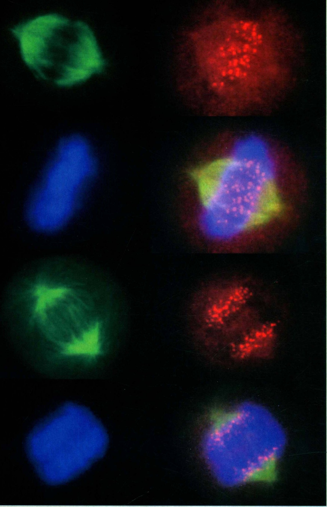

# IV 细胞增殖与调控·分部扉页

原始 PDF 第 330–331 页。

## 细胞增殖与调控

## IV

---

natural_image

Fluorescent microscopy images showing cellular structures with green, red, and blue staining (no text or symbols)

有丝分裂期中期和后期的HeLa细胞:经免疫荧光染色，显示其纺锤体（绿色）、染色体（蓝色）和着丝粒（红色）。

(北京大学生命科学学院张传茂组提供)
