# 第16章 细胞周期与检控点

原始 PDF 第 332–349 页。

第16章细胞周期与检控点

16

真核细胞的增殖和其调控对于生物的生存、生殖、发育分化和发挥正常生理功能均至关重要。细胞增殖是通过细胞周期来实现的，细胞数量的动态平衡离不开对细胞周期的精密调控。真核单细胞在营养充足和各种环境条件适宜时以指数方式快速分裂增殖。当营养缺乏、温度或渗透压等条件不适宜或存在有害物质时，这些外在条件会转换为细胞信号传递给细胞，停止细胞分裂增殖，使细胞处于较为安全的静息状态，待条件合适时再进行增殖。多细胞生物均是从一个受精卵（单个细胞）发育分化而来。某一类细胞的增殖除了营养和环境条件外，还受控于周边的细胞和液体系统中的各种活性因子，也依赖于细胞的分化状态。如细胞表面展示特定抗体的B细胞，在结合相应抗原后会通过驱动细胞周期快速分裂增殖，进一步分化成大量分泌抗体的浆细胞。这一B细胞成熟过程中除了相应抗原的结合，还需要多种细胞和免疫活性因子对B细胞的作用。浆细胞处于一个特定的状态，失去进一步分裂增殖能力，但保持大量分泌抗体的能力，维持增长的免疫功能。若B细胞的细胞周期失控，就会持续增殖分裂，发展成B淋巴细胞白血病。体内许多类型的细胞处于终极分化不能分裂增殖的状态，如神经元、肌细胞、角质细胞等，它们从组织中的干细胞分化而来。这些干细胞通常处于静息状态，需要时受组织中活性因子的激发进入分裂增殖。细胞周期调控在干细胞分裂、分化和进入终极分化状态中都发挥关键作用。

## 16.1 细胞周期和细胞周期检控点

正在增殖的真核生物细胞的细胞周期包括两个时相:间期（interphase）和有丝分裂期（mitosis，M phase）。其中间期又包括 $G_{1}$ 期（上一个细胞周期的M期和下一个细胞周期的S期之间的间隔期）、S期（DNA复制合成期）和 $G_{2}$ 期（S期和M期之间的间隔期）。所以细胞经过 $G_{1}$ 期、S期、 $G_{2}$ 期和M期4个时期的顺序更迭而完成其增殖。多细胞生物大多数细胞处于 $G_{0}$ 期或 $G_{1}$ 期检查点（restriction point）之前。处于 $G_{0}$ 期的细胞，离开了分裂增殖周期，需要适宜的外在条件才能重回增殖周期（图16-1）。体内还有两种特殊的细胞增殖状态:①胚胎内的快速增殖分裂，除了S和M期外几乎没有 $G_{1}$ 和 $G_{2}$ 期，胚胎中的丰富营养环境足够支撑连续的S期和M期；②在一些成熟分化细胞中，S期后没有M期，而是另一个间期，形成多核细胞（图16-2），如肌肉组织细胞。

$G_{1}$ 期往往是细胞周期的4个时期中历时最长的一个，是决定细胞周期时间长短的限速步骤。这与在此时期进行着的活跃的物质代谢有关。在 $G_{1}$ 期，细胞为DNA合成进行一系列的前期准备，如DNA复制所需要的RNA和蛋白质的合成、前复制复合物（pre-replication complex, pre-RC）的形成等。另外，在开始新的一轮遗传物质的复制之前，细胞需要检查各种内外界条件是否有利，DNA是否完整无损，以保证后续的过程不至于产生有害的、不可挽回的结果。这些复杂的信息整合和最终决定是否启动S期均需要一定的时间。

细胞周期中两个最关键的时期是DNA合成期和有丝分裂期，通过前者实现遗传物质的复制，通过后者将倍增后的遗传物质平均分配到两个子细胞中。

真核生物的DNA复制从染色体上多个起始点开始，形成多个复制叉。复制叉是在DNA复制过程中形成的一种“Y”字形结构。复制开始后，由于DNA双链解开，

16.1 细胞周期和细胞周期检控点

319

---

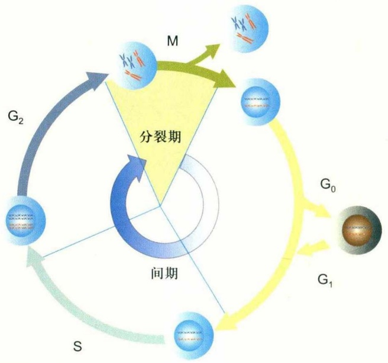

flowchart

图 16-1 细胞周期

典型的处于增殖状态的真核细胞周期由间期和分裂期（M期）构成。间期由DNA复制期（S）及M和S期之间的两个间隔期（ $G_{1}$ 期和 $G_{2}$ 期）组成。细胞在适宜环境或生理条件下离开增殖周期进入静息的 $G_{0}$ 期。 $G_{0}$ 期细胞除了不增殖，仍然具有生理和代谢活动。

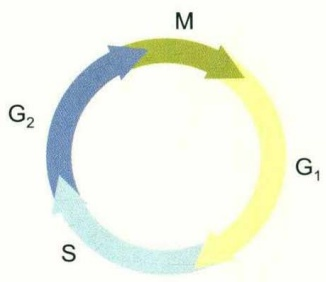

flowchart

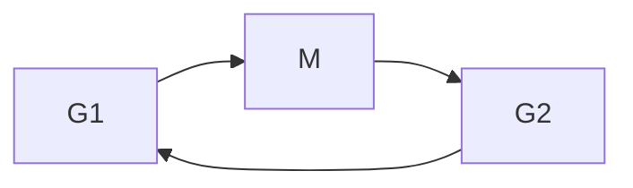

(A)

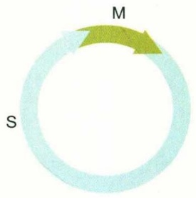

text_image

M
S

(B)

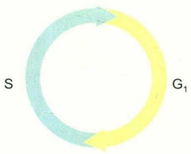

flowchart

(C)

图16-2 三种不同类型的细胞周期

(A) 典型的细胞周期；(B) 胚胎内的快速增殖分裂，几乎没有 $G_{1}$ 和 $G_{2}$ 期；(C) 肌肉组织细胞的增殖由S和 $G_{1}$ 期构成。

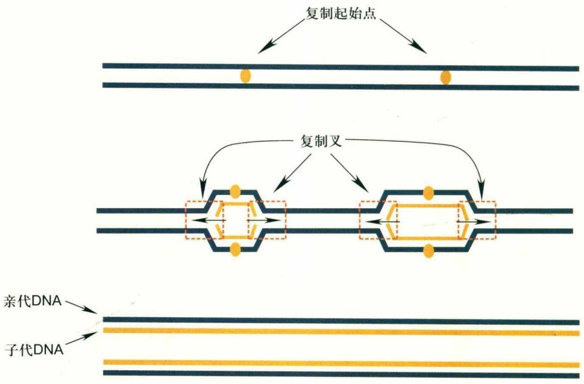

flowchart

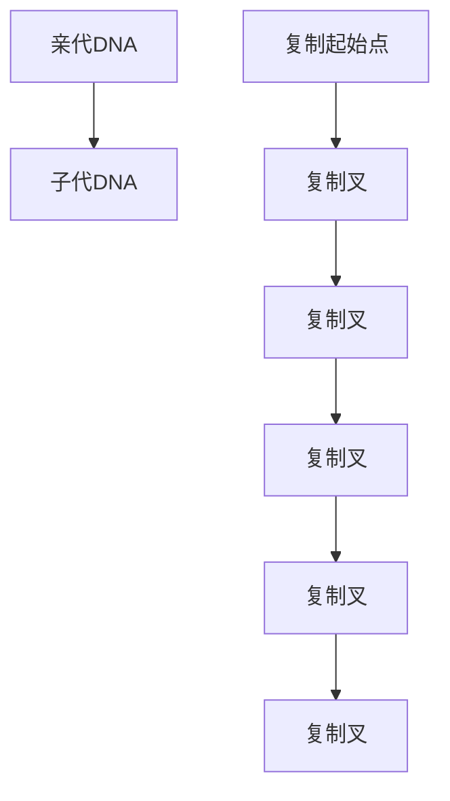

图16-3 DNA复制过程中的复制叉

DNA复制从复制起始点的两条单链向两个方向同时进行，形成复制叉，是S期进程的关键控制结构。在染色体上，有的复制起始点的复制启动早（早期复制起始点），有的起始点复制启动晚（晚期复制起始点）。

320

第 16 章 细胞周期与检控点

---

在两股单链上分别进行复制，在电镜下可观察到伸展成叉状的结构，称为复制叉（图16-3）。DNA复制从复制起始点开始，以复制叉的方式向两侧推进，与相邻的复制叉相遇而终止其前进。各个复制起始点的起始并非同步，有些起始较早，称为早期复制起始点(early origin of replication)；有些起始较晚，称为晚期复制起始点(late origin of replication)。复制的起始有赖于复制起始点上复制起始复合物的形成，而细胞对此复合物的形成进行着严格调控，如果发现DNA受损，就会减慢或停止复制起始点的发动（复制起始复合物的形成）。在真核细胞的每个细胞周期中DNA复制只能进行一次，受到严格调控。

在进入有丝分裂期之前，细胞要检查将要分配到两个子细胞中去的遗传物质是否完整，以保证遗传的稳定性。有丝分裂期分为6个阶段（图16-4）。细胞进入有丝分裂期之后，间期的染色质开始浓缩，成为染色体，核膜解体，纺锤体逐渐形成（前期，prophase）；然后，每个染色体（包括两个在着丝粒处联结在一起的姐妹染色单体）通过动粒（kinetochore）与纺锤丝相连（前中期，prometaphase）；继而在两侧纺锤丝的牵拉下，染色体排列到赤道板上（中期，mataphase）；然后姐妹染色单体分开，并在纺锤丝的牵引下分向细胞两极（后期，anaphase）；到了有丝分裂的末期（telophase），分到细胞两极的染色体周围分别重新形成核膜，染色质去螺旋化，重新变成松散的结构。在细胞核发生分裂的同时细胞质也发生分裂，即细胞质从细胞中部向内凹陷，形成缢裂环，直到将细胞完全分开成为两个子细胞，这个时期称为胞质分裂期（cytokinesis）。

在有丝分裂过程中，细胞也有一套检查和调控机制，维持基因组的稳定性。如在有丝分裂从中期向后期过渡之前，细胞要检查是否每个染色体都已正确地连接到纺锤丝上，以确保每对姐妹染色单体被准确地分向细胞两极。

总之，在细胞周期中的一些关键时刻有着一套调控机制，调节着细胞周期各个时相有序而适时地进行更迭，并使细胞周期的有序过程中后一事件的开始依赖于前一事件的完成，从而保证了细胞周期中的关键事件如DNA复制和染色体分离等过程高度准确地完成。这套调控机制称为细胞周期检控点。简言之，细胞周期检控点被定义为细胞周期进程中的一些行进调控点。

细胞周期检控点普遍存在于真核生物细胞中，汇集细胞内和细胞外信号，对细胞周期进程“利弊做出判断”，对细胞周期进程实施暂停、减速或终止等操作。细胞内信号主要源自遗传信息忠实复制和分配的各个步骤是否正确，也源自细胞器是否均衡分配到子细胞和细胞膜是否完整。不对这些过程进行监控，将会对细胞和个体造成灾难。

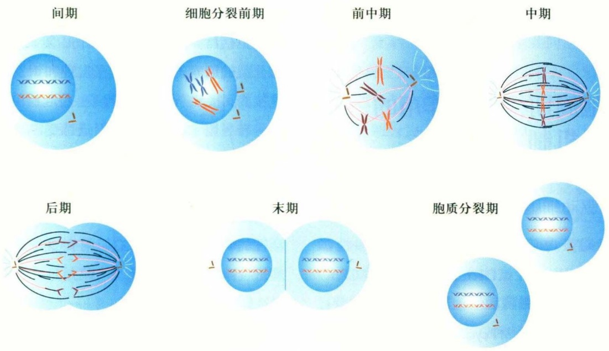

text_image

间期
细胞分裂前期
前中期
中期
后期
末期
胞质分裂期

图16-4 分裂期构成

有丝分裂期由6个亚期组成，按照时间次序为细胞分裂前期、前中期、中期、后期、末期和胞质分裂期。

16.1 细胞周期和细胞周期检控点

321

---

经典的细胞周期检控点是指对影响基因组稳定性做出响应的控制点。但这些控制同时与环境因素和生理因素交织在一起，尤其是对 $G_{1}$ 期细胞的监控。细胞外信号有两类:第一类是源自细胞营养和其他影响细胞生长的环境因素；第二类是控制细胞增殖的生理需求因素，如生长激素、细胞因子及周围的组成细胞等。目前研究得最多的、信息最丰富的是干扰细胞遗传稳定性（DNA损伤、复制错误和有丝分裂期姐妹染色体的正确分配）的细胞周期监控，检控点位于细胞周期各个时期。外界信号对细胞周期的控制主要集中在 $G_{1}$ 期。所以， $G_{1}$ 期是收集控制信息最多的细胞周期时相，也是决定细胞是否进入新一轮复制和分裂的“关口”。其他的细胞周期时相主要是对影响细胞遗传的稳定性和真实性把关。

细胞周期检控点蛋白还直接或间接地参与或促进DNA的修复。越来越多的证据显示，细胞周期检控点可能不仅仅在细胞遇到某些不利因素（如DNA损伤）时才起作用，也不仅仅是在某些时间点上起作用，而是存在于正常细胞周期过程中，作为一种质量控制或安全保障机制，随时监控着基因组的完整性，控制着细胞周期的进程。但这种观点的最终证实，还需要更深入的研究。本章依然以传统意义上的细胞周期检控点为主要讨论对象。细胞周期检控点与DNA修复系统和细胞凋亡机制相互配合，共同组成细胞对DNA损伤的响应系统（DNA damage response），维护基因组的稳定性。失去细胞周期检控点的调控作用，会导致基因组的不稳定性，还可能进一步导致细胞的转化及癌症的发生。

## 16.2 细胞周期检控点作用的分子机制

## 16.2.1 驱动细胞周期运转的引擎分子

由细胞周期蛋白(cyclin)和周期蛋白依赖性激酶(cyclin-dependent kinase, CDK)结合而形成的CDK/cyclin复合物，具有蛋白激酶活性。其中cyclin为调节亚基，CDK为催化亚基。有多种cyclin和CDK。特定种类的CDK只有与相应的cyclin结合才有活性。

在细胞周期的不同时期，不同的CDK/cyclin复合物通过磷酸化特异的蛋白(如转录因子)，而开启或关闭某些基因的表达，或直接调节某些蛋白的活性，从而推动着细胞周期的运行。CDK4、CDK6等与cyclin D结合的复合物主要在 $G_{1}$ 期起作用；cyclin E与CDK2形成的复合物作用于S期的起始；cyclin A与CDK2的复合物不仅作用于S期的起始，而且贯穿于整个S期；CDK1(cdc2)与cyclin A或cyclin B（主要是cyclin B）结合，为 $G_{2}$ 期到M期的过渡所必需（图16-5）。

cyclin的含量在细胞周期中变化很大，根据细胞周期进程的需要而被诱导表达，而在不需要时又被降解。CDK的含量在整个细胞周期中变化不大，但其活性变化非常大，有一套调控机制调节其活性。CDK的活性除了受到cyclin的影响，还受到其他激酶（如Wee1、CAK）和磷酸酶（如cdc25）对其磷酸化和去磷酸化的调节；另外，调节CDK活性的还有变构抑制剂（如p21）的作用，以及CDK在细胞中的定位和运输（CDK在细胞质中被合成后，必须被运送到细胞核里才能发挥其功能，控制其从细胞质向细胞核中的运输，是一种调节其作用的方式）。细胞周期检控点对细胞周期的调节作用是通过调节各个时期的cyclin的含量或CDK的活性而实现的。

## 16.2.2 细胞周期检控点是一种调控通路

从分子水平看，细胞周期检控点是作用于细胞周期转换时序的调控通路，包含起始信号（signal）、感受因子（sensor）、中介因子（mediator）、信号转导因子（signal transducer）和效应器（effector）等。但它们之间并没有绝对的分界，一个分子可能担任多个不同的角色。起始信号包括营养缺乏、DNA损伤、复制叉停止以及影响有丝分裂的因素等；感受因子发现和识别起始信号，然后直接或间接地（通过中介因子）将起始信号传递至下游的信号转导因子；中介因子促进感受因子和信号转导因子之间的相互作用；信号转导因子常常是一些激酶（或磷酸酶），它们通过影响下游分子的磷酸化状态而将来自上游的信号传递给下游的效应器；效应器实际上是各种CDK活性的调节分子，通过它们调节CDK的作用而使细胞周期进程减慢或停止。

## 16.2.3 参与调控细胞周期检控点的分子

## (1) ATM 和 ATR

DNA损伤通常发生于基因组中极少数的几个位点，但DNA损伤的信号却能够激活一系列下游分子，引起

322

第16章 细胞周期与检控点

---

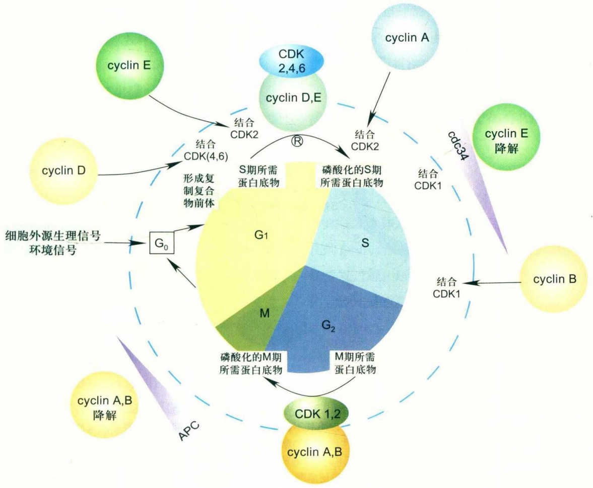

flowchart

This diagram illustrates the metabolic pathways of cyclin (cyclin) enzymes, showing how various proteins and complexes interact with CDK and S phase proteins to form downstream metabolites like cyclin E, cyclin D, cyclin A, and cyclin B.

图16-5 驱动细胞周期运转的引擎分子

CDK4、CDK6等与周期蛋白D形成复合物驱动 $G_{1}$ 期的进程；周期蛋白E与CDK2形成的复合物起始S期；周期蛋白A与CDK2形成的复合物不仅作用于S期的起始阶段，其作用也覆盖整个S期；CDK1(cdc2)与周期蛋白A或周期蛋白B（其中主要是周期蛋白B）形成复合物，驱动细胞从 $G_{2}$ 到过渡M期。

细胞整体水平的反应，如细胞周期的减慢或暂停。所以检控点通路最接近DNA损伤信号一端的激酶ATM和ATR，必须与检控点中介因子及信号转导因子Chk1、Chk2等密切配合，以有效地传递报警信号，完成对下游的效应器分子如p53、cdc25的调节性磷酸化（以 $G_{1}/S$ 检控点为例，如图16-6所示）。ATM和ATR蛋白都与磷脂酰肌醇3-激酶（phosphatidylinositol 3-kinase）有同源性，所以也被称为PIKK（phosphatidylinositol 3-kinase like kinase）。ATM基因在A-T（ataxia-telangiectesia）患者的细胞中突变，因而得名ataxia-telangiectesia mutated。A-T患者表现为小脑退化、免疫缺陷、基因组不稳定及癌症的发生率升高。ATR（ATM and Rad3 related）得名于其基因与ATM和裂殖酵母的Rad3基因的同源性。

现在的研究结果表明，ATM主要对电离辐射引起的DNA双链断裂作出反应，而ATR则对几乎所有类型的DNA损伤都能作出反应，包括由紫外线造成的DNA单链断裂和化学物质等引起的碱基破坏及复制叉停止，以及电离辐射引起的DNA双链断裂，并激活有关的检控点活性。但ATM和ATR常常是共同对DNA损伤作出反应，这种复杂的反应需要协同进行。

ATM和ATR都是非常大的蛋白激酶分子，预测分子量分别为 $3.5\times10^{5}$ 和 $3.01\times10^{5}$ 。它们能够磷酸化许多底物，以发挥其广泛的生理功能，如DNA损伤检控点通路的激活以及通过激活DNA修复系统中的某些分子而间接地影响DNA修复过程等。但其主要功能还是激活DNA损伤检控点信号转导通路。在该通路中，ATM和ATR是迄今为止已知的最上游的分子。当它们感受到DNA损伤时，分别通过对下游不同分子的磷酸化而激活DNA损伤检控点活性。其活性必须受到密切调控，以使其不至于在不需要的时候激活生长抑制通路，而又使其在需要时能立刻被激活。

缺失ATM基因的患者、小鼠和细胞能够存活，说明

16.2 细胞周期检控点作用的分子机制

323

---

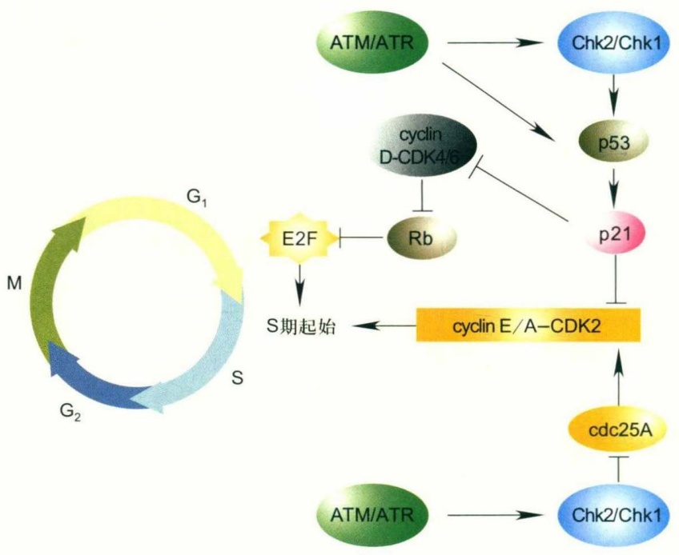

flowchart

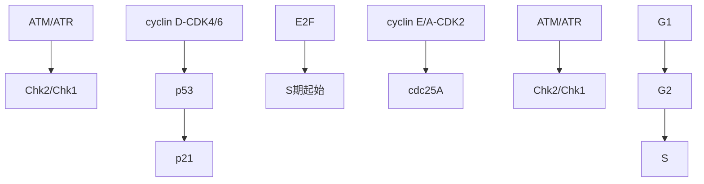

图16-6 $\mathrm{G}_1 / \mathrm{S}$ 检控点的作用机制

当细胞受到遗传毒性因子作用而发生DNA损伤时，ATM/ATR被激活，并磷酸化多种蛋白，如Chk2、Chk1、p53等。Chk1和Chk2被磷酸化后，具有了激酶活性，进而磷酸化cdc25A，下调其功能，使其不能发挥去除CDK2上抑制性磷酸基团从而活化CDK2的作用，最终抑制DNA复制的起始；p53被磷酸化后其转录下游基因的活性增强，如激活 $\mathrm{p21}^{\mathrm{WAF - 1 / Cip1}}$ 的转录，p21通过抑制CDK2而延迟或阻断进入S期。p21还可结合CDK4/cyclinD复合体，抑制其激酶活性，降低Rb蛋白的磷酸化水平。低磷酸化的Rb蛋白不能从E2F上释放，使E2F不能激活多个下游基因（包括dNTP合成和DNA复制所需要的二氢叶酸还原酶、胸腺嘧啶核苷激酶、DNA聚合酶等基因）的转录，因而细胞不能起始DNA复制。

ATM激酶对于关键的细胞功能如细胞增殖和分化等并不是必需的。在正常情况下，细胞中ATM激酶的活性很低；只有在遇到影响DNA或染色质结构的应力（stress）时，ATM才被激活。其活化需要Ser1981的磷酸化。在没有染色质结构的应力时，ATM以二聚体形式存在，封闭了Ser1981磷酸化位点和其激酶结构域；当细胞发生DNA双链断裂时，ATM的构象发生变化，激活其激酶结构域，这种激酶活性继而对其自身的Ser1981进行磷酸化，使ATM二聚体发生解聚，成为具有活性的单体。被激活的ATM单体可对其他底物进行磷酸化，其底物包括Chk2、p53、BRCA1等。Chk2、p53等被磷酸化以后，在细胞周期检控点中分别发挥着重要功能。BRCA1也在细胞周期检控点通路中发挥着十分重要的作用。

缺少ATR的动物体或细胞不能存活。这说明ATR对于正常的细胞周期进行是必需的。事实上，最近的研究发现在生理条件下，ATR似乎一直处于活性状态，并在S期结合到染色质上，对于控制正常的DNA复制起始点的发动和复制叉的移动速度有着重要作用；由它所激活的Chk1-cdc25A通路，通过调控CDK2活性，实现对正常DNA复制过程的监控，以保证DNA复制的准确性。在正常的DNA复制过程中，存在一些固有的、暂时性的类似于DNA损伤的情况，如冈崎片段、单链DNA、尚未连接起来的复制子等，细胞有理由发展一种机制对此进行监控，以确保最终形成完整的DNA。但是在DNA受损伤时，ATR的活性会进一步提高，以发挥其在DNA损伤检控点中的功能。当细胞受到紫外线的照射、暴露于烷基化物质或被交联剂作用时，ATR能够磷酸化并激活Chk1等，从而激活检控点活性。有时，ATR甚至能够弥补一部分ATM的功能，如在没有ATM的情况下，当细胞受到电离辐射时，ATR能够磷酸化许多ATM的底物。

酿酒酵母中的scMec1和裂殖酵母中的spRad3与人细胞中的ATM或ATR同源，且起着相似的作用（注:sc代表酿酒酵母S. cerevisiae，sp代表裂殖酵母S. pombe），都是检控点通路中的上游DNA损伤感受因子激酶（表16-1）。

324

第 16 章 细胞周期与检控点

---

## (2) Chk1 和 Chk2

哺乳动物细胞中的Chk1和Chk2、酿酒酵母中的scChk1和scRad53(scChk2)以及裂殖酵母中的spChk1和spCds1(spChk2)，都是上游DNA损伤感受因子激酶的底物，同时又是下游效应器分子的丝氨酸/苏氨酸激酶，所以在检控点调控通路中被称为效应器分子激酶(表16-1)。

在哺乳动物细胞中，Chk2主要是ATM的底物，而Chk1则主要是ATR的底物。ATM-Chk2和ATR-Chk1信号通路有很多共同的下游底物，如p53、cdc25A和cdc25C等。但是，ATM-Chk2对于胚胎发育并不是必需的，而完全缺失ATR或Chk1却会导致胚胎在发育早期死亡。这种基本的生物学差别是由于ATR-Chk1对于正常的细胞周期中一些基本的过程起着必不可少的调节作用。

## (3) Rad17-RFC2-5 与 9-1-1 复合体

9-1-1复合体是由Rad9、Rad1和Hus1组成的三聚体，其主要功能是参与DNA损伤检控点机制，有人认为9-1-1复合体也是DNA损伤的感受因子之一，9-1-1复合体对于ATR磷酸化和激活Chk1是必需的。电镜分析表明9-1-1复合体是一个直径5 nm、具有2 nm孔洞的三聚体环，类似于PCNA（proliferating cell nuclear antigen）三聚体环。9-1-1复合体以三聚体环的形式套在DNA上，并定位于DNA损伤处附近(图16-7)，在细胞周期检控点通路中发挥作用；PCNA三聚体虽然也参与某些细胞周期检控点的调控，但其主要功能在于DNA复制和修复过程。

复制因子复合体 (replication factor complex, RFC) 是由 p140、p40、p38、p37 和 p36 组成的五聚体。在复制过程中，RFC 的作用是将 PCNA 三聚体环加载到已经合成了一段引物的 DNA 上，以帮助其与 DNA 聚合酶 Polδ 共同进行高度持续性的 DNA 合成 (highly processive DNA replication); Rad17-RFC2-5复合体与复制因子RFC结构相似, 都是球形, 有一道凹槽贯穿其中。但在Rad17-RFC2-5复合体中, 由Rad17代替了p140。Rad17-RFC2-5复合体的作用是在DNA受到损伤时, 将9-1-1复合体加载到DNA上, 帮助后者行使其在DNA损伤检控点中的功能。裂殖酵母和人的细胞中都有Rad17-RFC2-5/9-1-1复合体, 而且作用机制相似。事实上, 裂殖酵母和人的细胞中细胞周期检控点很接近, 比其与出芽酵母更接近。

另外，研究还发现在裂殖酵母中的Rad17-RFC2-5/9-1-1复合体及芽殖酵母中相应的同源蛋白也参与跨损伤的DNA合成(translesion DNA synthesis)以及DNA损伤修复过程。所以该复合体是一个在DNA损伤响应中发挥重要作用的多功能复合体。

## (4) Claspin

Claspin是一种在ATR-Chk1检控点通路中发挥作用的蛋白。它介导ATR与Chk1蛋白之间相互作用，是ATR磷酸化并激活Chk1所必需的。Christiano C等用免疫沉淀(IP)和pull-down实验研究ATR、Claspin与Chk1之间的相互作用，发现无论是否存在DNA损伤因素，Claspin都与ATR结合；Claspin响应于DNA损伤因素如HU(羟基脲)或紫外线(UV)，与Chk1相结合；并且这种结合依赖于Claspin的磷酸化；而Claspin的磷酸化又依赖于ATR。Claspin可能在感受DNA的损伤方面也有积极作用。

酿酒酵母和裂殖酵母中的Mrc1（mediator of replication checkpoint）是Claspin的同源蛋白(表16-1)，只在S期表达，对于S期检控点信号从scMec1/spRad3（与人的ATM/ATR同源）到scRad53/spCds1（与人的Chk2同源）的传递是必需的。ATM/ATR-Chk2/Chk1检控点通路的保守性再次印证了它们在维护基因组稳定性中的重要性。

表 16-1 酵母和人细胞中同源的监控点蛋白

| 人 | 酿酒酵母 | 裂殖酵母 | 功能 |
| --- | --- | --- | --- |
| ATM和ATR | scMec1 | spRad3 | DNA损伤感受因子激酶 |
| Chk1和Chk2 | scChk1和scRad53(scChk2) | spChk1和spCds1(spChk2) | DNA损伤感受因子激酶的底物及下游效应器分子的激酶 |
| Rad17-RFC2-5/9-1-1复合体 | Rad24-RFC2-5/Ddc1-Rad17-Mec3复合体 | Rad17-RFC2-5/9-1-1复合体 | DNA损伤感受因子;为ATR磷酸化和激活Chk1所必需 |
| Claspin | Mrc1 | Mrc1 | 促进DNA损伤感受因子激酶(ATR、scMec1或spRad3)与其底物(Chk1、scRad53或spCds1)之间的相互作用 |

16.2 细胞周期检控点作用的分子机制

325

---

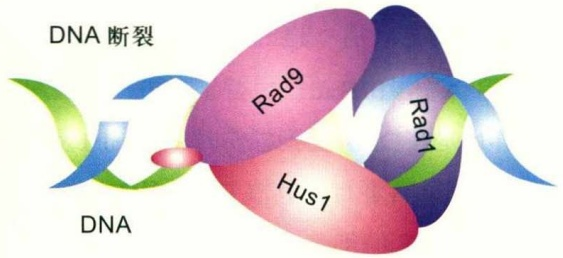

text_image

DNA 断裂
Rad9
Rad1
Hus1
DNA

(5) cdc25

在人细胞中，当存在DNA损伤时，磷酸化酪氨酸磷酸水解酶——cdc25A、cdc25C接收上游信号转导因子传来的信号，即被Chk1或Chk2磷酸化，结果或使其被泛素化而水解，或阻碍其进入细胞核发挥活化CDK的作用，或阻止其与CDK/cyclin复合体的相互作用，最终导致细胞周期被阻断在 $G_{1}/S$ 期或 $G_{2}/M$ 期交界处。现在已知cdc25A能够去除S期所需要的CDK2上的抑制性磷酸根，从而激活CDK2；cdc25A和cdc25C（主要是后者）能够去除进入M期所需要的CDK1（cdc2）上的抑制性磷酸根，从而激活CDK1。

(6) p53

p53是一种十分重要的肿瘤抑制因子，在许多类型的肿瘤细胞中有突变。在DNA发生损伤时，它通过激活或抑制特异基因的转录，而起着阻断细胞周期和诱导细胞凋亡的作用。由p53所激活转录的基因往往是抑制细胞增殖或促进细胞凋亡的基因；而被p53所抑制转录的基因则常常是促进细胞增殖或抑制细胞凋亡的基因。

当存在DNA损伤时，p53可被ATM或ATR直接或间接（通过Chk2或Chk1）磷酸化，p53被磷酸化之后，阻碍其与抑制分子Mdm2之间的相互作用。Mdm2与p53之间的关系十分有趣。p53能够激活Mdm2的转录，而Mdm2又是p53的负调控因子。Mdm2对p53有双重抑制作用:一方面，它对p53有特异性的泛素连接酶活性，使p53泛素化，从细胞核转运到细胞质，然后被蛋白酶体水解；另一方面，Mdm2直接抑制p53的转录调控功能。同时，Mdm2也可被ATM/ATR或Chk2/Chk1磷酸化。Mdm2被磷酸化后，它与p53的相互作用也被削弱。结果导致p53在细胞核中积累，同时其转录调节因子的活性也提高。

p53能激活 $p21^{WAF-1/Cip1}$ 的转录，而p21又是CDK4、CDK2和CDK1等的抑制因子。通过这种抑制作用，图16-7 9-1-1复合体以三聚体环的形式套在DNA上，并定位于DNA损伤处附近

Rad9上有一个伸出的小结构域，它是维持正常细胞周期检控点功能所必需的。

p53-p21参与了 $G_{1}/S$ 和 $G_{2}/M$ 检控点的调控。

(7) CKI

CKI (CDK inhibitor) 是一组通过与CDK结合并抑制其驱动细胞周期的蛋白质，分为CIP/KIP和INK4两类。CIP/KIP抑制从 $G_{1}$ 到S期的各种cyclin/CDK；而INK4特异抑制cyclinD/CDK4和cyclinD/CDK6，在控制从 $G_{0}$ 期转换到 $G_{1}$ 期过程起重要作用。CIP/KIP包括p21、p27和p57。INK4包括p16INK4A (p16)、p15INK4B (p15)、p18INK4C (p18) 和p19INK4D (p19)。CIP/KIP的抑制作用不依赖于Rb的存在，而INK4蛋白的抑制作用需要Rb。CKI蛋白与细胞的生理功能密切相关，细胞外因子的作用通过一系列复杂信号通路抵达这些CKI蛋白，影响 $G_{0}-G_{1}$ 期转换和 $G_{1}-S$ 期转换。p21比较特别，其表达水平受p53调控，在偶联细胞遗传稳定性和细胞周期进程中发挥重要作用。

(8) Rb

Rb是retinoblastoma protein（成视网膜细胞瘤蛋白）的缩写。Rb缺失会导致视网膜母细胞瘤的发生，因而Rb被称为肿瘤抑制基因。其蛋白家族包括Rb、p107（Rb样蛋白1）和p130（Rb样蛋白2），均与抑制细胞增殖有关，目前对Rb的研究最多（图16-8）。在静态的 $G_{1}$ 细胞中，Rb处于低水平磷酸化状态，与激活性转录因子如E2F1结合，抑制其进入S期所需蛋白质基因的转录。当cyclinD/CDK4(6)激酶磷酸化Rb，高水平磷酸化的Rb从E2F1解离下来，使E2F1转录S期所需基因，发生 $G_{1}-S$ 期转换。Rb在S期、 $G_{2}$ 期和M期都处于高水平磷酸化状态；在 $M-G_{1}$ 期转换过程中，Rb去磷酸化，回复到低水平磷酸化状态，待条件适宜，汇集的Rb再度高水平磷酸化，将细胞推入新一轮的遗传物质复制和分裂过程中。Rb除了通过抑制E2F1来限制 $G_{1}-S$ 期转换，还募集各种染色体调节因子，使待转录基因处于难转录的状态，加强对 $G_{1}-S$ 期转换的限制。高水平磷酸化的Rb还能结合cyclinE/CDK2，限制细胞进入S期。在 $G_{1}$ 期，Rb首先被cyclinD/CDK4(6)激酶磷酸化，然后继续被cyclinE/CDK2磷酸化。而cyclinD/CDK4(6)被MARK信号通

326

第16章 细胞周期与检控点

---

路激活，MARK上游接收源自细胞外的信号，cyclinD/CDK4(6)是介导细胞外信号进入细胞周期的关键蛋白激酶复合体。

## (9) E2F

E2F 包括一组转录因子，其中 3 个（E2F1-2 和 E2F3a）为转录激活因子，6 个（E2F3b 和 E2F4-8）为转录抑制因子。所有 E2F 都参与细胞周期和 DNA 合成的调控（如 cyclins、CDKs、检控点调节蛋白因子、DNA 修复蛋白、DNA 复制蛋白、DNA 聚合酶、胸腺嘧啶激酶、二氢叶酸还原酶和 cdc6），在 G₁-S 期转换中发挥关键作用。转录激活性 E2F 蛋白水平随细胞周期改变，在 G₁ 期达到高峰，而转录抑制性 E2F 蛋白水平在细胞周期中保持不变。

## 16.2.4 细胞周期检控点反应的特点

局部的DNA损伤能够十分迅速地激活一个全局性的细胞周期检控点调控网络；发生在损伤位点的局部事件需要与远处的细胞过程相协调。DNA损伤发生后，细胞不仅在损伤部位局部进行必要的处理（如DNA修复），而且整个细胞也发生全局的、协同的变化，减慢或终止DNA复制和染色体分离的启动等过程。

细胞对DNA损伤所作出的快速响应反映了一个事实，即检控点反应的开始是通过已有蛋白的翻译后修饰、重新定位、动态相互作用、构象变化和稳定性的改变来实现的。然而，要维持检控点的作用，则需要一些作用慢却更持久的途径，如p53-p21通路对于 $G_{1}/S$ 和 $G_{2}/M$ 检控点的维持，这其中涉及新的蛋白分子的合成（如p21等）。

值得指出的是，细胞周期检控点的作用机制非常复杂，在信号转导通路中，充满了交叉对话（cross-talk）；还有许多分子及其功能需要继续进行更深入的研究。

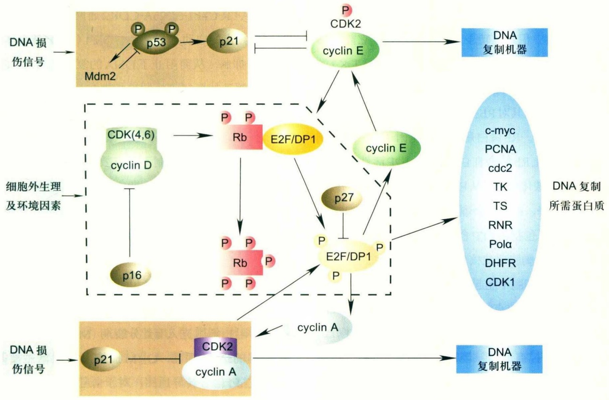

flowchart

```mermaid
graph TD
  subgraph Biological Process
  A["DNA损伤信号"] --> B["Mdm2"]
  B --> C["p53"]
  C --> D["p21"]
  D --> E["cyclin E"]
  E --> F["DNA复制机器"]
  end

  subgraph Molecular Processes
  G["CDK(4,6)\ncyclin D"] --> H["Rb"]
  I["p16"] --> J["E2F/DP1"]
  K["p27"] --> L["cyclin E"]
  M["c-myc\nPCNA\ncdc2\nTK\nTS\nRNR\nPolα\nDHFR\nCDK1"] --> N["DNA复制所需蛋白质"]
  O["cyclin A"] --> P["cyclin A"]
  P --> Q["cyclin A"]
  R["p21"] --> S["CDK2\ncyclin A"]
  T["DNA损伤信号"] --> U["p21"]
  V["DNA复制机器"] --> W["DNA复制机器"]
  end

  style A fill:#f9f9f9,stroke:#333
  style B fill:#f9f9f9,stroke:#333
  style G fill:#f9f9f9,stroke:#333
  style I fill:#f9f9f9,stroke:#333
  style J fill:#f9f9f9,stroke:#333
  style K fill:#f9f9f9,stroke:#333
  style L fill:#f9f9f9,stroke:#333
  style M fill:#f9f9f9,stroke:#333
  style N fill:#f9f9f9,stroke:#333
  style O fill:#f9f9f9,stroke:#333
  style P fill:#f9f9f9,stroke:#333
  style Q fill:#f9f9f9,stroke:#333
  style R fill:#f9f9f9,stroke:#333
  style S fill:#f9f9f9,stroke:#333
  style T fill:#f9f9f9,stroke:#333
  style U fill:#f9f9f9,stroke:#333
  style V fill:#f9f9f9,stroke:#333
  style W fill:#f9f9f9,stroke:#333
  style X fill:#f9f9f9,stroke:#333
  style Y fill:#f9f9f9,stroke:#333
  style Z fill:#f9f9f9,stroke:#333
  style AA fill:#f9f9f9,stroke:#333
  style AB fill:#f9f9f9,stroke:#333
  style AC fill:#f9f9f9,stroke:#333
  style AD fill:#f9f9f9,stroke:#333
  style AE fill:#f9f9f9,stroke:#333
  style AF fill:#f9f9f9,stroke:#333
  style AG fill:#f9f9f9,stroke:#333
  style AH fill:#f9f9f9,stroke:#333
  style AI fill:#f9f9f9,stroke:#333
  style AJ fill:#f9f9f9,stroke:#333
  style AK fill:#f9f9f9,stroke:#333
  style AL fill:#f9f9f9,stroke:#333
  style AM fill:#f9f9f9,stroke:#333
  style AN fill:#f9f9f9,stroke:#333
  style AO fill:#f9f9f9,stroke:#333
  style AP fill:#f9f9f9,stroke:#333
  style AQ fill:#f9f9f9,stroke:#333
  style AR fill:#f9f9f9,stroke:#333
  style AS fill:#f9f9f9,stroke:#333
  style AT fill:#f9f9f9,stroke:#333
  style AU fill:#f9f9f9,stroke:#333
  style AV fill:#f9f9f9,stroke:#333
  style AW fill:#f9f9f9,stroke:#333
  style AX fill:#f9f9f9,stroke:#333
  style AY fill:#f9f9f9,stroke:#333
  style AZ fill:#f9f9f9,stroke:#333
  style BA fill:#f9f9f9,stroke:#333
  style BAQ fill:#f9f9f9,stroke:#333
  style BAQA fill:#f9f9f9,stroke:#333
  style BAQB fill:#f9f9f9,stroke:#333
  style BAQC fill:#f9f9f9,stroke:#333
  style BAQD fill:#f9f9f9,stroke:#333
  style BAQE fill:#f9f9f9,stroke:#333
  style BAQF fill:#f9f9f9,stroke:#333
  style BAQG fill:#f9f9f9,stroke:#333
  style BAQH fill:#f9f9f9,stroke:#333
  style BAQI fill:#f9f9f9,stroke:#333
  style BAQJ fill:#f9f9f9,stroke:#333
  style BAQK fill:#f9f9f9,stroke:#333
  style BAQL fill:#f9f9f9,stroke:#333
  style BAQM fill:#f9f9f9,stroke:#333
  style BAQN fill:#f9f9f9,stroke:#333
  style BAQO fill:#f9f9f9,stroke:#333
  style BAQP fill:#f9f9f9,stroke:#333
  style BAQQ fill:#f9f9f9,stroke:#333
  style BAQR fill:#ff0000000000000000000000000000000000000000000000000000000000000000000000000000000000000000000000000000
```

图16-8 $\mathrm{G}_1 / \mathrm{S}$ 检控点整合DNA状态及环境和生理信息

围绕细胞周期有多个检控点，它们的主要输入控制信息是对遗传信息有重大影响的细胞事件（DNA复制状态、损伤已否、染色体分裂进程等）。但 $G_{1}/S$ 检控点除此功能外，还接收大量的环境和生理信息，来决定是否对处于 $G_{1}$ 期的细胞放行进入S期。 $G_{1}/S$ 检控点上游有两类控制模块，一类主要接收整合环境和生理信息（虚线框内），而另一类则主要接收整合DNA状态信息（虚线框外）。这两类模块有部分交叉。许多DNA状态模块上游控制分子如p53也参与别的检控点的调控。

16.2 细胞周期检控点作用的分子机制

327

---

## 16.3 几个重要的细胞周期检控点

## 16.3.1 $\mathrm{G}_1 / \mathrm{S}$ 检控点

$G_{1}/S$  检控点 ( $G_{1}/S$  checkpoint) 的作用是在 DNA 受到损伤时抑制 DNA 复制的起始，阻止细胞进入 S 期。

$G_{1}/S$ 检控点作用的起始和保持分别由ATM/ATR-Chk2/Chk1通路和p53-p21通路实现。当细胞DNA发生双链断裂时（如受到γ射线照射），ATM被激活，ATR活性提高，并磷酸化多种蛋白，如Chk2、Chk1和p53等；当细胞DNA出现单链断裂（受到紫外线照射或受到其他DNA损伤因子作用时），ATR活性增加，导致Chk1的磷酸化。Chk1和Chk2被磷酸化后，具有了激酶活性，进而磷酸化cdc25A，下调其功能活性，使其不能发挥活化CDK2的作用，从而抑制DNA复制的起始。

不论 $G_{1}/S$ 检控点反应的起始是由ATM-Chk2-cdc25A通路还是ATR-Chk1-cdc25A通路引起的，这两条通路只能暂时阻断 $G_{1}/S$ 进程； $G_{1}/S$ 检控点的保持是通过作用慢但更持久的p53-p21通路的作用。p53被磷酸化后能够在细胞核中积累且转录活化功能增强，它能激活 $p21^{WAF-1/Cip1}$ 的转录，p21抑制进入S期所需要的CDK2的活性。另外，p21结合在CDK4/cyclinD复合体上，抑制其激酶活性，从而抑制其对Rb蛋白的磷酸化，导致Rb蛋白的磷酸化水平下降。Rb蛋白是转录活化因子E2F的抑制蛋白，当低磷酸化Rb结合在E2F上时，E2F活性受到抑制；Rb蛋白的磷酸化对于其从E2F上的释放是必要的；由于磷酸化水平下降，Rb蛋白不能从E2F上释放，使E2F不能激活许多基因（包括dNTP合成和DNA复制所需要的二氢叶酸还原酶、胸腺嘧啶核苷激酶、DNA聚合酶等基因）的转录，因而细胞不能起始进行DNA复制。p53-p21就这样保持了 $G_{1}/S$ 检控点的作用，导致细胞被阻断在 $G_{1}/S$ 交界处（图16-8、图16-9）。

如果 $G_{1}/S$ 检控点通路被阻断，细胞在有DNA损伤因子时就不能有效地阻止细胞从 $G_{1}$ 进入S期。例如受到4Gy（Gy为辐射剂量单位）γ射线照射后再继续培养12 h，对正常细胞而言，由于细胞被阻断在 $G_{1}/S$ 交界处，进入S期的细胞明显减少；而对p53缺陷细胞而言，从 $G_{1}$ 期进入S期的细胞则没有明显减少，说明其 $G_{1}/S$ 检控点是有缺陷的（图16-9）。

前面讲到的 $G_{1}/S$ 检控点是经典 $G_{1}/S$ 检控点，是对DNA损伤做出的响应。正常组织多数处于 $G_{0}$ 期，是一种从 $G_{1}$ 离开细胞增殖周期的静息状态。在生理需求来临时， $G_{0}$ 细胞可以回到 $G_{1}$ 期。其核心调控分子为Rb、p16和p27（图16-6、图16-8）。但这个调控模块并没有与DNA损伤检控模块独立开来，有许多共用的分子。两类控制模块的终极控制都是 $G_{1}\rightarrow S$ 。

## 16.3.2 S期内检控点

当细胞在S期发生DNA损伤时，S期内检控点(intra-S phase checkpoint)被激活，暂时地、可逆性地抑制晚期复制起始点的启动，使DNA复制速度减慢(图16-10)。当DNA损伤是双链断裂或在修复带有缺刻或缺口的DNA的过程中所产生的双链断裂时，ATM-Chk2-cdc25A-CDK2通路被激活；ATR活性也提高，ATR-Chk1-cdc25A-CDK2通路被激活，抑制晚期复制起始点的启动；同时，通过ATM激活修复相关的蛋白(如NBS1)，促进DNA的修复过程。当细胞因受到紫外线照射而产生单链DNA断裂或受到其他DNA损伤因子作用时，ATR-Chk1-cdc25A-CDK2通路被激活，抑制晚期复制起始点的启动；同时cdc7/Dbf4（DDK复合体）的活性受到抑制，从而阻止了DNA的复制；另外，DNA修复和复制叉的恢复等机制也相继被激活，这些过程相互协作，使细胞摆脱因DNA损伤产生的危机。

当S期内检控点基因发生缺陷时，导致细胞在受到DNA损伤时DNA复制不能有效地减慢，出现高频率复制错误。不少癌细胞的S期内检控点有缺陷，许多抗癌化药正是利用这一检控点缺陷通过干扰DNA复制来导致癌细胞死亡。

## 16.3.3 $\mathrm{G}_2 / \mathrm{M}$ 检控点

当存在DNA损伤时， $G_{2}/M$ 检控点（ $G_{2}/M$ checkpoint）阻止细胞进入有丝分裂期（M期）。对于由紫外线等引起的DNA损伤， $G_{2}/M$ 检控点的激活主要是通过ATR-Chk1信号转导通路；对于由电离辐射引起的DNA双链断裂， $G_{2}/M$ 检控点通过ATM-Chk2和ATR-Chk1通路被激活。不论哪种情况，Chk1或Chk2都是通过下调cdc25A/C、同时上调Wee1而最终使进入有丝分裂所需要的cdc2/cyclin B的活性受到抑制，从而将细胞阻断在 $G_{2}/M$ 交界点上。

328

第16章 细胞周期与检控点

---

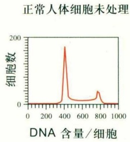

line

| DNA 含量/细胞 | 细胞数 |
| --- | --- |
| ~380 | ~180 |
| ~780 | ~45 |

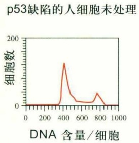

line

| DNA 含量/细胞 | 细胞数 |
| --- | --- |
| 0 | 0 |
| ~350 | ~10 |
| ~400 | ~160 |
| ~750 | ~40 |

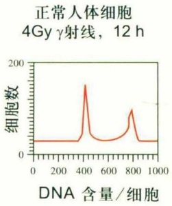

line

| DNA 含量/细胞 | 细胞数 |
| --- | --- |
| 0 | ~30 |
| 400 | ~170 |
| 800 | ~90 |
| 1000 | ~30 |

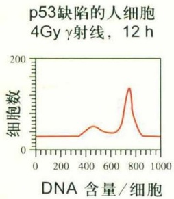

line

| DNA 含量/细胞 | 细胞数 |
| --- | --- |
| 0 | ~20 |
| 200 | ~20 |
| 400 | ~20 |
| 450 | ~40 |
| 600 | ~25 |
| 750 | ~140 |
| 850 | ~25 |
| 1000 | ~20 |

图16-9 用流式细胞仪检查正常的人细胞和p53缺陷的人细胞 $G_{1}/S$ 检控点的状态

流式细胞仪是研究细胞周期最重要的工具之一，它能高速测定细胞群体中单个细胞的DNA含量。 $G_{2}/M$ 期细胞中DNA含量为 $G_{1}$ 期细胞的两倍，S期细胞中DNA含量介于两者之间，所以图中左边的峰代表的是 $G_{1}$ 期细胞，右边的峰代表的是 $G_{2}/M$ 期细胞，两峰之间的曲线以下的区域代表处在S期的细胞。正常细胞受到足够剂量（如4Gy）γ射线照射后，细胞被阻断在 $G_{1}/S$ 交界处，进入S期的细胞明显减少；p53受到γ射线照射后，从 $G_{1}$ 期进入S期的细胞则不会减少。由于另一个细胞周期检控点 $G_{2}/M$ 被激活，细胞被阻断在 $G_{2}/M$ 交界处不能进入M和 $G_{1}$ 期，因而 $G_{1}$ 期细胞明显减少。

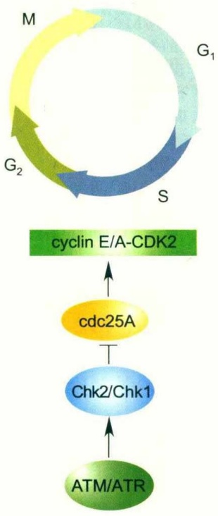

flowchart

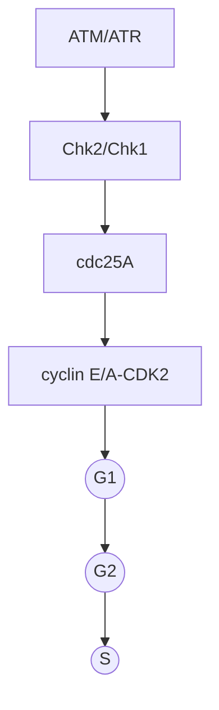

图 16-10 S 期内检控点的作用机制

当细胞在S期发生DNA损伤时，ATM/ATR被激活，ATM和ATR分别磷酸化Chk2和Chk1。Chk1和Chk2被磷酸化后，具有了激酶活性，进而磷酸化cdc25A，下调其活性，使其不能发挥活化CDK2的作用，从而抑制晚期复制起始点的启动。

细胞处在间期时，cdc2的Tyr15和Thr14被磷酸化，导致其活性被抑制。Wee1是负责磷酸化Tyr15和Thr14的蛋白激酶之一。细胞进入有丝分裂需要cdc2的激活，而cdc2的激活又需要Tyr15和Thr14的去磷酸化（以及Thr161的磷酸化），cdc25A和cdc25C（主要是后者）是使Tyr15和Thr14去磷酸化的磷酸酶（CAK是使Thr161磷酸化的激酶）。有研究表明，在人细胞中，p53和p21在 $G_{2}/M$ 检控点的保持中也起着重要作用；这种作用可能是通过p21 对 cdc2/cyclin B 激酶活性的抑制而实现的（图 16-11）。

正常细胞在受到电离辐射等DNA损伤因子作用后，能阻断细胞从 $G_{2}$ 期进入M期；但当 $G_{2}/M$ 检控点基因发生缺陷时，不能阻断细胞进入M期。例如，在受到8Gy的γ射线照射（诱导DNA损伤）后再继续培养16h，正常的人成纤维细胞大部分被阻断在 $G_{2}/M$ 交界处，而ATR缺陷的人成纤维细胞则有很多已从 $G_{2}$ 期通过M期并进入 $G_{1}$ 期（图16-12）。加入M期阻断剂nocodazole，

16.3 几个重要的细胞周期检控点

329

---

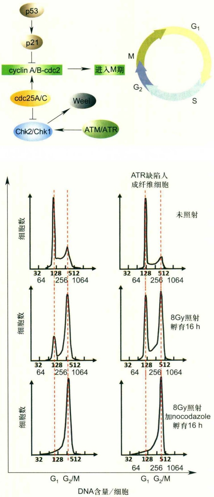

$G_{1}$ 峰消失，证明 $\gamma$ 射线照射后16 h进入 $G_{1}$ 期的细胞是来自通过 $G_{2}/M$ 并进入M期的细胞，说明ATR缺陷导致 $G_{2}/M$ 检控点有缺陷。

## 16.3.4 S/M检控点

S/M 检控点 (S/M checkpoint) 也称为 DNA 复制检控点 (DNA replication checkpoint)。当 DNA 复制被阻断时，图16-11 $\mathrm{G}_2 / \mathrm{M}$ 检控点的作用机制当细胞受到遗传毒性因子作用而发生DNA损伤时，ATM/ATR被激活，ATM和ATR分别磷酸化并激活Chk2和Chk1。Chk1或Chk2通过磷酸化cdc25A/C下调其活性、而通过磷酸化上调Wee1活性继而抑制cdc2/cyclinB的活性，最终将细胞阻断在 $\mathrm{G}_2 / \mathrm{M}$ 交界点上。在人的细胞中，p53和p21在维持检控点活性中起着重要作用，将细胞长久阻滞在 $\mathrm{G}_2 / \mathrm{M}$ 界面上。其机理可能是通过p21对cdc2/cyclinB激酶活性的抑制。

## 图16-12 ATR参与 $G_{2}/M$ 检控点的调节

$G_{2}/M$ 检控点上游具有一个复杂的信号网络，收集整合DNA损伤信息，决定是否将细胞阻滞在 $G_{2}/M$ 界面上。ATR在这个网络中是一个处于顶端的关键控制激酶，能够收集DNA损伤信息，通过磷酸化下游蛋白来激活 $G_{2}/M$ 检控点，阻滞细胞进入M期。在此例中，ATR缺陷细胞株不具有 $G_{2}/M$ 检控点功能。当使用8Gy剂量的伽马射线照射细胞损伤DNA后，正常细胞 $G_{2}/M$ 检控点在ATR的控制下被激活，孵育16 h后多数正常细胞聚集在 $G_{2}/M$ 界面，不能穿过M期进入 $G_{1}$ 期；在同样的实验条件下，ATR缺陷细胞不能被阻滞在 $G_{2}/M$ 界面上，而是直接进入并穿过M期和 $G_{1}$ 期。Nocodazole具有抑制细胞穿过M期的作用，显示ATR缺陷细胞不具有 $G_{2}/M$ 检控点功能。

该检控点感受到未完成复制的DNA，阻止细胞进入有丝分裂，防止未完成复制的染色质的提前凝集（premature chromatin condensation, PCC）（图16-13）。

由DNA损伤或核苷缺乏而引起的复制叉的停止可成为激活S/M检控点的信号。该检控点主要通过ATR-Chk1-cdc25A-cdc2通路阻止细胞进入有丝分裂期（图16-14）。实验显示，A-T患者的细胞的S/M检控点没有缺陷，

330

第16章 细胞周期与检控点

---

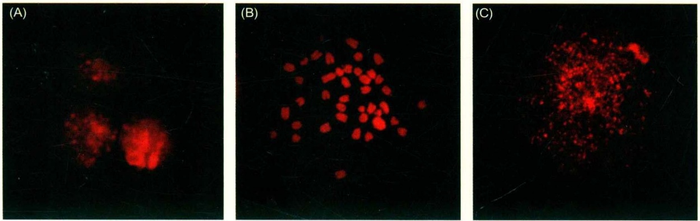

图16-13 S/M检控点缺陷细胞未完成复制的染色质的提前凝集

用碘化丙啶对小鼠ES细胞核DNA进行染色。(A) 间期细胞核；(B) 分裂期染色体；(C) 在培养的细胞中加入DNA合成阻断剂（如羟基脲）可引发有S/M检控点缺陷的细胞产生PCC。发生提前凝集的未完成复制的染色质在显微镜下呈现粉末状，但实际上染色质并未断开，这只是染色质不均一地发生凝集造成的表象。当细胞具有正常S/M检控点时，羟基脲不会引发PCC，细胞仍停留在间期。

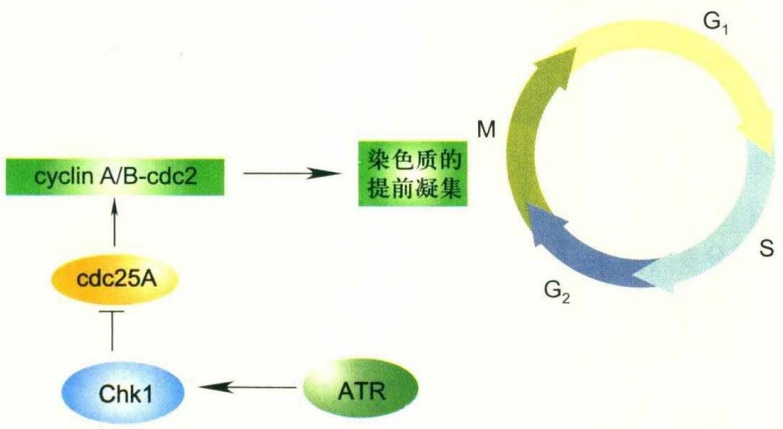

flowchart

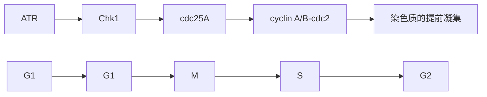

图16-14 S/M检控点的作用机制

由DNA损伤或核苷缺乏而引起的复制叉的停止，主要通过ATR-Chk1-cdc25A-cdc2通路阻止细胞进入有丝分裂期。

提示ATM-Chk2不参与S/M检控点的调控。

## 16.3.5 纺锤体组装检控点

纺锤体组装检控点(spindle assembly checkpoint)的作用是在有丝分裂中期，当纺锤丝未能正确地连接到染色体的动粒上时，通过抑制APC [anaphase promoting complex, 或称为cyclosome(APC/C)]的泛素连接酶活性，抑制姐妹染色单体的分离，阻止细胞从有丝分裂中期向后期过渡，以保证复制后的染色体精确地分配到两个子细胞核中。

细胞中DNA复制之后，每条染色体由两条姐妹染色单体组成。细胞进入有丝分裂后期之前，即姐妹染色单体完成在纺锤体上的两极定向之前，它们必须保持连接。姐妹染色单体之间的连接依赖于被称为cohesin的蛋白质复合物。有丝分裂后期的起始依赖于一种叫作separase的蛋白酶对cohesin的一个亚基Scc1的水解作用。而在细胞进入有丝分裂后期之前，抑制性蛋白securin与separase结合，并将其保持在非活性状态。当所有染色单体都已正确连接到纺锤丝上之后，APC/C将securin连接到泛素上，通过泛素化途径将其水解，继而separase恢复活性，水解Scc1，姐妹染色单体得以分离，驱使细胞进入分裂后期。

纺锤体组装检控点所感受到的有丝分裂缺陷可能包括两方面:一是染色体动粒上微管结合位点被占据的状态；二是由纺锤体两极所发出的微管与动粒结合而产生的姐妹染色单体之间的张力。但究竟是两方面因素共同起作用还是其中一方面的缺陷就足以激活纺锤体组装检控点，目前还不能得出定论。

参与纺锤体组装检控点作用的蛋白有Mad1、Mad2、Mad3（BubR1）、Bub1、Bub3和Mps1等。Mad（mitotic arrest deficient）和Bub（budding uninhibited by benzimidole）蛋白最初在酵母中被发现，Mad和Bub基因的突变体在微管毒性物质nocodazole或benzimidazole（苯并咪唑）作用

16.3 几个重要的细胞周期检控点

331

---

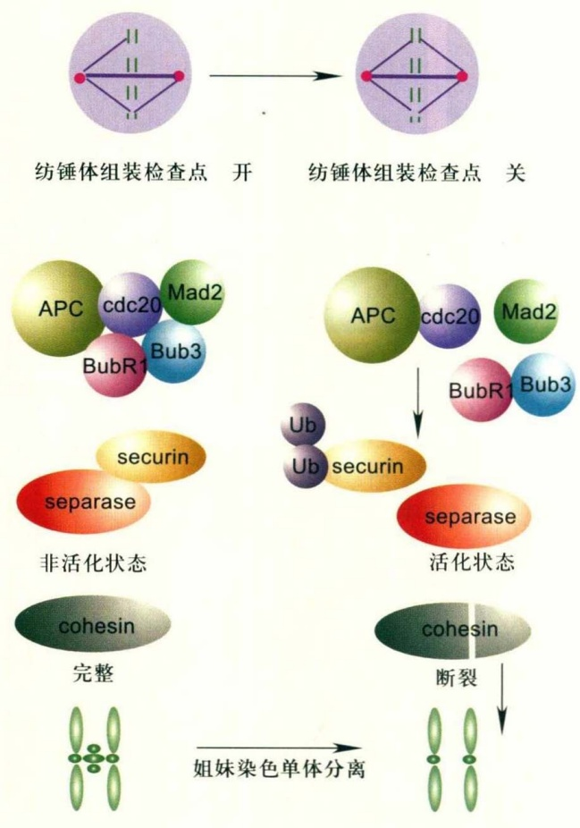

下不能存活。Mps1蛋白最初作为一种纺锤体组装所需要的中心体蛋白被发现，之后发现它也参与纺锤体组装检控点功能。后来也在哺乳动物等高等生物细胞中发现这些蛋白的同源蛋白，当用注射抗体或RNAi的方法抑制它们的功能时，纺锤体组装检控点的功能即被破坏；在存在微管毒性物质时，有丝分裂不能被阻断，导致染色体分离错误，产生非整倍体。部分抗癌化药利用癌细胞这一检控点缺陷而发挥作用。纺锤体组装检控点所作用的下游目标即APC/C和cdc20组成的复合物（APC/Ccdc20），APC/C需要与cdc20结合以发挥对securin的泛素连接酶作用。由Mad2、BubR1、Bub3和cdc20组成有丝分裂检控点复合体（mitotic checkpoint complex，MCC），抑制cdc20与APC/C之间的相互作用，结果使姐妹染色单体不能得以分离，细胞被阻断在有丝分裂中期和后期交界处（图16-15）。

图16-15 染色体分离及纺锤体组装检控点的分子机制

细胞在进入有丝分裂后期之前，cohesin将姐妹染色单体连接在一起。separase蛋白酶水解cohesin的一个亚基Scc1是姐妹染色单体分离的前提条件。在细胞进入有丝分裂后期之前，抑制性蛋白securin与separase结合，使其处于非活性状态。当所有染色单体都已正确连接到纺锤丝上之后，APC/C使securin泛素化，通过泛素化途径将其水解，继而separase恢复活性，水解Scc1，姐妹染色单体彼此分离（右图）。细胞进入有丝分裂后期之前，如果染色单体未能正确连接到纺锤丝上，纺锤体组装检控点即被激活，由Mad2、BubR1、Bub3和cdc20组成的检控点复合体抑制cdc20与APC/C之间的相互作用（而APC/C需要与cdc20结合才能发挥对securin的泛素连接酶作用），结果使姐妹染色单体不能得以分离（左图）。

## 16.4 细胞周期检控点与癌症的发生

细胞中的DNA经常会受到来自外界或细胞内部的各种因素的攻击，结果或是碱基遭到破坏，或是其骨架上的磷酸二酯键发生断裂。例如细胞在新陈代谢过程中或受到电离辐射后会产生氧自由基，氧自由基既能破坏碱基，也能使DNA双链发生断裂，烷基化试剂可使嘌呤碱基被烷基化，或使DNA产生链内或链间交联等。DNA损伤是导致癌症的主要原因。

癌症的发生是基因突变逐渐积累和选择的过程。从基因水平而言，它是多基因突变的结果，单独一个基因的突变不足以导致癌症的发生，因为细胞有一整套防御机制，共同应对DNA所受到的损伤，以防止致癌性的基因突变。这套防御机制包括相互协作的几个方面:① 细胞中的DNA修复系统，使受损的DNA及时得到修复；② 细胞周期检控点使细胞周期进程暂时停止，以使细胞有机会修复受损伤的DNA；③ 细胞凋亡机制，受损的DNA若未能被成功修复，细胞选择死亡的方式，以避免对整个机体产生更不利的影响。

癌基因、抑癌基因和DNA修复基因3类基因的突变能够导致癌症。癌基因也称为原癌基因，通常是正常细胞生长、发育和分化过程中所需要的基因，但其表达受到调节和控制，癌基因的突变使其持续处于活性状态，

332

第 16 章 细胞周期与检控点

---

使细胞生长失去控制，或在该分化的时候不能进行分化；抑癌基因在正常情况下是调控细胞生长的基因，如细胞周期检控点基因和细胞凋亡所需要的基因等，当其发生缺失或失活时，会导致细胞增殖失控和细胞凋亡障碍；DNA修复基因将DNA突变控制在最低水平，所以当其发生突变时，会大大提高其他基因的突变率。

当DNA突变使得细胞处于增殖失控状态时，细胞很容易进一步获得更多的突变而且有成瘤性，这些恶性的细胞能够浸润周围的组织，或向远处的组织和器官转移。

由DNA修复系统缺陷或细胞周期检控点失调所造成的基因组的不稳定性会大大提高具有致癌可能的突变的发生率，在癌症发生中具有重要作用。大多数人认为基因组的不稳定性会导致癌症发生，但少数情况下，导致基因组不稳定的突变并未引起癌症的发生率上升。所以关于这个问题仍有争论。还有人认为基因组的不稳定性可能与癌症的发生互为因果。许多细胞周期检控点基因陆续被证明是抑癌基因，当其表达下调或发生功能丢失突变(loss-of-function mutation)时，会导致癌症的发生。在癌细胞中经常发现细胞周期检控点基因失调的情况，如参与细胞周期检控点调控的p53和pRb(Rb蛋白)，作为抑癌分子，它们的基因突变在癌细胞中很常见；BRCA1或BRCA2基因的突变会导致乳腺癌或卵巢癌等；ATM的缺失使人或小鼠具有患淋巴瘤的倾向等。

ATR的两个等位基因的缺失导致动物在胚胎发育早期死亡，在动物和人细胞中，一个等位基因发生突变导致其蛋白表达下降（这种突变称为hypomorphic mutation），人Seckel综合征（Seckel syndrome）就与ATR单等位基因的突变有关。Seckel综合征患者表现为生长迟缓、矮小、小头、智力低下，其细胞在丝裂霉素C（可破坏DNA）作用下表现出染色体的不稳定性。尽管遗传性Seckel综合征患者并未表现出较高的恶性肿瘤发生率，但在DNA错配修复功能有缺陷的小鼠中，ATR的单等位基因突变却可提高肿瘤的发生率。这是一个在肿瘤发生的分子机制研究当中经常会观察到的现象，那就是，有时单独一个细胞周期检控点基因的突变可能不足以导致癌症，但当同时还有DNA修复基因的突变时，发生癌症的可能性即大大提高了。

多数癌细胞中的染色体缺失或增加，为非整倍体。导致癌细胞染色体数量异常的原因仍有争论，但已经发现某些纺锤体组装检控点基因如Bub1B（编码BubR1）的突变可能产生非整倍体。该检控点的缺失会导致染色体不均等地分配到两个子细胞中，故而产生非整倍体。但关于该检控点失调是否会导致癌症的发生，由于检控点蛋白完全失活往往导致早期胚胎死亡，所以很难在高等动物体上找到直接的证据。但有研究发现 $Mad2^{+/-}$ 小鼠肺部肿瘤的发生率上升。所以在癌细胞中，检控点蛋白一般不完全失活，但纺锤体检控点基因常发生部分缺失。

许多对细胞的基本生命活动所必需的基因，那就是双等位基因的缺失往往导致动物在胚胎发育早期死亡，所以无法得到这样的基因敲除动物用于癌症发生的研究。对于这类基因的研究，有时可采用条件性基因敲除的办法，即只在某些组织或器官中条件性地敲除某种基因，这样在胚胎发育的早期——即组织和器官尚未形成时，该基因尚处于正常状态，不影响胚胎的发育；而当该组织或器官形成时，该基因只在这种组织或器官中被敲除，然后可以观察该组织或器官中癌症的发生率是否升高。一种实现条件性基因敲除的方法是:在欲敲除的基因两侧加上可被核酸内切酶Cre识别的loxP位点，得到这种动物后，通过与在某种组织或器官中特异性表达Cre基因的动物杂交，从后代中筛选在该组织或器官中条件性地敲除了目的基因的动物。

## 16.5 细胞周期检控点蛋白质与细胞中其他生命过程的关系

参与细胞周期检控点调控的各种蛋白，除了调节细胞周期之外，还参与细胞中许多其他重要的生命过程，如DNA复制和修复等；而在研究DNA复制和修复过程中发现的许多蛋白质，后来发现在细胞周期检控点中也起作用。也就是说，许多蛋白在这些过程中的功能是交叉的。

例如，参与DNA损伤检控点作用的Rad17-RFC2-5和9-1-1复合体，也被发现参与跨损伤的DNA合成；过去发现在DNA复制和修复过程中起重要作用的PCNA，后来发现也参与由p21介导的细胞周期检控点作用；DNA复制蛋白Polα/primase（为DNA复制起始所需要），在DNA复制检控点中也起作用；单链结合蛋白RPA（复制蛋白-A）不仅参与DNA的复制和修复，还作为DNA损伤的感受因子，参与DNA损伤检控点功能；RFC2-5（复制因子-C的4个小亚基），也在DNA损伤检控点中参与DNA损伤

16.5 细胞周期检控点蛋白质与细胞中其他生命过程的关系

333

---

信号的传递。以上这些例子说明细胞周期和细胞周期检控点，以及DNA复制和修复等过程之间有着密切的联系。

的确，当DNA发生损伤时，为了更好地进行DNA修复，细胞需要通过细胞周期检控点控制细胞周期进程，尤其是DNA复制和有丝分裂过程。真核细胞的细胞周期检控点与DNA复制和修复等过程的协同配合对其是一个十分有利的机制，通过这一机制限制了可遗传的突变向子细胞的传递，同时提高了受损伤细胞的存活能力。

细胞中各种生命活动过程是相互联系的，而且这种联系是通过一些衔接分子的作用而实现的。细胞周期检控点通路与细胞周期之间的衔接是通过前者的效应器分子作用于细胞周期中各种CDK/cyclin而实现的。效应器分子在细胞周期、DNA修复和细胞死亡机制之间的界面上发挥作用。一些在这几个过程中具有交叉功能的蛋白或蛋白复合体，可能也是这些过程相互协调和联系的纽带。

## 16.6 细胞周期与癌症治疗

目前癌症治疗方法包括外科手术、放射线治疗、化疗、小分子靶向治疗和大分子靶向治疗。其中放疗和化疗与细胞周期密切相关；也有部分小分子靶向药是针对细胞周期靶点。这些治疗利用癌症细胞的一个共同特点，即癌细胞不受调控地进行复制和分裂，一个或多个细胞周期检控点失灵，其背后的分子机制是检控分子（如p53、p16、Rb等）和DNA损伤修复因子（BRAC1、BRACA2等）功能缺失。事实上，原发性致癌事件是导致不可控细胞增殖的基因突变，这些突变在遗传或获得性DNA修复缺陷的细胞中更为常见。

## (1) 放射线治疗

有一半的癌症患者需要放疗，用于清除手术后癌组织周边浸润的手术无法完全去除的癌细胞或治疗不适合外科手术的癌块。放疗的治疗机制是直接或间接通过激发自由基产生损伤癌细胞的DNA，进而诱导癌细胞死亡。癌细胞快速生长对DNA损伤敏感；且癌细胞通常有1个或多个检控点缺陷，DNA损伤后不能有效修复，导致细胞死亡。放疗的优点是具有指向性，也可使多数的射线能量沉积在癌块中，避免或减少对正常组织的损伤。

## (2) 化疗

化疗的治疗机制有两种:一种是干扰DNA复制，另一种是破坏有丝分裂。化疗与放疗有两点不同:①化疗是全身系统的治疗，用于癌症扩散或怀疑扩散的患者；②由于是全身治疗，化疗避不开敏感的正常组织，尤其是细胞快速分裂组织如胃肠道、血细胞系统（包括免疫细胞）和皮肤等。

前面讲到S/M检控点，如DNA复制受到化药阻断不能完成，细胞不能进入M期，不会造成细胞死亡。许多癌细胞该检控点有缺陷，化药阻断DNA复制，细胞仍然进入M期，导致细胞崩溃。还有一类化药在S期诱导DNA损伤，也导致细胞死亡。

干扰微管的化药如紫杉醇对不分裂的细胞毒性不大，但对快速分裂的癌细胞则有强杀伤力。对于那些M期检控点有缺陷的癌细胞杀伤力更强，因为这些细胞在药物干扰纺锤体形成与分离时仍然强行分裂，造成细胞死亡。

## (3) 靶向细胞周期关键分子的化药

目前临床上使用的小分子靶向药物许多是基于阻断控制细胞增殖的信号通路的药理，即控制 $G_{1}$ 期的上游信号通路。细胞周期关键分子和DNA损伤修复蛋白（如多聚ADP-核糖聚合酶PARP）作为潜在药靶的研发正在开展，但多数这类临床试验药的亲和力或专一性还有待提高，还未达到临床使用的标准。在此仅对两类成功用于临床靶向药的作用机制给予介绍，进一步的展开阅读请参考文献[6,16]。

靶向CDK4/6的药物帕博西尼（palbociclib）已经成功用于一种乳腺癌（雌激素受体阳性、HER2阴性）的治疗，显著延长患者的生存时间。如前所述，CDK4/6通过磷酸化Rb促进细胞从 $G_{1}$ 期进入S期。该药能够抑制癌细胞的DNA复制。

另一类药是靶向DNA修复酶PARP1。现在有3个靶向该酶的小分子化药olaparib、rucaparib和niraparib被批准用于BRCA1/BRCA2功能缺陷的卵巢癌的治疗。BRCA1和BRCA2蛋白在DNA双链断裂同源重组修复和细胞周期检控点中发挥重要作用，它们的功能缺失突变导致S期双链断裂增加和基因组不稳定，大幅增加乳腺癌和卵巢癌的发病率。PARP1在肿瘤中通常高表达，可以通过非同源重组修复DNA双链断裂，以弥补BRCA1/BRCA2功能缺失造成的双链断裂增加。抑制PARP1导致双链断裂增加，其实质就是利用肿瘤细胞检控点和修复缺陷杀伤癌细胞。

334

第 16 章 细胞周期与检控点

---

## □ 小结

细胞周期由4个分期构成。它们是分裂期M期（两套染色体均等分配到两个子细胞）、DNA复制期S期及M期和S期之间的两个间隔期—— $G_{1}$ 期（从M期到S期）和 $G_{2}$ 期（从S期到M期）。驱动细胞的关键周期因子是由多种细胞分裂激酶（如CDK1、CDK2、CDK3等）和多种周期蛋白（如cyclinA、cyclinB、cyclinD等）构成的一系列二聚蛋白激酶复合体。CDK和cyclin需形成复合体才具有激酶活性。CDK/cyclin通过磷酸化来激活众多在细胞周期中起重要作用的蛋白分子。细胞从一个分期进入下一个分期（如 $G_{1}$ 期到S期、 $G_{2}$ 期到M期）及分期内上一个阶段到下一阶段（如S期和M期内）是受到细胞周期监控点机制严密调控的。监控点机制调控CDK/cyclin的激酶活性。调控方式包括磷酸化修饰CDK、抑制蛋白（p21）结合CDK、cyclin的降解和cyclin的出核转运（与CDK分离）。检控点机制是确保细胞内的遗传物质精确复制和分配以及细胞正常生长和增殖的必要条件。

目前研究最多的检控点有 $G_{1}/S$ 、S期内、S/M、 $G_{2}/M$ 和纺锤体组装检控点。除此之外还有别的检控点，如 $G_{2}/M$ 短时调控检控点。每一个检控点上游均有多个复杂的调控通路，接收和综合细胞内外信号，最终调控CDK/cyclin的激酶活性。细胞外信号包括营养、激素、生长因子、细胞因子、同伴细胞密度等，细胞内信号包括细胞所处周期位置、细胞大小、基因组DNA的损伤程度等。DNA的损伤是调控细胞周期检控点的重要信号。检控点通路对DNA损伤十分敏感，基因组中出现一个DNA双链断裂便能被感知，使细胞被阻滞在 $G_{2}/M$ 期界面；待该损伤修复后才让细胞进入M期。许多检控点通路中的DNA损伤信号感受因子（如ATM、ATR、9-1-1复合体等）同时参与DNA损伤修复。细胞周期检控点与DNA损伤修复机制的偶联能有效维持基因组DNA的稳定性。

基因组不稳定是恶性肿瘤细胞的基本特征。检控点基因突变是肿瘤发生的重要遗传原因。如p53是重要的 $G_{1}/S$ 检控点基因，在半数以上肿瘤中都有功能丢失突变。BRCA1和BRCA2也是重要的 $G_{1}/S$ 和 $G_{2}/M$ 检控点基因，其突变导致乳腺癌和卵巢癌高发。正常细胞和肿瘤细胞检控点差异是肿瘤放射疗法和化学疗法的关键根据。对正常细胞检控点机制和肿瘤细胞检控点缺陷原因的深入研究，有望开发出新的肿瘤治疗药物。

## □ 思考题

1. 细胞周期检控点是点、机制，还是信号通路？请解释。

2. 细胞周期检控点的主要功能是什么?

3. 请解释为何 DNA 损伤因子是强细胞周期检控点激活因子。

4. 细胞周期检控点缺失为何容易导致癌症发生?

5. 癌症化疗和放疗利用了癌细胞周期检控点与正常细胞周期检控点的什么不同特征？请举例解释。

(杭海英 中国科学院生物物理研究所)

思考题

335

---

## □ 参考文献

1 汪堃仁, 薛绍白, 柳惠图. 细胞生物学. 2 版. 北京: 北京师范大学出版社, 1998.
2 Bharadwaj R, Yu H T. The spindle checkpoint, aneuploidy, and cancer. Oncogene, 2004, 23:2016–2027.
3 Bunz F, Dutriaux A. Requirement for p53 and p21 to sustain  $G_{2}$  arrest after DNA damage. Science, 1998, 282:1497–1501.
4 Chini S, Chen J. Human Claspin is required for replication checkpoint control. J Biol Chem, 2003,278:30057-30062.
5 Dart D A, Adams K E, Akerman I, et al. Recruitment of the cell cycle checkpoint kinase ATR to chromatin during S-phase. J Biol Chem, 2004, 279:16433-16440.
6 de Groot A F, Kuijpers C J, Kroep J R. CDK4/6 inhibition in early and metastatic breast cancer: a review. Cancer Treatment Reviews, 2017, 60:130–138.
7 Hang H, Fox M H. Analysis of the mammalian cell cycle by flow cytometry. In: Lieberman H B, Methods Mol Biol, 2004,241: 23–35. Cell Cycle Checkpoint Control Protocols. Totowa: Humana Press.
8 Kastan M B, Bartek J. Cell cycle checkpoints and cancer. Nature, 2004, 432:316–323.
9 Lengauer C, Wang Z. From spindlecheckpoint to cancer. Nat Genet, 2004, 36:1144–1145.
10 Marheineke K, Hyrien O. Control of
replication origin density and firing time in Xenopus egg extracts: role of acaffeine-sensitive, ATR-dependent checkpoint. J Biol Chem, 2004, 927:28071–28081.
11 Massagué J. G $_{1}$ cell-cycle control and cancer. Nature, 2004, 432: 298–306.
12 Maya R, Balass M, Kim ST, et al. ATM-dependent phosphorylation of Mdm2 on serine 395: role in p53 activation by DNA damage. Genes Dev, 2001, 15: 1067–1077.
13 Murakami H, Nurse P. DNA replication and damage checkpoints and meiotic cell cycle controls in the fission and budding yeasts. Biochem J, 2000, 349:1–12.
14 Musacchio A, Hardwick K G. The spindle checkpoint: structural insights into dynamic signaling. Nat Rev Mol Cell Biol, 2002, 3:731–741.
15 Nghiem P, Park P K Kim Y, et al. ATR inhibition selectively sensitizes  $G_{1}$  checkpoint–deficient cells to lethal premature chromatin condensation. PNAS, 2001, 98(16):9092–9097.
16 Nickoloff J A, Jones D, Lee S H, et al. Drugging the cancers addicted to DNA repair. J Natl Cancer Inst, 2017, 109(11): djx059.
17 Parrilla-Castellar E R, Arlander S J H, Karnitz L. Dial 9-1-1 for DNA damage: the Rad9-Hus1-Rad1(9-1-1) clamp complex. DNA Repair, 2004, 3:1009-1014.
18 Sancar A, Lindsey-Boltz L, Unsal-Kacmaz K, et al. Molecular mechanisms
of mammalian DNA repair and the DNA damage checkpoints. Annu Rev Biochem, 2004, 73:39–85.
19 Sar F, Lindsey-Boltz L A, Subramanian D, et al. Human Claspin is a ring-shaped DNA-binding protein with high affinity to branched DNA structures. J Biol Chem, 2004, 279:39289-39295.
20 Sorensen C S, Syljuasen R G, Lukas J, et al. ATR, Claspin and the Rad9-Rad1-Hus1 complex regulate Chk1 and Cdc25A in the absence of DNA damage. Cell Cycle, 2004, 3:941-945.
21 Stein G S, Baserga R, Giordano A, et al. The molecular basis of cell cycle and growth control. New York: Wiley–Liss, Inc, 1999.
22 Toueille M. Regulation of the DNA replicationfork: a way to fight genomic instability. Chromosoma, 2004, 113:113-125.
23 Uto K, Inoue D, Shimuta K, et al. Chk1, but not Chk2, inhibits Cdc25 phosphatases by a novel common mechanism. EMBO J, 2004, 23:3386-3396.
24 Vogelstein B, Kinzler K W. Cancer genes and the pathways they control. Nat Med, 2004,10:789–799.
25 Xu B, Kim S T, Lim D S, et al. Two molecularly distinct  $G_{2}/M$  checkpoints are induced by ionizing irradiation. Mol Cell Biol, 2002, 22:1049–1059.

336

第16章 细胞周期与检控点
