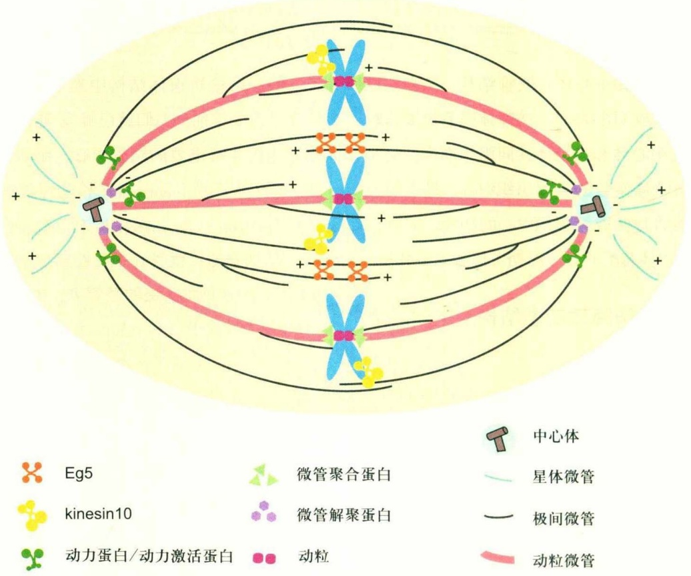
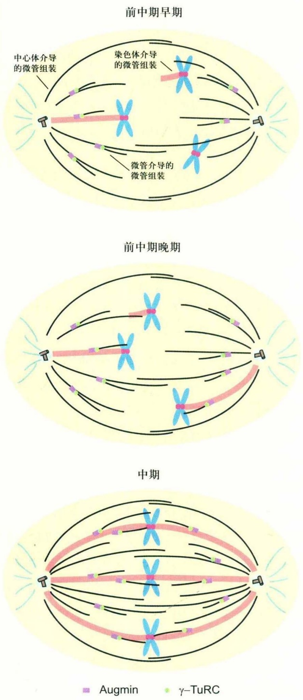
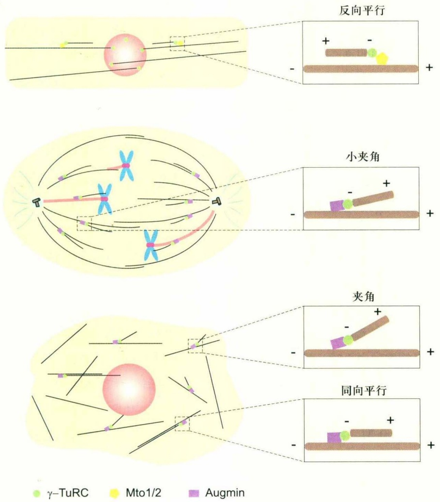
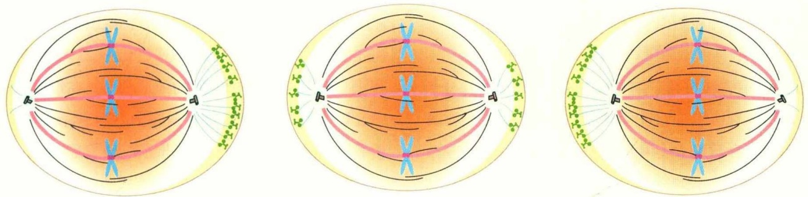
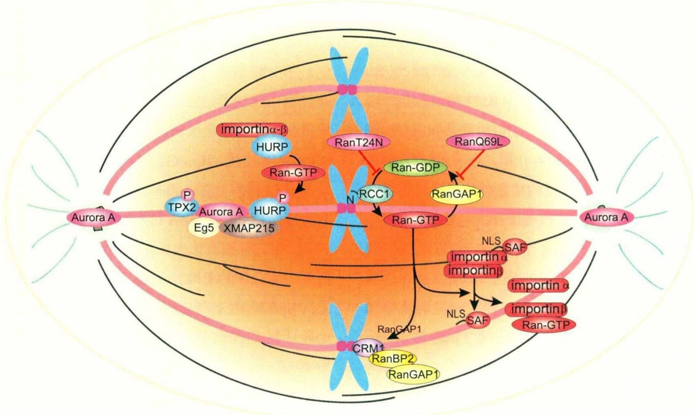

# 第18章 细胞有丝分裂期纺锤体的组装

原始 PDF 第 365–379 页。

第18章

## 细胞有丝分裂期纺锤体的组装

18

细胞有丝分裂期的纺锤体是一个高分子“机器”，其主要功能是在有丝分裂过程中将复制完成的染色体均等地分离到两个子细胞中。纺锤体的主要组成成分是微管结构。微管结构的极性和高度动态性是纺锤体发挥功能的关键因素。在大多数细胞类型中，纺锤体微管的成核主要依赖于纺锤体两极的两个中心体。此外，染色体以及微管本身也具有微管成核功能。许多纺锤体相关蛋白也参与纺锤体装配过程，如马达蛋白和微管动态调控蛋白。在过去的几十年中，大量的研究已经发现了许多纺锤体装配过程中起关键调控作用的蛋白因子，因而对于纺锤体和染色体的动态变化形成了一个相对清晰的模型。

纺锤体的正确组装对于染色体准确高效地分离具有重要意义。在生物体内，细胞有丝分裂的核心功能是保证细胞在S期复制完成的两套染色体均等地分离到两个子细胞中，而纺锤体在此过程中通过其微管结构发挥主要作用:纺锤体微管与染色体上的一对动粒相连接，拉动姐妹染色单体相互分离并向纺锤体两极运动，最终使得两套染色体在两个子细胞中各自形成细胞核结构。纺锤体微管从纺锤体两极发散出来，两极处的微管被称为微管负极，而从两极发散出来的微管的另一端被称为微管正极。根据微管的形态和功能的差异，纺锤体微管主要分为3类:星体微管、动粒微管和极间微管（图18-1）。星体微管从纺锤体两极发散出来，其正极指向细胞皮层，半衰期为30～60 s，这类微管对于纺锤体在细胞内位置的确定具有重要意义。动粒微管是一类直接与染色体相结合的微管，细胞内半衰期可达7 min，能够抵抗一定程度的微管解聚因子如低温或低浓度的微管解聚药物的作用。动粒微管与染色体连接的区域称为动粒（kinetochore），它是在染色体着丝粒上组装的盘状结构。姐妹染色单体两侧的动粒微管对染色体产生拉力，并确保两极对染色体拉力的平衡从而保证染色体的正确分离。极间微管指纺锤体内除动粒微管外的微管总和，数量巨大，降解-再生频率快，没有明显的动力学特征。极间微管有的很短，位于半个纺锤体区域；有的很长，能够跨越纺锤体中间区域与另一半纺锤体的微管形成反向平行的连接。极间微管一方面能够稳定纺锤体的结构，拮抗两极对纺锤体的过度挤压；另一方面能够协助动粒微管调节染色体列队。

不同物种的纺锤体具有一个共同的结构特点，即纺锤体是一个平衡的双极结构，从而能够保证染色体与纺锤体的两极相连，并最终将其均等分配到两个子细胞中。任何对于这种平衡的两极结构的破坏，都将可能导致致命的后果或癌变等。不同物种的纺锤体结构又有各自不同的特点。在大多数体细胞中，纺锤体两极聚集于中心体上，形成一个由多种蛋白组成的中心体结构，在纺锤体装配中发挥重要的微管组织作用。而中心体的正确复制和分离对于两极的建立具有重要意义。在缺少中心体的细胞如植物细胞和动物卵母细胞中，染色体在微管的成核和组装过程中发挥重要作用，微管则主要依赖于微管自组织以及各种马达蛋白的作用，从而形成纺锤体结构。在酿酒酵母中，有丝分裂期细胞不发生核膜崩解，纺锤体在细胞核内形成。此时，纺锤体微管的两极结构由镶嵌在细胞核膜上的纺锤体极体组织形成。

352

第 18 章 细胞有丝分裂期纺锤体的组装

---

## 18.1 有丝分裂期纺锤体的分子构成

体细胞纺锤体主要由中心体、微管结构、染色体以及纺锤体相关蛋白组成（图18-1）。纺锤体微管主要由行使组织微管功能的中心体和染色体共同组织而成。通常认为，中心体是纺锤体微管的重要组织中心。最近研究表明，染色体也能够行使微管组织中心的功能，多种染色体结合蛋白在纺锤体装配的各个时期发挥着重要作用。

## 18.1.1 微管是纺锤体动态结构的主要组成成分

纺锤体主要由微管组成。微管结构是由13根微管原丝组成的一根完整的中空圆柱状结构，而微管原丝是由α-微管蛋白(α-tubulin)和β-微管蛋白(β-tubulin)组成的异源二聚体以头尾相结合的方式形成。微管具有2个重要的特点——高度动态性和微管结构的极性，这两个特性在纺锤体装配和染色体分离过程中发挥重要作用。首先，微管高度动态，它可以通过微管蛋白二聚体的装配和解离实现微管的“生长”和“缩短”。每一根微管都在“生长”和“缩短”之间随机变化，形成了微管的动态不稳定性。研究发现，在体外组装的微管也能展现出微管的不稳定性；而在细胞内，微管的动态变化更为剧烈，并受到多种微管相关蛋白质(microtubule associated protein, MAP)的调节。有的MAP可以增强或减弱微管的稳定性，有些则用来改变微管“生长”和“缩短”之间频率的变化。在有丝分裂期中，MAP在不同的时机和位置对微管共同发挥作用，使有丝分裂期的纺锤体微管比细胞间期中的微管具有更加显著的动态不稳定性。其次，微管的极性在纺锤体装配过程中也发挥重要作用。由于微管由微管蛋白异源二聚体头尾排列组成，因而微管的两极具有不同的结构特点和动态变化特点。同时，具有极性特点的微管结合马达蛋白结合在微管纤维表面，负责向不同的方向运输其底物蛋白。动力蛋白(dynein)复合体在微管表面的运动方向为微管的负极，而驱动蛋白(kinesin)则向微管的正极运动。这些马达蛋白通过结合不同的底物蛋白作为运输的“货物”(cargo)，将细胞内各种关键因子，如染色体、微管以及其他蛋白，在合适的时间运送到不同的细胞亚定位发挥不同的功能，从而保证纺锤体微管组装和染色体分离的正常进行。

## 18.1.2 中心体是体细胞纺锤体微管的主要组织中心

中心体是纺锤体结构中最早被人们了解的细胞器。早在一百多年前，人们就已经发现细胞内存在一个对于微管组织非常重要的结构中心。在动物细胞中，中心体是由两个中心粒（centriole）和多种蛋白构成的中心粒周物质（pericentriolar material，PCM）而组成的直径约为1  $\mu$ m的细胞器。微管在中心粒周物质蛋白的作用下聚合并形成向外发散的正极的微管束。中心粒周物质中存在着大量的 $\gamma$ -微管蛋白( $\gamma$ -tubulin)。 $\gamma$ -微管蛋白募集Nedd1、GCP等蛋白，形成了 $\gamma$ -微管蛋白环状复合体( $\gamma$ -TuRC)， $\gamma$ -TuRC具有组织微管聚合的成核功能。在有丝分裂期，中心体对微管的组织能力非常活跃，能够在中心粒周物质中聚集大量的 $\gamma$ -TuRC和蛋白激酶等，从而使得中心体成核产生的微管数量增多。由中心体成核产生的微管寻找并捕捉赤道板附近的染色体，最终形成纺锤体结构。中心体还能够募集蛋白激酶，从而在中心体成熟和复制过程中发挥重要作用。

## 18.1.3 染色体在纺锤体装配中发挥重要功能

以往通常认为染色体在纺锤体装配中并不发挥重要功能。因为细胞在没有染色体存在的条件下，其中的纺锤体仍可以装配。然而，随着研究的深入，越来越多的实验证据证明，染色体在纺锤体装配中发挥着重要的功能。首先，染色体能够聚合并稳定微管结构；同时，多种在纺锤体装配过程中发挥重要功能的蛋白定位在染色体，尤其是染色体的动粒结构上。每条染色单体都具有一个动粒结构。动粒是一个巨大的分子复合体，能够与纺锤体的动粒微管相结合从而完成纺锤体和染色体的整合，并通过调节动粒微管的稳定性以及动态变化频率使动粒微管产生拉力，最终促进纺锤体装配和姐妹染色单体分离。在酵母细胞中，动粒微管由单根微管组成；在脊椎动物细胞中，动粒微管通常是由20～30根成束的微管束组成。多种定位于动粒的蛋白直接参与纺锤体装配检验点，监测动粒微管与动粒结合的稳定性和准确性，以保证姐妹染色单体能够正确地分配到两个子细胞中。因此，染色体上的动粒结构在纺锤体装配中也发挥着核心作用，对于姐妹染色单体的分离发挥着关键作用。此

18.1 有丝分裂期纺锤体的分子构成

353

---

text_image

中心体
Eg5
kinesin10
动力蛋白/动力激活蛋白
微管聚合蛋白
微管解聚蛋白
动粒
动粒微管
星体微管
极间微管

图18-1 有丝分裂期纺锤体的组成成分

外，最近的研究表明，染色体或仅仅是包被了DNA的小球，也可以直接在卵提取物中诱导纺锤体的自装配。纺锤体的分子构成如图18-1所示。

## 18.1.4 纺锤体装配的主要研究方法

研究人员主要通过基于酵母、线虫、果蝇等经典的模式生物的遗传学方法，寻找在纺锤体装配中发挥关键作用的蛋白分子。通常的研究方法是，通过筛选出有丝分裂明显缺陷的基因突变体，研究该基因所表达的蛋白在有丝分裂期中的作用。利用上述方法已取得了很大的研究成果，但是这种遗传学的研究方法也有明显的缺点:通常很难发现调控纺锤体装配等有丝分裂事件以外的功能的蛋白因子，如在生物体生长发育过程有重要功能的蛋白因子。另外，蛋白质组学是以蛋白的生化特点为基础，筛选一些具有特定定位的蛋白，如与染色体动粒、微管和中心体紧密结合的蛋白。人们利用一些病理上的自身免疫抗体如CREST等，已经发现了多种动粒结合蛋白（centromere protein，CENP）。

大通量功能遗传学和蛋白质组学方法使纺锤体装配机制的研究技术进入了一个新阶段。通过液相色谱和蛋白质质谱等实验方法，对胰蛋白酶酶解后的肽段进行序列分析，基于查询已知蛋白序列库的生物信息学，能够鉴定许多有特定定位或与特定蛋白结合的新蛋白。通过该实验手段，研究者可以发现许多纺锤体装配调控蛋白的结合蛋白，并且能够分离细胞中的大型细胞器对其所有蛋白成分进行质谱分析。纺锤体、中心体、染色体和中体（midbody）等亚细胞结构均已成功地从细胞中分离，并通过大通量蛋白质组学的方法对这些细胞器中的蛋白成分进行了深入分析。由于在细胞器的分离过程中存在着蛋白丢失，以及一些细胞器结合蛋白含量较低，使得许多蛋白难以被鉴定。因此，虽然这些研究中发现了1 000余种有丝分裂相关蛋白，但实际数字可能会更高。同时，有多项研究对有丝分裂期各种蛋白的磷酸化状态进行了质谱分析。实验结果表明，激酶在纺锤体装配中发挥了重要的调控作用。

基于蛋白质组学的实验方法已发现了多种新的有丝分裂调控蛋白，而基于RNAi和细胞形态的筛选方法将使这些新蛋白的功能研究变得比较简单。有丝分裂期的细胞形态有许多显著的特点，如纺锤体结构、染色体列队等。若某个RNAi序列导致细胞有丝分裂期形态发生异

354

第 18 章 细胞有丝分裂期纺锤体的组装

---

常，那么通过确定此RNAi序列的靶基因，就能够发现一些新的有丝分裂调控基因。在线虫、果蝇以及人细胞中，该实验手段都取得了重要成果。通过上述各种研究方法，人们已经发现了多种定位在纺锤体的不同部位并参与纺锤体装配的蛋白。

## 18.2 纺锤体微管组装的主要方式

## 18.2.1 中心体介导的纺锤体微管组装

“搜索-捕捉”模型（search and capture）是多种脊椎动物细胞纺锤体装配的主要机制，因此被称为“经典模型”。该模型表明，通过微管对染色体动粒的不断寻找和捕捉，从而实现染色体和动粒微管的正确结合。该模型中，以中心体为组织中心的微管束，正极向外发散，并在细胞内的三维空间内寻找染色体的动粒结构（图18-2）。当微管和染色体一侧的动粒结合后，动粒微管的稳定性将由于动粒的存在而大大增强，这种染色体称为单极结合的染色体。当染色体另一侧的动粒也被来自细胞另一极的中心体微管捕捉时，就形成两极结合的染色体。为了保持纺锤体两极对染色体拉力的平衡，每条染色体由于两侧动粒微管的高度动态变化从而排布在纺锤体的赤道板上。此时，染色体和两侧的动粒与中心体微管相连，最终形成完整的纺锤体结构。然而，数学模型研究表明，如果仅通过“搜索-捕捉”模型中的随机捕捉机制，可能并不能保证纺锤体在有丝分裂期的正常装配。因此，许多利于微管和动粒相互结合的机制对于促进纺锤体装配在短时间内完成也是必需的。

细胞进入有丝分裂期时，中心体对微管的组织能力大大增强，使得微管数量增多，微管和动粒结合的概率增高。 $\gamma$ -TuRC在中心体的募集和锚定受到多种蛋白的调节，如Pericentrin/Kendrin、AKAP450/CG-NAP、CEP215/CDK5RAP2、CEP192、GCP-WD/Nedd1等，根据它们的功能可分为中心体结构蛋白和 $\gamma$ -TuRC成员蛋白等。有丝分裂期开始时，为了更好地发挥微管组织中心的功能，中心粒周物质的体积和成核能力都大大增加，此过程也称为中心体成熟。Pericentrin、CG-NAP、CDK5RAP2都是中心粒周物质的组分，它们对于维持中心体结构的完整性是必需的，也可以说它们间接参与γ-TuRC的招募。Pericentrin是中心粒周物质的组分之一，通过结合γ-TuRC中的GCP2/3，像一个“搭桥”将γ-TuRC锚定在纺锤体两极处。CG-NAP（中心体和高尔基体上与PKN结合的蛋白）和Pericentrin具有部分同源性，它和Kendrin形成的复合体与γ-TuRC结合。CDK5RAP2是人Cnn的同源蛋白，在果蝇细胞中也参与中心粒周物质处蛋白的招募。CEP192功能缺失直接导致γ-微管蛋白、Pericentrin和其他中心粒周物质组分的蛋白无法在中心体定位。GCP-WD/Nedd1被认为是γ-TuRC的非核心组分之一，因为它在中心体的定位不依赖于γ-TuRC中的成员，但Nedd1对于间期和有丝分裂期时γ-微管蛋白在中心体的定位是必需的。此外，人类细胞中γ-微管蛋白在中心体的定位还依赖于γ-TuRC的结构和组分的完整性，但是这种机制在低等生物细胞中并不保守，如果蝇细胞和酵母细胞中GCP4-6的缺失并不影响γ-微管蛋白的中心体定位和微管成核。

## 18.2.2 染色体介导的纺锤体微管组装

尽管中心体对于微管成核和纺锤体装配发挥了主导作用，但是在有些缺乏中心体的细胞中，如卵细胞减数分裂时期，纺锤体的装配主要依赖于染色体。染色体能够不依赖于中心体而直接组织微管的装配，促使多条微管束在多种马达蛋白的作用下以反向平行的结构最终形成纺锤体，该模型也称为纺锤体“自装配”模型（图18-2）。该模型最初是通过研究缺少中心体结构的卵母细胞而得出的。实验表明，在爪蟾卵提取物中，包被DNA的小球能够诱导纺锤体的装配。

在染色体介导的微管组装过程中，小分子GTP酶Ran（Ran GTPase）发挥了重要的调控功能。在爪蟾卵提取物中，加入适量的Ran-GTP能够加速微管的生长；而在缺少中心体或染色质的提取物中，过量加入的Ran-GTP能够部分替代染色体的功能，诱导产生小的、类似于纺锤体形状的星体微管。Ran-GTP具有稳定微管的功能，不仅能够促进中心体处微管的成核，还调节了染色体依赖的微管成核；Ran-GTP还调节了纺锤体装配过程中马达蛋白的活性。除Ran GTP酶之外，染色体上还有另外一个信号能够调控微管的组装，即染色体乘客复合物(chromosome passenger complex, CPC)。

染色体上的动粒表面也能够组装微管，动粒是染

18.2 纺锤体微管组装的主要方式

355

---

色体与微管连接的重要结构。用药物解聚微管并抽提PtK2细胞，使得细胞仅保留中心体、染色体等结构；再将细胞置于外源微管环境中，可以观察到中心体和动粒上能组装微管。此外，纯化的染色体在体外与微管孵育后，也能观察到动粒上微管成核的现象，不过这些微管的极性比较杂乱，动粒相连的微管末端既有正极也有负极，与体内动粒微管的有序排列不一致。但是，由于中心体微管成核的主导作用，许多种类细胞中动粒微管的起始并不容易观察到。研究者发现，细胞从一定浓度的nocodazole培养基中释放后，动粒微管的组装过程被放大，许多动粒上都会有小星体微管的组装，微管的负极聚集在一起，就像一个个小纺锤体极。而后研究者们发现，这些星体微管的负极上具有γ-TuRC的定位，并且核孔复合体蛋白Nup107-160复合体在动粒表面招募γ-TuRC，从而起始动粒微管的组装。然而，关于动粒处微管极性的问题一直困惑着研究者们，如果在动粒表面γ-TuRC复合体上组装微管，那理论上微管的正极向外，负极连接着动粒表面。但是目前在细胞内观察到的现象是，动粒连接微管的正极，负极向外。因此，有研究者提出的模型认为，微管并不直接从动粒上组装，在染色体周围自我组装的小星体微管能够捕捉动粒，并且TACC3蛋白调节了小星体微管的组装和对动粒的捕捉过程。

图18-2纺锤体微管组装的方式

## 18.2.3 微管介导的微管成核

过去几十年来，研究者认为细胞内纺锤体的装配主要依赖于中心体和染色体，直到近几年，在不同物种细胞中发现微管表面也能起始微管的成核与生长（图18-2）。微管依赖的微管成核最早是在植物的间期细胞中发现的，植物细胞皮层处的微管成核依赖于γ-微管蛋白在微管表面的定位。此外，研究者在果蝇S2细胞和爪蟾卵提取物中也发现，微管正极标记蛋白EB1在纺锤体微管上也能标记出来，说明微管表面可能存在新生微管。在裂殖酵母中也观察到类似的现象，间期微管表面生长的微管在细胞体积增长和细胞核位置的决定过程中发挥了功能。

最近的研究发现，在植物细胞和动物细胞中， $\gamma$ -TuRC在微管表面的结合都依赖于Augmin蛋白复合体。最初，研究者们在果蝇和人细胞中鉴定出Augmin复合体招募 $\gamma$ -TuRC复合体到母微管（mother microtubule）表面，起始子微管（daughter microtubule）的组装。人的Augmin复合体包含8个成员，这些蛋白的敲减会导致 $\gamma$ -微管蛋白在纺锤体上定位减少以及纺锤体微管密度降低。但是Augmin复合体的组装方式和晶体结构都未知。研究者通过体外重组复合体结合冷冻电镜的方式，初步观察到Augmin复合体的结构。结果显示，体外重组的Augmin复合体为一个长约40 nm的“Y”字形结构，两个短臂间的夹角构象较为灵活。另外一个研究组则通过电镜三维重构技术观察人U2OS有丝分裂期的纺锤体，发现部分子、母微管间存在约29 nm的杆状结构，推测可能是

356

第 18 章 细胞有丝分裂期纺锤体的组装

---

Augmin。因为缺失 Augmin 后，中心体周围以及纺锤体内部，子、母微管间的直接连接或杆状连接数量大大减少。

在微管依赖的微管成核过程中，子、母微管间的夹角受到严格的调控，以确保子微管正确的极性（图18-3）。在裂殖酵母细胞中，子、母微管极性相反，夹角为 $180^{\circ}$ ，即两根微管呈反向平行。但是产生这种夹角的分子机制并不清楚，Mto1-Mto2复合体可能在此过程中发挥功能，因为缺失Mto1或Mto2的间期细胞微管束的数量减少、酵母外形更为弯曲，而且两者共同招募γ-TuRC复合体到微管上。间期植物细胞中，子、母微管的极性相同，大约2/3的夹角平均值为 $40^{\circ}$ ，其余的夹角为 $0^{\circ}$ ，即子、母微管同向平行。而在动物细胞（如爪蟾和人）中，母微管和新生的子微管具有同样的极性，并且两者夹角很小，>80%的子、母微管夹角为 $0\sim30^{\circ}$ 。子微管以较小的角度从母微管表面生长的现象具有重要意义，它确保了纺锤体上能快速生成极性相同的、有序的微管矩阵，从而提高了纺锤体装配和染色体列队的效率。

## 18.3 纺锤体形态的调控机制

## 18.3.1 纺锤体双极的建立

在所有开放型有丝分裂（即前期会发生核膜崩解）的细胞中，中心体大约在核膜崩解前1h分离，然后它们沿着核膜移动到细胞核的两侧。从酵母细胞到人细胞中的大量研究表明，驱动蛋白kinesin 5家族的Eg5是介导中心体分离的关键因子。Eg5在两个中心体间的反向平行微管上滑动，从而产生向外的推力促进中心体分离。如果用化学小分子monastrol干扰爪蟾卵提取物中Eg5的功能，复制后的中心体无法分离，细胞被阻滞在前中期，形成单极纺锤体。

另外一个在中心体分离中发挥重要功能的蛋白是dynein。dynein在胞质中许多位置均有分布，如生长中的微管的正极、胞内大量的囊泡、细胞皮层以及核膜表面。关于哪部分dynein参与中心体的分离，目前的研究支持

图18-3 不同物种中子、母微管间的关系

18.3 纺锤体形态的调控机制

357

---

两种观点。第一种观点认为细胞皮层的dynein通过星体微管与中心体连接，dynein一端锚定在皮层，另一端的马达蛋白结构域发挥微管负向运动的功能，产生对微管的牵拉力。如果一个中心体所连接的dynein在皮层的分布不对称，那么它受到的牵拉力的合力与另一个中心体受到的牵拉力的合力方向相反，两个中心体便会分离；如果一个中心体所连接的dynein在皮层的分布对称，那么两个中心体受到的合力呈一定角度，中心体在拉力的作用下远离核膜。所以，这个中心体分离模型对于dynein的分布、拉力的方向要求很严格，只有少数种类的细胞皮层比较规则对称（如酵母细胞、果蝇胚胎细胞和哺乳动物上皮细胞），大多数体外培养的细胞皮层形态不规则，难以形成理论上分离中心体的拉力。第二种观点认为核膜上的dynein通过微管分别连接两个中心体，中心体受到两侧的牵拉而分离。反之，如果只是一个中心体连接上两侧的dynein，则不会发生中心体分离。首先，dynein在$\mathrm{G}_2$晚期时定位在核膜上，约为中心体分离前 $1\mathrm{h}$ ；其次，核膜与中心体相距较近，便于中心体微管与核膜表面的dynein相互作用，时间和空间上提供该模型成立的可能性。但是第二种模型也无法解释一个中心体如何只与一侧的dynein结合，不会与另一侧的dynein结合产生相互抵消的拉力。研究者们提出第三种可能，在中心体分离的起始阶段，中心体周围微管表面的dynein产生的牵引力发挥了分离中心体的功能。由于中心体相距很近，造成两个中心体接壤的一面无法与dynein相互作用，物理上打破了中心体与四周dynein连接的对称性。当中心体分开一定距离后，由其他机制（如Eg5）继续执行分离中心体的功能。

## 18.3.2 纺锤体位置的决定

真核细胞有丝分裂期或减数分裂期纺锤体的位置受到精确调控。纺锤体的位置决定了胞质分裂时收缩环的位置，所以纺锤体位于母细胞的中心时，两个子细胞大小一致，为对称分裂（symmetrical division）；否则，子细胞大小则不同，为不对称分裂（asymmetrical division）。卵母细胞或受精卵的不对称分裂，在个体发育中具有重要意义。此处主要讨论对称分裂的细胞，如宫颈癌上皮细胞HeLa和猪肾小管上皮细胞LLC-Pk1，其纺锤体位置是如何确定的。研究者发现，处于有丝分裂期的HeLa细胞，纺锤体会沿着纺锤体长轴的方向来回摆动，并且dynein在此过程中发挥了重要的调节作用。当纺锤体不在细胞中心时，dynein/dynactin复合体通过与皮层上的LGN-NuMA-Gα复合体结合，呈“新月形”定位于远离纺锤体极的一侧细胞皮层上；当纺锤体靠近“新月形”dynein的一侧细胞皮层，dynein从皮层上脱离，因而在纺锤体极两侧产生不对称的dynein分布（图18-4）。

dynein在皮层的定位受到两种信号的共同调节，一种是染色体周围的Ran-GTP浓度梯度，另一种是来自纺锤体极的PLK1激酶。染色体周围存在高浓度的Ran-GTP，且浓度随着与染色体的距离增加而逐渐递减。Ran-GTP抑制LGN-NuMA与细胞皮层的结合，进而抑制dynein与细胞皮层的结合，因此，LGN-NuMA-Gα-dynein在细胞皮层的两极呈“新月形”分布，纺锤体在横轴上来回摆动。当纺锤体极靠近轴上某一侧时，位于纺锤体极的Plk1激酶导致dynein/dynactin复合体从LGN-NuMA复合体上解离下来，由于这一侧纺锤体极拉力的减小，纺锤体则往相反方向移动，直到纺锤体两极受到的拉力达到平衡，纺锤体处于细胞的中央。类似的现象在LLC-Pk1细胞中也曾报道过，纺锤体沿着长轴来回摆动、dynein/dynactin复合体呈“新月形”分布等。由于上皮细胞较HeLa细胞更为扁平、二维，所以dynein/dynactin在纺锤体中心位置的确立过程中发挥了更显著的功能。

## 18.3.3 纺锤体长度的调节

对于特定类型的细胞来说，中期纺锤体的长度（两极之间的距离）通常是恒定的，与细胞的体积大小息息相关，纺锤体长度的偏差会造成后续细胞有丝分裂的异常。小鼠卵细胞中的研究发现第一次减数分裂时，超出正常范围的中期纺锤体使得细胞倾向于对称分裂（原应为不对称分裂），产生的第一极体偏大，这将影响后续胚胎的发育与生存。细胞内影响纺锤体长度的因素众多，微管的数量与动态活性、马达蛋白的活性、中心体的大小以及纺锤体表面的膜组分等，都会影响纺锤体内部的力，这些力相互协调，调节纺锤体的结构。

① 微管聚合或解聚活性的调节是影响纺锤体长度的一个关键因素，如果用微管解聚药物处理或干涉细胞内微管聚合酶，会使得纺锤体变短，这主要是由于反向平行的极间微管负极的稳定性受到了影响。此外，动粒微管正极的聚合活性也影响纺锤体长度。② 马达蛋白

358

第18章 细胞有丝分裂期纺锤体的组装

---

natural_image

Three diagrams showing cell division or differentiation stages with chromosomes and spindle fibers, no text or labels present

LGN-NuMA-Gα$_{i}$复合体 皮层中的dynein Ran-GTP浓度梯度

图18-4纺锤体位置的决定

介导的极间微管的滑行在某些类型细胞中调控纺锤体长度。如果连接极间微管的是正向运动的马达蛋白（如kinesin 5），极间微管会向外分离，微管负极间的距离会增加；反之，负向运动的马达蛋白（如kinesin 14）活性使得极间微管向内聚拢，两极间距离减小。③ 极间微管的流动是调节纺锤体延长（spindle elongation）的分子开关。当微管间的滑行与微管负极的解聚频率达到平衡时，纺锤体维持在一个稳定的长度，并且能观察到向纺锤极移动的“微管光斑”（tubulin speckle），即微管的流动（microtubule flux）；抑制纺锤体极处微管的解聚则会导致纺锤体延长，此时“光斑”和纺锤体极远离赤道板的速度相等，微管上“光斑”的流动消失。④ 星体微管产生的力调节纺锤体长度。在含有中心体的动物细胞中，星体微管连接着纺锤体极和细胞皮层。当两极皮层的星体微管生长时，产生挤压纺锤体的力，减小两极间的距离。但是这种力常见于间期细胞核的移动或酵母细胞的后期纺锤体，并未在高等真核细胞的中期纺锤体中证实。另一种情况下，细胞皮层的dynein通过星体微管产生对纺锤体极的拉力，两极受到相等的拉力时，纺锤体延长；否则，纺锤体会偏向细胞一侧。⑤ 微管的数量影响纺锤体的大小。纺锤体中存在大量短小的极间微管，如果抑制果蝇细胞内短小微管的形成，中期纺锤体会变长。⑥ 中心体的大小与纺锤体体积相关。研究者们在线虫胚胎细胞中发现，中心体体积与纺锤体长度呈正相关。他们认为，与Aurora A激酶结合的微管结合蛋白TPX2，由中心体向赤道板扩散的信号通过某种未知的方式调节纺锤体长度。而最近一项研究证实，TPX2与动粒处的Clasps、纺锤体极处的Kif2a共同调节了微管的流动，从而维持了中期纺锤体的长度。⑦ 染色体也能调节中期纺锤体的长度，连接姐妹染色单体的cohesion蛋白和动粒能够产生向内的压力，以拮抗极间纺锤体向外的拉力。此外，染色体还通过影响微管的聚合与解聚调节纺锤体长度。⑧有些物种细胞的纺锤体基质（spindle matrix）组分也调控纺锤体长度，但机制尚不清楚。

## 18.4 Ran GTP 酶和激酶 在纺锤体装配中的作用

纺锤体在装配过程中受到细胞内多种信号的调控，其中Ran GTP酶发挥了重要功能。Ran GTP酶于近些年逐步被确认为一种重要的细胞增殖调控因子，参与调控细胞周期中各个时期的许多细胞生命活动，如细胞核重建、DNA复制、细胞核物质转运、有丝分裂期纺锤体的组装等，因而愈加受到生物学家的广泛重视。

在纺锤体装配过程中，蛋白质修饰也同样发挥重要作用，其中蛋白磷酸化是最重要的修饰之一。研究发现，有丝分裂期中多种纺锤体蛋白发生了磷酸化修饰，其中许多蛋白具有多个磷酸化位点。磷酸化质谱的研究结果发现了279个已知纺锤体蛋白的新的磷酸化位点。多种激酶在纺锤体装配中发挥着主要的调控作用，其中包括细胞周期进行中起关键性作用的CDK激酶家族、Polo-like激酶家族、Aurora激酶家族以及NEK激酶家族等。研究发现Polo-like kinase1（PLK1）在中心体成熟、染色体列队以及胞质分裂等多个过程中发挥重要作用；Aurora A在Ran GTP酶通路以及中心体微管组织等方面发挥重要作用。

18.4 Ran GTP酶和激酶在纺锤体装配中的作用

359

---

## 18.4.1 Ran GTP酶在纺锤体装配中的功能

Ran是一种主要分布于细胞核内的小分子蛋白，分子量为 $2.5 \times 10^{4}$ 。Ran于20世纪90年代初被发现并证实具有GTP酶活性。经分子结构特性分析表明，该蛋白属于原癌基因Ras大家族中的一员，因而得名为Ran（Ras-like nuclear protein）。作为GTP酶，Ran有两种底物结合形式，Ran-GTP和Ran-GDP。Ran-GTP通过其对GTP分子的酶解，转化为Ran-GDP形式。与其他GTP酶一样，Ran分解GTP的能力较低，但在结合蛋白RanGAP（Ran GTPase-activating protein）的作用下，其活性提高10万倍。RanGAP在激活Ran的GTP酶活性时，又得到另一个结合蛋白RanBP1（Ran-binding protein 1）的辅助。与Ran结合的GTP被分解后，残余的GDP需要在RanGEF（Ran guanine nucleotide exchange factor）的作用下才能被置换为新的GTP。到目前为止，已发现的RanGEF仅RCC1（regulator of chromosome condensation 1）一种。为了研究Ran的细胞生物学功能，研究者陆续发现并确立了数个显性功能缺失性突变体（dominant negative mutant）。其中一种突变体RanT24N（第24位的苏氨酸突变为精氨酸）能够微弱地结合GDP但不能结合GTP，因而常被认为是Ran的GDP锁定形式。RanT24N通过与RCC1紧密结合，抑制RCC1的功能。另一种突变体RanQ69L能够结合GTP，但不能使GTP水解，常被认为是Ran的GTP锁定形式。这些突变体在研究工作中的应用，大大加速了对Ran GTP酶功能的认识。RCC1早在1987年被发现，并被认为对染色体凝集起调节作用。RCC1定位于细胞核内，并于1991年被证明具有RanGEF活性，催化Ran-GDP转化为Ran-GTP。因而，细胞核内的Ran被认为可能是以GTP结合形式存在。研究发现，$90\% \sim 95\%$ 的Ran分布于细胞核内，其余的则分布于细胞质中。RanGAP和RanBP1于1994年被发现，进一步研究发现两者定位于细胞质内，催化Ran分解其GTP分子。因而推测，细胞质中的Ran大多为GDP结合形式。这种核内高Ran-GTP和核外高Ran-GDP的假设于2002年通过荧光能量共振转移法（fluorescence resonance energy transfer, FRET）被证实，此浓度差在调控细胞生命活动中是至关重要的。除上述RanGAP、RanBP1和RCC1等Ran GTP酶结合蛋白外，还有许多种蛋白能够与Ran结合，如importin α、importin β、nucleoporin、CRM1、RanBP2、RanBP3、RanBP5、RanBP7、RanBP8、RanBP9/RanBPM、RanBPI6、RanBPI7等。这些结合蛋白或作为Ran GTP酶活性的调节因子，或作为Ran GTP酶的效应因子，在细胞生命活动中起重要的调节作用，如importin α和importin β参与蛋白质向核内的转运，CRM1参与负责蛋白质和RNA向核外的转运等。

Ran GTP酶在染色体促进纺锤体装配的过程中发挥重要作用。1999年，作为细胞增殖调控领域的突破性进展，5个实验室几乎同时发现Ran调控纺锤体以及星体微管的组装。这一进展主要是在非洲爪蟾卵提取物的非细胞体系中发现的。非洲爪蟾卵提取物是一种相对均质的胶体状物质，在一定条件下能够呈现细胞周期性变化。不同方法准备的卵提取物，所处的细胞周期时相也不相同，因而可得到不同时相的卵提取物，包括间期提取物和分裂期提取物。通常Ran-GTP和Ran-GDP的浓度按比例存在，两者的相对浓度则必然会随细胞周期变化而变化。研究发现，通过加入GTP锁定形式的Ran GTP酶突变体或加入RCC1以提高Ran-GTP的比例，打破Ran-GDP和Ran-GTP浓度平衡，能够促进分裂期提取物中染色体诱导的纺锤体组装。最近的研究发现，直接向分裂期提取物中加入Ran-GTP，能够在缺少中心体和染色体的环境中直接诱导纺锤体的装配，表明Ran GTP酶在纺锤体装配中发挥着重要功能。多方面的研究证明，在有丝分裂期细胞中，Ran-GTP围绕染色体以梯度形式存在，这种Ran-GTP梯度对于纺锤体装配起重要作用。在有丝分裂期，RCC1定位于染色体上，RanGAP则主要定位于细胞质中。因而在RCC1和RanGAP蛋白的调控下，形成了围绕染色体的Ran-GTP梯度，创建了一个有利于微管组织和纺锤体装配的分子环境。Ran-GTP梯度不仅在爪蟾卵提取物中得到证明，在细胞体系中也同样存在。但是，破坏Ran-GTP梯度对于体细胞中纺锤体装配的破坏作用并不如同卵提取物体系中剧烈，说明依赖于中心体的纺锤体装配机制能够在一定程度上补偿Ran-GTP的功能。此外，研究者利用爪蟾提取物在体外模拟微管依赖的微管成核过程中发现，Ran-GTP和Ran GTP酶下游的纺锤体装配因子TPX2能够促进子微管在母微管表面快速生长，但其中的机制还不清楚。在体细胞中高浓度的Ran-GTP是否调节Augmin介导的微管成核过程也有待进一步研究。

360

第 18 章 细胞有丝分裂期纺锤体的组装

---

importin在Ran GTP酶调控的纺锤体组装过程中也起到重要的调节作用。在爪蟾卵提取物中加入importin，可以有效地抑制提取物中的纺锤体组装因子（spindle assembly factor，SAF）的活性，从而抑制纺锤体的组装。那么，importin是如何调控纺锤体装配的呢？研究发现，NuMA、TPX2等蛋白受到Ran GTP酶和importin的调控，并在纺锤体装配中发挥重要作用。在有丝分裂间期，NuMA和TPX2由于存在明显的核定位信号从而能够结合importin。因而，在Ran GTP酶的调节下，被importin运输入细胞核。在有丝分裂期，NuMA定位在纺锤体微管和纺锤体两极，NuMA蛋白的分子量为 $2.4 \times 10^{5}$，其尾部对NuMA的定位起重要作用。若在卵提取物中加入Ran-GTP或不能水解GTP的Ran GTP酶突变体，importin β由于与Ran-GTP结合紧密从而释放出NuMA蛋白，被释放出的NuMA蛋白进而促进星体微管的组装。因此，Ran-GTP促进纺锤体组装的机制被认为是Ran-GTP与NuMA竞争性结合importin，促使NuMA从结合状态中被释放出来从而促进纺锤体的组装。TPX2也是一种微管结合蛋白，主要由于调控kinesin样马达蛋白xKlp2与微管的结合而得名。importin与TPX2结合而抑制纺锤体组装。然而，Ran-GTP与TPX2竞争性结合importin，促使TPX2脱离结合状态从而将其SAF活性释放出来，促进纺锤体组装。在非洲爪蟾卵提取物中去除TPX2将导致纺锤体装配和中心体微管组织能力的异常。在体细胞中，通过RNAi下调TPX2的蛋白表达量也得到同样的结果，说明TPX2的功能在进化上保守。在卵提取物中，TPX2能够促进微管星体的组装。在提取物中加入importin能够抑制TPX2的星体组装功能，然而不能结合importin的TPX2突变体不受importin的影响。那么，TPX2是怎样调控纺锤体装配的呢？目前研究得最为清楚的机制是TPX2对Aurora A激酶的激活。研究发现，Ran-GTP并不能调控TPX2介导的xKlp2在纺锤体两极的定位，而Ran-GTP对TPX2的主要调控作用是促进TPX2与Aurora A间的结合。TPX2 Aurora A结合后可以促进Aurora A激酶的活性。Aurora A激酶是纺锤体装配过程中的重要激酶。另外，Maskin/TACC3、NuSAP和Rae1同样受到Ran-importin的调控。Maskin/TACC3是TACC蛋白家族的成员，能够促进中心体组织微管的能力。NuSAP是一种微管成束蛋白，对于微管和染色体的结合有重要作用。Rae1是首先在酵母中发现的一类mRNA出核调控因子，在提取物中去除Rae1或在细胞中下调Rae1的表达都将导致纺锤体装配异常。

关于Ran GTP酶调节微管组织的机制目前有两种假说。第一种假说认为染色体周围的Ran-GTP浓度梯度在细胞内提供了一种空间信号，决定了纺锤体上不同地方发生不同的生化反应。空间上距离染色体越近，Ran-GTP浓度越高，Ran-GTP所促进的反应越强，例如微管的成核能力越强，而被Ran-GTP所抑制的反应则越弱，再如LGN-NuMA-Gαi和dynein在细胞皮层的定位越少。第二种假说认为Ran GTP酶在细胞内特定位点调节蛋白复合体的组装。例如，RanGAP能够定位在动粒上，并在动粒上与RanBP2/Nup358结合。RanGAP在动粒上的定位依赖于RCC1和CRM1的活性。CRM1能够同时与RanGTP以及带有NES信号的蛋白结合，形成三元复合体。在有丝分裂期中，CRM1通过与Nup358/RanGAP结合使这些蛋白定位在动粒上。如果破坏CRM1与RanGAP等的结合，将严重破坏动粒微管的稳定性，并导致染色体列队异常以及染色体分离异常。同时，在酵母细胞中也发现Ran GTP酶相关蛋白参与动粒和微管的结合过程。在酵母中，纺锤体装配并不需要核膜的破裂，Ran-GTP梯度的形成将受到限制。因此，酵母细胞中，Ran GTP酶相关蛋白在动粒上的定位比Ran-GTP对于纺锤体装配更有意义。Ran GTP酶相关蛋白在动粒上的定位同时能够参与细胞周期的其他过程的调节，如RCC1表达量的升高导致一些纺锤体装配检验点蛋白不能正常定位在动粒上，从而破坏了纺锤体装配检验点的正常功能。研究还发现，CRM1和Ran GTP酶通路对于中心体的复制也具有重要的调控作用，说明中心体可能是Ran GTP酶通路除动粒以外的其他作用位点。Ran GTP酶在纺锤体装配中的作用如图18-5所示。

## 18.4.2 PLK1激酶在纺锤体装配中的功能

在动物细胞中，中心体是最主要的微管组织中心。在有丝分裂起始阶段，中心体的外周基质上募集了大量的微管蛋白和其他蛋白，促进中心体成熟和其微管组织的能力，最终促使纺锤体的形成。两个中心粒是在每个细胞周期中准确地复制一次而形成的。对细胞而言，严格控制中心粒的数量以及它的成熟和分离过程是染色体正常分离的先决条件。调控中心体成熟和复制的一个重

18.4 Ran GTP酶和激酶在纺锤体装配中的作用

361

---

flowchart

This diagram illustrates the regulatory mechanism of Aurora A gene expression, showing how various genes (HURP, RanGTP, etc.) regulate or inhibits specific gene targets (e.g., TPX2, NLRCC1) to regulate Aurora A.

图18-5 Ran在纺锤体装配中的作用

要机制是蛋白质的磷酸化修饰。

纺锤体主要由中心体、纺锤体微管和染色体构成。PLK1是细胞周期中一个多功能性的蛋白激酶。在人体细胞中，PLK1在间期和有丝分裂期都能够聚集到中心体上，参与中心体成熟以及双极纺锤体的形成。在有丝分裂期，PLK1定位在中心体、染色体、动粒等，并在纺锤体装配过程中发挥重要作用。PLK家族中的Polo蛋白最初是在果蝇纺锤体极损坏的缺失突变体中被发现的。PLK1对中心体的作用在人体细胞中也得到证实，PLK1功能缺失会引起γ-微管蛋白聚集的异常以及单极纺锤体的形成。研究主要是通过两种实验方式进行:一是在细胞中注射PLK1抗体；二是通过siRNA干扰的方法降低PLK1的表达。研究表明，PLK1的功能缺失并不影响中心体的复制，但是阻碍了中心体的成熟过程。另外，PLK1对于复制完成的两个中心体的分离过程同样重要。PLK1的功能缺陷会导致细胞形成单极纺锤体并引起细胞有丝分裂的阻滞。

PLK1在中心体成熟和纺锤体装配中的作用表明该蛋白功能的多样性，PLK1能够磷酸化多种在中心体成熟或者纺锤体装配中起关键作用的蛋白。一方面，PLK1能够与α-微管蛋白、β-微管蛋白、γ-微管蛋白结合并将它们磷酸化，还能够磷酸化微管稳定蛋白TCTP以及微管去稳定蛋白Stathmin/Op18。通过对这些蛋白的磷酸化调节有丝分裂期微管的组织状态。另一方面PLK1能够磷酸化多种中心体蛋白。在人细胞中，PLK1能够磷酸化Nedd1的多个位点，调节了Nedd1招募γ-TuRC的过程。在细胞中，敲减PLK1的表达量，会降低Nedd1的磷酸化水平，导致Nedd1和γ-TuRC无法定位在纺锤体两极的中心体上，从而抑制中心体的微管成核。在果蝇中，Polo可以磷酸化ASP蛋白（abnormal spindle protein）。参与微管成核过程的中心体蛋白Nlp（Ninen-like protein）通过dynactin定位到中心体上。在细胞进入有丝分裂期时，PLK1磷酸化Nlp从而抑制它与dynein的结合，促进Nlp脱离中心体。随后，磷酸化的Nlp通过APC/C途径降解。该过程还有可能起着促进有丝分裂微管成核结构γ-TuRC的聚集。另外，在细胞中表达缺失PLK1磷酸化位点的Nlp突变体能够明显地破坏有丝分裂纺锤体的形成。最近的研究发现，Kizuna（Kiz）蛋白对细胞建立一个有活性的有丝分裂中心体结构具有重要作用。如果在细胞中通过siRNA干扰的方法降低Kiz的表达量，将导致PCM在有丝分裂的前期从中心粒上解离并发生碎片化，从而导致细胞中多极纺锤体的形成。PLK1通过磷酸化Kiz的第379位苏氨酸使PCM结构更加稳定，从而使得PCM结构能够承受由微管带来的纺锤体张力。正是因为PLK1和Kiz的蛋白相互作用，成熟的中心体才不会在纺锤体形成时所带来的微管聚集力的

362

第 18 章 细胞有丝分裂期纺锤体的组装

---

作用下崩解。这一过程同样对细胞形成正确的双极纺锤体具有重要作用，而形成双极纺锤体是细胞在有丝分裂过程中将染色体完整准确地分离的重要前提。

在细胞有丝分裂期中，PLK1除了能够定位在纺锤体两极和纺锤体微管上以外，也能定位在动粒上。动粒是一个由多种蛋白组成的复杂的蛋白结构，主要有两方面的重要作用:首先，动粒能够与纺锤体微管结合，使染色体连接到纺锤体上；其次，动粒是纺锤体装配检验点发挥功能的重要位点。多种纺锤体检验点蛋白定位在动粒上，如Mad2、Bub1、BubR1、CenpE等。纺锤体装配检验点的作用是在姐妹染色单体被分开并拉向两极之前，确保所有的染色体均与双极纺锤体微管结合。研究发现，许多PLK1的相互作用蛋白对于PLK1结合到动粒结构上发挥作用。最近的研究表明，PLK1通过与被CDK1磷酸化的动粒内结构组成蛋白INCENP（inner centromere protein）结合从而聚集到动粒上。这一过程依赖于PLK1与INCENP的磷酸化位点第379位苏氨酸的直接结合。将INCENP上的磷酸化位点第379位苏氨酸突变，会影响PLK1在动粒上的定位，并导致有丝分裂中期向后期转变过程的延后。这表明PLK1在动粒上的定位对有丝分裂过程十分重要。最近的研究表明，与INCENP有相似作用的还有纺锤体检验点蛋白Bub1。Bub1也能够被CDK1磷酸化，并且Bub1的磷酸化对于PLK1结合到动粒上同样非常重要。另外，Kang等人的研究结果发现，PLK1还有可能是通过脚手架蛋白PBIP1（Polo-box-interacting protein1）被招募到细胞间期和有丝分裂期的动粒上。

最近有研究表明，PLK1参与染色体列队过程。当细胞中PLK1活性失调时，染色体在赤道板上的排列会受到影响。另外，PLK1激酶活性能够促进微管和动粒之间结合力的产生从而促使动粒结构稳定。研究者证明了这一过程可能的分子机制，在没有微管牵引力的情况下，PLK1能够磷酸化3F3/2抗原，从而在动粒上产生牵引力信号。研究表明，PLK1通过磷酸化动粒上的纺锤体检验点蛋白BubR1产生3F3/2抗原。在细胞有丝分裂中期，CDK1对BubR1进行磷酸化，磷酸化的BubR1能够与PLK1的PBD结构域结合，并促进PLK1对BubR1的磷酸化。这一过程促进了微管和动粒的结合以及染色体在赤道板上的列队，同时说明PLK1在染色体列队以及纺锤体装配中有着重要作用。另外，PLK1通过招募重要的动粒蛋白（如Hec1/Ndc80）协同介导微管与动粒的结合。因此，PLK1很可能在动粒上通过调控微管和动粒结合的张力、提高两者间的结合力等方面发挥作用。通过siRNA干扰的方法降低细胞中PLK1的表达，会部分地降低Mad2、CENP-E和cdc20等纺锤体检验点蛋白在动粒上的结合。这表明PLK1在纺锤体装配检验点中也发挥重要作用。

## 18.4.3 Aurora A 激酶在纺锤体装配中的功能

Aurora A 调节纺锤体装配是迄今为止在纺锤体装配过程中研究得最清楚的机制之一。有丝分裂时期中的 Aurora A 主要由两部分组成:一部分位于中心体外基质；另一部分位于纺锤体微管。这两部分 Aurora A 的功能以及调节机制都不相同，然而它们共同促进了纺锤体装配。

从 $G_{2}$ 期开始，Aurora A定位到中心体外基质上，并且被LIM蛋白Ajuba激活，进而促进中心体的成熟。在线虫胚胎中，Aurora A募集中心体周围的γ-微管蛋白和另外两种中心体外基质蛋白ZYG-9和CeGrip，促进中心体对微管的组织。在果蝇和哺乳动物细胞中，Aurora A对于中心体蛋白Centrosomin的正确定位是必需的。而Centrosomin能够结合γ-微管蛋白和其他中心体蛋白，进而促进中心体成熟。此外，在果蝇和非洲爪蟾细胞中，Aurora A募集D-TACC/maskin到中心体上，并且磷酸化中心体上的D-TACC/maskin。被磷酸化的D-TACC/maskin进而与Msps/XMAP215/ch-TOG形成复合体，后者能拮抗微管解聚蛋白MCAK的作用从而在中心体附近起稳定微管的作用。Aurora A也能够直接调控Msps/XMAP215/ch-TOG和MCAK在中心体上的定位。MCAK的第196和719位丝氨酸均能够被Aurora A磷酸化，这种磷酸化有助于提高纺锤体极聚集微管的能力，从而促进双极纺锤体的形成。另外，Aurora A还能够磷酸化其他一些中心体蛋白，包括能够募集γ-微管蛋白的丝氨酸/苏氨酸激酶Lats2、募集TACC3和Katanin p60的NDEL1等蛋白，以及纺锤体相关蛋白ASAP。因此，Aurora A促进中心体成熟的功能是通过磷酸化并募集中心体组分来实现的，从而推动纺锤体的装配。

Aurora A 在纺锤体装配中的第二个作用机制主要通过定位于微管上的 Aurora A 体现出来。当核膜破裂后，细胞质中的 Aurora A 迅速定位到微管上，这个过程受到 Ran 通路的调节。如前所述，在纺锤体装配中，染色质附近高浓度的 RCC1 将 Ran-GDP 转化成 Ran-GTP，Ran-

18.4 Ran GTP酶和激酶在纺锤体装配中的作用

363

---

GTP结合importin $\alpha/\beta$，将其所抑制的结合因子如TPX2和NuMA等释放出来。具有活性的TPX2与Aurora A结合，一方面将Aurora A定位到微管上，另一方面保持Aurora A的活性状态，即保护Aurora A激活环中的苏氨酸不被PP1去磷酸化。研究发现，在爪蟾卵中期提取物中，富集Aurora A的磁性小球和Ran-GTP共同作用能够加速Ran-GTP诱导的纺锤体装配，从而证实了Aurora A在中心体和纺锤体装配中的作用。这也提示了Ran-GTP诱导纺锤体装配的机制可能是将Ran-GTP的浓度梯度转化成蛋白激酶如Aurora A的活性梯度，从而将信号传递到下游底物。实验证明，HURP是Aurora A的一个重要底物，同时受到Ran-importin途径的调控。HURP主要定位在纺锤体靠近染色体一侧的微管上，其功能是稳定动粒微管、保证动粒间正常拉力以及促使微管有效捕捉动粒。HURP这种特殊的定位受Ran-GTP浓度梯度的调控。一旦importin $\beta$ 或Ran-GDP过表达，HURP的定位将受到破坏。Aurora A在体内和体外都能磷酸化HURP，一方面保护HURP不被降解，另一方面解除HURP蛋白分子内的自我抑制，阻止其蛋白C端与N端结合，从而将其N端微管结合区域暴露出来，进而发挥稳定微管的作用。研究表明，Aurora A激酶、HURP、微管结合蛋白TPX2和XMAP215，以及向微管正极运动的驱动蛋白Eg5，这5个蛋白在爪蟾卵中期提取物中形成复合体，共同促进星体结构向双极纺锤体结构转化。

## 18.5 纺锤体装配异常与肿瘤发生

纺锤体装配异常与肿瘤的发生有着密切的关系。如果细胞有丝分裂期中心体不能正常装配，在正常情况下将导致纺锤体装配检验点的激活，从而使细胞阻滞在有丝分裂期。在纺锤体装配检验点发生异常的情况下，细胞能够继续分裂，但可能导致子细胞非整倍体的出现，从而触发肿瘤的发生。

中心体功能异常将导致纺锤体的异常装配，从而可能诱发肿瘤的发生。中心体结构在纺锤体装配过程中发挥重要的作用。中心体成熟过程受到多种蛋白因子如PLK1激酶、Aurora A激酶等的调控，该过程对于纺锤体装配有重要影响。当细胞有丝分裂处于 $G_{2}$ 期时，若中心体成熟过程发生问题，则中心体对微管的组织能力出现异常。因而，在有丝分裂期，中心体发散的微管将不能有效地捕捉染色体，从而导致纺锤体装配的延迟甚至失败。另一种情况下，中心体结构的不稳定性对于纺锤体装配也有重大的影响。中心体是由多种蛋白形成的紧密的细胞器，当一些中心体蛋白发生突变甚至缺失时，中心体会发生崩解，因而在纺锤体装配中将形成明显的多级纺锤体结构，从而导致遗传物质不能正常分离，并有可能最终诱发肿瘤的形成。

染色体动粒蛋白对于防止肿瘤发生也具有重要的意义。染色体动粒蛋白在功能上可以分为两大类:一类是纺锤体装配检验点相关蛋白，如Mad1、Mad2、Bub1、BubR1等；另一类是动粒和微管结合相关蛋白，其中比较典型的是Hec1蛋白。大部分的染色体动粒蛋白可能同时被划分到这两类蛋白中。因为它们同时具有纺锤体装配检验点和动粒与微管结合两方面的功能，如CENP-E、BubR1、PLK1、Aurora B、cyclin B1等蛋白。染色体动粒蛋白的功能对于降低纺锤体装配的异常以及减少肿瘤发生率都有重要意义。其中，纺锤体装配检验点相关蛋白在细胞发生纺锤体装配异常的情况下，作用尤为重要。纺锤体装配异常后，正常情况下细胞纺锤体装配检验点激活，细胞被阻滞在有丝分裂期。如果在Aurora B等蛋白的帮助纺锤体装配能够完成修复，则细胞形成正常的纺锤体而正确分裂；如果纺锤体装配最终无法修复完成，细胞将会一直被抑制在有丝分裂期，直至发生凋亡。这两种情况均不会导致肿瘤的发生。然而，当纺锤体装配检验点出现问题，肿瘤发生的概率将大大增加。一方面，纺锤体装配过程中，动粒和微管结合失去了监控和修复机制；另一方面，当发生纺锤体装配异常，细胞将不能在纺锤体装配检验点的作用下诱导凋亡。因此，细胞将过度增殖从而诱导肿瘤的发生。

364

第18章 细胞有丝分裂期纺锤体的组装

---

## □ 小结

细胞有丝分裂期的纺锤体由中心体、微管结构、染色体以及微管相关蛋白组成，其主要功能是在有丝分裂过程中将复制完成的染色体均等地分配到两个子细胞中。在纺锤体装配过程中，双极的建立、位置的决定、长度的调节都受到精密的调控，从而确保姐妹染色单体的正确分离。

纺锤体微管的成核主要有3种方式:中心体介导的微管成核、染色体介导的微管成核和微管介导的微管成核。在中心体介导的微管成核途径中， $\gamma$ -TuRC被多种蛋白募集，锚定在中心体处并起始微管的组装，微管不断地寻找和捕捉染色体动粒从而实现染色体和动粒微管的正确结合。当染色体两端的动粒被来自细胞两极的中心体微管捕捉时，就形成两极结合的染色体。为了保持纺锤体两极对染色体拉力的平衡，每条染色体由于两侧动粒微管的高度动态变化从而排列在纺锤体的赤道板上。在染色体介导的微管成核途径中，染色体通过其周围高浓度的Ran-GTP诱导微管的成核与组装，将纺锤体装配因子从importin蛋白复合体的抑制作用中释放出来，促使多条微管束在多种马达蛋白的作用下排列成反向平行的结构，最终形成纺锤体。在微管介导的微管成核途径中，定位在微管表面的Augmin复合体能够募集 $\gamma$ -TuRC并起始微管的组装，子微管在母微管表面以较小的角度快速生长，促进纺锤体内能快速形成极性相同的、有序的微管矩阵，对提高纺锤体微管捕捉染色体动粒的效率具有重要意义。

纺锤体装配受到细胞内多种信号如Ran GTP酶和多种有丝分裂期激酶的调控。Ran GTP酶在染色体周围形成高浓度的Ran-GTP，促进了染色体介导的和微管介导的微管成核过程。PLK1在中心体成熟、染色体列队以及胞质分裂等多个过程中发挥重要作用；Aurora A在Ran GTP酶通路以及中心体微管组织等方面发挥重要作用。纺锤体装配异常与肿瘤的发生密切相关，纺锤体装配异常会导致纺锤体装配检验点的激活，从而使细胞阻滞在有丝分裂期。当纺锤体装配检验点发生异常时，细胞能够继续分裂，但可能导致子细胞非整倍体产生从而引发肿瘤。

## □ 思考题

1. 请简述哺乳动物细胞中期纺锤体的装配过程及中心体在其中的作用。

2. 纺锤体微管成核有几种方式？不同方式之间是如何协调并共同完成纺锤体装配的？

3. 纺锤体装配检验点的构成是什么？它是如何参与调控纺锤体装配的？

4. RanGTP 酶及其结合与活性调控蛋白和有丝分裂调控相关激酶（如 CDK1、PLK1、Aurora A/B 激酶等）均在纺锤体装配过程中起重要调控作用。请简述两组成分是如何协同调控纺锤体装配的。

5. 蛋白质组学常用于纺锤体研究中。你若用蛋白质组学方法分离到可能参与纺锤体装配和功能的未知蛋白，你如何进一步设计实验，探究该蛋白在纺锤体装配和功能发挥中的作用，并寻找其上下游调控因子？

(张传茂 罗佳 辛广伟 北京大学生命科学学院)

思考题

365

---

□ 参考文献

1 Bakhoum S F, Thompson S L, Manning A L, et al. Genome stability is ensured by temporal control of kinetochore-microtubule dynamics. Nat Cell Biol, 2009, 11: 27–35.
2 Barros T P, Kinoshita K, Hyman A A, et al. Aurora A activates D-TACC-Msps complexes exclusively at centrosomes to stabilize centrosomal microtubules. J Cell Biol, 2005, 170: 1039-1046.
3 Bayliss R, Sardon T, Vernos I, et al. Structural basis of Aurora-A activation by TPX2 at the mitotic spindle. Mol Cell, 2003,12:851-862.
4 Bucciarelli E, Giansanti M G, Bonaccorsi S, et al. Spindle assembly and cytokinesis in the absence of chromosomes during Drosophila male meiosis. J Cell Biol, 2003, 160: 993–999.
5 Clarke P R, Zhang C. Spatial and temporal coordination of mitosis by Ran GTPase. Nat Rev Mol Cell Biol, 2008, 9: 464–477.
6 De Luca M, Brunetto L, Asteriti I A, et al. Aurora-A and ch-TOG act in a common pathway in control of spindle pole integrity. Oncogene, 2008, 27: 6539–6549.
7 Doxey B W, Kuwada S K, Burt R W. Inherited polyposis syndromes: molecular mechanisms, clinicopathology, and genetic testing. Clin Gastroenterol Hepatol, 2005, 3: 633–641.
8 Ferenz N P, Gable A, Wadsworth P. Mitotic functions of kinesin-5. Semin Cell Dev Biol, 2010,21: 255-259.
9 Fu J, Bian M, Xin G, et al. TPX2 phosphorylation maintains metaphase spindle length by regulating microtubule flux. J Cell Biol, 2015, 210: 373–383.
10 Fu W, Chen H, Wang G, et al. Self-assembly and sorting of acentrosomal microtubules by TACC3 facilitate kinetochore capture during the mitotic spindle assembly. Proc Natl Acad Sci U S A, 2013, 110: 15295–15300.
11 Goshima G, Kimura A. New look inside the spindle: microtubule-dependent microtubule generation within the spindle. Curr Opin Cell Biol, 2010, 22: 44–49.
12 Goshima G, Scholey J M. Control of mitotic spindle length. Annu Rev Cell Dev Biol, 2010, 26: 21–57.
13 Goshima G, Wollman R, Goodwin
S S. Genes required for mitotic spindle assembly in Drosophila S2 cells. Science, 2007, 316: 417–421.
14 Helmke K J, Heald R, Wilbur J D. Interplay between spindle architecture and function. Int Rev Cell Mol Biol, 2013,306: 83–125.
15 Hirota T, Kunitoku N, Sasayama T, et al. Aurora-A and an interacting activator, the LIM protein Ajuba, are required for mitotic commitment in human cells. Cell, 2003, 114: 585–598.
16 Hsia K C, Wilson-Kubalek E M, Dottore A, et al. Reconstitution of the augmin complex provides insights into its architecture and function. Nat Cell Biol, 2014, 16: 852–863.
17 Kamasaki T, O'Toole E, Kita S, et al. Augmin-dependent microtubule nucleation at microtubule walls in the spindle. J Cell Biol, 2013, 202: 25–33.
18 Kinoshita K, Noetzel T L, Pelletier L, et al. Aurora A phosphorylation of TACC3/ maskin is required for centrosome-dependent microtubule assembly in mitosis. J Cell Biol, 2005, 170: 1047-1055.
19 Kittler R, Buchholz F. Functional genomic analysis of cell division by endoribonuclease-prepared siRNAs. Cell Cycle, 2005, 4: 564–567.
20 Koffa M D, Casanova C M, Santarella R, et al. HURP is part of a Ran-dependent complex involved in spindle formation. Curr biol, 2006, 16: 743–754.
21 Lawo S, Bashkurov M, Mullin M, et al. HAUS, the 8-subunit human Augmin complex, regulates centrosome and spindle integrity. Cur biol, 2009,19: 816–826.
22 McNally F J. Mechanisms of spindle positioning. J Cell Biol, 200, 2013:131-140.
23 Meunier S, Vernos I. Microtubule assembly during mitosis—from distinct origins to distinct functions?. J Cell Sci, 2012,125: 2805–2814.
24 Petry S, Groen A C, Ishihara K, et al. Branching microtubule nucleation in Xenopus egg extracts mediated by augmin and TPX2. Cell, 2013, 152: 768–777.
25 Pouwels J, Kukkonen A M, Lan W, et al. Shugoshin 1 plays a central role in kinetochore assembly and is required for kinetochore targeting of Plk1. Cell Cycle,
2007,6:1579-1585.
26 Sanchez-Huertas C, Luders J. The augmin connection in the geometry of microtubule networks. Curr Biol, 2015,25: R294-299.
27 Sauer G, Korner R, Hanisch A, et al. Proteome analysis of the human mitotic spindle. Mol Cell Proteomics, 2005, 4: 35–43.
28 Tanenbaum M E, Medema R H. Mechanisms of centrosome separation and bipolar spindle assembly. Dev Cell, 2010,19: 797–806.
29 Terada Y, Uetake Y, Kuriyama R. Interaction of Aurora-A and centrosomin at the microtubule-nucleating site in Drosophila and mammalian cells. J Cell Biol, 2003, 162: 757-763.
30 Tsai M Y, Zheng Y. Aurora A kinase-coated beads function as microtubule-organizing centers and enhance Ran GTP-induced spindle assembly. Curr Biol, 2005, 15: 2156–2163.
31 Uehara R, Nozawa R S, Tomioka A, et al. The augmin complex plays a critical role in spindle microtubule generation for mitotic progression and cytokinesis in human cells. Proc Natl Acad Sci U S A, 2009, 106: 6998–7003.
32 Venoux M, Basbous J, Berthenet C, et al. ASAP is a novel substrate of the oncogenic mitotic kinase Aurora-A: phosphorylation on Ser625 is essential to spindle formation and mitosis. Hum Mol Genet, 2008, 17: 215–224.
33 Wong J, Lerrigo R, Jang C Y, et al. Aurora A regulates the activity of HURP by controlling the accessibility of its microtubule-binding domain. Mol Biol Cell, 2008, 19: 2083–2091.
34 Xu X W, Luo J, Jiang Q, et al. Mitotic spindle assembly: the roles of microtubule nucleation and assembly. In: eLS John Wiley & Sons, Ltd: Chichester, 2016, DOI: 10.1002/9780470015902.a9780470022518.
35 Zhang X, Chen Q, Feng J, et al. Sequential phosphorylation of Nedd1 by Cdk1 and Plk1 is required for targeting of the gammaTuRC to the centrosome. J Cell Sci, 2009, 122: 2240–2251.
36 Zhang X, Ems–McClung S C, Walczak C E. Aurora A phosphorylates MCAK to control ran-dependent spindle bipolarity. Mol Biol Cell, 2008,19: 2752–2765.

366

第 18 章 细胞有丝分裂期纺锤体的组装
