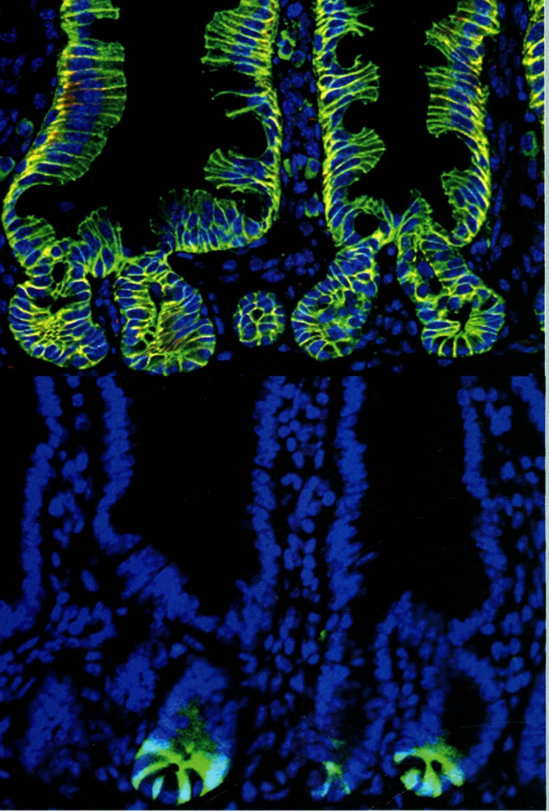

# V 干细胞与细胞分化·分部扉页

原始 PDF 第 380–381 页。

## 干细胞与

## 细胞分化

V

---

natural_image

Fluorescent microscopy image showing green and blue cellular structures against a dark background (no text or symbols)

小鼠小肠的隐窝和绒毛结构:上图，绿色表示E-cadherin细胞连接，蓝色表示细胞核；

下图，绿色表示Lgr5小肠干细胞，蓝色表示细胞核（清华大学生命科学学院陈晔光组提供）
