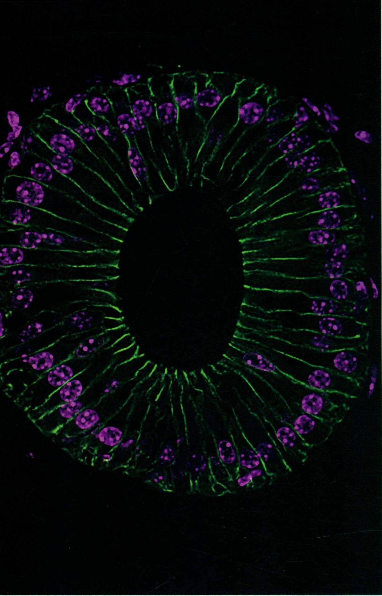

# VI 细胞衰老与死亡·分部扉页

原始 PDF 第 496–497 页。

## 细胞衰老与死亡

## VI

---

natural_image

Fluorescent microscopy image showing cellular structures with purple nuclei and green cytoplasmic markers (no text or symbols)

附睾:雄性小鼠附睾管状组织的柱状上皮细胞，显示细胞核和细胞间的黏附连接（中国科学院生物化学与细胞生物学研究所朱学良组提供）
