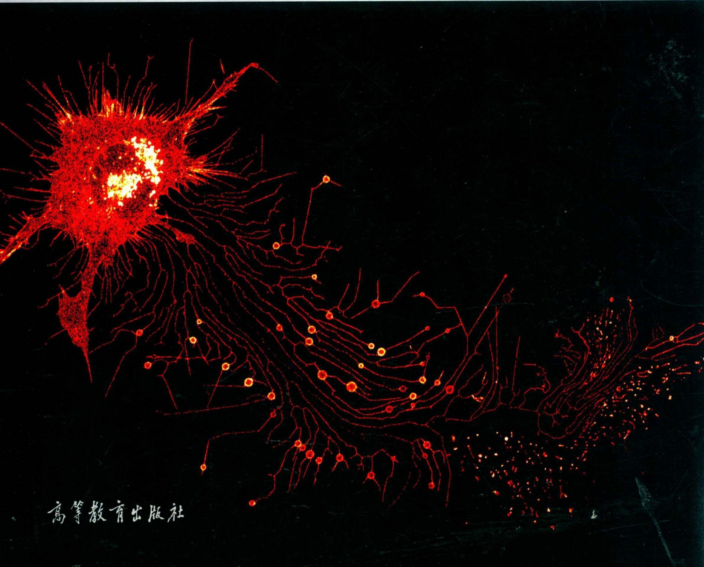

# 分子细胞生物学

# 第3版

# Third Edition

MOLECULAR CELL BIOLOGY

主编 陈晔光 张传茂 陈佺

text_image

高等教育出版社

# 分子细胞生物学

# 第3版

# Third Edition

MOLECULAR CELL BIOLOGY

主编 陈晔光 张传茂 陈佺

seal

中国科学技术大学
图书馆藏

# MOLECULAR CELL BIOLOGY

# 数字课程（基础版）

text_image

Abook
分子细胞生物学
（第3版）
主编 陈晔光 张传茂 陈佺
分子细胞生物学（第3版）数字课程与纸质教材一体化设计，紧密配合。数字课程包括各章思考题解题要点、章末自测习题，有助于延伸思考和探索，提供更多自主学习的空间。
用户名：
密码：
验证码：
5360 忘记编码？
登录 注册

## 登录方法

①电脑访问 http://abook.hep.com.cn/51306，或手机扫描上方二维码、下载并安装Abook应用。②注册并登录，进入“我的课程”。③输入封底数字课程账号（20位密码，刮开涂层可见），或通过Abook应用扫描封底数字课程账号二维码，完成课程绑定。④点击“进入学习”，开始本数字课程的学习。

\*\*\* 课程绑定后一年为数字课程使用有效期。如有使用问题，请点击页面右下角的“自动答疑”按钮。

陈建国 北京大学生命科学学院

(按姓氏拼音排序)

陈 佺 南开大学生命科学学院

陈晔光 清华大学生命科学学院

冯新华 浙江大学生命科学研究院

杭海英 中国科学院生物物理研究所

何苏丹 苏州系统医学研究所

焦仁杰 广州医科大学广州霍夫曼免疫研究所

李保界 上海交通大学生命科学技术学院

李朝军 南京大学医学院

李林 中国科学院生物化学与细胞生物学研究所

刘峰 中国科学院动物研究所

刘明耀 华东师范大学生命科学学院

刘平生 中国科学院生物物理研究所

裴端卿 中国科学院广州生物医药与健康研究院

尚永丰 北京大学医学部

松阳洲 中山大学生命科学学院

王 强 中国科学院动物研究所

徐涛 中国科学院生物物理研究所

俞立 清华大学生命科学学院

张博 北京大学生命科学学院

张传茂 北京大学生命科学学院

朱大海 中国医学科学院基础医学研究所

朱卫国 深圳大学医学部

朱学良 中国科学院生物化学与细胞生物学研究所

前言

分子细胞生物学主要是在分子水平上研究细胞生命活动的基本规律，其研究成果广泛应用于生命科学各领域，它与发育生物学、神经生物学、免疫生物学、癌症生物学等重要前沿生命学科以及基因组学、蛋白质组学、代谢组学等新兴学科不断交叉和整合，是现代生命科学领域最重要的前沿学科之一。本书较为系统地概述了分子细胞生物学主要领域的内容。

本书第2版出版至今的七年间，分子细胞生物学不仅在理论上有新的重大突破，其内容也不断丰富和系统化；同时，第2版在内容和编排上也存在一些不足。鉴于此，我们修订出版第3版。在修订过程中，我们继续秉承一贯的理念，即在强调基本概念的基础上，充分论述分子细胞生物学重要领域的最新成果和发展动态。第3版全书共26章，分别从基因表达调控与基因组稳定性、细胞物质运输和细胞运动、细胞信号转导、细胞增殖与调控、干细胞与细胞分化、细胞衰老与死亡等六方面进行阐释。本版除了对原有章节的文字和内容进行修订之外，将第2版的部分章节进行了整合，例如，将“干细胞”和“诱导多能干细胞”合并为“干细胞与细胞重编程”，将“细胞周期的调控”和“细胞周期检控点调控”合并为“细胞周期与检控点”，将“细胞黏附”和“细胞迁移”合并为“细胞黏附与迁移”，将“细胞内囊泡运输”和“细胞内吞作用”合并为“细胞囊泡运输”，将“染色质可塑性与基因组稳定性”和“DNA损伤与修复”合并为“DNA损伤修复与基因组稳定性”等；新增“GPCR信号转导”“血细胞的分化与造血功能”“细胞衰老”和“受调控的细胞坏死”等四章内容，充实了本书的内容。同时对部分内容进行了精简，章节设置更趋合理，使本书更完整地涵盖了分子细胞生物学的主要内容。

本书的编者都是奋斗在科研和教学一线的杰出中青年科学家，每个人撰写不同的章节，分别介绍其研究领域的最新进展和发展趋势，同时结合自己的科研工作，对该领域进行较为全面和深入的介绍。因此，本书不同于一般的基础性教材，具有较强的专业性。编者在努力保持全书系统性的同时，又尽可能使每一章具有相对独立性和完整性，以适合读者进行单章阅读。本书可作为高等院校生命科学及相关学科专业高年级本科生和研究生的教材，也可作为细胞生物学及相关专业研究人员和高校教师的参考书。

本书的出版得到了众多同仁的协助。感谢所有的撰稿人，他们为本书的编著花费了大量的心血和精力。高等教育出版社的王莉编辑为本书的出版给予了专业指导，清华大学的宁元亨花了大量的时间和精力帮助文稿组织、整理和编辑，北京大学生命科学学院的杜明、王向阳、孙梦杰、林巧玉、贾名康、杨碧莹、迟王菲、宇海慧、王瑶、庄腾寒、罗佳和辛广伟为本书改绘插图，还有很多老师和同学对本书进行了仔细地审阅并提出了宝贵建议。没有他们的帮助，本书是不可能顺利完成的，在此一并致谢！

鉴于编者的水平所限，书中难免有不妥之处，敬请批评指正。

陈晔光 张传茂 陈佺

2018年12月

目录

## I 基因表达调控与基因组稳定性

第 1 章 真核基因表达调控 3

1.1 基因表达调控的基本概念及生物学意义 3
1.2 真核基因表达调控的特点 4
1.3 真核基因表达调控的过程和方式 12

第 2 章 表观遗传调控 29

2.1 DNA 甲基化 29
2.2 组蛋白修饰 40
2.3 DNA 甲基化和组蛋白修饰之间的关系 50
2.4 表观遗传与疾病 50
2.5 表观遗传与胚胎发育 52

第 3 章 基因组编辑 56

3.1 基因组编辑技术简介与历史沿革 57

3.2 ZFN 与 TALEN——通过蛋白质特异识别靶序列的人工内切核酸酶 59
3.3 CRISPR/Cas 系统——通过 RNA 特异识别靶序列的人工内切核酸酶 64
3.4 人工内切核酸酶在基因组编辑中的应用 72

第 4 章 DNA 损伤修复与基因组稳定性 80

4.1 DNA 损伤与基因突变 80
4.2 DNA 修复与基因组稳定性的维持 82
4.3 染色质重塑在维持基因组稳定性过程中的作用 87
4.4 RecQ 螺旋酶家族在维持基因组稳定性过程中的作用 90

## Ⅱ 细胞物质运输和细胞运动

97

第 5 章 细胞囊泡运输 99

5.1 细胞内的膜转运——囊泡转运 100
5.2 从内质网到高尔基体的转运 104
5.3 胞吐作用:从反面高尔基网到细胞外的转运 107
5.4 胞吞作用:从细胞外到细胞内的转运 110

第 6 章 细胞自噬的分子机制与功能 119

6.1 细胞自噬简介 120
6.2 细胞自噬的生物学过程 121
6.3 自噬体的核心分子构成元件 123
6.4 细胞自噬的调控 126
6.5 细胞自噬的生理功能 128

第 7 章 跨核膜物质运输 132

7.1 核膜的基本结构和成分 132

7.2 核膜的蛋白质成分 134
7.3 跨核膜物质运输 138
7.4 核膜与基因转录调控和跨核膜信号
转导 139
7.5 核膜的动态变化 140
7.6 核膜相关疾病 143

第 8 章 微管与细胞内物质运输 147

8.1 微管的结构与动态不稳定性 148
8.2 依赖微管的分子马达与细胞内物质运输 153
8.3 中心粒和基体 164

第 9 章 细胞黏附与迁移 175

9.1 细胞黏附 175
9.2 细胞迁移 185

## Ⅲ 细胞信号转导

193

第 10 章 MAPK 信号转导 195

10.1 MAPK 的主要成员及其信号
转导途径 195
10.2 哺乳动物中的 MAPK 信号途径 198
10.3 蛋白磷酸酶介导的 MAPK 信号失活机制 205
10.4 哺乳动物 MAPK 信号途径中的支架蛋白 206
10.5 MAPK 的生理功能 208

第 11 章 GPCR 信号转导 214

11.1 G 蛋白与 GPCR 214

11.2 GPCR 信号通路 217
11.3 GPCR 生物学功能及其机制研究 222

第 12 章 Wnt 信号转导 230

12.1 经典 Wnt 信号通路 231
12.2 非经典 Wnt 信号通路 235
12.3 Wnt 信号通路的生理功能 239
12.4 Wnt 信号通路与人类疾病 242
12.5 靶向 Wnt 信号通路的疾病治疗 244

第 13 章 TGF- $\beta$  信号转导 249

13.1 TGF- $\beta$ 超家族概述 249
13.2 TGF- $\beta$  信号转导通路 250

13.3 TGF- $\beta$  信号转导的调控 258
13.4 TGF- $\beta$  信号对细胞行为的调控 260
13.5 TGF- $\beta$ 的正常生理功能及在疾病发生中的作用 263

第 14 章 JAK-STAT 信号转导 269

14.1 JAK-STAT 信号通路的发现 269
14.2 JAK-STAT 蛋白家族的类别及分子结构 270
14.3 JAK-STAT 信号通路的生物学功能 278
14.4 JAK-STAT 信号的其他活化调节方式 283
14.5 JAK-STAT 途径的负调节 286
14.6 JAK-STAT 与其他信号转导通路的

相互作用 290

14.7 JAK-STAT 信号转导通路与人类疾病发生 292
14.8 针对 JAK-STAT 信号通路的药物 294

第 15 章 翻译后水平的蛋白质修饰 298

15.1 蛋白质的磷酸化及去磷酸化 299
15.2 蛋白质的乙酰化 300
15.3 蛋白质的泛素化与去泛素化 301
15.4 蛋白质类泛素化修饰 306
15.5 蛋白质修饰在 TGF- $\beta$  信号转导中的调控作用 310
15.6 组蛋白翻译后水平的蛋白质修饰 312

## IV 细胞增殖与调控

317

第 16 章 细胞周期与检控点 319

16.1 细胞周期和细胞周期检控点 319
16.2 细胞周期检控点作用的分子机制 322
16.3 几个重要的细胞周期检控点 328
16.4 细胞周期检控点与癌症的发生 332
16.5 细胞周期检控点蛋白质与细胞中其他生命过程的关系 333
16.6 细胞周期与癌症治疗 334

第 17 章 真核生物 DNA 复制的起始调控 337

17.1) DNA 复制执照假说 337
17.2 DNA 复制起始点与前复制复合体的组装 338
17.3 DNA 前复制复合体组装

过程的调节 342

17.4 DNA 复制起始的激活与  $G_{1}/S$  期检控点 344
17.5 真核生物中 DNA 复制与中心体复制的协调关系 347

第 18 章 细胞有丝分裂期纺锤体的组装 352

18.1 有丝分裂期纺锤体的分子构成 353
18.2 纺锤体微管组装的主要方式 355
18.3 纺锤体形态的调控机制 357
18.4 Ran GTP 酶和激酶在纺锤体装配中的作用 359
18.5 纺锤体装配异常与肿瘤发生 364

## V 干细胞与细胞分化

367

第 19 章 干细胞与细胞重编程 369

19.1 胚胎干细胞 370
19.2 诱导多能干细胞 372
19.3 诱导多能干细胞的机制 377
19.4 多能干细胞的应用及意义 382
19.5 成体干细胞与肿瘤干细胞 386

第 20 章 肌细胞分化 390

20.1 骨骼肌细胞的胚胎起源与骨骼肌的发生过程 390
20.2 骨骼肌细胞增殖分化的调控机制 392
20.3 调节骨骼肌细胞增殖分化的信号转导通路 406
20.4 骨骼肌干细胞的调控 413

第 21 章 骨细胞的分化与骨骼形成 419

21.1 骨的简介 419
21.2 骨骼中的细胞及其干细胞 421

21.3 骨转换及骨代谢平衡 425
21.4 成骨细胞的增殖与分化的信号调节网络 426
21.5 调节破骨细胞增殖与分化的信号
转导途径 434
21.6 骨骼相关疾病 437
21.7 骨质疏松症及治疗 439

第 22 章 脂肪细胞分化 443

22.1 脂肪细胞的种类、分布及功能 443
22.2 脂肪细胞的来源及形成 449
22.3 肥胖与其他代谢疾病的关系 456

第 23 章 血细胞的分化与造血功能 466

23.1 血细胞发育 466
23.2 血细胞发育调控及其微环境 472
23.3 血细胞功能及体外造血 477

## VI 细胞衰老与死亡

第 24 章 细胞衰老 485

24.1 细胞衰老概述 485
24.2 细胞衰老的特征 486
24.3 细胞衰老的分子机制 489
24.4 抗衰老的研究进展 495

第 25 章 细胞凋亡的分子调控 501

25.1 不同的细胞死亡方式 502
25.2 细胞凋亡的关键蛋白 503

25.3 细胞凋亡的信号调控 508
25.4 细胞凋亡的保守性和单细胞生物的细胞凋亡 518
25.5 细胞程序性死亡与疾病 519

第 26 章 受调控的细胞坏死 525

26.1 细胞程序性坏死 525
26.2 细胞焦亡 532

## 索引

## 基因表达调控与

## I

## 基因组稳定性

natural_image

Fluorescent microscopy image showing colorful cellular structures against a black background (no text or labels)

## 真核基因表达调控

多细胞生物是由一个受精卵细胞、一套遗传基因组，经过精确的时间和空间调控，程序性地发育、分化形成的。在同一生物体内，由于不同的组织细胞产生各自专一性蛋白质，使得不同组织和器官具有迥然不同的功能并适应不断变化着的内外环境。那么，为什么具有相同遗传信息的不同组织细胞能产生不同的蛋白质？遗传物质在体内是怎样进行有条不紊、可调控的表达？经过人们长期的研究探索，目前已知细胞内千万个基因都能有调节地、有序地、有节制地表达，并且这些基因表达的程序、时间和位置受不同层次的调控元件所控制。这种控制不仅决定了基因表达的水平，而且也决定了基因表达的时空秩序性。生物的正常生长、发育和分化都是基因受控于有序表达的结果。

## 1.1 基因表达调控的基本概念及生物学意义

## 1.1.1 基因表达和基因表达调控

不同生物的基因组(genome)含有不同数量的基因。在某一特定的时期或生长阶段，基因组中只有一小部分基因处于表达状态。通常真核细胞中只有2%\~5%的基因处于转录活性状态，其余大多数基因不表达或表达水平极低。而这些少数表达活跃的基因也不是固定不变的。例如，与细菌蛋白质合成有关的延长因子编码基因表达活跃，而参与DNA损伤修复的酶分子编码基因却很少表达。另外，某些基因表达会随时间和环境的变化而变化。例如，当摄入的食物改变或耗尽时，在特定代谢途径中所需的酶的表达量就会随之改变。在多细胞器官进化的过程中，一些对形成细胞差异性有影响的蛋白质仅在少数细胞中短时期表达。

基因表达(gene expression)是指在一定的调控机制下，基因经过激活、转录、翻译等过程产生具有生物学功能的蛋白质分子，从而赋予细胞一定的功能或表型，即基因的转录和翻译过程。但并非所有基因表达过程都产生蛋白质。rRNA、tRNA编码基因转录产生RNA的过程也属于基因表达。基因表达调控(regulation of gene expression)指细胞或生物体接受环境信号刺激或适应环境营养供给状况的变化，在基因表达水平上作出应答的分子机制。

## 1.1.2 基因表达的方式

生物只有适应环境才能生存。当外界的营养、温度、湿度、pH等条件变化时，生物体会调整体内相应功能蛋白质的种类和数量，改变基因表达状况来适应环境。但由于不同种类的生物遗传背景不同，即使同种生物不同个体的生活环境也不完全相同，加之不同的基因功能和性质不同，对内外环境刺激信号的反应也不同，因此基因的表达方式存在很大差异。根据对刺激的反应敏感性，可以把基因表达大致分为两类。

## (1) 基础基因表达

基础基因表达是一类不易受环境变化而改变的基因表达，又称组成性基因表达（constitutive gene expression）。其中某些基因表达产物是细胞或生物体整个生命过程中都持续需要或必不可少的，这类基因称为管家基因（house-keeping gene）。管家基因表达水平受环境因素影响小，在个体各个生长阶段的大多数或几乎全部组织中持续表达或变化很小。

## (2) 可调节基因表达

可调节基因表达(regulated gene expression) 是一类很容易随环境变化而改变的基因表达。随环境变化基因表达水平增强的过程称为诱导(induction)，该过程中被激