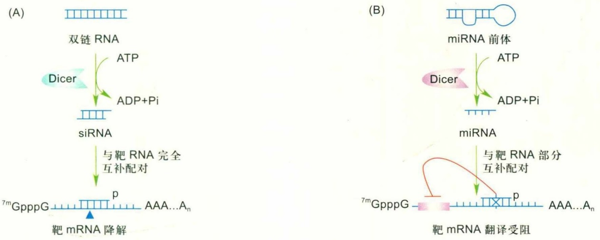
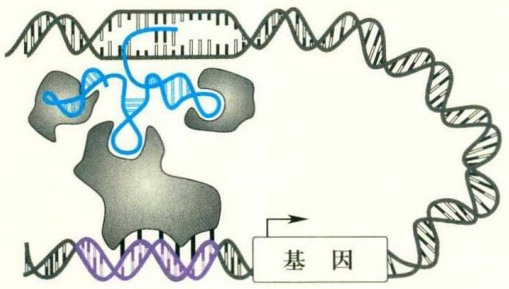
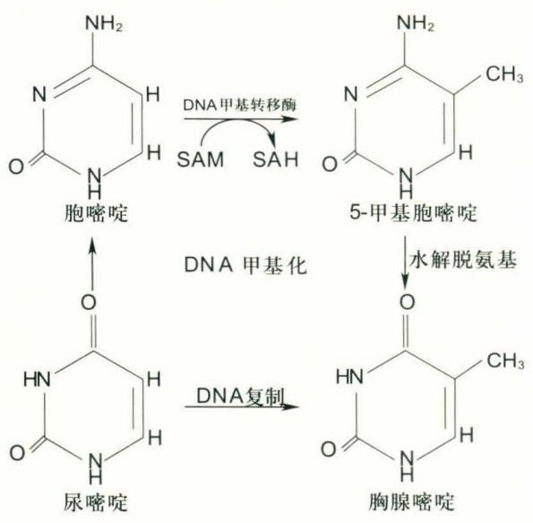
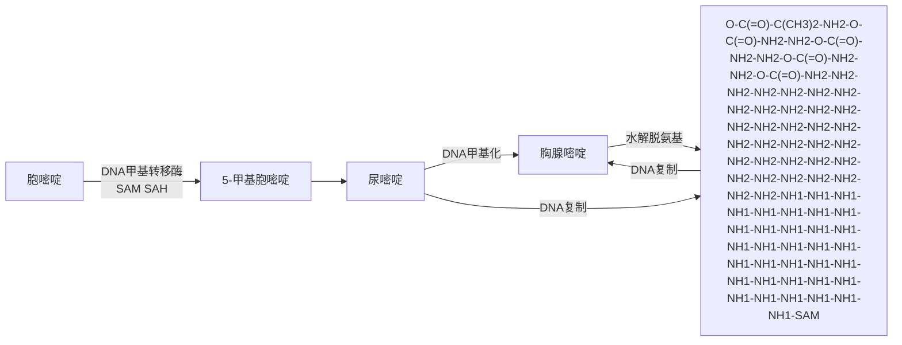
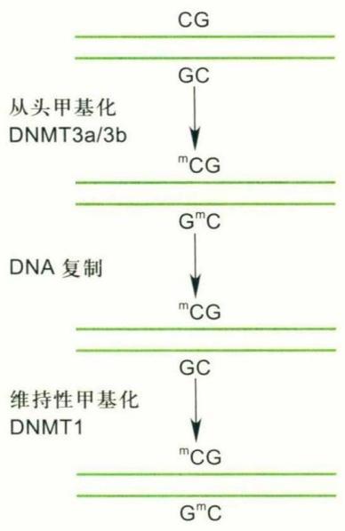
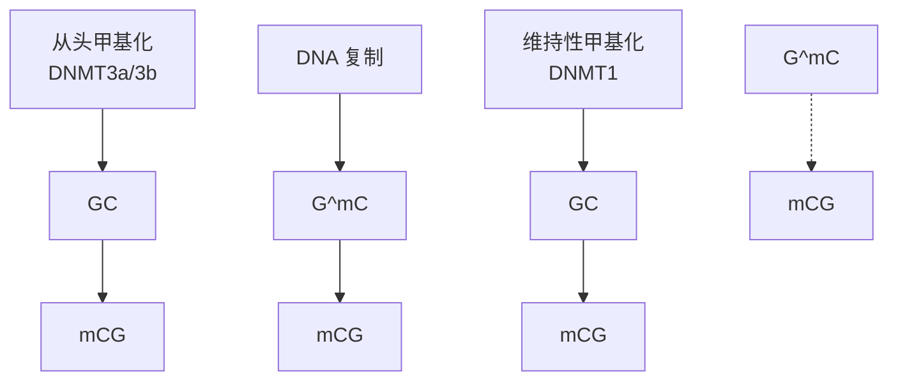
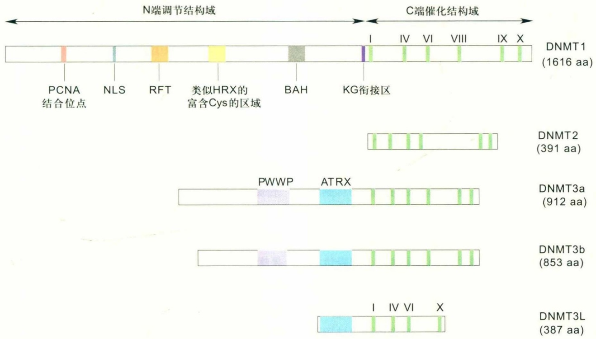
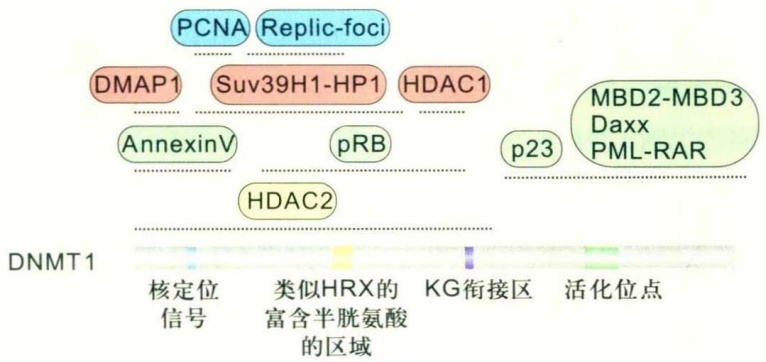
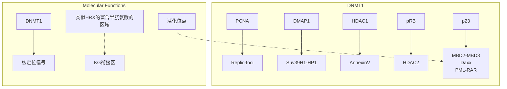
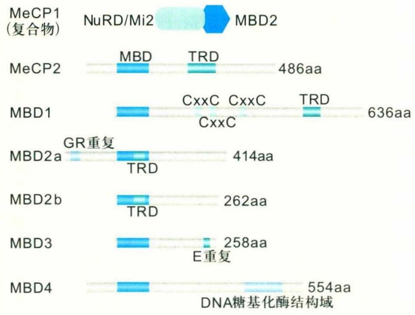

argininc rich, SR) 和非SR蛋白，包括核不均一核糖核蛋白 (heterogeneous nuclear ribonucleoprotein, hnRNP)、RNA螺旋酶和激酶等。选择性剪接位点选择机制与基本剪接机制紧密联系，剪接体中的剪接因子也参与对选择性剪接的调控。剪接位点的选择受许多顺式作用元件和反式作用因子的调控，顺式作用元件位于外显子或内含子内，反式作用因子通过识别正性（剪接增强子）或负性（剪接沉默子）的顺式作用元件对不同的剪接位点进行选择。调控选择性剪接的反式作用因子有两类:基本剪接因子和特异性剪接因子。

基本剪接因子间的协同作用、拮抗作用以及相对丰度的改变影响剪接位点的选择。特异性剪接因子调控特异的剪接过程。多种蛋白质和RNA复合物参与剪接体的形成，并通过不同方式影响剪接过程。SR蛋白是常规型剪接和变相型剪接所必需的蛋白因子，由至少6个成员组成的保守蛋白家族。它在剪接过程早期就结合mRNA前体并参与剪接复合体的组装。SR蛋白在外显子剪接增强子（exon splicing enhancer, ESE）的剪接调控中发挥重要作用。这类高度保守的RNA结合蛋白含有1或2个RNA识别基序（RNA recognition motif, RRM），并在C端有富含精氨酸和丝氨酸的RS区域。RRM决定了SR蛋白与RNA结合的活性，RS区域介导了蛋白质与蛋白质的相互作用。在剪接反应中，SR蛋白介导了U1 snRNP与U2AF的相互作用，促进U1 snRNP和U2AF结合在剪接位点上。在含有2个内含子的mRNA前体中，SR蛋白会选择最近的5'剪接位点，但不会激活隐蔽的5'剪接位点。而通常5'剪接位点的突变会激活附近的隐蔽剪接位点。SR蛋白通过改变组成和数量来选择特定的剪接位点，不同的SR家族蛋白可以在相同的mRNA前体中引起不同的剪接方式。

在剪接的负调控中，hnRNP是一类与抑制元件相互作用的重要蛋白，hnRNP能结合新生mRNA而抑制剪接的发生。hnRNP A1结合mRNA前体，使得U1 snRNP只能结合远端较强的5'剪接位点，近端较弱的5'剪接位点不被结合。剪接因子2（splicing factor 2，SF2）能与hnRNP A1相互竞争结合mRNA前体，干扰hnRNP A1与mRNA前体的结合，使得U1 snRNP能与所有的5'剪接位点结合，从而使剪接体可以选择较近的5'剪接位点。SF2与hnRNP A1间相对丰度的变化调控5'剪接位点的选择。另外，与ESE结合的SR蛋白还可以拮抗与外显子剪接沉默子(exon splicing silencer, ESS)结合的hnRNP的抑制作用。

此外，也有一些特异性剪接因子在特定组织或特定发育阶段起作用。果蝇中的性别致死蛋白（sex-lethal, SXL）是一类hnRNP蛋白，只在雌性个体中表达，SXL结合到性别转换基因（transformer, tra）的mRNA前体中两个3'剪接位点中较上游的一个位点的多聚嘧啶区域，从而阻遏了U2AF的接近而使其选择下游较弱的3'剪接位点，使得在雌性个体中表达TRA从而引起一系列的连锁反应，最终决定了雌性性别。

## (3) RNA 出核转运调控

在哺乳动物中，被转运出核的RNA仅占生成RNA总数的5%，大多数RNA都被剪接加工，其碎片[被切除的内含子，RNA3'端或poly（A）的序列]、加工不完全的RNA和被破坏的RNA均在细胞核内被外泌体(exosome)降解。外泌体是一个大的蛋白质复合体，包含一些不同的核酸内切酶亚单位。RNA分子的出核转运是在对mRNA加工完成后进行的。因此，任何阻碍RNA剪接完成的机制都成为RNA出核的障碍。

## (4) RNA 编辑

RNA 编辑 (RNA editing) 是指转录后 RNA 分子上的修饰、加工，使 RNA 所携带的遗传信息发生改变的过程。RNA 编辑发生在转录后的 mRNA 中，其编辑区出现碱基插入、删除或转换等变化，从而改变了初始物的编码特性。在哺乳动物中主要有 C→U、A→I、U→C、U→A 4 种类型的 RNA 编辑。RNA 编辑反应由一些与 pre-mRNA 中的被编辑序列互补而被称为指导 RNA (guide RNA, gRNA) 的小分子 RNA 所介导。

## 1.3.3 真核基因mRNA与翻译水平的调控

蛋白质的生物合成即翻译是遗传信息表达的最终阶段。所谓翻译就是由专一的tRNA携带和运送组成蛋白质原料的各种氨基酸到核糖体上，并按照mRNA模板提供的编码信息有序地相互结合，生成具有特定序列多肽链的过程，包括肽链合成的起始、延伸和终止3个阶段。其中翻译起始的调控最为重要。真核生物的翻译需要大量的因子参与，mRNA特异性因子解旋mRNA的5'端，40S核糖体沿mRNA滑动等决定了不仅蛋白质翻译相关因子的磷酸化控制蛋白质起始作用，而且mRNA的结构和稳定性也与翻译调控密切相关。

## 1.3.3.1 起始因子的磷酸化

真核生物在应激情况下，通过激活蛋白激酶使真核翻译起始因子2A（eukaryotic translation initiation factor 2A, eIF-2A）磷酸化，在翻译水平调节基因的表达，这是一种重要的调节方式。eIF-2A磷酸化后，除了对大多数mRNA翻译起抑制作用外，还能特异性激活某些mRNA的翻译，合成特异的蛋白质，以调节靶基因的表达。这种调节机制在生物体中非常保守，可能存在较广泛，是生物体适应环境变化并生存下来行之有效的手段之一。

## (1) eIF-2 磷酸化对翻译的抑制作用

当细胞遭受饥饿、高温或病毒感染时，蛋白质合成速率下降，这主要通过蛋白激酶对eIF-2磷酸化来实现。eIF-2最早作为通用的翻译起始因子被发现，经磷酸化修饰后对翻译起始起负调控作用。后来，在酵母中还观察到eIF-2磷酸化与gcn4（general control non-derepressible-4）mRNA翻译的增加有关。

eIF-2由3个亚单位组成，其分子量分别是 $3.6\times10^{4}$ 、 $3.8\times10^{4}$ 和 $5.5\times10^{4}$ 。它可以在ATP的参与下与Met-tRNAi特异结合。在蛋白质正常合成过程中，40S起始复合物滑动至起始密码子AUG时，与60S核糖体结合形成80S翻译起始复合物，进行肽链的合成和延伸，同时释放eIF-2和GTP。eIF-2再次进入eIF-2·GTP·Met-tRNAi复合物形成的循环中，继续进行翻译起始过程。当eIF-2被蛋白激酶HRI磷酸化后，对GDP和eIF-2B的亲和力明显增高，抑制了eIF-2的再循环，从而抑制了蛋白质的生物合成。eIF-2活性水平的调控对哺乳动物细胞尤其重要，可以使其进入非增生的静止状态（ $G_{0}$ 期）。

## (2) eIF-4F 磷酸化对蛋白质合成速率的激活作用

eIF-4F由α、β、γ3个亚单位聚合而成，即eIF-4FE、eIF-4FA和p220。其中，α亚单位eIF-4FE最小，分子量为 $2.5\times10^{4}$ ，可直接与mRNA的 $5^{\prime}m^{7}G$ 帽子结合，又称帽子结合因子(cap binding factor)；γ亚单位p220最大，分子量为 $2.20\times10^{5}$ ，可能在eIF-3与40S核糖体亚单位相互作用时为RNA和主要蛋白结合提供静电接触；eIF-4FA是依赖于RNA的ATP酶，分子量为 $4.4\times10^{4}$ ，可使eIF-4FAⅡ更好地结合在复合物上。

正常翻译时, eIF-4F与mRNA的 $5^{\prime}m^{7}G$ 结合后, 40S·eIF-2·GTP·Met-tRNAi复合物才能与mRNA相连, 进入翻译起始阶段。用蛋白激酶C(protein kinase C, PKC)在体外将eIF-4F磷酸化后, 在高活化的无细胞翻译体系中，比活性可增强5倍。

## (3) GCN4 mRNA 翻译的调控

真核细胞中有几种翻译起始的模式，如滑动扫描模型。翻译的起始阶段一般分为3步:① 当起始密码子为AUG时，对应的Met-tRNAi结合到40S核糖体上；② 核糖体小亚基与模板mRNA结合，扫描、识别起始密码子；③ 60S核糖体加入，形成80S翻译起始复合物，翻译起始结束，进入延伸阶段。典型的真核基因翻译起始于mRNA 5'端第一个被核糖体小亚基扫描到的AUG。如果识别位点非常贫乏，核糖体小亚基的扫描就会跳到mRNA上的第二个或第三个AUG密码而忽略第一个AUG，这种现象被称为“扫描遗漏”（leaky scanning）。这样可以从相同的mRNA中生成2种或更多的密切相关的蛋白质，它们仅在N端有所不同。这种“扫描遗漏”可以使一些基因生成在N端连有一个信号序列和无此序列的相似的蛋白质，使其在细胞中有两个不同的定位。

真核基因还可以通过一个或多个上游可读框架（upstream open reading frame，uORF）进行翻译调控。uORF是位于mRNA 5'端和基因起始之间的区域。由uORF编码的氨基酸序列通常并不重要，有些uORF只具有调节功能。如果在mRNA分子中出现一个uORF，正在扫描的核小体起始复合物就会在到达蛋白质编码序列前与uORF结合，使核小体翻译uORF并与mRNA分离，从而抑制下游基因的翻译。

当一个翻译起始因子如eIF-2的活性下降时，整个mRNA的翻译并不随之下降。如前所述，eIF-2磷酸化是翻译起始作用的负调控因子，酵母GCN4蛋白是一个转录激活因子，参与包括氨基酸生物合成酶系基因在内的表达调控。实验发现，大多数酵母在任何一种氨基酸饥饿的生长环境中均可激活gcn2，使eIF-2磷酸化，抑制大多数蛋白质的生物合成，并特异性激活gcn4 mRNA的翻译。gcn4 mRNA上游有4个小可读框，介导eIF-2磷酸化对GCN4的翻译激活作用。在所有情况下，核糖体结合在gcn4 mRNA的5'端帽子附近，开始扫描并翻译uORF1，uORF1翻译结束后核糖体可重新扫描，再次起始翻译。在营养丰富的条件下，eIF-2的磷酸化水平低，功能型的eIF-2水平高，核糖体在翻译uORF1结束后重新扫描时常在uORF4重新起始翻译，uORF4翻译完成后核糖体从gcn4 mRNA上解离下来，限制了GCN4的翻译，因而GCN4蛋白的合成处于低水平。在氨基酸饥饿时，

GCN2 活化，eIF-2 发生磷酸化，三聚体的水平下降，核糖体在翻译 uORF1 后重新扫描时需扫描更长的距离，忽略 uORF4，在 gcn4 的起始密码子处重新起始翻译，因而 GCN4 蛋白的合成水平明显提高。这一模型很好地解释了 eIF-2A 磷酸化对 GCN4 蛋白质合成的激活作用机制。

Harding等在哺乳动物中发现了类似的翻译激活现象，在内质网应激和氨基酸饥饿情况下，依赖于PERK（PKR-like endoplasmic reticulum kinase）或GCN2的eIF-2磷酸化作用抑制了大部分mRNA翻译，但选择性激活ATF4(activating transcription factor 4)蛋白质合成。这一发现提示，在应激情况下，eIF-2磷酸化对特异的蛋白质合成的激活作用在真核生物中可能广泛存在。

## 1.3.3.2 3' UTR 和 5' UTR 对翻译的调节作用

所有真核生物mRNA 5'端都有帽子结构。众多研究证实，大多数mRNA的翻译依赖5'端帽子结构，5'端帽子可增强翻译效率。除5'端帽子外，真核生物mRNA的3'端大都有poly(A)，在许多体内实验和高活性的体外翻译体系中都观察到，mRNA poly(A)结构与翻译效率直接相关，带poly(A)的mRNA比无poly(A)的相应RNA的翻译效率高得多。从真核mRNA 5'端帽子到起始密码子AUG之间的不翻译序列称为5'非翻译区，即5'UTR。5'UTR的长度和碱基顺序在不同生物和基因中变化很大，甚至同一基因通过不同的转录起始得到不同长度的5'UTR。此外，5'UTR的二级结构对翻译起始也有影响。二级结构较多的5'UTR阻碍核糖体的结合且不利于翻译起始。参与翻译起始的帽子结合蛋白(cap binding protein, CBP)能识别帽子结构并使5'UTR二级结构解链以促进mRNA与40S核糖体的结合。3'UTR是指从终止蛋白质合成的终止密码子到poly(A)的起始点之间的序列。3'UTR可以调节转录物的稳定性、亚细胞定位和翻译水平，决定某一特定mRNA的命运，是许多基因表达所必需的调节区。3'UTR介导的功能修饰可影响一个或多个基因的表达。

研究表明，mRNA的5'UTR与3'UTR在翻译过程中互相依赖、协同作用提高翻译效率。如果5'端帽子结构缺失，poly（A）不能促进翻译，而5'端帽子结构即使在某些物种中缺乏poly（A）的情况下也有利于翻译的进行，但在poly（A）或类似功能的结构存在时，帽子结构可使翻译效率提高一个数量级。5'端帽子和3'端poly（A）在缺少任何一方时都对翻译产生负面影响，暗示了帽子和poly（A）以及相关的蛋白质在翻译起始时是相互作用的。据此，有研究者提出了翻译时5'端帽子与poly（A）的相互依赖模型。这种末端相互作用既包括了与5'端帽子结合的起始因子和poly（A）的结合，又包括这些起始因子与poly（A）结合蛋白[poly（A）binding protein, PABP]之间的相互作用促进其与RNA结合的稳定性。

PABP在真核生物中高度保守，含有4个RNA识别基序。Sachs等首先证明了PABP参与翻译起始。PABP在此过程中参与帽子与其起始因子的相互作用。可能PABP可以直接与CBP作用或通过一个中介物间接作用，通过这种相互作用，mRNA的两末端在空间上十分靠近而形成环状。真核生物可能就是通过两末端作用从而提高翻译效率。PABP与CBP的相互作用不但能促进高效翻译起始，而且在维持mRNA的完整性方面也起着重要作用。在酵母和哺乳动物中，mRNA降解时，去poly（A）的反应发生于去5'端帽子之前。poly（A）首先降解导致PABP从mRNA上释放，随着PABP的释放，5'端帽子被脱帽酶（decapping enzyme，DCP）切掉，整个mRNA也迅速被5'→3' RNA外切核酸酶（exonuclease）Xrn降解。PABP从mRNA上的释放使5'端帽子易受攻击，PABP在此过程中起了保护作用。为什么poly（A）可以引发这一过程呢？在持续翻译过程中，poly（A）通过Pab1p和转录起始因子eIF-4F的亚基eIF-4G与5'端帽子结构相互作用，形成闭合环状的形式。这种构象可以保护5'端帽子结构不被DCP切掉，同时核糖体也可在环状的mRNA上启动持续的翻译。当poly（A）移走后，这种环状构象被破坏，5'端因失去保护而被脱帽继而暴露出来，mRNA被外切酶降解。

有多种内外因素调节mRNA 5'端帽子和poly(A)的相互作用。培养哺乳动物细胞时，当血清饥饿时翻译受抑制，反之翻译又被激活。胰岛素能以丰度依赖的方式诱导血清饥饿细胞的5'端帽子和poly(A)协同作用促进翻译。胰岛素的调节可能是通过蛋白因子磷酸化来完成的。如诱导eIF-4E发生磷酸化，从而提高了它与5'端帽子结合的活性，或促使eIF-4E结合蛋白发生磷酸化，促进eIF-4E与eIF-4G的相互作用，最终影响eIF-4A的召集，从而影响其与poly(A)结合蛋白相互作用蛋白1[poly(A) binding protein interacting protein 1, PAIP1]作为两末端间“桥”的作用。又如，热激一方面能使多核糖体快速解体，另一方面使mRNA 5'端帽子和poly(A)

的相互作用下降而抑制翻译。热激直接或间接地使与PABP结合的蛋白因子的磷酸化状态发生改变，如哺乳动物eIF-4E和eIF-4B去磷酸化，间接降低eIF-4A的召集及其与PAIP1/PABP/poly（A）复合体作用的机会，从而抑制翻译。

研究表明，没有poly（A）或5'端帽子结构的mRNA末端也能发生相互作用而影响翻译。哺乳动物中的细胞周期调控组蛋白的mRNA没有poly（A），但其5'端有一个保守的茎环结构，该结构是核胞质转运和调控不同细胞周期时维持mRNA稳定性所必需的。同时发现它对以茎环结构终止的哺乳动物mRNA的高效翻译也是必需的。这种茎环结构类似于poly（A），它作为调节因子的活性依赖于5'端帽子，表明5'端帽子与茎环结构间也存在相互作用。

## 1.3.3.3 mRNA的稳定性

真核生物基因翻译调控的一个重要作用是控制mRNA的稳定性。在某些真核细胞中的mRNA进入细胞质以后，并不立即作为模板进行蛋白质合成，而是与一些蛋白质结合形成核糖核蛋白(ribonucleoprotein, RNP)颗粒。这种状态的mRNA半衰期可以延长。mRNA的寿命越长，以它为模板进行翻译的次数就越多。家蚕的丝芯蛋白基因是单拷贝，但在几天内，一个细胞中可以合成多达1010个丝芯蛋白分子。这是因为丝芯蛋白基因的mRNA分子与蛋白质结合成为RNP颗粒从而延长了寿命。在真核细胞中，mRNA的平均寿命通常为3 h，而丝芯蛋白mRNA的平均寿命却长达4天，可以看出mRNA的寿命控制着翻译活性。不同发育时期，mRNA的寿命长短不同，翻译的活性也不同。

在细菌细胞中，绝大多数mRNA非常不稳定，在外切核酸酶作用下沿3'→5'方向迅速被降解，其半衰期大约为3 min。正是mRNA这种快速的合成和降解，使细菌能够很快适应环境变化。相比之下，真核细胞的mRNA稳定得多。如编码β球蛋白的mRNA，其半衰期约为10 h，而一些编码调节蛋白如生长因子、基因调节蛋白等的mRNA就相对不稳定，其半衰期约为30 min，这主要因为这些蛋白质的生成速率变化很快。

如前所述，细胞质mRNA poly（A）与mRNA稳定性密切相关。加上poly（A），mRNA就稳定；去除或削短poly（A），mRNA就开始降解。这种对mRNA的稳定作用都需要PABP的参与。真核mRNA 3'端poly（A）

可以被两种poly（A）结合蛋白（PABP）结合:PABPC在细胞质中，作用于翻译起始和mRNA降解的调控；PABPN1在细胞核内，可增加poly（A）聚合酶的速率和确定新合成的poly（A）的长度。mRNA的降解方式主要有两种:①尾部脱腺嘌呤核苷酸作用，是大多数mRNA降解的方式。poly（A）尾通过依赖于PABP的poly（A）核酸酶[PABP-dependent-poly（A）nuclease，PAN1]发生脱腺苷酸反应(deadenylation)，但反应速率在不同阶段有所不同，开始较慢，后逐渐加快，到剩下最后5～15个寡聚核苷酸时，又以较慢的速度将剩余的3'腺苷酸全部削去，结束脱腺苷酸作用。3'poly（A）消除后，5'端又进行脱帽反应(decapping)。这样，无帽无尾的mRNA就被外切核酸酶自5'→3'方向降解。②特异序列的3'UTR链内切割。这种方式不去除poly（A），而是在mRNA3'UTR链内剪接、降解。组蛋白类mRNA3'端没有poly（A），其降解是通过结合茎环结合蛋白(stem-loop binding protein，SLBP)自3'→5'破坏茎环结构。

在依赖于腺苷酸作用的mRNA降解模式中，mRNA的降解速率主要取决于poly（A）削短的速率、生成的寡腺苷酸降解的速率、核酸外切酶和mRNA特异结合因子等。mRNA自身结构元件与其降解也密切相关。例如，c-fos mRNA的编码区有促进脱腺苷酸作用的特定序列元件。研究发现，阻碍翻译起始或延长都会很大程度地阻碍poly（A）的削短和主要编码区决定簇（major protein coding region determinant, mCRD）调节的mRNA降解，证明降解步骤与正在进行的翻译相关联。细胞外信号也可以改变mRNA的稳定性，一个典型模式就是转铁蛋白(transferrin)的翻译调控，其作用基础是依赖于铁离子水平，铁离子影响了阻遏蛋白对mRNA的亲和力。红细胞5-氨基酮戊酸合成酶(erythroid 5-amionlevulinate synthase, eALAS)和转铁蛋白的mRNA在靠近5'帽子部位有一个茎环结构，称为铁离子应答元件(iron responsive element, IRE)。当细胞铁离子水平下降时，铁离子调节因子(iron regulatory factor, IRF)，又称铁离子应答元件结合蛋白(iron responsive element-binding protein, IRE-BP)与IRE就有很高的亲和力，两者的结合抑制了转铁蛋白和eALAS的合成，反之则解除了对翻译的抑制作用。

## 1.3.3.4 小分子RNA与基因表达调控

RNA干扰(RNA interference, RNAi)的发现使得人们对RNA调控基因表达的功能有了全新的认识，更因为可以简化甚至替代基因敲除而成为研究基因功能的有力工具，因此格外引人注意。在2002年度Science评选的十大科学成就中，RNAi名列榜首。随着对小分子RNA研究的不断深入，研究人员开始认识到:小分子RNA的世界一点都不小，小分子RNA可能为我们开启了一个新层次上理解基因表达调控方式的大门。

真核生物中主要存在两种非编码RNA (noncoding RNA)，在真核生物中发挥重要作用。一类为小干扰RNA (small interfering RNA, siRNA)，在RNA干扰途径中起定位特异mRNA的作用。另一类为微小RNA (microRNA, miRNA)，大小为19～25 nt，在体内与蛋白质形成核糖核蛋白复合体，在真核基因的表达调控、生长发育中起重要作用，miRNA在真核生物中的调控机制具有保守性。miRNA与siRNA有联系也有区别。

## (1) RNAi 和 siRNA

1998年，生物学家发现，在果蝇和其他真核生物中导入外源双链RNA（double-stranded RNA，dsRNA）分子，可以使内源基因相应序列基因的mRNA降解，从而引发内源基因转录后基因沉默(post transcriptional gene silencing, PTGS)。这种基因表达抑制作用称为RNA干扰。RNAi是细胞本身固有的对抗外源基因侵害的一种自我保护现象，是真核细胞的监控机制，它能识别、清除外源dsRNA或同源的单链RNA，对外源入侵的核酸如病毒、重组基因和转座子提供了一种防御措施。最近研究发现，RNAi还能参与表观遗传(epigenetics)调控。表观遗传是指生物体内由非基因改变而引起基因表型变化的现象，即DNA序列无改变而基因表达有变化，且这种表型变化具有可遗传性。它是遗传学上一种特殊而又普遍存在的现象，其原因是有些小RNAs可通过RNAi控制染色质的形态或螺旋程度，从而持久地封闭基因表达，甚至删除一部分DNA而导致DNA缺失或序列改变，而并非只是简单地使DNA暂时沉默。siRNA是RNAi途径的中间产物。外源dsRNA分子在特异核酸内切酶Dicer/Argonaute蛋白家族作用下，产生19～25 nt的小双链RNA，称为siRNA。siRNA能与靶mRNA完全互补配对，结合后导致靶mRNA降解，产生RNAi。

研究发现，dsRNA常出现在许多病毒（包括单链RNA病毒）感染的细胞内，诱发RNAi，封闭病毒生存和繁殖所必需的基因，产生抗病毒效应。某些病毒在漫长的进化过程中已获得了抑制封闭的基因。在哺乳动物中发现病毒感染后识别dsRNA的蛋白酶如PKR、2',5'寡核苷酸聚合酶大量合成，从而激发干扰素诱导的抗病毒状态。遗传研究还证实RNAi缺陷可引起内源性转座子的跳跃。转座子的重要特征之一是具有反向重复序列，生物体通过此序列可产生dsRNA发卡，启动PTGS效应，从而抑制转座酶蛋白的产生和转座子的跳跃，有利于遗传稳定，防止遗传损害。因此RNAi具有转座子封闭（transposon silencing）的功能。

## (2) miRNA

miRNA是一类约22 nt的非编码调节RNA，它参与RNA介导的基因沉默。多个研究小组在包括人类、果蝇及多种植物等生物物种中鉴别出数百个miRNA，而且在进化上高度保守。miRNA在不同组织、不同发育阶段中的水平有显著差异，这种miRNA表达模式具有不同的位相性和时序性（differential spatial and temporal expression pattern），提示miRNA有可能作为参与调控基因表达的分子。miRNA基因通常位于独立不相关的基因间或能编码蛋白质基因的内含子区域，在核内由RNA聚合酶Ⅱ转录产生具有5'端帽子结构和poly(A)的miRNA初始转录产物（primary miRNA, pri-miRNA）。新生的pri-miRNA在核酸酶Ⅲ家族成员Drosha的作用下，剪切成长约70 nt、具有茎环结构的miRNA前体(pre-miRNA)。pre-miRNAs在Ran-GTP依赖的转运蛋白exportin 5的作用下，从细胞核内运输到细胞质中，在细胞质内，pre-miRNA被Dicer和TRBP(trans-activation responsive RNA-binding protein)进行第二次切割，最终成为在3'端有2个碱基突出的约20 nt的双链RNA。RNA诱导的基因沉默复合物（RNA induced silencing complex, RISC）中的成熟miRNA链称为引导链(guide strand)，相对应的另一条链被称为随从链(passenger strand)。一旦成熟miRNA的引导链被装载进入RISC中，它会与其靶向mRNA的3'UTR结合，从而诱导沉默。目前已知miRNA针对靶mRNA的作用机制主要是:mRNA与其靶miRNA 3'UTR结合时，如果两者碱基序列完全互补，则可促进靶mRNA降解；如果不完全互补，则抑制靶mRNA翻译，影响蛋白质表达水平。例如，第一个被确认的miRNA是在线虫中发现的lin4和let7，可以通过部分互补结合到目的mRNA的3'UTR，以一种未知方式诱发蛋白质翻译抑制，进而抑制蛋白质合成，通过调控一组关键mRNA的翻译从而调控线虫发育进程。除lin4和let7外，已知还有一些miRNA可能参与在细胞分化和组织发育过程中起重要作用的基因转录后调控，如mir14和mir23等。最近对miRNA的研究分析提示:miRNA参与生命过程中一系列的重要进程，包括早期发育、细胞增殖、细胞凋亡、细胞死亡、脂肪代谢和细胞分化等。

图1-9 siRNA通路和miRNA通路之间的相互联系（A）siRNA通路；（B）miRNA通路。

## (3) miRNA与siRNA的关系

miRNA 和 siRNA 均属于小分子 RNA，从表面上说，miRNA 一个是非编码的单链小分子 RNA，在进化上高度保守，通过翻译抑制调控基因表达而不影响转录物的稳定性；siRNA 是针对编码区的双链小分子 RNA，每个转录物都可能有很多个 siRNA，通过降解靶序列，在转录后调控基因表达。但据推测，miRNA 通常是较大的前体经 Dicer 切割得到的，而 Dicer 同样负责将长 dsRNA 切割为 siRNA，而且两者的长度也差不多，同样有调控基因表达功能。因此，两者的关系令人迷惑，也格外令人关注。研究发现，miRNA 和 siRNA 之间存在许多相同点，但也有许多不同点（图1-9）。相同之处是:两者长度都约为 22 nt，均干扰蛋白质编码的 mRNA，都有与之对应的靶 mRNA，都是 Dicer 的加工产物，都需 Argonaute 蛋白家族的存在，同是 RISC 的组分，因此两者介导的沉默机制有相同之处。不同之处在于:siRNA 是 RNAi 途径的中间产物，在病毒感染或人工转入 dsRNA 后诱导形成，而 miRNA 则是细胞内 RNA 固有组分之一；siRNA 来源于转基因或病毒 RNA，而 miRNA则来源于内源转录物；siRNA由长dsRNA转变而来，而miRNA则由茎环结构的pre-miRNA转变而来；siRNA主要以双链形式存在，而miRNA则主要以单链形式存在；siRNA与靶mRNA完全互补配对结合，而miRNA则与靶mRNA并不完全互补，存在错配现象；它们对靶RNA的特异性也不同，siRNA的靶序列有一个核苷酸突变，就会影响RNA的沉默效应，而一个位点突变并不影响miRNA的调节效应；siRNA通过RNAi途径主要抑制转座子活性和病毒感染，这有些类似于基因组的免疫系统，而miRNA则主要在发育过程中发挥作用，调节内源基因的表达；siRNA主要在转录后水平发挥作用，介导mRNA的降解，而多数miRNA并不诱导靶mRNA的降解，即本身不影响相应mRNA的丰度，它主要在蛋白质合成水平发挥作用。

## 1.3.3.5 长链非编码 RNA 参与基因表达调控

长链非编码RNA(long noncoding RNA, lncRNA)是一类转录物长度超过200 nt、不编码蛋白质的RNA分子。lncRNA在转录水平、转录后水平和表观遗传水平调控基因表达。研究表明，lncRNA可直接或间接地与染色质修饰复合物等特定因子相互作用从而抑制基因转录。其中最为显著的例子为lncRNA介导的X染色体剂量补偿过程中发生的染色质调控。Xist这一lncRNA在女性细胞两条X染色体中的一条X染色体上表达，Xist可以与PRC2相互作用，使PRC2和与之相关的组蛋白标记H3K27me3定位到失活的X染色体上，从而改变整条染色体的染色质结构，造成 X 染色体失活，使 X 染色体上的大部分基因转录沉默。另外，lncRNA 可以发挥分子脚手架的作用连接 2 个或以上复合体发挥作用。如 lncRNA HOTAIR 可以通过 RNA 的特殊结构域同时结合 PRC2 和 LSD1-CoREST 复合体，这种联合的相互作用可以协同 H3K27 的甲基化和 H3K4me2 的去甲基化，从而确保基因沉默。ANRIL（antisense non-coding RNA in the INK4 locus）可以结合 PRC2 和 PRC1，Kcnq1ot1（Kcnq1 overlapping transcript 1）可以结合 PRC2 和 G9a，从而促进 H3K27me3 和 H3K9me3。以上这些联合的相互作用很可能是为了增强转录沉默状态。

text_image

基因

图1-10 增强子RNA作用机制（仿自Rinn等，2012）

此外，也有研究证实染色质的激活状态与 lncRNA 有关。例如，增强子样 lncRNA HOXA (homeobox A) 远端转录物 (HoxA transcript at the distal tip, HOTTIP) 可以与 WDR5 蛋白 (WD repeat-containing protein 5) 直接相互作用，而 WDR5 是 MLL1/MLL (mixed lineage leukaemia) 复合体的核心组分，可以催化激活性组蛋白标记H3K4me3，HOTTIP位于HOXA基因簇的5'端远端，HOXA的5'端以类似增强子的方式进行染色体成环，使HOTTIP在空间上靠近多个HOXA基因，使H3K4me3标记和基因激活状态得以维持（图1-10）。全基因组范围组蛋白修饰和增强子结合蛋白的图谱绘制为研究者提供了新一层面的信息，从而鉴定lncRNA在基因激活过程中发挥的作用。而基于染色质免疫共沉淀的大规模平行测序分析了H3K4me1、H3K27ac和p300这些与基因激活增强子相关的标志所在区域，发现这些区域同时也产生了lncRNA的转录物。尽管许多这类转录产物最初被认为是聚合酶Ⅱ转录或增强子-启动子相互作用过程的副产物，但更多证据指出这类lncRNA具有特定的功能。

lncRNA在调控染色质结构方面发挥了重要作用，然而我们对于其调控范围、影响及其深层机制所知仍然有限。关于lncRNA目前存在大量的注释资源，这些资源需要编译为简明的lncRNA转录物数据库；相比于蛋白质家族具有相似的结构域，lncRNA的序列及结构元件与其功能的联系需要进行进一步理解和阐释，需要进行大规模的功能缺失和功能获得实验来证实lncRNA发挥功能的因果关系等，对于lncRNA愈加细致的研究将会使lncRNA的生化特性与其体内所观察到的功能特性相联系。

## □ 小结

综上所述，真核基因表达与调控是一个高度复杂、精确调控的过程，是遗传调控和表观遗传调控综合作用的结果。蛋白质与DNA、蛋白质与蛋白质广泛的相互作用网络参与其中，相关研究策略也层出不穷。人们发现，在基因调控过程中，往往不是单个基因起作用，基因表达调控呈现出高度的有序性。因此，深入探讨遗传调控和表观遗传调控相互作用的网络与不同生物学表型之间的关系，在控制真核基因选择性表达的网络体系内进一步理解染色质结构、调控序列以及调控蛋白之间交互作用的内在机制，建立基因表达的调控网络数据库及其分析系统显得尤为重要。目前，一些新的技术正在开始应用于全基因组调控网络的研究。例如，基于基因表达芯片技术的转录组学研究揭示一个细胞中全基因组转录图谱；而在蛋白质水平上，蛋白质组学研究的突飞猛进勾画出了细胞的蛋白质表达谱和相互作用网络图。染色质免疫沉淀技术与高通量的基因芯片相结合形成的新技术，在大规模挖掘人类基因组调控信息方面也取得了显著的成效。此外，RNA翻译核糖体亲和纯化技术和染色体构象捕获技术对基因簇染色质构象的研究，第一次证实了远距离增强子元件的成环作用机制，为探讨基因远端增强子元件与近端的启动子相互作用的机制打下了基础。但即使如此，要搞清楚人类全部基因的功能及其相互关系，特别是要了解基因表达调控的全部规律，仍是一个漫长而艰苦的过程。如同分子生物学的发展由单个基因的研究进入全基因组研究的基因组学时代一样。近年来，科学家绘制了多种生物、不同组织和细胞以及不同生理状态下的多种表观修饰图谱，将表观遗传学研究推进到染色体水平和全基因组水平“全景式”的研究阶段。作为隐藏在基因组之上的另一套遗传密码，破译与分析表观信息及其功能研究无疑将促进并深化我们对调节生长、发育、疾病、衰老等重要生命活动的认识。

## □ 思考题

1. 真核生物染色质活化有哪些主要表现？
2. 说明在真核生物基因转录的反式调节作用中发挥作用的蛋白质种类及其可能的作用。
3. 什么是基因表达？有哪些方式，其特点是什么？
4. DNA 甲基化是如何影响转录的，其机制是什么？
5. 真核生物基因 mRNA 的翻译调控受哪些结构特点的影响?

(尚永丰 易霞 俞文华 北京大学医学部)

## □ 参考文献

1 查锡良，药立波.生物化学与分子生物学.8版.北京:人民卫生出版社，2013.
2 Amrani N, Ganesan R, Kervestin S, et al. A faux 3'-UTR promotes aberrant termination and triggers nonsense-mediated mRNA decay. Nature, 2004, 432: 112–118.
3 Batista P J, Chang H Y. Long noncoding RNAs: cellular address codes in development and disease. Cell, 2013, 152(6):1298–1307.
4 Chang T C, Yamashita A, Chen C Y, et al. UNR, a new partner of poly (A) binding protein, plays a key role in translationally coupled mRNA turnover mediated by the c-fos major coding region determinant. Genes Dev, 2004, 18: 2010–2023.
5 Chen P, Zhao J, Wang Y, et al. H3.3 actively marks enhancers and primes gene transcription via opening higher-ordered chromatin. Genes Dev, 2013, 27: 2109–2124.
6 Chen Y, Sprung R, Tang Y, et al. Lysine propionylation and butyrylation are novel post-translational modifications in histones. Mol Cell Proteomics, 2007, 6(5):812–819.
7 Clapier C R, Cairns B R. The biology of chromatin remodeling complexes. Annu Rev Biochem, 2009, 78:273–304.
8 Dai L, Peng C, Montellier E, et al. Lysine 2-hydroxyisobutyrylation is a widely distributed active histone mark. Nat Chem Biol, 2014, 10(5):365–370.
9 Davidovich C, Cech T R. The recruitment of chromatin modifiers by long noncoding RNAs: lessons from PRC2. RNA, 2015, 21: 2007–2022.
10 Dey B K, Mueller A C, Dutta A, et al.
Long non-coding RNAs as emerging regulators of differentiation, development, and disease. Transcription, 2014, 5(4):e944014.
11 Du J, Zhou Y, Su X, et al. Sirt5 is a NAD-dependent protein lysine demalonylase and desuccinylase. Science, 2011, 334 (6057): 806–809.
12 Fang J, Liu Y, Wei Y, et al. Structural transitions of centromeric chromatin regulate the cell cycle-dependent recruitment of CENP-N. Genes Dev, 2015, 29: 1058–1073.
13 Freitas–Junior L H, Hernandez–Rivas R, Ralph S A, et al. Telomeric heterochromatin propagation and histone acetylation control mutually exclusive expression of antigenic variation genes in malaria parasites. Cell, 2005, 121(1):25–36.
14 Goldberg A D, Banaszynski L A, Noh K M, et al. Distinct factors control histone variant H3.3 localization at specific genomic regions. Cell, 2010, 140: 678–691.
15 Goudarzi A, Zhang D, Huang H, et al. Dynamic competing histone H4 K5K8 acetylation and butyrylation are hallmarks of highly active gene promoters. Mol Cell, 2016, 62(2):169–180.
16 Gurtan A M, Sharp P A. The role of miRNAs in regulating gene expression networks. J Mol Biol, 2013, 425 (19): 3582–3600.
17 Hake S B, Allis C D. Histone H3 variants and their potential role in indexing mammalian genomes: the "H3 barcode hypothesis". Proc Natl Acad Sci U S A,
2006, 103: 6428–6435.
18 Jones P A. Functions of DNA methylation: islands, start sites, gene bodies and beyond. Nat Rev Genet, 2012, 13(7): 484–492.
19 Kim T K, Hemberg M, Gray J M, et al. Widespread transcription at neuronal activity-regulated enhancers. Nature, 2010, 465: 182–187.
20 Kouzarides T. Chromatin modifications and their function. Cell, 2007, 28: 693–705.
21 Lange M, Kaynak B, Forster U B, et al. Regulation of muscle development by DPF3, a novel histone acetylation and methylation reader of the BAF chromatin remodeling complex. Genes Dev, 2008, 22(17): 2370–2384.
22 Lewis P W, Elsaesser SJ, Noh K M, et al. Daxx is an H3.3-specific histone chaperone and cooperates with ATRX in replication-independent chromatin assembly at telomeres. Proc Natl Acad Sci U S A, 2010, 107: 14075–14080.
23 Li L, Shi L, Yang S, et al. SIRT7 is a histone desuccinylase that functionally links to chromatin compaction and genome stability. Nat Commun, 2016, 7:12235.
24 Lodish H, Berk A, Kaiser C A, et al. Molecular Cell Biology. 7th ed. New York: W. H. Freeman and Company, 2013.
25 Lodish H, Berk A, Matsudaira P, et al. Molecular Cell Biology. 5th ed. New York: W. H. Freeman and Company, 2004.
26 Margueron R, Trojer P, Reinberg D.
The key to development: interpreting the histone code. Curr Opin Genet Dev, 2005, 15(2): 163–176.
27 Nelson D L, Cox M M. Lehninger Principles of Biochemistry. 7th ed. New York: W. H. Freeman and Company, 2017.
28 Orom U A, Derrien T, Beringer M, et al. Long noncoding RNAs with enhancer-like function in human cells. Cell, 2010, 143: 46–58.
29 Pandey R R, Mondal T, Mohammad F, et al. Kcnq1ot1 antisense noncoding RNA mediates lineage-specific transcriptional silencing through chromatin-level regulation. Mol Cell, 2008, 32: 232–246.
30 Peng C, Lu Z, Xie Z, et al. The first identification of lysine malonylation substrates and its regulatory enzyme. Mol Cell Proteomics, 2011, 10(12):M111.012658.
31 Portoso M, Ragazzini R, Brenčič Ž, et al. PRC2 is dispensable for HOTAIR-mediated transcriptional repression. EMBO J, 2017, 36: 981–994.
32 Rinn J L, Chang H Y. Genome regulation by long noncoding RNAs. Annu Rev Biochem, 2012, 81: 145–166.
33 Sabari B R, Zhang D, Allis C D, et al. Metabolic regulation of gene expression through histone acylations. Nat Rev Mol Cell Biol, 2017, 18 (2): 90–101.
34 Smith B C, Denu J M. Acetyl-lysine analog peptides as mechanistic probes of
protein deacetylases. J Biol Chem, 2007, 282 (51): 37256–37265.
35 Tagami H, Ray-Gallet D, Almouzni G, et al. Histone H3.1 and H3.3 complexes mediate nucleosome assembly pathways dependent or independent of DNA synthesis. Cell, 2004, 116: 51–61.
36 Tan M, Luo H, Lee S, et al. Identification of 67 histone marks and histone lysine crotonylation as a new type of histone modification. Cell, 2011, 146 (6): 1016–1028.
37 Tan M, Peng C, Anderson K A, et al. Lysine glutarylation is a protein posttranslational modification regulated by SIRT5. Cell Metab, 2014, 19(4):605–617.
38 Torigoe S E, Urwin D L, Ishii H, et al. Identification of a rapidly formed nonnucleosomal histone-DNA intermediate that is converted into chromatin by ACF. Mol Cell, 2011, 43:638–648.
39 Tsai M C, Manor O, Wan Y, et al. Long noncoding RNA as modular scaffold of histone modification complexes. Science, 2010, 329: 689–693.
40 Turner B M. Cellular memory and the histone code. Cell, 2002, 111(3): 285–291.
41 Van Lint C, Emiliani S, Ott M, et al. Transcriptional activation and chromatin remodeling of the HIV-1 promoter in response to histone acetylation. EMBO J, 1996, 15(5):1112–1120.
42 Wang K C, Yang Y W, Liu B, et al. A long noncoding RNA maintains active chromatin to coordinate homeotic gene expression. Nature, 2011, 472: 120–124.
43 Wutz A. Gene silencing in X-chromosome inactivation: advances in understanding facultative heterochromatin formation. Nat Rev Genet, 2011, 12: 542–553.
44 Xie Z, Dai J, Dai L, et al. Lysine succinylation and lysine malonylation in histones. Mol Cell Proteomics, 2012, 11(5):100–107.
45 Xie Z, Zhang D, Chung D, et al. Metabolic regulation of gene expression by histone lysine-Hydroxybutyrylation. Mol Cell, 2016, 62(2):194-206.
46 Yamada T, Mizuno K, Hirota K, et al. Roles of histone acetylation and chromatin remodeling factor in a meiotic recombination hotspot. EMBO J, 2004, 23(8): 1792–1803.
47 Yap K L, Li S, Munoz-Cabello A M, et al. Molecular interplay of the noncoding RNA ANRIL and methylated histone H3 lysine 27 by polycomb CBX7 in transcriptional silencing of INK4a. Mol Cell, 2010, 38: 662–674.
48 Zhao J, Sun B K, Erwin J A, et al. Polycomb proteins targeted by a short repeat RNA to the mouse X chromosome. Science, 2008, 322: 750–756.

表观遗传调控(epigenetic regulation)又称表观遗传学、遗传外修饰学或后成论，是研究基因的活性或功能的遗传变化的学科。它是研究基因表达调控的新领域，是现代分子生物学研究的重要课题之一。表观遗传学研究的主要内容是DNA甲基化以及染色质的物理重塑和化学修饰。这种以染色质为基础的变化包括两方面内容:一种是依赖ATP的染色质重塑，ATP水解释放的能量可以使DNA和组蛋白的构象发生改变；另一种是染色质的共价化学修饰，包括DNA甲基化和组蛋白N端特殊位点的化学基团修饰，这些修饰同样可以直接或间接地影响染色质的结构和功能。这两种方式不是相互孤立的，它们之间相互渗透、相互作用，共同影响染色质的结构和基因表达。

## 2.1 DNA 甲基化

## 2.1.1 DNA甲基化概况

DNA甲基化现象广泛存在于细菌、植物和动物中，是DNA的一种天然的修饰方式。对这一现象的发现最早可以追溯到20世纪50年代。当时，Wyatt在Nature杂志上指出，DNA测序的研究表明DNA分子中可能存在着第5种碱基。但是进一步研究证明“新”碱基仅仅是胞嘧啶第5位碳原子上多了一个甲基，即5-甲基胞嘧啶(5'-methyl cytosine, 5-mC)，而且它不是在DNA合成过程中直接生成的，而是复制后化学修饰的结果，因而这一现象并没有引起人们足够的重视。直到1988年Bestor克隆了小鼠DNA甲基转移酶1(DNMT1)，人们才开始认识到基因本身的修饰，即DNA甲基化可能对基因的表达有着重要影响。随后，DNMT家族的其他成员如DNMT3a、DNMT3b、DNMT3L、DNMT2陆续被发现，DNA甲基化这一课题也逐渐成为人们研究的焦点。

5-mC是在DNA复制后由DNA甲基转移酶（或称甲基化酶）催化，以S-腺苷甲硫氨酸（SAM）作为甲基供体，将甲基转移到胞嘧啶环第5位碳原子上的一种反应（图2-1）。甲基化是哺乳动物基因组中最常见的一种DNA结构修饰，也是表观遗传的一种重要机制。由于正常胞嘧啶的甲基化产物5-mC容易脱氨基转变为胸腺嘧啶，于是甲基化的CG序列被TG所取代，这种转换是导致DNA突变的主要原因。随着整个基因组广泛甲基化的出现，DNA序列中的CG含量逐渐减少。与此不同，有一小部分序列不发生甲基化修饰，因而避免了高发突变的可能性，其CG出现的频率可以达到预计的平均值(6%)，甚至超过平均值5倍以上。在这种富含CG的DNA片段中CpG结构高度聚集，被称为CpG岛，通常情况下CpG岛不发生甲基化修饰。

根据作用方式和参与反应的酶不同，DNA甲基化反应可分为两种类型:从头甲基化（de novo methylation）和维持性甲基化（maintenance methylation）（图2-2）。从头甲基化是对DNA上甲基状态的重新构建，在完全非甲基化的位点上引入甲基，这是甲基化的建立机制。当甲基化的双链DNA复制后，在生成的两条新的DNA链中，只有亲代链是甲基化的，而新合成的子代链是非甲基化的。DNMT1以非对称甲基化DNA为底物，识别新生成的DNA双链中亲代单链上已经甲基化的CpG位点，然后催化互补单链相应位置的胞嘧啶发生甲基化，以维持甲基化。

## 2.1.2 DNMT家族

在哺乳动物细胞中，胞嘧啶特异性甲基转移酶使CpG二核苷酸序列发生甲基化，从而调节基因表达和细胞功能。根据N端的结构差异，DNMT家族成员可分为3类:

flowchart

图2-2 DNA甲基化模式、参与的酶及其功能

flowchart

图2-1 胞嘧啶甲基化、胞嘧啶突变和5-甲基胞嘧啶生化转移通路

DNMT1、DNMT2和DNMT3a/3b（图2-3）。虽然这些酶结构相似，如都具有N端调节结构域和C端催化结构域，但它们的功能和表达模式都不同。DNMT1是主要的维持性DNA甲基转移酶，参与DNA甲基化状态的维持；DNMT3a和DNMT3b则是主要的从头DNA甲基转移酶；DNMT2只有较弱的活性。这些DNA甲基转移酶的特异活性与其结构基序的分布有着密不可分的关系（图2-3）。这些基序包括有对催化功能有重要作用的基序IV和VI、DNA结合基序IX，以及与SAM辅因子结合的基序I和X。此外，基序VIII也是高度保守的，它一方面可以与基序IV和VI共同作为活化的催化核心位点的一部分，另一方面它和基序IX之间的非保守序列可以构成目标识别域(target recognition domain, TRD)，与DNMT对序列

DNA甲基化分为从头甲基化和维持性甲基化。通常，DNMT3a/3b负责使非甲基化的胞嘧啶建立甲基化模式。而在复制阶段，DNMT1识别半甲基化的母链，并催化子链对应的胞嘧啶甲基化，使DNA甲基化在复制过程中得以维持。

的特异性识别有关。DNMT家族氨基酸序列包含的基序不同，影响了其催化结构域的完整性和活性。

## (1) DNMT1

DNMT1是哺乳动物细胞内最常见的DNA甲基转移酶，也是最早被克隆和进行生物化学功能分析的DNA甲基转移酶。与其他DNA甲基转移酶不同，DNMT1优先催化半甲基化的DNA。在DNA复制时，DNMT1主要定位于细胞分裂S期的DNA复制又上，通过将DNA复制产生的半甲基化CpG二核苷酸完全甲基化，从而维持基因组DNA甲基化状态，使DNA甲基化在细胞分裂周期中不会丢失（图2-2）。在体外实验中发现，DNMT1催化半甲基化DNA的能力比催化未甲基化DNA的能力高7～100倍。在小鼠中敲除DNMT1基因使胚胎致死，同时胚胎里有66%以上的DNA甲基化丢失。以上实验说明DNMT1在细胞分裂和细胞分化中起着重要作用。

text_image

N端调节结构域
C端催化结构域
DNMT1
(1616 aa)
PCNA
结合位点
NLS
RFT
类似HRX的
富含Cys的区域
BAH
KG衔接区
I
IV
VI
VIII
IX
X
DNMT2
(391 aa)
PWWP
ATRX
DNMT3a
(912 aa)
DNMT3b
(853 aa)
DNMT3L
(387 aa)

图2-3 DNMT家族的结构

DNMT家族包括DNMT1、DNMT2、DNMT3a、DNMT3b和DNMT3L。它们的催化结构域保守（标注I、IV、VI、VIII、IX和X的区域），但是N端调节结构域的相似度很低，结构上的不同形成了它们功能上差异的基础。PCNA:PCNA结合结构域；NLS:核定位信号（nuclear localization signal）；RFT (replication foci-targeting domain，复制点定位结构域)；BAH (bromo-adjacent homology domain，溴邻同源性结构域)，与蛋白之间相互反应有关；PWWP:包含高度保守的“Pro-Try-Try-Pro”结构域，与异染色质的联结有关；ATRX:类似ATRX的富含半胱氨酸的区域，包含一个C2-C2锌指结构和非典型的PHD区，与蛋白质间作用有关。

flowchart

图2-4与DNMT1相互作用的蛋白

除了维持DNA甲基化，DNMT1还能通过自身不同的结构域与许多蛋白质相互作用，协同调节细胞的功能，参与许多重要生命活动。例如，在DNA复制修复过程中，DNMT1通过其N端与增殖细胞核抗原（proliferating cell nuclear antigen，PCNA）的相互作用，它可以与p21竞争性地结合到DNA复制复合物上，催化新合成的DNA单链发生甲基化(图2-4)。由于PCNA不仅是DNA复制的重要分子，而且也是DNA核苷剪切修复和错配修复的重要参与者，因而这一作用可能有着重要的生物学意义。一方面，p21可能由于排斥了DNMT1在S期与DNA复制复合物的结合，从而导致细胞周期的停滞，抑制细胞生长；另一方面，由p53缺失所引起的细胞损伤，有可能是因为p21的减少，进而无法滞留于DNA损伤位点。这些作用的具体机制还有待探讨。

DNMT1的N端另一结构域也参与和DNA复制复合物的结合，但是这些复制复合物相对较大，出现于S期晚期，被认为与异染色质DNA的复制有关。另外MBD2/MBD3也可能提供了进入S期复制晚期的信号，它们可以识别半甲基化的新合成的DNA链，并且能够捕捉DNMT1，从而有利于转录抑制性异染色质的形成。S期早期和晚期的复制复合物有较大的不同，这与常染色质和异染色质形成的差异有密切联系。在S期早期，复制复合物相对较小，DNMT1结合蛋白1（DNMT associated protein 1，DMAP1）结合到复制复合物上，短暂地抑制基因表达；而在S期晚期，DNMT1又招募组蛋白去乙酰化酶2（histone deacetylase 2，HDAC2），形成较大的复制复合物，后者对基因的表达有稳定的抑制作用，促进了异染色质的形成。

除了在DNA复制过程中抑制基因转录的活性以外，DNMT1还可以作为一种辅助抑制因子参与基因表达调控。DNA甲基化主要通过两种途径抑制基因表达:一种为直接途径，通过直接抑制转录因子与甲基化CpG岛的结合来抑制基因表达；另一种是间接途径，通过招募MBP及一些抑制复合物来阻止转录因子与特定序列的结合，达到抑制基因转录的作用。DNMT1和MBP可与HDAC、共抑制子及ATP依赖性染色质重塑蛋白结合形成抑制复合物，与组蛋白去乙酰化及染色体重塑三者共同作用，从而抑制基因表达。DNMT1除了参与组蛋白去乙酰化，还与组蛋白甲基化相关。其N端能够招募组蛋白甲基化酶SUV39H1，识别HP1，后者能够识别甲基化的组蛋白，同时稳定异染色质浓缩结构，通过它们改变染色质的活性，从而导致了基因沉默。目前还发现了集中与DNMT1相结合的特异转录因子，如Rb-E2F1可以招募DNMT1，辅助抑制靶基因的表达。白血病细胞异常表达的融合蛋白PML-RAR也可以与DNMT1的C端催化结构域相偶联，通过催化靶基因的甲基化抑制基因活性。

DNMT1在生命过程延续和发展中发挥重要作用。在肿瘤细胞中，DNMT1对于抑癌基因的从头甲基化和维持性DNA甲基化都有着重要作用。基因的异常甲基化可以抑制该基因的表达，使细胞周期失控，进而癌变。研究表明，在消化道肿瘤、乳腺癌中抑癌基因高甲基化，在癌变组织中DNMT1的表达也增加且发生在DNA甲基化之前，因此可能是引起异常DNA甲基化的原因。

## (2) DNMT2

DNMT2是DNMT家族中一个比较特殊的成员，于1998年通过对表达序列标签（EST）的分析克隆出来。DNMT2由391个氨基酸组成，与DNMT1/3a/3b相比，DNMT2含有保守的催化结构域（图2-3），但缺乏N端调节结构域，结构与原核生物的DNMT更相似。DNMT2在人和小鼠的很多组织中都有低表达。尽管DNMT2具有保守的催化结构域，但早期的研究表明DNMT2的DNA甲基化能力很弱，并且没有序列特异性。DNMT2缺陷的胚胎干细胞甲基化模式不发生改变，DNMT2敲除的动物基本没有缺陷，仍然能够成活和繁殖。最近的研究发现，外源过表达的DNMT2主要定位在细胞质，应用体外甲基化反应发现以 $DNMT2^{-/-}$ 的小鼠、拟南芥和果蝇的细胞RNA为底物，DNMT2催化RNA的甲基化。虽然在小鼠、拟南芥和果蝇中未发现DNMT2敲除对它们的生长、生殖有影响，但来自斑马鱼的研究发现敲减DNMT2的斑马鱼胚胎会出现视网膜、肝、脑的致死性发育缺陷，这种表型缺陷能够被细胞质中过表达的DNMT2所逆转。另外有研究也认为DNMT2对果蝇反转录转座子和亚端粒重复序列的表观沉默有作用。总之，目前关于DNMT2的报道相对较少，其功能还有待进一步研究。

## (3) DNMT3

DNMT家族另一类重要的成员是DNMT3a和DNMT3b（图2-3）。两者是不同的基因产物，但结构和功能非常相似。与DNMT1不同，它们具有DNA从头甲基化的活性，可以识别催化非甲基化的CpG位点。它们的主要区别在于表达模式，在体内DNMT3a表达比较广泛，然而DNMT3b在分化的组织中低表达。类似于DNMT1，在小鼠里敲除DNMT3a引起胚胎致死，而DNMT3b敲除的小鼠虽发育不全，但可以存活4周以上。以上实验告诉我们，DNMT3a在正常细胞分化中起着重要作用，而DNMT3b在早期发育过程中是必需的。

DNMT3a/3b还是一种辅助抑制因子，其N端富含半胱氨酸的PHD结构域可以招募多种蛋白质如HDAC和SUV39H1-HP1复合物，后者引起染色质结构的变化，从而抑制基因表达。与DNMT1不同，DNMT3a在整个细胞周期中主要位于异染色质内。DNMT3b在胚胎细胞中与DNMT3a分布相同，但是在成熟细胞中往往弥散存在，它可能在中心粒卫星重复元件和转录抑制物的甲基化过程中起重要作用。此外，DNMT3a的PHD结构域还可以与RP58结合，后者是一个序列特异的转录抑制因子，主要分布在异染色质的基因中，因而DNMT3a可能与异染色质的形成和相应的基因抑制有关。由于

DNMT3b具有相似的结构域，因而被认为具有同样的活性。有关白血病的研究中还发现，一种异常的融合蛋白PML/RAR（早幼粒细胞性白血病/维甲酸受体）可以招募DNMT3a到特异的基因启动子上（RA调节的基因），诱导基因的高甲基化，并抑制其相应的活性。但是它不是与DNMT3aN端调节结构域相结合，而是结合到C端催化结构域上。这一活性在DNMT3b上还未得到证实。SUMO-1/Ubc9也可以与DNMT3a/3b相结合，通过修饰后者的N端区域，影响DNMT3a与HDAC1的结合，从而降低了DNMT3a的抑制作用，但是这一修饰并不影响DNMT3b与HDAC1的结合，因而对其功能的影响尚有待研究。

DNMT3L是DNMT家族中另外一位成员，但是由于它的C端催化结构域不完整（图2-3），因而无法独立催化甲基转移的反应，而是作为调节分子，通过与DNMT3a和DNMT3b的催化结构域相互作用，招募有催化活性的酶对底物进行催化。此外，DNMT3L还是一种转录抑制因子，可以通过招募HDAC来抑制基因的表达。与DNMT3a和DNMT3b相似，这一活性是通过N端的PHD结构域与HDAC相互作用的，与DNA甲基转移酶的活性相互独立，这可能也是DNMT3家族的共同特征。

## 2.1.3 甲基化结合蛋白家族

在哺乳动物中，60%～90%的CpG被甲基化修饰，其余长500～2000bp的DNA延伸片段为CpG岛，主要位于基因启动子区。非启动子区的CpG岛主要位于基因间、基因内部、蛋白质编码基因的转录起始位点或非编码RNA区域。正如一些学者所描述的，甲基化的CpG位点如同给DNA特异地贴上了许多“标签”，用来标记哪些基因是被抑制表达的。但是许多抑制性转录因子并不直接与DNA序列结合，因此，需要一种蛋白质特异地识别甲基化的CpG位点，并与基因的表达相偶联。20世纪90年代初，研究者们发现2种与甲基化DNA有高亲和力的蛋白质，即甲基化CpG结合蛋白1（methyl-CpG-inding protein 1, MeCP1）和MeCP2。MeCP1可以识别12个或更多的对称性CpG位点。后来证实MeCP1是一个很大的多亚单位复合物，包括MBD2、NuRD（核小体重塑和组蛋白去乙酰化酶）复合物和Mi-2复合物（Mi-2是一种参与特殊染色质结构的发育调节因子），其中MBD2介导了此复合物与甲基化DNA的识别。与MeCP1不同，MeCP2可以识别一个对称的甲基化CpG位点。通过缺失分析，已找到MeCP2中识别甲基化DNA的最小结构单位，将其命名为甲基化CpG结合域(methyl-CpG-binding domain, MBD)。后续，通过搜索数据库同源序列，发现了更多的含有MBD结构域的蛋白成员。

至今发现有3种DNA甲基化结合蛋白家族:①MBD蛋白家族，包括MBD1、MBD2、MBD3、MBD4和MeCP2等；②KAISO蛋白家族，通过锌指结构域结合甲基化DNA，包括KAISO（ZBTB33）、ZBTB4和ZBTB38；③SRA（SET-and RING-associated DNA-binding domain）结构域蛋白，包括UHRF（ubiquitin-like, containing PHD and RING finger domain）1和UHFR2。

## (1) MBD

根据结构域的不同，MBD蛋白家族还可以分为3大类:第一类仅含有MBD结构域，包括MBD1、MBD2、MBD3、MBD4和MeCP2（图2-5）；第二类除含有MBD结构域外，其C端还有DDT、PHD、Bromo结构域3种蛋白质结构域，因而可能与组蛋白乙酰化有密切关系，这一类蛋白质包括人BAZ2a和BAZ2b以及鼠TIP5等；第三类在MBD的C端有Pre-SET和SET结构域，提示这类蛋白可能具有将DNA甲基化与组蛋白甲基化相偶联的活性，如人的SETDB1和CLLD8。下面主要对第一类蛋白家族进行重点叙述。

① MeCP1 MeCP1最早被认为是甲基化CpG结合蛋白，之后研究证明它是一个能与甲基化CpG岛结合的转录抑制复合物。MeCP1转录抑制复合物成员包括:MBD2、MBD3、RBAP48、HDAC1、HDAC2、MTA1和NuRD/Mi2复合物。与MeCP2不同，MeCP1复合物的结合需要密集的甲基化DNA片段（至少15个连续的mCpG）。

② MeCP2 MeCP2包含一个MBD结构域和一个转录抑制区域（TRD）（图2-5）。MBD结构域能够识别并结合单个对称的甲基化CpG位点，而TRD结构域可与转录抑制因子Sin3和HDAC1及HDAC2相结合而抑制基因转录。MeCP2对甲基化DNA的抑制作用部分依赖于HDAC的活性，也可以通过TRD结构域与TFII-B基本转录因子直接联系而实现。另外MBD结构域还可以与SUV39H1-HP1直接相互作用，从而导致目的基因组蛋白的甲基化，这也是其引起基因失活的另一个机制。

bar

| Protein | Position |
| :--- | :--- |
| MeCP1 (复合物) | NuRD/Mi2, MBD2 |
| MeCP2 | MBD, TRD, 486aa |
| MBD1 | CxxC, CxxC, TRD, CxxC, 636aa |
| MBD2a | GR重复, TRD, 414aa |
| MBD2b | TRD, 262aa |
| MBD3 | E重复, 258aa |
| MBD4 | DNA糖基化酶结构域, 554aa |

图2-5 第一类MBD家族蛋白结构

③ MBD1 MBD1的分子量为 $7 \times 10^{4}$, 是MBD家族成员中分子量最大的蛋白质。MBD1有3个重要的结构域(图2-5): N端的MBD结构域, CXXC半胱氨酸富含区和C端的TRD结构域。MBD1包含4种亚型, 即MBD1v1、MBD1v2、MBD1v3和MBD1v4。与MeCP2类似, MBD1可以通过MBD结构域与异染色质相关蛋白SUV39H1、HP1和HDAC相结合。另外, 由于MBD不能与组蛋白去乙酰化酶相互作用, 它对TSA的敏感性可能是由于SUV39H1介导了MBD与HDAC1、HDAC2的间接结合。CAF-1也是MBD结合的蛋白质之一, 它可以将乙酰化的组蛋白组装到染色质上, 并且在复制晚期, 通过招募HP1到DNA复制复合物上, 进一步促进异染色质的形成和组装。TRD结构域也介导了MBD1的重要功能, 它能够与MCAF (MBD1-containing chromatin associated factor) 相互作用, 形成MBD1-MCAF复合物, 结合在启动子SP1位点抑制基因转录。MBD1在MBD家族中具有特有的结构域CXXC, 虽然功能尚不清楚, 但是目前被认为与MBD1识别非甲基化的CpG序列有关。

④ MBD2 由于存在2个翻译起始位点，MBD2有2种重要的形式，即翻译于第一个甲硫氨酸位点的较长的MBD2a（分子量 $4.35 \times 10^{4}$）和起自第二个位点的较短的MBD2b（分子量 $2.91 \times 10^{4}$）。通过高特异性的抗体，MBD2已被证实为MeCP1中甲基化DNA的结合部分。MeCP1主要对高甲基化的启动子有抑制活性，而对低甲基化的启动子作用较弱，并且可以被增强子的结构所逆转。MeCP1还包含有HDAC1和HDAC2，MBD2可以通过影响组蛋白乙酰化的方式抑制甲基化基因的表达。除了形成MeCP1的复合体，MBD2a/MBD2b对甲基化基因的抑制作用还可以通过招募其他的抑制性复合物来实现，如MBD2可以与NuRD直接作用，后者是一种含有HDAC1/2活性和MBD3组分的抑制性复合物。考虑到MBD2可以通过HP66蛋白与MBD3形成复合二聚体，它可能是以此形式招募NuRD形成MeCP1复合物，其中MBD结构域和C端部分对于HP66α的结合有重要作用。另外，MBD2b还可以通过其转录抑制域与Sin3A复合物相互作用。利用酵母双杂交技术，还发现与MBD2相互结合的另一个蛋白质MIZF（MBD2 interacting zinc finger protein，MBD2锌指结合蛋白），这个具有锌指结构的蛋白可以招募含有HDAC活性的复合物，从而抑制基因的表达。MIZF在细胞核中弥散分布，而MBD2则主要位于卫星异染色质上，虽然两者在细胞中的定位并不完全一致，但前者的抑制活性依赖于后者的存在。与MBD1相似，MBD2和MBD3组成的复合二聚体参与了S期晚期异染色质的构建与组装过程。特别的是，MBD2/3可以识别半甲基化的新合成的子链，并且捕捉DNMT1，从而使局部的DNA序列高度甲基化。除了抑制转录的活性，还有研究认为MBD2a/2b具有激活基因表达的功能，但是两者的作用方式不同。MBD2a也被发现可以刺激去甲基化基因的表达，这一作用是由MBD2a近N端的GR重复序列区域所介导的。当CRE（cAMP responsive element，cAMP反应元件）被甲基化时，CREB（cAMP反应元件结合蛋白）不能结合到它的识别序列上，而MBD2a则识别甲基化的DNA，并通过招募MeCP1抑制基因表达。而当CRE序列去甲基化后，CREB与识别序列结合并通过中介分子RHA与DNA聚合酶相互作用，从而促进基因转录。MBD2a可以与RHA相结合，增强CREB刺激基因表达的功能。此外还有报道指出，MBD2a/2b的另一个结合蛋白MBDin（MBD2-interacting protein，MBD2结合蛋白）可以减弱MBD2的抑制基因表达的作用，这一作用发生在DNA去甲基化之前，在一定程度上激活了基因表达。

⑤ MBD3 MBD3是MBD家族中最小的成员。有2种亚型，分子量分别为 $3.2\times10^{4}$ 和 $2\times10^{4}$ 。前者与MBD2b高度相似(70%同源)；后者在MBD结构域中多了20个氨基酸序列，其他序列与前者一致。尽管MBD3也含有甲基化CpG结合域（图2-5），但是在体外试验中，MBD3并没有表现出与甲基化DNA相结合的活性。不过已有报道指出，在Xenopus中，MBD3仍可以选择性地结合到甲基化DNA上。MBD3能与MBD2形成异二聚体，与半甲基化的DNA结合并招募HDAC和DNMT1，进一步强化稳定的染色质抑制状态。另有研究报道MBD3蛋白的MBD结构域可与DNMT3a的N端相互作用。

⑥ MBD4 MBD4是MBD家族中的另一个成员，它N端的MBD结构域具有与甲基化和半甲基化的DNA相互结合的活性(图2-5)。但是MBD4的C端缺乏TRD区域，因而至今尚未发现该蛋白具有抑制基因转录的活性，不过鉴于它的末端与细菌DNA修复酶有同源性，因而可能在介导DNA损伤修复的过程中发挥着重要作用。目前发现，MBD4参与甲基化DNA诱发的错配修复(mismatch repair, MMR)和碱基切除修复(base excision repair, BER)过程。MBD4可以识别甲基化胞嘧啶脱氨产生的G:T错配，从而保证基因的保真性。

与DNMT缺失的致死性作用相比，DNA甲基化结合蛋白缺失的毒性作用要小一些。例如，DNMT突变的体细胞不能继续生长，而缺乏MeCP2的体细胞则能够存活。在胚胎细胞中，DNMT和MeCP2的缺失虽然不影响细胞的成活，但却不能进一步支持胚胎组织的生长。这种差异可能是由于DNMT的突变或缺失会导致整个基因组甲基化程度广泛降低，进一步影响了与甲基化信号识别有关的所有蛋白。而某个DNA甲基化结合蛋白的突变或缺失却不影响其他与甲基化信号识别有关的蛋白的生物功能。

## (2) KAISO

KAISO 蛋白家族是比较特异的 DNA 甲基化结合蛋白，具有与 MBD 完全不同的甲基化 DNA 结构域。通过测序发现，这一家族蛋白主要包含 N 端、BTB/POZ 结构域和 C 端锌指结构域。通过锌指结构域，KAISO 蛋白可以与至少 2 个以上甲基化 CpG 结合。KAISO 虽然结构上与 MBD 家族不同，但功能上也通过以 DNA 甲基化依赖方式抑制转录。

## (3) SRA 结构域蛋白

与其他的甲基化CpG结合蛋白不同，UHRF的主要功能不是与DNA结合、抑制基因转录，而是首先与DNMT1相结合，靶向半甲基化的位点进行甲基化，进而维持DNA甲基化状态。在小鼠中，与DNMT1的功能相似，UHFR1敲除后会引起胚胎致死。在哺乳动物细胞中，UHFR1有一个同源性基因UHRF2，它也能与甲基化DNA结合，但具体功能需要进一步研究。

## 2.1.4 DNA去甲基化

DNA去甲基化是与DNA甲基化相对的一个反应，是从5-mC转变成胞嘧啶的过程。DNA去甲基化可以分为主动和被动两种方式。被动甲基化一般发生在细胞分裂DNA复制过程中，DNMT1能够维持DNA的甲基化，但DNMT1被抑制或失活时，新合成的胞嘧啶就不能被甲基化，从而DNA甲基化程度越来越低。无论细胞是否处于发生分裂的过程中，主动甲基化都可以在细胞中发生，但这个过程需要酶促反应打断碳碳（C-C）键，使甲基化胞嘧啶转变为胞嘧啶。到目前为止公认的DNA主动去甲基化酶尚未被发现，对于主动去甲基化的研究主要集中在一些具有去甲基化功能的蛋白质上。主动DNA去甲基化在植物中研究得比较清楚，主要是由于植物中存在一类DNA去甲基化酶。这类DNA去甲基化酶实际上是一种DNA糖苷酶，它们可以识别并切除甲基化胞嘧啶，随后偶联DNA修复过程，将非甲基化的胞嘧啶掺入DNA双链，从而完成DNA的主动去甲基化。目前植物中发现的去甲基化酶主要有ROS1、DME、DML2和DML3。鉴于植物中DNA主动去甲基化的研究，推测哺乳动物中可能也存在类似的与DNA损伤-修复相偶联的DNA主动去甲基化机制。目前发现参与DNA主动去甲基化过程的主要有糖基转移酶和胞嘧啶脱氨酶。

胸腺嘧啶DNA糖基转移酶（thymine DNA glycosylase, TDG）能特异识别、切除修饰过的碱基如胸腺嘧啶、5-羟甲基尿嘧啶、5-胞嘧啶甲酰和5-胞嘧啶羧基，最终转变成胞嘧啶。在小鼠中切除或抑制TDG的活性引起胚胎致死，并且表现出高甲基化。有报道MBD4也可以识别5-mC，但到目前为止还没有证实TDG和MBD4在体内有5-甲基胞嘧啶DNA糖基转移酶活性。

体内存在一类胞嘧啶脱氨酶，主要在RNA编辑、抵抗病毒感染中起作用。它们能够催化5-mC脱氨形成T:G错配，再通过碱基切除修复途径完成DNA主动去甲基化过程，其中比较重要的是AID/APOBEC(activation-induced deaminase/apolipoprotein B mRNA editing enzyme complex)。在斑马鱼中，过表达AID/APOBEC促进DNA去