## 8.2.4 马达蛋白与人类疾病

越来越多的证据表明，马达蛋白的突变或功能缺失会引起细胞内运输系统障碍，并导致人类疾病。这方面的信息主要来自对马达蛋白突变体以及基因敲除动物的研究。

## (1) KIF1B与2A型腓骨肌萎缩症

2A型腓骨肌萎缩症(Charcot-Marie-Tooth disease type 2A, CMT2A) 是Ⅱ型CMT染色体显性遗传疾病的一种亚型，定位于染色体的1p35-36区域，与KIF1B基因的位点非常接近。在一个患有CMT2A的家系中发现KIF1Bβ基因发生了一个A→T的点突变，使Gln98转变成亮氨酸(Q98L)。体外实验表明KIF1Bβ的Q98L突变体极大地降低了其ATP酶和马达活性。KIF1B基因敲除 $\left(\mathrm{KIF1B}^{-/-}\right)$ 小鼠在出生后不久便死亡，野生型杂合小鼠 $\left(\mathrm{KIF1B}^{+/-}\right)$ 出生时表现正常，而在随后的发育过程出现感觉神经和运动神经功能低下，突触和突触小泡密度减少，类似人类进行性神经性肌肉萎缩症。因此，KIF1Bβ的Q98L突变被认为是导致驱动蛋白马达活性功能丧失、引起CMT2A疾病的直接原因。

## (2) KIF5A与遗传性痉挛性截瘫

遗传性痉挛性截瘫(hereditary spastic paraplegia, HSP)是一种常染色体显性遗传的神经退行性疾病，由运动神经元退化引起，至少与30个基因座有关，其中SPG10基因座中包含神经细胞中特异表达的KIF5A。在患有HSP的家族中，编码KIF5A马达结构域或中间杆状螺旋区的DNA发生了一个错义突变，如N256S、R280C和A361V。体外实验表明单个错义突变（如N256S）就可以降低KIF5A对微管的亲和力和滑行速率，从而影响KIF5A以微管为轨道的运输活性。神经细胞中，KIF5A与神经丝蛋白的转运相关，这也许可以很好地解释KIF5A的基因变异与HSP的关系。KIF5A突变导致神经丝蛋白（或许还有其他蛋白）不能向轴突运输，是神经细胞退行性病变的原因。

## (3) KIF3A与多囊肾病

多囊肾病（polycystic kidney disease，PKD）是常见的遗传性疾病。尽管确切的发病机制尚不清楚，但一些证据表明与多囊肾病有关的基因表达产物均存在于肾小管上皮细胞的纤毛中。基于KIF3与纤毛发生的关系，利用条件性基因敲除技术特异性地去除肾管状上皮细胞内的KIF3，结果发现小鼠在出生后5天便出现肾囊肿，从第21天起发生肾衰，且囊肿上皮细胞缺乏纤毛结构，细胞分裂旺盛，但容易发生凋亡。KIF3A基因敲除还导致细胞表皮生长因子受体（epidermal growth factor receptor）错误定位，同时 $\beta$ -catenin和c-Myc的表达量升高，而p21CP1的表达则受到抑制。可见KIF3A是维持初级纤毛所必需的，KIF3A的基因敲除使肾上皮细胞的纤毛发生受阻，产生与人类多囊肾病非常相似的肾囊肿特征。

## (4) 细胞质动力蛋白与神经退行性疾病

一般认为，肌萎缩侧索硬化(amyotrophic lateral sclerosis, ALS)是由于运动神经细胞损伤或死亡造成的神经退行性疾病。细胞质动力蛋白重链的温和错义点突变将影响动力蛋白的功能，携带突变体基因的杂合体小鼠发生进行性运动神经元变性疾病，而纯合突变体小鼠则形成具有ALS及相关疾病关键特征的雷维小体（Lewy body-like inclusion body）。用化学诱变剂(ENU)诱发产生的细胞质动力蛋白重链杆状结构域单个氨基酸替换的小鼠突变体（Legs at odd angles, Loa）和（Cramping 1, Cra 1）的杂合体小鼠的脊髓中也都可以观察到进行性运动神经元受损的现象。而另一个由辐射诱变产生的细胞质动力蛋白重链杆状结构域缺失(9 bp)突变小鼠（Sprawling, Swl）表现出感觉神经的病变，暗示细胞质动力蛋白重链在哺乳动物感觉神经元中也发挥重要的作用。过表达动力蛋白激活蛋白亚单位dynamitin的转基因小鼠表现出动力蛋白激活蛋白复合物的去组装，影响神经细胞中细胞质动力蛋白介导的轴突逆向运输，并导致运动神经元退行性病变。细胞质动力蛋白与ALS的直接证据来自对编码动力蛋白激活蛋白最大亚基p150基因突变体的发现，在微管结合结构域中由于单个碱基替换引起氨基酸突变，突变体与微管结合能力下降，动力蛋白激活蛋白介导的转运功能受损，引发缓慢进行性运动神经元疾病。

## 8.3 中心粒和基体

## 8.3.1 中心粒

在动物细胞的核附近，有一个由蛋白质组装而成的细胞器，由于在显微观察时总觉得该细胞器位于细胞的中心，故称为中心体。动物细胞内的微管大多是从中心体开始组装，并呈发散状向细胞的周围延伸，所以中心体也称为微管组织中心（microtubule organizing center, MTOC）。电镜和超高分辨率显微镜图像显示，中心体的内部有一对桶状的中心粒，彼此呈大致垂直的状态排列。中心粒的外围由中心粒外周物质组装而成。

## (1) 中心粒的结构与组成

中心粒(centriole) 是一个直径约200 nm，长150～500 nm的桶状结构，其外壁是9组等间距的三联体微管。在每组三联体微管中，只有一根微管在结构上是完整的，含有13根原丝，称为A管；另外的两根微管为不完整微管，依次称为B管和C管（图8-11）。中心粒微管蛋白亚基常被乙酰化、多聚谷氨酰化和多聚甘氨酰化等多种形式的修饰，并且有多种结合蛋白与微管蛋白亚基相互作用，因而结构非常稳定。用电镜观察中心粒外围的致密物质，发现微管并不是直接起源于中心粒，而是在外周物质区域成核，有部分微管锚定在母中心粒的亚远端附属结构上（图8-11）。参与中心粒组装的微管蛋白除了 $\alpha-/ \beta-$ 微管蛋白以外，还有 $\delta-$ 微管蛋白和 $\varepsilon-$ 微管蛋白，目前还不知道这两种微管蛋白是如何组装到中心粒结构上，也不知道它们发挥何种作用，但是 $\delta-$ 微管蛋白和 $\varepsilon-$ 微管蛋白的缺失将影响B管和C管的组装。

中心体内的两个中心粒在相互位置上接近于垂直，它们相互靠近的一端，即中心粒微管的负极端被称为中心粒的近端（proximal end）；而两个中心粒相距较远的一端（正极端）则称为中心粒的远端（distal end）。间期细胞的两个中心粒由于发育阶段的不同，在形态和结构也有区别。较早存在的结构比较完整，被称作母中心粒（mother centriole），而在上一个细胞周期的S期才组装产生的被称为子中心粒（daughter centriole）。母中心粒的远端和亚远端具有突起状的结构，分别称为远端附属结构（distal appendage）和亚远端附属结构（subdistal appendage）。子中心粒一开始没有这些附属结构，但在大致经历了一个细胞周期以后也渐趋成熟。在一些 $G_{0}$ 期细胞和终末分化细胞中，母中心粒远端附属结构可将来自高尔基体的膜泡招募至母中心粒/基体（basal body）的顶端，开始纤毛的组装，而亚远端附属结构则与间期细胞中微管的锚定相关。

细胞内的微管并不都与中心体相连，如在神经细胞轴突内，尽管微管的正极都指向轴突的顶端，但大部分微管的另一端也在轴突内部，推测这些微管是从中心体上被切断，并转运至轴突适当的区域定位后继续组装而成。在树突内约有50%的微管的正极指向胞体，它们显然也不可能与中心体相连。另外一个特殊的例子是小鼠卵母细胞，该细胞内并没有中心体，但仍然能组织像减数分裂纺锤体那样复杂的微管结构。高等植物细胞没有中心粒，与微管组织中心相关的物质似乎存在于细胞核的周围，如在植物胚乳细胞中，微管好像源于核膜的外表面。植物细胞有丝分裂纺锤体的微管从细胞的两极开始组装，然而，那里也没有中心体存在。

## (2) 中心粒的组装与调控

① 中心粒的组装 中心体复制其实就是子中心粒的组装、成熟和中心粒外周物质招募的过程。以下重点介绍中心粒的组装和成熟。中心体的复制周期大体分为4个过程:母子中心粒垂直定位的解除、子中心粒的组装、中心粒的成熟和细胞分裂前中心体分离。虽然中心体周期的每个过程早就被描述清楚，但与此相对应的分子机制却知之甚少。

中心粒的组装习惯上也称复制，其过程与DNA的复制基本同步。所不同的是中心粒的复制过程并没有模板，是一个蛋白质亚基的自组装过程，尽管现在仍然不知道到底有多少种蛋白参与其中，以及如何进行组装。当细胞进入S期后，在两个中心粒近端的一侧都会形成一个新的中心粒，称为原中心粒。一系列的分析结果表明，定位于母中心粒近端的PLK4招募了与子中心粒发生直接相关的SAS-6/Bld12，然后开始了车轮状结构（cartwheel formation）的组装。车轮状结构定位于原中心粒的底部，在脊椎动物细胞中该结构在原中心粒组装完成后消失。车轮状结构由中心的轮轴和从轮轴发出的九条呈辐射状均匀分布的轮辐构成，在轮辐末端是另一种结构非常保守的蛋白CEP135/Bld10形成的针头状结构，该结构可以附着三联体微管。在细胞中过表达PLK4将导致中心粒的过度复制，敲除四膜虫的Bld10导致基体完全缺失。

原中心粒形成以后，在S和 $G_{2}$ 期会因为添加微管蛋白和其他结构蛋白而延伸。如果用药物将哺乳动物细胞停滞在S期，则原中心粒只能生长到全长的70%，提示 $G_{2}$ 期环境对于中心粒组装也非常重要。中心粒的延伸受SAS-4（也称为CPAP或CENPJ）、POC5、OFD1和CP110等蛋白的调控。SAS-4通过其结合微管蛋白二聚体来促进中心粒微管的组装，而CP110和CEP97定位于中心粒远端，起着“帽子”的作用，限制中心粒微管的过度延伸。另一个保守的中心粒蛋白OFD1也参与调节中心粒延伸的调节，缺失OFD1导致母中心粒变长。至于三联体微管是如何延伸的，为什么到特定长度就不再伸长？仍是有待解答的问题。

(A)

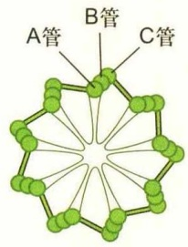

chemical

Diagram of a molecular structure with labeled pipes A, B, and C

(B)

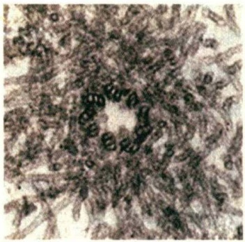

natural_image

Microscopic view of cellular structures with visible nuclei and cytoplasm (no text or labels)

(D)

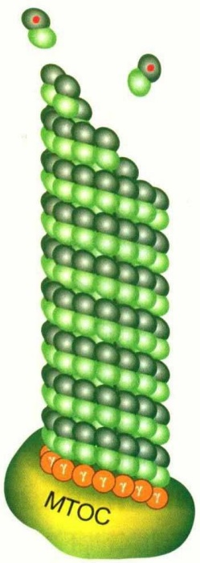

chemical

Molecular structure diagram showing a layered compound with MTOC label

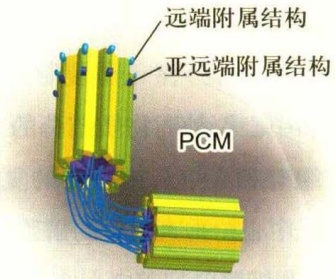

text_image

远端附属结构
亚远端附属结构
PCM

(C)

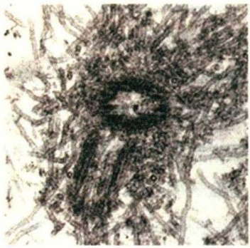

natural_image

Microscopic view of a biological tissue sample showing cellular structures (no text or labels visible)

图8-11 中心体的结构及微管的组装（电镜照片由伍启熹、滕俊琳提供）

(A) 中心体结构示意图，显示成对的中心粒以及外周物质 (PCM); (B) 中心粒横切面的电镜照片，显示9组微管三联体结构呈风车状排列; (C) 显示一对垂直分布的中心粒及其起源于外周物质的微管; (D) 大部分中心体微管的组装起始于PCM上的 $\gamma$-微管蛋白环状复合物。

除了三联体微管的伸长，中心粒的组装还包括在三联体微管所包围的腔内结构的装配。目前对于这些结构的功能和分子组成不甚清楚。在哺乳动物细胞中，中心粒末端的空腔被一堆倾斜的盘状物质填满。在草履虫的中心粒末端空腔中含有螺旋状结构，而在四膜虫细胞内，可以观察到一个圆柱状电子致密结构，而衣藻中心粒的空腔中填满了与三联体微管相连的纤维。虽然空腔内部的结构有所不同，但都存在一些共同的特点，如都存在centrin。centrin是钙结合蛋白，存在于所有装配动纤毛的物种基因组中。人源centrin可以与hPOC5和中心粒组分hSfi1直接结合，也与CP110存在相互作用。

原中心粒在经历有丝分裂后逐渐成长为子中心粒。此时，原中心粒车轮结构中的轮轴消失，即HsSAS-6不再与子中心粒的近端部分结合。虽然这样的中心粒在S期可以作为亲本起始新中心粒的复制，但是还没有完全成熟。中心粒最终成熟的标志是远端和亚远端附属结构的获得，这一过程发生在随后 $G_{2}$ 的晚期或M期早期。以此推算，一个中心粒从组装到完全成熟大概要经历1.5个细胞周期。中心粒的成熟与否直接反映在它们功能上的差异，至少在某些细胞中，成熟的中心粒具有锚定微管的能力，并可作为基体参与纤毛的形成。

在细胞周期的不同时期，中心体的母子中心粒之间由不同类型连接复合体相连（图8-12）。一种是S-M连接体（S-M linker，SML），它形成于S期，将新生的原中心粒与其邻近的母中心粒紧密连接在一起，持续到细胞分裂末期才解开。母子中心粒间紧密连接的解除也称为中心粒的解离（centriole disengagement），这一过程依赖于PLK1激酶和分离酶(separase)。由于PLK1和分离酶通常只在有丝分裂期被激活，因此这个假说（又称许可证模型）为中心粒复制和细胞周期转变的偶联提供了一个很好的解释。cohesin蛋白复合体的解体与有丝分裂过程中期向后期转变过程中姐妹染色单体的分离相关，对于中心粒的解离也是必需的，提示cohesin可能是SML的组分。

中心粒间的另一种类型的连接是“ $G_{1}-G_{2}$ 栓”（ $G_{1}-G_{2}$ tether，GGT），此种连接相对松散，主要作用是使间期细胞中心体的微管组织能力更加集中。GGT的组装与SML的解除同时进行或稍晚一些。由此推测GGT的装配很可能依赖中心粒的解离。实时动态观察显示两个中心粒的运动通常是协调一致的，但也会暂时相离较远的距离。GGT的解聚发生在 $G_{2}$ 期。此时，两对中心粒各自招募了一定量的外周物质而具备了组织微管组装的能力，中心体（每个中心体由一对相互连接的中心粒组成）开始分离，并向两极移动，开始纺锤体的组装。与GGT功能相关的蛋白包括C-Nap1、rootletin、LRRC45、CEP68和CEP215/CDK5RAP2等。其中C-Nap1定位于间期细胞两个中心粒近端底部，在 $G_{2}$ 晚期时会从中心粒上解离下来。Rootletin和LRRC45在间期细胞的两个中心粒之间组装成纤维状结构，并在近端的底部与C-Nap1相互作用，从而形成GGT。敲减C-Nap1、rootletin或LRRC45都会导致中心体提前分离。此外，还有CEP68和CEP215也参与了GGT的组装。GGT的解体主要受Nek2A（NIMA家族成员NIMA-related kinase 2A）和PP1α的调控。在 $G_{2}/M$ 期时，Nek2A的活性增加，而PP1α被CDK1磷酸化而失活，C-Nap1、rootletin和LRRC45等蛋白被磷酸化，导致GGT结构解体（图8-12），并开始纺锤体微管的组装。

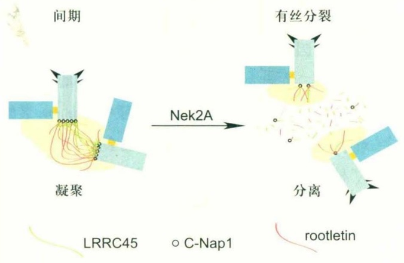

flowchart

② 中心粒组装的调控 细胞内中心粒数目的稳定是确保细胞分裂正常进行的关键。通常认为中心体的复制受两方面的调控:一是细胞周期调控，即在一个细胞周期中只复制一次；二是数量控制，即每次复制在每个已经存在的中心粒近端长出一个新的中心粒。

中心体复制与DNA复制有一些共同的特征。它们都发生在S期，并且在每个细胞周期中只进行一次。将处于细胞周期不同时段的细胞融合，发现S期和 $G_{2}$ 期的细胞质都能让 $G_{1}$ 期的中心体提前复制，而将 $G_{2}$ 期的中心体置于S期的细胞质中则不能再次复制。说明中心粒一旦已经在S期复制，在下一个S期之前将不再复制，即使是将其图8-12 中心粒连接在细胞周期中的变化（仿自He等，2013）

母子中心粒间的连接，也称S-M连接体(SML)。SML发生在母中心粒和刚刚组装的子中心粒之间，结构紧凑。在有丝分裂末期解体，取而代之的是较为宽松的 $G_{1}-G_{2}$ 栓(GGT)。GGT是间期细胞内连接两亲本中心粒的纽带，在两亲本中心粒近端的底部，与C-Nap1相连。在 $G_{2}$ 期的晚期，GGT的结构组分因Nek2A的活性升高而被磷酸化，GGT解体，两对中心粒带着各自的外周结合蛋白在Eg5的作用下移向细胞的两极，进行纺锤体的组装。

置于一个适合中心粒复制的细胞质环境中(如S期)。很显然，中心体复制也存在一个与DNA复制相似的认证过程。中心粒复制（原中心粒的装配）发生在S期，而中心粒复制许可推测发生在有丝分裂末期，因为那时CDK活性较低，中心体再复制的条件不成熟。母子中心粒在有丝分裂末期发生解离是中心粒复制的前提条件，这一过程使新中心粒组装位点暴露，为下一轮复制消除阻碍。事实上，将S期母中心粒侧面的原中心粒用激光去掉后，在相同的位置又能形成一个新的原中心粒。

中心体复制与DNA复制密切相关。当染色体复制停止时，中心体复制也会随之停止。在许多不同物种的细胞中，CDK2都被认为是促进中心粒和DNA在S期复制的重要激酶。CDK2的一些底物如nucleophosmin/B23、MPS1等与中心粒复制相关。Nucleophosmin/B23定位于核仁和中心体。在 $G_{1}/S$ 期，nucleophosmin/B23被CDK2/cyclin E磷酸化，并从中心体上脱落，直到有丝分裂开始后才再重新定位于中心体。抑制nucleophosmin/B23的磷酸化会阻碍中心体复制的起始。此外，DNA复制认证相关蛋白Orc1(origin-recognition complex 1)和geminin也参与中心体复制的调控，敲除这些蛋白会导致中心体的过度复制。这也进一步说明DNA和中心体复制的起始可能依赖于相同的调控机制。

当细胞中缺乏p53时，过表达DNA复制认证因子CDT1会使DNA异常复制。在细胞周期的各个时期，中心体上都有p53定位。在细胞核内，p53促进p21的表达水平升高，并通过p21抑制CDK2/cyclin E的活性，从而抑制中心体的过度复制。而在p53失活的情况下，p21的表达水平下降，CDK2的活性不受抑制，从而导致中心体过度扩增，说明DNA复制检验点的主要调控者p53也参与调控中心体的复制。

中心粒数量异常会影响有丝分裂纺锤体的正常组装。正常情况下，在一个细胞周期内，每个母中心粒附近只能复制出一个子中心粒，表明细胞中存在一种调控中心粒组装成核的机制。PLK4被认为是中心粒数量控制的一个主要调控者。PLK4又称为SAK，是Polo激酶家族成员，在中心体复制过程中始终定位于母中心粒的近端，并对于原中心粒的组装至关重要。在缺失PLK4的细胞中，原中心粒不能进行装配。而过表达PLK4会导致每个母中心粒周边同时形成多个原中心粒。虽然有多个激酶影响中心粒的复制，但只有PLK4在形成原中心粒过程中具有剂量效应。推测PLK4自身的磷酸化并促进其泛素降解可能是数量调节的一个重要方面。此外，过表达SAS-6、CPAP/SAS-4或SAS-5/Ana2也会导致中心粒过度复制。SAS-6和CPAP蛋白的表达量从有丝分裂结束到 $G_{1}$ 期一直较低，其中与 $APC^{Cdh1}$ 相关的泛素化降解也在数量调节上发挥作用。

有些动物（如小鼠）的受精卵在早期卵裂过程中没有中心粒，它们的中心体是在经过几次卵裂之后才产生。破坏或去除体细胞的中心体后，细胞还会产生新的中心体。在这些细胞中，中心体的产生是从无到有的，没有预先存在的中心粒作模板。因此，母中心粒对于新中心粒的形成很可能并不是一个严格必需的条件。但细胞通常都会采用“经典”途径（即依赖现有中心粒为模板）生成新中心体，而不用de novo装配途径。在衣藻中，只有在缺少内源中心粒的情况下，装配途径才会变得活跃。在HeLa细胞中，当所有内源中心粒被激光破坏后，虽然细胞可以通过de novo途径生成中心粒，但是只要有一个内源的中心粒存在就会抑制这种“非经典”途径的中心粒装配。为什么细胞会优先选择“经典”装配途径呢？最近的研究发现“经典”装配途径与de novo装配途径都需要如SAK/PLK4、SAS-6或SAS-4/CPAP等中心粒装配的关键因子参与，提示这两种装配途径所介导的中心粒装配过程可能类似，只是装配速率不同。有一种观点认为预先存在的中心粒是通过捕获和聚集中心粒装配蛋白对中心粒复制施加空间上的调控。中心粒可以在它们的近端招募和组织中心粒周围物质（PCM），而PCM对于中心粒的形成十分重要，一些中心粒装配的关键蛋白会定位在PCM区域。在哺乳动物细胞中过表达pericentrin时，围绕在母中心粒周围的PCM增大，导致在母中心粒周围形成过量的子中心粒。值得注意的是，pericentrin本身并不直接参与子中心粒的形成，敲除pericentrin也并不抑制中心粒的复制。因此，很可能是由于PCM增大而导致过量中心粒的形成。在有中心粒存在的情况下，大量的PCM都会被募集到中心粒周围，从而抑制胞质中的de novo装配途径。同样地，一个母中心粒周围可能会生成很多原中心粒的“种子”，但是由于装配因子是有限的，最终只有一个能“发芽”，形成新中心粒。

## 8.3.2 基体和轴丝微管

## (1) 纤毛与细胞周期

鞭毛和纤毛内部的微管源自基体，而基体通常是由母中心粒转化而来，因而在结构上，基体与中心粒基本一致，其外围由9组三联体微管构成。在纤毛组装时，A管和B管由于微管蛋白的不断加入而跨过纤毛板，形成纤毛的轴丝微管，C管终止于纤毛板或基板附近，因此轴丝微管在结构上与中心粒或基体不同，其外围是9组二联管结构（图8-13）。在纤毛的中央常有一对由中央鞘所包围的中央微管，即“9+2”型；有些类型的纤毛中，轴丝中央有四根单体微管，即“9+4”型；也有一些纤毛没有中央微管，为“9+0”型。轴丝微管外侧的膜在组分上有别于细胞膜，但彼此相连。纤毛与其他细胞质组分之间由转换区域相互隔开，形成一个相对独立的纤毛内环境。纤毛组装需要的蛋白组分由马达蛋白KIF3运入，而物质从纤毛输出则由动力蛋白担当。当细胞从 $G_{1}$ 期进入S期时，轴丝微管解聚，纤毛结构消失，基体转化成中心粒。又如精子鞭毛内部的微管起源于从中心粒衍生而来的基体。中心粒和基体都具有自我复制的性质。

根据纤毛是否能够运动可以将其分为动纤毛(motile cilia)和初级纤毛(primary cilia，也称原纤毛)。通常，动纤毛有一对中央微管，而初级纤毛没有，但并不是绝对的。如斑马鱼的脊髓中央管中就存在“9+0”型的运动性室管膜纤毛，而蛙嗅觉上皮细胞上“9+2”型纤毛却是不动纤毛。所以，纤毛的中央微管与运动之间的关系还有待阐明。

初级纤毛如同“天线”一样突出在细胞表面，用来感知多种外界信号。纤毛在形成、维持和功能方面的缺陷会导致多囊肾病、视网膜退化、脑发育畸形、肥胖以及糖尿病等人类疾病，它们被统称为纤毛疾病（ciliopathy）。此外，纤毛的缺陷往往还与肿瘤的发生有关。在多囊肾

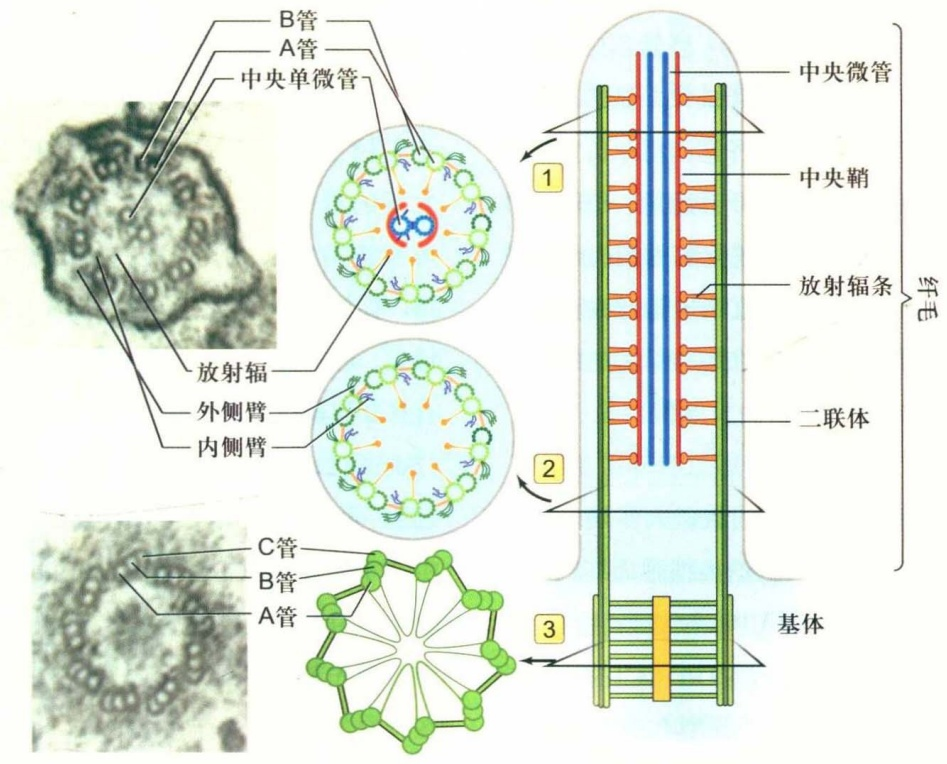

text_image

B管
A管
中央单微管
放射辐
外侧臂
内侧臂
C管
B管
A管
1
2
3
基体
中央微管
中央鞘
放射辐条
二联体
纤毛

图8-13 基体及轴丝的结构和示意图（电镜图像由丁明孝教授提供）

左侧为四膜虫纤毛和基体横切面的电镜图像。中间和右侧为轴丝微管及其附属结构示意图。其中:1. 轴丝的横切面示意图，其外围是9组相互联系的微管二联体，中央是由中央鞘包围的两根微管；2. 纤毛转换器微管的结构示意图；3. 基体横切面示意图，其外围是9组相互联系的微管三联体。

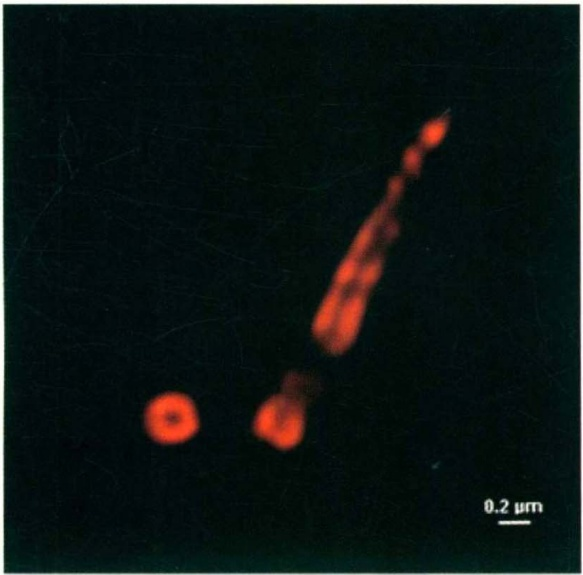

natural_image

Fluorescent microscopy image showing two red-stained cellular structures against a dark background, with a 0.2 μm scale bar (no text or symbols beyond scale indicator)

病的病理检查也常发现细胞过度增殖和极性消失等表型，这正是肿瘤形成的两个重要特征。

## (2) 基体和轴丝微管的翻译后修饰

在组成基体及纤毛轴丝微管的微管蛋白亚基上发生多种类型的PTM。其实，与微管PTM相关的酶类在具有纤毛或鞭毛的原始真核生物中就存在。在脊椎动物中，初级纤毛被认为是细胞信号转导的重要参与者，而动纤图8-14 纤毛轴丝和基体微管蛋白的乙酰化修饰（图片由黄宁博士提供）

对体外培养细胞用抗乙酰化α-微管蛋白的抗体进行免疫荧光染色，在超高分辨率显微镜下显示基体、轴丝微管和一侧的子中心粒被标记。从侧面观察纤毛的基体和轴丝显示轴丝微管所围绕的腔（中间无荧光部分），从子中心粒的一端正面观察显示三联体微管所围绕的中心粒的腔。

毛对于细胞运动尤其重要。在众多的PTM类别中， $\alpha$ -微管蛋白的乙酰化修饰是标志性的，用特异性抗体可将乙酰化修饰的微管标记，如纤毛的基体和轴丝微管（图8-14）。

令人惊讶的是一些微管蛋白的PTM在纤毛中并不均匀。如轴丝微管富含去酪氨酸化的微管蛋白，而组成中央微管的 $\alpha-$ 微管蛋白的C端大多是保留酪氨酸。在外侧的二联体微管中，B管上 $\alpha-$ 微管蛋白的去酪氨酸化修饰要比A管多得多。推测有更多的 $\Delta2-$ 微管蛋白在轴丝的B管上积累，这是一种不可逆转的去酪氨酸的手段。目前尚不清楚轴丝微管上存在的这种修饰差异是否与轴丝结构的组装及分子马达的运动相关。

微管蛋白的多聚谷氨酰化和多聚甘氨酰化修饰在纤毛中也很丰富。将四膜虫（T. thermophila）微管蛋白上潜在的修饰位点突变可导致纤毛中央微管缺失，显然，这种修饰对于维持轴丝结构是必需的。将基因组中负责微管甘氨酰化修饰的酶敲除导致四膜虫纤毛缩短，斑马鱼体轴产生随机的不对称性。果蝇甘氨酰化酶的消失对精子发生的早期阶段影响不大，但会导致精子轴丝完全去组装和不育。可见，轴丝微管的PTM在维持纤毛的结构和功能方面是相当重要的。

## (3) 纤毛的发生

对纤毛发生（ciliogenesis）过程的认识大多是基于对体外培养细胞的研究结果。当细胞退出细胞周期时，中心体向细胞表面迁移，与此同时母中心粒逐渐转化为基体，母中心粒远端的一些蛋白，如CP110和CEP97等被移除，并招募来源于高尔基体的纤毛膜泡（ciliary vesicle, CV），而后轴丝微管开始组装（图8-15），在这一过程中，纤毛组装所需要的材料要通过位于基部的转换区域的筛选以及IFT（intraflagellar transport）转运等多个过程协同完成。IFT运输货物量的调控以及轴丝微管组装与去组装的动态平衡决定了纤毛的长度（图8-16）。当细胞将要重新进入细胞周期时，纤毛组装与去组装之间的平衡开始向去组装方向倾斜，纤毛回缩。血清饥饿使一些细胞进入 $G_{0}$ 期，并诱导长出纤毛，重新加入血清或生长因子使细胞重新回到分裂周期，基体转变成中心体。

尽管调节纤毛生长的机制还远没有被阐明，但众多的实验结果表明，定位于母中心粒的远端附属结构蛋白(distal appendage protein, DAP) 和中心粒微管正极端的蛋白复合物在这一过程中发挥了重要作用。

① 远端附属结构蛋白 来自高尔基体的膜泡在母中心粒上的锚定，对于纤毛生长起始至关重要。最先发现的母中心粒远端附属结构组分是CEP164，该蛋白可直接与鸟嘌呤核苷酸交换因子（GEF）Rabin8相互作用，促进GTP酶Rab8在中心体上的激活，帮助膜泡的锚定。CEP164的蛋白水平在间期或血清饥饿期增多，在有丝分裂期有所下降，这与纤毛的生长期间相一致。敲减CEP164会加快细胞周期进程，并影响细胞的凋亡和上皮细胞-间充质细胞转换(epithelial-mesenchymal transition, EMT)。随后，CEP89（CCDC123）、CEP83（CCDC41）、SCLT1和FBF1/Albatross四个远端附属结构蛋白相继被鉴定。最先被招募到远端附属结构上的CEP83蛋白是膜泡在母中心粒的远端锚定所必需，也与TTBK2的招募以及CP110的去除相关，还在IFT20的招募过程中发挥作用。

② OFD1 I型口-面-指综合征（oral-facial-digital syndrome type 1, OFD1）蛋白定位于远端附属结构和中心体卫星结构（pericentriolar satellite）。前者在远端附属结构的组装以及初级纤毛的形成等方面发挥作用。后者与中心体卫星蛋白PCM1、CEP290和BBS4等相互作用，对初级纤毛的形成起抑制作用。当细胞处于血清饥饿状态时，中心体卫星结构上的OFD1经由细胞自噬降解，从而促进了纤毛生长的起始。

③ CP110-CEP97-KIF24复合体 该复合物定位于基体微管的正极端，是纤毛组装的负调控因子。CP110和

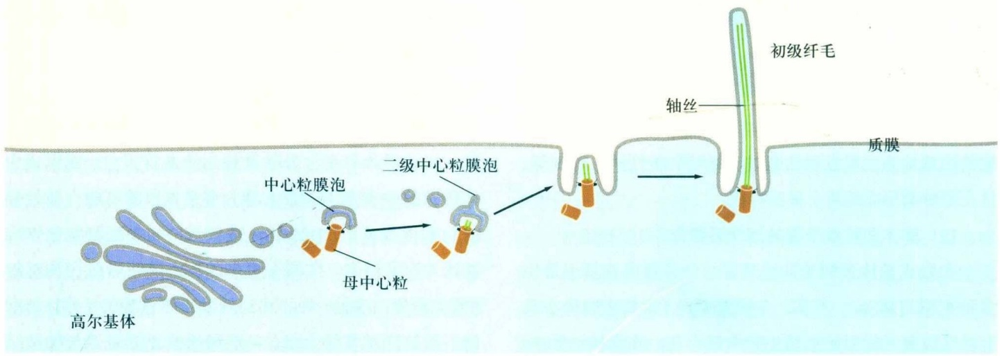

flowchart

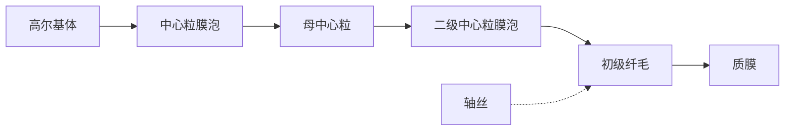

图8-15 初级纤毛的形成过程

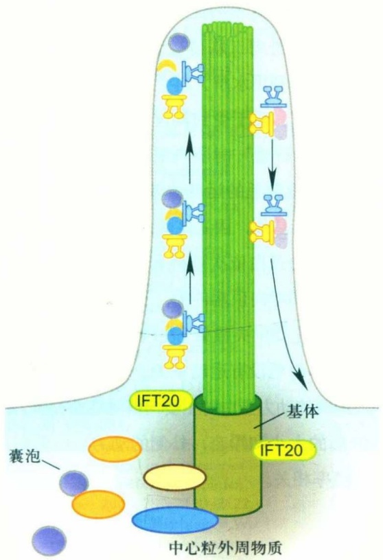

flowchart

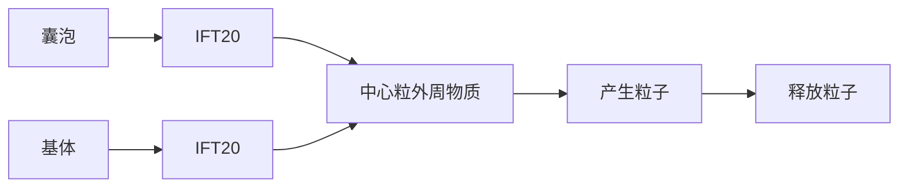

驱动蛋白-2 +IFT复合物B

动力蛋白
+IFT 复合物 A

CEP97是最早发现的两个抑制中心粒微管延伸的蛋白，而KIF24是驱动蛋白-13家族的成员，该复合物定位于中心粒微管的正极端，可抑制中心粒/基体微管的延伸。在母中心粒的远端，KIF24招募CP110和CEP97，后者覆盖在中心粒微管的正极端，阻止了微管的组装。而在间期细胞中，纤毛的发生有赖于这个复合物的移除。处于增殖周期中的细胞如缺失它们当中的任何一个都有可能导致中心粒的延伸或长出未成熟的纤毛。相反，当它们过表达时也会抑制正常的纤毛生长。有趣的是，KIF24对于CP110在母中心粒上的招募以及调节母中心粒微管延伸的能力只在RPE-1、3T3等可以诱导出纤毛的细胞中出现，而在U2OS等细胞中完全没有。这些蛋白的异常表达将导致与纤毛异常相关的疾病，如动纤毛缺失或功能异常所导致的慢性鼻窦炎患者细胞中，CP110的蛋白水平异常升高。

关于 CP110-CEP97 是如何从母中心粒远端移除这个问题，目前了解还很有限，只有在 miRNA 和磷酸化调节

## 图8-16 鞭毛内运输

驱动蛋白-2从鞭毛（或纤毛）的基部运送IFT复合物B至顶端，动力蛋白将IFT复合物A从鞭毛的顶端运向基部。

方面有一点线索。有报道认为mir-129-3p的含量在血清饥饿后升高，可特异识别并降低CP110的mRNA水平，从而间接地调控CP110的蛋白量。mir-34/449也是通过调节CP110的mRNA水平从而影响动纤毛的生长。相比之下，蛋白磷酸化的调节似乎更加直接。在血清饥饿诱导纤毛生长的过程中，TTBK2受CEP164的招募而定位于母中心粒远端，敲减TTBK2将导致CP110无法从母中心粒远端移除，并影响纤毛的生长。Ttbk2基因突变导致11型脊髓小脑共济失调（spinocerebellar ataxia type 11, SCA11）。MARK4的缺失同样会导致血清饥饿后CP110无法从母中心粒顶端移除。

CEP104也与CEP97以及CP110结合，但不同的是，CEP104具有促进纤毛轴丝的生长的功能。CEP290（又名BBS14、NPHP6、JBTS5、SLSN6、MKS4或LCA10）同样是一个具有调节纤毛生长功能的CP110结合蛋白，之所以出现诸多不同的名称是因为CEP290基因的突变会导致Bardet-Biedl综合征(BBS)、肾消耗性疾病(nephronophthisis, NPHP)、Joubert综合征、Senior-Loken综合征、Meckel-Gruber综合征以及先天性黑矇症(Leber's congenital amaurosis, LCA)等多种人类遗传疾病。虽然在CEP290基因中目前已经发现了超过100种不同的突变，但该基因的突变与疾病表征之间的关联尚不知晓。CEP290可与纤毛膜泡组分Rab8a相互作用，促进母中心粒/基体在细胞膜上锚定。此外，CEP290与CP110的功能相互拮抗，当过表达不能结合CEP290的CP110突变体后，CP110原本对于纤毛生长的阻滞作用消除，这从一定程度上证明了CP110是通过抑制CEP290来阻碍纤毛的生长。

④鞭毛内运输 IFT是位于二联体微管和纤毛膜之间的双向运输系统。纤毛的延伸和维持依赖于鞭毛内运输。kinesin 2将IFT复合物B（含纤毛组装所需的轴丝前体组分）从纤毛基部运送到顶部，IFT复合物A将需要回收的物质由dynein 2运回胞体。IFT复合物A包含6种纤毛组分，而复合物B包含10种纤毛组分（图8-15）。这些编码IFT组分的基因在真核生物中高度保守，几乎对于所有真核细胞的纤毛或鞭毛的组装都是必需的。BBsome蛋白复合体是纤毛膜蛋白转运的转接器，通过IFT在纤毛内循环。

## (4) 纤毛运动

纤毛和鞭毛是突出于细胞表面的、高度特化的细胞结构。精子和原生动物通过鞭毛的波状摆动使细胞在液体介质中游动。纤毛与鞭毛的结构相似，但较短。纤毛是一些原生动物（如草履虫）的运动装置。在一些高等动物体内，纤毛存在于多种组织（如输卵管、呼吸道上皮组织等）的细胞表面。相邻的纤毛可以几乎同步运动，使组织表面的液体定向流动。在人体呼吸道，数量众多的纤毛可以清除进入气管的异物，输卵管中的纤毛可以使卵细胞向子宫方向移动。近年来，随着鞭毛内转运机制的发现以及一些纤毛相关蛋白缺失后引起的一系列在细胞水平、组织水平乃至个体水平上的表型变化，使人们认识到这种细胞结构还与细胞信号转导、细胞增殖与分化、组织与个体的发育等过程密切相关。

纤毛运动的本质是由轴丝动力蛋白所介导的相邻二联体微管之间的滑动。然而，在纤毛或鞭毛内部，组成轴丝的9组二联体微管之间、外周微管与中央鞘之间都有许多辅助蛋白将微管横向连成一个整体。在相邻二联体微管之间，一个外周二联体微管的A管伸出的动力蛋白的马达结构域会利用水解ATP产生的能量在相邻二联体的B管上“行走”，由于受到轴丝结构“整体性”的阻碍，纤毛动力蛋白“行走”时所产生的力便会使纤毛的局部弯曲。在纤毛或鞭毛的运动协调过程中，轴丝微管的弯曲首先发生在其基部，因为这里的动力蛋白首先被活化。随着轴丝上动力蛋白依次被特异活化或失活，这种弯曲有规律地沿着轴丝向顶端传播，于是就产生了纤毛运动。动力蛋白的活化受中央微管和放射辐的调控，缺少这些结构的突变体纤毛没有运动能力。在纤毛或鞭毛的运动过程中，内侧的动力蛋白臂主要与纤毛弯曲相关，决定纤毛弯曲波形的大小和形态，外侧的动力蛋白臂则与拍打的力量和频率相关。

## □ 小结

微管通常起源于中心体，向细胞边缘呈放射状伸展。微管的组装通常是从中心体上的γ-微管蛋白环状复合体开始，通过添加α/β-微管蛋白二聚体不断延伸，也可以因为末端的解聚而缩短，因而表现出高度的动态不稳定性。Stathmin家族的成员能与游离的α/β-微管蛋白二聚体结合，从而调控细胞质内可溶性微管蛋白的有效浓度以及微管的组装。微管的直径为24 nm，通常是负极端与中心体相连，正极端游离在细胞质中，或与其他亚细胞结构相互作用。纤毛的轴丝微管以及中心粒和纤毛基体的微管则以二联体或三联体形式存在。微管蛋白的翻译后修饰为微管表面增加了多种结构和化学标签，为数目众多的微管结合蛋白提供了特异的结合位点，而微管结合蛋白是调节微管稳定性和微管网络结构的关键因子，特别是在高度极性化的细胞中。微管还能与其他蛋白共同组装成中心粒、纺锤体、鞭毛或纤毛的基体和轴丝等结构。驱动蛋白和动力蛋白是依赖微管的分子马达，它们可以携带多种细胞器和大分子复合物沿微管运动，在细胞形态的发生和维持、细胞内物质运输、细胞运动和细胞分裂等过程中发挥重要作用。鞭毛和纤毛是特化的细胞表面结构，除参与细胞运动，纤毛还与信号转导、细胞分化和个体发育等过程相关。一些与微管相关的蛋白在表达量上的变化或基因突变与多种人类疾病息息相关。

## □ 思考题

1. 如何理解微管对细胞结构和功能的组织作用？细胞内一些细胞器和生物大分子的不对称分布有什么意义？
2. 如何理解微管的动态不稳定性？这一现象受哪些因素的调控？与细胞生命活动过程有什么关系？
3. 以中心体为例，简述细胞结构的组装与蛋白质相互作用的关系。

(陈建国 滕俊琳 北京大学生命科学学院)

## □ 参考文献

1 Asbury C L, Fehr A N, Block S M. Kinesin moves by an asymmetric hand-over-hand mechanism. Science, 2003, 302: 2130–2134.
2 Azimzadeh J, Marshall W F. Building the centriole. Curr Biol, 2010, 20: R816–825.
3 Bahe S, Stierhof Y D, Wilkinson C J, et al. Rootletin forms centriole-associated filaments and functions in centrosome cohesion. J Cell Biol, 2005, 171: 27–33.
4 Banks G T, Fisher E M. Cytoplasmic dynein could be key to understanding neurodegeneration. Genome Biol, 2008, 9:214. doi: 10.1186/gb-2008-9-3-214.
5 Basto R, Brunk K, Vinadogrova T, et al. Centrosome amplification can initiate tumorigenesis in flies. Cell, 2008, 133: 1032–1042.
6 Bettencourt-Dias M, Glover D M. SnapShot: centriole biogenesis. Cell, 2009, 136: 188, e181.
7 Brendza R P, Serbus L R, Duffy J B, et al. A function for kinesin I in the posterior transport of oskar mRNA and Staufen protein. Science, 2000, 289: 2120–2122.
8 Bowman A B, Kamal A, Ritchings B W, et al. Kinesin-dependent axonal transport is mediated by the sunday driver (SYD) protein. Cell, 2000, 103: 583–594.
9 Chen J, Kanai Y, Cowan N J, et al. Projection domains of MAP2 and tau determine spacings between microtubules in dendrites and axons. Nature, 1992, 360: 674–677.
10 Cunha-Ferreira I, Rodrigues-Martins A, Bento I, et al. The SCF/Slimb ubiquitin ligase limits centrosome amplification through degradation of SAK/PLK4. Curr Biol, 2009, 19: 43–49.
11 Dzhindzhev N S, Yu Q D, Weiskopf K, et al. Asterless is a scaffold for the onset of centriole assembly. Nature, 2010, 467: 714–718.
12 Ebbing B, Mann K, Starosta A, et al. Effect of spastic paraplegia mutations in KIF5A kinesin on transport activity. Hum Mol Genet, 2008, 17:1245–1252.
13 Efimov A, Kharitonov A, Efimova N, et al. Asymmetric CLASP-dependent nucleation of noncentrosomal microtubules at the trans-Golgi network. Dev Cell, 2007, 12:917-930.
14 Gu C, Zhou W, Puthenveedu M A, et al. The microtubule plus-end tracking protein EB1 is required for Kv1 voltage-gated K+ channel axonal targeting. Neuron, 2006, 52:803–816.
15 Guillaud L, Setou M, Hirokawa N. KIF17 dynamics and regulation of NR2B trafficking in hippocampal neurons. J Neurosci, 2003, 23: 131–140.
16 Habedanck R, Stierhof Y D, Wilkinson CJ, et al. The Polo kinase Plk4 functions in centriole duplication. Nat Cell Biol, 2005, 7: 1140–1146.
17 Harada A, Takei Y, Kanai Y, et al. Golgi vesiculation and lysosome dispersion in cells lacking cytoplasmic dynein. J Cell Biol, 1998, 141: 51–59.
18 He Runsheng, Huang Ning, Bao Yitian, et al. LRRC45 is a centrosome linker component required for centrosome cohesion. Cell Reports, 2013, 4:1100–1107.
19 Hirokawa N. Kinesin and dynein superfamily proteins and the mechanism of organelle transport. Science, 1998, 279: 519–526.
20 Hirokawa N, Takemura R. Molecular motors and mechanisms of directional transport in neurons. Nat Rev Neurosci, 2005, 6:201–214.
21 Hirokawa N, Noda Y. Intracellular transport and kinesin superfamily proteins, KIFs: structure, function, and dynamics. Physiol Rev, 2008, 88:1089–1118.
22 Hirokawa N, Noda Y, Tanaka Y, et al. Kinesin superfamily motor proteins and intracellular transport. Nat Rev Mol Cell Biol, 2009, 10(10): 682–696.
23 Homma N, Takei Y, Tanaka Y, et al. Kinesin superfamily protein 2A (KIF2A) functions in suppression of collateral branch extension. Cell, 2003, 114: 229–239.
24 Horiguchi K, Hanada T, Fukui Y, et al. Transport of PIP3 by GAKIN, a kinesin-3 family protein, regulates neuronal cell polarity. J Cell Biol, 2006, 174:425–436.
25 Hua W, Chung J, Gelles J. Distinguishing inchworm and hand-over-hand processive kinesin movement by neck rotation measurements. Science, 2002, 295: 844–848.
26 Huang N, Xia Y, Zhang D, et al. Hierarchical assembly of centriole subdistal appendages via centrosome binding proteins CCDC120 and CCDC68. Nat Commun, 2017, 8:15057.
27 Janke C, Bulinski J C. Post-translational regulation of the microtubule cytoskeleton: mechanisms and functions. Nat Rev Mol Cell Biol, 2011,12(12): 773–786.
28 Jimbo T, Kawasaki Y, Koyama R, et al. Identification of a link between the tumour suppressor APC and the kinesin superfamily. Nat Cell Biol, 2002, 4: 323–327.
29 Kamal A, Almenar Queralt A, LeBlanc J F, et al. Kinesin-mediated axonal transport of a membrane compartment containing  $\beta$ -secretase and presenilin 1 requires APP. Nature, 2001, 414: 643–648.
30 Kanai Y, Dohmae N, Hirokawa N. Kinesin transports RNA: isolation and characterization of an RNA–transporting granule. Neuron, 2004, 43: 513–525.
31 Kardon J R, Vale R D. Regulators of the cytoplasmic dynein motor. Nat Rev Mol Cell Biol, 2009, 10:854–865.
32 Kirkham M, Muller-Reichert T, Oegema K, et al. SAS-4 is a C. elegans centriolar protein that controls centrosome size. Cell, 2003, 112: 575–587.
33 Kitagawa D, Busso C, Fluckiger I, et al. Phosphorylation of SAS-6 by ZYG-1 is critical for centriole formation in C. elegans embryos. Dev Cell, 2009, 17: 900–907.
34 Kleylein–Sohn J, Westendorf J, Le Clech M, et al. Plk4-induced centriole biogenesis in human cells. Dev Cell, 2007, 13: 190–202.
35 Klopfenstein D R, Tomishige M, Stuurman N, et al. Role of phosphatidylinositol (4, 5) bisphosphate organization in membrane transport by the Unc104 kinesin motor. Cell, 2002, 109: 347–358.
36 Kobayashi T, Kim S, Lin Y C, Inoue T, et al. The CP110-interacting proteins Talpid3 and Cep290 play overlapping and distinct roles in cilia assembly. J Cell Biol, 2014, 204: 215–229.
37 Kobayashi T, Tsang W Y, Li J, et al. Centriolar kinesin Kif24 interacts with CP110 to remodel microtubules and regulate ciliogenesis. Cell, 2011, 145: 914–925.
38 Kodani A, Salome Sirerol-Piquer M, Seol A, et al. Kif3a interacts with Dynactin subunit p150 $^{Glued}$ to organize centriole subdistal appendages. EMBO J, 2013, 32: 597–607.
39 Konishi Y, Setou M. Tubulin tyrosination navigates the kinesin-1 motor domain to axons. Nat Neurosci, 2009, 12:559–567.
40 Lawrence CJ, Dawe R K, Christie K R, et al. A standardized kinesin nomenclature. J Cell Biol, 2004, 167: 19–22.
41 Lin F, Hiesberger T, Cordes K, et al. Kidney specific inactivation of the KIF3A subunit of Kinesin II inhibits renal ciliogenesis and produces polycystic kidney disease. Proc Natl Acad Sci U S A, 2003, 100: 5286–5291.
42 Ling S C, Fahrner P S, Greenough W T, et al. Transport of Drosophila fragile X mental retardation protein-containing ribonucleoprotein granules by kinesin-1 and cytoplasmic dynein. Proc Natl Acad Sci U S A, 2004, 101: 17428-17433.
43 Luders J, Patel U K, Stearns T. GCP-WD is a  $\gamma$ -tubulin targeting factor required for centrosomal and chromatin-mediated microtubule nucleation. Nat Cell Biol, 2006, 8: 137–147.
44 Macho B, Brancorsini S, Fimia GM, et al. CREM dependent transcription in male germ cells controlled by a kinesin. Science, 2002, 298: 2388–2390.
45 Mahjoub M R, Xie Z, Stearns T. Cep120 is asymmetrically localized to the daughter centriole and is essential for centriole assembly. J Cell Biol, 2010, 191: 331–346.
46 Marszalek J R, Liu X, Roberts E A, et al. Genetic evidence for selective transport of opsin and arrestin by Kinesin II in mammalian photoreceptors. Cell, 2000, 102: 175–187.
47 Mayor T, Stierhof Y D, Tanaka K, et al. The centrosomal protein C-Nap1
is required for cell cycle-regulated centrosome cohesion. J Cell Biol, 2000, 151: 837–846.
48 Meraldi P, LukasJ, Fry A M, et al. Centrosome duplication in mammalian somatic cells requires E2F and Cdk2-cyclin A. Nat Cell Biol, 1999, 1: 88–93.
49 Mennella V, Tan D Y, Buster D W, et al. Motor domain phosphorylation and regulation of the Drosophila kinesin 13, KLP10A. J Cell Biol, 2009, 186:481–490.
50 Midorikawa R, Takei Y, Hirokawa N. KIF4 motor regulates activity-dependent neuronal survival by suppressing PARP-1 enzymatic activity. Cell, 2006, 125: 371–383.
51 Miki H, Setou M, Kaneshiro K, et al. All kinesin superfamily protein, KIF, genes in mouse and human. Proc Natl Acad Sci U S A, 2001, 98: 7004–7011.
52 Mitchison T, Kirschner M. Dynamic instability of microtubule growth. Nature, 1984, 312: 237–242.
53 Nakagawa T, Setou M, Seog D, et al. A novel motor, KIF13A, transports mannose-6-phosphate receptor to plasma membrane through direct interaction with AP-1 complex. Cell, 2000, 103: 569–581.
54 Nakata T, Hirokawa N. Point mutation of adenosine triphosphate-binding motif generated rigor kinesin that selectively blocks anterograde lysosome membrane transport. J Cell Biol, 1995, 131: 1039–1053.
55 Nakata T, Hirokawa N. Microtubules provide directional cues for polarized axonal transport through interaction with kinesin motor head. J Cell Biol, 2003, 162: 1045–1055.
56 Nigg E A, Stearns T. The centrosome cycle: centriole biogenesis, duplication and inherent asymmetries. Nat Cell Biol, 2011, 13: 1154–1160.
57 Nishimura T, Kato K, Yamaguchi T, et al. Role of the PAR-3-KIF3 complex in the establishment of neuronal polarity. Nat Cell Biol, 2004, 6: 328–334.
58 Niwa S, Tanaka Y, Hirokawa N. KIF1Bβ- and KIF1A-mediated axonal transport of presynaptic regulator Rab3 occurs in a GTP-dependent manner through DENN/MADD. Nat Cell Biol, 2008, 10: 1269–1279.
59 Noda Y, Okada Y, Saito N, et al. KIFC3, a microtubule minus end-directed motor for the apical transport of annexin X III b-associated Triton-insoluble membranes. J Cell Biol, 2001, 155: 77–88.
60 Nonaka S, Tanaka Y, Okada Y, et al. Randomization of left–right asymmetry due to loss of nodal cilia generating leftward flow of extraembryonic fluid in mice lacking KIF3B motor protein. Cell, 1998, 95: 829–837.
61 Reid E, Kloos M, Ashley-Koch A, et al.
A kinesin heavy chain (KIF5A) mutation in hereditary spastic paraplegia (SPG10). Am J Hum Genet, 2002, 71:1189–1194.
62 Rogers G C, Rogers S, Schwimme T A, et al. Identification and characterization of three Kin I family members in Drosophila: evidence that mitosis in this system involves the coordinated action of functionally distinct classes of Kin I motors. Nature, 2004, 427: 364–370.
63 Rogowski K, Dijk JV, Magiera M M, et al. A family of protein-deglutamylating enzymes associated with neurodegeneration. Cell, 2010, 143:564–578.
64 Setou M, Nakagawa T, Seog D H, et al. Kinesin superfamily motor protein KIF17 and mLin-10 in NMDA receptor-containing vesicle transport. Science, 2000, 288: 1796–1802.
65 Setou M, Seog D H, Tanaka Y, et al. Glutamate-receptor-interacting protein GRIP1 directly steers kinesin to dendrites. Nature, 2002, 417: 83–87.
66 Siegrist S E, Doe C Q. Microtubule-induced Pins/Galphai cortical polarity in Drosophila neuroblasts. Cell, 2005, 123: 1323-1335.
67 Song A H, Wang D, Chen G, et al. A selective filter for cytoplasmic transport at the axon initial segment. Cell, 2009, 136:1148–1160.
68 Spektor A, Tsang W Y, Khoo D, et al. Cep97 and CP110 suppress a cilia assembly program. Cell, 2007, 130: 678–690.
69 Surrey T, Nedelec F, Leibler S, et al. Physical properties determining self-organization of motors and microtubules. Science, 2001, 292: 1167–1171.
70 Tan D, Asenjo A B, Mennella V, et al. Kinesin-13s form rings around microtubules. J Cell Biol, 2006, 1751:25-31.
71 Tanaka Y, Kanai Y, Okada Y, et al. Targeted disruption of mouse conventional kinesin heavy chain, kif5B, results in abnormal perinuclear clustering of mitochondria. Cell, 1998, 93: 1147–1158.
72 Takeda S, Yonekawa Y, Tanaka Y, et al. Left–right asymmetry and kinesin superfamily protein KIF3A: new insights in determination of laterality and mesoderm induction by kif3A $^{-/-}$ mice analysis. J Cell Biol, 1999, 145: 825–836.
73 Takeda S, amazaki H, Seog D H, et al. Kinesin superfamily protein 3 (KIF3) motor transports fodrin–associating vesicles important for neurite building. J Cell Biol, 2000, 148: 1255–1265.
74 Terada S, Kinjo M, Hirokawa N. Oligomeric tubulin in large transporting complex is transported via kinesin in squid giant axons. Cell, 2000, 103: 141–155.
75 Teng J, Rai T, Tanaka Y, et al. The
KIF3 motor transports N-cadherin and organizes the developing neuroepithelium. Nat Cell Biol, 2005, 7: 474–482.
76 Valenzuela P, Quiroga M, Zaldivar J., Nucleotide and corresponding amino acid sequences encoded by  $\alpha$ -and  $\beta$ -tubulin mRNAs. Nature, 1981, 289: 650–655.
77 Vale R D, Reese T S, Sheetz M P. Identification of a novel force-generating protein, kinesin, involved in microtubule-based motility. Cell, 1985, 42: 39-50.
78 Venkateswarlu K, Hanada T, Chishti A H. Centaurin- $\alpha$ 1 interacts directly with kinesin motor protein KIF13B. J Cell Sci, 2005, 118:2471–2484.
79 Verhey K J, Hammond J W. Traffic control: regulation of kinesin motors. Nature Reviews, 2009, 10: 765–777.
80 Wang Q, Teng J, Shen B, et al. Characterization of kinesin-like proteins in silkworm posterior silkgland cells. Cell Res, 2010, 20: 713–727.
81 Wong R W, Setou M, Teng J, et al. Overexpression of motor protein KIF17 enhances spatial and working memory in transgenic mice. Proc Natl Acad Sci U S Å, 2002, 99: 14500–14505.
82 Wu Q, He R, Zhou H, et al. Cep57, a NEDD1-binding pericentriolar material component, is essential for spindle pole integrity. Cell Res, 2012, 22(9): 1390–1401.
83 Xia C H, Roberts E A, Her L S, et al. Abnormal neurofilament transport caused by targeted disruption of neuronal kinesin heavy chain KIF5A. J Cell Biol, 2003, 161:55–66.
84 Xu Y, Takeda S, Nakata T, et al. Role of KIFC3 motor protein in Golgi positioning and integration. J Cell Biol, 2002, 158: 293–303.
85 Yamazaki H, Nakata T, Okada Y, et al. KIF3A/B: a heterodimeric kinesin superfamily protein that works as a microtubule plus end-directed motor for membrane organelle transport. J Cell Biol, 1995, 130: 1387–1399.
86 Yang Z, Roberts E A, Goldstein L S. Functional analysis of mouse kinesin motor Kif3C. Mol Cell Biol, 2001, 21: 5306–5311.
87 Yildiz A, Tomishige M, Vale R D, et al. Kinesin walks hand-over-hand. Science, 2004, 303: 676–678.
88 Zhao C, Takita J, anaka Y, et al. Charcot-Marie-Tooth disease type 2A caused by mutation in a microtubule motor KIF1Bβ. Cell, 2001, 105: 587-597.
89 Zhou H, Wang T, Zheng T, et al. Cep57 is a Mis12-interacting kinetochore protein involved in kinetochore targeting of Mad1–Mad2. Nat Commun, 2016, 7.
90 Zimyanin V L, Belaya K, Pecreaux J, et al. In vivo imaging of oskar mRNA transport reveals the mechanism of posterior localization. Cell, 2008, 134: 843–853.

## 细胞黏附与迁移

细胞黏附（cell adhesion）是指细胞间或细胞与胞外基质间的结合。细胞黏附可实现细胞对周围细胞或胞外基质的特异性识别，是形成多细胞生物的基础。不同细胞凭借特异性的识别和黏附能力，使自己成为各种特化的建筑砌块，通过胞间连接（cell-cell junction）及细胞与胞外基质的相互作用形成同类、异类细胞的特定集合体，从而搭建出组织、器官和个体这些更高层次的生命结构。

细胞迁移（cell migration）是动物细胞通过形变产生的一种运动方式，需要在适当的支持物上才能进行。细胞在体外可表现出一维（如在线状支持物上）、二维（如在培养皿上）和三维（如在胞外基质构成的凝胶层中）以及定向、随机等迁移方式，这些方式在一定程度上反映细胞在体内的行为。细胞迁移需要胞外信号的激活和引导，并通过一系列协调的细胞黏附与去黏附过程，在胚胎发生、组织器官形成、创伤愈合、肿瘤转移、炎症等生理和病理活动中发挥重要作用。

## 9.1 细胞黏附

细胞黏附通常由细胞黏附分子(cell adhesion molecule, CAM)介导。细胞黏附分子大多为糖蛋白，少数为糖脂，分布于细胞表面或胞外基质中，主要以配体(ligand)-受体(receptor)相对应的形式发挥作用。它们不仅介导细胞与细胞之间、细胞与胞外基质之间的黏附，还参与细胞的信号转导、识别、活化，调节细胞运动、增殖、分化，以及参与组织形成、创伤愈合、炎症反应、血栓形成、肿瘤转移等一系列重要的生理和病理过程。根据结构特征，细胞黏附分子目前主要分为5类:整合素(integrin，亦称整连蛋白)家族、选凝素(selectin，亦称选择素)家族、钙黏着蛋白家族、免疫球蛋白超家族(immunoglobulin superfamily)和黏蛋白样家族(mucin-like family)。本章主要介绍选凝素和整合素。

## 9.1.1 选凝素的特性及功能

## (1) 选凝素分子概述及结构

选凝素家族分子含有共同的植物凝集素样结构域(lectin-like domain)，并且其功能和表达具有细胞选择性，因此其英文名“selectin”由“select”和“lectin”两词合并而成。目前选凝素家族中有3个成员:L选凝素、P选凝素和E选凝素，其中L、P和E分别代表白细胞(leukocyte)、血小板(platelet)和内皮细胞(endothelial cell)，即最初发现相应选凝素分子的3种细胞。

选凝素为典型的I型跨膜糖蛋白，可分为胞外区、跨膜区和胞内区(图9-1)。其家族各成员膜外部分有较高的同源性，结构类似，均由3个结构域构成:位于细胞外的N端为 $Ca^{2+}$ 依赖的外源凝集素结构域(calcium-dependent lectin domain)，可结合糖链结构，是选凝素分子的结合功能部位；紧邻外源凝集素结构域的是表皮生长因子（EGF）样结构域，虽不直接参与配体的结合，但对维持选凝素分子的构象是必需的；近胞膜部分是2～9个共有重复序列，与补体受体和C4结合蛋白等在结构上有一定同源性。3种选凝素都有单次穿膜的跨膜区和较短的胞内区，有关其胞内区的功能和结合蛋白还研究不多。

## (2) 选凝素的表达和调节机制

细胞黏附分子不仅具有多种生理功能，在一定条件下也与病理过程的发生密切相关。在细胞因子、炎症因子以及其他因素的作用下，细胞黏附分子的水平和构象发生变化，导致细胞黏附和迁移能力的改变。炎症过程的一个重要特征是白细胞黏附、穿越血管内皮细胞，向炎症部位渗出。由于白细胞与内皮细胞的最初黏附是由选凝素介导的，其表达对控制白细胞出脉管有重要意义。

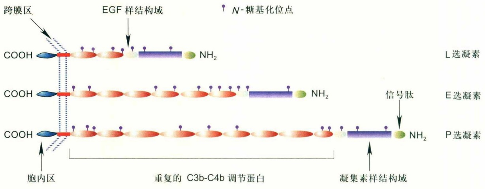

text_image

跨膜区
EGF 样结构域
COOH
NH₂
L 选凝素
COOH
NH₂
E 选凝素
COOH
信号肽
P 选凝素
胞内区
重复的 C3b-C4b 调节蛋白
凝集素样结构域

图9-1 选凝素家族3成员的分子结构（仿自Geng等，2004）

① E选凝素 E选凝素的表达仅限于内皮细胞。IL-1β、肿瘤坏死因子-α (tumor necrosis factor-α, TNF-α)或细菌脂多糖 (lipopolysaccharide, LPS) 等炎症因子的刺激可引起E选凝素基因的表达，合成出的E选凝素随后定位到内皮细胞表面行使功能。在人的脐静脉内皮细胞 (HUVEC) 表面，E选凝素的水平在TNF-α刺激3～6h内达到峰值，随后下降，16～24h后回到基本水平，即使在细胞因子持续作用下也是如此。E选凝素从活化内皮细胞表面的消失很可能是其基因转录水平下调、mRNA半衰期短及其被内吞并在溶酶体内降解等多个因素共同作用的结果。这些过程的综合作用使得E选凝素通常只在细胞因子活化的内皮细胞表面短暂出现。

② P选凝素 P选凝素储存于血小板的α颗粒和内皮细胞的Weibel-Palade小体。凝血酶(thrombin)、组胺、蛋白激酶C活化剂、补体片段或ADP等细胞活化后，这些颗粒与细胞质膜融合，导致P选凝素在细胞表面迅速出现（内皮细胞需数分钟，血小板仅需数秒钟），并在5～10 min内达到最高水平，随后的30～60 min内迅速下降。这种动态表达模式对P选凝素的功能有重要的调节作用。虽然内皮细胞表面的P选凝素、E选凝素都能被迅速内吞，但只有P选凝素可从内吞体再循环进入高尔基体，并被重新转运到Weibel-Palade小体。除了这一途径外，大部分P选凝素和所有内吞的E选凝素被转运到溶酶体消化分解。P选凝素的胞内分选机制与其胞内区序列相关:带有P选凝素跨膜区和胞内区的E选凝素融合蛋白可靶向转运到储存颗粒。此外，也有研究发现正常皮肤静脉的白细胞“滚动”作用部分地由P选凝素介导，提示有些组织的内皮细胞表面的P选凝素表达可能不需要炎症因子刺激。

③ L选凝素 L选凝素主要在白细胞、单核细胞（monocyte）表达。大多数的血源性T细胞、B细胞，以及自然杀伤细胞的亚群中也发现有表达。L选凝素参与淋巴细胞（lymphocyte）归巢、中性粒细胞（neutrophil）与淋巴细胞进入炎症组织等过程。在炎症反应中上调L选凝素配体能诱导L选凝素介导的黏附。L选凝素是介导白细胞在血管壁活化的内皮细胞上“滚动”过程（也被称为“二次黏附”）的重要黏附分子。“二次黏附”还依赖于黏附在内皮细胞的白细胞上L选凝素的配体，很可能是PSGL-1（P-selectin glycoprotein ligand-1）的表达。

上述3种选凝素的表达在时间、空间上相对独立，但又部分交叉，使白细胞对内皮细胞的早期识别得以精确调节。不同类型的选凝素与其配体的组合不同，导致不同细胞间结合能力有差异。中性粒细胞和单核细胞表达L选凝素、P选凝素和E选凝素的配体，而不同类型和功能的T细胞亚群只能表达其中的一种或几种。不同炎症或受损组织的血管壁表面的E选凝素或P选凝素水平可能也有差异。这些复杂的因素很可能决定白细胞选择性进入不同的组织去参与炎症反应和免疫应答。

④ 可溶性选凝素 白细胞、血管内皮细胞或其他细胞表面的黏附分子可以被整体内吞进入细胞，胞外区也可以脱落下来，进入血液成为可溶性黏附分子。在结构上，它们一般缺少跨膜区和胞内区部分，其分子质也较相应膜结合黏附分子小。由于可溶性黏附分子通常具有黏附分子的结合活性，因此可能作为机体调节细胞黏附作用的一种途径发挥作用。在某些疾病状态下，黏附分子的表达或脱落增加，可致血清中可溶性黏附分子的水平显著提高。因此，检测可溶性黏附分子的水平可能成为监测某些疾病状态的指征。

淋巴细胞和中性粒细胞活化后，L选凝素的胞外区会在近膜区域被蛋白酶水解而脱落，导致其在细胞表面表达水平的迅速下调。该过程可能促进白细胞从内皮细胞脱离，从而有利于白细胞穿越内皮细胞层。金属蛋白酶抑制剂可以抑制L选凝素的脱落，提示该过程可能是由金属蛋白酶切割所引起。膜结合的P选凝素是以寡聚状态存在的，而可溶性P选凝素在血液中以单体形式存在，且具有结合活性。巨核细胞和血管内皮细胞内P选凝素的mRNA存在着不同的剪接形式，其中一种缺少胞内区的mRNA编码的蛋白质被分泌到血液中，是血浆可溶性P选凝素的主要来源。体外培养的内皮细胞在IL-1β、TNF-α等细胞因子活化后2～3 h表达E选凝素，24 h即可在上清液中检测到大量可溶性E选凝素。由于E选凝素在体内只分布在活化的血管内皮细胞表面，因此血清中可溶性E选凝素水平可反映体内血管内皮细胞的活化状态。

## (3) 选凝素的功能性配体

功能性配体是指能在生理条件下被黏附分子识别，并介导一定生理功能的分子。大多数细胞黏附分子与其配体的结合是通过蛋白-蛋白相互作用，而选凝素识别的配体是一些寡糖结构，这与选凝素的配体结合区是凝集素样结构域有关。选凝素可识别结构各异的糖链结构，它们或被唾液酸化，或被岩藻糖化，或被硫酸化，或三者兼而有之。

① 糖脂 糖脂能与选凝素特异性结合。从人髓样细胞分离到了介导其与E选凝素结合的岩藻糖基化单唾液酰神经节苷脂。带有sialyl Lewis X和sialyl Lewis A的糖脂支持表达E选凝素或L选凝素的细胞的滚动结合。硫酸化鞘糖脂和SGNL脂类(sulfoglucuronyl neolactoglycolipids)能与L选凝素和P选凝素结合，但不能与E选凝素结合。糖脂可能在最初黏附发生后的滚动过程中起作用，加强选凝素介导的细胞结合。

② 糖蛋白 PSGL-1是公认的P选凝素配体，并且可与3种选凝素结合。PSGL-1在多种细胞中表达，如髓样细胞、淋巴细胞、树突细胞系和其他一些非造血细胞。PSGL-1的糖链需要唾液酸与岩藻糖的修饰，为其结合活性所必需。除了携带正确的寡糖链外，PSGL-1 N端的3个酪氨酸残基中至少有1个被硫酸化。PSGL-1在内质网经PACE酶加工，切除前肽，随后的19个氨基酸残基带有可被硫酸化的酪氨酸残基，对PSGL-1与P选凝素的结合很重要（图9-2）。

PSGL-1是迄今为止特性研究最清楚的选凝素配体，它具有生理环境下选凝素配体应具有的所有特点。

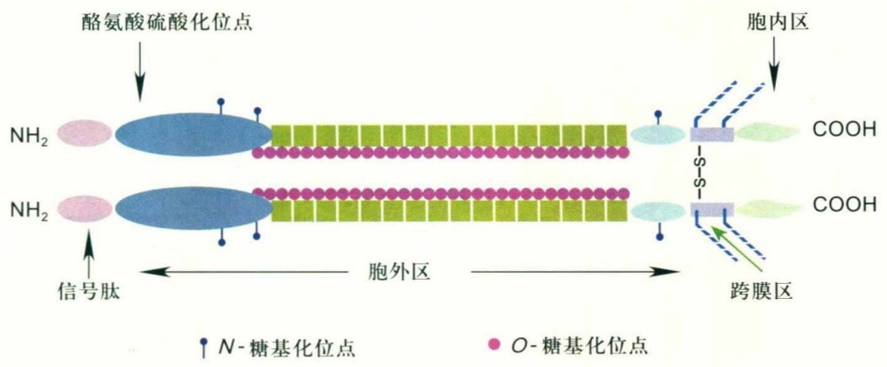

text_image

酪氨酸硫酸化位点
NH₂
信号肽
胞外区
胞内区
COOH
COOH
跨膜区
N-糖基化位点
O-糖基化位点

图9-2 PSGL-1的分子结构(仿自Geng等, 2004)

PSGL-1是人中性粒细胞上P选凝素的主要配体，为中性粒细胞和淋巴细胞与P选凝素结合所必需。PSGL-1的功能重要性说明，单一的糖蛋白分子也能以高亲和力与单一选凝素分子结合，从而介导细胞间的相互作用。因为PSGL-1能用P选凝素亲和层析柱得以分离，这为用亲和层析方法纯化鉴定生理条件下选凝素配体的可靠性提供了实例。

CD24是P选凝素的另一配体，又被称作热稳定抗原(heat-stable antigen, HAS)，它是一种细胞表面糖蛋白，在中性粒细胞、B细胞、未成熟胸腺细胞和红细胞中表达，在神经细胞、人的乳腺癌和小细胞肺癌细胞中也有表达。CD24的多肽链很小，仅有33个氨基酸残基，而它的分子量超过 $7\times10^{4}$ ，这与它的高度糖基化密切相关。高度糖基化的CD24通过糖基磷脂酰肌醇(glycosylphosphatidylinositol, GPI)锚定在细胞膜上。

## (4) 选凝素的生物学功能

① 选凝素与炎症和免疫 各种炎症刺激物，包括免疫复合物、病毒、细菌与创伤等引起白细胞黏附于血管内皮（endothelium），并穿过血管壁向局部区域趋化迁移，产生、分泌各种炎症递质与细胞因子，同时局部血流量与毛细血管通透性增加，导致炎症的发生。白细胞黏附和穿越血管内皮细胞的过程依赖于细胞黏附分子。由于白细胞与血管内皮细胞的黏附必须在血液流动产生的冲力下进行，因此白细胞最初沿血管壁滚动，随后再稳定黏附并穿越内皮细胞（图9-3）。

在淋巴细胞和中性粒细胞进入炎症组织的过程中，3种选凝素都起作用。P选凝素、E选凝素介导早期的黏附，而L选凝素则在较晚期介导中性粒细胞的迁移。内皮细胞表面的P选凝素和E选凝素能支持中性粒细胞、T细胞、单核细胞等与血管内皮细胞的滚动结合。淋巴细胞归巢则是唯一单独由L选凝素介导的过程。

实验表明，在体外模拟体内血液流动状态使中性粒细胞流过原代培养的单层内皮细胞时，其与血管内皮细胞的最初黏附主要是由选凝素及其配体所介导。整合素家族成员与其配体ICAM-1对此几乎不起作用。整合素主要是在随后发生的稳定黏附并穿越血管内皮细胞的过程中起作用。选凝素在介导白细胞与内皮细胞黏附的同时，还引起白细胞上整合素的活化，为下一步的稳定黏附创造条件。细胞黏附分子因此不能被简单视为仅介导细胞间的物理黏附，更应被作为具有复杂功能的膜受体来看待。

② P选凝素与凝血和血栓 血小板的主要生理功能是参与止血与血栓形成，并在动脉粥样硬化、肿瘤转移和炎症反应等过程中起重要作用。血小板的功能与血小板黏附、聚集和活性因子释放等活性密切相关。血管内皮细胞通常不与血小板发生反应。当血管受到损伤，内皮细胞的完整性被破坏，暴露出内皮下成分，血小板在数秒内黏附于破损血管壁，10 min内局部层积的血小板达最大值，形成白色的血栓。白色血栓的中央部位由血小板组成，血栓周围可是纤维蛋白、白细胞和红细胞。在此过程中，血小板除了与内皮细胞黏附外，血小板自身也发生相互聚集。P选凝素是血小板上一个重要的黏附分子，介导白细胞与血小板的结合，使白细胞聚集在血管破损部位，聚集的白细胞又加速纤维蛋白层积，从而帮助止血或形成血栓（图9-4）。

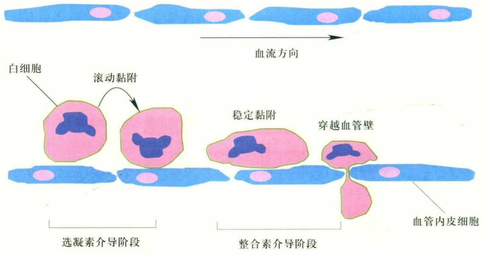

flowchart

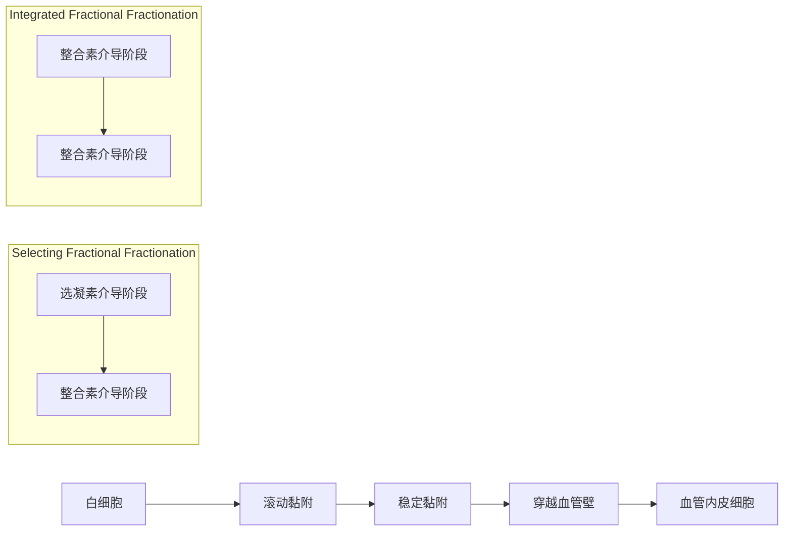

图9-3 炎症中白细胞在血管内皮细胞上的运动过程示意图

血小板本身的聚集也是血小板的一个主要功能。血小板黏附于血管破损处或受到活化剂作用后即被活化，在 $Ca^{2+}$ 的参与下，活化血小板可通过整合素GPⅡb-Ⅲa（Ⅱb3）与血纤蛋白原（fibrinogen）结合而聚集成团。血小板之间可通过P选凝素与其配体结合而相互聚集。P选凝素还能介导血小板和内皮细胞与单核细胞的结合，协助启动凝血机制。

③ 选凝素与肿瘤转移 肿瘤的浸润和转移的过程较为复杂，其中肿瘤细胞在原发灶恶性生长并脱离是肿瘤转移的关键条件，而肿瘤细胞与内皮细胞或细胞外基质的黏附则是肿瘤细胞血行转移不可缺少的环节，选凝素在此过程中起重要作用。结肠癌、肺癌、小细胞肺癌、乳腺癌、恶性黑色素瘤、胃癌、神经母细胞瘤等多种肿瘤细胞可通过不同的糖蛋白配体与内皮细胞上的P选凝素结合，从而黏附于血管内皮细胞，经过迁移侵袭等过程在其他组织中形成新的转移灶。

P选凝素还介导活化血小板与肿瘤细胞的相互作用，导致活化血小板在肿瘤转移灶部位分泌提供各种生长因子和丝裂原，促进肿瘤细胞的增殖。同时，肿瘤细胞在血液循环中与血小板的结合，可帮助肿瘤细胞免受吞噬细胞的清除。近年来肿瘤免疫治疗日益重要，有研究发现PSGL-1的缺失增强了T细胞对黑色素瘤的免疫清除能力，提示PSGL-1也许是一种免疫检查点调节因子。

## 9.1.2 整合素的特性和功能

整合素介导细胞与胞外基质蛋白的黏附及相关的信号转导。在脊椎动物中，整合素还在细胞与细胞之间以及细胞与病原体之间的相互作用中发挥重要功能。

整合素属于第一类跨膜蛋白，是由α和β两个亚基通过非共价键组成的异源二聚体。自1987年整合素被发现至今，在脊椎动物中已经发现了18种不同的α亚基和8种不同的β亚基，共组成至少24种不同的整合素。整合素的多样性和复杂性，决定了其生理功能的多样性和重要性。整合素一方面可以与胞外基质或其他细胞表面的配体结合行使其黏附分子的功能，包括介导细胞与细胞、细胞与胞外基质以及细胞与病原体之间的相互作用；另一方面可以通过其胞内区与细胞骨架蛋白和信号分子结合，分别由内到外和由外到内双向传递跨膜信号。这些功能对于生物体的免疫反应、细胞迁移、免疫细胞的组织定位、凝血、组织愈伤、组织和器官的发育以及神经系统的正常功能等都至关重要。整合素与很多人类疾病，如心血管疾病、血栓症、炎症、癌症等密切相关，是重要的药物靶点，已有多种以整合素为靶点的药物上市。

## (1) 整合素的分类

整合素家族可以根据其进化关系(图9-5)、配体特

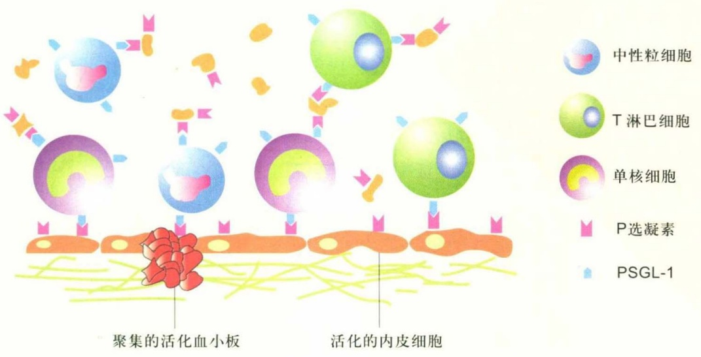

text_image

中性粒细胞
T 淋巴细胞
单核细胞
P选凝素
PSGL-1
聚集的活化血小板
活化的内皮细胞

图9-4 选凝素介导的血小板聚集、血小板与白细胞的黏附以及白细胞与血管内皮细胞的相互作用（仿自Geng等，2004）