异性和特定细胞群体的表达分为不同的亚家族。在18种整合素的α亚基中，9种带有一个I结构域(inserted domain, I domain)，另外9种整合素α亚基缺少该结构域，因此整合素可以分为带有αI结构域和缺少αI结构域两类。整合素按照结合的配体来分类，可以分为RGD受体、层粘连蛋白(laminin)受体、胶原蛋白(collagen)受体和白细胞特异性受体。RGD是指由精氨酸、甘氨酸和天冬氨酸形成的三肽序列，是RGD受体类整合素的结合位点。它主要存在于脊椎动物体内的纤维连接蛋白(fibronectin)和玻连蛋白(vitronectin)以及果蝇中的tiggrin。整合素α亚基按照进化关系可以分为5组:第一组包括αⅡb、α5、αV和α8；第二组包括α1、α2、α10和α11；第三组包括α3、α6和α7；第四组包括α4和α9；第五组包括αL、αM、αD、αE和αX。

## (2) 整合素识别的配体

整合素可以识别多种胞外基质蛋白以及表达在细胞表面的配体蛋白(表9-1)。有些配体蛋白可以被多种整合素所识别；而一个整合素通常也可以识别多种配体，已有研究发现整合素对不同配体会发生选择性的识别。例如，不同趋化因子可以引起整合素 $\alpha4\beta7$ 的差异性活化，从而选择性地结合配体MAdCAM-1或VCAM-1，控制淋巴细胞迁移到不同的组织部位。整合素及其配体的多样性以及在生物体内的广泛分布，决定了其生理功能的多样性和重要性。

## (3) 整合素的生理功能

大多数整合素在细胞表面处于非活化状态，不结合配体，也不传递信号，这对大部分整合素正常的生理功能非常重要。整合素αⅡbβ3（GPⅡb/Ⅲa）是血小板表面的主要整合素，通常处于非活化状态。当αⅡbβ3被激活后，会结合血浆中的血纤蛋白原、vWF和纤维连接蛋白，介导血小板稳定黏附到血管壁。通过血纤蛋白原的交联，大量血小板凝集在一起，发挥止血的功能。如果整合素αⅡbβ3异常活化，则导致血栓症；如果整合素αⅡbβ3功能丧失，则导致异常出血。αⅡb或β3亚基的基因敲除小鼠会出现凝血障碍，可以作为一种人类凝血障碍疾病——血小板无力症（Glanzmann thrombasthenia）的模型。该疾病是因为整合素αⅡb或β3亚基出现突变。另外一类重要的整合素（β2整合素）在白细胞的表面表达；当白细胞未被激活时，这些整合素也处于非活化状态；当白细胞被激活后，这些整合素也被迅速地激活，通过与血管内皮细胞上的免疫球蛋白超家族黏附分子ICAM的相互作用，使得白细胞可以在血管内皮表面黏附、迁移并穿过血管内皮进入淋巴器官或炎症部位。因此，这些整合素在通常情况下的低活性可以保证机体不会出现异常的炎症。整合素β2亚基的突变会导致一种遗传病——白细胞黏附缺陷症(leukocyte adhesion deficiency, LAD)，患者体内白细胞增多，白细胞无法被招募到感染的部位。临床应用方面，通过抑制β2整合素或α4整合素都可以减轻炎症，用于治疗一些自身免疫疾病。

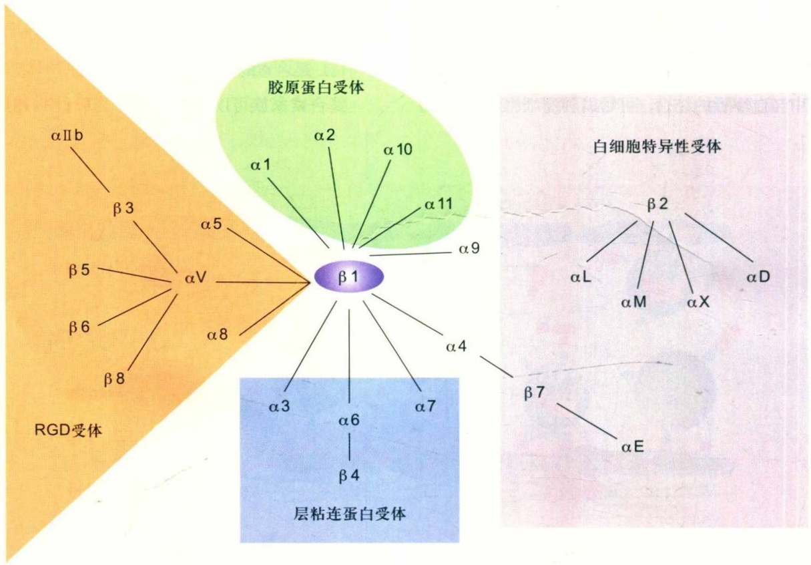

flowchart

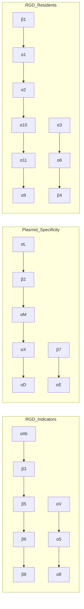

图9-5 整合素的分类
 $\alpha$ 亚基以不同的颜色表示。

表 9-1 各种整合素识别的配体

<table><tr><td colspan="2">胞外基质蛋白</td><td>细胞表面的黏附分子</td></tr><tr><td>α1β1: Col, LN</td><td>α10β1: Col</td><td>αLβ2: ICAM-1、-2、-3、RAGE,JAM-1</td></tr><tr><td>α2β1: Col, LN</td><td>α11β1: Col</td><td>αMβ2: ICAM-1,JAM,Fg,iC3b</td></tr><tr><td>α3β1: LN, Tsp</td><td>α II bβ3: Fg, vWF</td><td>αXβ2: ICAM-1,JAM,Fg,iC3b</td></tr><tr><td>α5β1: FN</td><td>αVβ1: FN, TN</td><td>αDβ2: VCAM-1, ICAM-3</td></tr><tr><td>α6β1: LN</td><td>αVβ3: FN, TN, Tsp, vWF, (Col)</td><td>α4β1: VCAM-1, FN</td></tr><tr><td>α6β4: LN</td><td>αVβ5: VN, Del-1</td><td>α4β7: VCAM-1,MAdCAM-1, FN</td></tr><tr><td>α7β1: LN</td><td>αVβ6: FN, TN</td><td>αEβ7: E-cadherin</td></tr><tr><td>α8β1: FN, TN</td><td>αVβ8: FN, Col, LN</td><td></td></tr><tr><td>α9β1: Col, LN, TN</td><td></td><td></td></tr></table>

Col: 胶原蛋白 (collagen); (Col): 隐藏的胶原位点 (cryptic collagen site); Fg: 血纤蛋白原 (fibrinogen); FN: 纤维连接蛋白 (fibronectin); ICAM: 细胞间黏附分子 (intercellular adhesion molecule); LN: 层粘连蛋白 (laminin); MAdCAM: 黏膜地址素细胞黏附分子 (mucosal addressin cell adhesion molecule); Tsp: 血小板应答蛋白 (thrombospondin); TN: 生腱蛋白 (tenascin); JAM: 连接黏附分子 (junctional adhesion molecule); VCAM: 血管细胞黏附分子 (vascular cell adhesion molecule); vWF: 血管性假血友病因子 (von Willebrand factor)。

除此以外，整合素还具有其他众多的生理功能。表9-2中给出了各种整合素基因敲除小鼠的表型。

## (4) 整合素的结构与功能调控

整合素的α亚基由大约1000个氨基酸组成，包括β-propeller、Thigh、Genu、Calf-1、Calf-2、跨膜区和胞内区共7个结构域。β亚基由大约700个氨基酸组成，包括PS I、Hybrid、I 结构域、I-EGF1、I-EGF2、

表9-2 敲除整合素基因小鼠的表型

| 整合素 | 表型 |  | 参考文献 |
| --- | --- | --- | --- |
| α1 | V, F | 短期内没有明显的发育缺陷,肿瘤中血管形成减少 | Gardner et al., 1996; Pozzi et al., 2000; 2002 |
| α2 | V, F | 少数短期内表现出明显发育缺陷,血小板凝结时间延长,与胶原蛋白单体结合力降低,乳腺分支减少 | Holtkotter et al., 2002; Chen et al., 2002 |
| α3 | P | 肾小管缺陷,肺分支形成降低,轻微的皮肤起泡,新皮层分层缺陷 | Kriedberg et al., 1996; Dipersio et al., 1997; Anton et al., 1999 |
| α4 | E11/14 | 胎盘(尿囊融合缺陷)和心脏(心外膜冠状血管)缺陷。嵌合体表现为血细胞生成缺陷 | Yang et al., 1995; Arroyo et al., 1996; 1999 |
| α5 | E10-11 | 中胚层(后体节)和血管发育缺陷,神经嵴细胞凋亡。嵌合体表现出肌营养不良 | Yang et al., 1993; Goh et al., 1997; Tavema et al., 1998 |
| α6 | P | 严重的皮肤起泡,其他表皮组织也出现缺陷。皮质和视网膜分层缺陷 | Georges-Labouesse et al., 1996; 1998 |
| α7 | V, F | 肌肉萎缩,肌腱节处缺陷 | Mayer et al., 1997 |
| α8 | P | 肾变小或缺失,内耳毛细胞缺陷 | Muller et al., 1997; Littlewood Evans et al., 2000 |
| α9 | V | 出生后10天内死亡,由于淋巴管缺陷出现乳糜胸 | Huang et al., 2000 |
| αV | E10/P | 分为两类:胎盘缺陷导致胚胎致死;或可能由于神经表皮细胞缺陷和腭裂导致产期致死,并伴随脑血管缺陷。大部分血管发育正常 | Bader et al., 1998; McCarty et al., 2002 |
| α11 | V, F | 出血,血小板凝结功能丧失 | Tronik-Le Roux et al., 2000 |
| αL | V, F | 白细胞招募受损 | Schmits et al., 1996 |
| αM | V, F | 中性粒细胞吞噬和凋亡缺陷,肥大细胞发育缺陷,脂肪积累 | Coxon et al., 1996; Tang et al., 1997; Dong et al., 1997 |
| αE | V, F | 上皮内淋巴细胞数量大量减少 | Schon et al., 1999 |
| β1 | E6.5 | 围着床期致死,内细胞团恶化,胚胎未能形成原肠胚 | Fassler and Meyer, 1995; Stephens et al., 1995; Brakebusch et al., 1997 |
| β2 | V, F | 白细胞增多,炎症反应受损,皮肤感染,T细胞扩增缺陷 | Scharffetter-Kochanek et al., 1998 |
| β3 | V, F | 出血,血小板凝结功能丧失;骨质硬化;肿瘤血管增生 | Hodivala-Dlike et al., 1999; McHugh et al., 2000; Reynolds et al., 2002 |
| β4 | P | 严重的皮肤起泡,其他表皮组织也出现缺陷 | Van der Neut et al., 1996; Dowing et al., 1996 |
| β5 | V, F | 短期内没有明显的发育缺陷 | Huang et al., 2000 |
| β6 | V, F | 皮肤和气管出现炎症以及肺纤维化受损 | Huang et al., 1996; Munger et al., 1999 |
| β7 | V | 肠道相关淋巴细胞减少:没有派氏小结,上皮内淋巴细胞减少 | Wagner et al., 1996 |
| β8 | E10/P | 分为两类:胎盘缺陷导致胚胎致死;或可能由于神经表皮细胞缺陷和腭裂导致产期致死,并伴随脑血管缺陷。大部分血管发育正常 | Zhu et al., 2002 |

E: 胚胎致死 (embryonic lethal); P: 围产期致死 (perinatal lethal); V: 存活 (viable); F: 生育 (fertile)。

I-EGF3、I-EGF4、β-tail结构域(βTD)、跨膜区和胞内区共10个结构域。β4由大约1700个氨基酸组成，其胞内区超过1000个氨基酸，因此不同于其他的整合素亚基。对于α亚基带有I结构域的整合素，α亚基I结构域的金属离子结合位(metal ion-dependent adhesion site, MIDAS)是整合素配体的结合位点；而对于α亚基没有I结构域的整合素，β亚基I结构域的MIDAS负责与配体的结合。

1995年，Lee等人解析了整合素的α亚基I结构域的晶体结构。该结构域是一个Rossmann折叠，其核心是一个被α螺旋包围的β片层。在I结构域的顶部为MIDAS位点，该位点可以被一个二价金属离子占据，如 $Mg^{2+}$ 。该金属离子可以与整合素配体特定位点上的天冬氨酸或谷氨酸残基结合，从而介导带有I结构域的整合素与其配体的结合。I结构域有关闭和打开两种构象，分别对应于低配体亲和力与高亲和力的结构。在I结构域从关闭到打开的构象变化过程中，该结构域中α7螺旋的下移是一个重要步骤。α7螺旋的下移可以引起I结构域配体结合位点的构象变化，从而活化整合素。2001年，第一个整合素全部胞外结构域的结构(αVβ3)被解析。从αVβ3的晶体结构上看，整合素由头部和腿部两大部分组成，整个整合素是一种折叠的构象。随后，对整合素αVβ3和αⅡbβ3的电镜和晶体结构研究表明，活化的整合素具有伸展的结构。

整合素与其配体的结合是一种动态可逆的过程。该过程是由整合素与其配体亲和力的动态调节决定的。整合素的胞外区可以通过快速的整体构象变化来调节其对配体的亲和力。整合素区别于其他黏附分子的一个重要特征是它可以在很短的时间内（<1 s）被细胞内的信号激活，与配体以高亲和力结合。非活化的整合素是折叠的低活性构象，α和β亚基的胞内结构域彼此相邻。当细胞遇到激活信号后，胞内的相关信号通路被激活。一些胞内蛋白，如踝蛋白(talin)，会结合到整合素的胞内区，进而引起整合素的构象变化，整合素α和β亚基的胞内结构域彼此分开。整合素的胞外结构域经过一系列的构象变化由折叠的低活性构象变成延伸的高活性构象，导致整合素活化。这一过程被称为整合素的由内向外信号传送(inside-out signaling)。活化的整合素与其配体以高亲和力结合。伴随着配体与整合素的结合，整合素在细胞膜上会发生簇聚(clustering)，引起细胞骨架的变化，进而招募相关的胞内信号分子，激活下游信号通路，完成一系列的生理功能。这一过程被称为整合素的由外向内信号传送(outside-in signaling)。整合素的这种介导双向跨膜信号传递的功能，使它成了细胞内外的“桥梁”。

整合素的活化伴随着整个分子一系列的构象变化（图9-6）。在从折叠的低亲和力构象变为伸展的高亲和力构象的过程中，整合素β亚基的Hybrid结构域会经历一个外摆的过程。这种构象变化是整合素活化的一个重要步骤，通过突变人为引起整合素β亚基Hybrid结构域的外摆可以导致整合素的活化。整合素活化过程中的另一个重要步骤是β亚基I结构域α7螺旋的下移，它会引起整合素β亚基I结构域顶部的部分构象变化，使整合素可以与其配体以高亲和力结合。此外，整合素α4β7中位于α4亚基Genu和β7亚基I-EGF1-2结构域的两对二硫键对整合素构象的伸展发挥重要作用。细胞所处微环境的还原环境可以将该二硫键打开，从而引起整合素α4β7的高度活化。

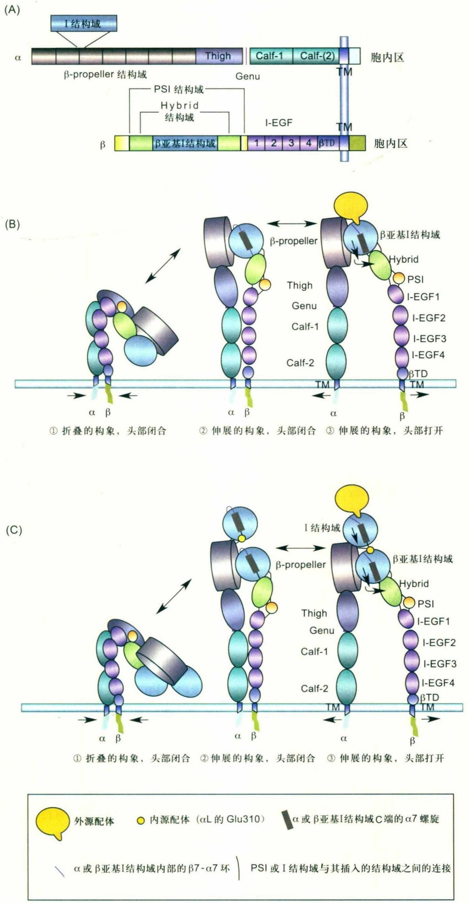

图9-6 整合素的结构与活化

(A) 整合素 $\alpha$ 和 $\beta$ 亚基的结构特征示意图；(B) $\alpha$ 亚基没有I结构域的整合素的激活过程示意图；(C) $\alpha$ 亚基带有I结构域的整合素的激活过程示意图。

对于有α亚基I结构域的整合素,β亚基I结构域的构象变化可以使得β亚基I结构域的MIDAS与α亚基I结构域中α7螺旋上的一个称为内源配体的负电氨基酸(如α亚基中第310位的Glu)结合,从而引起α亚基I结构域中α7螺旋的下移,使α亚基I结构域配体结合位点的构象变化,从而活化整合素(图9-6)。

## (5) 金属离子对整合素功能的调控

整合素是一种金属蛋白，它与配体的结合必须依赖于二价金属离子。在生理条件下，$\mathrm{Ca}^{2+}$ 与 $\mathrm{Mg}^{2+}$ 同时存在，通常 $\mathrm{Ca}^{2+}$ 会抑制整合素活化，将 $\mathrm{Ca}^{2+}$ 去除后可以将整合素激活。另外，$\mathrm{Mn}^{2+}$ 可以很强地活化整合素。金属离子对整合素亲和力的调控机制在对整合素α4β7和αLβ2的研究中得到了很好的解释。在整合素β7亚基I结构域的顶部有一个由3个金属离子结合位点组成的金属离子结合位点簇。中间的为MIDAS，两边分别为ADMIDAS (adjacent to MIDAS) 和SyMBS (synergistic metal ion binding site)。MIDAS直接负责介导整合素与配体结合，无论是整合素与配体的高亲和力或低亲和力的结合都需要MIDAS。ADMIDAS为整合素的负调控位点，该位点被 $\mathrm{Ca}^{2+}$ 占据后会维持整合素的低亲和力构象。ADMIDAS如果被破坏或结合 $\mathrm{Mn}^{2+}$、$\mathrm{Mg}^{2+}$，会导致整合素的活化。SyMBS的功能正与ADMIDAS相反，为整合素的正调控位点，该位点的金属离子为整合素的高亲和力构象所必需，如果失去SyMBS会导致整合素无法被活化。SyMBS对整合素的活化是通过与β亚基中SDL (specific determining loop) 上的芳香族氨基酸形成一个特殊的阳离子——π相互作用，从而稳定了配体结合位点的活化构象。另外，ADMIDAS并非在所有的整合素中都具有负调控的功能。例如，整合素α5β1的ADMIDAS突变并不能引起整合素的活化。

## (6) 整合素的胞内调节分子

① 踝蛋白(talin) 踝蛋白是一个分子量为 $2.7 \times 10^{5}$ 的胞内蛋白质，具有一个球状的头部（分子量为 $4.7 \times 10^{4}$）和一个比较柔性的杆状区域（分子量为 $2.2 \times 10^{5}$）。它可以通过头部区域激活整合素。踝蛋白的头部包括一个FERM结构域（protein 4.1、ezrin、radixin、moesin），由F1、F2和F3三个亚结构域组成。其中F3亚结构域形成了一个磷酸酪氨酸结合域（phosphotyrosine-binding domain, PTB），可以结合整合素的胞内区、PIPKIγ和透明质酸受体layilin。踝蛋白的杆状区域由一系列的螺旋组成，其中包含了多个F-actin结合蛋白Vinculin的结合位点以及另外一个整合素的结合位点。在踝蛋白的C端有一个THATCH（talin/HIP1R/Sla2p actin tethering C-terminal homology）结构域，该结构域可以介导踝蛋白二聚体的形成以及踝蛋白与F-actin的直接连接。

通常认为，踝蛋白是被RIAM(Rap1-GTP-interacting adaptor molecule)招募到整合素胞内区的。踝蛋白头部在整合素上的结合位点为其近膜区的NPxY保守序列，该序列为PTB结构域的常规结合位点。整合素β亚基胞内区的NPxY(F)中的Y(F)可以插入到踝蛋白的头部结构域F3的一个疏水口袋中，从而引起踝蛋白与整合素的结合。而且，F3结构域可以与整合素胞内近膜端的α螺旋通过疏水作用结合，通过影响整合素α/β亚基胞内区的结合而影响整合素的活化状态。

② Kindlin Kindlin是一种在生物进化上保守的含有FERM结构域的蛋白家族。目前已知在哺乳动物中有3种Kindlin蛋白:Kindlin-1、Kindlin-2和Kindlin-3。Kindlin-1又称为Kindlerin、FERMT1、Unc-112相关蛋白-1（Unc-112 related protein 1，URP-1），主要表达于肠道、肾组织的内皮细胞。Kindlin-1蛋白的基因突变会导致常染色体隐性遗传水疱皮肤病(Kindler syndrome)；Kindlin-2又称为Mig-2，在生物的大部分组织中都有表达，但在骨骼肌和平滑肌细胞中表达量最多；Kindlin-3又称为URP-2、FERMT3，主要表达于造血细胞，特别是巨核细胞和血小板。大量的研究证据表明，Kindlin是黏着斑(focal adhesion)复合物的基本组分。

Kindlin的分子量约为 $7.5 \times 10^{4}$，FERM结构域是其最重要的一个结构域。所有Kindlin的FERM结构域与踝蛋白的FERM结构域的氨基酸同源性很高（>50%）。Kindlin的FERM结构域中F3亚结构域是由2个直交的反向平行的β折叠和1个α螺旋组成，在结构、功能上与PTB结构域类似，能够直接与整合素β亚基胞内区远膜端的NxxY相互作用，协同踝蛋白活化整合素。Kindlin调节整合素活性的许多细节有待进一步研究，但是目前的研究结果支持Kindlin作为胞内接头蛋白影响整合素α和β两个亚基胞内区的相互作用，从而调节整合素的活性。

③ 抑制整合素活化的胞内调节分子 整合素的活化和去活化动态调控细胞迁移的进程，竞争或阻碍踝蛋白和Kindlin与整合素的结合可以有效地抑制整合素活化。研究表明:停靠蛋白（docking protein 1, DOK1）和整合素胞内结构域相关蛋白（integrin cytoplasmic domain associated protein 1, ICAP1）可以分别特异性地结合β亚基近膜端的NPxY序列和远膜端的NxxY序列，从而竞争踝蛋白和Kindlin与整合素的结合，抑制整合素的活化。细丝蛋白（filamin）虽然不含有PTB结构域，但能够和整合素β亚基胞内区结合并抑制整合素的活化，细丝蛋白缺失会引起细胞表面整合素活化。整合素α亚基结合蛋白同样可以通过空间位阻效应（如SHARPIN结合在α亚基胞内区高度保守的WKxGFF序列）阻碍踝蛋白或Kindlin与β亚基的结合，从而抑制整合素的活化。

## (7) 整合素的内吞及再循环

整合素可以通过多种途径来实现其内吞作用，包括在大型胞饮作用（macropinocytosis）过程中圆背褶边（circular dorsal ruffle，CDR）的形成、网格蛋白依赖的和非依赖的内吞途径等。一般通过直接招募内吞调节蛋白到细胞膜上实现整合素的内吞。例如，整合素β6胞内结构域直接招募HS1相关蛋白X-1（HS1 associated protein X-1，HAX-1），而整合素的α亚基胞内结构域则可以招募Rab21来实现内吞。

内吞后的整合素被快速地运输到早期内吞体（early endosome，EE）中。当存在纤维连接蛋白时，整合素α5β1能够被进一步运输到晚期内吞体（late endosome）中从而被降解利用，但是大多数内吞后的整合素可以快速地再循环回到细胞膜表面来发挥其生物学功能。整合素的内吞及再循环通过调节黏附复合体（adhesion complex）的周转介导整合素与细胞外基质蛋白之间的相互作用，进一步激活下游信号通路，调控细胞迁移。近期研究表明，整合素在细胞内的穿梭可以促进肿瘤细胞的侵袭和转移，并且在肿瘤细胞分泌的外泌体（exosome）中，不同整合素类型与肿瘤细胞向不同组织部位的转移密切相关，例如整合素α6β1和α6β4影响肿瘤细胞向肺转移，而整合素αvβ5则与肝转移相关。

## 9.2 细胞迁移

## 9.2.1 细胞迁移的基本过程

细胞迁移是一个高度动态的过程。在生长因子、趋化因子等信号分子的浓度梯度和胞外基质的密度差异等外界信号的综合刺激下，细胞内的信号传递分子和细胞骨架调节分子产生不对称的分布或激活，导致微管和微丝（microfilament）骨架等在即将发生迁移的方向上表现出前后不对称性，使细胞出现极化（polarization）。由此，细胞分化出迁移的前缘（leading edge）和后缘（trailing edge），并在前缘形成伪足（pseudopodium）。然后，不断通过伪足向前伸展并黏附胞外支持物、细胞体前移和后缘回缩等步骤产生持续位移（图9-7）。

大多数类型的动物细胞在体外培养条件下都能表现出迁移能力，只是速度比较缓慢，通常需要借助时间序列显微术（time-lapse microscopy）才能观察到（图9-7B）。原生动物变形虫能产生可直接观察的快速迁移，这种能力在一些免疫细胞（如中性粒细胞）中被保存下来，使之能够追逐细菌等病原物并将其吞噬。在体外，血清饥饿或高密度造成的紧密接触都可抑制细胞迁移，但恶化的肿瘤细胞不易受到影响。值得注意的是，在体内由于受到组织的束缚和三维环境的影响，细胞迁移的方式可能与体外有别。例如，一些肿瘤细胞和胚胎细胞被发现可以采用质膜出泡的方式迁移。

## 9.2.2 细胞迁移的驱动

正如动物的运动需要肌肉一样，细胞迁移也需要动力，而这主要是通过不同的微丝骨架的形成、动态变化以及肌球蛋白与微丝的相互作用来实现的。

## (1) 微丝的装配与解聚

微丝，也称为纤维状肌动蛋白（filamentous actin，F肌动蛋白），是由球状肌动蛋白（globular actin，G肌动蛋白）单体首尾相连并呈双螺旋状排列而成的链状聚合物，其直径约7 nm。G肌动蛋白是一种ATP酶，能结合并水解ATP。结合ATP的G肌动蛋白比结合ADP的更易聚合。微丝有极性，可分为正极（plus end，也称倒刺端barbed end）和负极（minus end，也称尖极pointed end）。尽管G肌动蛋白可以聚合到微丝的两极，但正极的装配速率要远高于负极。位于负极的肌动蛋白易将其结合的ATP水解成ADP，从而促使微丝解聚。当一根微丝上正极的聚合与负极的解聚速率相等时，这根微丝的长度保持不变，却会在溶液中发生匀速直线运动，产生所谓“踏车”现象（treadmilling）。

G肌动蛋白形成二聚体或三聚体，或称成核(nucleation)，是微丝形成的限速步骤。G肌动蛋白自发成核的效率低，需要成核因子（nucleator）的帮助才能高效完成。目前成核因子主要分为Arp2/3复合物、形成素（formin，也称形成蛋白）家族和含WH2结构域的成核因子家族3类。Arp2/3复合物有7个亚基，能结合在“母”微丝的侧面并在70°的方向上生成“子”微丝，最终形成分支状的微丝网络。这种网络具有高度的动态性，是片状伪足（lamellipodium）的基础（图9-8）。形成素蛋白家族则以二聚体方式结合于微丝的正极，利用前纤维蛋白（profilin）结合的G肌动蛋白促进微丝的成核与直线生长，促进丝状伪足（filopodium）的形成（图9-8）。可见，成核因子还可以帮助构建不同的微丝网络。

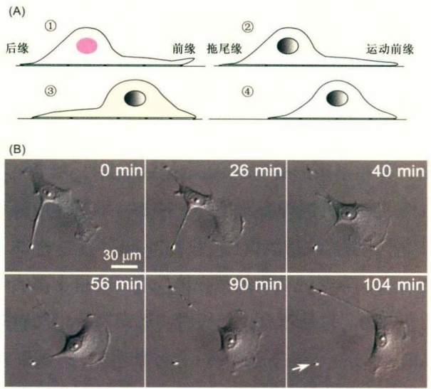

微丝骨架的结构、动态性和功能还需要由许多其他种类的肌动蛋白结合蛋白来调节。例如，前纤维蛋白特异性地结合G肌动蛋白，阻止其自发装配成微丝，但却能催化G肌动蛋白上的ADP转换成ATP的过程，使G肌动蛋白成为能被成核因子有效利用的模块。加帽蛋白（capping protein）通过结合在微丝正极而阻止其进一步生长，凝溶胶蛋白（gelsolin）和丝切蛋白（cofilin）等剪切蛋白可将微丝切成片段， $\alpha-$ 辅肌动蛋白（ $\alpha-$ actinin）等交联蛋白使微丝成束或形成其他稳定结构等（图9-8）。

## (2) 伪足的形成和作用

伪足的形成可以看作是细胞迁移的开始。在体外培养的高等动物细胞（如成纤维细胞）的前缘常能观察到2种类型的伪足，丝状伪足和片状伪足（图9-8）。丝状伪足被认为是探测环境、引导迁移方向的“感受器”，而片状伪足则是推动细胞前缘向前运动的关键结构。两种伪足都富含微丝，但结构上有本质的差别。片状伪足由图9-7 细胞迁移的过程（由朱学良研究员组的余礼厚博士拍摄）

(A) 细胞迁移的模式图；(B) 培养的ECV304细胞自由迁移时形成扇形的片状伪足，并可见到后缘的拖尾以及尾部被扯断（箭头所示）。

Arp2/3复合物诱导装配的高度动态性的分支状微丝组成，而丝状伪足中则是被丝束蛋白（fimbrin）等交联蛋白束缚在一起的束状微丝（图9-8）。片状伪足中的分支状微丝通过聚合提供了驱动力，推动前缘的细胞膜向前伸展，并通过整合素与胞外基质建立黏着位点(focal contact)，使膜锚定在新的位置。在伪足的基部，分支状微丝则不断解聚，由此产生的G肌动蛋白在前纤维蛋白的作用下，又为前缘微丝的生长提供可聚合的单体。如此循环往复，前缘的质膜不断地向前铺展，不仅对胞体造成了牵拉，还为后缘的回缩提供了空间。

## (3) 应力纤维与收缩力

前缘铺展后，只有后缘的回缩才能造成细胞的整体位移，从而实现迁移。后缘回缩所需的收缩力主要由应力纤维（stress fiber）提供。应力纤维也称张力丝，是由大量平行和反平行排列的微丝构成的束状结构（图9-8）。应力纤维的两端与整合素介导的黏附结构——黏着斑（focal adhesion）紧密结合，而应力纤维中的肌球蛋白是收缩力的来源所在（图9-8）。

肌球蛋白是一类以微丝作为运动轨道的分子马达。早期了解最多的是肌球蛋白在肌肉收缩中的作用，但随着研究的深入，发现肌球蛋白是一个包括多种亚型的家族，其成员能为细胞内不同的生理功能提供所需的机械力。在细胞迁移过程中，Ⅱ型肌球蛋白在应力纤维中提供收缩力。

肌球蛋白家族成员通常形似豆芽（图9-8），包含3个结构域:马达区、调控区和尾部区。马达区在肌球蛋白家族各成员中高度保守，具有ATP结合位点和肌动蛋白结合位点，能催化ATP水解并将释放的化学量转化为机械能，沿微丝行走；调控区结合的轻链蛋白的种类和数量决定了肌球蛋白的亚型，并调控马达区的ATP酶活性，控制运动；尾部区负责结合其他的蛋白质，或促使肌球蛋白的自身寡聚化。肌球蛋白可被肌球蛋白轻链激酶（myosin light chain kinase, MLCK）激活或被肌球蛋白轻链磷酸酯酶（myosin light chain phosphatase, MLCP）抑制。Ⅱ型肌球蛋白能向微丝正极运动。在应力纤维中，

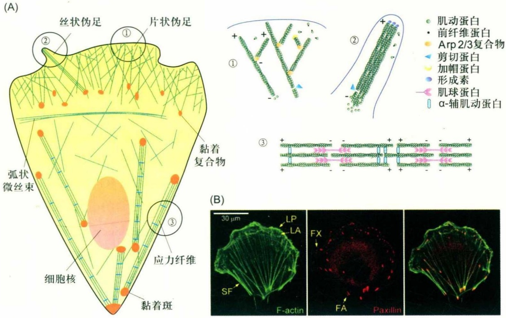

text_image

(A)
丝状伪足
①
片状伪足
②
黏着
复合物
弧状
微丝束
③
应力纤维
细胞核
黏着斑
肌动蛋白
前纤维蛋白
Arp 2/3复合物
剪切蛋白
加帽蛋白
形成素
肌球蛋白
α-辅肌动蛋白
①
②
③
(B)
30 µm
LP
LA
FX
SF
FA
Paxillin
F-actin

图9-8 迁移细胞中的微丝网络和整合素介导的黏附结构

(A) 细胞迁移相关的微丝骨架示意图, 其中片状伪足的厚度被过分夸大, ① 片状伪足中的分支状微丝网络, ② 丝状伪足中的束状微丝网络, ③ 应力纤维中具有收缩性的微丝网络; (B) 正在迁移的ECV304细胞经固定后用荧光色素标记的鬼笔环肽(phalloidin)显示微丝, 用抗桩蛋白抗体进行免疫荧光染色显示整合素介导的黏附结构。FX: 黏着复合物; FA: 黏着斑; LP: 片状伪足, 其中致密的分支状微丝在光学显微镜下不可分辨; LA: 片层, 位于片状伪足之下, 其中富含弧状微丝束; SF: 应力纤维。(由朱学良研究员组的单永立和余礼厚博士拍摄)

Ⅱ型肌球蛋白形成双向多聚体，通过马达区的交替运动使微丝产生相对位移，导致应力纤维发生收缩（图9-8）。这种方式类似于肌球蛋白在肌肉收缩中的作用。

应该指出的是，迁移细胞中的微丝骨架并非各自独立，而是紧密联系的整体。约2  $\mu$ m厚的分支状微丝的下方存在一个更厚的富含微丝的片层（lamellae）结构（图9-8）。片层中的微丝至少有一部分是由伪足向前推进后留下的微丝片段转变而来，其中一些形成横向的弧状微丝束，一些则逐渐转变为应力纤维。应力纤维高度动态，形成后会不断缩短并解聚。与伪足不同，应力纤维并非迁移细胞特有，在不迁移的贴壁细胞中也广泛存在。

## (4) 整合素介导的黏附结构及其作用

由于细胞必须黏附在支持物上才能进行迁移，因此可以想象，黏附过强或过弱均不利于细胞迁移。整合素介导的黏附结构与微丝系统的关系密切，不仅使细胞以可被调控的方式附着在支持物上以便迁移，还能为微丝聚合和收缩产生的力提供支撑点。

整合素介导的黏附结构是高度动态的。在细胞迁移过程中，活化的整合素位于片状伪足的顶端，在伪足伸展的过程中“搜寻”并结合胞外基质上的结合位点，从而锚定细胞质膜，以防止其回缩。随着细胞前缘的推进，一部分黏着位点发育成黏着复合物，即含有与胞外基质结合的整合素分子簇和其他辅助蛋白的斑点状黏附结构（图9-8）。黏着复合物常分布在伪足与片层交界的区域，与分枝状微丝网络的基部结合，为分枝状微丝产生的驱动力提供支撑点。随着时间的推移，部分黏着复合物进一步发育成含有更多整合素簇的黏着斑，其余的则解聚。黏着斑是应力纤维的两端，因而常成对出现，但也可以和其他应力纤维共享。它们一般分布在迁移细胞的中后部位（图9-8）。

黏附结构的动态性不仅体现在时间和空间上，还体现在黏附结构的组成上。胞内的黏着分子，如踝蛋白(talin)、桩蛋白(paxillin)、黏着斑激酶(focal adhesion kinase, 简称FAK)、纽蛋白(vinculin)和斑联蛋白(zyxin)等，会结合或被招募到黏附结构中整合素的胞内结构域上，形成超分子复合物(supramolecular complex)，并最终与微丝骨架相连(图9-8)。踝蛋白和桩蛋白可以直接结合整合素的胞内区，因此在最早期的黏附结构中就可能会出现。FAK和纽蛋白都能结合桩蛋白。FAK出现在黏着复合物和黏着斑中，而斑联蛋白则主要出现在黏着斑中，并在细胞受到周期性牵张力作用时可转位到应力纤维上。黏着复合物和黏着斑都能够完全解聚，解聚所得的蛋白质分子会被再次投入使用，即周转。周转的速率依细胞类型和细胞内外的微环境而异。新生黏着位点和黏着复合物的寿命较短，而黏着斑的寿命较长。此外，肌球蛋白产生的收缩力和细胞张力的变化都可以改变黏着斑的尺寸和稳定性。作用力在一定范围内的增加可以稳定黏着斑，使其面积增大，并相应产生较粗的应力纤维。相反，作用力过小或过大会导致黏着斑变小甚至消失。收缩力还能使应力纤维逐渐变短，同时伴随黏着斑中整合素分子与胞外基质的动态结合与解离。这种变化的结果是，伴随着应力纤维的缩短，两侧的黏着斑也不断向中心“移动”（图9-9），同时带动后缘的回缩。

黏附结构的动态性对细胞迁移的影响很大。快速移动的细胞如白细胞中，整合素簇相对较少，使黏着结构较小而易于解聚。而慢速移动或基本静止的细胞则具有较大而稳定的黏着斑。另一方面，由于黏附结构的形成需要胞外基质，过低密度的胞外基质会降低黏附结构形成的效率，过高密度的胞外基质则造成细胞的过度黏附，因此都会阻碍细胞的迁移。

## 9.2.3 Rho家族小GTP酶对细胞迁移的调节

细胞迁移是一个需要高度协调才能高效进行的活动。Rho家族小GTP酶（small GTPase）在细胞迁移的协调中扮演了关键性的角色。

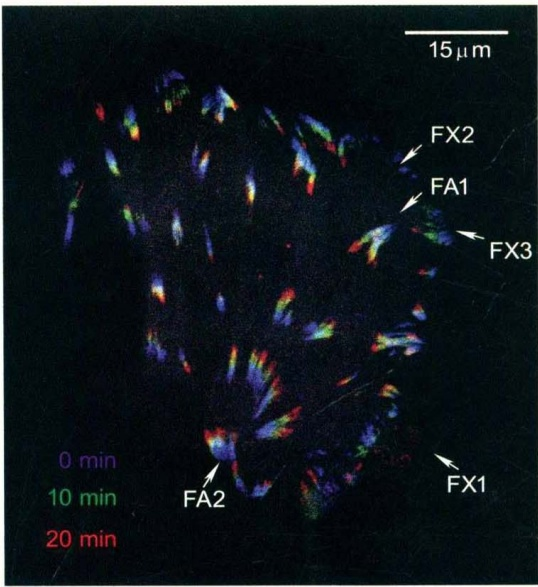

text_image

15 µm
FX2
FA1
FX3
0 min
10 min
20 min
FA2
FX1

## (1) Rho家族小GTP酶及其活性调节

小GTP酶是一个很大的超家族，在信号转导、胞内运输、细胞迁移等过程中有重要功能。小GTP酶常通过激活/失活状态的转换，如开关一样传递或关闭信号:结合GTP时处于激活状态，而结合GDP时则呈失活状态。负责调控小GTP酶活性的蛋白质分为3类:鸟嘌呤核苷酸交换因子（guanine nucleotide exchange factor, GEF）帮助它们脱掉GDP并与GTP结合，进入激活状态；GTP酶激活蛋白（GTPase-activating protein, GAP）促进它们水解其结合的GTP，进入失活状态；鸟苷酸解离抑制因子（guanine nucleotide dissociation inhibitor, GDI）会结合GDP形式的小GTP酶，使其处于持续抑制状态（图9-10）。

Rho家族小GTP酶至少包括5个亚家族，而在细胞迁移和微丝骨架调控中起关键作用的是其中的Rho、Rac和cdc42三个亚家族。其中又以对RhoA、Rac1和cdc42的研究最为广泛和深入。Rho家族成员的C端可发生脂类修饰，使其具有细胞膜结合能力。研究发现，Rho、Rac和cdc42共同调控了细胞迁移中各种事件的协调进行（图9-11）。目前，在哺乳动物中已知的针对Rho家族的GEF和GAP均超过40种。胞外信号对细胞迁移的调节，主要是通过GEF和GAP调控Rho家族成员的活性来实现。

## (2) cdc42 与细胞极性

极性或方向性对细胞迁移至关重要。事实上，不仅是微丝系统和黏附结构，在培养的上皮细胞、成纤维细胞和星形胶质细胞等类型的细胞中，微管组织中心（microtubule organizing center, MTOC）定位于细胞核与前缘之间。由于高尔基体等内膜细胞器主要富集在微管组织中心周围，因而它们的分布也发生了极化。

细胞极性的建立和维持主要由cdc42调控。胞外信

## 图9-9 整合素介导的黏附结构的动态性（修改自Shan等，2009，对色彩顺序有修改，由朱学良研究员组的余礼厚博士拍摄）

表达GFP-paxillin融合蛋白的ECV304细胞在3个不同时间的荧光图像叠加图。彩色的出现和方向显示黏着斑（FA）在进行向心移动（如箭头所示FA1和FA2）。此外，可以清晰地观察到黏着复合物（FX）的动态变化:黏着复合物的生成（FX1）、解聚（FX2）和成熟为黏着斑（FX3）。新生黏着位点由于几何尺寸太小，在光学显微镜下难以分辨。

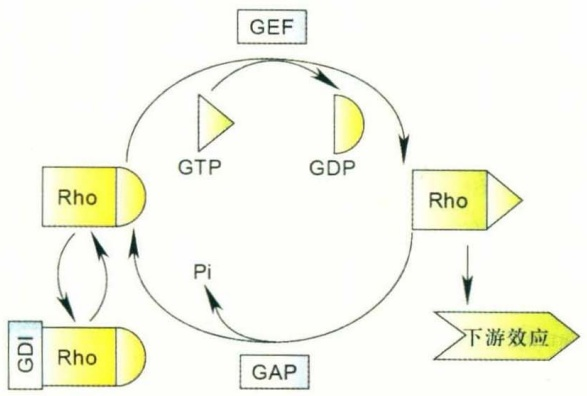

flowchart

This diagram illustrates a cyclical process involving GDF, GDP, GTP, Pi, and Rho inputs, with feedback loops and downstream effects.

号通过调节GEF和GAP在特定方向上激活质膜上的cdc42，而活化的cdc42和Par6相互作用来激活PKCζ；PKCζ通过磷酸化使GSK3β失活，进而招募微管正极结合蛋白APC（adenomatous polyposis coli）（图9-11）。最终导致cdc42/Par6/PKCζ/GSK3β/APC复合物在该膜区域的产生和富集，使细胞产生极性，随后该区域将图9-10 Rho家族小GTP酶的活性循环

发展成为细胞运动的前缘。这一复合物还参与了对微管骨架的锚定。同时，激活的cdc42还通过调控微丝骨架使细胞核移动到MTOC之后，使微管骨架和内膜系统也产生极化。

cdc42还可调节形成素mDia2，促进丝状伪足的形成（图9-11）。在细胞内过表达持续激活形式的cdc42突变体可导致丝状伪足的过度生长，细胞呈现毛刺状（图9-12）。此外，cdc42也可以通过WASP蛋白（欧德里综合征蛋白）激活Arp2/3复合物，刺激分支状微丝的生长（图9-11）。

## (3) Rac与片状伪足

Rac亚家族主要在细胞前缘被活化并发挥作用，其代表成员是Rac1。Rac主要调控分支状微丝的聚合，是片状伪足形成所必需的调控因子。活性形式的Rac可激活WAVE复合物，后者又激活Arp2/3复合物，从而诱导分支状微丝的成核与生长（图9-11）。WAVE复合物是由WAVE/Scar、Abi、Nap125、Sra1和HSPC300构成的复合物，平时处于自抑制状态。Rac1-GTP结合其中Sra-1后解除了WAVE复合物的自抑制，使WAVE/Scar结合Arp2/3复合物并使之激活。

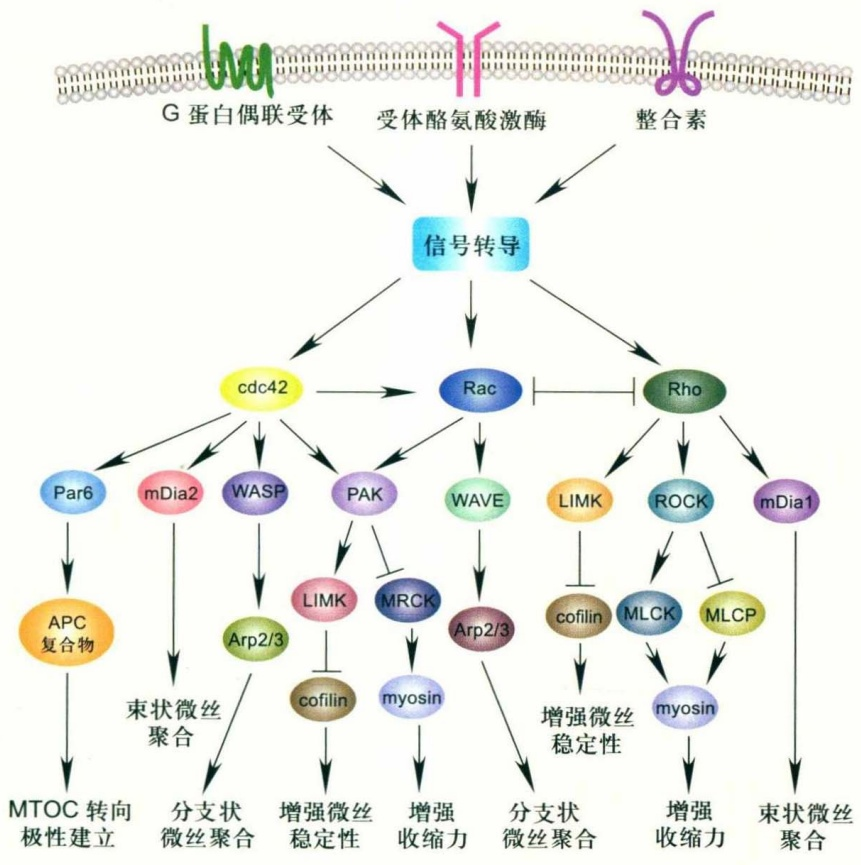

flowchart

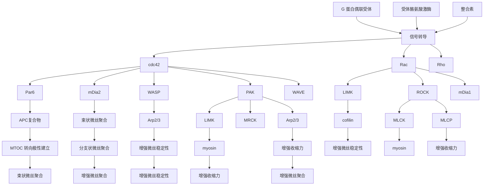

图9-11 Rho家族小GTP酶及其信号途径在细胞迁移中的作用（仿自Petrie等，2009；Raftopoulou和Hall，2004)

在细胞中过表达持续激活形式的Rac1突变体可以诱导伪足在细胞周边大量形成，使细胞铺展成荷叶状（图9-12）。这样的细胞尽管伪足很发达，但因没有极性，内部的力量互相抵消，因此无法迁移。

## (4) Rho 与黏着斑和应力纤维

迁移细胞中的Rho活性通常被认为是在细胞后端发挥作用，其主要功能是调节黏着斑动态性和应力纤维的收缩力。在细胞中过表达持续激活形式的RhoA可导致形成大量粗壮的应力纤维。

RhoA最重要的下游信号分子是丝氨酸/苏氨酸激酶ROCK（Rho-associated protein kinase），在成纤维细胞和许多免疫细胞的迁移中，ROCK是细胞尾部收缩必需的。ROCK在激活状态下会磷酸化肌球蛋白轻链激酶（MLCK）调节轻链的磷酸化以激活肌球蛋白，使肌球蛋白产生更强的收缩力，ROCK也使肌球蛋白轻链磷酸酯酶（myosin light chain phosphatase，MLCP）失活，从而增强MLCK的作用（图9-11）。ROCK还能激活蛋白激酶LIMK，进而使丝切蛋白失活，调节微丝的稳定性（图9-11）。

## (5) Rho 家族在细胞迁移中的协同作用

在迁移细胞中，活性形式的cdc42和Rac1都分布在前端，而活性形式的Rho则主要分布在后端。这样的分布对协调细胞前后端的行为很重要。除了胞外信号可以调控Rho的活性外，Rho之间还存在促进或抑制作用。例如，cdc42可以激活Rac，而Rac和Rho则互相抑制，使得伪足和后缘的产生与cdc42控制的细胞极性在空间上能够协调一致。

在机制方面，cdc42-GTP结合的Par复合体，特别是Par3蛋白，能招募GEF蛋白TIAM1（T-lymphoma invasion and metastasis-inducing protein 1）到迁移前缘，后者能激活Rac1。cdc42下游的PAK能招募并激活βPIX，后者是一类RacGEF，从而也能激活Rac。RhoA下游的ROCK则磷酸化Par3，抑制TIAM蛋白对Rac的激活；另一方面，Rac通过抑制LMW-PTP（low molecular weight protein tyrosine phosphatase）来提高p190RhoGAP蛋白的磷酸化水平，从而增强其抑制Rho的效应。此外，Nudel可在前缘隔离cdc42GAP，使活性形式的cdc42不易失活，以便维持细胞极性的相对稳定。

## (6) 微管骨架与细胞定性迁移

尽管在细胞迁移中微丝起主导作用，但实际上微管骨架也有功能，一般认为是帮助维持迁移方向。因此，微管骨架的作用在定向迁移中更显著。

在对大脑皮层发育的研究中还发现，神经元沿放射状胶质细胞（radial glia）迁移时，首先把前端长长地伸出并稳定住，然后利用微管骨架把细胞核向前拉动，并以此带动胞体的前移。这一过程依赖于胞质动力蛋白（cytoplasmic dynein）复合物及其调节蛋白Nudel、Lis1来实现。

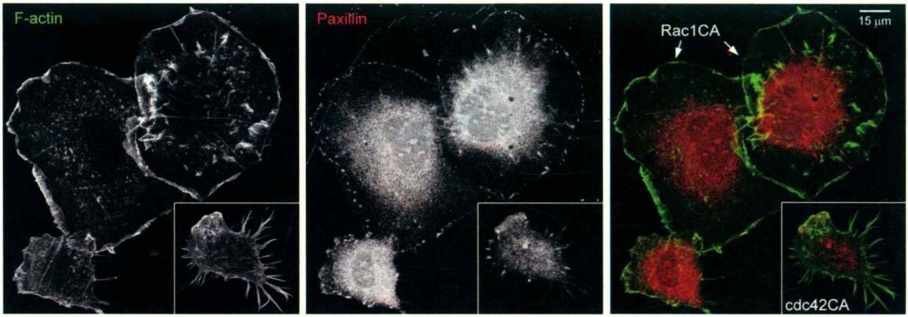

图9-12 过表达持续激活的cdc42或Rac1突变体（cdc42CA和Rac1CA）对细胞形态的影响（由朱学良研究员组的单永立和余礼厚博士拍摄）表达Rac1CA的ECV304细胞（箭头所指）的边缘都是片状伪足，过度铺展呈荷叶状，而表达cdc42CA的细胞（小图）则形成过多的丝状伪足。

## □ 小结

细胞黏附具有多方面的生物学功能。它在细胞迁移中保证了细胞与基底面的黏附，可实现细胞对环境中其他细胞或胞外基质的识别，也是形成多细胞生物的重要基础。细胞黏附分子有五大类，各自行使独特的功能。选凝素在炎症反应中主要介导白细胞在血管内皮细胞上的滚动，在凝血过程中介导血小板形成血栓和聚集，并在肿瘤转移中发挥作用。整合素主要结合胞外基质，在组织形成、细胞迁移等过程中有重要功能。

细胞迁移是最古老、最重要的动物细胞生理活动之一。细胞迁移是一个高度动态和协调的复杂过程，需要胞外信号的诱导、微丝系统提供的动力，以及整合素介导的黏附结构提供的附着力。定向迁移还需要微管骨架的参与。以Rac、Rho和cdc42为代表的Rho家族小GTP酶是细胞迁移的核心调控因子。细胞迁移在胚胎发育、组织形成、免疫活动、损伤修复等生理过程，以及炎症、癌症转移等病理过程中都有重要作用。

## □ 思考题

1. 细胞黏附可抑制细胞迁移，但细胞迁移却要依赖于细胞黏附。怎样理解两者的关系？
2. 微管和微丝在细胞迁移中发挥怎样的作用？
3. 为何白细胞浸润前需要在血管内皮上滚动？
4. 小 GTP 酶在细胞迁移中如何发挥作用？
5. 细胞在体外培养条件下的迁移方式和调控机制与体内相同吗?

(朱学良 陈铭 陈剑峰 丁翀 中国科学院生物化学与细胞生物学研究所)

## □ 参考文献

1 Arnaout M A, Mahalingam B, Xiong J P. Integrin structure, allostery, and bidirectional signaling. Ann Rev Cell Dev Biol, 2005, 21:381–410.
2 Campellone K G, Welch M D. A nucleator arms race: cellular control of actin assembly. Nat Rev Mol Cell Biol, 2010, 11:237–251.
3 Chen J, Diacovo T G, Grenache D G, et al. The  $\alpha(2)$  integrin subunit-deficient mouse: a multifaceted phenotype including defects of branching morphogenesis and hemostasis. Am J Pathol, 2002, 161: 337–344.
4 Charras G, Paluch E. Blebs lead the way: how to migrate without lamellipodia. Nat Rev Mol Cell Biol, 2008, 9:730–736.
5 Chen J, Salas A, Springer T A. Bistable regulation of integrin adhesiveness by a bipolar metal ion cluster. Nat Struct Biol, 2003, 10: 995–1001.
6 Chen J, Takagi J, Xie C, et al. The relative influence of metal ion binding sites in the I-like domain and the interface with the hybrid domain on rolling and firm adhesion by integrin alpha4beta7. J Biol Chem, 2004, 279:55556-55561.
7 Chen J, Yang W, Kim M, et al. Regulation of outside-in signaling and affinity by the
beta2 I domain of integrin alphaLbeta2. Proc Natl Acad Sci U S A, 2006, 103:13062–13067.
8 Doyle A D, Wang F W, Matsumoto K, et al. One-dimensional topography underlies three-dimensional fibrillar cell migration. J Cell Biol, 2009, 184:481-490.
9 Eden S, Rohatgi R, Podtelejnikov AV, et al. Mechanism of regulation of WAVE1-induced actin nucleation by Rac1 and Nck. Nature, 2002, 418:790–793.
10 Etienne Manneville S. Cdc42—the centre of polarity. J Cell Sci, 2004, 117: 1291–1300.
11 Feagan B G, Greenberg G R, Wild G, et al. Treatment of ulcerative colitis with a humanized antibody to the alpha4beta7 integrin. New Engl J Med, 2005, 352:2499–2507.
12 Furie B, Furie B C. The molecular basis of platelet and endothelial cell interaction with neutrophils and monocytes: role of P-selectin and the P-selectin ligand, PSGL-1. Thromb Haemost, 1995, 74: 224–227.
13 Gardner H, Kreidberg J, Koteliansky V, et al. Deletion of integrin α1 by homologous recombination permits
normal murine development but gives rise to a specific deficit in cell adhesion. Dev Biol, 1996, 175: 301–313.
14 Galbraith C G, Yamada K M, Galbraith J A. Polymerizing actin fibers position integrins primed to probe for adhesion sites. Science, 2007, 315:992–995.
15 Geng J G, Chen M, Chou K C. P-selectin cell adhesion molecule in inflammation, thrombosis, cancer growth and metastasis. Curr Med Chem, 2004, 11: 2153–2160.
16 Gomes E R, Jani S, Gundersen G G. Nuclear movement regulated by Cdc42, MRCK, myosin, and actin flow establishes MTOC polarization in migrating cells. Cell, 2005, 121:451–463.
17 Gu Z, Noss E H, Hsu V W, et al. Integrins traffic rapidly via circular dorsal ruffles and macropinocytosis during stimulated cell migration. J Cell Biol, 2011, 193:61–70.
18 Gupta A, Tsai L H, Wynshaw-Boris A. Life is a journey: a genetic look at neocortical development. Nat Rev Genet, 2002, 3:342-355.
19 Hotulainen P, Lappalainen P. Stress fibers are generated by two distinct actin assembly mechanisms in motile cells. J Cell Biol, 2006, 173: 383–394.
20 Holtkotter O, Nieswandt B, Smyth N, et al. Integrin α(2)-deficient mice develop normally, are fertile, but display partially defective platelet interaction with collagen. J Biol Chem, 2002, 277:10789–10794.
21 Hynes R O. Integrins: bidirectional, allosteric signaling machines. Cell, 2002,110: 673–687.
22 Kiema T, Lad Y, Jiang P, et al. The molecular basis of filamin binding to integrins and competition with talin. Mol Cell, 2006, 21:337–347.
23 Larjava H, Plow E F, Wu C. Kindlins: essential regulators of integrin signaling and cell–matrix adhesion. EMBO Rep, 2008, 9:1203–1208.
24 Laudanna C, Kim J Y, Constantin G, et al. Rapid leukocyte integrin activation by chemokines. Immunol Rev, 2002, 186:37–46.
25 Lu L, Lin C, Yan Z, et al. Kindlin-3 is essential for the resting alpha4beta1 integrin-mediated firm cell adhesion under shear flow conditions. J Biol Chem, 2016, 291:10363-10371.
26 Luo B H, Carman C V, Springer T A. Structural basis of integrin regulation and signaling. Ann Rev Immunol, 2007, 25:619–647.
27 Ma Y Q, Plow E F, Geng J G. P-selectin binding to P-selectin glycoprotein ligand-1 induces an intermediate state of  $\alpha$ M $\beta$ 2 activation and acts cooperatively with extracellular stimuli to support maximal adhesion of human neutrophils. Blood, 2004, 104:2549–2556.
28 Machacek M, Hodgson L, Welch C, et al. Coordination of Rho GTPase activities during cell protrusion. Nature, 2009, 461:99–103.
29 McEver R P. Selectins: lectins that initiate cell adhesion under flow. Curr Opin Cell Biol, 2002, 14:581–586.
30 Moser M, Legate K R, Zent R, et al. The tail of integrins, talin, and kindlins. Science, 2009, 324:895–899.
31 Nayal A, Webb D J, Horwitz A F.
Talin: an emerging focal point of
adhesion dynamics. Curr Opin Cell Biol, 2004, 16:94–98.
32 Pan Y, Zhang K, Qi J, et al. Cation-pi interaction regulates ligand-binding affinity and signaling of integrin alpha4beta7. Proc Natl Acad Sci U S A, 2010, 107: 21388–21393.
33 Pellinen T, Ivaska J. Integrin traffic. J Cell Sci, 2006, 119:3723–3731.
34 Petrie R J, Doyle A D, Yamada K M. Random versus directionally persistent cell migration. Nat Rev Mol Cell Biol, 2009, 10:538–549.
35 Pozzi A, Moberg P E, Miles L A, et al. Elevated matrix metalloprotease and angiostatin levels in integrin  $\alpha$ 1 knockout mice cause reduced tumor vascularization. Proc Natl Acad Sci U S A, 2000, 97: 2202–2207.
36 Pozzi A, LeVine W F, Gardner H A. Low plasma levels of matrix metalloproteinase 9 permit increased tumor angiogenesis. Oncogene, 2002, 21: 272–281.
37 Rantala J K, Pouwels J, Pellinen T, et al. SHARPIN is an endogenous inhibitor of  $\beta_{1}$ -integrin activation. Nat Cell Biol, 2011, 13:1315–1324.
38 Revenu C, Athman R, Robine S, et al. The co-workers of actin filaments: from cell structures to signals. Nat Rev Mol Cell Biol, 2004, 5:635–646.
39 Ridley A J. Life at the leading edge. Cell, 2011, 145:1012–1022.
40 Sako D, Comess K M, Barone K M, et al. A sulfated peptide segment at the amino terminus of PSGL-1 is critical for P-selectin binding. Cell, 1995, 83: 323–331.
41 Shan Y, Yu L, Li Y, et al. Nudel and FAK as antagonizing strength modulators of nascent adhesions through paxillin. PLoS Biol, 2009, 7:e1000116.
42 Shen Y, Li N, Wu S, et al. Nudel binds Cdc42GAP to modulate Cdc42 activity at the leading edge of migrating cells. Dev Cell, 2008, 14:342–353.
43 Shimaoka M, Springer T A. Therapeutic antagonists and
conformational regulation of integrin function. Nat Rev Drug Discov, 2003, 2:703–716.
44 Sun H, Liu J, Zheng Y, et al. Distinct chemokine signaling regulates integrin ligand specificity to dictate tissue-specific lymphocyte homing. Dev Cell, 2014, 30:61–70.
45 Tadokoro S, Shattil S J, Eto K, et al. Talin binding to integrin  $\beta$  tails: a final common step in integrin activation. Science, 2003, 302:103–106.
46 Takagi J, Petre B M, Walz T, et al. Global conformational rearrangements in integrin extracellular domains in outside-in and inside-out signaling. Cell, 2002, 110:599–611.
47 Tinoco R, Carrette F, Barraza M L, et al. PSGL-1 is an immune checkpoint regulator that promotes T cell exhaustion. Immunity, 2016, 44:1190–1203.
48 Vignoud L, Albiges-Rizo C, Frachet P, et al. NPXY motifs control the recruitment of the alpha5  $\beta$ 1 integrin in focal adhesions independently of the association of talin with the  $\beta$ 1 chain. J Cell Sci, 1997, 110:1421–1430.
49 Wang H B, Wang J T, Zhang L, et al. P-selectin primes leukocyte integrin activation during inflammation. Nat Immunol, 2007, 8: 882–892.
50 Xiao T, Takagi J, Coller B S, et al. Structural basis for allostery in integrins and binding to fibrinogen-mimetic therapeutics. Nature, 2004, 432:59–67.
51 Xiong J P, Stehle T, Diefenbach B, et al. Crystal structure of the extracellular segment of integrin  $\alpha$  V $\beta$ 3. Science, 2001, 294:339–345.
52 Xiong J P, Stehle T, Zhang R, et al. Crystal structure of the extracellular segment of integrin  $\alpha$  V  $\beta$ 3 in complex with an Arg–Gly–Asp ligand. Science, 2002, 296:151–155.
53 Zhang K, Pan Y, Qi J, et al. Disruption of disulfide restriction at integrin knees induces activation and ligand-independent signaling of  $\alpha(4)\beta(7)$ . J Cell Sci, 2013, 126:5030–5041.

## 细胞信号转导

## III

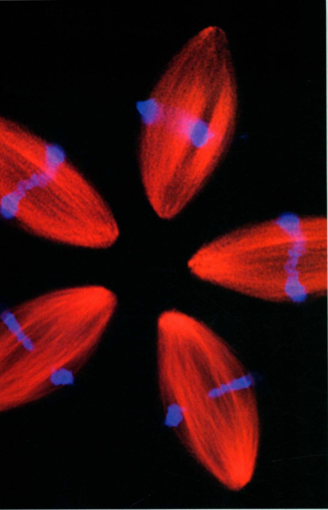

natural_image

Fluorescent microscopy image showing red-stained cell nuclei with blue fluorescent markers (no text or symbols)

在生物体中，细胞为了适应周围多变的环境，胞膜上的受体和相关蛋白必须对胞外的刺激进行监测并迅速作出适当的反应。胞内调控蛋白的磷酸化或去磷酸化是传递和调整胞外信号的重要机制。蛋白激酶、磷酸酯酶和其他信号传递分子形成高度相关的调控网络，从而整合细胞的功能。在分子细胞水平上了解信号传递分子的特性及其与整个信号传递网络的相互关系，包括第二信使的产生、蛋白激酶的激活和信号传递分子之间的相互作用，对于深刻理解信号传递的机制非常重要。促分裂原活化的蛋白激酶（mitogen-activated protein kinase, MAPK）途径是介导细胞对外界反应的重要信号系统，普遍存在于包括酵母和哺乳动物在内的多种生物细胞中，参与了细胞生长、发育、分化、凋亡等多种生理过程。MAPK 是一系列激酶酶促级联反应中重要的一环，通过其磷酸化状态的变化及与其他蛋白质，如上游激酶、磷酸酯酶和下游底物之间的相互作用，能将多种细胞外刺激产生的信号从细胞膜传递到细胞核内，配合其他信号转导通路，精确调控基因的表达，使细胞对外界环境作出合适的反应。

## 10.1 MAPK 的主要成员及其信号转导途径

MAPKs属于丝氨酸/苏氨酸激酶家族，由多种同工酶组成。自1991年Sturgill及其同事在哺乳动物细胞鉴定出胞外信号调节激酶（extracellular signal-regulated kinase, ERK）以来，MAPK信号通路的研究取得了迅猛发展，成为理解生长因子受体信号转导以及细胞应激反应中胞内事件的热点。

## 10.1.1 基本信号转导通路

MAPK信号通路在酵母和哺乳动物中高度保守（图10-1），其信号转导包括3个关键激酶:细胞外刺激通过某些中间环节激活MAPK激酶激酶（MAP kinase kinase kinase, MAPKKK, MEKK)，然后MAPK激酶（MAP kinase kinase, MAPKK, MEK, MKK）被激活；再由MAPKK通过对苏氨酸(threonine, Thr, 简称T)和酪氨酸(tyrosine, Tyr, 简称Y)双位点磷酸化激活MAPK。根据MAPK T-X-Y活性基团中X的不同以及上游MEK/MEKK的差异，将哺乳动物MAPK家族分为3个不同的亚族。

哺乳动物中MAPK信号途径主要由3个亚族以及多种相关蛋白组成，接收由生长因子、细胞因子、环境应激和炎症刺激等信号，通过生长因子受体或细胞表面受体[如G蛋白偶联受体(G-protein coupled receptor, GPCR)]传至胞内，通过小分子G蛋白如Ras和Rac引起一系列的激酶反应，将信号通过保守的三级激酶级联反应传至细胞核内，进而调控细胞的发育、生长、分化、凋亡等生理病理过程。

哺乳动物细胞中已鉴定的3个主要的MAPK亚族包括:胞外信号调节激酶ERK，又称为p42/44 MAPK；p38促分裂原活化的蛋白激酶(p38 mitogen-activated protein kinase, p38 MAPK)；c-Jun氨基末端激酶(c-Jun N-terminal kinase, JNK)，又称为应激激活的MAP激酶(stress-activated MAP kinase, SAPK)。3个亚族均由多个成员组成:ERK亚族包括ERK1和ERK2；p38亚族包括p38α、p38β、p38γ和p38δ；JNK亚族包括JNK1、JNK2和JNK3及10种不同的剪切体。另外，ERK3/4与ERK2具有很高的同源性，但是在功能上不同于ERK1/ERK2。ERK5/BMK1在结构上与典型的ERK有部分同源，但上