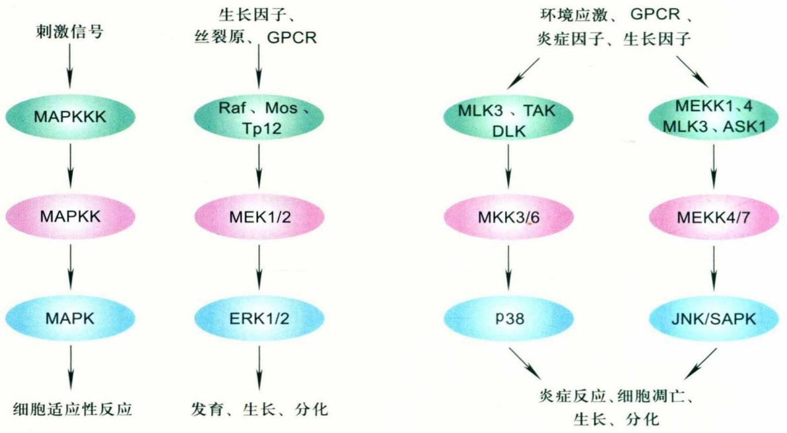
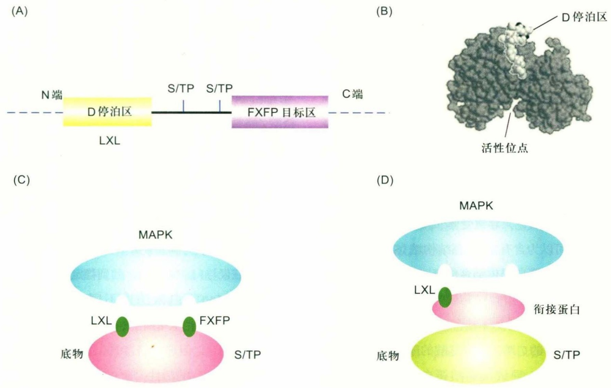
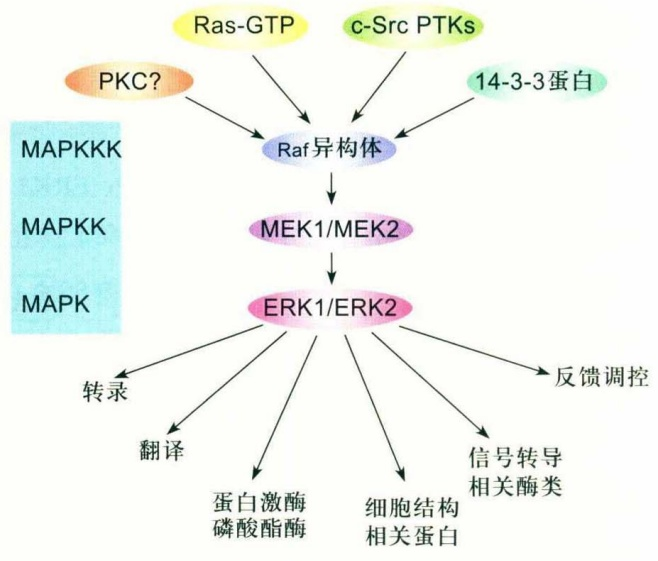
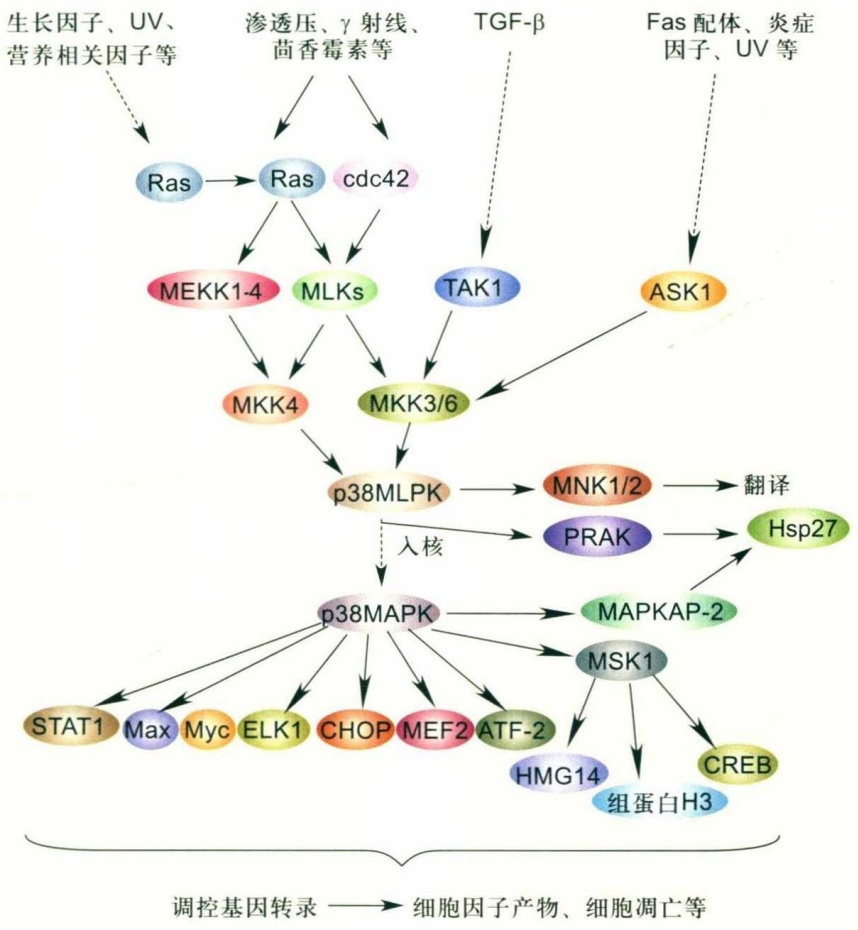
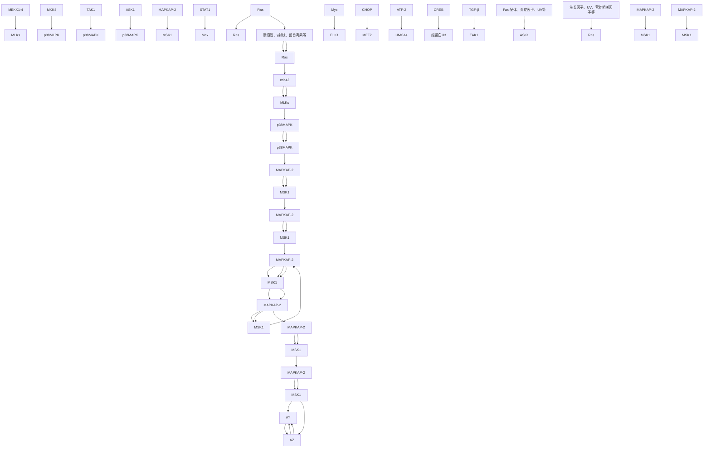
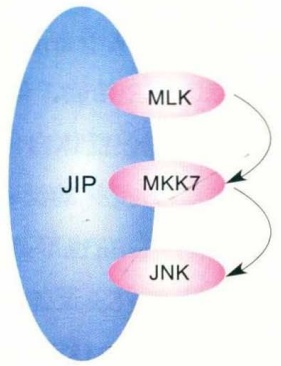
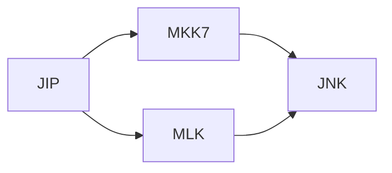
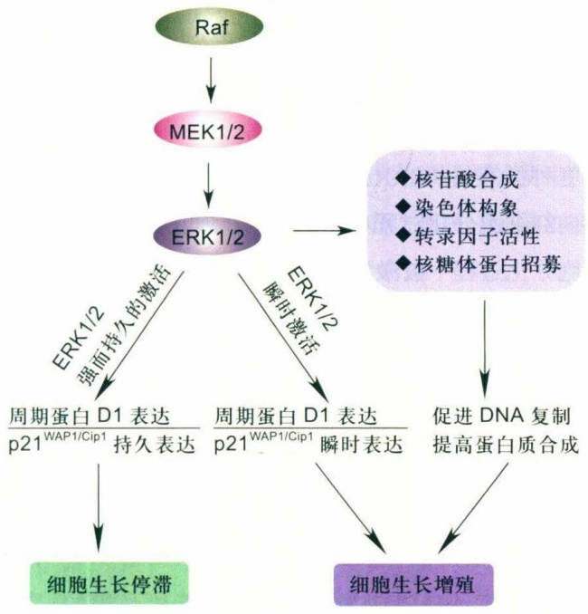

图10-1 哺乳动物中主要的MAPK信号途径

游MEK/MKK和下游磷酸化底物有很大区别，因此单独将其作为一个亚族。近来，又发现了2种ERK3相关的MAPKs，即MAPK4和MAPK6，其功能还不清楚。

ERK1/ERK2和ERK5的T-X-Y活性基团为Thr-Glu-Tyr，p38为Thr-Gly-Tyr，而JNK亚族为Thr-Pro-Tyr。现有研究表明，MEK1和MEK2是ERK1/ERK2的MAPKK，MEK3、MEK4和MEK6可以磷酸化p38的Thr-Gly-Tyr区域，从而激活p38；而MEK4和MEK7则可以调控JNK亚族的活化。另外一个MAPKK家族的成员MEK5，可以选择性激活ERK5的Thr-Glu-Tyr基团。同一亚族的不同异构体也有不同的MAPKK。在p38亚族中，MEK6可以磷酸化p38α、p38β、p38γ，而MEK3只能磷酸化p38α和p38γ，不能激活p38β。上游激酶MAPKKK对于MAPKK的激活也是有特异性的。Raf、Mos和Tpl2作为MAPKKK可以选择性激活ERK通路的MAPKK，而激活JNK和p38通路的MEKK包括混合系激酶(mixed-lineage kinase, MLK)Mlk1、Mlk2、Mlk3、Dlk、Lzk、MEKK(MEKK1、MEKK2、MEKK3和MEKK4)、Tak1、Ask1、Ask2以及Tpl2。

MAPK有多种底物，MAPK的激活至少可产生2种效应:① 底物磷酸化，如转录因子AP-1、c-Myc、c-Jun和Sp1等；② 激活其他激酶，如p90RIK和MAPK活化蛋白激酶2（MAPKAPK2）等，由此启动一系列细胞核和细胞质反应，引起基因表达水平的改变。各个亚族的MAPK被磷酸化激活后，调控的下游靶基因也具有特异性。JNK通过使c-Jun第63、73位Ser双磷酸化提高其转录活性，但不能磷酸化v-Jun。JNK也可使AP-1其他的组分蛋白磷酸化，包括JunB、JunD和ATF2及EIK-1。p38可以调节c-Myc、Max和Sp1等的转录活性。

尽管MAPK家族成员序列同源性大于40%，但不同的胞外刺激能激活不同的MAPK亚族，作用于不同的下游底物，从而产生特定的细胞反应。ERK主要在生长因子、细胞因子以及激素刺激引起的细胞反应中起作用，调控细胞增殖，在特定的环境下还可以促进细胞的分化；p38与应激和炎症反应有关，能够调控细胞周期及细胞凋亡，促进细胞分化，在特定条件下也可以转导胞膜受体接收的生长因子信号；JNK可以被应激和生长因子的刺激激活，调控细胞凋亡和细胞因子的表达，调整细胞周期进程。而细胞外高渗及 $H_{2}O_{2}$ 则可以激活ERK5通路。

## 10.1.2 信号特异性的维持

特定的胞外刺激，是怎样特异地激活相关MAPK通路，调控细胞作出特定的反应呢？其原因就在于MAPK信号通路中存在着多种机制以确保各成员功能的特异性和准确性，同时也防止了成员之间的交叉反应。这种特异性和准确性建立在激酶和其底物之间特异的相互作用上。

MAPK上有保守的停泊位点(docking site, DS)，对于调控的特异性有重要作用。停泊位点有共同停泊区(common docking, CD)和富含谷氨酸、天冬氨酸结构域(ED结构域)。CD功能区存在于所有已知的MAPK家族的C端，包含酸性和疏水残基，可以直接与MAPKK目标区结合。然而仅有CD功能区不能保证停泊的特异性，还需要ED结构域的协助。ED结构域和CD功能区一样，位于MAPK活性位点的对面。ED结构域在表面形成一个停泊凹槽。CD功能区是保证停泊特异性所必需的，而ED结构域在某些情况下并不起作用。另外，还可能有其他的机制决定停泊的特异性，如MAPK的C端有助于增加停泊特异性。

MAPK的底物如转录因子、蛋白激酶、磷酸酯酶中存在保守的MAPK停泊位点的目标区，调控底物与MAPK的特异结合，其中最具有广泛性特征的是D停泊区（D docking domain）（图10-2）。D停泊区由疏水残基Leu-X-Leu（或Leu-X-Leu-X-Leu）组成，中间X有2～6个残基，至少含2个碱性残基(Lys, Arg)，Leu可以由其他疏水氨基酸替代。D停泊区的碱性和疏水残基对于MAPK的结合、锚定和磷酸化具有重要作用。c-Jun含有保守的LX3～5L序列，可分别结合不同形式的JNK。其C端的DNA结合区是辅助的停泊位点，在JNK结合c-Jun过程中是必需的。ERK底物上除了D停泊区外，还存在FXFP（Phe-X-Phe-Pro）结构域，在ERK磷酸化中起着关键作用，但是对于JNK的停泊和磷酸化却无作用（图10-2）。p38 MAPK结合于其底物MEF2A和MKK3b的D停泊区的晶体结构为MAPK家族成员与底物的特异性结合提供了非常好的结构模型。

在酵母细胞中，并行的MAPK信号通路在细胞信号转导中并无相互作用，其每一条MAPK通路都是相对独立的，通常不与其他通路发生交联。哺乳类细胞MAPK通路之间也具有各自的独立性，这种独立性的维持在于各个反应级联蛋白激酶的底物特异性与支架蛋白的存在。支架蛋白可将外界信号激活的细胞信号通路中的各个信号分子结合在一起，形成复合物，起到生理性隔室化效应，从而防止两条通路间发生交联。在哺乳类细胞中并行的MAPK信号通路之间通过复杂的机制既可相互区别，又可相互调节，确保细胞反应的精确性和准确性。细胞对外界刺激的反应是综合了各个信号通路之间的激活或抑制效应而产生的。



图10-2 MAPK与其结合蛋白的停泊

(A) 位于MAPK底物中的D停泊区和FXFP目标区；(B) p38 MAPK（黑色）与转录因子MEF2A D停泊位点（灰色）的结合（引自Yang, 2003）；(C) MAPK不同的表面结构域和底物不同的停泊区结合，底物的磷酸化位点(S/TP)被特异磷酸化；(D) MAPK通过与衔接蛋白上的停泊区结合，随后磷酸化底物。

## 10.2 哺乳动物中的 MAPK 信号途径

## 10.2.1 胞外信号调节激酶途径ERK1/ERK2

哺乳动物细胞中了解得最清楚的MAPK是胞外信号调节激酶ERK，它的信号传递途径为典型的三级酶促级联反应，是调节细胞生长、发育及分化的信号网络的核心。在ERK传递途径中，Ras作为上游激活蛋白，Raf作为MAPKKK，MAPK/ERK激酶（MEK）作为MAPKK，ERK作为MAPK，即Ras-Raf-MEK-ERK途径。此途径是最有代表性的MAPK信号转导途径之一，包括许多不同的MKKK和MKK。ERK包括3个亚族:ERK1/ERK2、ERK3/ERK4和ERK5。其中ERK1/ERK2是MAPK家族中首先被克隆的成员，对ERK1和ERK2的研究也最多、最深入。

## (1) ERK1/ERK2途径的上游蛋白及MEKK

Ras是最早发现的小分子G蛋白，为癌基因ras的产物，具有活化态的GTP结合构象（Ras-GTP）与失活态的GDP结合构象（Ras-GDP）。两种构象可以相互转变，在信号转导过程中发挥开关作用。Ras可由许多因子激活，如EGF、TNF及Src家族成员等。生长因子与细胞表面的受体酪氨酸激酶（RTK）结合，诱发生长因子受体细胞质中的Tyr残基自磷酸化，导致受体二聚体化与活化。磷酸化的Tyr残基可以为含有Src同源结构域（Src homology domain 2，SH2）的蛋白提供结合位点。生长因子受体结合蛋白2（Grb2）是含有SH2结构域的衔接蛋白，该蛋白作为接头分子，与激活的受体结合，再与交换因子（son of sevenless，SOS）的C端富含脯氨酸的序列相互作用形成Grb2-SOS复合物，导致细胞质蛋白SOS向膜转位，并在Ras附近形成高浓度的SOS。SOS是一种鸟嘌呤核苷酸交换因子（guanine nucleotide exchange factor，GEF），促使GTP取代Ras上的GDP，使Ras由失活态转变为活化态，Ras进一步激活Raf-MEK-ERK的级联反应。活化的ERK进入细胞核，激活其下游底物，如原癌基因c-fos、c-myc、c-jun、Erg-1等，调控靶基因如ANF基因、MHC基因和MLC-2基因的表达。

在所有已知的MEKK中，只有Raf和Mos可以在一个简单的级联反应中磷酸化MEK。Raf只能磷酸化MEK家族的2个成员，即MEK1和MEK2。Raf家族蛋白激酶包括A-Raf、B-Raf和Raf-1（或称为C-Raf），都为丝氨酸/苏氨酸激酶。3种Raf蛋白都具有CR1、CR2和CR3保守结构域(conserved region, CR)。CR1和CR2位于Raf的N端，有调控Raf激酶结构域的功能。缺失CR1和CR2的Raf-1具有持续的不依赖于Ras的激酶活性。Raf激酶结构域位于CR3。Raf-1在各种细胞中广泛表达，而B-Raf在神经组织和睾丸中有较高水平的表达，A-Raf则仅在泌尿及生殖系统的组织中起作用。目前关于ERK1/ERK2途径中MEKK的研究多集中于Raf-1。对Raf-1的调节非常复杂，涉及蛋白-蛋白间的相互作用，以及Tyr、Thr和Ser残基的磷酸化与细胞定位的变化。多种调控模式使得Raf-1的激酶活性呈现多个层次。Raf可以与热休克蛋白90（heat shock protein 90, Hsp90）、p50以及数目不定的14-3-3蛋白形成多蛋白复合体，14-3-3蛋白在复合体中起到稳定Raf-1的作用，根据Raf-1磷酸化状态及复合体中其他调控蛋白的不同，多蛋白复合体具有或高或低的活性形式。14-3-3蛋白有多种生物学特性，最近有研究表明它们在酵母和哺乳动物细胞中均参与细胞周期的调控。14-3-3蛋白结合Raf-1的磷酸化的丝氨酸/酪氨酸序列，保护这些位点不被磷酸酶去磷酸化，并延长其活化时间。14-3-3蛋白还可以通过招募Raf-1到蛋白复合体来调控Raf-1信号。突变p50，使其不能和Hsp90结合，也能终止Raf-1信号向下游效应子的传递。在昆虫细胞系Sf9中共表达p50和Raf，可以提高Raf的活性。现在还不能确定p50本身就是Raf通路的激活因子，还是它仅与Hsp90结合，起到稳定Raf的作用。

不同的Raf蛋白激酶由不同的Ras及Rap1a调控。Raf-1可被H-Ras、K-Ras和N-Ras激活。尽管Raf-1也可与Rap1a结合，但这种结合的功能并不确定，因为其结合并没有提高Raf的活性。而B-Raf既能被Ras激活，也能被Rap激活。在交感神经PC212细胞中，Rap1可能是激活B-Raf的主要机制。这种调控机制是由于Raf蛋白富含半胱氨酸的区域引起的。交换Raf-1和B-Raf的CRD，使得Rap1可以激活Raf-1而不能激活B-Raf。

Raf-1的磷酸化状态受多种蛋白激酶的影响，包括酪氨酸激酶Src、蛋白激酶C（PKC）家族成员、p21（Rac/cdc42）活化蛋白激酶（PAK）、Akt（亦称为蛋白激酶B）及14-3-3蛋白。PAK和Src的磷酸化位点分别位于Raf-1N端催化区的Ser338、Tyr340和Tyr341部位，每一个位点被磷酸化时都能够使Raf-1活性增加。PKC与Raf-1形成复合物而使Ser338磷酸化，与PAK具有相同的作用位点。在乳腺癌细胞MCF-7中，Akt可使Raf-1的Ser259位点磷酸化，还可在许多情况下（如C2C12成肌细胞分化期间）降低Raf-1的活性。

ERK1/ERK2和cAMP依赖性蛋白激酶PKA也可以通过磷酸化Raf-1抑制其活性。ERK1/ERK2抑制Raf-1后，可能通过一个典型的反馈抑制机制来限制Raf/MEK/ERK途径的活化程度。PKA抑制Raf-1信号转导时，调节cAMP合成的受体系统对ERK1/ERK2途径进行负调控，从而允许多种信号对这些途径进行正负整合及调控。最近的研究表明，ERK1/ERK2途径中Raf-1下游的效应子MEK1可以增加Raf-1的活性，且与Ras和Src无关。因此ERK1/ERK2途径所转导的信号到达MEK1水平时得到放大，但当ERK1/ERK2被激活时则受到负调控，这种双向调节对调控ERK1/ERK2反应的持续时间和强度非常重要。

## (2) ERK1/ERK2途径中的MEK

MEK1和MEK2是ERK途径三级级联反应中的MKK，分子量分别为 $4.4\times10^{4}$ 和 $4.5\times10^{4}$ 。Raf蛋白激酶被活化后特异性结合并磷酸化激活MEK1和MEK2（图10-3），而不是其他MEK。MEK1和MEK2分子有一段富含Pro的区域，是Raf与ERK分子特异性识别的结构基础。删除这段富含Pro的区域，Raf将不能识别、结合和激活MEK。A-Raf可以激活MEK1，B-Raf可以与MEK1和MEK2结合，但激活MEK1的效率要高于MEK2。Raf-1能以相同的效率激活MEK1和MEK2，这表明Raf家族的成员与其底物MEK1和MEK2之间的亲和力是有区别的。Raf被激活后，它的C端催化区能与MEK结合，并使其催化区第Ⅷ亚区中2个丝氨酸(Ser)磷酸化，从而激活MEK。MEK属于双重特异性激酶，使Tyr和Thr两个调节位点磷酸化而激活ERK。但MEK如何兼具Tyr和Thr双特异性磷酸化活性目前尚不清楚，不过MEK对ERK的Tyr/Thr双特异性磷酸化具有重要的生理意义。因为ERK信号通路在细胞信号转导网络中处于枢纽地位，任何错误的活化都会对细胞生命活动产生深远的影响，而这种双特异性的识别和激活机制，大大提高了信号转导的准确性，防止了ERK的错误激活。

## (3) ERK1 和 ERK2

目前，MEK1/ERK2的底物仅发现了两种:ERK1和ERK2。ERK1/ERK2的分子量分别为 $4.4 \times 10^{4}$ 和 $4.2 \times 10^{4}$，是一种丝氨酸/苏氨酸蛋白激酶，其同源性约为 $85\%$，结合底物的核心区同源性更高。多种激酶作用于MEK时，活化的MEK通过其N端与ERK1和ERK2直接结合，磷酸化并激活底物。两个磷酸接受位点即Tyr和Thr，在ERK1和ERK2的活化环中被一个Glu残基隔开，形成TEY序列。虽然在各种组织中其相对丰度有所不同，但是ERK1和ERK2的表达是广泛存在的。例如，大多数免疫细胞中主要表达ERK2，而在神经内分泌起源的几种细胞中，ERK1和ERK2的表达是相同的。在某种程度上它们被多种配体和细胞外界刺激所激活，而且具有细胞种类特异性。在成纤维细胞中，它们被血清、生长因子、细胞因子、G蛋白偶联受体的配体和转化物质等激活，然后激活一些转录因子和其他的丝氨酸/苏氨酸激酶，从而引起细胞增殖、分化，调节细胞周期和细胞生存。近来发现了ERK1的另一种剪接体ERK1b，可能属于ERK4亚族。关于ERK2的另一种剪接体也有报道，在N端少了一些氨基酸残基，表达于细胞膜上。

MEK1/MEK2不仅仅是ERK的激活物，还可能是ERK在细胞质中的锚定器。当信号通路无活性时，它就将ERK固定在细胞质中，而细胞受到刺激后，活化的ERK与MEK解离并二聚体化，转移到胞核或其他活化位点，再进一步磷酸化下游底物。在ERK2磷酸化后转位入细胞核的过程中，磷酸化的ERK2和磷酸化或未磷酸化的ERK2形成同源二聚体转位入核，说明同源二聚体的形成是ERK入核所必需的。

## 10.2.2 p38信号途径

p38丝裂原活化蛋白激酶广泛存在于多种组织细胞。最近的研究表明，p38 MAPK不仅参与炎症反应，还与缺血缺氧、炎症因子、内毒素、高渗透压、牵张和剪切应力等细胞应激时信号转导有关，调控应激情况下的炎症相关基因表达、细胞骨架重构、细胞能量代谢及细胞增殖和凋亡。

p38激酶最先是用溶血磷脂酸(lysophosphatidic acid,



<details>
<summary>flowchart</summary>

This flowchart illustrates the signaling pathways and mechanisms of MAPKKK expression in a specific cell line, showing how Ras-GTP, c-Src PTKs, and 14-3-3 protein are involved in Raf异构体 formation, which is then mediated by MEK1/MEK2 and ERK1/ERK2 to regulate transcriptional processes.
</details>

LPS）刺激巨噬细胞时作为一种磷酸化的酪氨酸蛋白被发现，与酵母HOG1（high osmolarity glycerol response 1）激酶有明显的同源性。目前，已克隆出多个p38激酶亚型，包括p38α、p38β、p38γ、p38δ等，分子量为 $3.8 \times 10^{4} \sim 4.3 \times 10^{4}$ ，各亚型间同源性约为60%。这些不同亚型的激酶之间有一些相似性，具有相同的“T-G-Y”双磷酸化位点、均可被环境应激激活等。它们也具有各自不同的特征，不仅对上游激酶具有一定的选择作用，同时对下游底物的作用也不尽相同。不同亚型的p38激酶存在组织器官分布差异。p38α在多种组织器官呈高表达；p38β主要高表达于心脏和脑中；p38γ多表达于骨骼肌；p38δ则主要在肺、肾、睾丸、胰和小肠中表达。不同亚型间功能也存在差异:溶血磷脂酸处理粒细胞只活化p38α，而非p38β；p38γ的诱导表达主要与肌肉的分化有关；而p38δ的表达与发育调节有关。在本章中，如果没有特别说明，p38就是指p38α。

## (1) p38 MAPK途径的胞外刺激信号

p38同源蛋白已经从酵母、昆虫、青蛙及多种哺乳动物中被克隆，它们与细胞对胞外刺激的应激反应以及细胞周期的调控有关（图10-4）。因为哺乳动物的p38激酶是在研究炎症反应中的信号转导途径时被发现的，所以关于p38激酶调控的研究结果大多来自免疫系统。在溶血磷脂酸刺激的巨噬细胞、TNF刺激的上皮细胞、IL-17刺激的软骨细胞、IL-18刺激的U1单核细胞系、副甲氧基安非他明（PMA）刺激的中性粒细胞、凝血酶刺激的人血小板中，均发现有p38激酶的激活。

在过去的几年里，许多研究表明粒细胞—巨噬细胞

## 图10-3 ERK1/ERK2途径的激活及其生理功能

Ras、c-Src PTK、PKC及14-3-3蛋白等参与ERK1/ERK2信号途径上游激酶(MAPKKK) Raf家族的激活。Raf随后磷酸化激活MEK1和MEK2，MEK1和MEK2激活其MAPK底物ERK1/ERK2。ERK1/ERK2可以磷酸化多种蛋白酶类及转录因子，调控多种细胞反应。

集落刺激因子(granulocyte macrophage colony-stimulating factor, GM-CSF)、促红细胞生成素(erythropoietin, EPO)、成纤维细胞生长因子(fibroblast growth factor, FGF)、IL-2、IL-3、IL-7、神经生长因子(nerve growth factor, NGF)、血管内皮细胞生长因子(vascular endothelial growth factor, VEGF)等均可以引起特定细胞中p38的激活。尽管p38家族的其他成员p38β、p38γ、p38δ已经被克隆，但尚不清楚它们在不同的环境下及不同的细胞中是如何被激活的。几组研究人员用瞬时转染的方法表达p38家族的4个成员，发现它们具有相似的激活特性。然而，在激活的水平和激活的动力学方面还存在差异。

## (2) p38 信号途径的上游激酶 MAPKKK

与其他MAPK途径相比，p38信号途径的上游激酶MAPKKK种类极多，这与p38可以由多种刺激激活相适应。已有报道表明，可激活p38途径的MAPKKK有MTK1、MLK2/MST、MLK3/PTK/SPRK、DLK/MUK/ZPK、ASK1/MAPKKK5和TAK1等。因为p38途径与JNK途径通常是共激活的，过表达这些MAPKKK导致p38和JNK途径激活。当然，只激活p38或JNK的现象也存在，这说明有专一激活p38或JNK的上游激酶。这些不同的上游激酶受到不同的刺激而被激活，然后选择性激活下游激酶，引起细胞不同的反应，例如MAPKKK5可选择性激活MKK3/6。对p38激酶途径而言，MTK1仅能介导应激信号（如渗透压、紫外线照射），而不能被细胞因子激活。一组应激诱导的GADD45α/β/γ蛋白可以结合在MTK1的N端，介导MTK1的激活。曾有报道表明，TAK1被TAB（TAK binding protein）激活，介导转化生长因子TGF-β的信号转导。TAK1可以激活MKK4和MKK6，继而活化p38。

Ras 在激活 Raf/MEK/MAPK 途径中起着重要作用，所以研究人员对寻找参与激活其他 MAPK 途径的小分子GTP结合蛋白有着浓厚的兴趣。人们发现，更上游的p38的激活物可能包括Rho、Rac和cdc42。在COS7或HeLa细胞表达显性失活的cdc42、Rac，可阻碍IL-1或紫外线对p38的激活作用。MLK1、MLK2和MLK3都有一个Rac/cdc42结合区，所以Rac/cdc42可能直接激活MAPKKK，从而激活p38通路。有证据表明，它们对p38的激活作用也可能是通过PAK来发挥作用的。3种相关的PAK激酶PAK1、PAK2和PAK3可以结合并激活Rac/cdc42。而显性失活的PAKs可抑制Rac/cdc42对p38的激活。近来又发现了一种Ste20同源蛋白Mst1，可以激活MKK6、MKK7及p38和JNK。



<details>
<summary>flowchart</summary>


</details>

图10-4 p38 MAPK信号通路的激活及功能

紫外线照射、细胞外高渗、多种细胞因子和炎症因子均可激活p38 MAPK信号通路。经过典型的三级激酶级联反应磷酸化激活p38 MAPK。P38 MAPK可磷酸化Stat1、MEF2、ATF-2等转录因子或下游激酶，影响靶基因的转录或翻译，调控炎症反应或细胞存活。

不仅小分子GTP结合蛋白参与了p38途径的激活，一些大分子G蛋白也有调控p38途径的作用。化学趋化因子如N甲酸甲壳胺酸苯丙酸（fMLP）和血小板激活因子（platelet activating factor，PAF）与其G蛋白偶联的受体结合，可导致p38的激活。有证据表明，G蛋白信号调控蛋白（regulator of G protein signaling，RGS）也参与了依赖于G蛋白的p38激活机制。

## (3) p38途径中的MAPKK

与其他MAPK一样，p38激酶家族也是由双重特异性激酶MAPKK激活。MKK3和MKK6的同源性高达$80\%$ ，是公认的p38的上游激酶。MKK6能活化所有p38激酶亚型，而MKK3只能活化 $\mathrm{p38a}$ 、 $\mathrm{p38\gamma}$ 和 $\mathrm{p38\delta}$ 。有报道表明，MKK7可以激活 $\mathrm{p38a}$ 和 $\mathrm{p38\delta}$ 。这种底物的选择性表明不同的MKK可能行使不同的功能。MKK6可以比MKK3更有效地诱导JurkatT细胞的凋亡，而在心肌细胞中表达MKK3却比MKK6诱导凋亡更显著。MKK3、MKK4、MKK6和MKK7的多种剪接体已被克隆。在大多数细胞中，MKK全长的剪接体表达水平最高，并且具有更持久的活性。

## (4) p38 MAPK 家族的底物

与其他MAPK类似，p38被磷酸化激活后移位入核或转移到其他部位，发挥调节功能。近年来鉴定了一些p38作用底物，发现和鉴定p38的作用底物对于确定其生理功能是非常重要的。

① 转录因子 转录因子ATF2的生物学作用至今仍未完全阐明。ATF2含有一个磷酸化依赖性转录激活区和一个DNA结合区。p38可磷酸化ATF2 N端活化区域的第69、71位Thr，导致转录活性升高。转录因子CHOP10是C/EBP转录因子家族成员，在细胞应激条件下聚集并被p38磷酸化。CHOP10可以与C/EBP家族的其他转录因子形成异源二聚体。虽然还未发现CHOP的作用序列和细胞因子表达有直接关系，但它可能会在应激条件下间接参与细胞因子的表达调控。MEF2C属于MEF2转录因子家族，这个家族至今已克隆MEF2A、MEF2B、MEF2C和MEF2D 4个基因。研究发现，MEF2C不仅存在于骨骼肌、脾和脑，而且在THP-1、U937等多种单核细胞中广泛存在。p38可与MEF2C结合，并对MEF2C进行磷酸化。MEF2C可与c-Jun启动子区结合。溶血磷脂酸刺激细胞使p38和JNK发生双位点磷酸化而使之激活，p38的激活使MEF2C磷酸化，c-Jun转录增加，从而增加c-Jun蛋白的表达。另外，受p38调控的转录因子还有AP1、NFκβ、CREB、ELK-1、HSF-1、STAT1、p53、Sapl和SAP1等。

② p38的蛋白激酶底物 MAPKKK2和MAPKKK3属同一个丝氨酸/苏氨酸激酶家族，关系非常近，两者均可被p38磷酸化而激活。热休克蛋白Hsp27和转录因子CREB分别是MAPKKK2和MAPKKK3的底物。丝氨酸/苏氨酸激酶MNK1、MNK2和MAPKAPK2及MAPKAPK3一级序列结构接近，可能属于同一家族。MNK1和MNK2既可被ERK磷酸化又可被p38磷酸化，可能具有整合不同MAPK信号，即生长因子激活的ERK通路和应激激活的p38通路的功能，从而调节蛋白的合成。最近鉴定和克隆了一个受p38调控的丝氨酸/苏氨酸激酶PRAK（p38 regulated/activated protein kinase）。PRAK与已知的受MAPK调控的RSK1/2/3、MNK1/2、MAPKAPK2/3只有 $20\% \sim 30\%$ 的同源性，说明PRAK代表的是一个新家族。PRAK mRNA在所检查的人组织和细胞系中都有表达。在HeLa细胞中，PRAK可以被细胞因子和细胞应激激活。分裂素和应激激活蛋白激酶1（mitogen and stress activated protein kinase 1, MSK1）也是p38的蛋白激酶底物，被p38激活后，可以磷酸化组蛋白H3、cAMP反应元件结合蛋白（cAMP-responsive element binding protein, CREB）及HMQ14，调控靶基因的表达。

## 10.2.3 JNK/SAPK途径

JNK家族是一类丝氨酸/苏氨酸激酶，也被称为应激活化蛋白激酶，是哺乳动物内发现的第三类MAPK家族。它含有双磷酸化位点Thr-Pro-Tyr（T-P-Y），在酵母细胞中并未发现类似物。1994年，Derijard和Kyriakis分别克隆得到JNK基因。通过生化研究人们得到了纯化的JNK蛋白，并确认它是“p54微管相关蛋白激酶”，可以由放线酮（cycloheximide）活化。JNK与c-Jun的N端活性区域结合，并在第63、73位2个Ser位点使c-Jun磷酸化。多种刺激信号如生长因子、细胞因子和环境应激都可介导JNK的活化，调节胚胎发育、细胞生长、癌基因转化、细胞分化和细胞凋亡等多种生命过程。JNK/SAPK信号传递途径与ERK、p38MAPK及其他细胞内信号传递途径相互调节，共同决定细胞对外来刺激引起的生物学效应。JNK与细胞凋亡、T细胞发育及肿瘤形成等有密切关系，从而使JNK在临床上成为一个潜在的分子治疗靶点。

(1) JNK/SAPK途径的上游激酶MAPKKK及其激活机制

根据目前的研究，有以下MAPKKK参与激活JNK/SAPK途径:MEKK成员MEKK1～4；混合系激酶成员MLK1、MLK2、MLK3、DLK和LZK；凋亡信号调节激酶（apoptosis signal regulating kinase，ASK）成员ASK1和ASK2。此外，还有TAK1和TPL2等。多数情况下，上述激酶参与激活JNK/SAPK途径的证据来源于过表达及体外激酶活性检测等实验。然而，目前还不清楚它们是否在生理状态下具备同样的功能。敲除MEKK1的小鼠没有明显的形态学变化，只是眼睑丧失了闭合功能。而敲除MEKKK3的小鼠在胚胎发育及心血管形成中存在缺陷，不能成活。敲除MEKK2及MEKK4的小鼠还没有报道。

有研究表明，小分子G蛋白Rho家族参与了JNK上游激酶的激活。Rho可激活包括MLK家族和MEKK家族，而受体酪氨酸激酶可以激活Rho蛋白。因此，受体酪氨酸激酶结合配体后，可以通过激活Rho蛋白，将胞外信号传递至JNK通路。其他的替代机制也可以介导受体酪氨酸激酶对JNK通路的激活，如衔接蛋白Nck和Ste20样蛋白激酶NIK。

TRAF家族的衔接蛋白也可以介导受体酪氨酸激酶对JNK通路的激活。肿瘤转化因子TNF受体被激活后，招募TRAF2。TRAF2可以与MEKK1和ASK1结合。TRAF2激活MEKK1的机制还不清楚。TRAF2激活ASK1之前需要ASK1的抑制因子硫氧还蛋白（thioredoxin）的解离和ASK1的二聚体化。IL-1受体可以招募TRAF6，TRAF6在另一种衔接蛋白ECSIT的帮助下结合MEKK1，还可以在TAB2的帮助下结合TAK1。利用酵母双杂交方法还发现GADD45α、GADD45β及GADD45γ与MEKK4的激活有关。

## (2) JNK/SAPK中的MAPKK

作为JNK上游的两个激酶，MKK4和MKK7的作用并非完全相同，可能是JNK上游的2个分支。这些蛋白激酶在各种细胞中表达不同的剪切体，现在鉴定了MKK4的3种剪切体，其产生机制还不清楚，它们在N端存在着一些差异。MKK7有6种剪切体，由交替剪接和利用不同的启动子而产生，在N端和C端都有差异。MKK4、MKK7的不同剪切体的活性和可诱导性不同，并且由不同的MAPKKK激活。MKK4主要由环境应激激活，而MKK7主要由细胞因子如TNF和IL-1激活。MKK4和MKK7的底物也不同。MKK4对JNK和p38都有激活作用，但对两种激酶的作用强度不同。MKK4基因敲除的胚胎干细胞和野生型胚胎干细胞在相同环境刺激下，p38激酶的活性并没有显著性差异，而JNK的活性则显著不同。MKK4作为JNK通路的主要激酶，它对p38的作用远远小于对JNK的作用。尽管MKK4对JNK的活化十分重要，MKK4并非是JNK上游的唯一激酶，渗透压应激及紫外线照射仍能激活MKK4基因敲除的胚胎干细胞内的JNK途径。研究发现，MKK4上游激酶MEKK3可以激活MKK4基因敲除细胞内的JNK。后来发现起中间介导作用的另一个激酶MKK7。高渗溶液或紫外线照射仍能增强MKK4基因敲除的胚胎干细胞JNK的活性，是因为信号分子通过Ras通路激活了MKK7，而Ras通路对MKK4没有活化作用。MKK7与MKK4不同，对p38没有激活作用，因此被认为是JNK上游特异性激酶。高渗、热休克、紫外线照射、TNF等均可激活MKK7，小分子G蛋白Rac和cdc42也可激活MKK7。MKK7在人多个组织广泛表达，其中骨骼肌中表达水平最高。MKK7和MKK4在不同组织中表达水平不同，有可能整合不同的信号通路活化JNK。MKK4和MKK7通过对JNKⅧ区Tyr183和Thr185双位点磷酸化而激活

JNK，该反应在细胞核内和细胞质中均可进行。MKK4 和 MKK7 分别优先磷酸化 Tyr 或 Thr。在某些条件下，MKK4 和 MKK7 可能协同作用共同激活 JNK 途径。JNK 的失活可由酪氨酸蛋白磷酸酶和苏氨酸 / 酪氨酸双特异性蛋白磷酸酶等调节。

基因敲除实验表明，MKK4和MKK7在胚胎发育过程中是必需的。敲除MKK7基因的小鼠胚胎致死的原因还不清楚。MKK4缺失的小鼠胚胎致死的原因是肝细胞的凋亡。这种致死表型与敲除c-Jun的小鼠一样。然而MKK4缺失的小鼠胚胎致死并不是因为c-Jun不能被磷酸化，因为c-Jun的JNK磷酸化位点的突变并没有导致可观测到的胚胎非正常发育。因此，MKK4缺失的小鼠胚胎发育过程中肝细胞凋亡的原因有待于进一步研究。

初步的研究表明, MKK4缺失小鼠的胸腺细胞和外周T细胞对于细胞凋亡的响应有所增强, MKK4缺失的T细胞不能分泌IL-2, 也不能增殖。然而, 另一个研究表明敲除MKK4并没有阻断T细胞中JNK途径的激活, 缺乏MKK4的B细胞和T细胞发育正常, 两种实验结果的矛盾之处还需要进一步的实验来解决。敲除MKK7基因的T细胞中, JNK途径不能被激活, 然而MKK7和MKK4双敲除的T细胞在JNK激活和分泌IL-2方面并没有变化。MKK4和MKK7双敲除细胞的研究是解决上述问题的关键。

## (3) JNK 家族及其各种剪切体

JNK是一种丝氨酸/苏氨酸蛋白激酶，包含双磷酸化功能区Thr-Pro-Tyr。JNK定位于细胞质，一旦被磷酸化激活，便移位到细胞核。JNK蛋白激酶由3个基因编码，JNK1和JNK2基因在全身广泛表达，而JNK3呈限制性表达，多存在于脑、心、睾丸中。这3种基因都能编码分子量为 $46\times10^{3}$ 和 $55\times10^{3}$ 的蛋白产物（区别在于COOH末端的有无），基因通过选择性剪接产生了10种转录物。不同的JNK剪切体在不同细胞种类中表达有所不同，被不同的上游激酶激活，磷酸化不同的底物。正是由于这种选择性剪接作用，改变了JNK各亚型与底物停泊位点相互作用的能力，从而影响了底物特异性。

敲除JNK1或JNK2的小鼠外形正常，但是T细胞功能有严重的缺陷。敲除JNK1或JNK2的小鼠T细胞能正常增殖和分泌IL-2，但是由于不能激活JNK途径，辅助性T细胞（helper T cell）不能分化为效应T细胞。进一步分析发现是因为转录因子NFAT1的功能发生了变化，使细胞丧失了分泌干扰素的功能。胸腺细胞即不成熟的T细胞高表达JNK1和JNK2，但外周T细胞即成熟的T细胞JNK的表达水平却很低。可能不成熟的T细胞中JNK表达的缺陷使T细胞发育受阻。

## (4) JNK 的底物

JNK/SAPK的下游底物主要有3种转录因子c-Jun、ATF-2和ELK。转录因子ATF2和c-Jun属于亮氨酸拉链家族成员，它们以同源二聚体或异源二聚体形式与许多基因启动子上的激活器蛋白1(activator protein 1, AP1)和AP-1样位点结合，提高AP-1的转录活性，促进基因的表达和蛋白质的合成。活化的JNK可以与转录因子ATF2及c-Jun的N端区域结合，使转录因子的活性区域发生磷酸化。研究发现JNK1和JNK2的底物特异性不同，c-Jun优先与JNK1结合并被其磷酸化，而ATF2则与JNK2优先结合。JNK通过双磷酸化c-Jun第63、73位Ser，提高其转录活性，但不能磷酸化v-Jun。JNK也可使AP-1其他的组分蛋白磷酸化，包括JunB和JunD。c-Jun的第73位Ser经JNK磷酸化后可有效地避免被泛素化，使半衰期延长。ATF2也是JNK的底物，它可以与c-Jun形成异源二聚体，并刺激c-Jun基因的表达。ELK-1是JNK的另一个底物，它参与c-fos基因的诱导，而c-fos基因的产物则与c-Jun形成异源二聚体，这又一次表明JNK可以在多个位点调控转录活性。与c-Jun不同的是，JNK磷酸化ELK-1并不能改变其泛素化进程。其他蛋白激酶也能使ATF2和ELK-1磷酸化:ATF2可以被p38活化，而ELK-1可以被ERK和p38磷酸化。这说明不同家族的MAPK可能的转录因子底物存在交叉。

p53也是JNK的作用底物，JNK通过调节p53的半衰期来控制p53的表达水平。JNK磷酸化p53，抑制泛素介导的降解，从而稳定p53蛋白。但最近研究发现，紫外线刺激引起的p53的聚集并不需要JNK。c-Myc也可能是JNK的底物，c-Myc可在第62位Ser和第71位Trp被JNK磷酸化。JNK活性的提高与c-Myc诱导细胞凋亡紧密相关。JNK信号通路可能参与c-Myc诱导的凋亡，但JNK诱导的信号凋亡并不需要异位表达c-Myc。将U937细胞暴露于离子射线下可以使活化的JNK转位到线粒体，从而磷酸化抗凋亡蛋白Bcl-XL。这说明线粒体中的JNK在应激引起的凋亡反应中发挥作用。

最近的研究发现JNK底物并不局限于转录因子或核蛋白。成视网膜细胞瘤蛋白(retinoblastoma protein,

Rb）也是JNK/SAPK的靶蛋白，与γ射线诱导的多发性骨髓瘤（multiple myeloma）的细胞凋亡调节有关。Tau蛋白是细胞中双螺旋纤丝的主要蛋白。在阿尔茨海默病中，Tau蛋白被异常磷酸化，而JNK及p38可以使Tau蛋白磷酸化。

## 10.2.4 其他 MAPK 信号途径

## (1) ERK3

大鼠的ERK3基因是用ERK1作为探针从cDNA表达文库中得到的，也称作ERK3α。人的ERK3样蛋白激酶与ERK3有75%的同源性，称为ERK3β，分子量约为 $6.3\times10^{4}$ 。这些激酶在核心激酶区与ERK1和ERK2有约50%的同源性，并且都有约200个氨基酸残基的C端调节结构域。随后，Flier及其同事分离得到一种人的cDNA，预测可以编码分子量为 $9.7\times10^{4}$ 的蛋白质，其与ERK3α共有的氨基酸序列完全相同，但C端多出了近300个氨基酸残基。用抗ERK3α的抗体，从大鼠的多种组织和几种细胞系中检测到了分子量分别为 $6.3\times10^{4}$ 、 $9.5\times10^{4}$ 和 $1.6\times10^{5}$ 的ERK3样蛋白的表达。Meloche及其同事从小鼠中分离到分子量约 $1\times10^{5}$ 的ERK3α。在酵母和线虫中目前还没有发现ERK3的同源蛋白。

ERK3α和ERK3β具有一些与ERK1/ERK2不同的性质。在ERK3α的活化区仅有一个磷酸化位点:Ser189。Gly取代了其他MAPK中的Tyr残基，形成S-E-G活化区。ERK3α可以自磷酸化，而磷酸化其他ERK3异构体的活性很低。大多数MAPK定位于细胞质，被激活后移至细胞核内，而ERK3α在激活前后都高度集中于细胞核内。ERK3缺乏核定位信号，其入核机制尚不明了。

## (2) ERK5

ERK5，也称为大促分裂原活化的蛋白激酶 (big mitogen-activated protein kinase 1, BMK1)，由816个氨基酸组成，其C端约400个氨基酸为激酶区，含有10个MAPK磷酸化位点，但既不与任何已知蛋白具有序列相似性，也不具有已知的功能。这些磷酸化位点可能会自主发生磷酸化，这与ERK5活性高时其自磷酸化急剧增加一致。自磷酸化是否对细胞内ERK5的功能起整合作用仍不清楚。ERK5与ERK1/2存在着序列同源性，具有与ERK1/2相似的Thr、Tyr TEY磷酸模序。其C端包含有一个核定位信号和Pro富集区。其中核定位信号有利于BMK1刺激后进行核定位；而Pro富集区则作为与带有SH3结合模序蛋白的相互作用位点。这将其与ERK1/2等其他MAPK家族成员区分开来。同时，ERK5与ERK1/2在激活方式和功能上有一定的相似性。

ERK5在哺乳动物细胞中广泛表达。MAPKKK家族中的MEKK2和MEKK3激活MEK5，之后，MEK5磷酸化并激活ERK5，被激活的ERK5使心肌细胞增强因子2（MEF2）等底物发生磷酸化。与其他MAPK一样，ERK5可受多种促进细胞增殖和细胞应激的物质调节。血清、EGF、NGF、LPA以及佛波酯（phorbol ester）等均可以激活ERK5，促进细胞增殖，主要作用于 $G_{1}/S$ 过渡期。ERK5通过以下方式参与细胞增殖的调控:例如，ERK5使血清和糖皮质激素诱导激酶（SGK）发生磷酸化，这是细胞进入S期必需的；此外，与ERK1/2相似，ERK5能够驱动 $G_{1}/S$ 期的关键调控因子——细胞周期蛋白D1的表达。然而，ERK5和ERK1/2调节细胞周期蛋白D1表达的机制不同，ERK5的诱导需要cAMP反应元件（CRE），而ERK1/2不需要。

在一些细胞中ERK5的激活依赖于Ras。在HeLa细胞中EGF对ERK5的激活需要MEKK3的参与。激活ERK5的细胞应激刺激包括山梨糖醇（sorbitol）、 $H_{2}O_{2}$ 、紫外线照射等，这些刺激在某些情况下需要通过Src传递信号。ERK5促进细胞增殖，显性失活ERK5突变体能够抑制由EGF刺激所致的增殖。ERK5的底物包括MADS盒转录因子、肌细胞增强因子2A和2C（myocyte enhancer factor 2A and C，MEF2A and C）及Ets样转录因子SAP1α。MEK5位于ERK5的上游，主要在肝细胞和脑细胞中表达。目前所知，ERK5是MEK5的唯一底物。

## (3) ERK7

ERK7是一个分子量为 $6.1\times10^{4}$ 的MAPK，与ERK1、ERK2和ERK5一样，其活化环中有一个T-E-Y序列。ERK7不被能激活ERK2或JNK的刺激所激活，但在血清饥饿的细胞中具有活性。ERK7具有生长抑制作用。其C端较长，这是其蛋白定位和高基础活性所必需的。

## (4) NLK

Nemo样激酶(Nemo-like kinase, NLK) 是果蝇 Nemo 在哺乳动物中的一个同源蛋白。NLK 的性质介于 MAPK 与 CDKs 之间。虽然它与 ERK2 有近 45% 的同源性，但其活化环内没有双重磷酸化序列 T-X-Y，而是在 T-Q-E 序列中有一个与 CDK 极其相似的单磷酸化位点。但无论如何，NLK 位于 MAPK 级联反应中，可负向调节Wnt信号转导。线虫中的研究表明，lit-1是NLK的同源物，可被MEKK Mom-4激活。Mom-4是TAK1的同源蛋白。有实验表明，转染TAK1的细胞可增强共转染的NLK的活性。尽管目前还未发现特异性激活NLK的MEK，但在体外实验中，NLK可以被TAK的底物即MKK6激活。

## (5) MOK

MOK与MAPK成员以及CDK家族均有约30%的同源性。但是，MOK与典型的MAPK一样，其活化环存在T-E-Y序列。MOK可以被冈田酸（okadaic acid）和佛波酯激活，表明它处在一个激酶级联反应链中。它的同系物包括MAK（male germ cell-associated kinase）和MAK相关激酶MRK（MAK-related kinase）。

## 10.3 蛋白磷酸酶介导的 MAPK 信号失活机制

在哺乳动物进化过程中，对于重要的信号通路都形成了一个保守而且复杂的负反馈机制，从而得以适时的减弱或终止其对基因表达的调控。在生理条件下，MAPK的活性通常是瞬时存在的，MAPK的表达水平在受到刺激激活到失活的过程中没有明显变化。对于MAPK信号通路来说，MAPK被激活后的负反馈机制，主要是由磷酸酶介导的去磷酸化过程。MAPK或MAPK信号的其他成员的Ser/Thr以及Tyr被磷酸化后，可以被底物特异性磷酸酶去磷酸化，从而导致MAPK信号失活。

蛋白质酪氨酸磷酸酶(protein tyrosine phosphatase, PTP)可以使蛋白底物特异的Tyr位点去磷酸化。人的基因组大约有106个基因具有PTP活性，其中38个是经典的PTP，68个既有PTP活性又有Ser/Thr磷酸酶活性（即双特异磷酸酶活性，dual specific serine/threonine/tyrosine phosphatase, DUSP）。受体酪氨酸激酶(receptor tyrosine kinase, RTK)，如EGF和PDGF，是PTP的底物。SHP-2 PTP通过使RTK的Tyr位点去磷酸化，降低RTK激活的ERK1/2信号。在MAPK层次，有研究表明HePTP可以直接作用于ERK1/2，使其处于去磷酸化状态。

MAPK 磷酸酶 (MAPK phosphatase, MKP) 属于双特异磷酸酶，可以使底物蛋白的 Tyr 和 Thr 去磷酸化。MAPK 磷酸酶 1 (MKP1) 是其中最典型的成员，对几种

MAPK如ERK、JNK和p38均有去磷酸化作用。其他9种MAPK的双特异磷酸酶也已经被鉴定，它们处于严格的调控之下，在特定的组织、细胞以及亚细胞水平表达。在瞬时转染实验中，MKP1、MKP4和MPK5都可以有效地使p38α、p38β去磷酸化。有趣的是，所有的MKP家族成员均不能使p38γ、p38δ去磷酸化，这可能是细胞内调控不同p38剪接体的一种机制。包括MKP1在内的大多数双特异磷酸酶可以被丝裂原或环境应激诱导表达，而MKP3具有持续表达的特性。ERK2可以与MKP3结合，反过来调控MKP3的活性。

蛋白质丝氨酸/苏氨酸磷酸酶(protein serine/threonine phosphatase, PSP)为几种蛋白亚基组成的复合酶类，通常包含一个I型蛋白磷酸酶和一个II型蛋白磷酸酶，可以将蛋白底物的Ser/Thr位点去磷酸化。蛋白磷酸酶2A(protein phosphatase 2A, PP2A)是一个三元复合体，由1个支架蛋白、1个催化亚基以及1个调节亚基组成。随着调节亚基的变化、催化亚基的甲基化或磷酸化，PP2A的底物特异性和磷酸酯酶活性也相应地发生改变。根据调节亚基的不同，PP2A几乎可以使所有的MAPK信号通路失活。例如，PP2A既可以使MKK3和p38去磷酸化，也可以使MEK1/2和ERK1/2失活。在小鼠脑中过表达显性失活的PP2A催化亚基突变体，导致MEK1/2磷酸化水平的提高，从而在体内水平验证了PP2A对MEK1/2的去磷酸化作用。

人和小鼠基因组中有13个双特异磷酸酶可以特异地使MAPK信号通路的组分去磷酸化。DUSP8、DUSP9和DUSP10在细胞核及细胞质中均有表达，DUSP1、DUSP2、DUSP4和DUSP5主要在细胞核中表达，而DUSP6、DUSP7和DUSP16则在细胞质中表达。大多数DUSP的表达没有组织特异性，但有研究表明DUSP2主要表达于淋巴系统中，DUSP5在血管中特异表达；DUSP8在脑、心脏和骨骼肌中表达；而DUSP9则特异表达于胎盘、肾和胎肝中。DUSP1、DUSP2、DUSP3、DUSP4、DUSP5、DUSP7和DUSP9的主要底物为ERK1/2，DUSP5还可以作用于JNK和p38。DUSP8、DUSP10、DUSP16对于JNK和p38的活性比较高。DUSP18、DUSP22可以使JNK和其上游激酶去磷酸化。近期的研究发现有几种DUSPs对于细胞存活至关重要，这说明DUSPs直接使底物去磷酸化，抑制MAPK信号通路，从而可以调控细胞的命运。另外，

一系列的研究表明，DUSPs在细菌和病毒抗原触发的先天免疫以及一些自身免疫性疾病的发病机制中起着重要作用。

## 10.4 哺乳动物 MAPK 信号途径中的支架蛋白

在酿酒酵母(Saccharomyces cerevisiae)中存在着5条功能不同的MAPK通路，其中4条存在于生长的细胞中，分别是交配信息素(mating pheromone, MP)信号途径、单倍体侵袭性应答和二倍体假菌丝形成途径、细胞壁完整性途径以及高渗压应答途径。而孢子形成途径，即Smk1p MAPK途径，则存在于孢子形成时期，调控孢子壁的装配及孢子的发育过程。在酵母交配信息素反应通路中，存在着典型的MAPK蛋白激酶级联反应，即从最上游的MAPKK(Ste11)，到中间的蛋白激酶MAPKK(Ste7)，最后是位于级联反应底层的MAPK(Kss1和Fus3)。在Ste5的协助下，Ste11被招募到胞膜附近，其N端调控区被Ste20磷酸化。Ste50也可以结合Ste11，帮助其被磷酸化激活，然后，Ste11磷酸化激活Ste7，进而激活Fus3和Kss1。激活的Fus3和Kss1进入细胞核内，对下游底物进行调控。除了可以结合Ste11外，Ste5的不同区域还可以结合Ste7、Fus3及Kss1。Ste5可以使交配信息素响应通路MAPK级联反应中的蛋白激酶共定位，并且隔绝与其他MAPK途径的交叉，组织三级激酶反应的顺利进行，使得信息素信号可以特异地传递到细胞核内。在酵母交配信息素信号通路中，尽管Ste5的功能还没有完全阐明，其作为支架蛋白在组织激酶级联反应中的重要作用引起了科学家的浓厚兴趣。总结酵母交配信息素信号通路中的现象，有以下结论:①支架蛋白可以与MAPK信号通路中的主要组分形成复合体，从而组织激酶级联反应并使得信号通路中的激酶依次激活；②支架蛋白可以限制信号的接收和传递，保证胞外信号触发的细胞反应的专一性；③支架蛋白可以影响MAPK信号通路主要组分的运动和细胞定位；④支架蛋白可以提高底物磷酸化的效率。

Raf家族和MEK1/MEK2可能自身就有足够的专一性，在细胞中可以限定性激活ERK1/ERK2。但在实验中，一些MAPK组分却缺乏专一激活特定底物的性质。

例如，过表达Tpl2可激活至少5种MAPK通路，而在体外实验中，MKK6可以磷酸化至少7种MAPK底物。这些现象表明，如果这些蛋白处于由支架蛋白组织构架的复合体中，或许可以限定激酶的底物，使信号的输出具有专一性。以下介绍在哺乳动物MAPK途径中发现的支架蛋白及其功能。

## 10.4.1 MP-1

MP-1是通过酵母双杂交发现的MEK1结合蛋白，分子量为 $1.3\times10^{4}$ 。MEK1富含Pro的区域对MP-1的结合是必需的。MP-1也可与ERK1结合，因此它被认为是一种支架蛋白，能够促进蛋白复合体的形成。MP-1可以特异增强ERK1的激活，这与MP-1可以选择性的与MEK1和ERK1结合相一致。有趣的是，MP-1不能与ERK2结合。作为支架蛋白，MP-1的性质提示了一种专一性激活ERK1或ERK2这两种极为相似的MAPK机制。

## 10.4.2 GRB2/10

生长因子受体结合蛋白10(growth factor receptor-bound protein, GRB10)最初被认为是一种衔接蛋白，是在寻找Tyr磷酸化后的EGF受体结合蛋白过程中被发现的。GRB10可以与MEK1富含Pro的区域结合。GRB10-MEK1复合体可以结合在线粒体上，可能与细胞的存活信号相关。Grb2也可与MEK1结合。当胞外信号与受体结合后，Grb2作为接头分子，与激活的受体结合，再与SOS的C端富含Pro的序列相互作用形成受体-Grb2-SOS复合物。

## 10.4.3 Ras 激酶抑制因子

Ras激酶抑制因子(kinase suppressor of Ras, KSR)参与了众多的酪氨酸激酶途径。与Raf相似，KSR由富含半胱氨酸的N端以及C端激酶区组成，KSR作为支架蛋白参与了ERK1/ERK2途径。它具有一个与激酶家族极为相似的结构域，由于一个关键的赖氨酸位点被精氨酸代替，所以并不具有激酶活性。它可以通过此结构域与Raf-1和MEK1结合，如果突变以上精氨酸位点，KSR就丧失了其结合功能。KSR还可以通过其富含半胱氨酸的区域(CRD)与ERK2结合。KSR的功能之一，就是同Ste5一样，将MAPK途径的组分带到细胞膜附近，接收跨膜传递的信号。KSR可以结合G蛋白三聚体的γ亚基，提示它可能与G蛋白偶联的酪氨酸受体激酶的信号传递有关。

## 10.4.4 Crk II

蛋白质之间的相互作用对JNK信号转导通路发挥正常功能起关键作用。信号的特异性可通过形成蛋白质复合物来实现，它包括信号通路各成员间或各成员与其他蛋白质之间的相互作用。JNK信号途径中也存在着支架蛋白，其作用是对于某一刺激，集合JNK信号，促使蛋白激酶形成有序的复合物来发挥作用。Crk基因最先是从鸟肉瘤病毒株CT10分离出来的转化基因v-crk，后来在人细胞中相继发现了Crk I和Crk II等。Crk II的N端SH3功能区可与JNK表面富含Pro的序列相互作用。在Rac I激活JNK的过程中，这种相互作用是必需的。Crk蛋白与Crk相关作用蛋白p130 Cas（Crk-associated substrate）先组成复合物，再通过SH3序列引起JNK的募集，形成了含有JNK、p130Cas和MKK4的蛋白复合物。MKK4属于MAPKK家族，是JNK的激活酶之一。因此，在Rac诱导JNK的信号途径中，Crk II可能是一种支架蛋白。

## 10.4.5 细丝蛋白

细丝蛋白 (filamin) 也被称为肌动蛋白结合蛋白 (actin-binding protein, ABP), 可结合 MKK4 和肿瘤坏死因子受体相关因子 2 (TRAF2)。在缺乏细丝蛋白的黑色素瘤细胞中, 肿瘤坏死因子 (tumor necrosis factor, TNF) 不能活化 JNK, 异位表达的细丝蛋白可弥补此缺陷。TRAF2 是 TNF 活化 JNK 必需的成分, 它可以与细丝蛋白结合, 因此细丝蛋白可能作为支架蛋白在 JNK 信号途径中发挥作用。

## 10.4.6 β-arrestin

β-arrestin属于衔接蛋白的抑制蛋白家族，有β-arrestin 1和β-arrestin 2两种。β-arrestin可以被GPCR激酶磷酸化，然后与GPCR结合，阻断GPCR与G蛋白异源三聚体的相互作用，使受体内化并滞留在内质网中。此外，β-arrestin可以介导受体的泛素化，在受体内吞和降解过程中起作用。β-arrestin也可募集其他信号分子至受体，如β-arrestin 1募集c-Src至GPCR。近来实验表明，β-arrestin 2可募集ASK1、MKK4和JNK3至血管紧张素受体（angiotensin receptor, AR）。β-arrestin 2可直接结合ASK1和JNK3，间接结合MKK4，但不与JNK1或JNK2结合。

## 10.4.7 JNK相互作用蛋白

JNK相互作用蛋白（JNK interacting protein，JIP）是与JNK结合的蛋白，也是哺乳动物JNK信号转导通路中重要的支架蛋白(图10-5)，在N端有与JNK结合的功能域JBD，在C端有SH3功能域，其功能尚不明确。在细胞对外界刺激发生反应时，JIP-1分别直接与JNK、MKK7及其上游的MAPKKK家族的MLK特异性结合，在调节细胞JNK信号转导通路中发挥重要作用。JIP蛋白包括JIP1和JIP2（也分别称为IB1和IB2）。JIP3蛋白结构上与JIP1和JIP2无关，但也可与MLK、MKK7、JNK相互作用。JIP3的另一种剪切体JSAP与JNK、MKK4、MEKK1可结合形成复合物。JIP3通过一个卷曲螺旋与驱动蛋白轻链的TPR功能区相互作用。JIP1与JIP2的C端区与驱动蛋白轻链的TPR功能区也发生类似的相互作用。这些表明，JIP不仅作为JNK信号途径的支架蛋白发挥作用，也可运输微管动力蛋白激酶1（microtubule motor protein kinesin 1，MMPK1）。

## 10.4.8 MEKK1

MEKK1是一个分子量比较大的蛋白，包含很多MAPK组分的结合位点。它不仅是一种MAPKKK，也作为支架蛋白发挥作用。JNK结合于MEKK1的N端由22个残基组成的结构域，ERK1/ERK2结合于MEKK1的N端非催化结构域，而MKK4结合于其催化结构域。与Raf-1相似，MEKK1的表达水平比下游激酶低，因而只有下游激酶的一小部分和MEKK1结合。MEKK1不能与p38、ERK3和TAO（thousand and one amino acid protein kinase）结合，表明它参与JNK和ERK信号途径的行为是特异性的。在纤维原细胞中过表达NIK可以增强JNK的活性。



<details>
<summary>flowchart</summary>


</details>

图10-5 支架蛋白JIP与JNK信号途径

## 10.4.9 TAOs

TAO1和TAO2作为哺乳动物中Ste20激酶的同源蛋白被分离。TAO2也称为前列腺起源的Ste20样激酶，主要表达于前列腺癌中。TAO1和TAO2具有MEKK活性，在体外可以激活MEK3、MEK4和MEK6，但TAO1、TAO2仅与MEK3、MEK6结合。MEK的N端对于TAOs的结合是必需的，而C端则不起作用。TAOs与MEK3、MEK6的稳定结合，可能与TAO参与p38信号通路而不是JNK途径的生理功能有关。第三种TAO样激酶，即JNK抑制激酶JIK，与TAO1的催化结构域有近90%的同源性，但对p38途径的调控作用未见报道。

MAPK途径成员有些也可以看作支架蛋白。如MEKK1可以特异性结合MKK4和JNK，提高酶促反应效率。需要指出的是，高等生物MAPK途径许多成员本身就是广义的平台分子。例如，在ERK途径中，Raf与Ras通过一个功能结构域相结合，同时又结合MEK。在JNK途径中，MKK4分子的不同剪切体分别与MEKK1、JNK结合，介导了级联途径中不同时段的反应。

## 10.5 MAPK 的生理功能

## 10.5.1 ERK

ERK是MAPK家族的一个亚族，ERK1和ERK2是ERK的两个重要成员。研究表明，ERK是受外界刺激时决定细胞命运的关键性因素，它能促进细胞增殖或凋亡，或决定细胞向终末期分化。ERK活化是将信号从表面受体转导至细胞核的关键步骤，它的上游分子包括Ras、Raf和MEK双重特异性激酶。ERK1/ERK2信号途径对真核细胞细胞周期的调控起关键作用（图10-6）。大鼠的嗜铬细胞瘤PC12细胞系是研究细胞分化和增生最好的模型，EGF可以刺激PC12细胞增殖，而NGF可导致细胞分化，生长出神经突出并使细胞滞留至 $G_{1}$ 期。在NGF的刺激下，PC12细胞中ERK1/ERK2被持续激活并在细胞核内积聚。ERK1/ERK2的激活可以持续几个小时，并且这对于细胞的分化和存活是必需的。与在PC12细胞中的作用相似，MEK1-ERK1/ERK2可以诱导血细胞分化。在两种人白血病细胞系K562和CMK中表达持续激活型MEK1，能够导致细胞生长停滞。ERK1/ERK2的激活使K562细胞中球蛋白的表达受到抑制；如果抑制MEK的活性，则球蛋白的表达增强。通过研究ERK1基因敲除小鼠发现，ERK1在胸腺细胞的发育和分化过程中起着重要的作用。同时，在ERK1突变体小鼠中，ERK1的缺失导致ERK2的表达上调。ERK1在胚胎发育中的作用可有可无，而ERK2发生突变的胚胎无法形成外胎盘锥和胚外外胚层，导致胎盘不能继续发育。因此，ERK1和ERK2在发育过程中有不同的生理作用。



<details>
<summary>flowchart</summary>

```mermaid
graph TD
  Raf["Raf"] --> MEK1_2["MEK1/2"]
  MEK1_2 --> ERK1_2["ERK1/2"]
  ERK1_2 -->|"ERK1/2 强而持久的激活"| D1_D1["周期蛋白 D1 表达\np21WAP1/Cip1 持久表达"]
  ERK1_2 -->|"ERK1/2 瞬时激活"| D1_D1
  ERK1_2 -->|"ERK1/2 强而持久的激活"| ERK1_2
  ERK1_2 -->|"ERK1/2 瞬时激活"| D1_D1
  ERK1_2 -->|"ERK1/2 强而持久的激活"| D1_D1
  D1_D1 --> P21_WAP1_Cip1["细胞生长停滞"]
  D1_D1 --> D1_D1_P21_WAP1_Cip1["周期蛋白 D1 表达\np21WAP1/Cip1 瞬时表达"]
  D1_D1_P21_WAP1_Cip1 --> P21_WAP1_Cip1
  D1_D1_P21_WAP1_Cip1 --> P21_WAP1_D1["细胞生长增殖"]
  ERK1_2 -.->|"◆ 核苷酸合成\n◆ 染色体构象\n◆ 转录因子活性\n◆ 核糖体蛋白招募"| DNA复制<br/>"促进 DNA 复制\n提高蛋白质合成"
```
</details>

对大脑的正常发育和功能来说，生长因子时空表达的正确性至关重要。当星形胶质细胞暴露于生长因子或趋化因子时，ERK1/ERK2信号途径是其细胞增殖所必需的。由于星形胶质细胞可以分泌细胞因子来维持中枢神经系统的稳态，因此，当由外部刺激引起脑损伤时，靶向ERK信号通路的药物可以选择性地增加星形胶质细胞的数量，以维持血脑屏障的结构和功能完整。此外，在星形胶质细胞中，ERK1/ERK2的激活状态与维持正常的认知能力和记忆有关。

图10-6 ERK1/ERK2信号途径对真核细胞细胞周期的调控

ERK1/ERK2信号途径可以通过刺激核苷酸的合成，增强核糖体蛋白的招募，修饰转录因子和改变染色体结构等途径影响细胞的生长和增殖。而且，ERK1/ERK2可以提高周期蛋白D1的转录水平，有助于周期蛋白D1/CDK4复合体的形成，导致细胞的生长和增殖。另外，强而持续的激活ERK1/ERK2可导致CDK2抑制因子p21 $^{WAF1/Cip1}$ 长时间激活，使细胞生长停滞。

越来越多的证据表明，ERK1/2的激活与一些脑肿瘤的生成有密切关系。在胶质母细胞瘤细胞的增殖中，基质细胞因子1（SDF-1）可通过激活ERK1/2诱导大鼠I型星形胶质细胞增殖。此外，在ERK1/2活化介导的神经元分化过程中，支架蛋白2表达上调，并在分化的视网膜母细胞瘤的密度区与神经纤维蛋白具有共定位。

为了应对肿瘤坏死因子(TNF)、Fas配体、TNF相关的凋亡诱导配体(TRAIL)、辐射、渗透压、缺氧、NO、 $H_{2}O_{2}$ 、基质分离和化疗药物等刺激，ERK1/2在细胞内被激活以抑制细胞凋亡。相反，抑制ERK1/2的活性可以促进细胞凋亡。由于ERK1/2的活性可通过去磷酸化或降解而下调，所以长时间的刺激会使抗细胞凋亡的效果减弱。因此，防止ERK2活性下调可以促进细胞存活。

虽然ERK1/2是MAPK家族中的一个促生存因子，并有助于调控细胞增殖和分化，但在某些情况下，ERK1/2能以一种促凋亡的方式发挥作用。在神经系统中，ERK1/2被认为参与神经退化。抑制MEK1/2可以保护神经元细胞免于6-羟多巴胺的致死作用。ERK1/2的持续活化与Glu诱导的神经细胞氧化毒性有关，而抑制ERK1/2活化则可以保护细胞不受Glu毒性的影响。

MEK1/2和ERK1/ERK2信号途径在不同组织中有不同的功能，这在成纤维细胞中表现得更为明显。表达持续激活型MEK1/2，可以使成纤维细胞在裸鼠中形成肿瘤。因此，在这种细胞中ERK1/ERK2的激活不与细胞的分化相关，而是诱导细胞的增殖。Pagès等第一个发现ERK的激活对于停滞于 $G_{0}$ 期的CCL39纤维原细胞重新进入细胞周期是至关重要的。后来，陆续有很多报道说明了ERK1/ERK2调控细胞增殖的现象。这些研究表明ERK1/ERK2信号途径和细胞周期紧密相关。ERK1/ERK2驱动的信号通过下面几种机制对细胞生长产生影响: ① ERK2可以直接调控氨甲酰磷酸合成酶Ⅱ (carbamyl phosphate synthetase II, CPS II) 的活性, 影响核酸的合成。CPS II是影响嘧啶核苷合成的关键因素, ERK2可以磷酸化CPS II, 从而改变其构象, 提高其活性。CPS II构象的改变使其对尿嘧啶积累产生的负反馈不再敏感。另外, 启动DNA的合成还需要PI3K的辅助作用。PI3K可被ERK反应性的自分泌生长因子间接活化。② ERK1/ERK2可以增强蛋白质的合成。ERK1/ERK2 磷酸化MAPK交互激酶 (MAPK interacting kinase, MIK), MIK随后磷酸化一些翻译因子, 增强真核翻译因子4E招募核糖体蛋白和其他蛋白组装为起始复合体的能力。同样, ERK1/ERK2可以通过修饰转录因子调控细胞的生长。ERK1/ERK2磷酸化几种转录因子, 增强它们驱动基因转录的活性, 提高诱导细胞增殖蛋白的表达水平。而且, ERK1/ERK2还可以通过改变染色体的结构来增强基因的转录。ERK1/ERK2的底物如Rsk2, 可以磷酸化组蛋白H1和H3。尽管这些磷酸化事件的确切作用还未知, 但它们有可能影响DNA与转录因子或染色体修饰酶的结合能力。③ ERK1/ERK2可以直接调控细胞周期。ERK1/ERK2能够提高周期蛋白D1基因的转录水平, 并有助于周期蛋白D1/CDK4复合体的形成。周期蛋白D1/CDK4复合体随后磷酸化Rb蛋白, 使其与转录因子E2F解离, 从而E2F能激活促细胞周期因子的转录合成, 如调控周期蛋白A和周期蛋白E的表达。周期蛋白A和周期蛋白E与CDK2形成复合体, 增强DNA的复制与细胞的生长。在G₁晚期, 周期蛋白激酶抑制因子p27 Kip1被蛋白酶水解, 使p27 Kip1从周期蛋白E-CDK2复合体中解离, 有助于细胞进入S期。尽管周期蛋白E-CDK2本身对p27 Kip1的降解也有作用, 但ERK2的活性是至关重要的。

ERK1/ERK2信号途径也可以引起细胞周期停滞。CDK2抑制因子p21WAF1/Cip1活性的增加不仅依赖于p53的转录活性的提高，也依赖于ERK的激活。虽然此过程中也伴随着周期蛋白D1的激活，但 $p21^{WAF1/Cip1}$ 的激活对细胞周期的影响要大得多。因此，强而持续的激活ERK1/ERK2可导致 $p21^{WAF1/Cip1}$ 长时间激活，使细胞生长停滞。与上述观点一致，C7细胞中表达持续激活的MEK1，可检测到周期蛋白D表达水平的升高，但细胞的增殖却有明显的减弱。同时，如果抑制MEK的表达，周期蛋白D的表达和ERK的磷酸化水平降低，但过表达MEK1的C7ca细胞增殖却升高。这可能就是MEK1-ERK1/ERK2的持续激活引起的p21 $^{WAF1/Cip1}$ 活性长时间存在而导致的结果。

ERK通路在诱导肿瘤细胞分化中被激活或抑制，与细胞种类有关:ERK通路在Friend大鼠白血病细胞被诱导向红细胞分化过程中受到抑制，而在促神经母细胞瘤细胞分化过程中被激活。TPA通过激活MEK/ERK信号通路可诱导白血病细胞向单核细胞分化。另外，MAPK通路在人胃癌细胞中处于活化状态，NSAID（非甾类抗感染物）抑制胃癌细胞增殖与生长时，MAPK(ERK2)活性被抑制。

## 10.5.2 JNK

JNK信号是效应T细胞发挥功能所必需的，敲除了JNKI和JNK2的小鼠由于T细胞功能缺陷导致免疫缺陷。Jnk1的纯合体小鼠中T细胞增生，细胞凋亡减少。JNK与上皮细胞极性的建立有关，也与胚胎形态发生有关。 $Jnkl^{-/-}/Jnk2^{-/-}$ 小鼠的前脑区域细胞凋亡增加，而后脑侧边区域的细胞凋亡减少，提示JNK在大脑的早期发育过程中，对区域特异的细胞凋亡的调控是必需的。 $Jnkl^{-/-}/Jnk2^{-/-}$ 小鼠胚胎期第11.5天死亡，并呈现出神经管闭合不全的表型。此外，同时缺失Jnk1和Jnk2的T细胞，表现出过度增殖及IL-2产生增加。另外，通过研究 $Jnk3^{-/-}$ 小鼠，发现JNK3信号途径介导中枢神经组织的凋亡。

近年来许多证据表明，JNK在肿瘤的发生发展中具有重要作用。在Ras诱导的转化实验中，Ras介导c-Jun的磷酸化是由JNK完成的:JNK磷酸化c-Jun位点的突变可抑制Ras引起的成瘤。另外，在许多肿瘤细胞系中有JNK的持续性活化，并且一些癌基因的转化功能呈JNK依赖性。这些证据强烈提示JNK与肿瘤发生相关。另外，MMP9的表达和人神经胶质瘤细胞系8NB19的侵袭性受JNK和ERK调节，干预其中的任何一条信号通路都能够降低肿瘤细胞的侵袭性。野生型小鼠经TPA诱导产生的乳头瘤平均数比 $Jnk2^{-/-}$ 小鼠多，生长速度更快，且更容易形成血管。在野生型小鼠中，TPA可诱导ERK的磷酸化及AP-1与DNA结合，但在 $Jnk2^{-/-}$ 小鼠中此活性却受到了抑制，提示JNK信号转导通路与肿瘤的侵袭有紧密的关系。JNK还参与许多其他病理过程，如JNK可能介导心肌肥大反应、高血糖引起的内皮细胞凋亡、糖尿病相关的胰腺细胞凋亡以及神经萎缩疾病。Jnkl $^{-/-}$ 小鼠在持续高脂肪饮食的条件下，能维持正常的寿命和免于肥胖，说明Jnkl缺失能在小鼠饮食诱发的肥胖模型中提供长期的新陈代谢保护作用，减少肝和白色脂肪的氧化损伤。抑制JNKL，可以阻止脂肪性肝炎和肝癌的发生。在小鼠的巨噬细胞中敲除JNK1和JNK2基因，小鼠不会出现胰岛素抵抗性和糖尿病。

最近的研究发现，在小鼠的模型试验中，血流的剪切应力能够减弱JNK信号转导和相关炎症基因的表达，从而减少单核细胞对内皮细胞的黏附，延缓动脉粥样硬化的形成。此外，JNK在胰岛素信号转导、胰岛β细胞的凋亡及氧化应激引起的胰岛素基因表达障碍中有重要作用，JNK能多方面调节B细胞的功能和存活。在多种动物模型的肾小球疾病（包括新月体肾炎、糖尿病肾病等）中也发现JNK的活化。总之，JNK与多种疾病的发病机制有关，这使得JNK成为临床上一个潜在的分子治疗靶点。

## 10.5.3 p38

p38激活方式的不同可产生不同的生物学效应。γ射线照射Jurkat T细胞后，p38持续激活，细胞发生凋亡；CD28单抗加PMA处理后，p38被迅速而短暂地激活，细胞不发生凋亡，而是被活化和增殖。在PC12细胞中，撤除NGF诱导的凋亡不仅伴有p38的激活，同时还伴有ERK活性的降低，ERK的持续激活可以阻止细胞凋亡的发生。T细胞的激活需要来自TCR及CD28的双重刺激，TCR与配体结合后可激活ERK，而CD28与配体结合后可激活p38。仅有ERK的激活，T细胞将成为无反应性T细胞；只有ERK和p38两条通路均被激活后，才能激活T细胞增殖，分泌IL-2。CD40是B细胞表面的跨膜糖蛋白，在B细胞的激活、增殖、分化过程中发挥着重要作用。研究表明，CD40选择性激活p38，而不是ERK。因此，B细胞p38的激活可促进其增殖、分化。由此可见，p38通路也可以为细胞增殖提供信号，p38及ERK两条信号通路信号的整合与协调决定着细胞的最终反应。

p38通路是炎症反应的重要信号系统。研究表明，p38参与了多核白细胞（PMN）跨内皮细胞的全过程，抑制p38MAPK活性，几乎可完全抑制TNF- $\alpha$ 诱导的人中性粒细胞IL-8的分泌、超氧阴离子的产生及FMIP诱导的趋化性。溶血磷脂酸通过血液循环中溶血磷脂酸结合蛋白与髓样细胞表面CD14分子结合，介导p38活化，从而使效应细胞表达，合成和释放IL-1、ILK-6、TNF-$\alpha$ 等多种细胞炎性因子及花生四烯酸，参与炎症反应。p38除参与调控细胞应激反应和炎症反应外，还参与调控细胞的增殖、分化和凋亡。在不同应激刺激下，p38通过多条信号转导通路作用于细胞周期的各个检控点，抑制细胞增殖，使细胞阻滞于不同分裂周期的不同时期。

同一细胞外刺激信号可同时作用一个以上MAPK家族成员。在撤除培养体系中的神经生长因子导致PC12细胞株凋亡时，出现p38、JNK激活和ERK被抑制的现象。细胞的凋亡与存活决定于生长因子激活的ERK与应激信号激活的p38和JNK之间的动态平衡。丁酸盐诱导人K562白血病细胞向红细胞分化时包含ERK通路的抑制和p38通路的激活。维甲酸在诱导白血病细胞向髓系细胞分化过程中，选择性地激活了ERK2而不激活JNK或p38。p38和JNK对于促红细胞生成素诱导白血病细胞向红细胞分化是必需的。p38通路的抑制和ERK通路及JNK通路的激活增强了 $VD_{3}$ 对人白血病HL60细胞的分化诱导作用。

对p38α基因敲除小鼠的研究发现，多数纯合体胚胎在胚胎期第10.5～11.5天由于胚盘发育缺陷致死。此外，卵黄囊和胚胎的血管发生异常。在存活的纯合体小鼠中，由于EPO的表达减少而使红细胞生成异常，呈现出贫血的表型。p38α还通过调控转录因子MEF2C来调节肌肉发育。近年来的研究表明，小鼠胚胎植入前发育在8—16细胞期依赖于p38 MAPK。

许多证据表明，p38信号通路调控着骨的发育和稳态维持的许多步骤。首先，在软骨细胞的生成过程中，p38 MAPK的磷酸化和活性增加，若p38信号被抑制，则软骨细胞的分化和软骨的形成受阻。此外，为了响应包括TGF-β、GDF5、BMP等软骨细胞的生成所必需的生长因子，p38 MAPK被激活。在软骨细胞的肥大过程中，ROS的增加使ERK和多种MAPK激活。p38α是调控软骨发育的最重要的p38成员，定位在整个软骨生长板中。软骨细胞中缺失p38α的小鼠，表现出软骨细胞的分化延迟，并伴随着调控骨生成的两个关键转录因子Sox9和Runx2表达的减少。TAK1是一种MAPKKK，起着指导TGF-β、BMP信号激活的作用。软骨细胞中缺失Tak1基因的突变体小鼠具有严重的软骨发育异常和侏儒症的表型，这主要是由于软骨细胞的增殖减少，生长板的增殖区