## □ 思考题

1. GPCR 的七次跨膜结构有哪些特点?
2. GPCR 除了能促发 G 蛋白依赖的信号，是否还存在其他下游信号通路？请举例说明。
3. GPCR 是目前最成功和最重要的药物靶标家族,那么 GPCR 作为药物开发靶点的优势有哪些?请举例说明。
4. 游离脂肪酸通过与脂肪酸受体作用发挥它们的功能，这些功能与肠道菌群有什么关系？举例说明。
5. 嘌呤类受体在细菌、病毒感染和炎症中的作用提示我们抗感染与能量系统的相互关系，那么你认为这些简单的能量小分子如 ATP、ADP 是否能直接起到增强免疫力的作用？

(刘明耀 卢伟强 陈华青 华东师范大学生命科学学院)

## □ 参考文献

1 Ahrén B. Islet G protein-coupled receptors as potential targets for treatment of type 2 diabetes. Nat Rev Drug Discov, 2009, 8: 369–385.
2 Attramadal H, Arriza J L, Aoki C, et al.  $\beta$ -arrestin2, a novel member of the arrestin/ $\beta$ -arrestin gene family. J Biol Chem, 1992, 267: 17882–17890.
3 Belmonte S L, Blaxall B C. G protein coupled receptor kinases as therapeutic targets in cardiovascular disease. Cir Res, 2011, 109: 309–319.
4 Benovic J L, Kuhn H, Weyand I, et al. Functional desensitization of the isolated beta-adrenergic receptor by the  $\beta$ -adrenergic receptor kinase: potential role of an analog of the retinal protein arrestin (48-kDa protein). Proc Natl Acad Sci U S A, 1987, 84: 8879–8882.
5 Berridge M J, Bootman M D, Roderick H L. Calcium signalling: dynamics, homeostasis and remodelling. Nat Rev Mol Cell Biol, 2003, 4: 517–529.
6 Berridge M J, Lipp P, Bootman M D. The versatility and universality of calcium signalling. Nat Rev Mol Cell Biol, 2000, 1: 11–21.
7 Berstein G, Blank J L, Jhon D Y, et al. Phospholipase C-β 1 is a GTPase-activating protein for $\mathrm{G}_{\mathrm{q / 11}}$, its physiologic regulator. Cell, 1992, 70: 411-418.
8 Bos J L. Epac: a new cAMP target and new avenues in cAMP research. Nat Rev Mol Cell Biol, 2003, 4: 733–738.
9 Carafoli E, Santella L, Branca D, et al. Generation, control, and processing of cellular calcium signals. Crit Rev Biochem Mol Biol, 2001, 36: 107–260.
10 Cheloha R W, Gellman S H, Vilardaga J P, et al. PTH receptor-1 signalling-mechanistic insights and therapeutic prospects. Nat Rev Endocrinol, 2015, 11:712–724.
11 Chen Y L, Law P Y, Loh H H. Sustained activation of phosphatidylinositol 3-kinase/Akt/nuclear factor kappaB signaling mediates G protein-coupled delta-opioid receptor gene expression. J Biol Chem, 2006, 281: 3067-3074.
12 Chu Z L, Jones R M, He H, et al. A role for β-cell-expressed G protein-
coupled receptor 119 in glycemic control by enhancing glucose-dependent insulin release. Endocrinology, 2007, 148: 2601–2609.
13 de Wire S M, Violin J D. Biased ligands for better cardiovascular drugs: dissecting G-protein-coupled receptor pharmacology. Cir Res, 2011, 109: 205-216.
14 El Zein N, Badran B, Sariban E. VIP differentially activates  $\beta$  2 integrins, CR1, and matrix metalloproteinase-9 in human monocytes through cAMP/PKA, EPAC, and PI-3K signaling pathways via VIP receptor type 1 and FPRL1. J Leukocyte Biol, 2008, 83: 972–981.
15 Farooqi I S, Keogh J M, Yeo G S, et al. Clinical spectrum of obesity and mutations in the melanocortin 4 receptor gene. N Engl J Med, 2003, 348: 1085–1095.
16 Gloerich M, Bos J L. Epac: defining a new mechanism for cAMP action. Annu Rev Pharmacol Toxicol, 2010, 50: 355–375.
17 Houslay M D. Underpinning compartmentalised cAMP signalling through targeted cAMP breakdown. Trends Biochem Sci, 2010, 35: 91–100.
18 Ichimura A, Hirasawa A, Poulain-Godefroy O, et al. Dysfunction of lipid sensor GPR120 leads to obesity in both mouse and human. Nature, 2012, 483:350–354.
19 Kawasaki H, Springett G M, Mochizuki N, et al. A family of cAMP-binding proteins that directly activate Rap1. Science, 1998, 282: 2275–2279.
20 Li J, Zheng W, Hou L, et al. Differential nucleocytoplasmic shuttling of the nucleoprotein of influenza a viruses and association with host tropism. Cell Microbiol, 2017, 19: e12692.
21 Li R, Tan B, Yan Y, et al. Extracellular UDP and P2Y6 function as a danger signal to protect mice from vesicular stomatitis virus infection through an increase in IFN- $\beta$ production. J Immunol, 2014, 193: 4515–4526.
22 Luo J, Yang Z, Ma Y, et al. LGR4 is a receptor for RANKL and negatively regulates osteoclast differentiation and
bone resorption. Nat Med, 2016, 22: 539–546.
23 Luttrell L M, Lefkowitz R J. The role of  $\beta$ -arrestins in the termination and transduction of G-protein-coupled receptor signals. J Cell Sci, 2002, 115:455–465.
24 Millard S M, Wang L, Wattanachanya L, et al. Role of osteoblast G $_{i}$ signaling in age-related bone loss in female mice. Endocrinology, 2017, 158: 1715–1726.
25 Oakley R H, Laporte S A, Holt J A, et al. Differential affinities of visual arrestin, beta arrestin1, and  $\beta$ -arrestin2 for G protein-coupled receptors delineate two major classes of receptors. J Biol Chem, 2000, 275: 17201–17210.
26 Park J B, Lee C S, Jang J-H, et al. Phospholipase signalling networks in cancer. Nat Rev Cancer, 2012, 12: 782-792.
27 Park S Y, Shi X, Pang J, et al. Thioredoxin-interacting protein mediates sustained VEGFR2 signaling in endothelial cells required for angiogenesis. Arterioscler Thromb Vasc Biol, 2013, 33: 737–743.
28 Pfister C, Chabre M, Plouet J, et al. Retinal S antigen identified as the 48K protein regulating light-dependent phosphodiesterase in rods. Science, 1985, 228: 891–893.
29 Qin J, Zhang G, Zhang X, et al. TLR-activated gap junction channels protect mice against bacterial infection through extracellular UDP release. J Immunol, 2016, 196:1790–1798.
30 Ravni A, Vaudry D, Gerdin M J, et al. A cAMP-dependent, protein kinase A-independent signaling pathway mediating neuritogenesis through Egr1 in PC12 cells. Mol Pharmacol, 2008, 73: 1688–1708.
31 Reiter E, Lefkowitz R J. GRKs and  $\beta$ -arrestins: roles in receptor silencing, trafficking and signaling. Trends Endocrinol Metab, 2006, 17: 159–165.
32 Rodriguez-Collazo P, Snyder S K, Chiffer R C, et al. cAMP signaling regulates histone H3 phosphorylation and mitotic entry through a disruption of
$G_{2}$  progression. Exp Cell Res, 2008, 314: 2855–2869.
33 Salazar N C, Chen J, Rockman H A. Cardiac GPCRs: GPCR signaling in healthy and failing hearts. BBA-Biomembranes, 2007, 1768: 1006–1018.
34 Sassone-Corsi P. The cyclic AMP pathway. Cold Spring Harb Perspect Biol, 2012: 4.
35 Scott M G, Le Rouzic E, Perianin A, et al. Differential nucleocytoplasmic shuttling of  $\beta$ -arrestins. Characterization of a leucine-rich nuclear export signal in  $\beta$ -arrestin2. J Biol Chem, 2002, 277: 37693–37701.
36 Stevens R C, Cherezov V, Katritch V, et al. The GPCR network: a large-scale collaboration to determine human GPCR structure and function. Nat Rev Drug Discov, 2013, 12: 25–34.
37 Taylor S S, Kim C, Cheng C Y, et al. Signaling through cAMP and cAMP-dependent protein kinase: diverse strategies for drug design. BBA-Proteins
and Proteom, 2008, 1784: 16–26.
38 Thomas C, Gioiello A, Noriega L, et al. TGR5-mediated bile acid sensing controls glucose homeostasis. Cell Metab, 2009, 10: 167–177.
39 Thomsen A R B, Plouffe B, Cahill T J, et al. GPCR-G protein- $\beta$ -arrestin super-complex mediates sustained G protein signaling. Cell, 2016, 166: 907–919.
40 Tohgo A, Choy E W, Gesty-Palmer D, et al. The stability of the G protein-coupled receptor- $\beta$ -arrestin interaction determines the mechanism and functional consequence of ERK activation. J Biol Chem, 2003, 278: 6258–6267.
41 Tsvetanova N G, Von Zastrow M. Spatial encoding of cyclic AMP signaling specificity by GPCR endocytosis. Nat Chem Biol, 2014, 10: 1061–1065.
42 Vilardaga J-P, Jean-Alphonse F G, Gardella T J. Endosomal generation of cAMP in GPCR signaling. Nat Chem Biol, 2014, 10: 700–706.
43 Violin J D, DiPilato L M, Yildirim N, et al.  $\beta_{2}$ -adrenergic receptor signaling and desensitization elucidated by quantitative modeling of real time cAMP dynamics. J Biol Chem, 2008, 283: 2949–2961.
44 Wang J, Liu R, Wang F, et al. Ablation of LGR4 promotes energy expenditure by driving white-to-brown fat switch. Nat Cell Biol, 2013, 15: 1455–1463.
45 Winzell M S, Ahrén B. G-protein-coupled receptors and islet function—implications for treatment of type 2 diabetes. Pharmacol Ther, 2007, 116: 437–448.
46 You P, Hu H, Chen Y, et al. Effects of melanocortin 3 and 4 receptor deficiency on energy homeostasis in rats. Sci Rep, 2016, 6: 34938.
47 Zhang T, Zhang Y, Cui M, et al. CaMK II is a RIP3 substrate mediating ischemia-and oxidative stress-induced myocardial necroptosis. Nat Med, 2016, 22: 175–182.

Wnt 蛋白是一类糖基化修饰的分泌型蛋白质, 自分泌或旁分泌的 Wnt 蛋白可以与膜上受体结合, 激活细胞内各级信号分子, 从而调节下游靶基因的表达, 引起细胞增殖、细胞分化等细胞命运的改变。关于 Wnt 基因的发现, 可以追溯到 20 世纪 70 年代。1973 年, 科学家在研究果蝇的胚胎发育时发现, 其中一个基因的无效突变导致果蝇发育分节缺陷 (segmentation defect), 产生无翅表型, 这个基因被命名为无翅基因 (wingless)。1982 年, 科学家 Nusse 和 Varmus 在研究小鼠乳腺癌病毒的致癌机制中发现, 乳腺癌病毒在小鼠染色体的整合位点 1 插入并激活了一个基因, 促进了癌症的发生。该潜在的原癌基因被命名为 Int-1 (integration site 1), 这是第一个被分离并克隆的 Wnt 基因, 因此, 在 Wnt 研究领域普遍认为 1982 年是 Wnt 基因首次被发现的年份。随后, 在 1991 年, Nusse 等科学家发现 Int-1 和 wingless 是同源基因, Int-1 对于小鼠的胚胎发育同样发挥着重要作用, 因此合并了 Int-1 和 wingless, 命名该基因为 Wnt。之后的研究表明, Wnt 信号通路非常保守, 是控制生物体胚胎发育和维持组织稳态最基本和重要的信号通路之一。从无脊椎的简单多细胞生物到蠕虫类昆虫再到脊椎动物包括哺乳动物和人都存在这条保守的信号通路。脊椎动物有着一套精细而复杂的 Wnt 基因和与此相关的 Wnt 信号通路。目前, 已经发现了 19 个 Wnt 基因, 分别是 wnt1、wnt2、wnt2b、wnt3、wnt3a、wnt4、wnt5a、wnt5b、wnt6、wnt7a、wnt7b、wnt8a、wnt8b、wnt9a、wnt9b、wnt10a、wnt10b、wnt11 和 wnt16。这些基因编码的 Wnt 蛋白由 $350 \sim 400$ 个氨基酸残基组成, 序列高度保守, 在 N 端起始位置是一个由 $15 \sim 20$ 个氨基酸残基组成的信号肽, 其后是一个信号肽酶识别位点, 序列中还包含一段由 $22 \sim 24$ 个半胱氨酸组成的保守信号区。此外, Wnt 蛋白的成熟还需要糖基化和脂质化修饰。由酰基转移酶 Porcupine 介导的棕榈酰化对于 Wnt 蛋白的分泌以及与其他蛋白互作起到重要作用。同样, 发生在多个保守位点的糖基化修饰在 Wnt 蛋白的正确折叠以及分泌过程中发挥了重要作用。由于 Wnt 蛋白的糖基化和脂质化修饰、富含半胱氨酸、水溶性较低等特点, 为其体外纯化和结构生物学研究带来了巨大的挑战。在 2003 年, Willert 等科学家首次成功纯化出了 Wnt 蛋白, 直到 10 年后科学家才最终获得 Wnt 蛋白的晶体结构。2012 年, 科学家成功解析了非洲爪蟾的 Wnt8 蛋白和其受体的复合物晶体结构。有趣的是, 在这个结构中, Wnt 蛋白上的棕榈酸脂质链插入到受体结构域上的一个疏水口袋中, 这一结果支持了 Wnt 蛋白的脂质修饰在受体结合过程中的重要性 (图 12-1)。

Wnt 蛋白介导的信号转导通路通常被分成两大类:① 经典 Wnt 信号通路，如由 Wnt1、Wnt3a 和 Wnt8 等介导的 Wnt 通路；② 非经典 Wnt 信号通路，如由 Wnt5a 和 Wnt7a 等介导的 Wnt 通路。还有一些 Wnt 蛋白如 Wnt11，既能激活经典也能激活非经典 Wnt 信号通路。β-catenin 蛋白是经典 Wnt 信号通路中的一个核心信号分子，因此经典 Wnt 信号通路又被称作 Wnt/β-catenin 信号通路。非经典 Wnt 信号通路不以 β-catenin 为核心分子，而是通过其他方式传递 Wnt 信号，它有多个分支，其中 Wnt/PCP（planar cell polarity）以及 Wnt/Ca$^{2+}$ 两条通路目前研究得较为清楚。经典 Wnt 信号通路在调控细胞增殖、迁移、凋亡等方面发挥重要作用，而非经典 Wnt 信号通路则主要控制细胞极性和迁移。但是经典和非经典 Wnt 信号通路不能看作独立分离的信号通路，它们有很多共同组分，并且互相影响，共同参与调控一些生命活动。例如，非经典 Wnt 信号通路可以通过不同机制抑制经典 Wnt 信号通路，同时，非经典 Wnt 信号分子也可以激活经典 Wnt 信号通路。

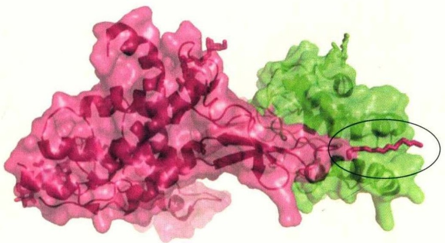

natural_image

3D protein structure visualization with pink and green regions, highlighting a highlighted secondary structure (no text or labels)

图12-1 非洲爪蟾Wnt8蛋白和其受体Frizzled 8的CRD结构域的复合物晶体结构

Wnt8（品红色）上一个保守Ser残基上的棕榈酸脂质链深入到Frizzled 8的CRD结构域（绿色）一个疏水口袋中（圆圈位置）。

Wnt 蛋白的首要膜上受体是 Frizzled (FZD) 家族蛋白。1996 年，FZD 作为 Wnt 受体首次被发现。目前，已发现有 10 种参与 Wnt 信号通路的 FZD 受体，即 FZD1 \~ FZD10。FZD 家族受体是七次跨膜蛋白，属于 GPCR (G protein-coupled receptor) 家族中的一个亚家族，FZD 蛋白的 N 端包含一个保守的富含半胱氨酸的区域称为 CRD 结构域 (cysteine-rich domain)，这个结构域负责特异性地结合 Wnt 蛋白 (图 12-1)。2000 年，Wnt 蛋白的共受体 LRP5/6 (low density lipoprotein receptor-related protein 5/6) 被发现。LRP 受体是单次跨膜蛋白，在哺乳动物的基因组里包括 12 个 LRP 基因，目前的研究表明 LRP5 和 LRP6 是参与经典 Wnt 信号通路的主要成员。除了 FZD 和 LRP5/6，Wnt 蛋白还存在一些其他受体，包括 ROR (receptor tyrosine kinase-like orphan receptor)、RYK (receptor-like tyrosine kinase) 和 PTK-7 (protein tyrosine kinase-7)。Wnt 蛋白所开启的信号通路不仅取决于 Wnt 蛋白的种类，也与它结合受体的种类和方式相关。例如，Wnt5a 与 FZD4/LRP5/6 结合激活 Wnt/β-catenin 信号通路，而 Wnt5a 与 ROR2 的结合则抑制 Wnt 信号通路。

## 12.1 经典 Wnt 信号通路

经典Wnt信号通路即Wnt/β-catenin通路，是目前研究最为广泛和深入的Wnt信号通路。目前有多个经典Wnt信号通路的机制模型，最为经典的模型如图12-2所示。在没有Wnt信号刺激的条件下，细胞内由轴蛋白Axin和APC（adenomatous polyposis coli gene product）作为骨架蛋白介导蛋白激酶GSK3β和CK1（casein kinase 1）、E3泛素连接酶β-TrCP以及β-catenin组成一个复合物，称作“β-catenin降解复合物”（以下简称降解复合物）。在降解复合物中，β-catenin被CK1和GSK3β两个激酶先后磷酸化，继而被β-TrCP识别，随后被泛素化修饰并被蛋白酶体降解，从而维持细胞质内游离β-catenin处在一个较低的水平。而当Wnt蛋白和膜上受体FZD及共受体LRP5/6结合后，Dishevelled（Dvl）蛋白被激活，导致Axin与LRP5/6受体结合，并通过GSK3β对LRP5/6的磷酸化而进一步激活LRP5/6受体，使信号得以传递和放大，其结果是β-catenin降解复合物解聚，使β-catenin逃

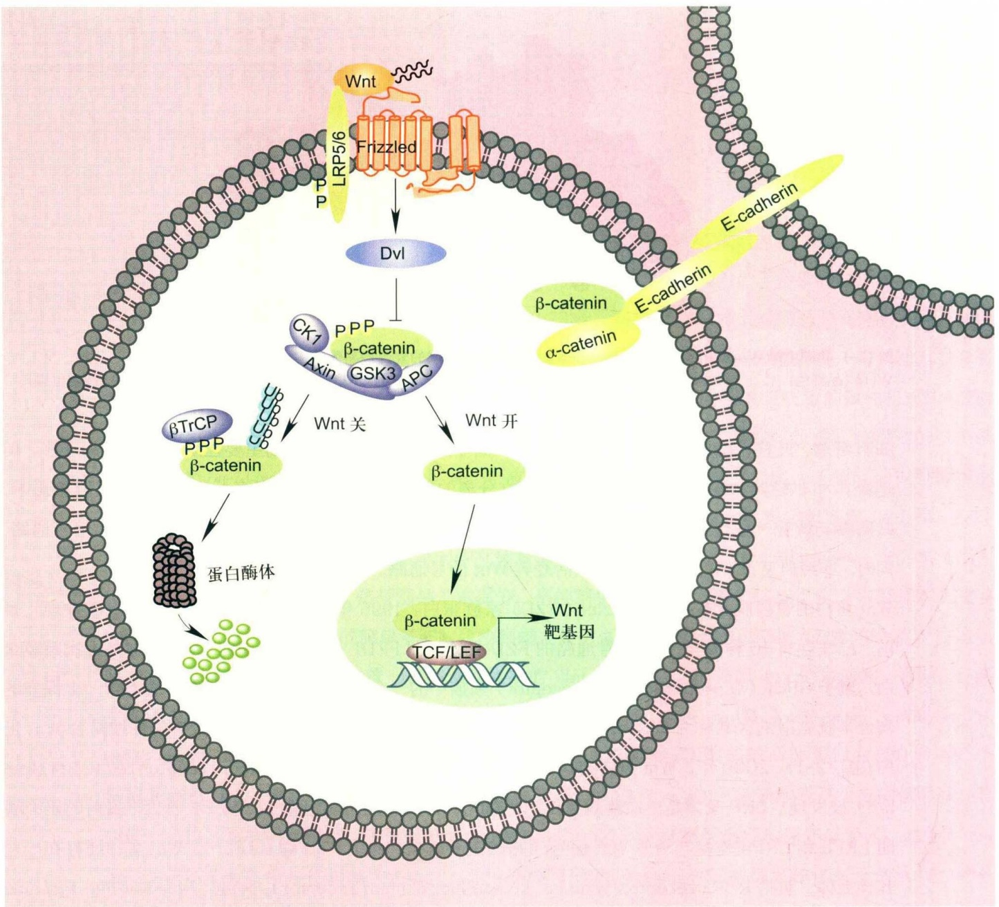

flowchart

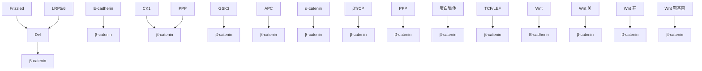

图12-2 经典Wnt信号通路模式图

在没有Wnt信号刺激下，Axin、APC、GSK3β、CK1以及β-catenin组成“β-catenin降解复合物”。在这个复合物中β-catenin被CK1和GSK3β两个激酶先后磷酸化，磷酸化形式的β-catenin被β-TrCP识别，随后被泛素化修饰并被蛋白酶体降解。而Wnt信号开启后，Dvl蛋白被激活，导致β-catenin降解复合物解聚或其活性被抑制，β-catenin不再被降解，并在细胞内不断累积，最终进入到细胞核中，与转录因子TCF/LEF1结合，开启了下游Wnt靶基因的表达。

脱被降解的命运。β-catenin在细胞内不断累积后最终进入到细胞核中，与转录因子TCF/LEF1结合并激活转录复合物，从而开启下游Wnt靶基因的表达。除了这个经典的生化模型，还有其他一些模型:① Wnt信号开启后，细胞内形成多泡小体，由于降解复合物被困在双层的小泡结构中，从而不能磷酸化β-catenin；② Wnt信号开启后，磷酸化的β-catenin结合降解复合物，降解复合物以非活性状态存在细胞膜附近，从而新合成的β-catenin不断在细胞内积累，进入到核中，激活TCF/LEF1转录复合物。上述模型提出了不同的β-catenin在细胞内积累的机制，不同点在于 $\beta$ -catenin降解复合物在Wnt信号刺激下是发生解聚还是受到抑制，以及受到抑制的机制是什么，但其一致的是Wnt信号通过调控 $\beta$ -catenin降解复合物从而进一步向下游传递信号。

## 12.1.1 Wnt信号在膜上的传递

自然界天然存在一些Wnt蛋白的拮抗剂和激活剂，来调控Wnt蛋白与膜上受体FZD及LRP5/6的结合。已经发现的拮抗剂包括WIF（Wnt inhibitory factor）、Dkk（Dickkopf）、Cerberus、sFRP（secreted frizzledrelated protein）、硬骨素（sclerostin）及其相似蛋白Wise、IGFBP-4（insulin-like growth factor binding proteins-4）和APCDD-1（adenomatosis polyposis coli down-regulated-1）等。目前主要发现了Norrin和R-spondin两种家族成员为Wnt的激活剂。这些分泌蛋白质通过不同的机制来调节Wnt蛋白与膜上受体FZD及LRP5/6的结合，从而影响Wnt信号向下游的传递。例如Dkk1蛋白可以结合受体LRP6，从而阻止了Wnt蛋白与LRP6受体的结合，抑制了Wnt信号通路。有报道表明Dkk1结合LRP6还能引起LRP6受体的内吞和降解，从而抑制Wnt信号通路。另一方面，激活剂R-spondin则可以阻止LRP5/6内吞，从而促进经典Wnt信号通路的激活。还有研究表明它通过结合膜上受体LGR4和LGR5（leucine-rich repeat containing G-protein coupled receptors 4 and 5），抑制E3泛素连接酶RNF43/ZNRF3的活性，从而阻止FZD受体的泛素化和降解，促进Wnt信号向下游传递。R-spondin/LGR调控体系只存在于脊椎动物中。

Wnt与膜上受体FZD及共受体LRP5/6结合后，LRP5/6受体发生磷酸化，转变为活化形式，磷酸化后的LRP5/6受体能有效地开启Wnt信号向下游的传递。综合近几年的发现，目前关于LRP5/6磷酸化及活化机制主要有3种模型:① Wnt结合LRP5/6和FZD受体，招募Axin、GSK3β及CK1α等分子上膜对LRP5/6进行初始磷酸化，磷酸化的LRP5/6为Axin提供了结合位点，从而招募更多Axin到LRP5/6受体上，而Axin结合的GSK3β则进一步促进了LRP5/6的磷酸化，如此使信号得到放大；② 在Wnt信号刺激下，支架蛋白Dvl通过自身DIX结构域的寡聚介导了Wnt-LRP5/6-FZD的聚集，聚集的配体/受体复合物招募Axin上膜，并与GSK3β、CK1等形成一个信号转导体，即“LRP5/6信号体”（LRP5/6 signalosome），进而受体得到活化，信号放大并传递；③ 最新的一项发现是Wnt信号刺激诱导Dvl和磷脂酰肌醇激酶家族的PI4KIIα和PIP5KIβ形成一个复合物，高效合成磷脂酰肌醇二磷酸[PI(4,5)P₂，简称为PIP₂]，从而提升了细胞膜附近PIP₂的水平。而PIP₂可以显著促进Axin上膜，进而促进LRP5/6的磷酸化和Wnt信号向下游的传递。这三种机制可能并不矛盾，可以相互补充，Wnt信号在膜上的传递机制有待进一步的研究和完善。

## 12.1.2 Wnt信号在细胞质内的传递

Wnt与膜上受体FZD及共受体LRP5/6结合后，Dvl被激活， $\beta$ -catenin降解复合物活性被抑制， $\beta$ -catenin在胞内积累并进入到细胞核中，开启下游基因的转录。以下对Wnt信号在细胞质内传递过程中的关键蛋白质Dvl，以及降解复合物中的4个核心成员简单做以介绍。

Dvl是Wnt信号在细胞质内传递的关键分子，不仅在经典Wnt信号通路的信号转导中发挥必不可少的作用，在非经典Wnt信号通路中同样扮演着重要角色。Dvl家族包含Dvl1、Dvl2和Dvl3三个成员。Dvl蛋白由3个保守的结构域组成，分别是DIX结构域、PDZ结构域和DEP结构域（图12-3）。Dvl的DIX结构域与位于Axin C端的DIX结构域相互作用，被认为是激活Wnt信号通路至关重要的一步。同时，Dvl通过其PDZ结构域结合FZD，促进FZD/LRP6信号体的形成。Dvl的活性受到多种翻译后修饰的影响，如磷酸化、泛素化等修饰，这些修饰参与对Dvl活性的调控。最近，有报道表明Dvl的C端与PDZ结构域相互作用，形成自抑制构象，Dvl通过构象变化来调控其活性。虽然，对Dvl发挥功能的机制有一些假说，然而Dvl在接收Wnt信号之后，是如何被激活、又是如何抑制β-catenin降解复合物活性等尚不清楚，这些问题也是国际上Wnt信号研究领域的热点和难点之一。虽然Dvl主要是作为Wnt信号通路细胞质内的一个重要信号分子广为人知，但近年来的研究也揭示了Dvl在细胞核中也发挥着重要功能。

Axin是经典Wnt信号通路中一个至关重要的信号分子，它包含两个结构域，位于N端的RGS（regulation of G-protein signaling）结构域和位于C端的DIX结构域（图12-3）。人源的Axin包含800余个氨基酸残基，它与Wnt通路的主要成员LRP5/6、Dvl、APC、GSK3β和β-catenin等都能直接相互作用。Axin在介导降解复合物的形成、维持Wnt信号静息下的信号通路抑制状态中发挥重要功能。在没有Wnt信号刺激的条件下，Axin作为骨架蛋白参与组装降解复合物，促进β-catenin的降解，而当Wnt信号分子结合细胞膜上受体时，Axin发生转移，与LRP5/6受体结合并介导“LRP5/6信号体”的形成，促进LRP5/6的活化和Wnt信号向下游的传递。由于Axin在细胞中的含量极低，因此在上述两种功能不同的复合物的形成过程中被认为是限速因素。由此可见，Axin在Wnt信号的传递过程中发挥着双重作用，它像一把双刃剑，在Wnt信号刺激前后发挥截然相反的功能。Axin蛋白有两个成员Axin1和Axin2，Axin1持续低水平表达，而Axin2则是Wnt信号通路的靶基因，通过负反馈机制调控Wnt信号通路的活性。

APC是一个超大的蛋白质，包含约2800个氨基酸残基。人源APC包含两个成员APC1和APC2。APC的序列中包含3个Axin结合序列（SAMP重复），在这3个Axin结合序列之间，以及其他区域分布着15～20个氨基酸残基组成的β-catenin结合区间（图12-3）。APC序列的大多数区域预测处于无序结构。细胞质中的APC通过提高降解复合物的稳定性促进β-catenin的降解。此外，有报道APC在细胞核中也发挥抑制Wnt信号通路的功能，它通过促进β-catenin出核抑制Wnt信号在核内的传递，还可以通过介导转录抑制子CtBP与β-catenin的相互作用，从而抑制β-catenin/TCF的转录活性。值得一提的是，APC的突变是结肠癌中一个主要的致癌机制，携带APC功能缺失的基因，到40岁时患结肠癌的概率几乎达到了100%，而超过80%的结肠癌患者中发现了APC突变。

GSK3属于丝氨酸/苏氨酸蛋白激酶家族，是目前已知Wnt信号通路中功能最重要的激酶之一。人源中包含两个同源的GSK3基因——GSK3α和GSK3β，它们在Wnt信号通路中表现出功能冗余。人源的GSK3β由

420个氨基酸残基组成，其中第56～340位为激酶结构域，负责结合并催化底物（图12-3）。GSK3对底物的磷酸化需要底物先发生一个起始磷酸化，在降解复合物中，这个对β-catenin的起始磷酸化是由CK1介导的。CK1磷酸化后的β-catenin即被GSK3β识别并进一步磷酸化，促进β-catenin被泛素化并降解，因此GSK3β是Wnt信号通路的负调控因子。除在降解复合物中发挥功能外，当Wnt信号存在时，GSK3β通过结合Axin被一起招募到LRP5/6上，对LRP5/6的胞内区进行磷酸化，从而促进信号向下游的传递。除了Wnt通路相关的功能，GSK3β还执行很多其他功能，如参与胰岛素信号通路以及Hedgehog信号通路等。

β-catenin是经典Wnt信号通路的核心蛋白分子，它包含3个主要结构域（图12-3）。β-catenin作为经典Wnt信号通路的中枢分子，它的活性异常将直接导致细胞增殖等细胞命运的改变，因此β-catenin的活性受到严格调控。细胞对β-catenin活性的调控主要表现在3个层次:亚细胞定位、蛋白质水平的稳定性以及转录活性。细胞内有存在两种不同功能的β-catenin:一种在细胞膜上，与钙黏着蛋白E-cadherin结合，负责调控细胞与细胞之间的黏附；另一种在细胞质和细胞核中，决定Wnt信号通路的活性（图12-2）。β-catenin通过在细胞膜上、细胞质和细胞核中的不同定位，发挥不同的功能，从而影响细胞的命运。研究表明β-catenin N端结构域对于其出入细胞核以及转录发挥重要作用。而中间的ARM（armadillo重复）结构域由12个armadillo结构组成，每一个armadillo结构包含约40个氨基酸残基，含有3个α螺旋。ARM结构域主要负责β-catenin与其他细胞膜上、细胞质和细胞核中蛋白质的相互作用。有观点认为这些β-catenin结合蛋白不能同时与β-catenin的ARM结构域结合，而是通过竞争结合从而调控β-catenin执行不同的功能。也有报道认为β-catenin的两个末端与ARM结构域相互作用，通过构象变化调控β-catenin与其他蛋白的相互作用。β-catenin的稳定性主要受降解复合物调控。在降解复合物中，β-catenin N端的第45位丝氨酸被CKI磷酸化，而第33、37位丝氨酸和第41位苏氨酸被GSK3β磷酸化，被CKI和GSK3β先后磷酸化的β-catenin被E3泛素连接酶β-TrCP识别和泛素化，最终被蛋白酶体降解。Wnt信号激活后，β-catenin进入到细胞核中，其转录功能同样受到严格的调控，多种蛋白质以及转录后修饰参与调控β-catenin和转录因子TCF/LEF1的结合。

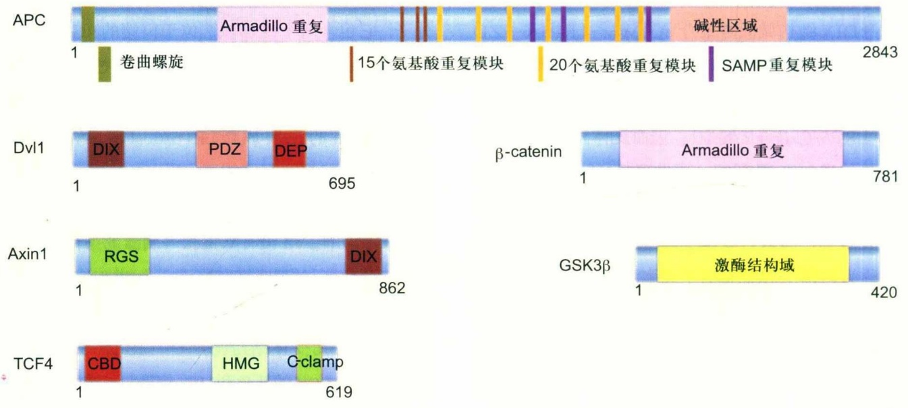

bar_stacked

| Protein | Domain/Feature | Residue |
| :--- | :--- | :--- |
| APC | Armadillo 重复 | N/A |
| APC | 碱性区域 | N/A |
| APC | SAMP重复模块 | N/A |
| APC | 卷曲螺旋 | N/A |
| APC | 15个氨基酸重复模块 | N/A |
| APC | 20个氨基酸重复模块 | N/A |
| APC | SAMP重复模块 | N/A |
| Dvl1 | Armadillo 重复 | N/A |
| Dvl1 | DIX | N/A |
| Dvl1 | PDZ | N/A |
| Dvl1 | DEP | N/A |
| Dvl1 | \(\beta-\)catenin | N/A |
| Dvl1 | N/A | 695 |
| Axin1 | Armadillo 重复 | N/A |
| Axin1 | RGS | N/A |
| Axin1 | DIX | N/A |
| Axin1 | GSK3β | N/A |
| Axin1 | 激酶结构域 | N/A |
| Axin1 | N/A | 862 |
| TCF4 | CBD | N/A |
| TCF4 | HMG | N/A |
| TCF4 | C-clamp | N/A |
| TCF4 | N/A | 619 |

图12-3 Dvl、$\beta$-catenin、Axin1、APC、GSK3$\beta$和TCF4的结构域组成示意图

## 12.1.3 细胞核中TCF/LEF1转录复合物

TCF/LEF1家族转录因子是介导经典Wnt信号通路功能最主要的转录因子。TCF/LEF1家族成员通过HMG(high mobility group)结构域识别并结合DNA。目前发现的TCF/LEF1家族有4个成员:TCF1、TCF3、TCF4和LEF1。研究表明TCF1、TCF4和LEF1倾向于转录激活，而TCF3倾向于转录抑制。但这不是绝对的，在某些情况下，TCF/LEF1家族转录因子的转录活性会发生改变。其中，TCF1和LEF1还是经典Wnt信号通路的靶基因，通过正反馈机制促进信号传递。人源的TCF4包含N端负责结合β-catenin的CBD结构域(catenin binding domain)、负责结合DNA的HMG结构域，以及这两个结构域之间的CRD结构域(context-depedent regulatory domain)。TCF/LEF1成员的各种剪切变体大多发生在CRD结构域。此外，还包含有一个位于C端的C-Clamp结构域，这个结构域也参与DNA的识别和组装(图12-3)。TCF/LEF1家族转录因子具有双向调节功能，在没有Wnt信号时，通过与转录抑制子如Groucho蛋白结合，招募组蛋白去乙酰化酶HDAC，对靶基因区域的组蛋白进行去乙酰化，从而抑制下游靶基因的表达。而Wnt信号被激活后，β-catenin入核取代Groucho与TCF/LEF1结合，同时招募转录激活子，如Brg1、CBP/ p300、BCL9和Pygopus等，促使TCF/LEF1从转录抑制转变为转录激活状态（图12-4）。转录激活子可以通过不同的机制促进β-catenin/TCF转录复合物的活性。例如，p300介导β-catenin的乙酰化，促进β-catenin/TCF4相互作用。而BCL9通过与β-catenin相互作用，或介导β-catenin与Pygopus的相互作用，促进β-catenin/TCF的转录活性，参与大多数β-catenin调控的基因转录。脊椎动物至果蝇中的TCF结合的DNA序列非常保守，这个序列被称为TBE（TCF binding element），而在Wnt信号通路研究中被广泛使用的TOPflash荧光报告基因系统，则是串联了多个TBE，用来监测Wnt信号的激活强度。Wnt的靶基因包含很多和细胞增殖、凋亡及细胞分化相关的基因，目前已报道的Wnt靶基因超过500个，其中一些代表性靶基因见Nusse创立的网站“Wnt homepage”(https://web.stanford.edu/group/nusselab/cgi-bin/wnt/target\_genes)。

β-catenin/TCF转录复合物可以通过招募不同的转录激活因子和抑制因子来实现组织或细胞特异性的基因的表达。大多数Wnt靶基因是组织或发育阶段特异性表达的。在不同的组织、细胞以及不同的发育阶段，TCF/LEF1成员扮演不同的角色，并通过不同的机制使Wnt靶基因表达受到严格和复杂的调控，从而使Wnt靶基因得以特异性、有节制地转录，维持细胞的正常功能，避免Wnt信号激活不足或过度而产生疾病。

## 12.2 非经典 Wnt 信号通路

非经典Wnt信号通路是相对于经典Wnt信号通路而言，经典Wnt信号通路依赖于 $\beta$ -catenin进行信号转导，而非经典Wnt信号通路则不依赖于 $\beta$ -catenin进行信号转导。后者主要包括 $Wnt/Ca^{2+}$ 信号通路和Wnt/PCP信号通路，也有其他一些分支被报道。

## 12.2.1 $\mathrm{Wnt / Ca^{2 + }}$ 信号通路

人们最早在斑马鱼和非洲爪蟾中发现Wnt蛋白通过调节细胞内 $Ca^{2+}$ 的水平调控胚胎发育。在较长一段时间里，关于细胞内源 $Ca^{2+}$ 释放的增加是否受Wnt调控一直备受争议，直到研究人员用纯化的Wnt5a在不同的细胞培养体系中刺激细胞均检测到细胞内源 $Ca^{2+}$ 的增加，人

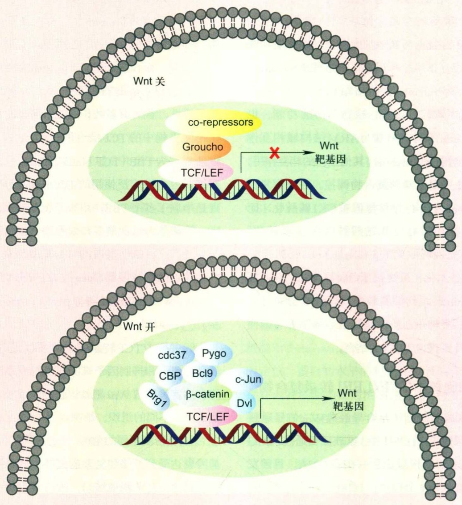

flowchart

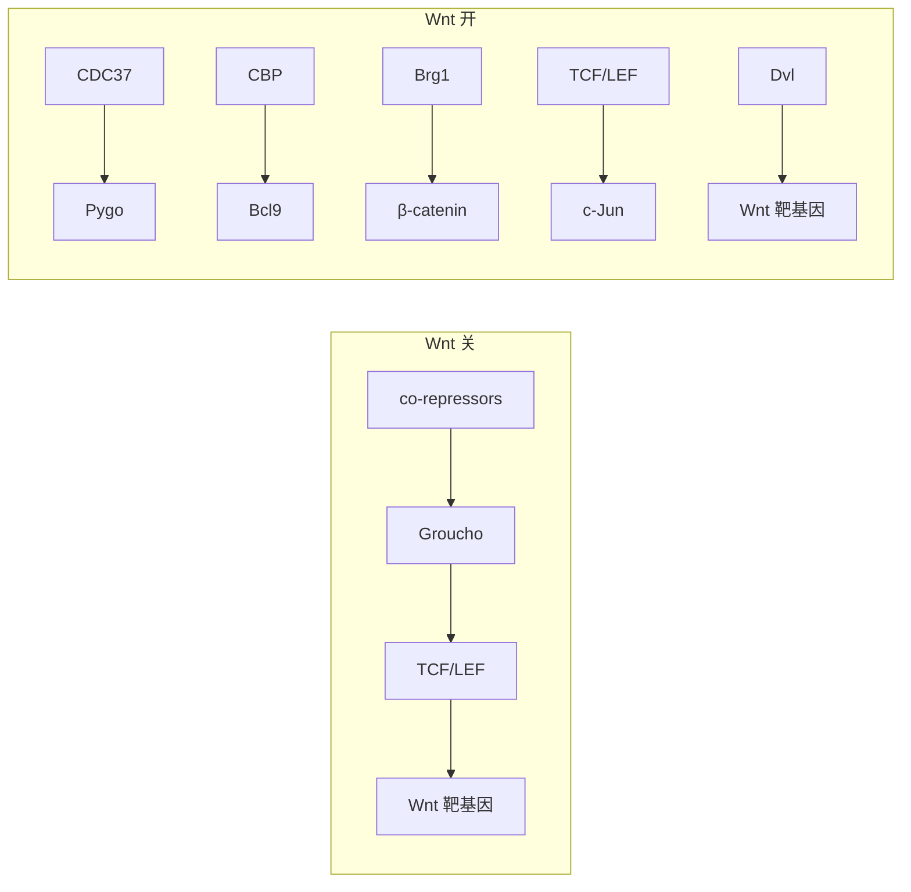

图12-4 具有双向调节功能的 TCF/LEF1 转录因子

在没有Wnt信号时，TCF/LEF1通过和Groucho等转录抑制子结合，抑制下游靶基因的表达。而Wnt信号被激活后，$\beta$-catenin入核取代Groucho等转录抑制子，同时招募转录激活子，如Brg1、CBP、BCL9和Pygopus等，使TCF/LEF1从转录抑制转变为转录激活状态。

们才更加确信了 $Wnt/Ca^{2+}$ 信号通路的存在。经过长期研究， $Wnt/Ca^{2+}$ 信号通路的传递过程如下:Wnt蛋白与细胞膜上的受体FZD结合启动信号传递，后者通过结合Dvl和小G蛋白进而激活磷脂酶C（PLC），激活的PLC诱发储存在内质网中的 $Ca^{2+}$ 大量释放到细胞质中，迅速升起的钙流激活了下游信号蛋白PKC、钙依赖磷酸酶和CaMKⅡ，这3个蛋白分别通过介导转录因子CREB、NFAT和NF-κB的激活促进靶基因的表达（图12-5）。 $Wnt/Ca^{2+}$ 通路参与多种生物功能的调控，如在原肠胚形成过程中调控细胞的黏性和迁移、参与心脏的发育等。

## 12.2.2 Wnt/PCP信号通路

Wnt/PCP信号通路最早在果蝇中被发现。经过研究，人们发现该信号通路是多种组织器官建立上皮细胞和间叶细胞极性所必需的。Wnt/PCP信号通路通过调控细胞骨架控制细胞的迁移和极性，如内耳毛细胞极性的调控。当Wnt/PCP信号通路被激活时，Wnt蛋白（如Wnt5a）与细胞膜上的受体FZD结合，同时常伴随共受体ROR、RYK和PTK的结合，之后受Wnt刺激的FZD受体结合Dvl，Dvl再通过与Rac1和DAAM1结合分别将信号传递给JNK和Rho（图12-5）。JNK的激活促进了c-Jun的转录激活，进而诱发促进细胞极性和迁移的靶基因的表达，从而调控细胞极性的建立。与之相应的，被DAAM1激活的Rho激活ROCK，后者通过调节细胞骨架的重排调节细胞极性。

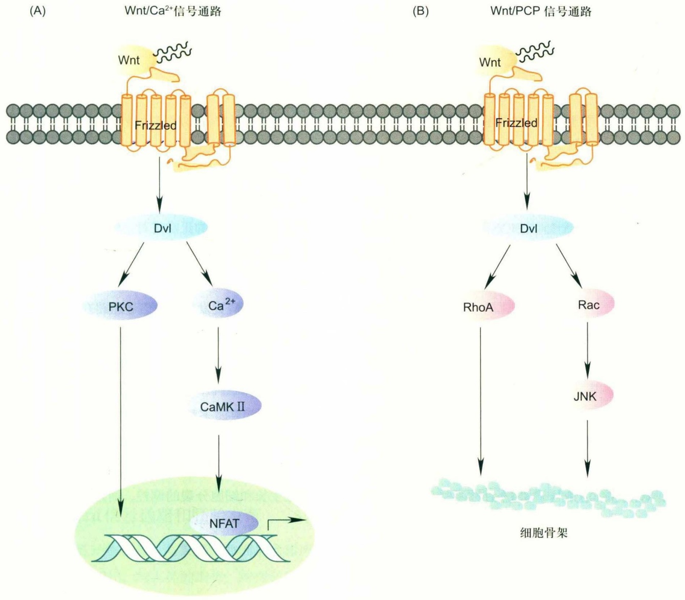

flowchart

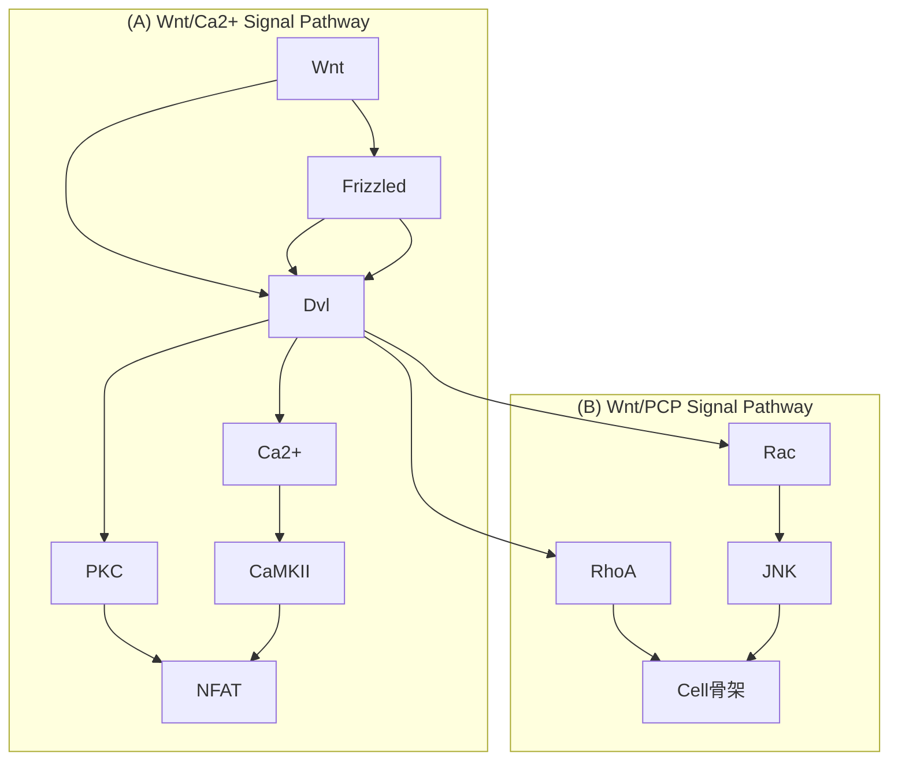

图12-5 非经典Wnt信号通路示意图

(A) $\mathrm{Wnt} / \mathrm{Ca}^{2+}$ 信号通路:Wnt蛋白和细胞膜上的受体FZD结合，激活Dvl，诱发储存在内质网中的 $\mathrm{Ca}^{2+}$ 大量释放到细胞质中，迅速升起的钙流激活了PKC、CaMKⅡ等，通过介导转录因子NFAT等激活促进靶基因的表达；(B) Wnt/PCP信号通路:Wnt蛋白和细胞膜上的受体FZD结合，激活Dvl，接着Dvl通过Rac等将信号向下游传递。

## 12.2.3 其他非经典Wnt信号通路

近年来，随着研究的深入，人们发现除了 $Wnt/Ca^{2+}$ 和Wnt/PCP之外的受Wnt调控而不依赖于β-catenin的新的信号通路。目前已发现两条这样的信号通路，分别是Wnt/TOR信号通路和Wnt/STOP信号通路。这两条信号通路均依赖于Wnt蛋白与细胞膜上的共受体FZD和LRP5/6的结合。与经典Wnt信号不同的是，这两条信号通路在后续的信号转导中不需要β-catenin的传递。人们根据激活的Wnt信号是否受小分子雷帕霉素的抑制，分别将这两条新发现的信号通路命名为受雷帕霉素抑制的Wnt/TOR信号通路，以及不受雷帕霉素抑制的Wnt/

STOP信号通路。

正常情况下，细胞需要协调细胞周期的进程和细胞生长，从而在细胞传代过程中维持细胞形态大小的基本恒定。为了达到这个目的，细胞通过Wnt信号通路共调节同化作用/异化作用和细胞周期的效应因子来维持细胞生长。GSK3β是调节细胞异化作用的关键因子，其参与细胞多种生命活动的调节，如抑制细胞对葡萄糖的吸收进而抑制细胞生长，减弱TOR对蛋白质翻译过程的调节，降低关键的细胞周期效应因子的稳定性。因而，通过抑制GSK3β的活性，Wnt信号通路不仅影响细胞生长，而且调控细胞周期的进程。此处所指的Wnt信号通路主要包括Wnt/TOR信号通路和Wnt/STOP信号通路，前者通过抑制GSK3β的活性促进细胞内相关蛋白的翻译，后者通过抑制GSK3β的活性抑制细胞内相关蛋白的降解，从而维持细胞内蛋白质含量在一个相对较高的水平，有利于细胞分裂的顺利进行。

Wnt/TOR信号通路在没有Wnt信号的刺激时，被AMPK磷酸化的TSC2接着被GSK3磷酸化并激活，激活的TSC2结合TORC1并抑制其活性，进而抑制了细胞内相关蛋白质的翻译。当Wnt蛋白与细胞膜上的受体结合，抑制了GSK3β的活性，TSC2不能被GSK3β磷酸化而失去结合TORC1的能力，TORC1活性恢复促进了细胞内相关蛋白质的翻译（图12-6）。以上过程多发生在细胞分裂的 $G_{1}$ 期，帮助细胞完成正常的蛋白质储备，为接下来的细胞分裂做好准备。另外，Wnt依赖的TOR激活也增加了cyclin D1的mRNA翻译，进而在促进细胞生长的同时，也使得细胞顺利通过 $G_{1}$ 期并进入后续的细胞分裂。

Wnt/STOP信号通路与Wnt/TOR信号通路类似，主要功能是维持细胞内蛋白质的含量，且该信号通路活性的强弱与GSK3密切相关。与Wnt/TOR信号通路不同的是，Wnt/STOP信号通路的活性不受雷帕霉素的抑制，且其主要通过抑制蛋白质降解而不是促进蛋白质合成起作用。具体地，在没有Wnt蛋白的刺激时，细胞内GSK3β磷酸化细胞内多种蛋白质并进入蛋白酶体降解，从而使得细胞内的蛋白质含量维持在较低的水平。当有Wnt信号刺激时，细胞内近70%的GSK3β因和Wnt/FZD/LRP等蛋白质形成信号转导体被由细胞膜包被形成的多泡小体隔离而无法发挥磷酸激酶的活性，使得相关蛋白质稳定性增加而不被降解（图12-6）。Wnt/STOP信号通路在细胞分裂过程中通过增加相关蛋白质的稳定性促进了细胞分裂的正常进行。研究发现，在细胞准备分裂时，近15%的细胞内源蛋白质因Wnt/STOP信号通路得以稳定。除此以外，Wnt/STOP信号通路还可以调节细胞大小。研究发现，该信号通路在细胞分裂 $G_{1}$ 期促使细胞体积增大到静息状态的125%，且此过程不依赖于β-catenin和TOR的激活。Wnt/STOP信号通路的靶蛋白还参与细胞多种生命活动的进行，如细胞周期的进程、内溶酶体的产生、多种信号通路的交互作用、DNA重塑和细胞骨架的形成等。

Wnt/TOR信号通路和Wnt/STOP信号通路不仅参与细胞生长和细胞分裂的调控，而且在生殖细胞的发生和神经系统功能的维持中也起到重要作用。研究发现，在成熟的非洲爪蟾卵母细胞中Wnt/STOP信号通路是胚性细胞第1次分裂必需的，Wnt/TOR信号通路和Wnt/STOP信号通路也是转录沉默的精子成熟所必需的。

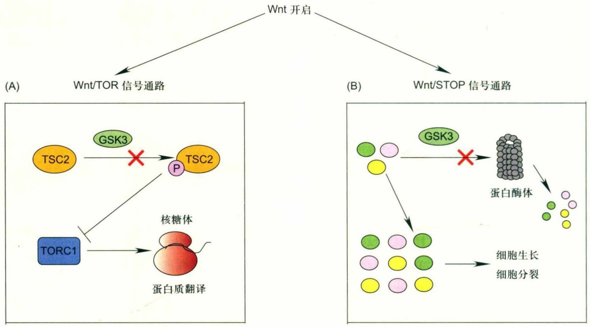

flowchart

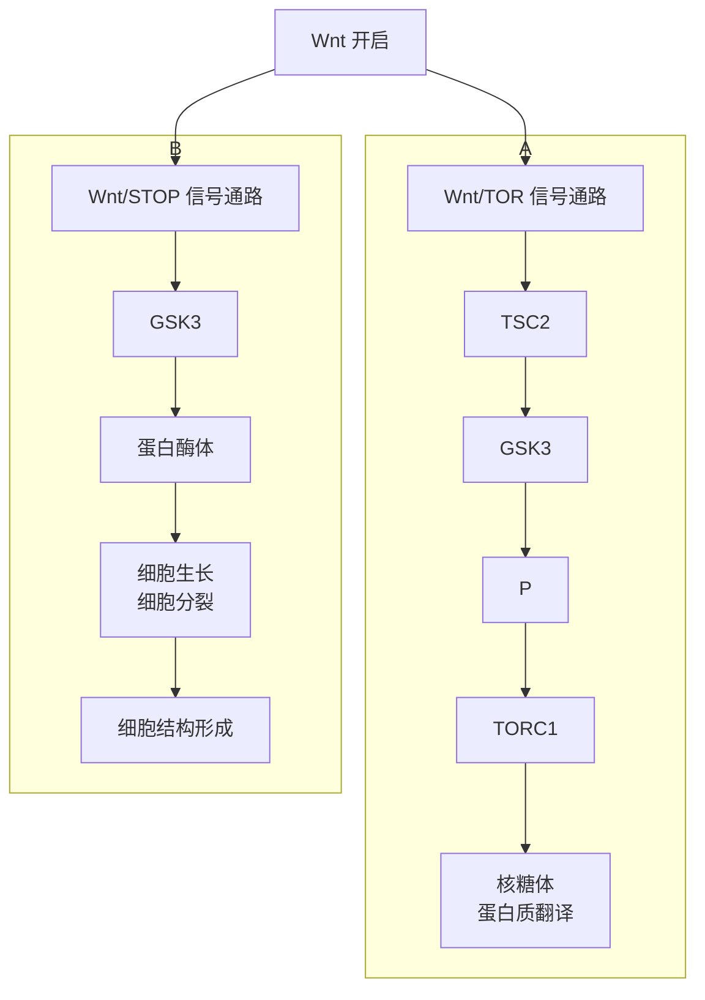

图12-6 Wnt/TOR与Wnt/STOP信号通路示意图

(A) Wnt/TOR信号通路: Wnt信号开启后抑制了GSK3的活性, TSC2不能被GSK3磷酸化, 从而失去结合TORC1的能力, TORC1活性恢复促进了细胞内相关蛋白的翻译; (B) Wnt/STOP信号通路: 当Wnt信号开启后, 细胞内多数的GSK3因与Wnt/FZD/LRP等形成信号转导体, 被由细胞膜包被形成的多泡小体隔离而无法发挥磷酸激酶的活性, 使得细胞内大量相关蛋白质的稳定性增加。

## 12.3 Wnt 信号通路的生理功能

基于包括果蝇、斑马鱼、小鼠等在内的多种动物模型的研究表明，Wnt传递生长和发育信号，控制胚胎分化、胚胎轴向的确立，并维持成体组织平衡。胚胎发育期Wnt信号通路的失调会导致胚胎死亡或多种发育缺陷，在成体中则会导致多种疾病的发生。Wnt蛋白在胚胎发育的早期即开始广泛表达，在脊髓、乳腺、皮肤、肺、大脑、骨骼、眼睛、软骨、胰腺、肝、牙齿、肾、造血及生殖系统等多种器官和组织的发育中发挥重要作用。此外，Wnt信号在胚胎干细胞以及多种成体干细胞的自我更新和维持中也扮演重要角色，它在皮肤和头发的再生、肺和肝损伤后的修复等生理过程中都发挥着至关重要的作用。

## 12.3.1 Wnt信号通路和胚胎发育

小鼠作为哺乳动物模型，与果蝇、非洲爪蟾和斑马鱼等低等模式生物相比，与人类的遗传、结构和生理特征最为接近，都具有19个Wnt基因和10个FZD基因。基于小鼠的研究表明Wnt在胚胎发育早期即开始表达。小鼠的受精卵在胎期第3.5天形成囊胚，它由内细胞团和滋养外胚层两种细胞类型组成，滋养外胚层用于产生胚胎外组织，而内细胞团则分化为内、中、外3个胚层，它是各器官和组织的原基。一些Wnt基因在胚胎植入前即在囊胚的两种细胞类型中被发现有短暂的表达。有研究表明子宫上皮Wnt通路的激活可能在胚胎植入过程中发挥作用，然而目前Wnt在胚胎植入前发挥的功能还不是很清楚。在胚胎植入后，从前后轴的确立和原肠胚的形成开始，Wnt则无疑开始发挥重要功能。外胚层尾侧正中线上形成一条增厚区，称为原条。伴随原条的出现，胚盘即可区分出头尾端和左右侧，标志着原肠胚形成的开始。Wnt2b、Wnt3a、Wnt8a的表达谱分析及Wnt报告基因活性的分布结果表明，经典Wnt信号通路从胚胎期第6天开始，也就是在原肠胚形成的初期，在原条的形成中即已经激活。在原肠胚末期，内、外两个胚层之间逐渐分化发育出中胚层。各胚层细胞不断分裂变化，进而形成各种各样的组织和器官，最终完成胚体的整体结构。从原肠胚形成开始到接下来这些复杂又紧密相连的发育过程中，Wnt信号在很多方面都起到了重要作用。例如，敲除wnt3a的小鼠将不能形成中胚层，而携带组成性激活形式β-catenin的小鼠则发生内胚层发育缺陷。在前后体轴的确立中，携带组成性激活β-catenin的小鼠不能形成前后轴，而携带Axin功能缺失的小鼠，其前后轴发生前端截断并且双体轴的表型。Wnt信号在左右轴的确立中也发挥必不可少的功能，小鼠中敲除Wnt3a将导致多个器官表现出单侧性缺陷。

Wnt信号在调控胚胎发育时表现出时空性特点，即不同时间、空间呈现出不同活性。例如，Wnt信号在原条和后体发育模式（posterior patterning）中发挥必不可少的功能，原条和它的衍生物尾芽产生中胚层，Wnt3a在胚胎期第7.5天时开始在原条中表达，敲除Wnt3a将不能形成后中胚层，而尾芽则发育成异位神经组织。然而，在胚胎前区的发育中却需要暂时关闭Wnt信号以促进前后轴的确立。在原肠胚发育阶段，前外胚层Wnt的表达开始下降，同时Wnt通路抑制剂DKK1和sFRP则开始表达，进一步抑制Wnt通路的激活，促进胚胎前体的发育。敲除DKK1的小鼠，Wnt活性扩大到前体，发生头部截短等缺陷。此外，Wnt信号调控胚胎发育还呈现出特异性，即不同时空、不同的Wnt蛋白呈现出特异性的表达。例如在胚胎期第9.5～12.5天时，Wnt7b在端脑及脊髓中表达，而Wnt3a从端脑一直到脊髓的神经管背方均有表达，Wnt1则在间脑、中脑交界区域及脊髓上特异表达。

除了经典Wnt信号通路在胚胎发育中发挥重要功能，非经典Wnt通路对于胚胎发育也发挥着必不可少的功能。目前基于小鼠模型的研究主要针对非经典Wnt信号通路中的Wnt/PCP通路。Wnt/PCP通路在胚胎植入后确立、维护外胚层顶底极性和促进原肠胚的形成等发育早期事件中即开始发挥功能。在果蝇、非洲爪蟾以及斑马鱼中，都发现了Wnt/PCP通路在会聚延伸（convergent extension，CE）中发挥必不可少的功能。CE是形态形成过程中，组织从前向后地延长，伴随内侧横向变窄，它在神经管的闭合中发挥重要功能。在Wnt/PCP通路蛋白突变的小鼠中，最早发现也是最典型的形态发生缺陷为一种独特的神经管闭合缺陷，称为脊椎柱裂，表现为患者从中脑到尾部整个神经管没有闭合。Wnt/PCP通路的核心成员（如Celsr1、FZD3/6、Dvl1/2/3和Vangl1/2等）的突变都能引发该缺陷。在斑马鱼中，Wnt/PCP通路被发现促进定向细胞迁移与定向细胞分裂。在小鼠中，遗传研究揭示Wnt/PCP在协调细胞极性与组织形态发生中扮演重要角色。此外，Wnt/PCP通路成员的一个重要特征是膜上的不对称分布，这一特征最初在果蝇中发现，这种不对称分布被认为是Wnt/PCP通路蛋白在上皮细胞传递极性信息的一种机制。在小鼠中，这种不对称分布在确立静纤毛方向中发挥功能。FZD6突变的小鼠体毛分布缺陷和果蝇中frizzled突变导致的翼毛缺陷表型十分相似。小鼠中的Wnt/PCP通路功能异常还将导致多种器官（如耳蜗管、胃和小肠等）形态发生缺陷。除此以外，Wnt5a介导的Wnt/PCP通路还参与调控四肢的形态发生以及骨架的形成。综上所述，对小鼠Wnt/PCP通路的大量研究确立了非经典Wnt信号通路在组织形态发生和细胞极性中的中心调控地位，然而Wnt/PCP介导的形态发生背后的很多细节仍不清楚，有待于更多的研究来帮助人们更完整清楚地理解Wnt/PCP信号通路在调控胚胎发育中的功能机制。

值得一提的是，近年来越来越多的研究结果强调了信号网络在胚胎发育中的重要性，Wnt信号通路和Hippo、BMP、FGF以及Hedgehog等信号通路组成信号网络，Wnt作为这个网络中的一个重要组成，与其他通路的成员相互作用，协同调控发育过程。

## 12.3.2 Wnt信号通路和干细胞

干细胞是一类具有自我更新能力，同时也具备分化能力的细胞。通过对Wnt靶基因特别是Lgr5和Axin2的表达追踪表明Wnt信号是维持干细胞的关键信号之一。在不同的干细胞中，包括小肠、胃、皮肤、毛囊以及乳腺等干细胞中都发现了关键的Wnt靶基因的表达。能产生决定干细胞自我更新还是分化信号的细胞称为巢细胞(niche cell)，非常多的证据表明Wnt信号作为Niche，在决定干细胞的命运中发挥关键作用。巢细胞信号具有近距离传递的特征，而Wnt信号具备短距离、小范围传播的特征，有利于控制紧挨着的相邻干细胞。

胚胎干细胞（embryonic stem cell，ESC）是早期胚胎（原肠胚期之前）或原始性腺中分离出来的一类细胞，它具有多能性，拥有分化为机体几乎所有细胞类型的能力。Wnt/β-catenin信号是ESC维持自我更新所必需的信号。

加入 Wnt3a 或抑制 GSK3β 活性可以促进类似 ESC 的细胞成团。其中一种机制是 Wnt/β-catenin 通过抑制 TCF3 的转录抑制活性，来促进维持自我更新的相关基因的表达。Wnt/β-catenin 通路的激活还能提高体细胞重编程和诱导多能干细胞（iPSC）的形成。只要信号通路维持核心转录因子 Oct4、Sox2 和 Nanog 的表达，干细胞多能性即可持续维持。此外，β-catenin 还可以通过和重编程因子 Klf4、Oct4 和 Sox2 的相互作用，进一步提高维持多能性相关基因的表达。

小肠干细胞是成年哺乳动物更新最快的组织，也是研究Wnt信号通路在成体干细胞中功能机制最常用的模型之一。目前认为，小肠干细胞分布在两处（图12-7）:一处是距离隐窝底部一定距离的+4位置，一处位于隐窝（crypt）的底部的基柱状隐窝细胞（crypt base columnar, CBC）。图12-7中+4位置的干细胞常用的标签蛋白是Bmi1，这个位置的干细胞一般处于静息状态，在损伤情况下被激活，而Wnt通路的天然分泌抑制剂sFRP5a则在+4位置细胞周围表达，参与调控这个区域的干细胞。在另一种肠干细胞CBC细胞中，Wnt靶基因Lgr5持续表达。通过对隐窝细胞进行Lgr5标记，并对Lgr5 $^{+}$ 细胞跟踪分析等研究表明，CBC细胞可以分化成全部小肠上皮细胞类型，因此，CBC细胞是需要Wnt信号维持其增殖的具有多能性的细胞，这类细胞一直被认为是代表了小肠干细胞（图12-7）。多数的隐窝基底层细胞中，Wnt信号通路处于激活状态，表达Wnt靶基因Axin2的基底细胞在体内可以持续一年产生角质细胞。肠隐窝上皮细胞中还发现了一系列Wnt蛋白和受体的表达，显示Wnt信号通路对于小肠的更新发挥关键作用。Wnt信号通路失调将导致小肠隐窝增殖的停滞，最终导致小肠组织的持续丢失，引发疾病。与此一致的是，Wnt的激活剂R-spondin可以有效地促进小肠上皮细胞的增殖。

间充质干细胞（mesenchymal stromal cell，MSC）存在于骨髓、脂肪和胚胎组织中，在体内或体外特定的诱导条件下，可分化为多种组织细胞。经典Wnt信号通路对于决定MSC的命运发挥重要的调控功能。经典Wnt信号通过上调Cbfa1/Runx2和碱性磷酸酶的表达，以及与BMP（bone morphogenetic protein）通路协同作用，诱导MSC向成骨细胞的分化。而在MSC向脂肪组织和心脏组织分化时，Wnt通路则需要被抑制。研究表明抑制Wnt/β-catenin信号通路可以促进基于间充质干细胞的肉芽组织形成与心肌修复。此外，经典Wnt信号通路激活的程度不同可以产生不同的结果，如经典Wnt信号低水平的激活促进MSC的自我更新，而高程度的激活则会促使MCS向成骨细胞的分化。

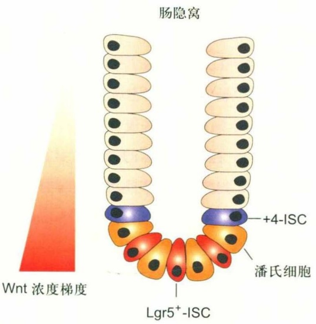

text_image

肠隐窝
Wnt 浓度梯度
+4-ISC
潘氏细胞
Lgr5+-ISC

图12-7 Wnt信号通路对于小肠干细胞的维持至关重要

乳腺是另一个需要维持更新的组织。在孕期和哺乳期，乳腺进行动态的增长；哺乳期结束，乳腺里的腺泡发生退化，从而重新回到孕前的状态。为了探寻这一个再生长的周期是如何实现的，通过体外移植实验和移植细胞追踪等实验研究发现，在成体乳腺上皮中存在干细胞，并且这些干细胞特异地表达Wnt信号通路的靶基因Lgr5和Axin2。在体外给予这群细胞Wnt蛋白刺激时，可以进行扩增。表达Axin2标签的细胞可以自我更新，并且在孕期、哺乳期以及退化期持续维持细胞增殖，暗示这些Wnt通路激活的细胞中至少有一部分具有干细胞性能。

造血干细胞（hematopoietic stem cell，HSC）是血液系统中的成体干细胞，具有长期自我更新的能力和分化成各类成熟血细胞的潜能。血红细胞形成早期，Wnt信号已被激活，诱导造血前体细胞的形成。在小鼠模型中，敲除Wnt3a会导致胚胎肝中造血干细胞以及前体细胞的减少，而过表达具有持续活性的β-catenin激活Wnt信号通路，则会促进HSC的扩增。Wnt信号通路的抑制剂DKK1和WIF1可以破坏HSC的静息状态，导致HSC自我更新减弱。此外，Wnt/β-catenin还和其他通路协同作用维持造血系统的平衡。例如在造血系统受到急性损伤后，BMP和Wnt通路通过转录因子Smad1和TCF，调在小肠隐窝的底部，Wnt信号通路活性最高，表达Wnt靶基因Lgr5的基柱状隐窝细胞被认为代表了小肠干细胞(ISC)。而+4位置的干细胞一般处于静息状态，在损伤情况下被激活。

控造血相关基因的表达以及红细胞分化。值得一提的是，经典造血干细胞自我更新模型认为造血干细胞以一种非对称的方式增生，即每一个母体细胞产生一个干细胞和一个分化的子细胞，但是小肠等干细胞认为不受这种选择方式进行增生。

毛囊干细胞是在人的毛囊外根鞘隆突部中的一种多能干细胞，它在体内处于静止状态，在毛发周期性再生以及皮肤损伤等情况下，可以快速扩增，分化成表皮、毛囊、皮脂腺等，维持皮肤稳态以及参与皮肤创伤愈合等过程。Wnt信号通路在胚胎毛囊形态形成中即发挥重要作用。β-catenin的激活促进胚胎外胚层向毛囊的分化。毛发生长初期，在毛发生殖前体细胞以及在毛发生长中的毛囊前体细胞的细胞核中，均发现β-catenin的累积，而在毛发生长的静止期，则没有发现细胞核中的β-catenin。在皮肤上皮细胞中条件性敲除β-catenin将导致毛囊干细胞的丢失。在静息状态下，干细胞表达TCF3和TCF4，抑制Wnt/β-catenin的活性，而Wnt/β-catenin激活后，抑制TCF3/TCF4的活性并激活转录因子LEF1，促进前体细胞的分化。在这个过程中，Wnt/β-catenin还和其他信号通路协同作用，如Notch和BMP通路等。BMP和Wnt通路彼此依赖，相互拮抗从而平衡毛囊干细胞的活性。Wnt信号的升高使毛囊干细胞发生增殖和分化，从而引起表皮相关成分的形成；而BMP信号通路转录因子表达量的升高则会抑制正在进行增殖分化的干细胞，从而促进其转向静息状态。

Wnt信号通路在维持干细胞自我更新中的重要作用，还反映在干细胞的体外培植中。当干细胞在体外难以扩增时，加入Wnt蛋白或R-spondin等Wnt信号通路的激活剂能够极大地促进干细胞在体外的维持和扩增。因此，在体外多种器官的培植中，都需要加入Wnt信号通路的激活剂以促进干细胞扩增和类器官的形成。

## 12.4 Wnt 信号通路与人类疾病

基于Wnt信号通路在胚胎发育、组织稳态维持和干细胞调控中所扮演的重要角色，Wnt信号通路的失调将导致各种疾病的发生和发展，如癌症、神经性退行疾病、骨质疏松以及心血管疾病等。Wnt通路的各个环节，Wnt蛋白翻译后的修饰、Wnt蛋白的分泌、Wnt和膜上受体结合以及信号在细胞质和细胞核中的传递等过程中任何一处出现异常都可能使Wnt信号通路失调，从而导致疾病的产生和发展。

## 12.4.1 Wnt信号通路与肿瘤

如前所述，第一个Wnt基因int-1就是作为乳腺癌的一个致癌因子被发现的。此后，越来越多的证据表明Wnt通路的异常激活和多种肿瘤的发生发展密切相关。最为典型的例子是结肠直肠癌（colorectal cancer, CRC）。结肠直肠癌是全球发病率及引起死亡率最高的癌症之一。超过90%的CRC癌症患者中发现了Wnt信号通路的过度激活，其中超过80%都发现了APC的突变。在肝癌中，β-catenin和Axin1是最常见的异常突变之一，44%的肝癌患者样本中发现了β-catenin的突变，而25%的患者中则发现Axin1的突变。β-catenin的持续激活突变和Axin1的失活突变都导致Wnt信号通路活性上调，是肝癌发生发展中最主要的事件之一。β-catenin突变发生在胃癌早期，而在硬纤维瘤中APC和β-catenin也是高发性突变。Wnt通路成员的致癌突变还广泛存在于皮肤癌中，包括黑色素瘤。除了β-catenin、APC和Aixn外，通路其他成员也在不同癌症中出现不同的突变。例如E3泛素连接酶ZNRF3和RNF43通过促进FZD降解抑制Wnt信号通路的活性，在胰腺癌等一些癌症中发现ZNRF3和RNF3功能缺失的突变，引起癌症的Wnt信号通路成员的突变信息可以参考Nusse创立的“Wnt homepage”。

除了 Wnt 通路成员的致癌突变，一些肿瘤通过下调天然 Wnt 通路拮抗剂 DKK、WIF 和 sFRP 等引起 Wnt 通路的异常激活。例如，天然 Wnt 竞争性抑制剂 WIF1，在很多肿瘤中包括前列腺癌、乳腺癌、肺癌、膀胱癌和骨肉瘤中都发生了下调。还有一些癌症，Wnt 信号通路成员的突变比较少发生，多数情况下出现通路成员的异常表达。例如，Wnt 信号通路在肺癌的产生和发展中扮演重要角色。然而 Wnt 信号通路成员的突变在肺癌中比较少出现，多数情况下出现通路一些成员的异常表达，特别是Wnt蛋白的异常表达。Wnt7a的沉默是一些肺癌细胞系和原代肿瘤的特征之一。在其他一些非小细胞肺癌(NSCLC)，Wnt1和Wnt2的表达水平出现上调，抑制Wnt2活性可以诱发肿瘤细胞凋亡。不仅仅是Wnt蛋白，其他Wnt信号通路的一些成员在肺癌中也出现表达异常情况。例如，Dvl3在 $75\%$ 的原代NSCLC中表达上调。在骨肉瘤中，LRP5的高表达可能与骨肉瘤患者的预后生存期缩短相关。在三阴性乳腺癌中，$\beta$-catenin的表达水平和患者的生存期呈现负相关，并且Wnt/$\beta$-catenin的上调是肿瘤细胞对PI3K抑制剂产生耐药性的原因之一。在多形性成胶质细胞瘤中，Wnt通路很多成员都发生表达异常升高。通过遗传或药物抑制Wnt/$\beta$-catenin通路能够减少恶性胶质瘤中化疗抗性标签蛋白MGMT（O-6-methylguanine-DNA methyltransferase）的表达，从而增加抗肿瘤药物的细胞毒性。此外，其他一些癌症，如血液恶性肿瘤、胆管癌、口腔癌、子宫内膜癌、骨肉瘤、肾上腺皮质肿瘤、肾细胞癌和前列腺癌等都报道与Wnt通路的失调相关。

肿瘤干细胞（cancer stem cell，CSC）是肿瘤细胞中一类比较特殊的细胞。肿瘤干细胞处于一种类似成体干细胞的休眠状态，代谢缓慢，因此传统的放化疗方法不能将之完全杀灭。然而，由于肿瘤干细胞具有自我复制和分化能力，被认为有形成肿瘤并随着癌症转移后产生新的肿瘤的能力，是肿瘤产生抗药性或复发性的一个重要因素。Wnt/β-catenin信号通路在正常的干细胞和前体细胞的调控中发挥着重要作用，因此不难想象Wnt/β-catenin信号通路也参与调控肿瘤干细胞。许多CSC的标签蛋白质如Lgr5/GPR49、CD44、CD24和Epcam等都是Wnt的靶基因。在乳腺癌肿瘤中，表达Lgr5的细胞表现出CSC的特征，如具备自成球能力（self-renewing sphere）。成球能力是肿瘤干细胞鉴定的指标之一，反映了单个细胞的自我更新能力。Wnt3a在急性淋巴细胞性白血病和前列腺癌中，可以促进肿瘤干细胞以及前体细胞的自我更新。在结肠癌细胞系LT97中发现，CD44表达的细胞中β-catenin在核中累积，而CD44表达缺失的细胞中则未发现β-catenin在核中的累积。CD44和肿瘤的生长、侵入及转移密切相关。目前认为肿瘤干细胞是肿瘤细胞对化疗和放射治疗产生抗性的重要原因，因此靶向Wnt信号通路可能是一种从根源上消除肿瘤细胞的治疗策略。

Wnt信号通路的失调不仅影响肿瘤的发生，还影响肿瘤的转移和扩散。转移和扩散是肿瘤致死的主要原因。Wnt/β-catenin信号通路和肿瘤的转移有着密切的关系。肿瘤的转移是一个复杂的过程，包含肿瘤细胞从原发部位局部侵袭、突破基底膜、侵入血液或淋巴系统，然后癌细胞从血管进入周围组织，最后形成新的肿瘤等一系列过程。研究表明Wnt/β-catenin信号通路和肿瘤的侵袭和扩散密切相关，其靶基因MMP7（matrix metalloproteinase 7）、CD44、VEGF（vascular endothelial growth factor）和E-cadherin等在肿瘤细胞局部侵袭和扩散中发挥重要作用。E-cadherin/β-catenin复合物介导的细胞黏附用于维持正常的细胞极性，以及和上皮细胞的紧密联系。而上皮细胞-间充质细胞转换（epithelial-mesenchymal transition，EMT）在肿瘤的扩散过程是至关重要的一步。Wnt/β-catenin通路的异常激活，导致一系列促进EMT过程的因子（Snail1、Snail2、ZEB1、ZEB2、E47和KLF8等）的表达，促进了EMT过程。此外，Wnt/β-catenin的激活还会通过上调环氧合酶Cox2的表达促进肿瘤血管生成，从而促进肿瘤的转移。

## 12.4.2 Wnt信号通路和骨损伤

Wnt通路在骨和关节的发育、组织稳态的维持以及病变特别是骨关节炎中发挥重要角色。通过大量转基因小鼠以及人体转化医学的研究发现，Wnt/β-catenin在骨和关节的病理中发挥重要作用，直接影响骨、软骨、滑膜等组织的稳态和健康，通过调节Wnt信号通路的活性可以有效减轻疾病的程度。在骨折损伤中，Wnt信号通路的诸多成员（如Wnt4、Wnt5a、FZD2、LRP5和β-catenin等）在骨折后3～5d发生上调，暗示Wnt信号通路在骨折损伤修复早期即发挥功能。提高β-catenin的稳定性或抑制GSK3β的活性促进骨的愈合，而Wnt信号通路抑制剂DKK1则延缓骨的愈合、阻止骨的再生。硬骨素（sclerostin）是一种骨细胞分泌的糖蛋白，它抑制Wnt/β-catenin信号通路和成骨细胞的激活，因此抑制骨形成，在骨骼的生长中发挥重要的调控功能。在成体中，硬骨素的分泌受骨骼负重的影响，即静息时加速分泌，负重状态下减少分泌，同时也受激素/细胞因子对骨细胞作用的调控。在人体中，硬骨素缺失的症状是高骨质症；在动物模型中，通过抗体抑制硬骨素的功能可以刺激成骨细胞的活性，从而促进骨的形成，提高骨质和骨的强度。

在最近完成的临床实验中，硬骨素的抗体可以显著地提升骨密度，快速有效地降低了骨折的风险。溶骨性骨损伤是多发性骨髓瘤一种常见的并发症，是发病和死亡的一个重要因素。它是由于破骨细胞的活力增高，但是随后成骨细胞的活力相对较弱，未能有效地进行骨的生成，进而引发溶骨性骨疾病。硬骨素和DKK1被认为是影响骨髓瘤成骨细胞功能异常最重要的因素之一。

风湿性关节炎是得病率最为广泛的关节炎，目前对其致病机制还不是十分清楚。有多项证据暗示，Wnt信号通路可能在风湿性关节炎的发病中扮演重要角色。风湿性关节炎的两个主要特征是滑膜增生和炎症导致的骨质损坏。在风湿性关节炎患者中，Wnt蛋白和FZD的表达有所上调，下游的一些靶基因也出现上调。在一些小鼠的风湿性关节炎模型中，发现硬骨素的丢失会加剧骨损伤。而在一个针对1418名风湿性关节炎患者的基因分析中发现多个Wnt通路基因出现单核苷酸多态性，包括DKK1、硬骨素、Kremen1和LRP5，这些基因的异常和关节炎骨损失的发展可能相关。目前的研究暗示抑制Wnt通路也许可以减轻风湿性关节炎的症状。

## 12.4.3 Wnt信号通路与神经疾病

Wnt信号通路在胚胎神经发育中就发挥重要作用，对中脑多巴胺神经元的发展和维持至关重要。Wnt信号通路在大脑中突触形成、轴突的重塑、神经树突的生长、突触的活性、神经形成以及行为的可塑性等过程中都发挥功能。Wnt通路的失调和一些衰老相关的神经疾病，如阿尔茨海默病(Alzheimer, AD)、帕金森病(Parkinson, PD)和亨廷顿病(Huntington's disease, HD)等存在密切关系。Wnt信号负调控因子GSK3和DKK1的表达在阿尔茨海默病患者以及其转基因小鼠疾病模型的大脑中有所上调，暗示在阿尔茨海默病中，经典Wnt信号通路被抑制。此外，在多态性阿尔茨海默病患者中还发现LRP6的表达下调，研究表明LRP6表达的下调可能增加患阿尔茨海默病的风险。在帕金森病患者以及其疾病小鼠模型中发现一些受Wnt通路影响的基因，PARK8、PARK2和PARK17出现表达异常。PARK8基因编码的蛋白质LRRK2属于富含亮氨酸重复激酶家族成员，最近有研究表明LRRK2和Dvl、β-catenin、GSK3以及Axin1作用，促进Wnt信号通路的活性。PARK17的基因产物VPS35（vacuolar sorting protein 35 homologue）功能