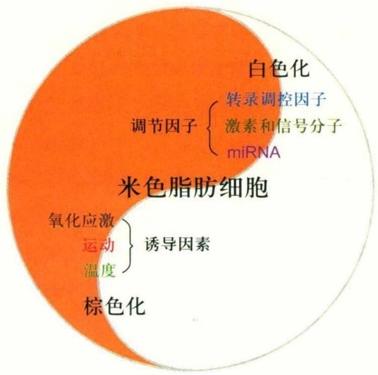
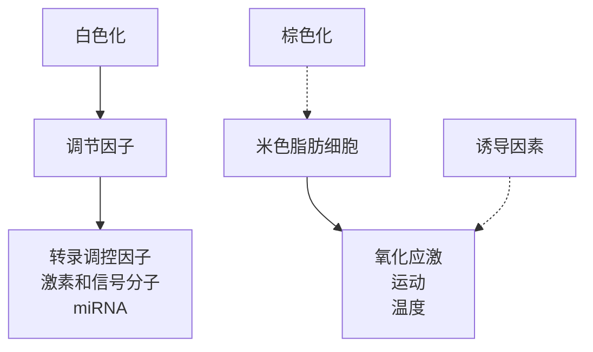
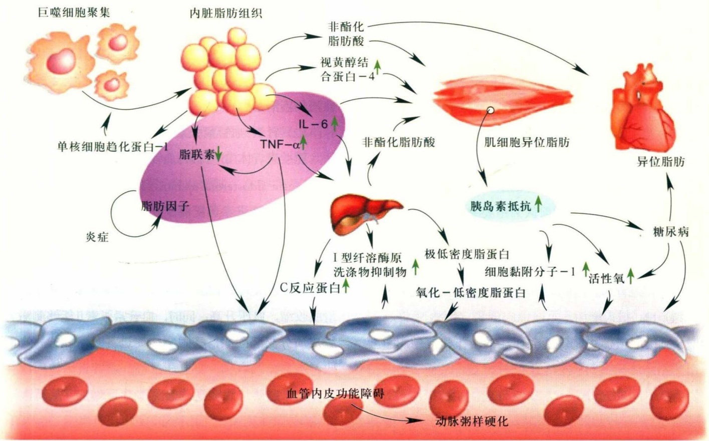
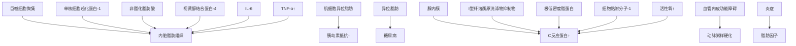
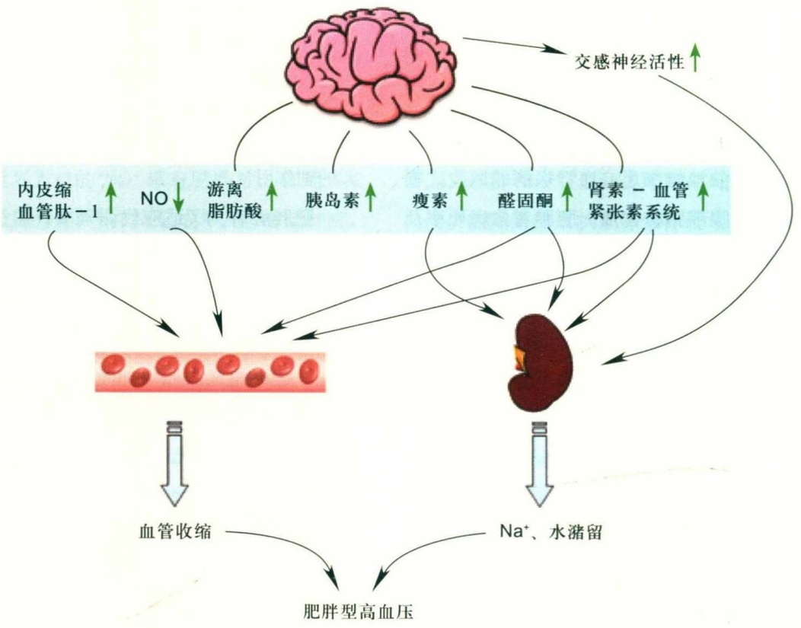
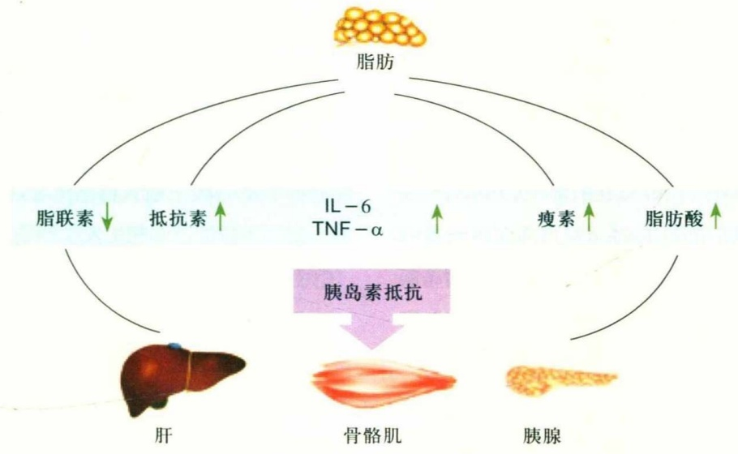
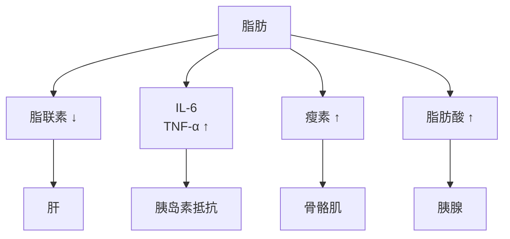

血清培养基中加入高浓度的胰岛素。在低水平自发分化的脂肪前体细胞中加入胰岛素会引起向脂肪细胞分化的细胞数量增多，而向正处于增殖阶段的脂肪前体细胞中加入高浓度的胰岛素却不能引起分化的脂肪细胞数量增多，但可以增加脂肪细胞中甘油三酯的含量。实验表明，胰岛素的刺激可以增加PPAR-γ的含量，进而影响细胞的活性。脂肪前体细胞并不能表达胰岛素受体，但可以表达IGF-1受体，随着脂肪前体细胞分化成脂肪细胞，IGF-1受体的表达量逐渐减少而胰岛素受体的表达量逐渐增多。胰岛素可以分别与这两种受体结合。在脂肪前体细胞时期，胰岛素主要是通过和IGF-1受体结合来调节脂肪前体细胞的活性；当脂肪前体细胞分化成脂肪细胞后，胰岛素主要是通过与胰岛素受体结合来调节脂肪细胞的活性。

② 胰岛素样生长因子-1（IGF-1） IGF-1是3T3-F442A脂肪前体细胞生长和分化所必需的。IGF-1最初是从Ob1771脂肪前体细胞中发现的，它可以通过自分泌和旁分泌的形式影响Ob1771的分化。生长激素通过促进IGF-1的表达使前脂肪细胞分化增殖的同时，也可以通过细胞膜上的自身受体途径促进脂肪氧化并抑制脂蛋白脂酶活性，进而抑制脂肪聚积，减小成熟细胞的体积。脂肪细胞膜上的胰岛素受体主要介导脂肪细胞的能量代谢，而IGF-1受体则主要调节细胞生长。在细胞分化早期，IGF-1受体表达多于胰岛素受体，随着分化的进行胰岛素受体表达逐渐增多。胰岛素和IGF-1都可同这两种受体相结合，并存在着竞争性抑制。

③ 表皮生长因子(epidermal growth factor, EGF) 实验表明，在鼠和人的前体脂肪细胞中，EGF能够抑制前体脂肪细胞的分化，如果在新生小鼠的皮下注射EGF，将会导致小鼠的脂肪含量严重不足。EGF并不总是对脂肪细胞的分化起抑制作用，在无血清培养条件下，EGF对猪脂肪前体细胞的分化表现出明显的促进效应；而在有血清的培养基中，EGF能够降低3T3-L1脂肪细胞的分化。低浓度EGF对脂肪细胞的分化有促进作用，高浓度的EGF对脂肪细胞的分化具有抑制作用。

④ 糖皮质激素 糖皮质激素也可用来促使脂肪前体细胞向脂肪细胞分化，实验中最常用的是它的类似物地塞米松（DEX）。研究表明，当在分化早期用DEX处理细胞后，细胞可以产生快速的瞬时变化，激活糖皮质激素受体，糖皮质激素受体是一种核受体，激活的糖皮质激素受体可直接调控靶基因，也可通过调节与脂肪前体细胞分化的有关转录因子，如c-Myc、c-jun等，诱导产生C/EBP-δ，随之激活C/EBP-α途径，诱导前体脂肪细胞的分化。体外实验表明，糖皮质激素是很多哺乳动物前体脂肪细胞的有效分化所必需的。

⑤ Akt Akt可以被胰岛素和一些激素激活，是磷脂酰肌醇途径的下游效应因子。如果在3T3-L1细胞中持续表达Akt会导致其自发地向脂肪细胞分化，表明Akt在脂肪前体细胞分化过程中起重要作用。

(2) 抑制脂肪前体细胞分化的激素和信号因子

① Wnt 途径 Wnt 家族因其编码一组富含半胱氨酸的分泌型糖蛋白而得名，这些糖蛋白可以通过旁分泌或自分泌的形式发挥调节作用。Wnt 途径可以通过调节相应的转录因子来抑制脂肪前体细胞向脂肪细胞分化而维持脂肪前体细胞的性状。目前，人和小鼠中发现的 Wnt 蛋白已有 20 余种。根据其信号转导方式，可将 Wnt 信号途径分为经典 Wnt 信号途径和非经典 Wnt 信号途径。其中，经典 Wnt 信号途径中包括 Wnt1、Wnt3a、Wnt8 和 Wnt10b 等，非经典 Wnt 信号途径中包括 Wnt4、Wnt5a 和 Wnt11 等。在经典 Wnt 信号途径中，一系列的信号传递导致内源性的 β-catein 在细胞质内积聚并进入细胞核，激活相关靶基因；而在非经典 Wnt 信号途径中，信号传递不通过 β-catein 的途径使靶基因表达，如 Wnt5a 通过介导钙调蛋白依赖性蛋白激酶 II 和蛋白激酶 C 起作用。这些信号途径最终抑制 PPAR-γ 和 C/EBP-α 的表达而使得脂肪细胞的形成受到影响。

② 肿瘤坏死因子- $\alpha$ （TNF- $\alpha$ ） TNF- $\alpha$ 能够通过抑制C/EBP- $\alpha$ 和PPAR- $\gamma$ 的表达，从而抑制脂肪细胞特异性基因的表达，对脂肪细胞分化起负调控作用。长期以来认为，TNF- $\alpha$ 主要是通过诱导脂解作用和下调脂肪细胞基因如PPAR- $\gamma$ 、C/EBP- $\alpha$ 、LPL、aP2及GLUT-4等的表达来削弱脂肪细胞的生理功能，TNF- $\alpha$ 抑制脂肪细胞分化的作用机制尚不清楚。但最近研究表明TNF- $\alpha$ 对脂肪细胞的分化作用呈浓度依赖性，高浓度下TNF- $\alpha$ 具有抗脂肪生成的作用，同时也促进脂肪细胞凋亡，而生理状态下的低浓度TNF- $\alpha$ 则增加脂肪组织未分化细胞的数量。

③ 前脂肪细胞分化因子-1(Pref-1) Pref-1也在脂肪细胞分化早期表达，它是含有6个连续表皮生长因子样重复序列的细胞表面蛋白，无论是膜结合状态还是溶解形式的Pref-1都有助于3T3-L1前脂肪细胞保持未分化状态。Pref-1过表达可强烈抑制脂肪细胞的分化。大的可溶性Pref-1片段以分泌的方式抑制体内脂肪细胞的分化。Pref-1的膜外成分已被克隆纯化并命名为FAI（分子量为$5\times 10^{4}$ 的可溶性蛋白），对3T3-L1细胞的分化有抑制作用，而Pref-1的其他成分则无此作用。

④ 前列腺素(prostaglandin, PG) PG及其衍生物在脂肪组织代谢和发育过程中有重要作用。前列腺素有很多亚型，其中包括由脂肪细胞分泌的PGF2α、PGE2和PGD2。总体来看，PG对脂肪前体细胞的分化起抑制作用，但其具体机制尚不明确。

## 22.2.3.2 与脂肪前体细胞分化有关的转录因子

## (1) C/EBPs

CCAAT/增强子结合蛋白（CCAAT-enhance binding proteins, C/EBP）属于bzip (basic-region/leucine-zipper) 家族，它可以特异识别靶基因的增强子序列CCAAT，以促进相关基因的表达，在脂肪细胞分化过程中起重要作用。C/EBP家族有3个成员，即C/EBP-α、C/EBP-β和C/EBP-δ。C/EBP-α主要在肝、脂肪、肾上腺等脂质代谢旺盛的组织器官中表达，由一个外显子组成。它是第一个被证明的在脂肪细胞分化过程中起重要作用的转录因子。通过C/EBP-α的基因干扰和基因敲除等手段进一步证明，C/EBP-α在脂肪细胞分化中必不可少。其作用主要表现在3个方面:①促使脂肪前体细胞停止增殖而走向分化阶段，并维持PPAR-γ的高表达而保持分化细胞的表型；②增强脂肪特异性基因（如胰岛素受体基因、GLUT-4基因、瘦素、PEPCK等）的转录，这些基因都有CCAAT重复序列，可以被C/EBP-α结合而提高其转录活性；③C/EBP-α具有自身诱导作用，可以转录激活自身的基因，使C/EBP-α保持高浓度，诱导细胞的分化。C/EBP-β、C/EBP-δ的分布与C/EBP-α一样，在脂肪、肝等组织中都有表达，也由一个外显子构成，它们在脂肪细胞分化过程中也起着重要作用。3个C/EBP家族成员在脂肪前体细胞分化过程中的表达有一定的时序性。其中，C/EBP-β和C/EBP-δ在激素诱导下先表达，它们可以通过CCAAT结合位点促进C/EBP-α和PPAR-γ的表达，进而促进脂肪细胞分化。研究表明，在脂肪细胞分化过程中，C/EBP-β先激活PPAR-γ的表达，PPAR-γ再去降解结合到C/EBP-α启动子上的HDAC1，并与C/EBP-β共同激活C/EBP-α。

## (2) PPAR-γ

PPAR-γ是核激素受体家族中的一员，具有脂肪组织特异性。由于启动子和拼接方式的不同可分为PPAR-γ1、PPAR-γ2、PPAR-γ3三种亚型。PPAR-γ在脂肪组织中高表达，而在肝、胰腺等器官中低表达。其中，PPAR-γ1主要分布于脂肪、骨骼肌、心肌和肝等组织器官中，PPAR-γ2则主要分布于脂肪组织中，PPAR-γ3仅表达于巨噬细胞、脂肪组织及结肠中。与其他核激素受体一样，PPAR-γ必须与其他核激素配体形成聚合体并与DNA结合才能表现出转录活性。PPAR-γ在脂肪细胞分化的全过程中起着重要作用，从细胞分化的早期开始表达，随着细胞分化，其表达量不断上升，当脂肪前体细胞完成终末分化后其表达量达到最高。PPAR-γ可以促进C/EBP-α表达增加，从而促使脂肪前体细胞向脂肪细胞转化。研究表明在PPAR-γ敲除鼠中由于脂肪细胞分化障碍使得小鼠在胚胎期就死亡。反之，如果PPAR-γ过度表达则会引起严重的脂质代谢紊乱。PPAR-γ的功能主要是诱导脂肪细胞的形成，它可以调控乙酰CoA羧化酶、脂肪酸合成酶和激素敏感脂肪酶等基因的表达以及抑制瘦素的表达，使能量摄取增加。

在脂肪细胞诱导分化过程中，C/EBP- $\alpha$  和 PPAR- $\gamma$  相互协调作用，促进脂肪细胞基因的转录与表达，触发脂肪细胞的最终分化。分化所必需的多种因素都直接或间接地汇聚到 C/EBP- $\alpha$  和 PPAR- $\gamma$  上，最终通过调节 C/EBP- $\alpha$  和 PPAR- $\gamma$  的表达来影响脂肪细胞的分化。

## (3) ADD1/SREBP

脂肪细胞定向和分化因子1(adipocyte determination and differentiation factor 1, ADD1)，又称胆固醇调节元件结合蛋白1c(sterol regulatory element-binging proteins-1c, SREBP-1c)，属于SREBP家族，是一种重要的核转录因子。SREBP家族具有碱性的螺旋-环-螺旋-亮氨酸拉链结构。哺乳动物中存在3种不同的SREBP蛋白，即SREBP-1a、SREBP-1c和SREBP-2。SREBP-1中90%为SREBP-1c，它在人和鼠的大多数组织器官中表达，尤其在肝和白色脂肪组织中的表达水平较高，而SREBP-1a只在细胞增殖能力强的组织中表达水平较高，如脾和肠。SREBP-1主要参与调节脂肪前体细胞分化和甘油三酯合成相关基因。SREBP-2和SREBP-1蛋白具有47%的相似性，它主要在肝中表达，参与胆固醇的代谢调节。SREBPs的活性受到细胞内固醇含量的调节。

SREBPs在内质网合成后，结合在膜上，在内质网上与固醇调节元件结合蛋白裂解激活蛋白（sterol regulation element binding cleavage activating protein, SCAP）结合形成SREBP-SCAP复合物。当细胞内固醇消耗时，SREBP-SCAP复合物被运送到高尔基体，丝氨酸蛋白酶(S1P)将SREBP连接两个跨膜部分中间的腔内小环上的亮氨酸-丝氨酸化学键切开，锌蛋白酶(S2P)对其进行第二次剪切，释放出N端转录活化域，即核SREBP(nSREBP)。随即nSREBPs转移至核内，与其靶基因启动子/增强子的固醇调节元件(SREs)或回文序列E盒(5-CAXXTG-3，X代表任何碱基)结合，激活与胆固醇和脂肪酸合成代谢相关酶的基因转录。当细胞内固醇含量升高时，SREBP-SCAP复合物被保留在内质网中，不进行裂解。其中SREBP-1的靶基因包括脂肪酸合成酶、ATP柠檬酸裂解酶、苹果酸酶、PPAR-γ、乙酰CoA羧化酶、脂蛋白脂酶和甘油三酯合成酶等。实验表明，用PPAR-γ配体处理的3T3-L1脂肪细胞，ADD1的过表达使3T3-L1细胞具有分化能力；而ADD1和PPAR-γ的共表达对3T3-L1脂肪细胞系分化具有协同作用。

## (4) CUP

C/EBP- $\alpha$ 分化不良蛋白(C/EBP- $\alpha$ undiffe-rentiated protein, CUP)是在前脂肪细胞中表达的蛋白之一，亦称转录因子AP2 $\alpha$，它的表达降低了分化刺激。实验证明CUP/AP2 $\alpha$ 在前脂肪细胞中有较高的表达水平，CUP通过两个结合位点结合到C/EBP- $\alpha$ 启动子上，使C/EBP- $\alpha$ 处于抑制状态。在受到激素诱导剂诱导时，CUP表达下降，C/EBP- $\alpha$ 去抑制。

## 22.2.3.3 细胞外基质

细胞黏附因子和细胞外基质成分在调节细胞与其所处环境之间相互作用方面起重要作用，同样它们也可以调控脂肪前体细胞的迁移和分化。在脂肪前体细胞的分化过程中，细胞外形、细胞外基质和细胞内部都发生巨大的变化。例如，在分化的早期可以观察到在细胞和细胞外基质的边界处有胶原蛋白的积累和膜成分的形成；细胞与细胞之间或细胞与基底膜之间会发生松动，以便于细胞移动和更加充分地接触细胞外基质中的信号因子。电镜结果显示，处于分化时期的3T3-F442A会在胞外基质中形成一些颗粒状沉淀物，这些沉淀物由一些棒状结构和纤维组成，可能与细胞的迁移有关。细胞外基质中的不同成分对细胞分化有不同的影响，I型胶原、Ⅲ型胶原、纤连蛋白、多聚赖氨酸以及β-整合素对脂肪前体细胞的分化起抑制作用，而IV型胶原、层粘连蛋白对脂肪前体细胞的分化起促进作用。细胞外基质中的主要成分有胶原蛋白、层粘连蛋白、纤连蛋白和蛋白聚糖。

## (1) 胶原蛋白

胶原蛋白是细胞外基质中含量最多的一种成分，目前发现人体内的胶原蛋白有20余种，不同类型的胶原蛋白在分子结构及免疫学特征性上有所不同，按组织来源可以把胶原蛋白分3类:第一类称为间隙胶原，又分为I～III型，主要存在于皮肤和肌腱等组织中，是细胞之间的胶原蛋白，有很强的抗张性；第二类称为基膜胶原，又分为IV～VII型，主要存在于脏器当中；第三类称为软骨胶原，又分为IX～XI型，主要存在于软骨中，与软骨形成有关。研究发现，I型胶原、III型胶原对脂肪前体细胞的分化起抑制作用，而IV型胶原则对脂肪前体细胞的分化起促进作用。

## (2) 层粘连蛋白

层粘连蛋白主要存在于基膜结构中，是基膜所特有的非胶原糖蛋白。由1条α链和2条β链组成，结构上呈不对称的“十”字形。层粘连蛋白作为一个桥梁分子介导细胞与基膜结合，它的主要功能是在细胞表面形成网络结构并将细胞固定在基膜上，在细胞发育过程中刺激细胞黏附和细胞运动。研究表明层粘连蛋白中的五肽序列IKVAV起着重要作用，如果将脂肪前体细胞置于IKVAV修饰过的多聚己内酯支架上细胞的形态变得更伸展。

## (3) 纤连蛋白

纤连蛋白是多聚体，属于分子量较大的糖蛋白，各个单体之间以二硫键交联。纤连蛋白的主要功能是介导细胞黏着，增强细胞间黏连以及细胞与基质的黏连。最初研究发现，如果在培养的脂肪前体细胞中加入纤连蛋白，则导致细胞不能进行正常分化，而加入细胞松弛素D则加速细胞分化。后来发现，如果向脂肪前体细胞中加入热解素将纤连蛋白分解，也可促进脂肪细胞的分化。所以，纤连蛋白可以对脂肪前体细胞的分化起抑制作用。

## (4) 蛋白聚糖

蛋白聚糖是由糖胺聚糖和多肽链依靠共价键组成的大型分子，它主要通过空间位阻原理组织整合素与细胞外基质上细胞附着位点的结合，从而抑制细胞与胶原蛋白或纤连蛋白之间的相互黏附作用，使细胞处于一种比较疏松的空间环境，便于细胞形态改变和迁移，能够促进脂肪前体细胞的分化。

细胞外基质在细胞与细胞所处环境之间起中介作用，它通过调节细胞骨架系统的重排和改变细胞内信号转导途径影响细胞分化。而且，有人提出细胞外基质可以通过细胞骨架影响核基质成分的假说。总之，细胞外基质对细胞的影响非常关键而复杂，对它的研究也在不断深入。

## 22.2.4 脂肪细胞的转化

## (1) 米色脂肪细胞的来源

脂肪细胞的转化主要是米色脂肪细胞在不同条件诱导下在棕色化和白色化之间转化的过程（即白色脂肪棕色化和米色脂肪白色化）。关于米色脂肪细胞的来源，目前主要有两种假说。第一种是从已有的前体细胞中从头分化。已知可能有3种具有特异标记蛋白的前体细胞，包括平滑肌细胞 $\left(\mathrm{MYH11}^{+},\mathrm{SMA}^{+}\right)$ 、壁细胞 $\left(\mathrm{PDGFR}\beta^{+},\mathrm{SMA}^{+}\right)$ 和 $Sca-1^{+}$ 前体细胞 $\left(\mathrm{ScaPCs},\mathrm{Sca}-1^{+}/\mathrm{CD45}^{-}/\mathrm{Mac1}^{-}\right)$ 。第二种是分化转移理论，指米色脂肪细胞从成熟的脂肪细胞诱导而来，且这种分化是可逆的。在此关于脂肪细胞的转化的阐述主要是基于第二种假说。以下简单介绍一些主要的脂肪细胞转化的诱导因素和调节因子（图22-7）。

## (2) 脂肪细胞转化的诱导因素

① 温度 很多研究已报道，温度会诱导脂肪细胞的转化。在寒冷条件刺激下，棕色脂肪被激活，同时在白色脂肪组织中有部分细胞会棕色化成为米色脂肪细胞。这种细胞会具有一些棕色脂肪细胞的特性，如UCP1高表达和β氧化增强等。而在温暖条件下处理一段时间后，这些米色脂肪细胞又会变回白色脂肪细胞的形态。通常温度会通过调节转录调控因子的表达来诱导转化。

flowchart

② 运动 研究发现，运动会刺激白色脂肪细胞棕色化并增加能量消耗。据报道，运动后，一种叫作肌肉因子鸢尾素（irisin）的分子分泌增加，而这种分子会明显提升小鼠白色脂肪细胞中UCP1和CIDEA的表达，表征棕色化。

③ 氧化应激 氧化应激可能通过不同的机制双向调控脂肪细胞转化。研究发现，冠心病患者心外膜脂肪组织中活性氧的水平明显升高，且白色脂肪特异性基因Igfbp3和Hoxc9表达升高，而棕色脂肪特异基因UCP1、PGC-1α和PRDM16表达降低，表明活性氧可能会诱导脂肪白色化。另一研究发现，白色脂肪经硝酸盐处理后棕色脂肪特异基因表达上升，表明发生白色脂肪棕色化。

## (3) 脂肪细胞转化的调节因子

目前已有很多研究报道了诱导脂肪细胞转化的机制，其中包含很多调节因子，主要包括转录调控因子、激素和信号分子以及小RNA等。

① 转录调控因子 与脂肪前体细胞分化相似，脂肪细胞的转化也需要转录调控因子。其中主要包括PPAR-γ、PGC-1α、C/EBPs和PRDM16，这些因子会通过相互作用影响靶基因的表达。
② 激素和信号分子 脂肪细胞的转化也需要激素和信号分子。肌肉因子鸢尾素就是一种由骨骼肌分泌的激素，其他主要的激素包括内分泌激素FGF21和心房钠尿肽。这些激素一般通过影响转录调控因子的表达及活性

## 图22-7 脂肪细胞转化示意图

在正常条件下，米色脂肪细胞呈白色脂肪细胞状态，而在诱导条件出现后，会向棕色脂肪细胞转化，这种转化过程被称为白色脂肪棕色化。同时这种转化是可逆的，重新回到正常条件下后，米色脂肪细胞也会变回白色脂肪细胞状态，这种现象被称为米色脂肪白色化。米色脂肪细胞的双向转化受多种因素调控，如温度、运动和氧化应激等。这其中包含多种调控因子，如转录因子、激素和信号分子以及miRNA等。另外，生物体的年龄、体重和饮食也会对转化有影响。

来调节脂肪细胞的转化。腺苷是一种诱导白色脂肪棕色化的信号分子。另外，骨形态发生蛋白和哺乳动物雷帕霉素靶蛋白复合物1也参与脂肪细胞的转化。

③ miRNA 现已报道多种miRNA会影响白色脂肪棕色化，如miR-196a、miR-26和miR-30诱导米色脂肪细胞的产生，而miR-155、miR-133、miR-276和miR-34抑制白色脂肪棕色化。这些miRNA多是通过影响转录调控因子的表达来调节脂肪细胞的转化。

目前，白色脂肪棕色化过程被认为是治疗肥胖和相关代谢疾病的有效措施。因此，对米色脂肪细胞双向转化相关机制的研究会为预防和治疗肥胖及相关代谢疾病提供重要的理论基础。

## 22.3 肥胖与其他代谢疾病的关系

体重指数(body mass index, BMI) 是用来评估肥胖与否的一个参数，其计算方法是体重(kg)除以身高(m)的平方。根据BMI值的大小，可以将体重分为体重过轻、中等体重、超重和肥胖等(表22-1)。除BMI外，其他描述肥胖的指标还包括体脂、腰围、腰臀比以及重量身高比。

世界卫生组织（WHO）报告指出，1995年全球约有2.5亿成年人（占世界人口的7%）患有肥胖症，有至少5亿成年人超重；到2005年，约有4亿成年人患有肥胖症，16亿成年人超重。到2015年，约有7亿成年人患有肥胖症、23亿成年人超重。

对于肥胖，起初人们认为只是饮食过度的结果，并非一种疾病。然而越来越多的研究表明，肥胖症是一种代谢失调的疾病，是一种易发现的、复杂的代谢失调症，可影响整个机体的正常功能。肥胖对机体的影响十分广泛，与很多代谢性疾病及心血管疾病有关，包括糖尿病、脂肪肝、动脉粥样硬化以及高血压等。

## 22.3.1 肥胖与冠心病

冠状动脉粥样硬化性心脏病(coronary heart disease, CHD)，简称冠心病。肥胖能够引起冠心病，继而出现心力衰竭(heart failure, HF)、心房纤颤(atrial fibrillation, AF)、心脏猝死等。研究显示，肥胖为男性冠心病危险因素中继年龄及血脂异常后的第三个最重要的独立危险因素。

表 22-1 BMI 与体重间的关系

| 体重描述 | BMI值/(kg·$m^{-2}$) |
| --- | --- |
| 体重过轻 | &lt;18.5 |
| 中等体重 | 18.5~24.9 |
| 超重 | 25.0~29.9 |
| 轻微肥胖(肥胖I期) | 30.0~34.9 |
| 中度肥胖(肥胖II期) | 35.0~39.9 |
| 极度肥胖(肥胖III期) | ≥40 |

## (1) 肥胖能够诱导多种细胞因子和炎症因子的产生

这些因子能够参与冠心病的发生，影响多种代谢过程及血管状态，包括脂蛋白酯酶、血浆胆固醇酯转移蛋白（cholesteryl ester transfer protein, CETP）、血管紧张素原（angiotensinogen）、补体因子如脂肪细胞蛋白酶adipsin和补体D、脂联素、酰基化刺激蛋白（acylation-stimulating protein, ASP）、白介素-6(IL-6)、前列腺素、TNF-$\alpha$ 和NO。

肥胖患者体内脂肪组织释放大量的生物活性因子，如瘦素、脂联素、促炎症因子(IL-6、TNF-α)、纤维酶原激活物抑制因子(PAI-1)及内脏脂肪素(visfatin)等。可见，由肥胖组织释放的生物活性因子很多属于上述物质，它们参与不同的代谢过程，不仅改变体重的平衡，而且引起胰岛素抵抗，改变脂质和血压水平，影响血液凝固、纤溶和炎症过程，增加氧化应激，从而导致血管内皮功能障碍和冠状动脉粥样硬化(图22-8)。例如，瘦素可以通过降低胰岛素的敏感性来损伤内皮功能，同时激活蛋白激酶，使脂肪酸氧化，诱导T1淋巴细胞和巨噬细胞向皮下迁移，促进动脉粥样硬化的形成。同时，瘦素还可以引起冠脉血管强烈收缩，使冠脉血流量减少，心肌耗氧量增加，从而加重组织缺血、缺氧。此外，瘦素还可以通过与血小板和内皮细胞上的血栓蛋白结合，促进血小板聚集和血栓形成。

## (2) 内脏性肥胖和胰岛素抵抗增加了患冠心病的风险

胰岛素抵抗是指胰岛素作用的靶器官对胰岛素的敏感性下降，即正常剂量的胰岛素产生低于正常情况下的生物学效应的一种状态。通常是指胰岛素介导的葡萄糖利用率降低，体内胰岛素生物学作用减低的一种病理生理改变。胰岛素抵抗往往与心血管危险因素（如脂代谢紊乱、葡萄糖耐受不良和高血压）同时出现。

flowchart

图22-8 肥胖引起冠心病的各种因子（仿自van Gaol等，2006）

在单核细胞趋化蛋白-1作用下，巨噬细胞聚集，促使内脏组织分泌脂肪因子，如脂联素和TNF-$\alpha$，这些因子能够直接引起血管内皮功能障碍。同时IL-6和TNF-$\alpha$ 能够间接引起炎症。IL-6、TNF-$\alpha$ 、脂联素、非酯化脂肪酸和视黄醇结合蛋白-4能够引起胰岛素抵抗，从而导致氧化应激以及一系列内皮功能紊乱（如PAI-1的释放）。脂肪积累、胰岛素抵抗、肝诱导性炎症和脂代谢紊乱等，这些因素都能够导致早期的动脉粥样硬化。

研究发现，除了体脂含量增加这一因素外，腹部内脏脂肪的积累能够单独地增加患心血管疾病的风险。腰围和臀围的比值反映腹部脂肪含量。肥胖者总病死率及冠心病死亡率不仅与BMI及脂肪的重量有关，更与脂肪的分布相关。中心性或腹部内脏性脂肪患者对冠心病患病率及病死率的危险性较肢体性肥胖要大得多。

腹部内脏脂肪引起心血管疾病可能主要是由于胰岛素抵抗造成的。腹部脂肪增多往往伴随着脂肪细胞脂解作用受损，游离脂肪酸（non-esterified fatty acid，NEFA）水平升高，胰岛素抵抗增强，从而导致血管内皮细胞损伤。此外，内脏脂肪过多还能够增加PAI-1的水平以及出现低度的炎症反应，而储存于心脏、血管和肾的异位脂肪也能够增加心血管疾病的风险。这些异位脂肪能够改变血流动力学，引起高血压，而且过多的脂肪积累可能减弱内皮依赖性血管舒张，使氧化应激增加，产生心血管毒性。

(3) 肥胖对血液动力学以及心血管结构和功能有很大的副作用

肥胖患者为了适应代谢需要，总循环容量、心输出量增加，静脉回流量增加，心脏呈高动力循环状态。因此，肥胖可引起心脏质量和形态结构的广泛改变，并与肥胖的严重程度相关。肥胖者心脏结构改变的特点是:左心室容量和充盈压增加，左心室腔肥大，左心室壁张力增加、增厚，室壁厚度与左室内径平行增长，左室内径/后壁厚度比值无明显变化，属于左室非向心性肥大。肥胖者左室搏出功能增加和高动力循环状态能够引起心脏收缩功能的改变。此外，肥胖对心脏的舒张功能也有影响。肥胖能够引起心脏舒张功能的减退和左心室肥厚，进而发展为收缩功能减退。而相比收缩功能，舒张功能的变化不仅在严重肥胖病例，而且在轻度和中度肥胖病例中均更为常见，并且和BMI直接相关。

## 22.3.2 肥胖与高血压

高血压是指体循环动脉收缩压和（或）舒张压的持续升高（收缩压＞140 mm Hg或（和）舒张压＞90 mm Hg，1 mm Hg=0.133 kPa），常伴有脂肪和糖代谢紊乱以及心、脑、肾和视网膜等器官功能性或器质性改变，是以器官重塑为特征的全身性疾病。目前认为，肥胖是高血压的一个独立危险因素。但肥胖引起高血压的机制尚未完全明确，目前认为主要是由于 $Na^{+}$ 摄入增加、胰岛素抵抗、瘦素水平升高和肾素-血管紧张素系统激活等多方面引起交感神经兴奋，外周血管收缩，心输出量增加，促进肾 $Na^{+}$ 重吸收等导致血压升高（图22-9）。

## (1)  $Na^{+}$ 摄入增加

$Na^{+}$ 摄取增加在肥胖性高血压的发生机制中起重要作用。肥胖者 $Na^{+}$ ， $K^{+}-ATP$ 酶活性降低，从而致使平滑肌细胞内 $Ca^{2+}$ 浓度增加，后者又可致使肌肉弹性和外周血管抵抗增高从而导致高血压。同时，血钠升高，可使肥胖性高血压患者总血容量增加。血容量增加及所致的心输出量增加和相对的外周血管抵抗升高均可导致肥胖型高血压。进一步的研究发现肥胖者细胞内液比间质和血浆液体容量增加更多，但这种变化是否及怎样导致高血压仍不清楚。

## (2) 肾素-血管紧张素系统功能亢进

肥胖患者体内，肾素-血管紧张素-醛固酮系统（renin-angiotensin-aldosterone system，RAAS）功能亢进，研究表明RAAS亢进参与肥胖所引发的高血压的形成。肾分泌肾素，激活从肝产生的血管紧张素原，生成血管紧张素I，然后经肺循环的血管紧张素转换酶生成血管紧张素II，血管紧张素Ⅱ作用于血管紧张素Ⅱ受体，使小动脉平滑肌收缩，血压升高；同时，血管紧张素Ⅱ能够刺激肾上腺皮质分泌醛固酮，醛固酮能促进肾对水和 $Na^{+}$ 的重吸收，增加体液容量，使血压升高。肥胖者因体内含有大量脂肪，脂肪组织表达血管紧张素原增加，从而激活肾素-血管紧张素-醛固酮系统，使血压升高。

flowchart

This diagram illustrates the physiological mechanisms of liver function, showing how various hormones (e.g., NO, lipids, serum) influence blood circulation and sodium levels in the kidney.

图22-9 肥胖引起高血压的机制（仿自Rahmouni等，2005）

长期的交感神经活性能够通过引起外周血管收缩并增加肾 $Na^{+}$ 重吸收导致血压升高。同时，许多因子如游离脂肪酸浓度升高，胰岛素抵抗，瘦素水平升高和肾素血管紧张系统激活等，能够引起交感神经兴奋，外周血管收缩，促进肾钠重吸收，进而导致血压升高。内皮缩血管肽-1水平的升高以及NO浓度的下降同样能够引起血管收缩导致血压升高。

## (3) 交感神经活动增强

交感神经系统 (sympathetic nervous system, SNS) 过度激活是肥胖相关高血压发生的重要机制。交感神经系统过度兴奋，是肥胖人群的一个共同特征。近来的研究表明，交感活性增强对于肥胖引起的高血压起关键作用。交感神经活动增强时，心交感神经兴奋，其末梢释放去甲肾上腺素，它作用于心肌细胞膜上的肾上腺素受体，导致心率加快，心肌收缩力增强，心排血量增加，血管收缩，血压升高。而长期的交感兴奋可能通过引起外周血管收缩和增加肾小管的重吸收而导致动脉压增高。此外，肥胖患者体内高浓度的游离脂肪酸能够参与激活交感神经系统，因此，高浓度的游离脂肪酸与高血压的发生呈正相关。

## (4) 胰岛素抵抗

胰岛素抵抗在代谢疾病中广泛存在，而肥胖或体脂分布异常是引起胰岛素抵抗的重要因素。分析表明，在控制BMI、腰臀比、空腹和餐后血糖、空腹胰岛素和年龄等因素影响后，胰岛素抵抗与血压呈显著正相关。胰岛素抵抗引起高血压的可能机制:增加肾对 $Na^{+}$ 的重吸收，血管平滑肌细胞内的游离 $Ca^{2+}$ 增多，血管加压素的反应增强，内皮细胞内的蛋白激酶C增加，内皮细胞合成内皮素增加等缩血管物质。但是，胰岛素抵抗并非必然引起高血压。

## (5) 瘦素水平升高及脂联素水平降低

人血浆瘦素水平升高与人体脂肪重量成正比，瘦素及其受体基因突变可导致病态肥胖。在肥胖南美豚鼠模型中，长期注射瘦素或瘦素过表达会引起动脉血压升高。高浓度瘦素除了影响食欲和代谢外，还可能通过复杂的下丘脑途径促进交感活性升高，并对胰岛素受体后的信号转导途径产生影响，这些均有升高血压的效果，提示瘦素与肥胖相关的高血压关系密切。

同样，一些调节食欲和能量平衡的因子也与血压调节有关。如脂联素的作用靶点是肝和肌肉。最近的研究表明，脂联素进入脑脊髓液，通过增加能量消耗来减轻体重，但脂联素并不影响食欲。脂联素可以改善胰岛素抵抗，但是肥胖者血中脂联素浓度降低。低浓度的脂联素可能是引起高血压的独立危险因素，但是具体机制尚未明确。

## (6) 血管改变

血管内皮功能障碍如NO应答性下降，是肥胖症的普遍现象。高血压患者体内，BMI的增加往往伴随着血管生成内皮缩血管肽-1（endothelin-1）增加。此外，由于肥胖者的脂肪组织大量增加，扩充了血管床，血液循环量相对增加，在正常心率的情况下，心排血量要增加许多，长期的负担过重就会导致左心肥厚、血压升高。

## 22.3.3 肥胖与动脉粥样硬化

动脉粥样硬化在肥胖者中发病率明显增高。肥胖者与消瘦者的冠状动脉粥样硬化的发生率为5:1。肥胖者血脂增高、脂肪细胞因子的异常分泌及胰岛素抵抗的增加是导致其患动脉粥样硬化的主要原因。

## (1) 血脂异常与动脉粥样硬化

研究表明，腹腔内脂肪面积与血清甘油三酯及游离脂肪酸水平呈正相关，即腹部脂肪越多，血清甘油三酯和游离脂肪酸水平越高，在肝内合成极低密度脂蛋（VLDL）也随之增加，在VLDL和LDL之间通过胆固醇酯和甘油三酯的转换，产生了富含甘油三酯的LDL颗粒，它们通过脂解作用形成小而密的LDL颗粒。这种颗粒更容易渗透到血管壁而被氧化成为氧化型LDL（Ox-LDL），Ox-LDL在动脉粥样硬化过程中起关键作用，它可导致内皮细胞功能受损和炎症反应，诱导单核细胞聚集和泡沫细胞形成，进而促进动脉粥样硬化发生。高密度脂蛋白（HDL）被认为是一种抗动脉粥样硬化的脂蛋白，它能吸收周围组织和细胞中的胆固醇，并将其运送至肝分解，以减少由于摄取过多的LDL而造成的胆固醇及胆固醇酯在血管壁的沉积。同时，HDL能降低单核细胞TNF-α等炎症因子的释放，发挥抗炎症作用，这也是其抗动脉粥样硬化的机制之一。肥胖时，血清HDL水平降低，成分也发生改变，其核心甘油三酯成分增加，而胆固醇酯减少，使其抵抗动脉粥样硬化的能力减弱。

## (2) 脂肪细胞因子与动脉粥样硬化

肥胖患者脂肪细胞因子分泌异常也是导致动脉粥样硬化的关键原因之一。肥胖人群存在瘦素抵抗，血浆瘦素水平增高。瘦素在病理状态下，能损伤NO依赖的内皮舒张功能，促进平滑肌细胞迁移和增殖，诱导单核巨噬细胞炎症因子的表达，因而具有促进动脉粥样硬化的作用。动脉粥样硬化是一种血管炎性疾病，而肥胖患者脂肪细胞分泌过多的TNF- $\alpha$ 和IL-6等炎性因子本身就会加重血管的炎症损伤，导致动脉粥样硬化。

## (3) 胰岛素抵抗与动脉粥样硬化

肥胖引起的胰岛素抵抗是导致动脉粥样硬化的又一重要原因。胰岛素抵抗与内皮细胞损伤、血管平滑肌细胞增殖迁移、斑块的不稳定、破裂及血栓形成均有关系。胰岛素抵抗导致IRS/PI3-K信号途径受损，继而NO释放降低，NO引起的扩张血管、保护内皮的作用减弱；同时也使VEGF促进血管内皮细胞产生ICAM-1、VACM-1及E选择素的作用明显增加，使内皮细胞对单核细胞的黏附能力明显增加，这些黏附分子的表达增加在动脉粥样硬化形成的早期起重要作用。血管平滑肌细胞的增殖及迁移是动脉粥样硬化形成的中心环节。在胰岛素抵抗状态下，PI-3K途径受损，失去了保持血管平滑肌细胞处于静止状态的作用，同时Ras/MAPK途径激活，促进血管平滑肌细胞的增殖和迁移。巨噬细胞在动脉粥样硬化的发生发展中起着重要作用。巨噬细胞通过清道夫受体吞噬并降解Ox-LDL，进一步转化为泡沫细胞，并在此过程中分泌TNF-$\alpha$ 及IL-1等炎症因子促进炎症反应。胰岛素可以通过IRS/PI-3K途径介导抑制巨噬细胞的凋亡而增加粥样斑块的稳定性，从而减少了动脉粥样硬化的发生。而在肥胖患者中，胰岛素抵抗效应使得巨噬细胞更容易凋亡形成泡沫细胞，继而促进动脉粥样硬化发生。

## 22.3.4 肥胖与糖尿病

糖尿病是一种多基因遗传性疾病，是由胰岛素生理作用降低（胰岛素抵抗）和胰岛素分泌障碍两大病因引起。胰岛素抵抗是指胰岛素生理作用低下，胰岛素抵抗时机体靶组织器官对胰岛素的反应性降低或丧失，使机体组织如肌肉、脂肪等对胰岛素促进葡萄糖摄取的作用发生抵抗，逐步引起分泌胰岛素的胰岛细胞功能衰退，致使糖耐量降低。胰岛素抵抗可发生在胰岛素、胰岛素受体和受体后信号转导3个水平上，以受体后信号转导为多见和常见。在糖尿病临床发病前10年即可出现胰岛素抵抗，胰岛素抵抗持续于整个糖尿病病程。

胰岛素抵抗的产生有着复杂的遗传和环境背景，肥胖是其中的重要因素之一。大量的人群流行病学调查和循证医学前瞻性研究证实，肥胖者发生糖尿病的危险性是正常人的3倍，约50%的肥胖者将来会患上糖尿病。肥胖患病率越高的地区，糖尿病患病率也越高，如太平洋岛国瑙鲁，70%的人肥胖，近一半的人患糖尿病。WHO已将肥胖定义为一种疾病，1999年WHO将中心性肥胖定为代谢综合征 (metabolic syndrome, MS) 的病理生理基础之一。肥胖导致的胰岛素抵抗和糖尿病的发生主要与游离脂肪酸及脂肪细胞因子相关 (图22-10)。

## 22.3.4.1 游离脂肪酸

生理情况下，血浆游离脂肪酸具有刺激胰岛素分泌的作用，特别是在空腹状态下，游离脂肪酸水平对于保证一定量的胰岛素分泌具有重要作用。肥胖导致脂代谢出现异常，血浆游离脂肪酸浓度增高，而长期的高游离脂肪酸水平是导致胰岛素抵抗的重要原因。在肝中，局部的脂肪酸水平增加，通过影响胰岛素受体后信号转导，使肝糖原输出增加，糖异生增强，引起血糖升高。肌肉组织游离脂肪酸升高，使过量的脂质沉积于肌细胞，导致肌细胞对胰岛素介导的葡萄糖摄取和转运障碍，从而导致肌肉胰岛素抵抗加重。此外，胰腺脂质过度负荷，使β细胞胰岛素分泌在短期升高后持续减少，导致β细胞功能障碍及凋亡。游离脂肪酸升高对脂肪组织的影响是使脂质过度沉积，导致脂肪细胞体积增大、数量增加，增大的脂肪细胞通过细胞膜表面胰岛素受体密度降低引起胰岛素抵抗。所以，大量脂质异位沉积使游离脂肪酸“泛滥”于肝、肌肉、胰腺及脂肪等，引起全身组织器官广泛出现胰岛素抵抗，进而产生高血糖、高胰岛素血症、糖尿病等临床表型，这种现象称为“脂肪毒性作用”或“脂中毒”。

目前认为游离脂肪酸升高所致的胰岛素抵抗，主要是通过影响胰岛素信号转导的多个环节，如胰岛素受体酪氨酸的磷酸化、胰岛素受体底物（IRS）磷酸化、蛋白激酶C（PKC）、磷脂酰肌醇-3-羟激酶（PI3K）等，即经典的胰岛素-胰岛素受体-IRS-1-PI-3K途径而致葡萄糖转运载体-4（glucose transporter type 4，GLUT-4）向细胞表面转位减少，胰岛素介导的糖摄取减少。游离脂肪酸导致胰岛素抵抗的另一个机制是氧化应激，活性氧（ROS）和过氧化脂质能够激活PKC和NF-$\kappa$ B途径等导致胰岛素抵抗。此外，大量过剩的游离脂肪酸分解入血液后，由于体内游离脂肪酸的氧化减弱，非氧化代谢途径增强，导致游离脂肪酸在非脂肪细胞再酯化，使细胞内脂肪异位沉积，加重机体胰岛素抵抗并最终导致糖尿病。

## 22.3.4.2 脂肪细胞因子

近年的研究表明脂肪组织不仅是机体的能量储存器官，也是一个内分泌器官。它能分泌几十种脂肪细胞因子，如瘦素、抵抗素、TNF- $\alpha$ 和脂联素等。肥胖患者由于脂肪细胞因子的分泌异常所导致的糖尿病主要与增加胰岛素抵抗有关。

flowchart

图 22-10 肥胖导致胰岛素抵抗的相关因素

肥胖时脂肪过度累积，导致脂肪组织脂联素分泌减少，而瘦素、IL-6、TNF-$\alpha$ 、抵抗素和游离脂肪酸大量分泌，以上脂肪酸和脂肪细胞因子的改变通过影响胰岛素信号转导的多个环节导致肝、骨骼肌和胰腺等机体代谢相关组织的胰岛素抵抗效应。

## (1) 瘦素与胰岛素抵抗

高浓度瘦素在肝中可抑制肝细胞的磷酸烯醇丙酮酸羧激酶，抑制肝葡萄糖氧化，增加肝糖原储备，并导致甘油三酯合成增加，减少肝糖产生及输出，发生胰岛素抵抗，在骨骼肌细胞可导致骨骼肌内的脂肪沉积，与胰岛素抵抗的发生也有关；瘦素可促进脂肪组织中甘油三酯的水解，产生游离脂肪酸，瘦素对脂肪的分解作用本身就造成了胰岛素抵抗。同时瘦素可直接抑制基础胰岛素分泌与葡萄糖刺激的胰岛素释放。瘦素抑制胰岛素分泌作用还可表现为抑制胰岛素原mRNA的表达，降低胰岛素基因启动因子转录活性、抑制外周组织胰岛素受体磷酸化，进而产生胰岛素抵抗。

## (2) 抵抗素与胰岛素抵抗

抵抗素是新近发现的由脂肪细胞分泌的多肽类激素，目前对抵抗素生理功能的研究尚处在初级阶段，作用尚不明确。在高脂饮食诱导或基因突变的小鼠体内血抵抗素水平增高，用抗体中和抵抗素后，小鼠血胰岛素水平变化不大，但糖耐量及胰岛素敏感性却有显著改善；用噻唑烷二酮类药物（TZDs）改善胰岛素抵抗的同时伴有抵抗素水平的下降，提示抵抗素参与胰岛素抵抗的形成。抵抗素引起胰岛素抵抗的机制是:① 抵抗素作用于胰岛素受体和胰岛素受体底物，引起胰岛素抵抗。研究发现，抵抗素能减弱胰岛素多种功能，包括抑制胰岛素信号转导途径中的胰岛素受体及胰岛素受体底物中酪氨酸残基磷酸化，使磷脂酰肌醇3激酶（PI-3K）和蛋白激酶B（PKB）的激活减少，从而引起脂肪细胞的胰岛素抵抗。② 抵抗素能上调细胞因子信号转导抑制因子-3（suppressor of cytokine signaling 3, SDCS-3）引起的胰岛素抵抗。研究发现，SDCS-3是一种胰岛素信号抑制因子，它可以通过与胰岛素受体相互作用抑制胰岛素信号转导。抵抗素显著地增加SOCS-3的表达，使其与胰岛素竞争性地结合胰岛素受体，抑制胰岛素受体底物的磷酸化作用，从而导致胰岛素抵抗。③ 抵抗素增加游离脂肪酸含量，进而引起胰岛素抵抗。高抵抗素血症使胰岛素对脂肪组织的脂解抑制作用减弱，使血浆游离脂肪酸含量升高。但一些研究并不支持这一观点，这些研究发现血清抵抗素与肥胖和胰岛素抵抗并无直接关系，健康人、肥胖伴有糖尿病或肥胖不伴糖尿病的年轻患者的血清抵抗素并无差异，从而认为抵抗素在胰岛素抵抗及能量代谢失衡的形成中并不起主导作用。

## (3) TNF- $\alpha$ 与胰岛素抵抗

在伴有胰岛素抵抗的肥胖患者和肥胖的糖尿病患者中，脂肪组织的TNF- $\alpha$ 表达明显增加，高水平的TNF- $\alpha$ 在胰岛素抵抗中起重要作用:① 抑制胰岛素信号传递通路，TNF- $\alpha$ 直接作用于胰岛素信号传递的级联反应，抑制胰岛素受体底物-1（IRS-1）与受体结合及PI3K的磷酸化，阻碍下游信号的传递；②抑制脂肪细胞中TRS-1、GLUT-4和PPAR- $\gamma$ 等基因转录，进而抑制胰岛素刺激的葡萄糖转运，减弱葡萄糖的摄取和利用。除了以上导致胰岛素抵抗的直接作用外，TNF- $\alpha$ 还有促进脂解的作用，使游离脂肪酸释放增加，并且TNF- $\alpha$ 也可抑制脂联素的表达，促进瘦素基因的表达，这可能TNF- $\alpha$ 引起胰岛素抵抗的重要间接机制之一。TNF- $\alpha$ 对应激状态下胰岛素抵抗的形成起首要作用。

## (4) IL-6与胰岛素抵抗

体内约1/3的IL-6来源于脂肪组织，脂肪组织IL-6的分泌量及循环中IL-6的浓度与脂肪量、体重指数、胰岛素抵抗呈正相关，是胰岛素抵抗的独立危险因素。IL-6可直接或通过兴奋下丘脑、垂体肾上腺来促进脂解、增加肝甘油三酯水平，从而引起胰岛素抵抗；其加重糖尿病患者胰岛素抵抗的机制可能是加速脂肪分解，导致患者体内游离脂肪酸水平增高；通过内分泌和旁分泌抑制肌肉组织胰岛素受体的酪氨酸激酶活性，以降低胰岛素在骨骼肌的作用；IL-6对脂肪细胞的葡糖转运蛋白4也有下调作用。

## (5) 脂联素与胰岛素抵抗

脂联素是脂肪组织释放入循环对远端组织起作用的一种肽类激素，它是目前最明确和最重要的一个具有抑制胰岛素抵抗作用的脂肪细胞因子，其可减轻餐后血糖和血游离脂肪酸的升高。早期的研究发现肥胖及糖尿病患者群血脂联素浓度的降低与胰岛素敏感性下降相平行。当前的研究证实，脂联素的生物效应是通过激活单磷酸腺苷激活蛋白激酶（AMP activated protein kinase, AMPK）信号转导途径实现的，它可能通过以下4个机制改善胰岛素的敏感性:增加脂肪酸氧化；促进胰岛素受体及受体后水平的信号传导；抑制葡萄糖异生；抑制脂肪组织TNF-α信号转导。

## 22.3.5 肥胖与脂肪肝

各种原因致使肝脂肪代谢障碍，脂质代谢的动态平衡失调，脂肪在肝细胞内储积，当肝组织脂肪含量超过肝重量的5%以上或在组织学上有1/3以上肝细胞脂肪变时，即称之为脂肪肝或肝脂肪浸润。按致病原因脂肪肝又分为酒精性脂肪肝和非酒精性脂肪肝。本节主要涉及肥胖与非酒精性脂肪肝（non alcoholic fatty liver disease,

NAFLD）的关系。

## (1) 流行病学调查

非酒精性脂肪肝是脂肪肝中最常见的一种，是代谢综合征在肝的表现。肥胖与脂肪肝关系密切，一般人群中非酒精性脂肪肝流行率为10%～24%，肥胖人群发生脂肪肝的概率较一般人群高出4.6倍，其中内脏脂肪性肥胖与皮下脂肪性肥胖相比发生脂肪肝的危险性更大。

## (2) 肥胖引起脂肪肝的发病机制

肝是脂质和脂肪代谢的重要场所，脂质的改造、合成、分解以及脂蛋白的分解代谢均在此进行。甘油三酯在外周脂肪组织和肝之间不断循环，保持平衡，一旦平衡失调，即可引起肝脂肪变。而肥胖者无论是摄入过多还是消耗过少均造成体内能源物质的堆积，并在肝内合成甘油三酯，当超出肝运转能力时，甘油三酯就沉积在肝，形成脂肪肝，主要由以下几方面引起:外周入肝的脂肪酸增加；肝内脂肪酸合成增加；脂肪酸生成中性脂肪的酯化增强；肝内脂肪酸氧化降低；肝内脂蛋白合成障碍引起中性脂肪释放障碍。肥胖者的脂肪肝成因有以下方面。

① 过量摄取膳食甘油三酯和糖类 肥胖者一般过量摄取膳食甘油三酯及糖类，经过一系列吸收及代谢途径导致入肝脂肪酸过剩，引起肝内脂肪蓄积增加。

② 外周脂肪组织的脂肪酸动员增加 储存在脂肪组织中的甘油三酯被脂肪细胞内激素敏感性脂肪酶水解为甘油和游离脂肪酸，并释放入血。肥胖者由于外周脂肪组织增多，即使是空腹其血中游离脂肪酸量也比正常人高，使得入肝的脂肪酸增加，合成中性脂肪也增加。而且，肥胖者由于外周组织的胰岛素抵抗代偿性地引起高胰岛素血症，而胰岛素促进肝内中性脂肪合成增多，同时抑制线粒体内的脂肪酸氧化。

③ 载脂蛋白的相对不足 肝内蓄积的甘油三酯与胆固醇、磷脂及载脂蛋白结合形成VLDL，并分泌入血。肝细胞VLDL的分泌取决于VLDL的主要蛋白质，即载脂蛋白B。肥胖者其载脂蛋白B的合成亢进，但中性脂肪的合成量超过载脂蛋白B的合成量，从而载脂蛋白B相对不足，导致肝细胞内脂肪的沉积。

此外，近年来发现肥胖时肥大的脂肪细胞分泌的一些细胞因子发生了改变，如肿瘤坏死因子和瘦素水平升高、脂联素水平降低等，这些细胞因子的变化也通过不同的机制加重胰岛素抵抗和脂肪肝，并促进脂肪肝发生炎症、坏死、纤维化和肝硬化。

## 22.3.6 脂肪发育障碍与脂肪代谢障碍

迄今为止，有较多的基因被发现与脂肪代谢障碍有关。脂肪代谢障碍又可大致分为先天性全身性脂肪营养不良（congenital generalized lipodystrophy, CGL）和家族性局部脂肪萎缩（familial partial lipodystrophy, FPL）。CGL是一种罕见的常染色体隐性遗传病，典型症状是出生时没有或较少有白色脂肪组织以及新生儿肌肉组织肥大。而FPL患者在童年或青春期会出现部分脂肪组织发育障碍。AGPAT2、BSCL2、caveolin1和PTRF的基因突变与CGL有关；PLIN1、Fsp27和HSL的基因突变与FPL有关。这两种脂肪发育障碍都导致非正常的脂肪组织发育和脂质储存，但又有较多的其他临床并发症的差异，如胰岛素抵抗、糖尿病、高血脂、脂肪肝、骨骼肌肥大以及卵巢雄激素过多症等。

## □ 小结

肥胖及与肥胖相关的代谢疾病正日益成为人类健康的重大威胁，而对脂肪组织和脂肪细胞的分化及相关功能的研究是了解肥胖，继而有针对性地缓解和改善肥胖相关的代谢疾病所造成不良后果的重要策略之一。研究发现，成人的脂肪细胞在数量上保持稳态，即衰老凋亡的脂肪细胞数量与从脂肪前体细胞分化产生的更新脂肪细胞的数量基本一致，而肥胖主要是因为脂肪细胞中积累的甘油三酯过多造成。这种累积效应除了与脂肪细胞的不适当分化有关外，与遗传和环境因素也有密切关系。而当今社会，饮食结构的不合理导致的一系列与脂肪细胞分化及脂代谢相关的基因表达和活性的异常，是导致肥胖的根本原因。而肥胖引起的脂肪细胞因子分泌异常及胰岛素抵抗，又是导致其他代谢疾病的基础。本章从脂肪细胞的功能、影响脂肪细胞分化的因素和肥胖导致代谢相关疾病的致病机制等方面，阐述了正常的脂肪细胞转变为肥胖患者脂肪细胞的相关分子机制，以及肥胖患者脂肪细胞分泌功能和代谢功能异常引起的各种代谢疾病的相关机制。至此，人们对脂肪组织的认知，从一个简单的储能器官跨越到受多种调节和有多种功能的重要器官。尽管如此，脂肪组织还有很多未知的领域有待进一步深入研究，比如最近几年逐渐显现的肠道菌群与肥胖的关联。深入揭示脂肪细胞分化、脂肪组织积累，以及有针对性地治疗和缓解肥胖相关的代谢疾病，仍然是人类面临的重大课题。相关的基础研究及临床应用研究依旧任重而道远。

## □ 思考题

1. 脂肪细胞不能储存的甘油三酯的去向是什么？

2. 简述甘油三酯代谢的主要方式。

3. 刺激脂肪细胞甘油三酯水解肯定会明显减肥，但这是正确的减肥方法吗？

4. 动物体内存在 3 种脂肪细胞，分别为白色、棕色和米色脂肪细胞。简述这三种脂肪细胞的特点。

5. 试举3种与肥胖相关的代谢类疾病。

(刘平生 徐式孟 张聪研 中国科学院生物物理研究所)

1 Aizawa-Abe M, Ogawa Y, Masuzaki H, et al. Pathophysiological role of leptin in obesity-related hypertension. J Clin Invest, 2000, 105:1243-1252.
2 Avram M M, Avram A S, James W D. Subcutaneous fat in normal and diseased states 3. Adipogenesis: from stem cell to fat cell. J Am Acad Dermatol, 2007, 56:472–492.
3 Bartelt A, Heeren J. Adipose tissue browning and metabolic health. Nat Rev Endocrinol, 2014, 10:24–36.
4 Billon N, Monteiro M C, Dani C. Developmental origin of adipocytes: new insights into a pending question. Biol Cell, 2008, 100:563–575.
5 Bordicchia M, Liu D, Amri E Z, et al. Cardiac natriuretic peptides act via p38 MAPK to induce the brown fat thermogenic program in mouse and human adipocytes. J Clin Invest, 2012, 122:1022e1036.
6 Bostrom P, Andersson L, Rutberg M, et al. SNARE proteins mediate fusion between cytosolic lipid droplets and are implicated in insulin sensitivity. Nat Cell Biol, 2004, 82:115–121.
7 Bostrom P, Wu J, Jedrychowski M P, et al. A PGCl- $\alpha$ -dependent myokine that drives brown-fat-like development of white fat and thermogenesis. Nature, 2012, 481(7382): 463–468.
8 Bray G A. The epidemic of obesity and changes in food intake: the fluoride hypothesis. Physiol Behav, 2004, 84:277–359.
9 Cannon B, Nedergaard J. Brown adipose tissue: function and physiological significance. Physiol Rev, 2004, 84:277-359.
10 Cinti S. The adipose organ.
Prostaglandins Leukot Essent Fatty Acids, 2005, 73:9–15.
11 Dominguez C S, Cabrerade L A, Almeida G D, et al. Inverse association between serum resistin and insulin resistance in humans. Diabetes Res Clin Pract, 2008, 82:256–261.
12 Dozio E, Vianello E, Briganti S, et al. Increased reactive oxygen species production in epicardial adipose tissues from coronary artery disease patients is associated with brown-to-white adipocyte trans-differentiation. International Journal of Cardiology, 2014, 174(2):413-414.
13 Farmer S R. Transcriptional control of adipocyte formation. Cell Metab, 2006, 4:263–273.
14 Ferreira S R, Franco L J, Gimeno S G, et al. Is insulin or its precursor independently associated with hypertension? An epidemiological study in Japanese-Brazilians. Hypertension, 1997,30:641-645.
15 Fisher F M, Kleiner S, Douris N, et al. FGF21 regulates PGC-1α and browning of white adipose tissues in adaptive thermogenesis. Genes Dev, 2012, 26:271e281.
16 Friedman J M. Obesity in the new millennium. Nature, 2000, 404:632–634.
17 Garg A, Agarwal A K. Lipodystrophies: disorders of adipose tissue biology. Biochimica et biophysica acta, 2009,1791:507–513.
18 Gesta S, Tseng Y H, Kahn C R. Developmental origin of fat: tracking obesity to its source. Cell, 2007,131:242–256.
19 Gnad T, Scheibler S, Kügelgen I V, et al. Adenosine activates brown adipose tissue and recruits beige adipocytes via A2A receptors. Nature, 2014, 516: 395–399.
20 Gong J, Sun Z, Wu L, et al. Fsp27 promotes lipid droplet growth by lipid exchange and transfer at lipid droplet contact sites. J Cell Biol, 2011, 195: 953–963.
21 Greenberg A S, Egan J J, Wek S A, et al. Perilipin, a major hormonally regulated adipocyte-specific phosphoprotein associated with the periphery of lipid storage droplets. The J Biol Chem, 1991, 266: 11341–11346.
22 Gregoire F M, Smas C M, Sul H S. Understanding adipocyte differentiation. Physiol Rev, 1998,78:783–809.
23 Grundy S M. Obesity, metabolic syndrome, and cardiovascular disease. J Clin Endocrinol Metab, 2004, 89:2595-2600.
24 Haemmerle G, Lass A, Zimmermann R, et al. Defective lipolysis and altered energy metabolism in mice lacking adipose triglyceride lipase. Science, 2006, 312:734–737.
25 Harsha D W, Bray G A. Weight loss and blood pressure control (Pro). Hypertension, 2008, 51:1420–1425.
26 Hauner H. Secretory factors from human adipose tissue and their functional role. Proc Nutr Soc, 2005, 64:163–169.
27 Iqbal N, Seshadri P, Stern L, et al. Serum resistin is not associated with obesity or insulin resistance in humans. Eur Rev Med Pharmacol Sci, 2005, 9:161–165.
28 Ishibashi J, Seale P. Beige can be slimming. Science, 2010, 328(5982):1113.
29 Lo K A, Sun L. Turning WAT into BAT: a review on regulators controlling the browning of white adipocytes. Biosci Rep, 2013, 33(5): e00065.
30 Kernohan E A, Lepherd E. Size distribution of fat globules in cow's milk during milking, measured with a Coulter counter. Journal of dairy research, 1969, 36: 177–182.
31 Kershaw E E, Flier J S. Adipose tissue as an endocrine organ. J Clin Endocrinol Metab, 2004, 89:2548–2556.
32 Kiess W, Petzold S, Topfer M, et al. Adipocytes and adipose tissue. Best Pract Res Clin Endocrinol Metab, 2008,22:135-153.
33 Kim S H, Plutzky J. Brown fat and browning for the treatment of obesity and related metabolic disorders. Diabetes Metab J, 2016, 40:12–21.
34 Lee J H, Chan J L, Yiannakouris N,
et al. Circulating resistin levels are not associated with obesity or insulin resistance in humans and are not regulated by fasting or leptin administration: cross-sectional and interventional studies in normal, insulin-resistant, and diabetic subjects. J Clin Endocrinol Metab, 2003, 88:4848–4856.
35 Liu M, Bai J, He S, et al. Grb10 promotes lipolysis and thermogenesis by phosphorylation-dependent feedback inhibition of mTORC1. Cell Metabolism, 2014, 19(6): 967–980.
36 Liu P S, Bartz R, Zehmer J K, et al. Rab-regulated interaction of early endosomes with lipid droplets. BBA-Mol Cell Res, 2007, 1773:784-793.
37 Loftus T M, Jaworsky D E, Frehywot G L, et al. Reduced food intake and body weight in mice treated with fatty acid synthase inhibitors. Science, 2000, 288:2379–2381.
38 MacDougald O A, Burant C F. The rapidly expanding family of adipokines. Cell Metab, 2007, 6:159–161.
39 Margetic S, Gazzola C, Pegg G G, et al. Leptin: a review of its peripheral actions and interactions. Int J Obes Relat Metab Disord, 2002, 26:1407–1433.
40 Martin S, Driessen K, Nixon S J, et al. Regulated localization of rab18 to lipid droplets—effects of lipolytic stimulation and inhibition of lipid droplet catabolism. J Biol Chem, 2005, 280:42325–42335.
41 Matsuzawa Y. The metabolic syndrome and adipocytokines. FEBS Lett, 2006, 580:2917-2921.
42 Mikhail N, Golub M S, Tuck M L. Obesity and hypertension. Prog Cardiovasc Dis, 1999, 42:39–58.
43 Miyoshi H, Perfield J W, Souza S C, et al. Control of adipose triglyceride lipase action by serine 517 of perilipin A globally regulates protein kinase A-stimulated lipolysis in adipocytes. J Biol Chem, 2007, 282: 996–1002.
44 Ntambi J M, Young-Cheul K. Adipocyte differentiation and gene expression. J Nutr, 2000, 130: 3122S-3126S.
45 Ozeki S, Cheng J L, Tauchi-Sato K, et al. Rab18 localizes to lipid droplets and induces their close apposition to the endoplasmic reticulum-derived membrane. J Cell Sci, 2005, 118: 2601-2611.
46 Park K W, Halperin D S, Tontonoz P. Before they were fat: adipocyte progenitors. Cell Metab, 2008, 8:454–457.
47 Petrovic N, Walden T B, Shabalina I G, et al. Chronic peroxisome proliferator-activated receptor gamma (PPARgamma) activation of epididymally derived white adipocyte cultures reveals a population of thermogenically competent, UCP1-containing adipocytes molecularly distinct from classic brown adipocytes. J Biol Chem, 2010, 285:7153–7164.
48 Pidoux G, Witczak O, Jarnaess E, et al. Optic atrophy 1 is an A-kinase anchoring
protein on lipid droplets that mediates adrenergic control of lipolysis. EMBO J, 2011, 30: 4371–4386.
49 Qi Y, Takahashi N, Hileman S M, et al. Adiponectin acts in the brain to decrease body weight. Nat Med, 2004, 10: 524–529.
50 Qian S W, Tang Y, Li X, et al. BMP4-mediated brown fat-like changes in white adipose tissue alter glucose and energy homeostasis. Proc Natl Acad Sci U S A, 2013, 110: E798eE807.
51 Rahmouni K, Correia M L, Haynes W G, et al. Obesity-associated hypertension: new insights into mechanisms. Hypertension, 2005, 45: 9–14.
52 Roberts L D, Ashmore T, Kotwica A O, et al. Inorganic nitrate promotes the browning of white adipose tissue through the nitrate–nitrite–nitric oxide pathway. Diabetes, 2015, 64(2): 471–484.
53 Seale P, Bjork B, Yang W, et al. PRDM16 controls a brown fat/skeletal muscle switch. Nature, 2008, 454:961–967.
54 Subramanian V, Rothenberg A, Gomez C, et al. Perilipin A mediates the reversible binding of CGI-58 to lipid droplets in 3T3-L1 adipocytes. J Biol Chem, 2004, 279: 42062-42071.
55 van Gaal L F, Mertens I L, De Block C E. Mechanisms linking obesity with cardiovascular disease. Nature, 2006, 444: 875–880.
56 Vargas-Castillo A, Fuentes-Romero R,
Rodriguez–Lopez L A, et al.
Understanding the biology of thermogenic fat: is browning a new approach to the treatment of obesity?. Archives of Medical Research, 2017, 48(5):401–413.
57 Vegiopoulos A, Muller-Decker K, Strzoda D, et al. Cyclooxygenase-2 controls energy homeostasis in mice by de novo recruitment of brown adipocytes. Science, 2010, 328:1158e1161.
58 Wang H, Hu L, Dalen K, et al. Activation of hormone-sensitive lipase requires two steps, protein phosphorylation and binding to the PAT-1 domain of lipid droplet coat proteins. J Biol Chem, 2009, 284: 32116–32125.
59 Welte M A, Gross S P, Postner M, et al. Developmental regulation of vesicle transport in drosophila embryos: forces and kinetics. Cell, 1998, 92: 547–557.
60 Wu J, Bostrom P, Sparks L M, et al. Beige adipocytes are a distinct type of thermogenic fat cell in mouse and human. Cell, 2012, 150:366–376.
61 Wu L, Xu D, Zhou L, et al. Rab8a-AS160-MSS4 regulatory circuit controls lipid droplet fusion and growth. Dev Cell, 2014, 30: 378–393.
62 Xu S, Zhang X, Liu P. Lipid droplet proteins and metabolic diseases. Biochimica Et Biophysica Acta, 2017, 1864(5 Pt B).
63 Yamaguchi T, Omatsu N, Matsushita S, et al. CGI-58 interacts with perilipin
and is localized to lipid droplets. Possible involvement of CGI-58 mislocalization in chanarin-dorfman syndrome. J Biol Chem, 2004, 279: 30490-30497.
64 Yang L, Ding Y, Chen Y, et al. The proteomics of lipid droplets: structure, dynamics, and functions of the organelle conserved from bacteria to humans. J Lipid Res, 2012, 53:1245–1253.
65 Zehmer J K, Huang Y G, Peng G, et al. A role for lipid droplets in inter-membrane lipid traffic. Proteomics, 2009,9:914–921.
66 Zhang C, Yang L, Ding Y, et al. Bacterial lipid droplets bind to DNA via an intermediary protein that enhances survival under stress. Nat Commun, 2017,8: 15979.
67 Zhang C, Liu P. The lipid droplet: a conserved cellular organelle. Protein Cell, 2017, 8: 796.
68 Zhang H H, Souza S C, Muliro K V, et al. Lipase-selective functional domains of perilipin A differentially regulate constitutive and protein kinase A-stimulated lipolysis. J Biol Chem, 2003, 278: 51535–51542.
69 Zhang Y, Proenca R, Maffei M, et al. Positional cloning of the mouse obese gene and its human homologue. Nature, 1994, 372:425–432.
70 Zuk P A, Zhu M, Ashjian P, et al. Human adipose tissue is a source of multipotent stem cells. Mol Biol Cell, 2002, 13:4279–4295.

## 血细胞的分化与造血功能

血液是生命的源泉，为整个生命过程源源不断地输送营养物质，提供免疫保护。血细胞发育过程起始于原肠胚（gastrula），包括初级造血（primitive hematopoiesis）和次级造血（definitive hematopoiesis）两个阶段。短暂的初级造血可以为早期胚胎提供 $O_{2}$ 和免疫保护，但最终会被次级造血取代。在次级造血过程中，起源于主动脉-性腺-中肾区（aorta-gonad-mesonephros, AGM）主动脉腹侧壁生血内皮（hemogenic endothelium, HE）的造血干细胞（hematopoietic stem cell, HSC），经过扩增和分化，逐步发育为多种类型的成熟血细胞；随后，HSC迁移至骨髓（人和小鼠）或肾髓（斑马鱼）以维持终生造血。斑马鱼和小鼠等模式动物的血液发育过程与人高度相似，并且因其个体小、易饲养、繁殖周期短以及遗传操作技术成熟等诸多优势，成为血液发育及疾病研究领域的理想模型。以小鼠和斑马鱼为主的研究发现，血细胞的产生、分化和成熟过程受到多种信号通路、转录因子以及表观遗传等因素的协同调控，此外，科学家还在不断解析血液系统发育各个阶段精细的调控机制，以期为血液疾病的临床治疗提供理论基础。本章详细阐述了脊椎动物血细胞发育过程，重点介绍次级造血过程中HSC的产生、分化以及其发育过程中的遗传/表观遗传学和微环境调控机制等。同时，介绍血细胞的功能和体外造血等领域的最新研究进展，探讨其应用前景。

## 23.1 血细胞发育

脊椎动物血液系统发育是一个连续的过程，起始于原肠胚。胚胎通过原肠运动（gastrulation）形成外、中、内3个胚层。三胚层的出现引起了组织器官的分化，血液系统的发育始于原肠胚时期的腹侧中胚层（mesoderm），其中部分细胞特化为成血（管）前体细胞（hemangioblast），并具有分化产生血细胞和血管前体细胞的能力。在原肠胚阶段开始的血液系统分化，为快速发育的胚胎提供了必要的营养供给，保障了复杂机体各系统的建成。

## 23.1.1 脊椎动物血液发育概述

脊椎动物血液系统的发育分为初级造血和次级造血两个阶段。初级造血是血液发育的最初阶段，可以产生初级红细胞和初级髓系细胞，具备携氧能力的初级红细胞能为胚胎各组织器官的快速发育提供 $O_{2}$ ，而初级髓系细胞能为发育中的胚体提供必不可少的免疫保护。初级造血产生的血细胞不具有自我更新的能力。在哺乳动物和鸟类中，初级造血发生于胚外组织卵黄囊（yolk sac）上的血岛（blood island, BI）。在斑马鱼中，初级造血发生于躯干部的中间细胞团（intermediate cell mass, ICM）和前部血岛（rostral blood island, RBI）。为了建立功能完整的血液系统，紧接着出现的次级造血会取代短暂的初级造血过程。脊椎动物次级造血又可以分为两个阶段。第一阶段会在哺乳动物血岛和斑马鱼后部血岛（posterior blood island, PBI）处产生一群红系-髓系祖细胞（erythroid-myeloid progenitor, EMP），这些EMP是最早定植至哺乳动物胎肝（fetal liver, FL）并参与建立胎肝早期血液系统。此外，EMP能分化产生组织驻留巨噬细胞（tissue-resident macrophage）并贡献于成体造血。次级造血的第二个阶段是指具有自我更新和多向分化潜能的HSC的产生、迁移、扩增和分化等过程。在脊椎动物的AGM区，HSC是由动脉腹侧壁（ventral wall of dorsal aorta, VDA）一群特化的内皮细胞通过内皮-造血转换过程（endothelial-to-hematopoietic transition，EHT）产生的。经过EHT产生的HSC进入血液循环，跟随血液流动到达哺乳动物的胎肝或斑马鱼尾部造血组织（caudal hematopoietic tissue, CHT）进行扩增和早期分化。随后，一部分由HSC分化形成的前体细胞会迁移至胸腺（thymus）并发育为T淋巴细胞。最后，HSC将迁移至哺乳动物骨髓（bone marrow, BM）或斑马鱼肾髓（kidney marrow, KM），骨髓和肾髓分别是哺乳动物和斑马鱼的终生造血器官。HSC在这里进一步逐级分化产生各种功能的血细胞，以维持脊椎动物终生造血（图23-1）。

脊椎动物血液系统的发育过程在进化上保守，但在不同物种之间也存在一定的差异。例如:斑马鱼和哺乳动物在初级造血发生位置上存在明显区别，在斑马鱼中，短暂的初级造血开始于受精后11 h，初级红细胞和初级髓系细胞分别产生于胚内结构中间细胞团和前部血岛；但在人和小鼠中，初级造血分别开始于21天和7.5天，初级红细胞和初级髓系细胞均产生于胚外组织卵黄囊的血岛（图23-1）。斑马鱼的HSC产生过程开始于受精后26 h，AGM区内皮细胞特化为生血内皮细胞，通过向腹侧“出芽”的形式产生HSC，成熟的HSC脱离主动脉血管壁，经由动静脉间质进入静脉血液循环；人和小鼠在胚胎发育到28天和10.5天时，AGM区动脉血管内皮发生命运转化，逐渐获得生血潜能。随后在动脉腹侧壁上会形成数个腔内血细胞簇（intra-aortic hematopoietic cluster, IAHC），成熟的HSC脱离IAHC进入动脉血液循环（图23-1）。此外，在人和小鼠胚胎分别发育到6周和11.5天时，母体与胎儿之间重要的物质交换器官——胎盘（placenta）也能参与血液系统发育。由于斑马鱼等其他经典模式动物不具备胎盘结构，因此，胎盘参与血液发育是人和小鼠次级造血的一个重要特征，但关于胎盘在哺乳动物血液系统发育过程中扮演的角色尚不明确。

## 23.1.2 造血干细胞的鉴定与分离

人类对于HSC的认识经历了一个漫长的过程。20世纪初，HSC仅是科学家的一个抽象推理，它的发现源于第二次世界大战后放射医学研究的兴起。1951年，美国科学家Egon Lorenz等发现将骨髓细胞移植到经致死剂量辐射的动物体内，可以在骨髓受到严重破坏的受体动物中重建造血系统，并首次提出“骨髓移植”的概念。自此，通过移植实验检测重建受体造血系统的能力，成为评定HSC功能的依据与标准之一。随后，Irving L. Weissman等逐步将HSC从其微环境细胞群中分离出来，并找到了一系列HSC的表面标记分子。他们在1988年首次报道$\mathrm{Thy-1}^{\mathrm{lo}}\mathrm{Lin}-\mathrm{Sca}-\mathrm{l}^{+}$骨髓细胞是一群具有多能性的造血细胞，并且证实100个$\mathrm{Thy-1}^{\mathrm{lo}}\mathrm{Lin}-\mathrm{Sca}-\mathrm{l}^{+}$骨髓细胞就可以快速重建经致死剂量辐射小鼠的造血系统，重建率高达 $95\%$ 。1991年，Shin-Ichi Nishikawa团队报道小鼠的HSC表达c-Kit基因，这是一种酪氨酸激酶受体，对于HSC的增殖和分化十分重要。随后，他们发现CD34也在人和小鼠的HSC表面表达。2001年，Irving L. Weissman等又发现酪氨酸激酶受体Flk-2可以用来标记HSC，$\mathrm{Flk-2^{-}}$ 的HSC具有自我更新和长期重建能力，但$\mathrm{Flk-2^{+}}$的HSC失去了自我更新能力，只具有短期重建能力。随着分子生物学和细胞生物学技术的进步，新的HSC分子标记不断被揭示。2005年，Sean J. Morrison等报道了SLAM（signaling lymphocyte activation molecule）分子家族可以在原有HSC标记组合的基础上，分离更纯的HSC，并利用体内移植实验证明了这群细胞具有长期重建能力。2016年，Irving L. Weissman等发现HoxB5是存在于长期造血干细胞(long-term HSC, LT-HSC)内的一个特殊标记物，移植实验证明，每2.1个表达HoxB5的骨髓细胞中就会有一个HSC。同年，有研究发现，CD201纯化获得的HSC在单细胞移植实验中的成功率在 $30\%$ 以上，并且首次在单细胞水平解析HSC及其前体细胞在转录组水平的规律和特点。总之，上述已报道的HSC分子标记是体内示踪其发育过程和体外获得HSC实验中不可或缺的分子工具。

对于HSC体内发育起源的认识始于20世纪90年代，研究人员在鸡胚中观察到主动脉内造血细胞由内皮细胞产生。然而，直到2008年，Ann C. Zovein等通过谱系示踪追踪内皮细胞的发育，才证实HSC起源于AGM区主动脉腹侧内皮细胞。随后，Hanna M. Eilken等人在体外单细胞水平观察到中胚层细胞向血管内皮细胞分化，再分化为血细胞，形成血细胞群落的过程；同时，Christophe Lancrin等人在体外培养胚胎干细胞向血细胞分化的过程中，证实了HE的存在，揭示了内皮细胞和血细胞间的直接联系。HSC体内起源的突破性成果产生于2010年，来自荷兰、美国和法国的3个研究组分别以小鼠和斑马鱼为模型，通过活体成像追踪技术及遗传学分析，证明动脉腹侧壁上特化的HE通过EHT直接产生HSC，并且EHT过